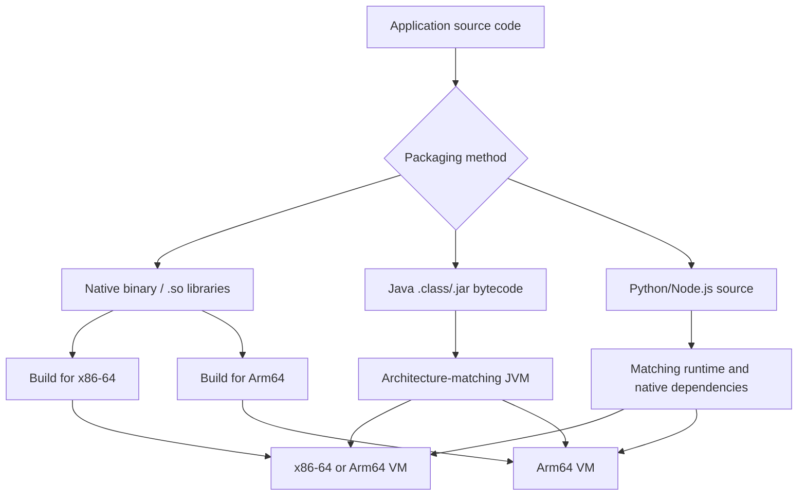
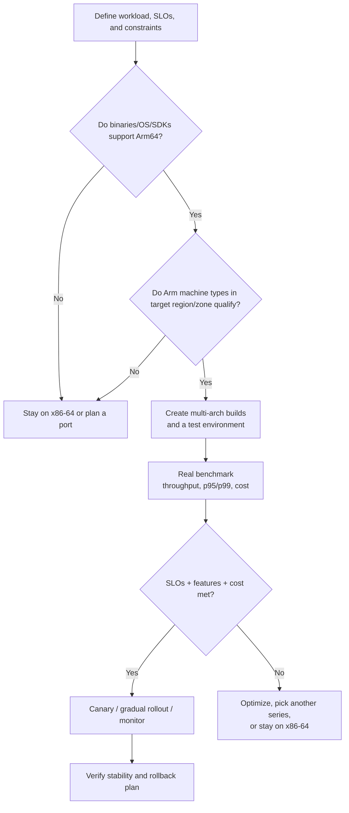
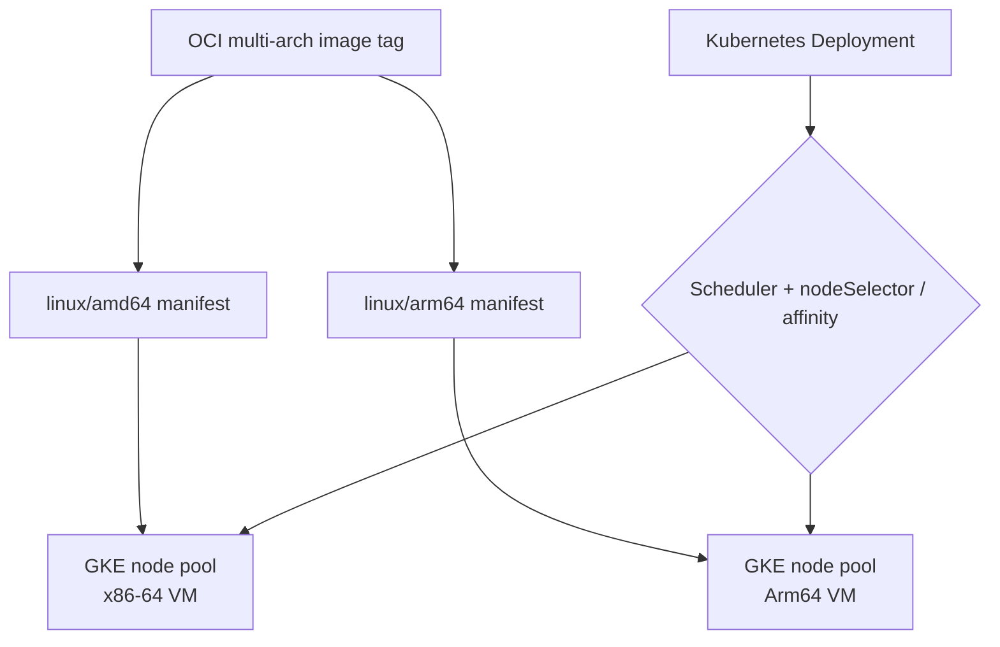

# Choosing a CPU Architecture for Your Workload

When creating a virtual machine on **Google Compute Engine**, picking vCPU count and RAM size solves only part of the problem. Administrators must also decide on the **CPU architecture** (the processor's instruction set architecture): will the application run on **x86-64** or **Arm64**? This decision affects the operating system, executables, native libraries, container images, performance, cost, and the ability to deploy consistently from development to production.

This lesson belongs to the **Compute Engine** chapter of the `CLOUD_PROVIDERS_GCP` module. The module spans Google Cloud from project organization, IAM, and VPC to Compute Engine, GKE, Cloud Run, storage, databases, deployment automation, and reliability/cost monitoring. Within that picture, this lesson focuses on **how to select a CPU architecture based on workload requirements**, rather than picking machines by list price or series name.

## 1. Learning Outcomes

Upon completing this lesson, you will be able to:

1. Explain the difference between **x86-64 / AMD64** and **Arm64 / AArch64**, avoiding confusing CPU architecture with CPU vendor.
2. Inspect Compute Engine **machine series**, machine types, and architecture attributes before deployment.
3. Identify architecture dependencies across **OS images, executables, JVMs, JNI/native libraries, container images, monitoring agents, and drivers**.
4. Select an architecture based on **compatibility, performance, latency, cost, region/zone, security, and operability**.
5. Run machine type and image availability checks with `gcloud`; design a reproducible x86-64 vs. Arm64 evaluation.
6. Compare benchmarks based on **completed units of work and cost**, rather than raw vCPU count or synthetic benchmark scores alone.
7. Recognize risks when migrating workloads between the two architectures, especially with boot disks and container images.
8. Connect VM architecture decisions to **GKE node pools** and runtime constraints of other managed services.

## 2. What Is CPU Architecture Really?

CPU architecture here primarily refers to the **instruction set architecture (ISA)**: how binary software communicates with the processor via instructions, registers, calling conventions, and hardware features. The same program at the source code level can be compiled into **two different binaries** for two ISAs.

| Term | Common Names | Meaning |
| --- | --- | --- |
| **x86-64** | `x86_64`, `amd64`, `AMD64` | 64-bit architecture in the x86 family; includes **Intel and AMD** CPUs |
| **Arm64** | `arm64`, `aarch64`, `AArch64` | 64-bit Arm architecture; Compute Engine offers Arm-based machines |
| **CPU vendor** | Intel, AMD, Google Axion, Ampere | Processor manufacturer/designer, **not** synonymous with ISA |
| **Machine series** | E.g. `N2`, `N2D`, `C4`, `C4D`, `C4A`, `T2A` | Compute Engine machine families; determines resource options and features |
| **Machine type** | E.g. `n2-standard-4` or `c4a-standard-4` | Specific vCPU/RAM configuration within a series |

**Note on the name AMD64:** "AMD" appears due to the ISA's design history; an **Intel Xeon** machine also typically runs Linux where `uname -m` returns `x86_64` and uses `linux/amd64` Docker images. Never conclude that an "amd64 image only runs on AMD CPUs."

Similarly, an Arm64 machine may report:

```text
Linux uname -m:        aarch64
Debian/Ubuntu package: arm64
Docker/OCI platform:   linux/arm64
Go build GOARCH:       arm64
Java os.arch:          aarch64
```

These different labels refer to the same architecture family. Meanwhile, `linux/arm/v7` is **32-bit** Arm and is not equivalent to `linux/arm64`.

### 2.1. Source Code, Bytecode, and Binaries



Pure bytecode Java `.jar` files can generally run on both ISAs **if a compatible JVM is present**. However, JNI libraries (`.so`), native images, Java agents using native code, the OS, and external packages must still match the architecture. For Go, Rust, or C/C++, the application compiles to a native binary and requires a build targeting the right architecture.

A `linux/amd64` binary does not run directly on an `arm64` kernel/CPU. Emulation or binary translation may exist in some environments, but **should not be assumed for production workloads**: feature support, performance, and operational behavior can differ markedly.

## 3. Architecture Options on Compute Engine

Google Cloud offers multiple machine series powered by different CPU platforms. Below are **illustrative examples**, not an exhaustive list, and not a guarantee that every series is available in every zone or release.

| Architecture | Example Machine Series | Typical CPU Platform | What to Evaluate |
| --- | --- | --- | --- |
| **x86-64** | `N2` | Intel Xeon | General-purpose configurations, resources, and compatibility |
| **x86-64** | `N2D` | AMD EPYC | General-purpose configurations and price/performance ratio |
| **x86-64** | `C4` | Intel Xeon | Performance-oriented series; verify disk/network type support |
| **x86-64** | `C4D` | AMD EPYC | Performance-oriented series with AMD CPUs |
| **Arm64** | `C4A` | **Google Axion** | Google-designed Arm CPU; evaluate benchmarks and Arm64 ecosystem |
| **Arm64** | `T2A` | Ampere Altra | Arm line suited for certain scale-out workloads |

Machine series can also differ in **vCPU counts, RAM/vCPU ratios, Persistent Disk/Hyperdisk support, Local SSDs, network performance, security features, maintenance policies, quotas, and regional availability**. You cannot claim all Arm machines are "faster" or "cheaper" than all x86 machines solely because of the ISA.

### 3.1. CPU Architecture Is Not Machine Family

There are three decision layers:

1. **Architecture:** x86-64 or Arm64 — can the application run at all?
2. **Machine series:** `N2`, `C4A`, `C4D`, etc. — feature set, CPU platform, and workload fit.
3. **Machine type:** specific vCPU/RAM shape — actual resources and cost.

For instance, a Java application might be **compatible** with Arm64, yet require high single-thread CPU performance or a specific disk type not supported by the candidate Arm series in the target zone. In that case, the right decision could still be x86-64 or another suitable Arm series.

### 3.2. Never Compare "1 vCPU = 1 vCPU" Literally

vCPU count is a resource allocation unit, **not a guarantee** of identical instructions per second across CPUs. CPU family, generation, clock speed, memory subsystem, cache, SMT, networking, and real utilization all affect results.

A "4 vCPU, 16 GiB" shape on an x86 machine may not exhibit the same performance profile as "4 vCPU, 16 GiB" on an Arm machine. A fair comparison requires matching:

- The same **workload** and software versions.
- The same application resource limits.
- Equivalent placement and network conditions.
- The same dataset size, concurrency, and I/O constraints.
- The same SLO, throughput, and cost metrics over the measurement window.

## 4. Software Compatibility Comes First

A cost optimization is worthless if critical binaries, runtimes, or agents cannot run reliably.

### 4.1. Operating Systems, Images, and Packages

For a VM, the **boot disk image must match the architecture** of the machine series. You cannot simply switch an x86-64 image's machine type to Arm64 and expect it to boot normally.

| Component | Question to Answer |
| --- | --- |
| OS image | Does the image have `architecture=ARM64` or `X86_64` matching the machine? |
| Kernel/drivers | Are the kernel and drivers supported by the image provider? |
| Package repositories | Do required packages provide `arm64` or `amd64` builds? |
| System agents | Do Cloud Ops Agent, security/EDR agents, and backup agents offer builds for the target architecture? |
| Ops tooling | Do debuggers, profilers, scanners, and monitoring exporters support the target machine? |
| Licensed software | Is licensing tied to CPU, core count, processor type, or platform? |

On Debian/Ubuntu, run `dpkg --print-architecture` to inspect package architecture; on RPM-based Linux, use `rpm --eval '%{_arch}'`. Distributions maintain separate Arm image policies and catalogs. **Never assume an Arm image exists** just because an x86 image does.

### 4.2. Third-Party Libraries and Native Code

Dependencies that commonly block Arm64 adoption:

- C/C++ libraries shipping `.so`/`.a` files or executables built only for x86.
- Python **wheel** modules with native extensions lacking `aarch64` wheels.
- Node.js modules relying on native addons or prebuilt binaries.
- Database drivers or encryption libraries bound to a native ABI.
- Java **JNI**, Netty native transport, RocksDB JNI, native compression/crypto libraries, and profiling/observability agents.
- Docker base images or Dockerfiles fetching a binary via a hard-coded `amd64` URL.
- Applications assuming specific CPU instructions like x86 AVX, or embedding inline assembly/SIMD without Arm fallbacks.

For example, pure Python code might not need recompilation, yet packages like `numpy`, `cryptography`, or an imaging library include platform-specific binaries. Verify the **entire dependency graph**, not just your main application source code.

### 4.3. Java and Spring Boot

Java is a strong example of portability **at the bytecode level**, but not every layer of the stack is portable:

```text
Spring Boot JAR
  ├─ JVM bytecode: generally portable
  ├─ JDK/JRE: must have a Linux x86-64 or Linux AArch64 build
  ├─ JNI/native libraries: must provide architecture-specific .so files
  ├─ Java agents: must check support matrix
  └─ Container base image: needs multi-arch or matching platform manifest
```

Modern JDK releases provide Linux AArch64 builds from major vendors; choose a **supported and security-patched** build. Keep the Java version, GC, heap settings, and application identical when benchmarking. If using **GraalVM Native Image**, the resulting binary is native machine code for the target architecture rather than a portable `.jar`; CI/build pipelines must produce artifacts for each supported target.

Command to inspect Java once a JDK is installed on the VM:

```bash
java -XshowSettings:properties -version 2>&1 \
  | grep -E 'java.version|java.vendor|os.arch|os.name'
```

On x86-64, `os.arch` is typically `amd64`; on Arm64, it is typically `aarch64`. Do not conclude "Java works" solely because `java -version` succeeds — start the **real application**, exercise API paths, run tasks invoking native libraries, and inspect logs.

## 5. Which Workloads Can Benefit from Arm64?

Arm64 is not limited to mobile or embedded devices. On Compute Engine, Arm can fit backend services, batch processing, cloud-native applications, and scale-out workloads with an established Arm64 ecosystem.

| Workload | Arm64 Is Worth Testing When | Must Verify Carefully |
| --- | --- | --- |
| **HTTP API / microservice** | Containers/JDK have Arm64 builds and scale horizontally | p95/p99 latency, TLS, compression, auth, native dependencies |
| **Java/Spring Boot** | Arm64 JDK and Java agents are all supported | JVM warm-up, GC, JNI, Netty native, peak memory |
| **Go / Rust service** | CI builds `linux/arm64` with full test coverage | CGO/FFI, crypto, assembly-specific code |
| **Python web/worker** | Dependencies provide Arm64 wheels or compile cleanly | Native extensions, image size, startup time |
| **Batch/ETL** | CPU-bound, repeatable jobs with few platform ties | Job completion time, throughput, quotas, I/O |
| **Redis or self-managed services** | Version has official Arm builds and support | Memory, networking, persistence, compatibility |
| **Media/image processing** | Codecs/libraries have Arm optimizations | CPU SIMD, plugin architecture, licensing |
| **Systems needing proprietary vendor SDKs** | Vendor ships and supports an Arm64 SDK | Support contract, native libraries/drivers |
| **GPU/HPC/specialized hardware** | Machine/GPU/drivers support the right architecture | CUDA, drivers, machine availability, interconnects |

Do not treat this table as a performance guarantee. A compression library, JVM GC, or crypto module may perform well on architecture A while behaving quite differently on architecture B due to **specific software versions and CPU generations**.

### 5.1. When to Stay on x86-64?

Staying on x86-64 is usually sensible when:

- Proprietary binaries, SDKs, or drivers **only support x86-64**.
- The system is heavily tuned for specific x86 instructions without an available port.
- Build, deploy, monitoring, or backup tooling lacks production-grade Arm64 support.
- Available Arm machine series lack the required disk, network, accelerator, zone, or HA topology.
- Migration time and risk outweigh measured cost savings.
- Workload benchmarks **fail to show net benefit** after accounting for engineering effort, risk, and migration time.

You do not need to force an entire organization onto a single architecture. A platform can run **service A on Arm** and **service B on x86**, provided API contracts, data formats, monitoring, and deployment pipelines are properly governed.

## 6. CPU Architecture Decision Process

Instead of starting from a machine type name, follow this process:



### 6.1. Decision Matrix

Weight criteria according to business needs rather than "which CPU is newer":

| Criterion | Question | Importance |
| --- | --- | --- |
| **Compatibility** | Do the OS, JDK, app binaries, native libs, and security agents run? | **Mandatory prerequisite** |
| **Latency SLO** | Are p95/p99 latency and startup time within limits? | Mandatory for interactive services |
| **Throughput** | RPS, jobs/hour, rows/hour, or MiB/s at target load | Drives cost and scalability |
| **Memory & I/O** | Are RAM, disk throughput/IOPS, and network adequate? | Often the actual bottleneck |
| **Availability** | Do region/zone, quotas, capacity, and HA rules hold? | Mandatory for production |
| **Security** | Are images/JDK/agents patched, and IAM/Shielded VM/required features supported? | Mandatory per policy |
| **TCO** | VM price, licenses, disk/network, plus migration and ops costs | Compare per unit of work |
| **Maintainability** | Do CI, artifacts, tests, on-call, and rollbacks support multi-arch? | Determines long-term sustainability |

An option with a lower hourly price that misses p99 latency or breaks backup agents is **not a good solution**.

## 7. Preparing an x86-64 vs. Arm64 Comparison Lab

This lab guides **verification and selection**, not production deployment. Some commands create VMs that incur charges; execute them only in an **authorized project** on an appropriate subnet and zone.

### 7.1. Input Assumptions

| Variable | Example | Notes |
| --- | --- | --- |
| `PROJECT_ID` | `YOUR_LAB_PROJECT_ID` | Lab project with billing and Compute Engine API enabled |
| `ZONE` | `YOUR_SUPPORTED_ZONE` | Choose a zone offering both planned x86 and Arm machines |
| `SUBNET` | `YOUR_LAB_SUBNET` | Subnet in the zone's region with proper management access |
| `X86_TYPE` | `n2-standard-4` | Example only: x86-64, 4 vCPU shape |
| `ARM_TYPE` | `c4a-standard-4` | Example only: Arm64, 4 vCPU shape |
| `X86_IMAGE_FAMILY` | `debian-12` | x86 image from project `debian-cloud` |
| `ARM_IMAGE_FAMILY` | `debian-12-arm64` | Arm64 image from project `debian-cloud` if available |

There is **no guarantee** these exact machine type and image family pairs are available together in your zone. Always run discovery checks first. If a configuration does not exist or does not fit, select another series/zone per current documentation rather than forcing an architecture change onto an old image.

VMs **without an external IP** are safer in many environments, though they require management access such as IAP TCP forwarding or VPN along with matching firewall and IAM rules. Never open SSH `0.0.0.0/0` just to reach a test VM.

### 7.2. Checking CLI and Project (Read-Only)

```bash
PROJECT_ID="YOUR_LAB_PROJECT_ID"
ZONE="YOUR_SUPPORTED_ZONE"
SUBNET="YOUR_LAB_SUBNET"

X86_TYPE="n2-standard-4"
ARM_TYPE="c4a-standard-4"
X86_IMAGE_FAMILY="debian-12"
ARM_IMAGE_FAMILY="debian-12-arm64"

gcloud --version
gcloud auth list

gcloud projects describe "$PROJECT_ID" \
  --format="yaml(projectId,projectNumber,lifecycleState)"

# Machine types currently listed for your chosen zone.
gcloud compute machine-types list \
  --project="$PROJECT_ID" \
  --zones="$ZONE" \
  --format="table(name,guestCpus,memoryMb,zone.basename())"
```

Look for `n2-standard-4` and `c4a-standard-4` in the output. If either is missing, **do not run** the VM creation commands. Beyond the machine type list, check **quotas/capacity** and organization policy constraints; seeing a machine type listed does not guarantee quota or capacity to provision an instance.

### 7.3. Verifying Machine Specs and OS Images

```bash
# Read-only inspection of selected machine types.
gcloud compute machine-types describe "$X86_TYPE" \
  --project="$PROJECT_ID" \
  --zone="$ZONE" \
  --format="yaml(name,guestCpus,memoryMb)"

gcloud compute machine-types describe "$ARM_TYPE" \
  --project="$PROJECT_ID" \
  --zone="$ZONE" \
  --format="yaml(name,guestCpus,memoryMb)"

# Latest image in the image family provided by Debian Cloud.
gcloud compute images describe-from-family "$X86_IMAGE_FAMILY" \
  --project="debian-cloud" \
  --format="yaml(name,architecture,status,creationTimestamp)"

gcloud compute images describe-from-family "$ARM_IMAGE_FAMILY" \
  --project="debian-cloud" \
  --format="yaml(name,architecture,status,creationTimestamp)"
```

For the x86 image, `architecture` must show `X86_64`; for the Arm image, it must show `ARM64` per API values. If an image family, OS version, or machine type is unavailable, pick a supported image with the **matching ISA** rather than skipping verification.

### 7.4. Checking VPC/Subnets, IAM, and Name Collisions

```bash
# Read-only subnet listing; verify region/CIDR and management path.
gcloud compute networks subnets list \
  --project="$PROJECT_ID" \
  --format="table(name,region.basename(),network.basename(),ipCidrRange)"

# Check for existing VMs with the same names before creating.
gcloud compute instances list \
  --project="$PROJECT_ID" \
  --filter="name=(arch-lab-x86 arch-lab-arm)" \
  --format="table(name,zone.basename(),status,machineType.basename())"
```

Confirm these prerequisites before creating VMs: IAM permissions to create VMs and use the subnet, CPU quota/reservations, boot image policies, connectivity without a public IP, billing ownership, and no name conflicts with existing workloads. If using Shared VPC, verify host/service projects and `compute.networkUser` permissions.

## 8. Creating Two Lab VMs with Matching Architectures

**The commands below modify Google Cloud resources and incur charges.** Run them only after preflight checks pass, with the right project/zone/subnet and authorization. Use one VM per ISA; this is an initial validation, not a final benchmark.

### 8.1. x86-64 VM

```bash
gcloud compute instances create "arch-lab-x86" \
  --project="$PROJECT_ID" \
  --zone="$ZONE" \
  --machine-type="$X86_TYPE" \
  --image-family="$X86_IMAGE_FAMILY" \
  --image-project="debian-cloud" \
  --boot-disk-size="20GB" \
  --subnet="$SUBNET" \
  --no-address \
  --labels="purpose=cpu-arch-lab,environment=dev"
```

### 8.2. Arm64 VM

```bash
gcloud compute instances create "arch-lab-arm" \
  --project="$PROJECT_ID" \
  --zone="$ZONE" \
  --machine-type="$ARM_TYPE" \
  --image-family="$ARM_IMAGE_FAMILY" \
  --image-project="debian-cloud" \
  --boot-disk-size="20GB" \
  --subnet="$SUBNET" \
  --no-address \
  --labels="purpose=cpu-arch-lab,environment=dev"
```

These commands select specific test parameters. In real deployments, Compute Engine may require additional flags depending on machine series, image, disk, or organization policies. In tightly governed environments, specify a **least-privilege runtime service account** (or omit the SA if appropriate for the workload) and review access scopes/metadata. Never grant Editor to the default service account just to run a CPU benchmark.

### 8.3. Inspecting Both VMs

```bash
gcloud compute instances describe "arch-lab-x86" \
  --project="$PROJECT_ID" \
  --zone="$ZONE" \
  --format="yaml(name,status,machineType,disks,networkInterfaces)"

gcloud compute instances describe "arch-lab-arm" \
  --project="$PROJECT_ID" \
  --zone="$ZONE" \
  --format="yaml(name,status,machineType,disks,networkInterfaces)"
```

A VM in the `RUNNING` state does **not** mean the OS has finished booting, the application is ready, or the network path is reachable. Inspect boot logs, SSH/IAP, startup scripts, and service health when authorized.

## 9. Verifying Architecture Inside the Guest OS

Once a proper SSH/IAP path is ready, run on each VM:

```bash
# ISA reported by the Linux kernel to user space.
uname -m

# CPU details recognized inside the guest OS.
lscpu

# Package architecture on Debian/Ubuntu.
dpkg --print-architecture

# Linux distribution details.
cat /etc/os-release
```

Expected output mapping:

| Machine | `uname -m` | `dpkg --print-architecture` | OCI Platform for Containers |
| --- | --- | --- | --- |
| x86 VM | `x86_64` | `amd64` | `linux/amd64` |
| Arm VM | `aarch64` | `arm64` | `linux/arm64` |

You can run commands over SSH from Cloud Shell or an admin workstation configured with IAP, IAM, and firewall rules:

```bash
# Example works only when IAP TCP forwarding is prepared.
gcloud compute ssh "arch-lab-x86" \
  --project="$PROJECT_ID" \
  --zone="$ZONE" \
  --tunnel-through-iap \
  --command="uname -m"

gcloud compute ssh "arch-lab-arm" \
  --project="$PROJECT_ID" \
  --zone="$ZONE" \
  --tunnel-through-iap \
  --command="uname -m"
```

IAP is **an access mechanism**, not automatically enabled when a VM is created. It requires IAP permissions, OS Login/SSH keys matching project policies, and necessary firewall rules. If no management path exists, ask an administrator to configure a secure path; do not expose the VM with an unrestricted public IP.

### 9.1. Distinguishing Host CPU from Guest VM Info

`lscpu` shows the CPU, ISA, and flags exposed to the guest, not the full capabilities of the physical host, and does not replace machine series documentation. Certain CPU flags may be restricted by platform/virtualization, especially for specialized instruction sets. To choose SIMD paths (AVX2/AVX-512/NEON/SVE…), **check actual runtime flags and behavior** rather than guessing from a series name.

## 10. Building Multi-Architecture Containers

Many Compute Engine/GKE workloads are packaged as OCI containers. Container images typically embed ISA-specific binaries and libraries; a single tag does not automatically support both architectures.

### 10.1. Image Tags and Image Manifests

```text
registry.example.com/team/api:1.4
  ├─ linux/amd64 -> image digest for x86-64
  └─ linux/arm64 -> image digest for Arm64
```

A **multi-platform image** uses a manifest index so the runtime pulls the image matching the node's architecture. If a tag only contains `linux/amd64`, pulling it on an Arm VM/node can cause an unsupported platform error or `exec format error` when executing binaries.

Inspect a manifest with:

```bash
docker buildx imagetools inspect \
  "REGISTRY_HOST/PROJECT/REPOSITORY/IMAGE:TAG"
```

This command is read-only against the registry if Docker Buildx and registry credentials are present; substitute placeholders and verify whether both `linux/amd64` and `linux/arm64` exist.

### 10.2. Java Dockerfile Example

Illustrative template for a Java app packaged as `app.jar`:

```dockerfile
FROM eclipse-temurin:21-jre
WORKDIR /app
COPY app.jar /app/app.jar
USER 10001
EXPOSE 8080
ENTRYPOINT ["java", "-jar", "/app/app.jar"]
```

Verify that the **actual base image tag** provides manifests for both `amd64` and `arm64` before use; never assume every variant tag is multi-arch. If `app.jar` contains pure Java bytecode, a multi-platform image can reuse the JAR, whereas if the JAR bundles native libs or agents, the pipeline must package ISA-matching builds.

Multi-platform build command (builds and pushes artifacts to a registry you own):

```bash
# Writes to registry: requires a multi-platform-capable builder
# and push permissions; do not run against someone else's registry.
docker buildx build \
  --platform linux/amd64,linux/arm64 \
  --tag "REGISTRY_HOST/PROJECT/REPOSITORY/IMAGE:TAG" \
  --push .
```

Buildx may use QEMU emulation or native build nodes depending on configuration. **A successful build does not prove good benchmark performance** and does not guarantee all native dependencies behave properly. Run unit and integration tests on **native machines matching the target architecture** for critical workloads.

### 10.3. Go, Rust, and C/C++

Pure Go can cross-compile for both targets:

```bash
GOOS=linux GOARCH=amd64 go build -o app-linux-amd64 ./cmd/app
GOOS=linux GOARCH=arm64 go build -o app-linux-arm64 ./cmd/app
```

This example applies only if the Go project has `./cmd/app`. With CGO, matching toolchains and native libraries are needed; cross-compiling is not as simple as swapping `GOARCH`. For Rust or C/C++, prepare appropriate cross-targets/toolchains/linkers and equivalent tests. Never copy an `amd64` binary into an `arm64` image by mistake.

## 11. Benchmark the Real Problem, Not Intuition

CPU architecture is only one factor in performance. A meaningful test must reflect **real user or job behavior**.

### 11.1. Defining Workload and Baseline

Consider a Spring Boot order-processing system with:

- Read endpoints querying the database and serializing JSON.
- CPU-bound pricing and promotion calculation endpoints.
- Nightly data aggregation batch jobs.
- Requirement: **p95 latency below the target SLO**, low error rate, and capacity for peak traffic.

Before benchmarking, record:

| Factor | Keep Identical or Record |
| --- | --- |
| App | Commit, JAR/image digest, feature flags |
| Runtime | Java version, GC, heap, thread pools |
| Data | Dataset, payload size, cache hit ratio, database state |
| Network | Client/server region/zone, VPC path, TLS, LB if present |
| VM | CPU architecture, machine type, vCPU/RAM, disk, network |
| Load | Concurrency, target RPS, warm-up duration, ramp-up |
| Results | RPS, p50/p95/p99, CPU%, RSS/heap, GC pauses, error rate |
| Cost | VM duration, disk/network, licenses, monitoring, applicable rates |

If each VM hits a database in a different region, API results may reflect **network latency** rather than CPU capability. For I/O-bound workloads, switching CPU architecture may matter far less than increasing IOPS or colocating data with the application.

### 11.2. Warm-Up and Repeated Runs

Especially for the JVM:

1. Start the app and verify health checks pass.
2. Run a **warm-up** phase so JIT compilation and caches reach steady state.
3. Run the identical request/input set and concurrency on each VM.
4. Repeat across multiple runs, recording latency and CPU utilization.
5. Eliminate test harness, deployment, or network errors; keep unexpected results for analysis.
6. Compare **variance/spread** rather than cherry-picking a single best run.

Do not rely solely on a CPU stress test or `openssl speed` if your real workload depends on databases or HTTP. Microbenchmarks help spot anomalies, but **business transactions** are the deciding unit.

### 11.3. Limited Illustrative Microbenchmark

If both VMs have Python 3 installed, the small snippet below illustrates measuring compute speed. It benchmarks the hashing library in the current environment, **not a general-purpose benchmark of all CPUs**.

```python
import hashlib
import platform
import time

payload = b"cloud-benchmark" * 32768  # ~0.5 MiB
rounds = 2000

start = time.perf_counter()
checksum = b""
for _ in range(rounds):
    checksum = hashlib.sha256(payload).digest()
elapsed = time.perf_counter() - start

processed_mib = len(payload) * rounds / (1024 * 1024)
print("architecture:", platform.machine())
print("seconds:", round(elapsed, 3))
print("MiB/s:", round(processed_mib / elapsed, 2))
print("digest_prefix:", checksum.hex()[:12])
```

Run the **same interpreter/library version** and round count on both VMs. Results depend on OpenSSL, SIMD instructions, crypto acceleration, VM scheduling, and CPU frequency. Do not extrapolate this `MiB/s` number into real HTTP/API throughput or production cost.

### 11.4. Application Load Testing

If the application has an authorized lab test endpoint, drive load using tools like `hey`, `wrk`, or `k6` from an **independent load generator**:

```text
1. Pick a test endpoint that creates no real financial transactions.
2. Fix request rate/concurrency and warm-up duration.
3. Run 5 trials on x86; save latency histograms and error rates.
4. Run 5 trials on Arm; use the exact same dataset and request mix.
5. Compare p95/p99, throughput, CPU/RAM, GC, and network.
6. Adjust machine size if bottlenecks are not comparable.
```

Never load test production or third-party endpoints without authorization. The **load generator** itself has CPU/network limits; if the generator saturates, both servers may appear "equal" despite differing capacity.

## 12. Calculating Performance per Unit Cost

**A lower hourly price does not necessarily mean lower cost for the entire workload.** If a VM processes work more slowly, you may need more instances or larger shapes.

Assume these **hypothetical** figures, not current Google Cloud prices:

| Option | Assumed VM Price | Throughput Meeting SLO | VM Cost per 1 Million Requests* |
| --- | --- | --- | --- |
| x86-64 | 0.20 USD/hour | 100 req/s | Approx. 0.56 USD |
| Arm64 | 0.16 USD/hour | 110 req/s | Approx. 0.40 USD |

\*Assumes instances run continuously at the stated throughput without traffic variation and ignores other costs; numbers **only illustrate the formula**.

Formula:

\[
\text{VM cost per 1 million requests}
=
\frac{\text{Hourly VM price} \times 10^6}
{\text{SLO-compliant requests/sec} \times 3600}
\]

Real numbers must be checked by **machine series, region, VM size, provisioning model, runtime duration, and discount policies**. Add Persistent Disk, Hyperdisk/Local SSD, egress, load balancers, logging, licenses, and operations; managed services like Cloud SQL bill separately and should not be attributed to VM architecture.

### 12.1. Measuring "Cost per Job" for Batch Workloads

An ETL job processes 100 GiB of data:

- Machine A has a lower hourly rate but finishes in 6 hours.
- Machine B has a higher hourly rate but finishes in 2 hours.

VM cost for each option is **hourly price × runtime hours**; then add disk/network/storage and startup overhead. Also factor in failure rates and retry costs. If the batch SLA window is 3 hours, Machine A fails the SLO even if its headline cost looks attractive.

### 12.2. Accounting for TCO When Switching Architectures

Migrating to Arm may require:

- Updating CI/CD build pipelines to publish `linux/arm64`.
- Purchasing or upgrading software/agents with Arm support.
- Adding unit, integration, and canary tests for the new architecture.
- Handling native libraries, container packaging, and security scanning.
- Rehearsing rollbacks, backups, and runbooks.
- Training on-call operations staff and confirming support contracts.

Do not ignore these upfront and ongoing costs when deciding to migrate based solely on a monthly VM list-price gap.

## 13. How Do Security and Operations Differ?

CPU ISA **does not by itself make** one machine more secure than another. Security depends on **patched OS/JDK**, kernel, runtime, image supply chain, IAM, VPC/firewalls, service accounts, disk encryption, and specific VM features.

| Control Layer | Question When Choosing Arm64 or x86-64 |
| --- | --- |
| OS patches | Does the image provider actively release security updates for this architecture? |
| Firmware/boot | Are Shielded VM, Secure Boot, and vTPM/integrity monitoring supported on the planned machine/config? |
| Confidential Computing | Do the machine series/zone and Confidential VM features support it? |
| IAM/service account | Does the VM hold only workload-scoped permissions and avoid static keys? |
| Network | Do firewalls, private IPs, IAP/NAT, and logging work as designed? |
| EDR/backup agents | Are matching ISA artifacts available and vendor-supported? |
| Supply chain | Are base images, packages, native binaries, and SBOMs verified for the architecture? |
| Observability | Are metrics, tracing, profiling, and crash dumps readable on the new ISA? |

Some VM security features are restricted to specific machine series, rather than "all x86" or "all Arm." Before applying a production security baseline, cross-check your **chosen machine type and image** against feature support documentation.

## 14. Is Migrating an x86-64 VM to Arm64 Just a Machine Type Change?

**Never treat this as a single `machineType` field edit.** Because boot disks and executables are ISA-dependent, the safe approach is usually to **create a new Arm64 VM with an Arm64 OS image**, deploy the Arm-built/tested application version, and shift traffic/data in a controlled manner.

### 14.1. Reference Migration Process

1. **Inventory:** list source VM OS, machine type, architecture, disks, service account, firewalls, routes, startup scripts, agents, and licenses.
2. **Compatibility matrix:** validate the app, native deps, images, JDK, and backup/monitoring on Arm.
3. **Data plan:** use an external database, storage service, or supported data transfer; never try to boot an x86 boot image on an Arm CPU.
4. **Build:** publish Arm64 images/binaries with traceable digests/versions.
5. **Canary:** create the Arm VM, deploy test data, and run health/integration tests.
6. **Benchmark:** measure p95/p99, throughput, memory, disk/network, and cost.
7. **Cutover:** shift a portion of traffic via a load balancer/MIG or appropriate routing mechanism.
8. **Observe:** monitor SLOs, error counts, CPU/GC, database behavior, and cost metrics.
9. **Rollback:** keep the x86 VM and prior configuration long enough to revert traffic if issues arise.
10. **Cleanup:** remove old x86 VMs and legacy artifacts only after confirming zero remaining dependencies.

**Data Persistent Disks** can sometimes be moved/attached per disk type capabilities and limits, but you must verify filesystems, partitions, mount options, database recovery, encryption, and application compatibility. An x86-64 boot disk does not become an Arm64 boot disk simply by reattaching it.

### 14.2. Downtime and State

Stateless applications behind a load balancer are much easier to canary than stateful VMs holding local data. If an app writes local state, plan synchronization/backups and test restores. Never let two VMs concurrently write to the same disk or local database state unless explicitly architected for it.

### 14.3. Managed Instance Groups and Autoscaling

When a workload runs under a **Managed Instance Group (MIG)**, architecture selection is expressed through the machine type and boot image of the **instance template**. To change ISA, create a new instance template, validate with a canary or separate MIG, and execute a rolling/canary update using a tested strategy. Avoid replacing production fleets in one big bang without a rollback path.

## 15. GKE Node Pools and Container Architecture

GKE is an orchestration layer built on Compute Engine. If GKE uses an Arm64 machine series for a node pool, Pods must run container images and agents compatible with the node architecture.

### 15.1. Multi-Architecture Deployment Diagram



Example forcing the scheduler onto Arm64 nodes:

```yaml
apiVersion: apps/v1
kind: Deployment
metadata:
  name: orders-api-arm
spec:
  replicas: 2
  selector:
    matchLabels:
      app: orders-api-arm
  template:
    metadata:
      labels:
        app: orders-api-arm
    spec:
      nodeSelector:
        kubernetes.io/arch: arm64
      containers:
        - name: orders-api
          image: REGISTRY_HOST/PROJECT/REPOSITORY/orders-api:multiarch
          ports:
            - containerPort: 8080
```

The standard Kubernetes label `kubernetes.io/arch` typically takes `amd64` or `arm64`. If the cluster lacks matching Arm64 nodes, Pods remain `Pending` due to scheduling failure. If the image tag lacks an Arm64 manifest or contains incompatible native code, Pods suffer image pull errors or crashes. Verify DaemonSets (logging, security, CNI/CSI), CSI drivers, operators, and team-deployed GKE add-ons.

**Do not assume every GKE mode or every Arm machine type is supported**; series availability, regions, node auto-provisioning, and features vary across GKE modes and versions. Consult GKE Arm documentation before building production clusters.

### 15.2. Cloud Run Is Not a Compute Engine VM with Selectable CPU ISA

Cloud Run is a managed service where users do not select Compute Engine machine series directly. Cloud Run's container runtime enforces its own **architecture and container contract**, which must be checked in current Cloud Run docs before pushing images. Having a multi-architecture image does not mean Cloud Run can run whichever ISA the image happens to provide.

Therefore, "migrating VMs from x86 to Arm" does not automatically imply "Cloud Run backends also switch to Arm"; the two products have different support matrices and runtime contracts.

## 16. Choosing CPU Architecture for Typical Workload Profiles

### 16.1. Java API Serving Users in Vietnam

Assume the app runs in a Southeast Asia region, calling Cloud SQL and Redis with peak traffic spikes. Approach:

- Verify an Arm64 JDK and all JNI/native modules and monitoring agents.
- Build the exact same JAR and standard container image for both ISAs.
- Place benchmark clients, database, and cache so baseline network latency is equivalent.
- Replay realistic workloads with production-like read/write endpoint ratios.
- Measure p95/p99 under autoscaling and JVM warm-up, not just average throughput.
- Choose the machine meeting SLOs with better cost/request and simpler incident operability.

If CPU utilization is low while latency comes from the database, switching ISA may yield little benefit. Optimizing queries, connection pools, and networking can matter much more.

### 16.2. Nightly Data Processing Job

A batch job reads files from Cloud Storage, decompresses, processes, and writes outputs:

- Check whether algorithms rely on ISA-specific native codecs or SIMD.
- Measure total job runtime and error/retry rates, not raw CPU speed alone.
- Separate **data download/upload time** from **compute time**.
- If work partitions cleanly, test parallel workers on Arm VMs to compare cost/job.
- Check quotas, capacity, and Spot VMs if the job can safely stop and retry.

Spot VM is a **provisioning model**, not an architecture; never use Spot vs. on-demand price differences to claim one CPU ISA is inherently more efficient.

### 16.3. Services with Proprietary Binaries, Licenses, or Special Drivers

Ask the vendor:

1. Do you officially release and support Linux AArch64/Arm64 builds?
2. Are our exact Linux distro and kernel/JDK versions supported?
3. Does per-core/per-vCPU licensing change when running on Arm?
4. Are monitoring, backup, failover, and crypto modules compatible?
5. During a production incident, will vendor support cover this stack?

If answers are unclear or only x86 binaries exist, keeping x86-64 is lower risk until full support is confirmed.

## 17. Monitoring After Switching Architectures

Pre-deployment benchmarks are necessary but not sufficient. After canary/cutover, monitor at least:

| Metric | What It Reveals |
| --- | --- |
| **Availability/error rate** | Runtime errors, native library failures, OOMs, or dependency issues |
| **p50/p95/p99 latency** | Real impact on end-user experience |
| **Throughput at SLO** | Capacity to handle work within quality targets |
| **CPU utilization** | Remaining headroom or saturation |
| **Memory RSS/heap/GC** | Whether JDK/allocator/GC behaves differently |
| **Disk IOPS/throughput** | Whether I/O is bottlenecked |
| **Network throughput/latency** | Network bottlenecks skewing CPU conclusions |
| **Cost/request or cost/job** | Real financial benefit |
| **Quota/capacity** | Ability to scale out to more instances |
| **Security/backup agent status** | Whether mandatory operational agents remain healthy |

Google Cloud Monitoring and Logging expose many VM metrics, though granularity depends on enabled metrics and agents. For example, **guest memory usage** may require Ops Agent. Never treat "the VM emits logs" as proof that the app, EDR, and backups are all working.

### 17.1. When to Roll Back?

Example triggers:

- Error rate exceeds error budget/SLO.
- p99 latency breaches agreed thresholds at peak load.
- Required native libraries or agents fail to run.
- Failover HA/capacity cannot be met in backup zones.
- Actual cost or operational overhead exceeds targets.

Rollback should route traffic back to the still-running x86 version, preserve data compatibility, and monitor until stable. **Never delete x86 resources immediately after one successful test.**

## 18. Common Issues and Troubleshooting

| Symptom | Likely Cause | How to Check |
| --- | --- | --- |
| `gcloud` cannot find Arm machine type | Series unsupported in zone, typo, or type retired | `machine-types list --zones=...`, series docs |
| VM creation fails with image incompatible | x86 image paired with Arm machine type or vice versa | `images describe-from-family`, `architecture` field |
| VM boots but binary throws `Exec format error` | Native executable built for wrong ISA | `file binary`, `uname -m`, OCI manifest |
| Python package fails to install | Missing Arm wheel or native build toolchain | PyPI wheel/platform tags, build logs, system libs |
| Java app throws `UnsatisfiedLinkError` | JNI/native `.so` built for wrong ISA or missing deps | Stack trace, `file`/`ldd`, package version |
| Container pulls but crashes on start | Wrong image variant or base image missing architecture | OCI manifest, app logs, container runtime |
| Arm benchmark unexpectedly slow | Cold start/JIT, CPU bottleneck, unoptimized lib, unfair test | Warm-up, profiling, flags, dataset/regions |
| Lower VM price yet higher cost/job | Job takes longer, I/O-bound, or needs more instances | Measure throughput at SLO and cost/job |
| GKE Pod `Pending` on Arm | Node selector/taints, missing Arm nodes, or quota | `kubectl describe pod`, node allocatable/arch |
| Cannot SSH to VM | Private IP without matching IAP/VPN/firewall/OS Login | Network, IAM, serial console, logs |
| Moving x86 boot disk to Arm fails to boot | Boot disk is ISA-incompatible | Use fresh Arm OS image and migrate data |
| App runs but agent reports no metrics | Ops/security/backup agent lacks Arm support | Support matrix, deployment/agent logs |
| Series only available in certain zones | Hardware availability, quota/capacity, or service limits | Region/zone lookup and quotas before rollout |

## 19. Cleaning Up Lab Resources and Avoiding Surprise Bills

If the two lab VMs were actually created, verify their names, project, and zone and ensure no workloads or data depend on them before deletion.

### 19.1. Inspecting Resources Again (Read-Only)

```bash
gcloud compute instances list \
  --project="$PROJECT_ID" \
  --filter="name=(arch-lab-x86 arch-lab-arm)" \
  --format="table(name,zone.basename(),status,machineType.basename())"

gcloud compute disks list \
  --project="$PROJECT_ID" \
  --format="table(name,zone.basename(),sizeGb,users)"
```

### 19.2. Deleting Lab VMs (Destructive Action)

**Run only if both VMs were created by this lab, needed data is saved, and deletion is authorized**:

```bash
gcloud compute instances delete "arch-lab-x86" \
  --project="$PROJECT_ID" \
  --zone="$ZONE"

gcloud compute instances delete "arch-lab-arm" \
  --project="$PROJECT_ID" \
  --zone="$ZONE"
```

Verify boot disk deletion settings and check any remaining disks per data retention policy. Disks may persist depending on `autoDelete` or attachment settings; never assume deleting a VM automatically removes all disks, snapshots, images, or logs. Remaining resources can continue incurring charges.

If you only want to **stop** a machine, `gcloud compute instances stop` stops CPU compute billing in many cases, yet **Persistent Disks, unused static IPs, and ancillary resources** may keep billing. Never equate "VM `TERMINATED`/STOPPED" with "zero cost."

## 20. Practice Exercises

### Exercise 1 – Identifying ISA

An Intel Xeon VM reports `uname -m = x86_64`. A Docker image specifies platform `linux/amd64`.

**Question:** Must this image run only on an AMD CPU?

*Guided answer:* No. `amd64` is the name for the x86-64 architecture, supported on compatible Intel and AMD CPUs.

### Exercise 2 – Is Java Bytecode Enough?

A Spring Boot application packaged as a JAR runs on x86; it uses a JNI RocksDB native library and a security agent released only for Linux x86-64.

**Question:** Can you migrate immediately to an Arm VM simply by changing the machine type?

*Guided answer:* No. You need an Arm64 JDK, Arm64 builds (or alternatives) for RocksDB JNI and the security agent, an Arm64 boot image, plus functional and operational testing. Never just change the machine type.

### Exercise 3 – Proper Cost Comparison

VM A costs 0.25 USD/hour and serves 150 req/s at target p95. VM B costs 0.18 USD/hour and serves 90 req/s at the same p95.

**Question:** Which machine has a lower VM cost per 1 million requests under continuous load assumptions?

*Guided answer:*

- A: \(0.25 \times 10^6/(150 \times 3600) \approx 0.463\) USD/million requests.
- B: \(0.18 \times 10^6/(90 \times 3600) \approx 0.556\) USD/million requests.

Even though B's hourly price is lower, A has a lower VM cost per million requests under these assumptions. Disk, network, licensing, scaling, and variable traffic are excluded.

### Exercise 4 – Single-Architecture Image

A GKE Deployment specifies `kubernetes.io/arch: arm64`, but the Docker manifest only includes `linux/amd64`.

*Guided answer:* CI must build/push an Arm64 image or multi-platform manifest and verify dependencies. Otherwise, Arm nodes cannot run the image even though the scheduler selected the right node.

### Exercise 5 – Why API Benchmarks Fail to Reflect CPU

A team places Arm and x86 VMs in two different regions, both querying a database located near the x86 VM. Arm latency looks worse.

*Guided answer:* The comparison is skewed by network/database latency. Design an equivalent benchmark, isolate CPU-bound segments alongside p95/p99, colocate backends, or compare within the same region and equivalent network paths.

### Exercise 6 – Arm in CI/CD Yet Cloud Run Fails

A team built a multi-arch image and assumed every Google Cloud service can run `linux/arm64`.

*Guided answer:* Always verify the runtime contract and architecture support of **each managed service**. Compute Engine VMs and GKE nodes allow selecting machine series in supported configurations, whereas Cloud Run has its own runtime contract.

### Exercise 7 – Stateful Migration

An x86 VM holds a database on its boot disk; the team wants to switch to Arm and delete the old VM immediately after deployment.

*Guided answer:* High risk of data loss and OS image incompatibility. Require tested backup/restore, data migration, a fresh Arm build, canary testing, consistency checks, controlled cutover, and rollback; delete the source VM only once zero dependencies remain.

### Exercise 8 – Choosing by Business Requirements

An internal service runs only 2 hours/week and relies on a vendor binary released exclusively for x86-64; Arm machines are 20% cheaper per hour.

*Guided answer:* Arm is not a valid option if the vendor binary is incompatible and no supported alternative exists. Keep x86 or re-evaluate the software solution, while optimizing schedule and VM sizing.

## 21. Checklist Before Finalizing CPU Architecture

- [ ] Documented requirements for **OS, runtime, native libraries, licenses, and agents**.
- [ ] Distinguished x86-64/AMD64 from CPU vendor AMD; Arm64 from AArch64.
- [ ] Verified machine series/type availability in the **region/zone** and confirmed quotas/capacity.
- [ ] Verified **OS image architecture** matches the machine's ISA.
- [ ] If containerized, verified image manifests include `linux/amd64` and/or `linux/arm64`.
- [ ] Verified compatible builds for JVM/JNI/native libs, drivers, security agents, and backup agents.
- [ ] Checked CPU flags/SIMD if workloads optimize for specific instruction sets.
- [ ] Executed real application benchmarks measuring throughput at SLO and p95/p99, not microbenchmarks alone.
- [ ] Calculated **cost/request or cost/job** including disks, network, licenses, and operations.
- [ ] Checked disk/network/feature/security support for the specific **machine series**.
- [ ] For GKE, verified node architecture, scheduler rules, DaemonSets/agents, and container images align.
- [ ] For managed services like Cloud Run, verified architecture support independently rather than assuming parity with Compute Engine.
- [ ] For migrations, prepared **new builds, canary, data plan, rollback**, and an observation window.
- [ ] Enabled sufficient logging/metrics to detect shifts in latency, GC, errors, and cost.
- [ ] After lab exercises, cleaned up unused VMs/disks/snapshots and checked for residual charges.

## 22. Official Google Cloud Documentation and References

- [Compute Engine machine families](https://cloud.google.com/compute/docs/machine-resource): machine family characteristics, machine types, and resources.
- [Arm-based VMs on Compute Engine](https://cloud.google.com/compute/docs/instances/arm-on-compute): Arm series, compatibility, and deployment steps.
- [General-purpose machine series](https://cloud.google.com/compute/docs/general-purpose-machines): specifications for N2/N2D/C4A and newer supported lines.
- [Compute-optimized machine series](https://cloud.google.com/compute/docs/compute-optimized-machines): performance-optimized series and features.
- [Public OS images](https://cloud.google.com/compute/docs/images/overview): image families, OS support, and image architecture.
- [Create and start a VM instance](https://cloud.google.com/compute/docs/instances/create-start-instance): commands to create VMs, machine types, boot images, and locations.
- [Machine types gcloud reference](https://cloud.google.com/sdk/gcloud/reference/compute/machine-types): checking machine types in a zone.
- [Images gcloud reference](https://cloud.google.com/sdk/gcloud/reference/compute/images): inspecting images and image families.
- [GKE on Arm](https://cloud.google.com/kubernetes-engine/docs/how-to/arm-on-gke): node architecture support and GKE considerations.
- [Cloud Run container runtime contract](https://cloud.google.com/run/docs/container-contract): container image and execution environment requirements.
- [Compute Engine pricing](https://cloud.google.com/compute/all-pricing): price comparisons by machine series/region and cost components.
- [Google Cloud Architecture Framework](https://cloud.google.com/architecture/framework): system-level performance, cost, reliability, and security.

**Conclusion:** Never ask "Is Arm or x86 better?" in absolute terms. Ask **"Does this workload run correctly, meet its SLOs, deliver a better cost per unit of work, and remain supportable by our ops team throughout its lifecycle?"**. The right CPU architecture satisfies **compatibility, real performance, operational requirements, and total cost** together.
