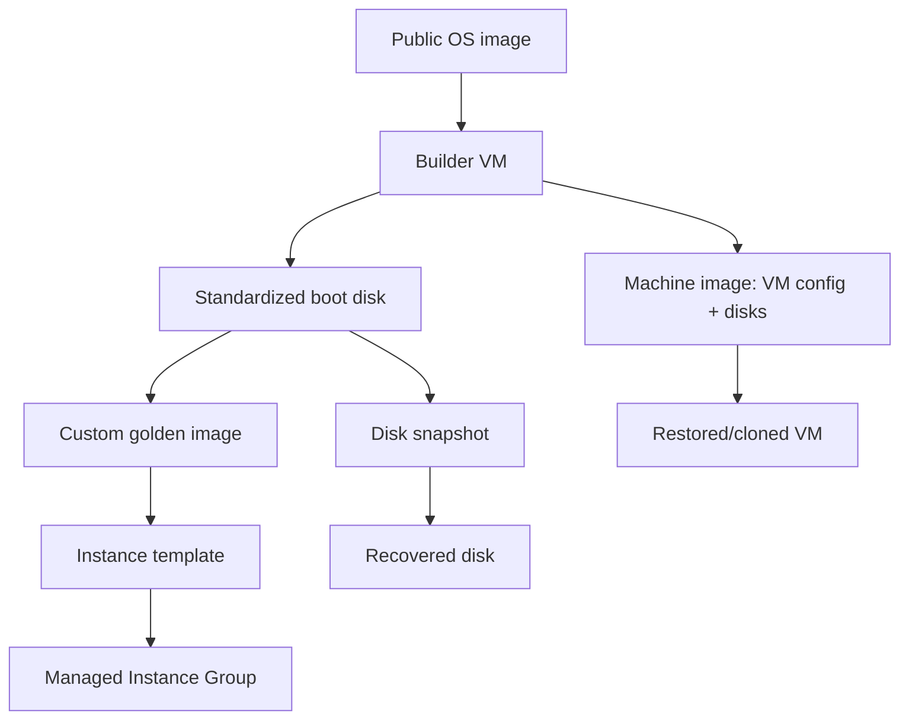
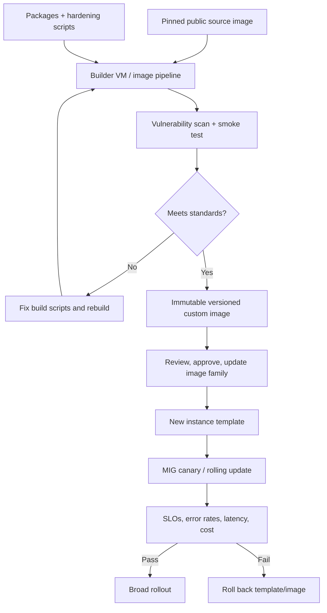

# Images, Custom Images, and Machine Images

When creating a VM on Google Compute Engine, you pick an operating system image as the base for the boot disk. However, when you need to **deploy many identical VMs**, **back up disk data**, or **restore a machine with multiple disks and configuration**, you must accurately distinguish between an *OS image*, *custom image*, *machine image*, *disk snapshot*, and *instance template*. Choosing the wrong resource can cause data loss, clone sensitive secrets, or prevent meeting RPO/RTO during recovery.

This lesson belongs to the **Compute Engine** chapter of the `CLOUD_PROVIDERS_GCP` module, connecting project organization, IAM, VPC, Compute Engine, GKE, Cloud Run, storage, databases, automated releases, reliability, and cost. All project and VM names are sandbox examples; resource-creating commands are clearly marked and **should not be run casually while reading**.

## 1. Learning Outcomes

After this lesson, you will be able to:

1. Explain what public OS images, custom images, image families, and machine images store.
2. Compare images with disk snapshots and instance templates by deployment or recovery goal.
3. Build versioned, secret-free, reproducible golden images.
4. Create, inspect, and use custom images or machine images with `gcloud`.
5. Understand crash consistency, application consistency, disk-type limits, IAM permissions, and CMEK behavior during restore.
6. Design VM release pipelines via instance templates/MIGs and backup/DR workflows validated by tested restores.

## 2. Picking the Right Resource for the Job

| Resource | Primary Contents | Use When | Does Not Replace |
| --- | --- | --- | --- |
| **Public OS image** | OS boot disk contents published by Google/vendors | Creating new VMs from Debian, Ubuntu, Windows, and supported OSes | Application configuration, VM-specific data |
| **Custom image** | Data of **a single customized disk** (usually the boot disk); created from a disk, snapshot, image, or RAW import | Golden OS/application baseline, fleet releases | Machine type, network interfaces, multiple data disks |
| **Standard disk snapshot** | Point-in-time copy of one persistent disk, stored incrementally | Single-disk backup, snapshot schedules, disk restore | Full VM config, automatic multi-disk point-in-time coordination |
| **Machine image** | Most VM configuration, metadata, and data for boot plus eligible attached disks | Multi-disk VM backup/cloning, machine-level recovery | Application-consistent backups, all VM properties, all disk types |
| **Instance template** | Blueprint config to create VMs, referencing image/disks, machine type, network, and metadata | Managed Instance Groups (MIGs), scaling, rolling updates | Live data written on running VMs |

For example: 30 stateless API VMs should be built from **custom image + instance template + MIG**; a database data disk needs **snapshots or database-level backups**; a legacy VM with a boot disk and two data disks needing full machine restoration can use a **machine image**, provided the machine type and disks are supported.



**Key point:** A machine image is not simply a "multi-file" version of a custom image. It is a distinct Compute Engine resource type with its own lifecycle, APIs, pricing, and usage limits.

## 3. Public OS Images and Image Families

A public image has a **specific name** and belongs to a vendor-managed image project, such as `debian-cloud`. Many public images belong to an **image family**. For example, the `debian-13` family points to the latest non-deprecated Debian 13 image in that project.

```bash
# READ-ONLY: list images in a public image project.
gcloud compute images list \
  --project=debian-cloud \
  --filter="family:debian-13"

# Describe the current image of a family.
gcloud compute images describe-from-family debian-13 \
  --project=debian-cloud
```

Before choosing, check whether the OS version still receives security updates, CPU architecture (x86-64/Arm), UEFI/Shielded VM/guest agent support, compatibility with your machine series, software licensing, and premium OS costs. The family name or OS version number is only part of the criteria.

### 3.1. Families Resolve to Latest Without Auto-Updating Running VMs

Suppose an internal `orders-base` family contains:

```text
orders-base-20261001       ACTIVE
orders-base-20261101       ACTIVE
orders-base-20261118       ACTIVE  <-- latest image in family
```

When creating a new VM from `orders-base`, Google selects the latest ACTIVE/non-deprecated image. If `20261118` is marked DEPRECATED, the family falls back to the previous ACTIVE image. **Changing the family target does not automatically update the boot disk of running VMs.**

| Approach | Best For | Trade-offs |
| --- | --- | --- |
| `--image-family=orders-base` | Sandboxes/build pipelines wanting the latest approved baseline | Output can change between runs; must record the resolved version. |
| `--image=orders-base-20261118` | Production requiring exact image reproducibility on rollback | Must explicitly bump version when patching. |
| Manifest/instance template pinning image name | MIGs, release auditing, canary/rollback | Extra artifact management and approval workflow. |

Use **versioned image names** in release manifests, even if your pipeline discovers new candidates via a family. To upgrade a MIG, create a new instance template and roll it out; the family will not update existing VMs on its own.

## 4. Custom Images and the Golden Image Pipeline

A **custom image** is created in a project you manage from one of the supported sources: a persistent disk, disk snapshot, another image, or a RAW image in Cloud Storage. Custom images are valuable when many VMs need the same OS, packages, security baseline, guest/monitoring agents, and standard runtime setup.

### 4.1. What Should a Golden Image Contain?

| Include | Strictly Exclude |
| --- | --- |
| Patched OS, drivers, guest agent, security hardening, monitoring agents | Service account JSON keys, access tokens, passwords, TLS private keys |
| Shared runtime/application with explicit versions | Personal data, production database dumps, sensitive logs |
| Idempotent startup hooks, non-sensitive configuration | Host identifiers/SSH host keys that must be unique per VM |
| Provenance, owner, build ID, scan metadata, or SBOM where appropriate | Fixed IP addresses and secrets valid for only one project |

Secrets should be supplied via **workload identity**, Secret Manager, and IAM at runtime—never "baked" into the OS image. On Windows, prepare OS cloning with the appropriate GCESysprep flow; on Linux, strip machine-specific state and identifiers as well.

### 4.2. Preparing the Disk Before Image Creation

Capturing a boot disk from a running VM risks capturing unflushed state. Using a **cleanly stopped builder VM** is recommended whenever possible. Creating an image from a disk attached to a running VM may require `--force` in `gcloud`, which does not guarantee application-level consistency. If stopping is impossible, minimize writes, flush the application/filesystem, and test restoration.

Workflow:

1. Select a versioned public source image from a trusted project.
2. Provision a builder VM in a sandbox; install OS updates, packages, and agents.
3. Run security and boot verification checks; confirm guest OS compatibility.
4. Remove secrets, sensitive logs, and host identities; stop writes or stop the VM.
5. Create a versioned custom image in the target family.
6. Launch a **new** VM from the image and verify boot and application behavior before approving.

### 4.3. Example: Creating a Custom Image from a Disk

Suppose `orders-builder-boot` exists from a builder VM in zone `asia-southeast1-b`:

```bash
# MUTATING: creates an image and incurs storage charges.
PROJECT_ID="gcp-image-lab"
ZONE="asia-southeast1-b"

gcloud compute images create orders-base-20261118 \
  --project="$PROJECT_ID" \
  --source-disk=orders-builder-boot \
  --source-disk-zone="$ZONE" \
  --family=orders-base \
  --storage-location=asia-southeast1 \
  --description="Hardened Orders baseline, release 2026-11-18"
```

`--storage-location` determines where image bytes are stored; you can choose a supported region or multi-region to satisfy data residency. Do not assume image storage defaults to the source zone or the VM's runtime location. Organization Policies, CMEK, and IAM can constrain your choice.

Other sources include snapshots or existing images:

```bash
# MUTATING: create an image from a single disk snapshot.
gcloud compute images create orders-base-from-snapshot \
  --project="$PROJECT_ID" \
  --source-snapshot=SNAPSHOT_NAME

# MUTATING: copy an existing image, including authorized cross-project copies.
gcloud compute images create orders-base-copy \
  --project="$PROJECT_ID" \
  --source-image=SOURCE_IMAGE_NAME \
  --source-image-project=SOURCE_PROJECT_ID
```

Each command reads from **one source**; it does not bundle a boot disk plus multiple attached data disks.

### 4.4. Creating a VM from an Image

```bash
# MUTATING: creates a VM and disk, incurring charges.
gcloud compute instances create orders-api-test \
  --project="$PROJECT_ID" \
  --zone="$ZONE" \
  --machine-type=e2-standard-2 \
  --image=orders-base-20261118 \
  --image-project="$PROJECT_ID" \
  --subnet=SUBNET_NAME \
  --no-address
```

An image stores boot disk contents; machine type, network/subnet, external IP, firewall tags, and service account must be set at instance creation or via an instance template/IaC. `--no-address` does not automatically grant access to Google APIs or the Internet: configure networking, routing, and Cloud NAT/Private Google Access as needed.

## 5. Disk Snapshots: Backing Up a Single Disk

A **standard snapshot** captures the data of a single persistent disk at a point in time. Subsequent snapshots are stored incrementally to save space. This is a core tool for disk backup schedules and recovery, though it **does not capture full VM configuration**.

```bash
# READ-ONLY.
gcloud compute snapshots list --project=gcp-image-lab

# MUTATING: snapshot a persistent disk.
gcloud compute snapshots create orders-data-20261118 \
  --project=gcp-image-lab \
  --source-disk=orders-data-disk \
  --source-disk-zone=asia-southeast1-b
```

A VM with one boot disk and two data disks requires three separate backups if relying solely on disk snapshots. Snapshots triggered individually do not guarantee crash consistency **across all three disks at the exact same instant**. For databases, use application quiescing/backups or native database backup/PITR when transactional consistency and tight RPO are required.

Snapshots are useful for single-disk restoration, but raw disk images should not replace full backup workflows for Cloud SQL or distributed data stores.

## 6. Machine Images: VM Configuration Plus Multiple Disks

A **machine image** captures most instance configuration along with the data of the boot disk and eligible attached disks. According to Compute Engine documentation, machine images coordinate disk snapshot timestamps to provide **multi-disk crash consistency**, making them useful for cloning or recovering multiple disks at the same point in time.

> **Crash-consistent differs from application-consistent.** Crash-consistent resembles the state right after a sudden power loss; disk-level I/O writes are consistent, whereas RAM, unflushed transactions, and external system states are not necessarily synchronized.

| Component | Usually Stored by Machine Image | What to Verify on Restore |
| --- | --- | --- |
| Machine properties | Machine type, metadata, labels, network tags, and many instance settings | Some properties are not restored verbatim and may need overrides. |
| Network | References to network interfaces/VPC/subnet | Ephemeral IPs, regional subnets, firewalls, and static addresses may not be reusable. |
| Identity | Service account and related config when supported | `iam.serviceAccounts.actAs` permissions and cross-project service account overrides. |
| Disk contents | Boot disk and supported attached disks | Filesystem mounts, data, disk types, encryption, regional disk replica zones. |
| Runtime | Persistent data on disks | Apps may need journal/DB transaction recovery; RAM is not saved like VM suspend. |

Certain properties such as Resource Manager tags, resource policies, specific disk properties, and certain Shielded VM settings are **not fully preserved**; consult *Instance and disk properties not supported by machine image* in official docs. Do not treat machine images as a substitute for Terraform infrastructure inventory or config auditing.

### 6.1. Key Limitations

Under current documentation, you cannot create a machine image from a VM that:

- Has no attached disks or exceeds **200 TiB** total disk size;
- Has any attached **Hyperdisk** volumes;
- Belongs to certain specialized machine series (e.g., C3D, H3, A3, and many Z3/Z4 types, with documented exceptions).

Supported machine/disk types are updated by Google; verify your exact resources and version. Creating multiple VMs rapidly from **one** machine image is also rate-limited (current docs note up to **6 instance creations per 60 minutes** from the same source). Thus, stateless apps scaling out to hundreds of VMs should not rely on a machine image as their primary cloning source.

Machine images typically include all attached disks. Options to include or exclude specific **non-boot disks** may vary by feature availability/Preview; the boot disk cannot be excluded. If `/etc/fstab` still references an excluded disk, the restored VM may fail to boot unless `nofail` or proper adjustments are configured.

### 6.2. Creating a Machine Image from a VM

```bash
# MUTATING: creates a machine image, consuming storage and quota.
PROJECT_ID="gcp-image-lab"
ZONE="asia-southeast1-b"

gcloud compute machine-images create orders-vm-backup-20261118 \
  --project="$PROJECT_ID" \
  --source-instance=orders-vm-source \
  --source-instance-zone="$ZONE" \
  --storage-location=asia-southeast1 \
  --description="Orders VM backup before maintenance"
```

When taken from a running VM, a machine image provides crash-consistent capture; if the application needs transaction-level consistency, stop/flush/quiesce or combine with database-aware backups. When using a machine image to **clone a golden VM**, scrub secrets, hostnames/host identities, and instance-specific data beforehand.

```bash
# READ-ONLY: inspect machine images.
gcloud compute machine-images list --project="$PROJECT_ID"

gcloud compute machine-images describe orders-vm-backup-20261118 \
  --project="$PROJECT_ID"
```

### 6.3. Restoring a VM from a Machine Image

```bash
# MUTATING: creates a new VM from a machine image, incurring charges.
gcloud compute instances create orders-restore-test \
  --project="$PROJECT_ID" \
  --zone="$ZONE" \
  --source-machine-image=orders-vm-backup-20261118
```

Never treat command success as proof of successful restoration. Verify boot, all disks and mount points, application health, network/firewalls, service accounts, DB consistency, KMS, audit logs, and recovery time. Restoring into a different region may require overriding subnets, regional disk replica zones, IPs, and zonal/regional references.

**CMEK Pitfall:** When creating a VM via `gcloud` or REST from a machine image whose disks were encrypted with CMEK, the newly created disks **may revert to Google-managed encryption** unless CMEK/disk settings are explicitly specified; the Console provides a workflow to inherit CMEK in supported cases. Always inspect `diskEncryptionKey` and KMS IAM after restore rather than assuming inheritance from the source image.

## 7. IAM and Security Boundaries

Images and machine images can contain OS configurations, application state, logs, metadata, and **credentials that once lived on the source disk**. Anyone permitted to create VMs from a machine image can restore and read that data. Therefore, image governance is part of data protection, not just a build concern.

| Action | IAM Permissions to Verify |
| --- | --- |
| Create custom image | `compute.images.create` plus read/use permissions on the source disk, snapshot, or image. |
| Create machine image | `compute.machineImages.create` on the project, `compute.instances.useReadOnly` on source VM, `compute.disks.createSnapshot` on disks. |
| Create VM from machine image | `compute.instances.create`, `compute.machineImages.useReadOnly` on image, plus permissions on related networks/disks. |
| Attach service account to VM | `iam.serviceAccounts.actAs` on that service account (commonly via `roles/iam.serviceAccountUser`). |
| Use CMEK | Cloud KMS key permissions for the proper service agents/workflows and compliance with org policies. |

Do not grant project-wide `Owner` just to use an image. Restrict cross-project image sharing via IAM, store images in locations meeting data residency rules, manage secrets via Secret Manager, and separate build/publish/deploy accounts.

For cross-project restores, specify the target project's service account, VPC/subnet/Shared VPC host project, firewalls, and regional resources when source VM attributes cannot be reused. Never run a cloned VM simultaneously with duplicate hostnames/IPs/credentials and cron schedules alongside production without isolation controls.

## 8. When to Choose Custom Image, Snapshot, or Machine Image?

| Scenario | Preferred Choice | Rationale |
| --- | --- | --- |
| 100 stateless API VMs in a MIG | Custom golden image + instance template | Reproducible, scales out, and supports rolling updates without copying live VM state. |
| Backing up one persistent data disk | Snapshot and snapshot schedule | Matches single-disk scope; incremental storage. |
| Cloning a legacy VM with multiple data disks | Machine image (if supported) | Captures config and crash-consistent multi-disk snapshots together. |
| Database needing recovery to 15 minutes ago | Native DB backups/logs/PITR/replication | Daily machine images cannot satisfy tight RPOs. |
| Defining VM config in Git | Terraform/IaC, instance templates | Enables change review and drift control; images do not replace IaC source of truth. |
| Provisioning VMs in another project | Custom image or machine image + IAM/overrides | Must align service accounts, networking, KMS, region, and permissions. |

**Tool selection mindset:** need a **base OS/app** → custom image; need **one backed-up disk** → snapshot; need **full multi-disk VM + config recovery** → machine image (if supported); need **many identically configured VMs** → instance template/MIG.

## 9. CI/CD for Golden Images and Instance Templates

A production image must be a **verifiable, rollback-ready artifact**, not the ad-hoc state of a machine an engineer recently SSHed into and patched by hand.



Core steps:

1. **Pin source image** and record OS version, source project, build ID, and checksums/provenance where available.
2. **Automate builds** with scripts/Ansible/Packer or controlled CI; never make manual edits on production.
3. **Generalize** the image before capture; strip tokens, SSH host keys, instance identifiers, and customer data.
4. **Test with a fresh VM**, checking boot, startup scripts, Cloud Monitoring/Logging, app health, IAM, networking, and failure handling.
5. **Security review**: patches, vulnerability scan, guest agent, Shielded VM/Secure Boot compatibility, and no sensitive data.
6. **Publish an immutable artifact**: unique versioned image name, family, owner/cost center, release notes, and retention policy.
7. **Roll out via instance template**, using MIG canary/rolling updates; on error, roll back to a verified template/image version.

For stateless VMs, store application state in Cloud SQL, Cloud Storage, or appropriate durable services rather than each VM's boot disk. This makes MIG autohealing, instance replacement, and scaling much simpler.

### 9.1. Being Careful with Families During Rollouts

If an instance template references an image family directly, instances spun up at different times can pick different image versions once the family pointer moves. Strict releases should therefore **resolve the family to a concrete image name and pin it** in the deployed template. An image family is a version distribution channel, not a guarantee that an entire fleet stays uniform after publishing.

## 10. Backup/DR: RPO, RTO, and Consistency

**RPO** (Recovery Point Objective) is the acceptable amount of data loss measured in time; **RTO** (Recovery Time Objective) is the target time to restore service. A machine image taken every 24 hours will not meet a 15-minute RPO for an active transactional system, even if the machine itself restores rapidly.

| Property | Meaning | How to Evaluate |
| --- | --- | --- |
| Crash consistency | Disks reflect the same instant of a sudden power loss | May require journal replay and DB recovery at boot. |
| Application consistency | App/database flushed or quiesced cleanly | Requires app/DB coordination, native backups/quiesce, and testing. |
| RPO | Maximum tolerable data loss | Backup frequency, transaction logs, replication/PITR. |
| RTO | Target timeline to restore full service | Disk restore, VM boot, network/IAM/KMS config, app verification, DNS/LB cutover. |
| Retention | How long, how many copies, and where stored | Compliance requirements, cost, immutable backups if needed. |

A DR runbook for a multi-disk VM should cover:

1. Documenting VM/disk types and any components **not** supported by machine images.
2. Choosing a capture method matching application consistency needs: quiescing, DB dumps/backups, snapshots, and machine images.
3. Storing backups in locations meeting residency, disaster recovery, and KMS access requirements.
4. Restoring to an **isolated test VM**, preventing hostname, IP, scheduler, or production data collisions.
5. Verifying filesystems, mount points, business data, app logs, and dependency connectivity.
6. Measuring actual end-to-end recovery time and confirming the latest backup meets RPO.
7. Recording test evidence, defects, and lessons learned, and updating the runbook.

Never treat a successful `gcloud compute instances create` call as proof that the application is recovered. For databases especially, boot the system and verify data integrity, log/transaction replay, and business logic.

## 11. Image Lifecycle: Deprecate, Roll Back, and Delete

Custom images support deprecation states. When a version contains a vulnerability or startup bug, deprecating it stops the family from selecting it as the latest version:

| State | Operational Meaning |
| --- | --- |
| `ACTIVE` | Available for creating VMs; family resolves to the latest eligible version. |
| `DEPRECATED` | Can still create VMs if named explicitly (with warnings); skipped by family resolution. |
| `OBSOLETE` | Restricted from creating new VMs. |
| `DELETED` | Image is no longer available; VMs previously created from it are unaffected. |

When `orders-base-20261118` is faulty:

1. Pause rollout and identify which image version templates currently reference.
2. Deprecate the faulty image via the approved procedure if appropriate.
3. Verify which ACTIVE image the family now resolves to—never assume.
4. Roll back the MIG using the previously tested instance template version.
5. Test and document the change; build a new image rather than mutating a published one.

```bash
# READ-ONLY: list image versions in a family.
gcloud compute images list \
  --project=gcp-image-lab \
  --filter="family=orders-base"

gcloud compute images describe-from-family orders-base \
  --project=gcp-image-lab
```

A deleted image can no longer be used as a source for new VMs, but running VMs created from it earlier do not vanish. Before deleting, verify retention rules, references in templates/scripts, and rollback/DR needs; never clean up solely because an image name looks old.

## 12. Costs and Operational Limits

Images and snapshots carry storage costs independent of running VMs:

| Item | Cost Driver | What to Check |
| --- | --- | --- |
| Public image | Public image itself plus premium OS licenses where applicable | VM, disk, OS licensing, and regional pricing. |
| Custom image | Image storage bytes, storage location, and retained versions | Golden image retention and number of referenced versions. |
| Snapshot | Storage consumed across backup points | Backup schedule, change rate, and deletion behavior preserving chains. |
| Machine image | Disk data stored via applicable differential mechanisms, metadata, version count | Disk size/change rate, storage location, and restore requirements. |
| KMS/network | Cloud KMS operations, data transfer depending on restore/copy topology | Key permissions, regions, and actual billed usage. |
| Restore drill | Temporary test VMs, disks, and networking during drills | Use sandboxes, cap runtime, and clean up test resources cleanly. |

The initial machine image may store a full baseline of data; subsequent images can store differentials, though encryption modes and features introduce exceptions. Never multiply a disk's **logical** 1 TiB capacity directly by backup count to assume exact storage cost. Use Cloud Billing exports/Reports and current pricing pages.

Rapidly creating VMs from one machine image is rate-limited; images and disks also face quotas and source-compatibility constraints. For fleet scaling, the balanced price/performance pattern remains golden image + MIG, not cloning hundreds of stateful VMs from a machine image.

## 13. Case Study: Deploying and Protecting the Orders System

An organization operates three workload groups:

| Workload | Architecture | Recommended Tooling |
| --- | --- | --- |
| Stateless Orders API | 12 VMs behind HTTPS Load Balancer needing autohealing/scaling | Custom image + instance template + MIG. |
| Legacy batch VM | Boot disk plus two data disks running cron and internal tools | Machine image (if disks/machine type supported) paired with app-level backups. |
| Cloud SQL for orders | Transactional data requiring PITR and HA | Cloud SQL-native backups/PITR/replication aligned with RPO/RTO. |

**Example projects:**

```text
platform-image-catalog
  /orders-base-20261118
  /orders-base (image family)
orders-dev
  /image-builder
  /canary-vm
orders-prod
  /orders-api-mig
  /orders-legacy-vm
  /machine-images: scheduled maintenance backups
```

### 13.1. Releasing the API

The builder generates a custom image from an approved base OS, scans it, and runs a canary. The pipeline pins the exact image name in a new instance template and performs a MIG rolling update, rolling back to the prior template if error rate or latency rises. Never copy database/cache state from a production VM into an image deployed across dozens of new VMs.

### 13.2. Protecting the Legacy VM

Before maintenance, ops verifies that the machine type and disks support machine images, quiesces the app if required, creates a machine image, and runs a sandbox restore drill. Restoring across projects/regions requires verifying subnets, service accounts, disk encryption, non-preserved source instance properties, data, and job schedulers. Never let a restored clone run live billing or customer email jobs alongside production.

### 13.3. Linking Security and Cost Governance

The image catalog requires strict IAM, separation of build/publish/deploy accounts, storage location policies, KMS governance, and approved-image controls. The production project tracks cost centers and labels, budget alerts, SLOs, and backup/restore drill costs. These choices are part of overall system quality, not mere UI options on the VM creation screen.

## 14. Common Troubleshooting Scenarios

| Symptom | Possible Cause | How to Verify |
| --- | --- | --- |
| Creating image from in-use disk rejected | Source VM still running or command requires live-capture flag | Stop VM cleanly, or review `--force` rules and quiesce first. |
| VM from custom image fails to boot | Image not generalized, filesystem corruption, OS/architecture/UEFI mismatch | Serial console/boot logs, version, Shielded VM settings, test VM. |
| Image family picks wrong version | Newer image is ACTIVE or desired image was deprecated | `describe-from-family`, list image versions and states. |
| Creating machine image reports unsupported | Hyperdisk, unsupported machine series, or capacity limit exceeded | Check disks/types against the official support list. |
| Restored VM misses a disk/mount | Excluded disk, restore overrides, `/etc/fstab` waiting on missing disk | Compare source properties, `deviceName`, volume mounts, app logs. |
| Cross-region clone hits network errors | Target subnet/regional disk missing or IP conflict | Override network, subnetwork, replicaZones, and regional resources. |
| Cross-project restore returns `403` | Missing useReadOnly/image IAM, service account actAs, or KMS access | Read error details; fix IAM on the exact resource and principal. |
| Restored VM loses CMEK | CLI/REST did not re-specify disk encryption config | Check `diskEncryptionKey` and override disk settings per docs. |
| Database restore has consistency errors | Snapshot was only crash-consistent with unflushed transactions | Replay logs, use app-level backups or database-native PITR. |
| Mass VM creation from machine image hits rate limit | Concurrent clones exceed source rate limit | Use golden image + instance template for fleet scaling. |

Never fix a `403` by granting project-wide `Owner`. Identify the exact principal, operation, source image/disk type, and specific permission on the target resource first.

## 15. Practice Exercises

### Exercise A — Choosing the Right Resource Type

A VM has a 30 GiB boot disk and two data disks (200 GiB and 500 GiB). The team wants to launch 10 identical API VMs, back up data disks hourly, and have a full-VM restore point before maintenance. Assign custom image, disk snapshot, or machine image to these three needs, explaining data scope and consistency requirements.

### Exercise B — Faulty Image Family

Family `orders-base` contains versions from Nov 10, 15, and 18. The Nov 18 build fails on startup. Explain which version the family selects before and after deprecation, how to pin the Nov 15 build for rollback, and why existing VMs do not automatically revert to the older version.

### Exercise C — Cross-Project Restore

A machine image resides in project `backups-prod`, and the DR team needs to launch a VM in `orders-dr` in a different region. List the IAM permissions, service account, subnet, regional disks, CMEK, hostname/IP, and data verification steps required.

### Exercise D — Security Review

A builder VM contains a service account JSON key file, SSH host keys, and logs with tokens. An engineer wants to create an image and share it organization-wide. List the prerequisite steps: cleanup/generalization, workload identity, secret scanning, IAM controls, and fresh-VM testing.

### Exercise E — RPO/RTO

A system requires a 15-minute RPO and 60-minute RTO, yet only captures a machine image every 24 hours. Why does this fall short? Design additions covering database-native backups, logs, replication where suitable, a DR runbook, and restore drills.

### Exercise F — Cost Control

A project retains 150 unused custom images, hundreds of machine images, and multiple builder VMs running 24/7. Build a checklist covering image references, compliance retention, storage, quotas, KMS, builder VM scheduling, and restore testing before deletion.

### Self-Check Questions

1. Why is a custom image an image of **one disk**, whereas a machine image stores configuration and multiple disks?
2. How does a disk snapshot differ in purpose from an image family?
3. Does updating a family automatically update running VMs or instance templates?
4. Why is a crash-consistent machine image not automatically application-consistent?
5. Can a VM using Hyperdisk reliably create a machine image?
6. What must be checked when restoring a machine image to a different region?
7. Why must disk CMEK settings be verified after a CLI/REST restore?
8. Why should a MIG create VMs from an instance template and custom image?
9. Should secrets and production data ever be baked into a golden image?
10. Why must actual restore RTO be measured rather than merely checking that backups succeed?

**Memory workflow:** identify the goal **VM baseline – single-disk backup – full-machine clone – fleet scaling** → choose custom image/snapshot/machine image/instance template → check source, IAM, security, disk types, consistency, and KMS → create versioned artifact → boot/restore test → roll out or back up per RPO/RTO → monitor, retain, and manage cost.

## 16. Official Documentation References

- [Compute Engine OS images](https://cloud.google.com/compute/docs/images)
- [Create custom images](https://cloud.google.com/compute/docs/images/create-custom)
- [Image families best practices](https://cloud.google.com/compute/docs/images/image-families-best-practices)
- [Deprecate custom images](https://cloud.google.com/compute/docs/images/deprecate-custom)
- [Disk snapshots](https://cloud.google.com/compute/docs/disks/snapshots)
- [Machine images](https://cloud.google.com/compute/docs/machine-images)
- [Create machine images](https://cloud.google.com/compute/docs/machine-images/create-machine-images)
- [Create instances from machine images](https://cloud.google.com/compute/docs/machine-images/create-instance-from-machine-image)
- [Instance templates](https://cloud.google.com/compute/docs/instance-templates)
- [Disk/image pricing](https://cloud.google.com/compute/disks-image-pricing)
- [Compute Engine IAM access](https://cloud.google.com/compute/docs/access/iam)

Machine series/disk type limits, APIs, encryption behavior, quotas, and pricing evolve over time. When applying to production, cross-check current documentation for your **exact VM type, disks, storage location, project, and restore method**, and only consider a backup validated after a successful restore drill.
