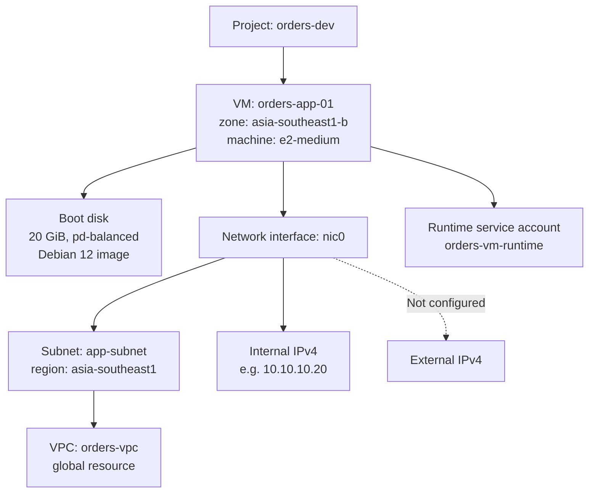
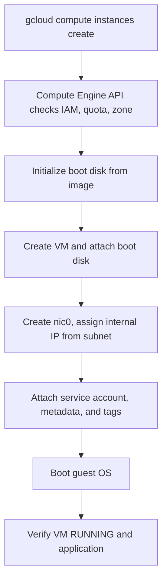

# Creating a VM with a Boot Disk and Network Interface on Compute Engine

When creating a **virtual machine (VM)** on Google Compute Engine, choosing CPU and RAM is only part of the job. To boot the VM, you need a **boot disk** containing the operating system; to exchange data, you must configure a **network interface (NIC)** attached to a VPC/subnet, IP addresses, and appropriate connectivity controls. These two components directly affect security, performance, cost, recoverability, and how applications reach Cloud SQL, Cloud Storage, other VMs, or the Internet.

This lesson belongs to the **Compute Engine** chapter of the `CLOUD_PROVIDERS_GCP` module. It builds upon project organization, IAM, VPC, and routing, while laying the groundwork for deploying services and databases, automating releases, monitoring reliability, and managing costs on Google Cloud.

Running example throughout: creating Linux VM `orders-app-01` in project `orders-dev`, zone `asia-southeast1-b`, with a 20 GiB boot disk and a NIC attached to private subnet `app-subnet` of VPC `orders-vpc`. The VM has **no external IPv4 address**; operators will connect through a controlled private mechanism such as Identity-Aware Proxy (IAP) TCP forwarding.

> Project names, subnets, service accounts, and VM names in this lesson are illustrative examples. Commands that create or delete resources below **may incur charges and alter live infrastructure if executed**. Run them only in an authorized environment after verifying identity, permissions, and network settings.

## 1. Learning Objectives

After this lesson, you will be able to:

1. Explain the relationship between **VM instance, boot disk, disk image, zone, VPC, subnet, and network interface**.
2. Choose an appropriate boot disk: **image, capacity, storage type, encryption, auto-delete**, and data protection methods.
3. Configure a NIC: **VPC/subnet, internal IP, external IP**, routing, and firewalls, knowing when to deploy a private VM.
4. Create VMs using the **Google Cloud Console** and **`gcloud compute instances create`** with explicit flags, avoiding unintended defaults.
5. Apply **dedicated service accounts, IAM/OS Login/IAP** appropriately instead of exposing SSH directly to the Internet.
6. Inspect configurations after creation, diagnose common failures, and identify components that continue accruing charges when a VM is stopped.
7. Outline how to bring VM configurations into infrastructure-as-code, logging, and monitoring workflows.

## 2. Visualizing a VM's Structure

A Compute Engine VM is a **zonal** resource. It attaches a boot disk to load the operating system and one or more network interfaces to connect to permitted VPC networks. A VPC has **global** scope, whereas each IPv4 subnet in a VPC belongs to a **region**; a VM's NIC must reference a subnet compatible with the region containing the VM's zone.



| Component | Role | Decision to Make |
| --- | --- | --- |
| **Project** | Governance, IAM, billing, and quota boundary. | Who can create VMs, use subnets, and attach service accounts? |
| **Zone** | Execution location for the VM resource. | Does it match data region, network, and machine type availability? |
| **Machine type** | CPU, memory, and corresponding hardware capabilities. | Sized for load, available, compatible with disks/network and budget? |
| **Boot disk** | Stores the OS and files needed to boot the VM. | Which image, disk type, size, and lifecycle policy? |
| **Network interface** | Connects the VM to a VPC/subnet. | Private/public IP, IPv4/IPv6 stack, routing, firewalls? |
| **Service account** | Identity the VM uses when calling Google Cloud APIs. | Least-privilege IAM permissions on required resources? |
| **Firewall/network policies** | Controls traffic by direction, source, destination, and port. | Which inbound/outbound flows does the VM need? |

**Two facts to remember:** A VM can exist without an **external IP** while still needing proper networking for real tasks; and **the boot disk does not disappear when a VM is merely stopped**. Deleting the boot disk upon VM deletion is a separate lifecycle setting that must be checked.

## 3. Boot Disk: Where Does the Operating System Boot From?

### 3.1. Boot Disk vs. Disk Image vs. Data Disk

- **Disk image:** the data source used to initialize a boot disk, usually containing an OS. Google Cloud provides public images; organizations may use custom images when permitted.
- **Boot disk:** a Compute Engine disk resource attached to the VM containing bootable contents. Every VM boots from a designated boot disk.
- **Data disk:** an additional disk for application/data storage; does not replace the boot disk and has an independent lifecycle.
- **Snapshot:** a point-in-time snapshot copy of a disk used for recovery or creating new disks; does not automatically provide application-consistent backups while databases are actively writing.

Example:

```text
Public image family: debian-12 (project debian-cloud)
                  │
                  ▼
Boot disk: orders-app-01
  - type: pd-balanced
  - size: 20 GiB
  - source: Debian 12 image
                  │
                  ▼
VM: orders-app-01
  - OS boots from boot disk
  - application runs on VM
```

An **image family** generally points to the latest valid image in the family at disk creation time. Thus, creating two VMs at different times from the same family **does not guarantee byte-for-byte identical image contents**. For strictly reproducible deployments, pin a **specific image** or manage image versions through a controlled pipeline.

### 3.2. Choosing an Operating System

When choosing an image, consider:

1. **OS and application:** Is Debian, Ubuntu, RHEL, Windows Server, or an organization-hardened image compatible with your workload?
2. **CPU architecture:** Does the image support the exact architecture and machine series selected?
3. **Patching and support lifecycle:** Does the vendor still ship updates, and what is the upgrade plan?
4. **Licensing and cost:** Some commercial images carry software license fees beyond VM/disk charges.
5. **Secure boot:** Are Shielded VM, Secure Boot/vTPM/integrity monitoring supported by the image and organization policy?

In this hands-on example, we use image family `debian-12` in project `debian-cloud`. This is an illustrative choice, not mandatory for production workloads.

### 3.3. Choosing a Boot Disk Type

Compute Engine supports multiple persistent storage types. **Boot disk** eligibility and machine/zone compatibility vary by disk type, so verify them specifically for the configuration you are creating.

| Common Type | General Characteristics | When to Consider |
| --- | --- | --- |
| **`pd-balanced`** | SSD Persistent Disk balancing price and performance for broad workloads. | General Linux boot disks and standard applications. |
| **`pd-ssd`** | SSD Persistent Disk oriented toward higher I/O demands per service specs. | Boot workloads needing higher storage performance, validated via benchmarks. |
| **`pd-standard`** | HDD Persistent Disk suited for moderate I/O; boot workloads can be slower. | Choose only if actual performance needs and support match. |
| **Boot-supported Hyperdisk variants** | Decouples performance/capacity attributes depending on Hyperdisk type. | Workloads/machine types requiring specialized performance; verify boot support, region/zone, and pricing. |

Never assume **every Hyperdisk can serve as a boot disk** or works with every machine family. For demanding workloads, consult official disk compatibility matrices and IOPS/throughput caps.

### 3.4. Capacity, Performance, and Data

The boot disk stores the OS, packages, logs, runtime files, and potentially application data if not separated. Undersizing risks filling `/var/log` or temp directories; oversizing increases cost. Disk performance is also governed by disk type, disk size, machine configuration, and active quotas/limits.

**Example of choosing 20 GiB:** a learning VM running Debian, a few services, and bounded logs can start with 20 GiB. This is not a blanket production recommendation; size capacity based on OS footprint, containers/images, log retention, peak usage, and upgrade needs.

If durable data is required:

- Consider a **separate data disk** for contents that must survive VM replacement.
- Maintain snapshot/backup schedules and **test restores**, rather than relying on a single boot disk.
- For critical databases, prefer managed services like Cloud SQL where appropriate, or implement dedicated backup/replication.
- Enable encryption and key governance per organizational requirements; Compute Engine disks are encrypted at rest, while **Google-managed keys/CMEK/CSEK** carry different operational implications.

### 3.5. Encryption and Key Management

Compute Engine disks are encrypted at rest. You can use **Google-managed keys** (default) or supported customer-managed/customer-supplied key mechanisms within product scope.

When using a **Cloud KMS customer-managed encryption key (CMEK)**:

- Ensure the required service agents/identities hold permissions to use the KMS key.
- Place the key in a compatible location and configuration for the resource.
- Understand what happens if the key is disabled, scheduled for destruction, or unreachable: the VM/disk may fail to function properly.
- Establish key rotation, recovery, and auditing procedures.

Never copy key material, service account JSON keys, or tokens into VM startup scripts or metadata.

### 3.6. Boot Disk Lifecycle on VM Stop/Delete

These operations behave **differently**:

| VM Operation | Impact on Boot Disk |
| --- | --- |
| **Stop** | VM stops running, while the disk persists and retains data; storage billing may continue. |
| **Restart** | Boots again using the attached boot disk; data on persistent boot disks is retained per disk semantics. |
| **Delete VM** | Boot disk may be deleted automatically or retained depending on the attachment's **auto-delete** setting. |
| **Detach/replace disk in supported flows** | Must obey attach/detach and boot constraints; protect data before intervening. |

Before deleting a VM, inspect the boot disk's **autoDelete** flag, especially on VMs holding non-reproducible data. A boot disk left behind after VM deletion can continue incurring charges. Conversely, if the boot disk auto-deletes with the VM without backups, data may be permanently lost.

## 4. Network Interface: How Does a VM Connect to a VPC?

### 4.1. VPC Is Global, Subnet Is Regional, VM Is Zonal

In our example:

```text
Project       : orders-dev
VPC network   : orders-vpc                 (global)
Subnet        : app-subnet                 (asia-southeast1)
Subnet IPv4   : 10.10.10.0/24              (example)
VM zone       : asia-southeast1-b          (inside region asia-southeast1)
VM NIC        : nic0                       (attached to app-subnet)
Internal IPv4 : allocated from subnet
External IPv4 : None
```

A VM in zone `asia-southeast1-b` **cannot select a subnet located solely in region `us-central1`** for a standard NIC. With Shared VPC, the VPC/subnet may live in a **host project** while the VM lives in a service project; IAM for subnet usage and network administration must be assigned accordingly.

### 4.2. NICs and IP Addresses

The **first NIC** is typically named `nic0`. When creating a single-NIC VM, it connects to one VPC and subnet; the NIC receives an **internal IP** per subnet configuration (ephemeral or a reserved static internal address if supported and configured). You can choose:

- **No external IPv4:** the VM has a private address for VPC communication and valid private connectivity.
- **Ephemeral external IPv4:** a public address assigned dynamically per Compute Engine semantics; do not rely on ephemeral addresses remaining static.
- **Static external IPv4:** a reserved public address managed as an independent resource; govern necessity, cost, and lifecycle.
- **IPv6 / dual-stack** where supported by VPC/subnet/NIC configuration, region, and deployment type; never assume every subnet has IPv6 enabled.

**An internal IP does not mean only one VM can reach it.** Traffic to a VM still depends on routes, VPC connectivity, firewalls, DNS, and application-layer identity.

### 4.3. External IP or Not?

| Requirement | Preferred Option to Evaluate | Rationale |
| --- | --- | --- |
| Backend-only VM receiving no public traffic | **Do not assign an external IP** | Shrinks public Internet inbound surface. |
| VM needs Internet egress to fetch packages | Private VM + **Cloud NAT** / approved egress proxy | Provides outbound access without a public IP on the VM. |
| VM needs to call Google APIs | **Private Google Access**, Private Service Connect for Google APIs, or proper egress | Avoids assigning public IPs to every VM. |
| Staff need SSH access to a private VM | **IAP TCP forwarding** or private paths via VPN/Interconnect/bastion | Avoids opening TCP 22 to the entire Internet. |
| Public web service | Load balancer in front of VM group with source-restricted backend firewall | Avoids placing public IPs directly on each backend. |
| Requirement genuinely needs a direct public endpoint | External IP + strict firewall + authentication and monitoring | Use only after risk assessment and formal approval. |

**Cloud NAT** handles certain outbound connections from private resources; it **does not automatically create an inbound endpoint** for Internet clients to reach the VM. **Private Google Access** provides a path to supported Google APIs/services for VMs with only internal IPs, not a general-purpose NAT to arbitrary websites.

### 4.4. When Does a VM Have Multiple NICs?

Compute Engine supports **multi-NIC** VM configurations depending on machine type, interface type, and service limits. Multiple NICs can attach to **different VPC networks** per supported rules; some designs use multi-NIC VMs as network appliances or to separate management and data planes.

However, multiple NICs add complexity around routing, source IP selection, firewalls, and guest OS policy routing. Most application VMs only need **one NIC (`nic0`)**. Never add a second NIC merely to reach the Internet: evaluate Cloud NAT, private service access, load balancing, and proper VPC design first.

## 5. IAM, Service Accounts, and Firewalls Before Creating a VM

### 5.1. VM Creation Permissions Do Not Equal Universal Subnet Permissions

A VM creator needs appropriate Compute Engine permissions (e.g., via a narrowly scoped instance-admin role). If attaching a **service account** to the VM, they generally need `iam.serviceAccounts.actAs` on that service account. With **Shared VPC**, they may need `compute.networkUser` or an equivalent role on the target subnet.

**Never grant `roles/editor` or `roles/owner` to the entire team** just to bypass permission errors. If a command returns `PERMISSION_DENIED`, identify the missing permission and target resource, then adjust according to least privilege.

### 5.2. Runtime Service Account

The lab uses the example:

```text
orders-vm-runtime@orders-dev.iam.gserviceaccount.com
```

The VM uses this service account when applications call Google Cloud APIs. The service account's IAM permissions must be scoped to its tasks—such as reading objects from a specific bucket or emitting monitoring metrics. A VM **does not automatically inherit the permissions of the user who created it**.

**OAuth scopes** on the VM can also constrain how access tokens invoke Google APIs. A common pattern uses the `cloud-platform` scope while enforcing actual permissions via least-privilege IAM roles; this **does not mean** the scope grants broad permissions on its own, though organization policies must still be respected. Avoid using the overly broad default service account purely for convenience.

### 5.3. Ingress/Egress Firewalls

A new VM in a custom VPC is **not automatically allowed to accept SSH/HTTP from the Internet**. Google Cloud VPCs have default implied deny-ingress and allow-egress rules, while **explicit firewall rules and hierarchical/network firewall policies** alter effective behavior. Do not confuse this with pre-populated rules in a **default VPC** if a project has one.

Example for a private VM:

- No public TCP 80/443 ingress needed if the VM is backend-only.
- If using IAP TCP forwarding for SSH, firewalls must allow TCP 22 from **current IAP TCP forwarding source ranges** to the target VM; documentation commonly cites `35.235.240.0/20` for IPv4.
- If the VM calls a database, verify VM egress, target ingress for VM-hosted backends, and Cloud SQL rules for managed databases.
- Behind a load balancer, allow the exact **health check/proxy source ranges** for that LB type rather than `0.0.0.0/0`.

A rule targeting a network tag like `iap-ssh` only matches **VMs carrying that tag**. Anyone permitted to edit instance tags can alter firewall matching; secure environments govern tag permissions and firewall policies accordingly.

## 6. Preparing the Lab Environment

### 6.1. Pre-Creation Checks

Assume the following exist:

- Project `orders-dev` with active billing and the **Compute Engine API** enabled.
- Custom VPC `orders-vpc`; subnet `app-subnet` in region `asia-southeast1` with sufficient internal IPs.
- Service account `orders-vm-runtime@orders-dev.iam.gserviceaccount.com` created with least-privilege roles.
- IAM permissions for the VM creator, including service account attachment and subnet access if needed.
- Sufficient vCPU, disk, and networking quotas in the target region/zone.
- An approved private SSH path or plan to use IAP after creation.

There is no need to recreate the project or VPC in this lesson if your organization already provisioned them. If the subnet does not yet exist, treat subnet design and creation as a separate step with clear IP planning, firewalls, routes, and ownership.

Bash variables example:

```bash
PROJECT_ID="orders-dev"
ZONE="asia-southeast1-b"
REGION="asia-southeast1"
NETWORK="orders-vpc"
SUBNET="app-subnet"
VM_NAME="orders-app-01"
VM_SA="orders-vm-runtime@orders-dev.iam.gserviceaccount.com"
```

### 6.2. Read-Only Verification Commands

```bash
# Which identity is currently active?
gcloud auth list
gcloud config get-value project

# Verify VPC and subnet in the right region
gcloud compute networks describe "$NETWORK" \
  --project="$PROJECT_ID"

gcloud compute networks subnets describe "$SUBNET" \
  --region="$REGION" \
  --project="$PROJECT_ID"

# Verify runtime service account
gcloud iam service-accounts describe "$VM_SA" \
  --project="$PROJECT_ID"

# List existing VMs and their zones
gcloud compute instances list \
  --project="$PROJECT_ID"
```

In Shared VPC setups, switch the project flag on VPC/subnet inspection commands to the **host project**, and pass the full subnet resource path when creating the VM if required. The commands above assume the VM and subnet reside in the same project.

## 7. Method 1 — Creating a VM via Google Cloud Console

Illustrative steps in the Google Cloud Console:

1. **Select project** `orders-dev` from the project selector. Confirm you are in dev rather than prod.
2. Open **Compute Engine → VM instances**, click **Create instance**.
3. **Name:** `orders-app-01`. Choose **Region: asia-southeast1** and **Zone: asia-southeast1-b**.
4. Select a suitable **machine type**, such as `e2-medium` if available and within quota/budget.
5. Under **Boot disk / OS and storage**, click **Change** or configure the boot volume; select image **Debian 12**, disk type **Balanced persistent disk**, size **20 GiB**. Review encryption and auto-delete options before saving.
6. Under **Networking / Network interfaces**, select VPC **orders-vpc**, subnet **app-subnet**, internal IP as required, and **External IPv4 address: None**.
7. Under **Security / Identity and API access**, select service account **orders-vm-runtime** and set API access per organizational policy. Enable **OS Login**, Shielded VM, or other controls where compatible and approved.
8. Review **firewall rules**: do not check options exposing HTTP/HTTPS to the Internet if this VM is not directly public. For SSH, prepare IAP or private connectivity.
9. Review the **cost estimate**, disk auto-delete, NIC count, network tags, metadata, zone, and image. Click **Create**.
10. Wait for the VM to reach ready state, open the instance details page, and verify **Boot disk**, **Network interfaces**, **Service account**, and **Shielded VM**.

Menu names and labels may shift across Console versions, but the meaning of the fields remains constant: **VM → boot disk → NIC → VPC/subnet/IP → identity/security**.

### 7.1. Fields That Should Never Be Left on Unchecked Defaults

| Field | Risk of Leaving Default Unchecked | How to Handle |
| --- | --- | --- |
| Project/zone | Provisioning in the wrong environment or region. | Verify before creation and during final review. |
| Boot image | Unexpected OS version, license, or architecture. | Specify exact image and follow version-pinning rules. |
| Boot disk size/type | Insufficient space/IO or excessive cost. | Estimate logs, packages, peak usage, and benchmark. |
| Delete boot disk with VM | Accidental data loss or orphaned disk charges. | Set deliberately; maintain backup/snapshot policies. |
| External IP | VM unintentionally gets a public endpoint. | Select **None** when no public IP is needed. |
| Service account | Overly broad default permissions or wrong identity. | Assign a dedicated runtime account with least privilege. |
| Allow HTTP/HTTPS/SSH | Unnecessary port exposure. | Open only exact sources/targets; use LB/IAP where fit. |
| OS Login/SSH | Inconsistent SSH key governance. | Follow approved SSH/OS Login and audit policies. |

## 8. Method 2 — Creating a Private VM with the gcloud CLI

After verifying the prerequisites in Section 6, create the VM with explicit flags:

```bash
gcloud compute instances create "$VM_NAME" \
  --project="$PROJECT_ID" \
  --zone="$ZONE" \
  --machine-type=e2-medium \
  --image-family=debian-12 \
  --image-project=debian-cloud \
  --boot-disk-size=20GB \
  --boot-disk-type=pd-balanced \
  --network-interface="network=$NETWORK,subnet=$SUBNET,no-address" \
  --service-account="$VM_SA" \
  --scopes=https://www.googleapis.com/auth/cloud-platform \
  --metadata=enable-oslogin=TRUE \
  --tags=iap-ssh
```

**This command creates real billable resources if executed.** The example assumes the image/machine type are available in the zone, the project has quota, and the caller holds required permissions.

### 8.1. Explaining Each Flag Group

| Flag | Meaning |
| --- | --- |
| `--project` / `--zone` | Creates the VM in the specified project and zone. |
| `--machine-type=e2-medium` | Machine with CPU/RAM from the E2 machine family. |
| `--image-family` / `--image-project` | Selects the boot image from the Debian 12 image family in the public image project. |
| `--boot-disk-size=20GB` | Sets boot disk capacity using CLI-supported units. |
| `--boot-disk-type=pd-balanced` | Selects the persistent disk type for the boot disk. |
| `--network-interface=...` | Configures NIC attached to VPC/subnet; `no-address` omits external IPv4. |
| `--service-account` | Attaches the runtime service account to the VM. |
| `--scopes=cloud-platform` | Grants broad OAuth scope; **IAM roles still enforce actual permissions**. |
| `--metadata=enable-oslogin=TRUE` | Enables OS Login per image capability and policy; IAM login roles must be granted separately. |
| `--tags=iap-ssh` | Attaches a network tag for firewall targeting; the tag alone does not enable SSH. |

This command intentionally assigns **no** external IP. If an external IP appears anyway, inspect the network interface specification and any other applied configs. Never pass `--address` or add an `access-config` unless public exposure is required.

**Note on images:** `--image-family` resolves the latest image at creation time. For reproducible CI/CD pipelines, replace it with an approved, pinned image name/version.

### 8.2. What Happens When the Command Runs?

Conceptually:



This diagram is an educational model, not an exact transactional trace of the Compute Engine API. A `RUNNING` status indicates the instance is running at the infrastructure layer, **not proof** that SSH, the application, DNS, or databases are working.

## 9. Reviewing Boot Disk and Network Interface After Creation

### 9.1. Inspecting the Instance

```bash
gcloud compute instances describe "$VM_NAME" \
  --project="$PROJECT_ID" \
  --zone="$ZONE" \
  --format="yaml(name,status,zone,machineType,disks,networkInterfaces,serviceAccounts,metadata,tags)"
```

In the output, focus on:

- `status`: has the VM started running?
- `disks[]`: which disk has `boot: true`, `source`, `autoDelete`, and attachment mode.
- `networkInterfaces[]`: `name` (usually `nic0`), `network`, `subnetwork`, `networkIP`, and `accessConfigs`.
- `serviceAccounts[]`: runtime identity email and scopes.
- `metadata`: OS Login and startup scripts as configured.
- `tags`: network tags used for firewall rule matching.

**Expected outcome:** a boot disk built from the chosen Debian 12 image, a NIC in `orders-vpc/app-subnet`, a valid internal IPv4 address, and **no `accessConfigs` assigning an external IPv4**.

### 9.2. Inspecting the Boot Disk in Detail

Extract the disk name from `disks[].source` and inspect its metadata:

```bash
# Replace BOOT_DISK_NAME with the name from disks[].source
gcloud compute disks describe BOOT_DISK_NAME \
  --project="$PROJECT_ID" \
  --zone="$ZONE" \
  --format="yaml(name,sizeGb,type,sourceImage,status,users,diskEncryptionKey)"
```

Do not infer the boot disk's **auto-delete** setting from the standalone disk resource metadata; that flag lives on the **VM attachment**, inspected via `instances describe → disks[].autoDelete`.

Similarly, `orders-app-01` may be the default disk name when created alongside the VM, yet with pre-existing disks or custom setups you should **never guess the disk name**: always read `source`.

### 9.3. Inspecting Subnet and IPs

```bash
gcloud compute networks subnets describe "$SUBNET" \
  --project="$PROJECT_ID" \
  --region="$REGION" \
  --format="yaml(name,region,network,ipCidrRange,privateIpGoogleAccess)"

# List VPC firewall rules directly in the project owning the network
gcloud compute firewall-rules list \
  --project="$PROJECT_ID"
```

With Shared VPC, run subnet/firewall inspection commands against the **host project**, and also review hierarchical/network firewall policies affecting the VM. Listing VPC firewall rules in a service project alone is **insufficient** to determine all effective policies.

### 9.4. Inspecting Inside the Operating System

Once valid SSH access is established, useful Linux commands include:

```bash
hostname
ip -br addr
ip route
lsblk
df -h
```

`ip -br addr` and `ip route` show guest OS addresses and routing; `lsblk` lists block devices; `df -h` checks mounted filesystems and used capacity. Do not confuse **increased disk size** with **filesystem size**: resizing a disk later often requires expanding the partition/filesystem inside the guest OS.

## 10. SSH to a Private VM Without Exposing an External IP

When a VM has only an internal IPv4 address, one access option is **IAP TCP forwarding**. Example:

```bash
gcloud compute ssh "$VM_NAME" \
  --project="$PROJECT_ID" \
  --zone="$ZONE" \
  --tunnel-through-iap
```

Successful connection requires **all of the following simultaneously**:

1. The user has permission to use IAP TCP forwarding, e.g., `roles/iap.tunnelResourceAccessor` at the approved scope.
2. When using OS Login, the user holds an appropriate OS login role such as `roles/compute.osLogin` or `roles/compute.osAdminLogin` as required; some cases also require permissions to read relevant Compute Engine metadata.
3. Firewalls allow **IAP TCP forwarding source ranges** to reach the target VM on TCP 22.
4. The VM is booted, the guest OS SSH daemon is running, and OS Login/SSH configuration is compatible.

If your design uses network tag `iap-ssh`, you can create a firewall rule scoped to tagged VMs in the **project owning the VPC**:

```bash
# MUTATING firewall command; do not run without permission/approval.
gcloud compute firewall-rules create allow-iap-ssh \
  --project="$PROJECT_ID" \
  --network="$NETWORK" \
  --direction=INGRESS \
  --priority=1000 \
  --action=ALLOW \
  --rules=tcp:22 \
  --source-ranges=35.235.240.0/20 \
  --target-tags=iap-ssh
```

The source range above is the Google Cloud-documented IPv4 example for IAP TCP forwarding; when implementing, verify current guidance on source ranges, IPv6 if used, and IAP limitations. If a **hierarchical/network deny policy** blocks SSH, this VPC allow rule will not necessarily take effect.

**Never use** `--source-ranges=0.0.0.0/0` to open TCP 22 simply because SSH fails. When behind a Shared VPC, manage firewalls in the **host project** and assess impact on other VMs.

## 11. Verifying Outbound Paths for a Private VM

A VM without an external IP may still need to:

- Download OS packages and security patches.
- Call Google Cloud APIs such as Cloud Storage, Pub/Sub, or Secret Manager.
- Connect to internal databases or service endpoints across the VPC.
- Send telemetry/logs to Cloud Operations.

### 11.1. Internet Egress via Cloud NAT

To let private VMs reach public Internet websites/services, use **Cloud NAT** or a managed egress proxy. Cloud NAT is configured on a Cloud Router in the region per Google Cloud architecture, allowing VMs to avoid external IPs. However:

- Appropriate **routes** and **egress firewall policies** are still required for that traffic.
- Cloud NAT is not a firewall rule and does not automatically open inbound access to VMs.
- NAT setup must choose proper subnets/IP ranges, NAT IP/port allocations, logging, and cost controls.

### 11.2. Private Access to Google APIs

If the VM only calls Google APIs, evaluate **Private Google Access** on the subnet or supported **Private Service Connect for Google APIs** options. DNS, routing, and network policies must align.

Enabling Private Google Access alone **does not** allow a VM to reach arbitrary Internet domains. Nor does it grant the service account new IAM permissions; Google Cloud APIs still enforce identity and authorization.

### 11.3. Connecting to Cloud SQL

A VM with a private NIC can connect to Cloud SQL via **private IP** or the Cloud SQL Auth Proxy/connectors per supported setups. Verify:

- Connectivity between the VM's VPC and the private service network / link to Cloud SQL.
- Egress firewalls, DNS, or connector configuration; IAM permissions for the service account when using supported IAM auth.
- Database users/roles, TLS settings, and connection limits.

**Having an internal IP does not mean a VM can reach every Cloud SQL instance in the same project.** Network connectivity and database authorization are distinct layers.

## 12. Provisioning VMs with Infrastructure as Code: Reproducible Configuration

In larger environments, manage VMs, boot disks, NICs, service accounts, and related controls in **Terraform** or an equivalent IaC platform. Below is an **illustrative sample**, not a copy-paste config for every project:

```hcl
resource "google_compute_instance" "orders_app" {
  name         = "orders-app-01"
  project      = "orders-dev"
  zone         = "asia-southeast1-b"
  machine_type = "e2-medium"

  tags = ["iap-ssh"]

  boot_disk {
    initialize_params {
      image = "debian-cloud/debian-12"
      size  = 20
      type  = "pd-balanced"
    }
    auto_delete = true
  }

  network_interface {
    subnetwork = "projects/orders-dev/regions/asia-southeast1/subnetworks/app-subnet"
    # Omitting access_config: no external IPv4 assigned.
  }

  service_account {
    email  = "orders-vm-runtime@orders-dev.iam.gserviceaccount.com"
    scopes = ["cloud-platform"]
  }

  metadata = {
    enable-oslogin = "TRUE"
  }
}
```

This sample highlights three core choices:

1. **Boot disk**: Debian 12, 20 GiB, `pd-balanced`, `auto_delete = true` — meaning **snapshots/backups are needed and data must not depend solely on the boot disk** before deleting the VM.
2. **Network interface**: attached to a specific subnet with **no external IPv4**.
3. **Runtime identity**: attached to a least-privilege service account, avoiding the deployer's personal account.

Terraform can only create the VM if the **VPC, subnet, and service account already exist** (or are managed via another module), the provider is configured, and the executing principal holds the required permissions. Store Terraform state securely; avoid ad-hoc Console edits when IaC is the source of truth, as this introduces drift. To pin OS releases, replace the image family with a vetted image version.

## 13. Common Errors When Creating VMs

| Symptom | Possible Cause | How to Check/Resolve |
| --- | --- | --- |
| `PERMISSION_DENIED` on VM creation | Missing Compute Engine permissions, subnet permission, or `iam.serviceAccounts.actAs`. | Read error details for project/subnet/SA; grant minimal role. |
| `RESOURCE_EXHAUSTED` or quota exceeded | Out of vCPU, IP, disk, or related quotas. | Check exact quota metric/project/region; reduce size or request increase. |
| `ZONE_RESOURCE_POOL_EXHAUSTED` or capacity error | Zone lacks available capacity for the requested machine/resource. | Check machine type/zone; try another zone in the region or reservation. |
| `Invalid value for field subnetwork` | Wrong subnet name/region or missing Shared VPC subnet permission. | Match subnet region with VM zone; verify host project and subnet IAM. |
| Boot image not found / incompatible | Wrong image project/family, deprecated image, or wrong architecture. | List/pick official images; check machine type and image permissions. |
| VM `RUNNING` yet SSH fails | Private VM lacks IAP/VPN, TCP 22 firewall, OS Login IAM, or SSH daemon. | Inspect connectivity path and logs; never open SSH to the public Internet. |
| VM calls to Google APIs return `403` | Service account lacks IAM role, wrong access scopes, or API disabled. | Check runtime identity, IAM bindings, scopes, and API enablement. |
| VM cannot download Internet packages | No external IP/NAT/proxy, egress deny route/firewall, or bad DNS. | Verify Cloud NAT/Private Google Access per need and network policies. |
| Data missing after recreating VM | Boot disk was auto-deleted; data lived only on the old VM. | Enforce backup/snapshot policy and separate data disks. |
| Disk resized yet `df -h` unchanged | Partition/filesystem not extended inside the guest OS. | Run filesystem resize steps appropriate for OS/filesystem. |
| Charges continue after deleting VM | Retained disks, static IPs, snapshots, or other resources remain. | Inventory resources and billing before and after teardown. |

### 13.1. Diagnosing a VM That Fails to Boot Properly

1. Check Compute Engine status and operation errors in the Console or `gcloud`.
2. Inspect `disks[].boot`, image source, disk type/size, and KMS access if using CMEK.
3. Inspect serial port output/boot diagnostics per permissions and support settings when the guest OS fails to boot.
4. Check startup scripts, package repositories/DNS, and dependencies that might stall booting.
5. If the VM is running yet the app is unready, read application logs, health checks, and service processes.

Never delete a VM or boot disk to "try fixing" an issue before deciding on data preservation, taking a snapshot (where appropriate), and confirming a recovery plan.

## 14. Optimizing Security, Reliability, and Cost

### 14.1. Security Checklist

- [ ] VM is in the approved project, zone, and machine type.
- [ ] Image is patched, with a patch strategy and version control.
- [ ] Boot disk is encrypted, covered by backup/snapshot policy, with `autoDelete` understood.
- [ ] Dedicated runtime service account with **least privilege**; no long-lived keys stored on the VM.
- [ ] No external IP assigned unless a public endpoint is truly required.
- [ ] SSH accessed via IAP/VPN/private path; TCP 22 never exposed publicly.
- [ ] VPC firewalls and hierarchical/network policies verified at scope.
- [ ] Cloud NAT/Private Google Access/PSC configured only as actually needed by the workload.
- [ ] Audit logs, OS/service monitoring, and incident response plans in place.

### 14.2. Cost Components

| Component | When Charges May Accrue | Control Measures |
| --- | --- | --- |
| **VM CPU/RAM** | While the instance is in a billable state per product policy and machine type. | Right-size, schedule/stop when idle, monitor billing. |
| **Boot/data disks** | As long as persistent disks exist, **even when the VM is stopped**. | Pick suitable type/size; audit orphaned disks and backups. |
| **External IP** | May incur charges based on address type, attachment state, and pricing. | Avoid unneeded public IPs; release unused reserved IPs. |
| **Cloud NAT, network egress** | Outbound traffic and NAT usage per applicable billing model. | Measure traffic, cache/optimize paths, model egress cost. |
| **Snapshots/backups** | Stored snapshot data and retention volume. | Align lifecycle and retention with RPO/RTO. |
| **Logs/monitoring** | Ingested, stored, and analyzed data per service tier. | Tune sampling, retention, and necessary alerts. |
| **Licenses** | Certain commercial images carry software fees. | Verify licensing before selecting OS/image. |

**Budget alerts do not automatically stop VMs.** Quotas are also not hard cost caps. When provisioning via CI/CD, put guardrails and teardown workflows in place.

### 14.3. Reliability and Scale

A **single VM** is a single point of failure. If an application needs high availability, consider:

- **Managed Instance Group (MIG)** with an instance template standardizing boot disk, network interface, service account, and startup config.
- **Load balancing** in front of backends, with health checks and autoscaling as needed.
- **Multi-zone** deployment for high availability; data stores must also have matching replication/backups.
- **State separation:** keep sessions/data in managed services or durable storage with tested recovery rather than tying data fate to one boot disk.
- **Monitoring and rollouts:** observe CPU, disk, network, and error rates, and test recovery after deployments.

When an application is mostly stateless HTTP without OS-level control needs, consider **Cloud Run** instead of VMs to reduce ops overhead; for complex containerized workloads, GKE may fit better. Compute Engine shines when deeper control over machine/OS/network/disk is required.

## 15. Reinforcement Exercises

**Exercise 1 — Choosing a Boot Disk.** You are creating a Debian VM for temporary CI testing where the disk holds only the OS and reinstallable packages. Why is a 20 GiB `pd-balanced` boot disk a reasonable starting point? What must be checked before choosing it?

**Exercise 2 — Private VM NIC.** A VM lives in `asia-southeast1-b`; VPC `orders-vpc` has subnet `app-subnet` in `asia-southeast1` and `other-subnet` in `us-central1`. Which subnet should the VM's NIC use?

**Exercise 3 — No External IP.** A private VM needs to download packages from an external website, yet requests fail. Name at least three layers to check.

**Exercise 4 — SSH via IAP.** An account succeeded with `gcloud auth login`, yet `gcloud compute ssh --tunnel-through-iap` still fails. Which layers could be blocking it?

**Exercise 5 — Data Loss on VM Deletion.** You delete a VM and its boot disk vanishes too. Why? How should you design the setup so application data survives VM replacement?

**Exercise 6 — Inspecting Configuration.** In `instances describe`, you observe:

```yaml
disks:
- boot: true
  autoDelete: true
networkInterfaces:
- name: nic0
  networkIP: 10.10.10.20
  accessConfigs:
  - natIP: 203.0.113.25
```

This output is **illustrative data**, not a live VM configuration. Does this VM have an external IPv4 address? Could the boot disk be deleted along with the VM?

**Exercise 7 — IAM.** An engineer has permission to create VMs but is denied when attaching `orders-vm-runtime`. Will upgrading them to `roles/compute.instanceAdmin.v1` definitely fix the error? Which permission needs checking?

### Suggested Answers

1. `pd-balanced` balances price and performance for many workloads. Still check image, machine/disk compatibility, OS/log/package space, performance, data durability needs, and pricing.
2. `app-subnet` in `asia-southeast1`, matching the region of zone `asia-southeast1-b`. The subnet in `us-central1` is invalid for this zonal NIC.
3. Check **Cloud NAT/egress proxy** (for general Internet access), routes, egress firewalls, DNS, and matching subnet/region. Private Google Access covers only supported Google APIs.
4. CLI authentication alone is insufficient. Check IAP TCP forwarding IAM roles, OS Login/SSH roles, TCP 22 firewall from IAP source ranges, VM status and SSH daemon, plus higher-level policies.
5. The disk attachment likely had `autoDelete: true`. Separate data onto dedicated data disks or managed data services, maintain tested snapshot/backup restores, and inspect auto-delete before deleting a VM.
6. **Yes.** `accessConfigs[].natIP` indicates an assigned external IPv4. `autoDelete: true` indicates the boot disk attachment is configured to delete automatically when the VM is deleted per service behavior.
7. **Not necessarily.** They need `iam.serviceAccounts.actAs` on the runtime service account (commonly via `roles/iam.serviceAccountUser`) alongside Compute Engine and network permissions.

## 16. Summary

A safely deployed Compute Engine VM must be designed as an **integrated combination of compute, boot disk, network interface, and identity**:

- **Boot disk** determines the OS, storage tier, capacity, encryption, and data lifecycle.
- **Network interface** places the VM in the right VPC/subnet/region, assigns IPs, and works with routes/firewalls.
- **Omitting an external IP** is sensible for most backends; use Cloud NAT, Private Google Access, IAP, or private connectivity as needed.
- **IAM and service accounts** govern VM administration and how apps call Google Cloud services; firewalls do not replace authentication.
- **Verify post-creation configuration** with `gcloud compute instances describe`, inspecting boot disk, `nic0`, IPs, SA, auto-delete, logs, and billing.
- **A single VM does not guarantee high availability.** For production, evaluate MIGs, load balancers, backups, monitoring, and reproducible automated deployments.

### Official Google Cloud References

- [Compute Engine VM instances](https://cloud.google.com/compute/docs/instances)
- [Create and start a VM instance](https://cloud.google.com/compute/docs/instances/create-start-instance)
- [Create a VM from a public image](https://cloud.google.com/compute/docs/instances/create-vm-from-public-image)
- [Boot disks](https://cloud.google.com/compute/docs/disks/boot-disks)
- [Persistent Disk overview](https://cloud.google.com/compute/docs/disks/persistent-disks)
- [VPC networks and subnets](https://cloud.google.com/vpc/docs/vpc)
- [VM network interfaces](https://cloud.google.com/compute/docs/networking/network-interfaces)
- [Internal IP addresses](https://cloud.google.com/compute/docs/ip-addresses/internal-ip-address)
- [Connect to VMs using IAP](https://cloud.google.com/compute/docs/connect/ssh-using-iap)
- [Cloud NAT overview](https://cloud.google.com/nat/docs/overview)
- [Service accounts for VMs](https://cloud.google.com/compute/docs/access/service-accounts)
