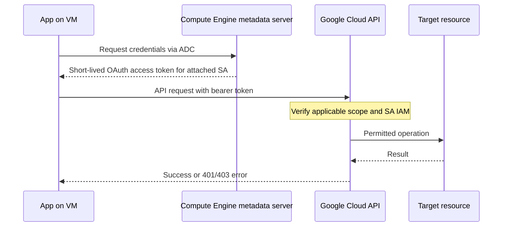

# Attaching Service Accounts and Controlling VM Permissions

> **Chapter:** Compute Engine  
> **Module:** CLOUD_PROVIDERS_GCP  
> **Module Scope:** Exploring Google Cloud from project organization, IAM, and VPC to Compute Engine, GKE, Cloud Run, storage services, and databases. Through deployment scenarios, learners know how to select services, protect resources, automate releases, and track reliability and cost.

A Compute Engine virtual machine frequently needs to call other Google Cloud services: reading configuration from Cloud Storage, writing logs, fetching secrets, or publishing messages. Instead of copying passwords and JSON keys onto the VM, administrators can **attach a service account (SA)** to the VM. Applications inside the VM retrieve short-lived credentials from the **metadata server**, and Google Cloud checks the service account's IAM permissions on the target resources.

The key takeaway of this lesson is that **attaching a service account does not grant full project access to the VM**. API access depends on the **SA's IAM roles** and, for eligible OAuth calls, the **VM's access scopes**. Moreover, **the permissions of the user creating/editing the VM** differ from **the permissions of applications running on the VM**. Understanding these boundaries reduces data leakage, over-privileged workloads, and identity misconfiguration.

## Learning Objectives

After this lesson, you will be able to:

1. Distinguish **user-managed service accounts**, the **Compute Engine default service account**, **Google-managed service agents**, and human user accounts logging into the VM.
2. Explain why both **IAM permissions** on target resources and appropriate **OAuth access scopes** on the VM are needed.
3. Design a least-privilege SA for a specific workload, avoiding misuse of `roles/editor`, `roles/owner`, and JSON service account keys.
4. Distinguish **`iam.serviceAccounts.actAs`** (to attach an SA) from **`iam.serviceAccounts.getAccessToken`** (to impersonate an SA).
5. Attach an SA at VM creation, replace an SA on an existing VM through a controlled process, and verify configs via Console/`gcloud`.
6. Inspect VM identity via the metadata server, use Application Default Credentials (ADC), and diagnose `403`, `401`, missing OAuth scopes, and missing network paths.
7. Audit metadata server safety, logging, IAM changes, and clean up lab resources safely according to ownership.

## 1. Three Commonly Confused Identities

### 1.1. The VM Administrator

This is the **human user** or automation principal running `gcloud compute instances create`, editing instance settings, or deploying images. This principal is evaluated against **Compute Engine API** permissions and, when needed, **service account attachment** permissions. Having SSH access or VM creation rights **does not automatically grant** access to read every Cloud Storage bucket that the VM's SA can access.

### 1.2. The Service Account Attached to the VM

The SA is the **workload identity**. Compute Engine provides short-lived credentials so code on the VM can call APIs on behalf of this SA. A VM can have **at most one service account attached at a time**, while **the same SA can be attached to multiple VMs**. Modifying roles on a shared SA can affect every VM using that SA.

Example user-managed SA email created by an administrator:

```text
vm-object-reader@my-gcp-compute-lab.iam.gserviceaccount.com
```

Create **dedicated SAs per application and environment**, e.g., `orders-dev-vm` separate from `orders-prod-vm`. This limits blast radius if a VM is compromised and simplifies audit analysis compared to sharing one privileged SA.

### 1.3. Google-Managed Service Agents

Certain service agents are created by Google Cloud to operate platform features, such as the Google APIs Service Agent formatted as:

```text
PROJECT_NUMBER@cloudservices.gserviceaccount.com
```

**Never attach a service agent to an application VM.** These serve internal Google Cloud operations and differ from user-managed service accounts. Never delete or modify service agent roles to "clean up" a project without understanding service dependencies.

### 1.4. The Compute Engine Default Service Account

When the Compute Engine API is enabled, a project typically gets a default SA:

```text
PROJECT_NUMBER-compute@developer.gserviceaccount.com
```

If no other SA is chosen, a VM created via Console/CLI may default to this SA depending on configuration. Permissions of the default SA **are not always identical**: older projects may have been auto-granted `roles/editor`, whereas newer organization policies often block automatic grants. For organizations created on or after **2024-05-03**, the `iam.automaticIamGrantsForDefaultServiceAccounts` constraint is enforced by default per Google Cloud docs. Never assume the default SA always has Editor or always has zero permissions; **inspect live IAM bindings**.

**Recommendation:** use a dedicated SA per workload and assign only necessary roles. If the default SA currently holds overly broad roles, assess impact and use **Policy Simulator** or controlled IAM change procedures before narrowing it; do not delete the default SA while workloads still depend on it.

## 2. Authentication and Authorization Model on a VM



How it works in practice:

1. The VM has SA `vm-object-reader@...` attached along with OAuth scopes configured.
2. The application uses **Application Default Credentials (ADC)** from a Google Cloud client library (or another supported mechanism) to obtain credentials from the **metadata server**.
3. The metadata server returns a short-lived token; the application stores no private key.
4. The target service checks the **VM's attached SA** permissions on the bucket, project, or resource. For eligible OAuth APIs, VM access scopes can further restrict calls.
5. As the token nears expiration, compatible client libraries automatically refresh it; IAM changes affect subsequent calls once propagated.

**Code running on a VM assumes the service account's permissions, not automatically the email of whoever SSHed into the machine.** However, if a user runs `gcloud auth login` or sets a custom `GOOGLE_APPLICATION_CREDENTIALS` file inside the VM, commands or programs may use **a different credential**. When troubleshooting, inspect the **actual credential resolution path**, not just the VM's configured identity.

## 3. Two Control Layers: IAM Roles and Access Scopes

### 3.1. IAM Roles Control *What Can Be Done* and *On Which Resource*

IAM binds a principal to a set of permissions on a **resource** (bucket, secret, project, etc.), subject to conditions and inherited policies. For example:

- SA `vm-object-reader@...` holds `roles/storage.objectViewer` **on a single lab bucket**, not project-wide.
- That SA can view/list objects in the bucket, yet lacks `storage.objects.delete` to remove them.
- If the same SA lacks Secret Manager read permissions, code on the VM **cannot access secrets** merely by having a valid SA identity.

Classic permission failure: the token is valid, yet Cloud Storage returns `403 Permission denied` because the SA lacks the required role on that bucket.

### 3.2. Access Scopes Control *Which API Groups the VM's OAuth Token Can Request*

Access scopes are Compute Engine's legacy OAuth restriction mechanism. They are a **per-VM** attribute and do not replace IAM roles:

| VM Setting | Meaning | Effect |
|---|---|---|
| `https://www.googleapis.com/auth/cloud-platform` | Broad OAuth scope for Google Cloud APIs | **Grants no IAM permissions by itself**; ideal when letting IAM enforce fine-grained access |
| `https://www.googleapis.com/auth/devstorage.read_only` | Read-only Cloud Storage OAuth scope | Can block writes via OAuth even if the SA holds a write IAM role |
| Missing required API scope | OAuth token lacks API scope | Requests may fail with `403 Request had insufficient authentication scopes` |
| VM has no SA attached | No workload credential via attached SA | Application must use another approved auth mechanism |

Google Cloud recommends **setting the `cloud-platform` scope** and enforcing granular permissions via IAM on the SA. Picking the broad scope does **not** make a workload Owner or Editor. Conversely, a narrow scope **cannot** compensate for an overly broad IAM role, because scopes restrict by coarse API family and cannot target one specific bucket or secret.

**Important limitation:** access scopes apply to API calls using scope-enforced OAuth mechanisms; they **do not guarantee restrictions across every auth protocol** (such as certain gRPC paths per product docs). Never rely on scopes as your sole security boundary.

### 3.3. Permission Matrix for a Data-Reading VM

Suppose an app only needs to **list and read objects** in bucket `gs://my-lab-read-only-bucket`:

| IAM on SA | Scope on VM | Expected Outcome for Eligible OAuth Calls |
|---|---|---|
| `roles/storage.objectViewer` on exact bucket | `cloud-platform` | Can read/list objects subject to other policies |
| `roles/storage.objectViewer` on exact bucket | `devstorage.read_only` | Can read/list objects per existing permissions |
| **No** object read permission | `cloud-platform` | **Cannot** read the bucket despite broad scope |
| `roles/storage.objectAdmin` on bucket | `devstorage.read_only` | OAuth write calls may be blocked by the narrow scope |
| SA has project-level Editor | `cloud-platform` | Over-privileged risk; review project-level roles |

To determine why a live request fails, check **resource IAM**, **deny policies/conditions**, **scopes**, and **API enablement** together. The software also needs valid networking and API endpoint configuration.

## 4. Permissions to *Attach an SA to a VM* Differ from the SA's Own Permissions

A service account is both a **principal** and a **resource**. Two sets of permissions serve two distinct purposes:

| Question | Relevant Permission | Who Needs It? |
|---|---|---|
| Who can create/modify the VM? | `compute.instances.create`, `compute.instances.setServiceAccount`, `compute.instances.stop/start`, and related perms | VM deployer / administrator |
| Who can **attach** an SA to a VM? | `iam.serviceAccounts.actAs`, typically via `roles/iam.serviceAccountUser` **on that specific SA** | VM deployer |
| Who can grant the SA access **on a bucket**? | Permission to edit the bucket's IAM policy | Resource admin or bucket owner |
| Which objects can the SA on the VM read? | `roles/storage.objectViewer` and other policies on the bucket | The **SA** as the principal |
| Who can **mint access tokens** to impersonate the SA directly? | `iam.serviceAccounts.getAccessToken`, typically via `roles/iam.serviceAccountTokenCreator` | Callers needing direct impersonation, **not** routine VM attachment |

**`roles/iam.serviceAccountUser` is not equivalent to `roles/iam.serviceAccountTokenCreator`.** Service Account User allows attaching an SA to supported resources; Token Creator allows minting short-lived credentials on behalf of the SA and is highly sensitive. Never grant both roles out of habit.

### Permission Boundary Example

```text
Deployer: deployer@example.com
  ├── Has permission to create/edit lab VMs in the project
  └── Has iam.serviceAccounts.actAs on SA vm-object-reader

Service account: vm-object-reader@PROJECT_ID.iam.gserviceaccount.com
  └── Has roles/storage.objectViewer on ONLY the lab bucket

VM: reader-vm
  ├── Attached SA: vm-object-reader
  └── OAuth scope: cloud-platform

Result:
  ├── App on the VM can read the lab bucket if other conditions hold
  ├── App cannot delete objects due to read-only role
  └── Deployer must NOT be assumed able to read the bucket
      using personal credentials just because they can create the VM
```

**Security note:** permission to attach a privileged SA to a VM controlled by the deployer **can lead to exercising that SA's permissions from inside the VM**. Hence `actAs` is not harmless; grant it only on required SAs and audit who can initialize or execute code on the VM.

## 5. Preparing a Controlled Lab

The sample lab uses a **sandbox project and VPC**, a pre-existing bucket holding non-sensitive text files, a new SA, and a dedicated VM. If you lack permission to create VMs or want to avoid charges, you can still perform **all read-only inspection steps** on an owner-approved VM.

**Do not run directly on production projects, VMs holding critical data, or shared SAs.** Attaching or replacing an SA may require **stopping the VM**, causing downtime; VMs, boot disks, static IPs, and network traffic can incur charges.

### 5.1. Sample Variables Table

| Variable | Example | Notes |
|---|---|---|
| `PROJECT_ID` | `my-gcp-compute-lab` | Actual sandbox project ID |
| `ZONE` | `asia-southeast1-a` | Zone with required quota and machine type |
| `SUBNET_NAME` | `lab-subnet` | Subnet in `ZONE`'s region |
| `VM_NAME` | `reader-vm` | Lab VM only; never a production machine |
| `SA_NAME` | `vm-object-reader` | User-managed service account ID |
| `SA_EMAIL` | `vm-object-reader@PROJECT_ID.iam.gserviceaccount.com` | Actual email once created |
| `BUCKET_NAME` | `my-lab-read-only-bucket` | Existing bucket with test data only |
| `OPERATOR_EMAIL` | `deployer@example.com` | User permitted to deploy/attach SA |

Verify beforehand:

1. **Compute Engine API** (`compute.googleapis.com`) and **IAM API** (`iam.googleapis.com`) are enabled if creating resources; enabling APIs requires proper permissions.
2. You hold VM admin permissions for the tasks, SA creation permission if needed, bucket IAM edit permissions, and `actAs` granted **on the exact SA**.
3. The VM has a network path to Google Cloud APIs. If the VM has **no external IP**, configure **Private Google Access**, **Cloud NAT**, or another supported connectivity mechanism matching the subnet and endpoints.
4. Costs, quotas, and **Cloud Billing budgets** are reviewed; budgets/alerts do not automatically shut down VMs when exceeded.
5. A secure SSH path is established, such as IAP TCP forwarding combined with OS Login/IAM where appropriate, rather than opening SSH `0.0.0.0/0`.

### 5.2. Setting Variables and Verifying Project in Cloud Shell

Bash example in **Cloud Shell** or a terminal authenticated with Google Cloud CLI. **Replace all placeholders before running mutating commands**:

```bash
PROJECT_ID="my-gcp-compute-lab"
ZONE="asia-southeast1-a"
SUBNET_NAME="lab-subnet"
VM_NAME="reader-vm"
SA_NAME="vm-object-reader"
SA_EMAIL="$SA_NAME@$PROJECT_ID.iam.gserviceaccount.com"
BUCKET_NAME="my-lab-read-only-bucket"
OPERATOR_EMAIL="deployer@example.com"

# Read-only commands: verify active identity, project, VMs, and target bucket
gcloud auth list --filter="status:ACTIVE"
gcloud projects describe "$PROJECT_ID" \
  --format="table(projectId,projectNumber,name,lifecycleState)"
gcloud compute instances list --project="$PROJECT_ID"
gcloud iam service-accounts list --project="$PROJECT_ID"
gcloud storage ls --project="$PROJECT_ID"

printf 'Project: %s\nVM: %s\nZone: %s\nSA: %s\nBucket: %s\n' \
  "$PROJECT_ID" "$VM_NAME" "$ZONE" "$SA_EMAIL" "$BUCKET_NAME"
```

**Never use example names to delete or alter existing resources.** If `reader-vm` or `vm-object-reader` already exists, confirm ownership before touching it or pick distinct lab names.

## 6. Lab A — Creating an SA and Granting Single-Bucket Read Access

Goal of this section: give the SA **minimal read permissions**, no write/delete rights on the bucket, and no broad project-wide roles.

### 6.1. Console: Creating the Service Account

1. Select the right project in the Google Cloud Console.
2. Go to **IAM & Admin → Service Accounts → Create service account**.
3. Enter ID `vm-object-reader` and a clear description like "Read-only access to lab bucket objects".
4. Create the SA. If prompted to grant project-level roles, **do not select Editor/Owner** and do not grant Storage Object Viewer project-wide when only one bucket is needed.
5. Open **Cloud Storage → Buckets → lab bucket → Permissions**.
6. Add principal `vm-object-reader@PROJECT_ID.iam.gserviceaccount.com` with role **Storage Object Viewer** (`roles/storage.objectViewer`) **on that exact bucket**.
7. Verify the recorded principal, role, and scope; never grant access to `allUsers` or `allAuthenticatedUsers`.

### 6.2. Cloud Shell: Equivalent Commands

For users permitted to create service accounts and edit bucket IAM:

```bash
# Run only if this SA does not yet exist and the project is an authorized sandbox
gcloud iam service-accounts create "$SA_NAME" \
  --project="$PROJECT_ID" \
  --display-name="Read-only VM application identity"

# Verify the created SA
gcloud iam service-accounts describe "$SA_EMAIL" \
  --project="$PROJECT_ID" \
  --format="yaml(email,displayName,disabled)"

# Grant object read access on the exact bucket, NOT project-wide
gcloud storage buckets add-iam-policy-binding "gs://$BUCKET_NAME" \
  --project="$PROJECT_ID" \
  --member="serviceAccount:$SA_EMAIL" \
  --role="roles/storage.objectViewer"

# Inspect the bucket IAM policy
gcloud storage buckets get-iam-policy "gs://$BUCKET_NAME" \
  --project="$PROJECT_ID"
```

If the bucket lives in another project, IAM edit permission is needed on **that bucket**, and flags must reflect the actual project/bucket. **An SA can access resources in another project** if resource IAM permits it; not every role needs to be bound in the project where the SA was created.

**Expected result:** principal `serviceAccount:$SA_EMAIL` appears with `roles/storage.objectViewer` in the bucket IAM policy. Reading the bucket policy alone does not reveal all effective permissions if the SA also holds roles at the project/folder/organization level or is affected by deny policies/conditions.

## 7. Lab B — Allowing a User to Attach the SA to a VM

In this example, `OPERATOR_EMAIL` is an account allowed to create/modify VMs. The SA administrator grants **Service Account User** on **that exact lab SA**:

```bash
gcloud iam service-accounts add-iam-policy-binding "$SA_EMAIL" \
  --project="$PROJECT_ID" \
  --member="user:$OPERATOR_EMAIL" \
  --role="roles/iam.serviceAccountUser"

# View the IAM policy of the SERVICE ACCOUNT ITSELF:
# this policy governs who can use/manage the SA, not the SA's roles on buckets
gcloud iam service-accounts get-iam-policy "$SA_EMAIL" \
  --project="$PROJECT_ID"
```

To operate on VMs, the operator also needs corresponding **Compute Engine permissions**, such as VM creation permissions or `compute.instances.setServiceAccount`, plus network/disk permissions when creating new VMs. `roles/iam.serviceAccountUser` **does not by itself grant** permission to create VMs.

If an operator holds Compute Engine permissions but lacks `actAs`, creating a VM with an attached SA is typically denied. Conversely, having `actAs` without VM creation permissions still prevents creating the machine. **Never grant Token Creator to work around a missing `actAs` permission.**

## 8. Lab C — Attaching an SA When Creating a New VM

### 8.1. Google Cloud Console

1. Open **Compute Engine → VM instances → Create instance**.
2. Choose the project, name `reader-vm`, zone `asia-southeast1-a`, and an approved/budgeted machine type.
3. Choose an OS image compliant with class and organization policies; for Linux, a Google Cloud-supported Debian image works well.
4. Select **VPC/subnet `lab-subnet`** in the matching region. Decide whether an external IP is needed based on VM management access and Google API reachability.
5. Under **Security → Service account**, choose `vm-object-reader@...`. Exact section names/positions may vary across Console versions.
6. For a user-managed SA, the recommended scope option is **Allow full access to all Cloud APIs** (corresponding to `cloud-platform`). **Actual permissions remain governed by the SA's IAM roles.**
7. Review firewalls, SSH/OS Login, disks, metadata, and cost estimates. Do not check "Allow HTTP/HTTPS traffic" unless the VM requires a public frontend.
8. Click **Create**, and once the VM appears, open its details page to confirm the service account and access scopes.

### 8.2. gcloud: Example VM **Without an External IP**

The command below **creates a live VM and may incur charges**. Use it only once the VPC/subnet, Google API reachability, and IAP/SSH paths are ready per policy. On a VM **without an external IP**, lacking Private Google Access or a valid network path will cause calls to many Google Cloud APIs to fail even when IAM and scopes are correct.

```bash
# Run only after confirming subnet region, quota, billing, and permissions
gcloud compute instances create "$VM_NAME" \
  --project="$PROJECT_ID" \
  --zone="$ZONE" \
  --machine-type=e2-small \
  --image-family=debian-12 \
  --image-project=debian-cloud \
  --subnet="$SUBNET_NAME" \
  --no-address \
  --service-account="$SA_EMAIL" \
  --scopes=cloud-platform

# Verify the VM, SA, and OAuth access scopes in Compute Engine config
gcloud compute instances describe "$VM_NAME" \
  --project="$PROJECT_ID" \
  --zone="$ZONE" \
  --format="yaml(name,status,networkInterfaces,serviceAccounts)"
```

Do not run `create` if the VM name already exists. To SSH via IAP, ensure IAP API/roles, TCP 22 connectivity, and OS Login/SSH IAM are configured; this lesson **does not** instruct opening SSH to the Internet.

**Checkpoint:** `serviceAccounts[].email` shows the lab SA and `serviceAccounts[].scopes` includes `https://www.googleapis.com/auth/cloud-platform`. Applications on the VM can now fetch credentials, though testing against target resources is still required to confirm effective permissions.

## 9. Lab D — Changing the Service Account of an Existing VM

Changing the SA on an existing VM is a **service-impacting change**, not just an IAM role assignment. Per Compute Engine guidance, you must **stop the VM before changing its SA or access scopes**, then start it again.

### 9.1. Before Stopping the VM

1. Choose only a **lab VM you are authorized to operate**; notify system owners if the machine hosts active workloads or users.
2. Record the current SA, scopes, IPs, disks, and dependencies to preserve a rollback plan.
3. Determine acceptable downtime; stopping interrupts running processes and affects ephemeral IPs or in-memory application state.
4. Verify permissions for `compute.instances.stop`, `compute.instances.start`, `compute.instances.setServiceAccount`, and `actAs` on the new SA.
5. If the VM belongs to a managed instance group (MIG), update the **instance template** and perform a MIG rolling update rather than manually editing an instance the group will replace.

### 9.2. Method A: Console

1. Open **Compute Engine → VM instances** and select the lab VM.
2. Go to **Details** and record the current service account and access scopes.
3. **Stop** the VM; wait for `TERMINATED` or full stop completion.
4. Click **Edit**, locate **Service account**, and select the newly approved SA.
5. Select the recommended `cloud-platform` scope; available options depend on SA type and UI state.
6. **Save**, review the configuration, and **Start/Resume** the VM.
7. Wait for the application to recover, then verify the metadata server, API permissions, and operational metrics.

### 9.3. Method B: Cloud Shell (Lab VM Only)

```bash
# Inspect SA and scopes BEFORE editing to keep rollback info
gcloud compute instances describe "$VM_NAME" \
  --project="$PROJECT_ID" \
  --zone="$ZONE" \
  --format="yaml(name,status,serviceAccounts)"

# Run only within an approved change window
gcloud compute instances stop "$VM_NAME" \
  --project="$PROJECT_ID" \
  --zone="$ZONE"

# VM must be stopped before updating SA and scopes
gcloud compute instances set-service-account "$VM_NAME" \
  --project="$PROJECT_ID" \
  --zone="$ZONE" \
  --service-account="$SA_EMAIL" \
  --scopes=cloud-platform

gcloud compute instances start "$VM_NAME" \
  --project="$PROJECT_ID" \
  --zone="$ZONE"

# Read back the updated config once the VM is running
gcloud compute instances describe "$VM_NAME" \
  --project="$PROJECT_ID" \
  --zone="$ZONE" \
  --format="yaml(name,status,serviceAccounts)"
```

`set-service-account` does not create a new service account; it updates the SA/scopes **attached to the VM**. Passing `--no-service-account` detaches any SA from the VM, which will break applications relying on metadata credentials to call Google Cloud APIs.

**Never test changing a production SA just to verify the command.** To trim workload permissions without swapping the SA identity, consider updating the SA's **IAM bindings**, keeping in mind that affects **every VM sharing that SA** and also requires change control.

## 10. Verifying Identity from Inside the VM

Compute Engine exposes the **metadata server** at `metadata.google.internal` or `169.254.169.254`. A VM with an attached SA can query service account metadata endpoints.

### 10.1. Safe Queries — **Never Print Tokens**

Run these commands **inside the Linux VM**, not from your laptop or Cloud Shell to infer the VM's identity:

```bash
# Check the attached SA email via the metadata server
curl --fail --silent --show-error \
  --header "Metadata-Flavor: Google" \
  "http://metadata.google.internal/computeMetadata/v1/instance/service-accounts/default/email"

# Inspect OAuth scopes attached to the VM
curl --fail --silent --show-error \
  --header "Metadata-Flavor: Google" \
  "http://metadata.google.internal/computeMetadata/v1/instance/service-accounts/default/scopes"
```

`default` in the metadata path is an alias for **the SA currently attached to the VM**, not necessarily the project's **Compute Engine default service account**.

Other metadata endpoints return **OAuth access tokens**. **Never print or share responses containing `access_token`**, as tokens are bearer secrets usable while valid. When calling APIs, prefer Google Cloud client libraries using ADC to acquire and refresh tokens automatically.

### 10.2. Inspecting Externally with gcloud

Users with VM view permissions can verify the configuration without SSH:

```bash
gcloud compute instances describe "$VM_NAME" \
  --zone="$ZONE" \
  --project="$PROJECT_ID" \
  --format="yaml(name,status,serviceAccounts)"
```

This shows the VM's SA/scopes setting in Compute Engine, **not proof that code inside the VM is using that credential**. If someone ran `gcloud auth login` inside the guest OS or pointed an environment variable at a key file, programs may authenticate as a different identity.

### 10.3. Testing Cloud Storage Read Access

If the VM has network reachability to APIs, Google Cloud CLI installed, and **no extra user credentials logged in**, test:

```bash
# Run INSIDE the VM against the existing authorized lab bucket
gcloud storage ls "gs://my-lab-read-only-bucket"
```

Substitute your actual lab bucket name. `ls` is read-only and creates or deletes nothing. To confirm it uses the **attached service account**, cross-check the metadata email and how `gcloud` resolves credentials; `gcloud auth list` may reveal logged-in user accounts, though it is not complete proof of which token an application uses.

In Java, Python, Go, or Node.js applications, Google Cloud client libraries typically rely on ADC:

```text
Application calls API via Google Cloud client library
  └── ADC searches the environment for credentials
      ├── GOOGLE_APPLICATION_CREDENTIALS if set
      ├── Local developer credentials if present
      └── Compute Engine metadata server when running on a supported VM
```

Avoid setting `GOOGLE_APPLICATION_CREDENTIALS` to a JSON private key unless required. On a Compute Engine VM, the metadata server is the recommended workload credential source.

## 11. Distinguishing VM SSH Access from Google Cloud API Permissions

Logging into a VM's operating system and calling Google Cloud APIs are two distinct authorization domains:

| Activity | Usually Checked | Do Not Confuse With |
|---|---|---|
| View/create/edit VM via Console/API | Operator's Compute Engine IAM permissions | Roles granted to apps running inside the guest OS |
| SSH into a Linux VM | OS Login/SSH keys, IAM/guest agent, IAP/network/firewalls per config | `roles/storage.objectViewer` on the attached SA |
| App on VM reads a bucket | SA token via metadata/ADC, SA's IAM on bucket, scopes, network | Operator's SSH permissions |
| Attaching an SA to a VM | Operator's `iam.serviceAccounts.actAs` + Compute Engine permissions | `roles/iam.serviceAccountTokenCreator` |
| Impersonating an SA from a laptop | `iam.serviceAccounts.getAccessToken` / Token Creator | Attaching an SA to a VM |

An engineer may be able to SSH into a VM via OS Login while having zero personal Storage Object Viewer access; code running with the **attached SA** can still read the bucket using the SA's token. Therefore, **code execution access on a VM is a critical security boundary**: anyone who can run code on the VM can generally exercise the permissions of its attached SA.

## 12. Metadata Server Safety and Credential Protection

### 12.1. Why Is the Metadata Server Sensitive?

The metadata server exists so workloads on the VM can read configuration and obtain short-lived credentials. Any malicious code or untrusted process able to query allowed metadata endpoints risks obtaining tokens for the **attached SA**.

One major risk is **Server-Side Request Forgery (SSRF)**: an app accepts a URL from an untrusted client and fetches internal addresses or metadata endpoints server-side. If the app allows arbitrary headers or has related vulnerabilities, attackers may exploit this path. Never treat the `Metadata-Flavor: Google` header as an application's sole defense.

### 12.2. Mitigation Principles

1. **Least-privilege SA:** give each VM/workload its own SA with tightly scoped resource roles; avoid Editor/Owner.
2. **No JSON keys:** use short-lived metadata/ADC credentials; enforce org policies restricting key creation or upload where appropriate.
3. **Control code on the VM:** restrict SSH, root access, software installation, and untrusted containers to authorized users and pipelines.
4. **Protect metadata call paths:** prevent SSRF, validate destination URLs and redirects, block unintended proxy forwarding; use OS/app protections rather than attempting to alter the metadata server itself.
5. **Isolate SAs by environment and app:** never attach a production SA to test VMs or jobs running untrusted third-party code.
6. **Monitor IAM and audit logs:** track who edits SAs/VMs, who attaches which SA, and which APIs are invoked.
7. **Shrink permissions systematically:** use Policy Analyzer/Simulator, review SA usage insights, and test in staging before removing key roles.
8. **Protect token lifecycle:** short-lived tokens are still secrets; never print them to stdout, logs, CI artifacts, chat, or Git.

### 12.3. IAM Conditions, Deny Policies, and Organization Policies

Beyond role allow policies, effective access is shaped by **IAM Conditions**, **deny policies**, **Organization Policies**, and service constraints. For example, an org may block creating long-lived SA keys or restrict attaching SAs from other projects. Never "fix" an error by granting project-level Editor without diagnosing the exact missing permission.

### 12.4. Attaching a Service Account from Another Project

Some organizations centralize SAs in a dedicated project and attach them to VMs in other projects. This requires enabling Google Cloud-supported **cross-project service account usage**, compatible Organization Policies, and permissions for both deployers and the Compute Engine service agent.

**Never assume `roles/iam.serviceAccountUser` on the SA is enough** when the VM and SA reside in different projects. For foundational labs, keep the VM and SA in the **same project** to avoid organizational policy changes.

## 13. Observing and Auditing VM Permissions

### 13.1. What Should You Audit?

- **VM configuration:** SA email, OAuth scopes, zone, network, image, and modification timestamps.
- **IAM policy on the SA (as a resource):** who has `actAs`, impersonation, or SA admin rights.
- **IAM on target resources:** what roles the SA holds on buckets, secrets, or projects; inherited/deny policies and conditions.
- **Cloud Audit Logs:** who created/edited the VM, changed the SA, or altered IAM; Data Access logs if enabled.
- **Application telemetry:** request success/failure rates, HTTP status codes, quotas, auth errors, trace IDs.
- **Guest OS security:** OS Login, agents, patches, code execution permissions, and traces of alternate credential configs.

### 13.2. Read-Only Inventory Commands

```bash
# Actual SA email/scopes attached to a VM
gcloud compute instances describe "$VM_NAME" \
  --project="$PROJECT_ID" --zone="$ZONE" \
  --format="yaml(name,status,serviceAccounts)"

# Inspect SA resource and who holds bindings on the SA itself
gcloud iam service-accounts describe "$SA_EMAIL" --project="$PROJECT_ID"
gcloud iam service-accounts get-iam-policy "$SA_EMAIL" --project="$PROJECT_ID"

# Inspect bucket IAM - what permissions does the SA hold on the lab bucket?
gcloud storage buckets get-iam-policy "gs://$BUCKET_NAME" \
  --project="$PROJECT_ID"
```

**Note:** `get-iam-policy` **on a service account** shows who can use or manage the **SA resource**, not all the roles **granted to the SA** on projects or buckets. To inspect what the SA can access, check the IAM policy of **target resources** or use **IAM Policy Analyzer/Troubleshooter**.

### 13.3. Logging Changes

Cloud Audit Logs for `compute.googleapis.com` capture VM creation and modification events, including service account changes where logged. IAM updates on buckets or SAs also emit audit logs for their respective services. Data Access logs may require explicit policy enablement; do not assume every object read is logged by default.

When investigating, correlate:

```text
Who modified the VM configuration?
  → Which SA is attached? Which scopes?
    → What IAM bindings does the SA hold on resources?
      → Which API requests were denied or allowed?
        → Are untrusted users or processes running on the VM?
```

## 14. Common Issues: Layered Troubleshooting

| Symptom | Likely Cause | How to Check |
|---|---|---|
| Cannot create VM when selecting SA | Operator lacks `iam.serviceAccounts.actAs` or VM/network/disk perms | Read permission error; check IAM on SA and project/subnet |
| `gcloud compute instances set-service-account` denied | VM not stopped, missing `compute.instances.setServiceAccount` or `actAs` | Verify VM state and both permission layers |
| Metadata endpoint `.../default/email` empty/errors | No SA attached or code not running inside a valid Compute Engine VM | Check `instances describe` and execution environment |
| `403 Request had insufficient authentication scopes` | VM has narrow OAuth scope | Check `serviceAccounts[].scopes`; switch to `cloud-platform` via stop/edit/start |
| `403 Permission denied` reading bucket | SA lacks permission or blocked by condition/deny | Inspect bucket IAM, inherited roles, and Cloud Audit Logs |
| `401 Unauthorized` | Missing, expired, or wrong-audience token | Verify ADC, token refresh, audience/type, and clock skew |
| VM cannot call API despite valid IAM | Missing egress, Private Google Access, NAT, route, or DNS | Inspect VPC/subnet, DNS, egress firewalls, and endpoints |
| Commands use human email instead of SA | `gcloud auth login` or another ADC/key file present on VM | Check credential resolution chain; never print tokens |
| Newly granted role does not work yet | IAM propagation delay or cached token/state | Wait briefly for propagation and re-verify permissions |
| SA attached cleanly yet API still fails | API not enabled in target project or blocked by policy/quota | Run `gcloud services list --enabled` and inspect API error |
| Unexpected access to extra buckets | SA still holds `roles/editor` or broad project/folder/org roles | Use IAM Policy Analyzer/Troubleshooter and trim systematically |
| Removing a role breaks another workload | Multiple VMs share the same SA | Inventory VM/SA mappings before editing; split SAs per app |

### Six-Step Diagnostic Flow

1. **Right VM/project/zone?** Inspect the VM and service account with `instances describe`.
2. **Which credential is code using?** Check metadata email, ADC, environment variables, and active `gcloud` accounts on the VM.
3. **Are scopes sufficient?** For OAuth calls, verify `cloud-platform` or required API scopes.
4. **Does the SA hold target resource permissions?** Check resource IAM, conditions, inherited roles, and deny policies.
5. **Are APIs and networking working?** Verify API enablement, quotas, DNS, routing, and egress firewalls.
6. **What do logs say?** Correlate request IDs, audit logs, and application logs before altering IAM.

## 15. Three Design Scenarios

### Scenario A — Image-Processing VM Needing Read-Only Cloud Storage

An app on a VM processes images from bucket `incoming-images` without deleting or administering the bucket. Create a dedicated SA, grant `roles/storage.objectViewer` on **that bucket**, and attach it to the VM with scope `cloud-platform`. Code uses ADC; deployers hold `actAs` only on that SA. Input image reads are governed by resource IAM.

**Mistake to avoid:** granting project-level `roles/storage.admin` or Editor merely so the app can download images.

### Scenario B — Application VM Needing Secret Manager

An API on a VM needs to read **one specific secret**. Create an SA for the API, grant `roles/secretmanager.secretAccessor` on **that secret** (with policy constraints as appropriate). Attach the SA and fetch the secret via client libraries using ADC. Restrict who can SSH or run code on the VM, because anyone controlling code on the VM can leverage the SA's secret access.

**Mistake to avoid:** copying secrets into startup scripts, metadata visible inside the guest OS, or granting Secret Manager Admin project-wide.

### Scenario C — Multiple Environments Sharing One Privileged SA

A team attaches `shared-vm-sa` across dev, staging, and production. When extra permissions are added for production, dev VMs inherit them too. If a dev VM is compromised, an attacker can abuse the SA's credentials to access production resources permitted by those roles.

**Solution:** inventory all VMs using the shared SA, plan per-app and per-environment SAs with least-privilege resource bindings, update VM configs during maintenance windows, and monitor audit logs. Do not delete the shared SA until all dependent workloads have migrated off it.

## 16. Cleaning Up Lab Resources and Restoring Configuration

### 16.1. Cleanup Rules

Clean up **only resources created by this lab**. Never delete pre-existing buckets, default service accounts, service agents, or shared VMs. Deleting an SA can break every VM referencing it; deleting a VM can auto-delete its boot disk and destroy test data.

**If you created a brand-new VM solely for this lab:** delete the VM after saving any needed results/backups, then revoke SA bindings and delete the dedicated lab SA.

**If you swapped the SA on an existing VM:** before wrapping up, **restore the original SA and scopes** via stop → set-service-account → start if that change was intended as temporary and confirmed with the owner; never delete the VM or leave an unapproved identity behind.

### 16.2. Inventory Before Deleting

```bash
printf 'Project: %s\nVM: %s\nZone: %s\nSA: %s\nBucket: %s\nOperator: %s\n' \
  "$PROJECT_ID" "$VM_NAME" "$ZONE" "$SA_EMAIL" "$BUCKET_NAME" "$OPERATOR_EMAIL"

gcloud compute instances describe "$VM_NAME" \
  --project="$PROJECT_ID" --zone="$ZONE" \
  --format="yaml(name,status,serviceAccounts,disks)"

gcloud iam service-accounts describe "$SA_EMAIL" --project="$PROJECT_ID"
gcloud iam service-accounts get-iam-policy "$SA_EMAIL" --project="$PROJECT_ID"
gcloud storage buckets get-iam-policy "gs://$BUCKET_NAME" --project="$PROJECT_ID"
```

### 16.3. Deleting the VM **Only When Created Exclusively for This Lab**

```bash
# Non-recoverable VM deletion; verify boot disk, IPs, snapshots,
# and any data/config to keep before running
gcloud compute instances delete "$VM_NAME" \
  --project="$PROJECT_ID" --zone="$ZONE"
```

If you only changed the SA on a pre-existing VM, **do not run delete**. Restore the original service account and scopes first, confirm the app works, and only then revoke lab bindings.

### 16.4. Revoking Lab IAM Bindings

```bash
# Remove lab SA read access on bucket; leave other owners' IAM untouched
gcloud storage buckets remove-iam-policy-binding "gs://$BUCKET_NAME" \
  --project="$PROJECT_ID" \
  --member="serviceAccount:$SA_EMAIL" \
  --role="roles/storage.objectViewer"

# Remove operator's actAs permission on this lab SA
gcloud iam service-accounts remove-iam-policy-binding "$SA_EMAIL" \
  --project="$PROJECT_ID" \
  --member="user:$OPERATOR_EMAIL" \
  --role="roles/iam.serviceAccountUser"
```

Once certain **no VMs, instance templates, managed instance groups, or workflows still reference the lab SA**, an authorized user can delete the **lab-created SA**:

```bash
# Delete only the dedicated SA created for this lesson, unused elsewhere
gcloud iam service-accounts delete "$SA_EMAIL" --project="$PROJECT_ID"

# Re-inventory VMs and SAs after cleanup
gcloud compute instances list --project="$PROJECT_ID"
gcloud iam service-accounts list --project="$PROJECT_ID"
```

Do not delete buckets that existed prior to the lesson. Note remaining disks, static IPs, snapshots, and other billable resources. Cloud Billing Reports may lag; budget alerts are not hard spending caps.

## 17. Lab Completion Checklist

| Item | Expected Evidence |
|---|---|
| Identities | Distinguished VM creator, attached SA, default SA, and service agents |
| Lab SA | Dedicated user-managed SA for the workload, without Editor/Owner |
| Bucket IAM | SA holds only `roles/storage.objectViewer` on the authorized bucket |
| Attachment perm | Operator holds `actAs` on that SA plus required Compute Engine perms |
| VM | `serviceAccounts[].email` matches the lab SA |
| Access scopes | `cloud-platform` or appropriate scope verified |
| Metadata | `/default/email` endpoint returns the attached SA |
| API | Successfully read test lab data via SA credentials when network and IAM allow |
| Security | Created no JSON private keys, opened no unrestricted SSH, printed no bearer tokens |
| Auditing | Know how to inspect roles on the SA resource and roles held by the SA on target resources |
| Cleanup | Removed **lab-only** VM/SA/bindings or restored pre-existing VM |
| Cost | Verified remaining VMs/disks/IPs and checked Billing/budgets |

## 18. Self-Check Questions

**1. Can a VM attach two service accounts simultaneously so the app chooses between them?**  
**Answer:** No. Compute Engine permits **one attached service account per VM at a time**. Use delegation/impersonation or split workloads when multiple identities are truly required, per supported patterns.

**2. Why does Google recommend the `cloud-platform` scope even when restricting permissions?**  
**Answer:** This scope prevents OAuth calls to Google Cloud APIs from failing due to overly narrow scopes, while the SA's **IAM roles** enforce fine-grained per-resource access.

**3. An SA has `roles/storage.objectViewer` on a bucket while the VM has scope `devstorage.read_only`. Can it read objects?**  
**Answer:** Generally yes for supported OAuth read calls, provided bucket IAM, policies, and networking are valid.

**4. A VM has the `cloud-platform` scope, yet its SA has no permissions granted on a bucket. Can it read the bucket?**  
**Answer:** Not from the broad scope alone. Required IAM permissions on the target resource are still necessary.

**5. How does `roles/iam.serviceAccountUser` differ from `roles/iam.serviceAccountTokenCreator`?**  
**Answer:** Service Account User grants `actAs` to attach an SA to a resource; Token Creator allows minting credentials/impersonating the SA per the role's permissions.

**6. Why does changing the attached SA on a production VM require a maintenance window?**  
**Answer:** Compute Engine requires stopping the VM to update its SA/scopes; downtime and permission changes can disrupt running applications.

**7. Does metadata path `/instance/service-accounts/default/email` always return the project's default SA?**  
**Answer:** No. `default` in the metadata path is an alias for **the SA currently attached to that VM**.

**8. Why is SSH access to a VM an IAM risk for its attached SA?**  
**Answer:** Any user or process able to execute code inside the VM can use the SA's metadata credentials within the bounds of its granted permissions.

**9. Why does a `403` error not necessarily mean a missing IAM role?**  
**Answer:** It could be caused by missing OAuth scopes, IAM Conditions/deny policies, other org policies, or API restrictions; inspect the full error message.

**10. Why should you never delete the default Compute Engine service account to finish a lab?**  
**Answer:** Other VMs or workloads may rely on it; delete only the dedicated SA created specifically for the lab after confirming zero dependencies remain.

## Key Takeaways

- **VM deployers** and **workload SAs** are distinct identities with separate permissions. Attaching an SA requires both Compute Engine permissions and `actAs` on that SA.
- **IAM governs actions on resources; OAuth access scopes can further restrict VM calls.** Prefer `cloud-platform` scopes paired with tight IAM bindings.
- **A VM attaches at most one SA**, whereas one SA can serve multiple VMs; changing roles on a shared SA impacts every application using it.
- **ADC and the metadata server** deliver short-lived tokens without JSON keys, yet tokens remain secrets and anyone executing code on the VM can leverage the SA's permissions.
- **Updating SA/scopes on an existing VM follows stop → set-service-account → start**, requiring checks on downtime, permissions, and rollback readiness.
- **Least privilege, auditing, and controlled cleanup** protect data, preserve reliability, and prevent unnecessary Compute Engine charges.

## Official Documentation References

- [Google Cloud — Service accounts for Compute Engine](https://cloud.google.com/compute/docs/access/service-accounts)
- [Google Cloud — Create a VM that uses a user-managed service account](https://cloud.google.com/compute/docs/access/create-enable-service-accounts-for-instances)
- [Google Cloud — Change the attached service account](https://cloud.google.com/compute/docs/instances/change-service-account)
- [Google Cloud — gcloud compute instances set-service-account](https://cloud.google.com/sdk/gcloud/reference/compute/instances/set-service-account)
- [Google Cloud — View and query VM metadata](https://cloud.google.com/compute/docs/metadata/querying-metadata)
- [Google Cloud — Attach service accounts to resources](https://cloud.google.com/iam/docs/attach-service-accounts)
- [Google Cloud — Best practices for using service accounts](https://cloud.google.com/iam/docs/best-practices-service-accounts)
- [Google Cloud — Application Default Credentials](https://cloud.google.com/docs/authentication/application-default-credentials)
