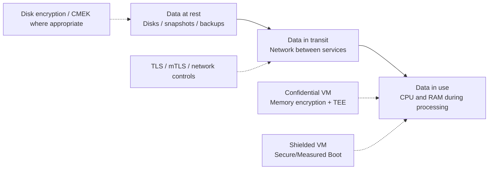
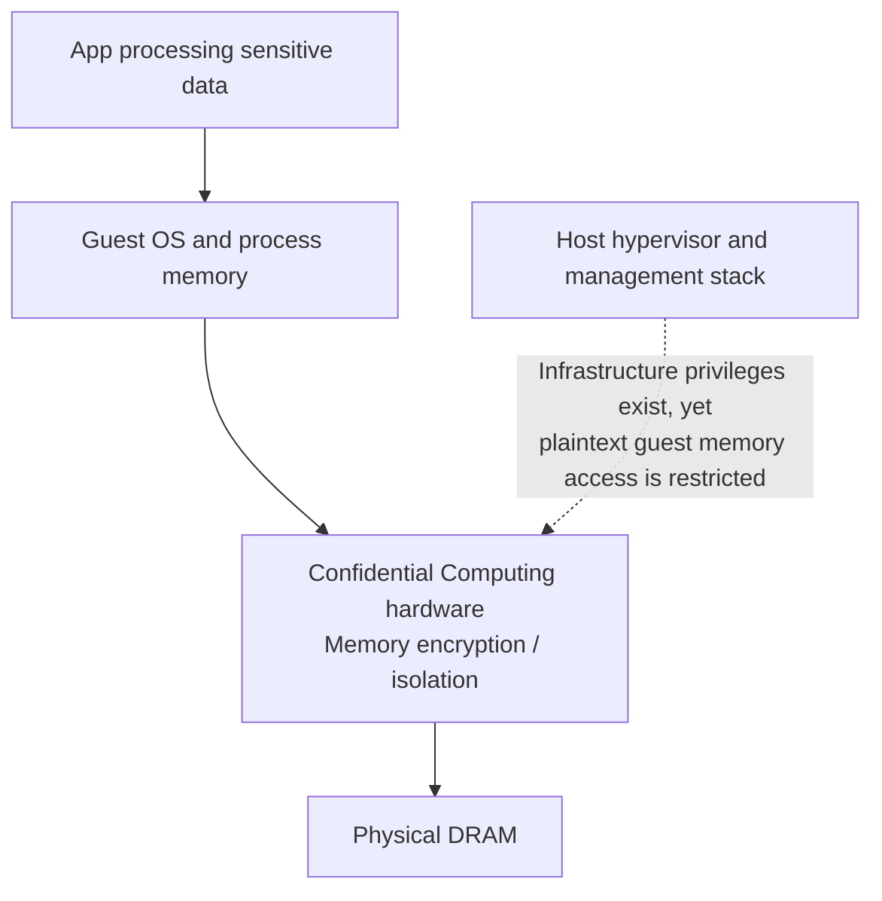
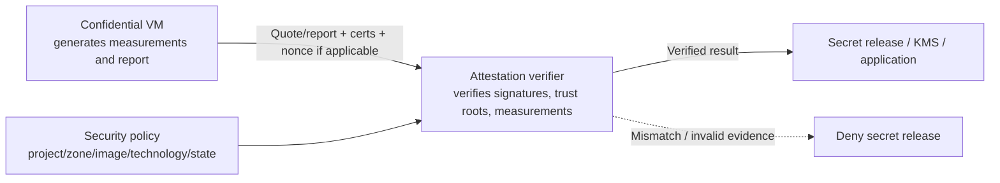
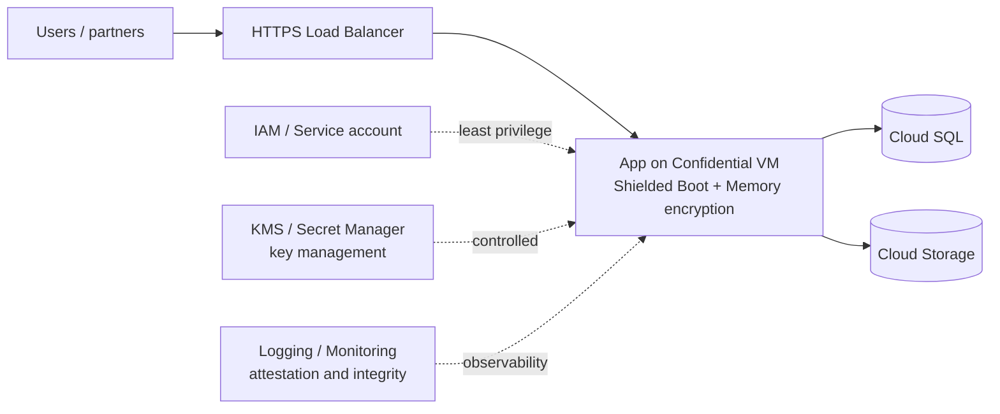

# Shielded VM and Confidential VM

## 1. Why Virtual Machine Security Is More Than Firewalls and IAM

Suppose an enterprise runs a transaction-processing system on **Compute Engine**. Operations has locked down IAM permissions, opened only necessary VPC ports, placed HTTPS in front of the service, encrypted disks, and configured backups. Yet two critical questions remain:

1. **When a VM boots, how do we know the firmware, bootloader, and kernel have not been tampered with?**
2. **While the program is running and data is decrypted in RAM, what technology helps reduce the risk of data being read from the host/hypervisor layer?**

Google Cloud provides two related—but **not synonymous**—sets of capabilities:

- **Shielded VM:** strengthens the integrity and trustworthiness of the **boot chain** through Secure Boot, a virtual Trusted Platform Module (vTPM), Measured Boot, and Integrity Monitoring.
- **Confidential VM:** uses hardware-backed **Confidential Computing** technologies on the CPU to **encrypt memory in use**, reducing certain risks from infrastructure layers outside the guest; it also supports **attestation** mechanisms tailored to the CPU technology.

The two technologies can **complement each other**. Confidential VMs also include Shielded VM capabilities such as vTPM and Integrity Monitoring; memory protection does not replace boot-chain verification. Within the **CLOUD_PROVIDERS_GCP** module, this lesson connects **Compute Engine** with IAM, VPC, organizational governance, Cloud KMS, CI/CD, reliability monitoring, and cost.

After this lesson, you will be able to:

1. Explain the threat model and boundaries of Shielded VM vs. Confidential VM.
2. Distinguish **Secure Boot**, **Measured Boot**, **integrity baseline**, **memory encryption**, and **attestation**.
3. Select appropriate configurations by OS image, machine series, CPU platform, zone, host maintenance, and target protection level.
4. Inspect, create, and modify Shielded VM configurations using Console/`gcloud` without causing unplanned production downtime.
5. Create a Confidential VM using supported technologies, understanding constraints around live migration, disks, GPUs, and converting existing VMs.
6. Interpret integrity signals, troubleshoot Secure Boot failures, and establish safe incident response procedures.
7. Integrate these protection layers with IAM, Organization Policy, networking, encryption at rest/in transit, backups, and application operations.

> **Lab Note:** All Project IDs, VMs, zones, and resource names in this lesson are **hypothetical examples**. Commands that create or stop VMs can incur charges and cause service interruption. Verify permissions, quotas, machine types, availability, and approvals before executing.

## 2. Quick Distinction: Protecting Boot Integrity vs. Data in Use

| Criterion | Shielded VM | Confidential VM |
| --- | --- | --- |
| **Primary Goal** | Detect/prevent unauthorized tampering in the boot chain | Reduce exposure of guest data and code in **memory in use** from external layers |
| **Underlying Technology** | UEFI Secure Boot, vTPM, Measured Boot, Integrity Monitoring | AMD SEV, AMD SEV-SNP, Intel TDX; supported GPU setups add GPU-specific capabilities |
| **Secure Boot** | Verifies boot component signatures and can block boot if invalid | Can be enabled as an additional layer if supported by image/config |
| **vTPM** | Stores boot measurements; TPM 2.0 compliant | Still provided; can support boot measurement and attestation depending on Confidential Computing type |
| **Integrity Monitoring** | Compares boot measurements against a baseline | Yes, monitors boot; hardware attestation can supply additional evidence |
| **CPU TEE RAM Encryption** | **Not the purpose** of Shielded VM | **Yes**, with CPU-specific mechanisms and guarantees |
| **Supported Machine Scope** | Broad Compute Engine image/machine configurations | Only specifically listed CPUs, machine types, OS images, and zones |
| **Feature Surcharge** | No separate charge for Shielded VM | Carries a **Confidential VM surcharge** on top of Compute Engine pricing per current rate cards |
| **Operational Impact** | Secure Boot can block unsigned drivers/kernels; baseline shifts after updates | May restrict disk types, machine types, live migration, and features; requires benchmarking |
| **Replaces IAM/VPC/TLS/backups?** | **No** | **No** |

**One sentence to remember:** Shielded VM asks **"Did the VM boot the expected code chain?"**; Confidential VM further asks **"How are guest data and code in memory isolated from certain host-level risks?"**.

### Three States of Data



The diagram illustrates **complementary protection layers**—it does not mean Shielded VM directly encrypts data in use. Encryption at rest is no longer enough once data is decrypted in RAM for CPU/application processing; Confidential Computing targets that gap.

## 3. How Does Shielded VM Work?

### 3.1. UEFI Secure Boot: Signature Verification Before Execution

**Secure Boot** relies on UEFI and a set of trusted keys/certificates. During boot, firmware verifies digital signatures on components such as the bootloader and low-level boot code along the boot chain. Components lacking valid signatures can be refused execution, mitigating bootkits and certain persistent rootkits across reboots.

Key points to understand:

- Secure Boot is **not enabled by default** on every new Shielded VM because some unsigned kernel modules, drivers, or custom boot code may be incompatible.
- On supported images, **vTPM and Integrity Monitoring are typically enabled by default**, whereas **Secure Boot must be enabled explicitly**.
- Secure Boot is **not an antivirus** and does not guarantee userspace programs are free of vulnerabilities.
- A self-compiled kernel module, GPU driver, or custom bootloader can prevent a VM from **booting** when Secure Boot is enabled. Test images and drivers beforehand.
- For Windows, track **Microsoft Secure Boot certificate** updates per vendor advisories to avoid certificate lifecycle issues.

When Secure Boot blocks a component, the serial console may show messages resembling `UEFI: Failed to load image` and `Status: Security Violation`. This is a signal to investigate the boot chain, **not a reason to permanently disable Secure Boot by default**.

### 3.2. vTPM and Measured Boot: Recording What Was Loaded

A **Virtual Trusted Platform Module (vTPM)** is a virtual TPM 2.0-compliant device. With **Measured Boot**, each boot component is measured (hashed), and measurements are extended sequentially into **Platform Configuration Registers (PCRs)**. They reflect what components were loaded and in what order.

```text
Firmware / UEFI
      ↓  measurement
Bootloader
      ↓  measurement
Kernel + boot drivers
      ↓  measurement
PCR values / boot measurements in vTPM
      ↓
Integrity Monitoring compares against trusted baseline
```

**Distinguish the two behaviors:**

- **Secure Boot** can **block** components that fail signature checks from running.
- **Measured Boot** records **what was loaded**; measuring alone does not automatically block execution.

The vTPM can also support tasks like sealing secrets bound to TPM state. Using secret sealing requires application design and key recovery planning; do not assume every VM secret is automatically sealed into the vTPM.

### 3.3. Integrity Monitoring: Comparing Against a Baseline

When a Shielded VM boots for the first time, the platform establishes an **integrity policy baseline** from the initial trusted boot state. Subsequent boots generate fresh measurements compared against that baseline:

- **Early Boot Validation:** covers UEFI firmware up to handoff to the bootloader.
- **Late Boot Validation:** covers from the bootloader through the relevant kernel initialization phase.

If measurements mismatch, Google Cloud emits an **integrity validation failure**, visible in **Cloud Logging** and **Cloud Monitoring**. A mismatch **may reflect a legitimate kernel update**, or it may indicate tampering or unauthorized modification.

> **Never click "learn new baseline" immediately upon seeing a red alert.** Investigate the root cause first; record a new baseline only after verifying that an approved update occurred. Accepting a compromised boot state as the baseline hides the breach.

## 4. Defaults and Dependencies Between Options

| Shielded VM Option | Common Default on Supported VMs | Notes |
| --- | --- | --- |
| **Secure Boot** | Disabled by default | Should be enabled after testing bootloaders, kernels, and drivers |
| **vTPM** | Enabled | Disabling vTPM **also disables Integrity Monitoring** |
| **Integrity Monitoring** | Enabled | Depends on measurements from vTPM / Measured Boot |

Actual configuration can be governed by the **image, Organization Policy, and creator flags**. Always run `gcloud compute instances describe` to confirm rather than assuming defaults.

### Related IAM Permissions

| Action | Commonly Involved Permission | Principle |
| --- | --- | --- |
| View VM and Shielded config | `compute.instances.get` | Grant read access at appropriate project/resource scope |
| Create VM | `compute.instances.create` plus supporting perms | Never requires granting Owner just to create VMs |
| Edit Shielded options | `compute.instances.updateShieldedInstanceConfig` | Requires change control and stopping the VM |
| Update integrity baseline | `compute.instances.setShieldedInstanceIntegrityPolicy` | Restrict tightly since it can mask unwanted boot states |
| Enforce org-wide constraint | Organization Policy Admin permissions | Subject to review; do not grant to every workload admin |

## 5. Creating and Inspecting a Shielded VM with gcloud

Suppose you use **project** `acme-security-lab`, **zone** `asia-southeast1-a`, and a Linux image supporting Shielded VM. A test VM can be created with:

```bash
# May incur charges: run only in an authorized lab project
gcloud compute instances create shielded-demo \
  --project=acme-security-lab \
  --zone=asia-southeast1-a \
  --machine-type=e2-standard-2 \
  --image-project=ubuntu-os-cloud \
  --image-family=ubuntu-2404-lts-amd64 \
  --shielded-secure-boot \
  --shielded-vtpm \
  --shielded-integrity-monitoring \
  --no-address
```

**Explanation:** `--shielded-secure-boot` enables Secure Boot; vTPM and Integrity Monitoring are specified explicitly for clarity. `--no-address` omits an external IPv4 address, though the VM has no default Internet egress; installing packages may require Cloud NAT or another egress path.

If your account lacks permissions, the zone lacks support, or the image changed, the command will fail. Never strip out security flags just to claim "the lab succeeded."

### Inspecting Configuration with Read-Only Commands

```bash
gcloud compute instances describe shielded-demo \
  --project=acme-security-lab \
  --zone=asia-southeast1-a \
  --format="yaml(name,status,machineType,shieldedInstanceConfig,shieldedInstanceIntegrityPolicy)"
```

Under `shieldedInstanceConfig`, verify fields such as:

```yaml
shieldedInstanceConfig:
  enableSecureBoot: true
  enableVtpm: true
  enableIntegrityMonitoring: true
```

This is an **illustrative output snippet**, not live output from a real project. In Google Cloud Console: **Compute Engine → VM instances → VM details → Security** displays the equivalent settings.

### Changing Options on an Existing VM

To modify Shielded options, documentation requires **stopping the VM before updating**:

```bash
# Disruptive action: perform only within an approved change window
gcloud compute instances stop shielded-demo \
  --project=acme-security-lab \
  --zone=asia-southeast1-a

# Update boot configuration once the VM is stopped
gcloud compute instances update shielded-demo \
  --project=acme-security-lab \
  --zone=asia-southeast1-a \
  --shielded-secure-boot \
  --shielded-vtpm \
  --shielded-integrity-monitoring

gcloud compute instances start shielded-demo \
  --project=acme-security-lab \
  --zone=asia-southeast1-a
```

For production VMs, account for downtime, IP rotation, load balancer backends, application state, and data protection before stopping/starting. Specifically, if the VM uses an image or drivers incompatible with Secure Boot, it may fail to boot after enabling it.

### If a VM Fails to Boot After Enabling Secure Boot

1. Inspect **serial console output** and logs to identify the cause; look for signature verification errors.
2. Check installed bootloaders, kernels, and drivers; review recent changes.
3. Following an approved recovery runbook, **stop the VM** and temporarily pass `--no-shielded-secure-boot` to boot and remediate.
4. Once properly signed kernels/drivers are installed, **re-enable Secure Boot** and verify operation.

Permanently disabling Secure Boot as a "quick fix" defeats hardening goals. In special environments where an unsigned driver is unavoidable, document a risk exception, scope, and compensating controls.

## 6. Operating Integrity Monitoring and Baselines Properly

### 6.1. Viewing Events and Metrics

In the Console:

1. Open **Compute Engine → VM instances** and select a VM with Integrity Monitoring enabled.
2. Open **Logs** to inspect boot integrity records.
3. Open **Monitoring → Metrics Explorer**, select resource **VM instance**, and pick **Early Boot Validation** or **Late Boot Validation**.
4. Create alerts whenever validation transitions to failed, backed by a runbook for security and ops teams.

In Cloud Logging, helpful event types include `earlyBootReportEvent`, `lateBootReportEvent`, `startupEvent`, `shutdownEvent`, `updateShieldedInstanceConfig`, and `setShieldedInstanceIntegrityPolicy`.

Example **read-only** query for integrity logs:

```bash
gcloud logging read \
  'logName="projects/acme-security-lab/logs/compute.googleapis.com%2Fshielded_vm_integrity"' \
  --project=acme-security-lab \
  --limit=20 \
  --format="table(timestamp,severity,jsonPayload)"
```

The `policyEvaluationPassed` field in early/late boot events indicates whether measurements matched the baseline. Also inspect `actualMeasurements`, `policyMeasurements`, and PCR details. Never draw conclusions from a single PCR without understanding which boot component it measures.

### 6.2. After a Legitimate Kernel Update

An approved kernel or driver update can alter boot measurements. Procedure:

1. Verify the update source, digital signatures, and change ticket.
2. Apply and reboot in a canary environment first.
3. Read integrity failure details and compare measurements; distinguish expected changes from suspicious anomalies.
4. **Only after verifying the new state is trustworthy**, record the new baseline:

```bash
# Updates integrity policy baseline; requires specific permissions and review evidence
# The VM must be running per Google Cloud documentation
gcloud compute instances update shielded-demo \
  --project=acme-security-lab \
  --zone=asia-southeast1-a \
  --shielded-learn-integrity-policy
```

5. Check subsequent integrity events, verify alerts reset cleanly, and archive audit evidence.

**Important:** updating the baseline **is not the same as silencing an alert**. If a VM was genuinely compromised, learning a new baseline normalizes the compromised state; always run the incident response runbook and investigate first.

## 7. Confidential VM: Encrypting Data in RAM via CPU Technology

Standard VMs rely on software/hypervisor isolation and physical infrastructure controls for memory separation. **Confidential VM** adds **hardware-based memory encryption and a Trusted Execution Environment (TEE)** to limit the ability of layers outside the guest to read guest memory contents.



In supported configurations, hardware helps protect VM data **while resident in RAM**, even against privileged host infrastructure layers. Exact guarantees differ across **AMD SEV, AMD SEV-SNP, Intel TDX**, and GPU setups.

**Confidential VM does NOT mean:**

- Nobody inside the **guest OS** can read data; root processes or vulnerabilities inside the guest still matter greatly.
- Every side-channel or hardware attack is completely eliminated.
- Data sent over the network or written to disk is automatically protected across all threat models; TLS and encryption at rest remain mandatory.
- Any legacy CPU, zone, image, or VM can enable Confidential Computing with a single flag.
- Secrets management, IAM, OS patching, auditing, and backups are no longer needed.

### Complementary Protection Rather Than Replacing Existing Layers

When workloads process PII or sensitive commercial data, standard defense-in-depth includes: **least-privilege IAM**, VPC/firewalls, **Shielded Boot/Integrity**, **Confidential VM**, TLS/mTLS, disk encryption/CMEK where appropriate, secrets/key management, and application-level data access controls.

## 8. Comparing AMD SEV, AMD SEV-SNP, and Intel TDX

| Technology | Core Mechanism and Goal | Attestation | Key Limitations to Review |
| --- | --- | --- | --- |
| **AMD SEV** | Encrypts guest memory via AMD Secure Processor | Google-managed vTPM and associated evidence; SEV-specific verification flows | Lacks full memory integrity protections provided by SEV-SNP |
| **AMD SEV-SNP** | Extends SEV with hardware protections against hypervisor tampering like memory remapping/replay | Hardware attestation reports from AMD Secure Processor | Requires supported N2D/AMD Milan, zones, and OSes; no default live migration |
| **Intel TDX** | Creates a **Trust Domain** isolating guest memory/CPU with hardware measurements | Reports from Intel TDX module (e.g., MRTD/RTMR) with TDX attestation flows | Restricted to specific machine series, images, and zones; live migration constraints |

**Security comparisons must follow your threat model**, rather than assuming "SNP is always better than TDX" or vice versa. SEV-SNP and TDX differ in measurement registers, report formats, and hardware roots of trust; choose based on workload requirements and what evidence your secret-releasing verifier validates.

### Machine Series Support Hints per Current Documentation

| Machine Series (Example) | Listed Confidential Computing Tech | Operational Notes |
| --- | --- | --- |
| **N2D (AMD Milan)** | SEV or SEV-SNP | **SEV** supports live migration; **SEV-SNP** typically requires `TERMINATE` host maintenance policy |
| **C2D (AMD Milan)** | SEV | No default live migration |
| **C3D (AMD Genoa)** | SEV | Supports live migration for listed configurations |
| **C4D (AMD Turin)** | SEV | Check networking performance and maintenance limits |
| **Compatible Intel C3 / C4** | TDX | Verify exact type, image, disk, and region |
| **A3 H100 / G4 RTX Pro GPU** | Selected TDX/SEV combinations with NVIDIA Confidential Computing | Separate GPU/driver/licensing conditions and pricing |

**This is not an exhaustive machine type list.** Supported configurations evolve over time. Google Cloud publishes matrices by **machine type, CPU, OS image, zone, disk type, GPU, vNIC, and provisioning model**; verify [Supported configurations](https://cloud.google.com/confidential-computing/confidential-vm/docs/supported-configurations) before selection.

### How Does Live Migration Differ?

**Most Confidential VMs do not support live migration.** Under current documentation, **N2D and C3D running AMD SEV** are the primary cases supporting live migration. Many other configurations such as SEV-SNP or TDX must handle host maintenance via **terminate/stop** (combined with automatic restart policies as needed).

Do not pass `--maintenance-policy=MIGRATE` blindly to every Confidential VM. Workloads with high SLOs must architect **multiple VMs across multiple zones, load balancing, and replicated state** rather than expecting zero-disruption host maintenance.

## 9. Creating a Confidential VM with a Specific Configuration

Suppose security selects **AMD SEV-SNP** for a sensitive workload. An example aligned with official docs uses N2D in `us-central1-a` and a supported Ubuntu image:

```bash
# May incur charges. Run only when project/zone/quotas are approved.
gcloud compute instances create confidential-demo \
  --project=acme-security-lab \
  --zone=us-central1-a \
  --machine-type=n2d-standard-2 \
  --min-cpu-platform="AMD Milan" \
  --confidential-compute-type=SEV_SNP \
  --maintenance-policy=TERMINATE \
  --image-project=ubuntu-os-cloud \
  --image-family=ubuntu-2404-lts-amd64 \
  --no-address
```

**Meaning of key flags:**

- `--confidential-compute-type=SEV_SNP` selects the Confidential Computing technology.
- `--machine-type=n2d-standard-2` and `--min-cpu-platform="AMD Milan"` choose compatible hardware for the example.
- `--maintenance-policy=TERMINATE` matches SEV-SNP's live migration limitation.
- `--image-family=ubuntu-2404-lts-amd64` selects a supported image family for this setup. Verify support before using any other image.
- `--no-address` omits external IPv4; configure OS Login/IAP and firewalls if SSH is needed.

**Do not run this command if `us-central1-a` violates your data residency requirements.** Just because a zone appears in a technical example does not authorize sending customer data to that region. Pick a zone satisfying both data governance and Confidential Computing availability.

### Using Google Cloud Console

1. Navigate to **Compute Engine → VM instances → Create instance**.
2. Choose a **Region/zone, machine family, and machine type** supporting Confidential VM.
3. Under **Security → Confidential VM service**, enable it and select **AMD SEV, AMD SEV-SNP, or Intel TDX** as supported.
4. Review any Console adjustments to **machine type, image, NIC, or on-host maintenance**; never blindly click confirm without reading warnings.
5. Verify boot disk, VPC, service account, SSH/OS Login, Shielded options, firewall, IAM, and cost before clicking Create.

### Inspecting with Read-Only Commands

```bash
gcloud compute instances describe confidential-demo \
  --project=acme-security-lab \
  --zone=us-central1-a \
  --format="yaml(name,status,machineType,confidentialInstanceConfig,shieldedInstanceConfig,scheduling)"
```

Output should confirm the selected Confidential Computing config, Shielded options, and maintenance policy. **The `describe` command confirms Compute Engine's recorded settings**; it does not replace **remote attestation verification** when your threat model demands cryptographic proof.

### Can You Enable Confidential VM on an Existing VM?

**You cannot convert an existing Compute Engine VM into a Confidential VM simply by updating a flag.** Per official documentation, using Confidential VM requires **creating a new VM** with compatible machine type, image, and technology.

Migrating an existing workload typically requires:

1. Inventorying the VM, OS image, boot disk, data disks, startup scripts, instance metadata, and network dependencies.
2. Checking OS, filesystem, and driver compatibility with Confidential VM (e.g., **NVMe** disk interface requirement, no SCSI per product rules).
3. Designing encrypted data migration, secret restoration, and service account setup.
4. Launching the new VM, testing, verifying security properties, and cutting over via load balancer/DNS or orchestration.
5. Maintaining a rollback plan and sanitizing/deleting old resources per data retention policy.

## 10. Attestation: More Than "Flipping the Confidential VM Switch"

**Attestation** is the process of collecting and cryptographically verifying evidence that a VM is running inside the expected environment. Its goal is to let a **verifier** decide whether to trust the VM's state before releasing secrets or permitting sensitive processing.

### 10.1. Components of the Flow



A proper workflow includes:

1. The VM retrieves an **attestation report/quote** from a supported source.
2. The verifier validates **signatures, certificate chains, measurements**, freshness, and challenge/nonce if supplied.
3. The verifier evaluates **organizational policy**: expected technology, trusted image, debug modes disabled, and matching VM identity/config.
4. Only upon passing is a sensitive action permitted, such as releasing a decryption key.

**Passing attestation does not automatically grant IAM permissions** or prove userspace code is bug-free. Secret release must be enforced by dedicated systems and policies.

### 10.2. Evidence Differs Across Technologies

| Configuration | Primary Attestation Source | Scope of Measured Data |
| --- | --- | --- |
| **AMD SEV** | Google-managed **vTPM** | Boot-chain measurement evidence tied to SEV context |
| **AMD SEV-SNP** | **AMD Secure Processor**; optionally combined with vTPM | Hardware/firmware measurements and TEE state details |
| **Intel TDX** | **Intel TDX module**, optionally combined with vTPM for TPM features | Trust domain MRTD and RTMR plus corresponding chain measurements |

On Google Cloud, **Go-TPM tools** and vendor utilities can retrieve evidence, and some flows integrate with **Google Cloud Attestation** for verification. However, Google Cloud Attestation support and report formats **differ** across SEV, SEV-SNP, TDX, and GPUs. Check technology-specific attestation docs rather than assuming one universal "Verify" button.

### 10.3. Distinguishing Integrity Alerts from Attestation

- **Shielded Integrity Monitoring:** compares boot measurements against a baseline to detect **drift/changes** on a VM, emitting alerts in Logging/Monitoring.
- **Confidential VM attestation:** delivers **cryptographically verifiable evidence** of TEE/boot/hardware state so an **external verifier** can enforce trust policies.

Passing a baseline comparison **does not** prove a VM satisfies Confidential Computing hardware guarantees. Conversely, holding a valid TEE report **does not** mean the application holds minimal IAM or that secrets inside guest memory are safe from guest bugs.

## 11. Integrating Protection Layers into Application Architecture

Suppose a company processes customer records on Compute Engine, storing files in Cloud Storage and metadata in Cloud SQL:



A responsible design requires:

**IAM and Identity**

- Assign a dedicated service account to the VM with least-privilege access to Cloud Storage, Cloud SQL, and Secret Manager.
- Restrict principals with `compute.instances.setMetadata`, `compute.instances.setServiceAccount`, or broad admin roles, since altering startup scripts, images, or identity creates privilege-escalation risks.
- Use OS Login, IAP TCP forwarding, or controlled SSH paths. Never open ports 22 or 3389 broadly just because the VM is a Confidential VM.

**Networking**

- Place VMs in appropriate VPCs/subnets; enforce firewalls, IAM, and egress controls.
- For Cloud SQL access, evaluate private IP or Private Service Connect per database type and supported setup.
- Encrypt data **in transit** with TLS/mTLS; memory encryption does not replace transport encryption.

**Storage**

- Compute Engine disks already encrypt at rest; consider **CMEK/Cloud KMS** when customer key control is required.
- Confidential VM does not automatically ensure backups, snapshots, or Cloud Storage objects share the **exact same key/policy**.
- Select a disk type supported by Confidential VM. In some setups, **Confidential mode for Hyperdisk Balanced** is a distinct feature with its own requirements and fees.

**CI/CD and Image Management**

- Use supported images from trusted sources; track bootloader, kernel, and dependency patches.
- Test Secure Boot and drivers in canary deployments before production.
- If using attestation to release secrets, verify whether image/kernel updates alter measurements expected by your policy.

### Which Services Are Protected?

Running an app on a **Confidential VM** does not automatically turn **Cloud SQL, Cloud Storage, or Cloud Run** into Confidential Computing workloads. Each service maintains its own security model; when using **Confidential GKE Nodes** or GPU Confidential Computing, check product-specific support and conditions.

## 12. Organization Policy: Turning Security Baselines into Guardrails

Across an Organization with many projects, you should not rely solely on every VM creator remembering the right flags. **Organization Policy** provides relevant constraints:

| Constraint | Purpose | Notes |
| --- | --- | --- |
| `constraints/compute.requireShieldedVm` | Requires newly created VMs to use Shielded VM images and Shielded features as specified | Enforced primarily at creation; should not be viewed as an immutable lock on all options post-creation |
| `constraints/compute.requireConfidentialVm` | Requires **newly created** Compute Engine VMs to use Confidential VM when enforced | Can narrow permitted machine types/zones/images and affect CI/CD pipelines |

According to `requireShieldedVm` documentation, it requires **Secure Boot, vTPM, and Integrity Monitoring at VM creation**, though Secure Boot **can be disabled afterward** where permissions allow. Thus Organization Policy does not replace **drift detection** or auditing `updateShieldedInstanceConfig` permissions.

### Rolling Out Policies Safely

1. Inventory workloads needing exceptions: legacy images, custom kernels, GPUs, or machine series/region limits.
2. Apply policies to a **test Folder or Project** before expanding organization-wide.
3. Evaluate impact on instance templates, Managed Instance Groups, GKE nodes, and CI/CD; managed services have specific behaviors.
4. Use Policy Simulator / dry-run modes where supported by the constraint.
5. Attempt creating both compliant and non-compliant VMs to verify guardrails.
6. Monitor provisioning errors, quotas, costs, and drift after enforcement.

**Never enforce `requireConfidentialVm` across the entire Organization without inventorying regions and machine types first.** Some VMs or dependent services may fail to provision if compatible Confidential Computing combinations are unavailable.

## 13. Operating Performance, Reliability, and Host Maintenance

### 13.1. Compatibility Matters More Than Feature Names

Before deploying, verify across these dimensions:

| Check Dimension | Shielded VM | Confidential VM |
| --- | --- | --- |
| OS image | Image must support UEFI/Shielded features | Image must appear on the supported list for SEV/SNP/TDX |
| Drivers/kernel | Secure Boot may block unsigned modules | Needs kernel/drivers compatible with memory encryption and disk/NIC |
| Machine type | Broad series support | Only explicitly published series/types |
| Region/zone | Follows standard VM placement | May be constrained by technology, CPU platform, and quotas |
| Disk | Follows Compute Engine feature compatibility | Interface/disk restrictions apply; docs specify **NVMe**, not SCSI |
| GPU/TPU | Depends on machine type and boot settings | Select GPU combinations supported; **TPUs cannot attach to Confidential VMs** |
| Host maintenance | Follows series/type | N2D/C3D with SEV can live migrate; many others must terminate |
| Snapshot/backup | Depends on disk/product configuration | Still requires backups, encryption, and restore drills like regular workloads |

### 13.2. High Availability When Live Migration Is Unsupported

For Confidential VMs that terminate during host maintenance, operations must never assume "a single VM stays up forever":

- Deploy **multiple instances across multiple zones** where the application supports it.
- Use load balancers/health checks to drain traffic away from unhealthy backends.
- Store state in fault-tolerant services or via replication/consensus; never treat local RAM as the sole data store.
- Configure restart policies, maintenance behavior, and rolling updates per machine series docs.
- Test VM loss, zone loss, stop/start, and secret re-acquisition after attestation.
- Benchmark p95/p99 latency, CPU, memory, disk/network throughput, and error rates when choosing Confidential VM over standard VMs.

**Memory encryption introduces potential performance and operational overhead**, varying by workload and CPU technology. Documentation notes low overhead for many AMD SEV cases, yet you must not extrapolate identical impact across GPUs, TDX, and SNP.

## 14. Costs: Which Protections Cost Extra?

Per Google Cloud pricing pages:

- **Shielded VM:** incurs no separate charge for using Shielded VM options.
- **Confidential VM:** typically carries a **surcharge** on top of Compute Engine pricing based on vCPU, memory, Confidential Computing technology, and consumption model. GPU combinations carry separate surcharges/licenses by model.
- Standard **VM compute, boot/data disks, networking, image licenses, snapshots, Logging/Monitoring, KMS, GPUs, and egress** must still be included in estimates.

### Illustrative Estimation Formula

No fixed unit prices are hardcoded here since rates vary by machine type, region, and billing model:

```text
Total estimated cost
 = Compute Engine base compute
 + Confidential Computing surcharge (if Confidential VM is chosen)
 + disk / snapshot / image licenses
 + network / load balancer / egress
 + logging, monitoring, and dependent services if applicable
 - eligible discounts / credits per program rules
```

For vCPU- and RAM-based surcharges, conceptually estimate:

```text
Confidential VM surcharge (illustrative hourly model)
 = vCPU count × billable hours × surcharge/vCPU-hour
 + RAM GiB × billable hours × surcharge/GiB-hour
```

This is a **conceptual model for reading billing units**, not a complete formula for every Confidential VM/GPU shape, and should not be used for real quotes without checking SKU tables. Use [Confidential VM pricing](https://cloud.google.com/confidential-computing/confidential-vm/pricing), [Compute Engine pricing](https://cloud.google.com/compute/all-pricing), and the Pricing Calculator at decision time.

**Trade-off worth measuring:** Confidential Computing fees are justified when they materially lower data exposure risk for sensitive workloads. Never enable it blindly everywhere just because the name sounds safer; evaluate threat model, compliance, workload profile, and operational readiness.

## 15. Scenario 1: Hardening Routine Operational VMs

An enterprise runs an internal service on Compute Engine using a common Ubuntu image, with no contractual requirement for hardware in-memory protection from the host. Security wants to reduce bootkit risk and detect unexpected kernel changes.

**Recommended analysis:**

1. Use a Shielded VM-supported image; keep **vTPM and Integrity Monitoring** enabled.
2. Enable **Secure Boot** in a canary environment, confirming all kernels and drivers are signed.
3. Set Cloud Monitoring alerts for **early/late boot validation failures**.
4. Restrict IAM permissions for changing Shielded configs and integrity baselines.
5. For kernel updates, confirm the authorized change before rebaselining.
6. Pair with least-privilege IAM, IAP/OS Login, firewalls, backups, and application monitoring.

If Secure Boot blocks an unsigned driver, fix the software supply chain or document a transparent risk exception rather than disabling all Shielded features by default.

## 16. Scenario 2: Processing Sensitive Data with Confidential VM

A financial processing service reads records from Cloud Storage, decrypts them in memory, computes results, and writes outputs to Cloud SQL. The organization wants to mitigate host-level RAM inspection risks and verify runtime environment evidence before releasing decryption keys.

**Architecture to evaluate:**

1. Select **Confidential VM** with SEV-SNP or TDX (or SEV per threat model), aligned with OS, machine type, zone, and attestation requirements.
2. Enable appropriate **Shielded features**, including Secure Boot if compatible.
3. Release secrets only after a verifier validates the **report/quote and policy**; never trust the `confidentialInstanceConfig` flag alone.
4. Connect to Cloud Storage/Cloud SQL using dedicated IAM, TLS, and controlled network paths.
5. Apply disk encryption, backups, auditing, restore drills, and key lifecycle governance.
6. Design **multi-zone HA** since the configuration may not live migrate.
7. Monitor Confidential VM costs, disk/network usage, and run performance benchmarks.

**Never conclude:** "financial data is completely impossible to steal." Confidential VM mitigates threats within the hardware threat model, yet application bugs, loose IAM, secrets leaked to logs, permitted memory dumps, or unencrypted endpoints can still leak data.

## 17. Common Troubleshooting

| Symptom | Likely Cause | Controlled Resolution |
| --- | --- | --- |
| VM fails to boot after enabling Secure Boot | Unsigned kernel/driver or untrusted bootloader | Inspect serial console; verify signatures and recent updates; temporarily disable Secure Boot per runbook to fix, then re-enable |
| Integrity Monitoring fails after kernel update | PCR values differ from baseline | Verify change ticket and measurements; rebaseline only after confirming safe state |
| Integrity failure with no approved change | Possible boot-chain tampering or unexpected change | Investigate incident, isolate VM if needed; **never** auto-reset baseline |
| No integrity metrics visible | Integrity Monitoring or vTPM disabled, missing perms, or delay | Check `shieldedInstanceConfig`, VM status, Cloud Monitoring/Logging, and time window |
| Confidential VM creation reports unsupported type | Invalid series/CPU/zone/OS combination | Cross-check Supported configurations table; pick a published combination |
| `MIGRATE` rejected | Confidential VM tech/type does not support live migration | Choose `TERMINATE` as required; architect HA and rollouts accordingly |
| Cannot convert old VM to Confidential | In-place conversion unsupported | Create a new VM with compatible image/disks and follow a migration plan |
| Guest fails to boot due to disk/NIC/driver | Confidential VM NVMe/image/NIC constraints | Verify disk interface, image/kernel version, and limitations docs |
| Attestation report retrieval fails | Wrong tool/vendor module, missing guest kernel driver, or unsupported flow | Review AMD SEV/SNP/Intel TDX attestation docs, OS, and guest devices |
| Attestation succeeds yet secret release fails | Verifier policy mismatch, missing IAM/KMS, or changed expected measurement | Inspect report, policy, timestamps, roles, and key release logic |
| VM reboots or drops during host maintenance | Config terminates instead of live migrating | Check maintenance policy, alerts, auto-restart, replicas, and runbooks |
| Confidential VM has high cost or latency | Surcharge, disk/GPU/egress, or unbenchmarked workload | Review Cloud Billing SKUs and benchmark per workload/region |

### Layered Investigation Flow

```text
Security requirements / threat model
    ↓
VM image, machine type, CPU platform, zone
    ↓
Shielded options / Confidential Computing type
    ↓
Boot status, serial logs, integrity reports, attestation
    ↓
IAM, OS Login, VPC/firewalls, disks, and application logs
    ↓
Remediation decision + change evidence + re-verification
```

When troubleshooting errors, avoid granting `roles/owner` or opening public ingress just to "see if it works." Boot/memory protections never replace **least privilege and attack-surface reduction**.

## 18. Practice Exercises and Self-Check Questions

### Exercise 1: Classifying Requirements

Match the appropriate technology or control layer:

1. Detect bootloader tampering after a reboot.
2. Block an unsigned kernel module from loading at boot.
3. Protect decrypted data in RAM from certain host-level risks.
4. Restrict SSH access solely to security staff.
5. Encrypt data moving between the VM and database.

**Hint:** (1) Measured Boot + Integrity Monitoring; (2) Secure Boot; (3) Confidential VM; (4) IAM/OS Login/IAP/firewalls; (5) TLS/mTLS per service.

### Exercise 2: Distinguishing Defaults

A new VM uses an image supporting Shielded VM. Can you assume **Secure Boot is definitely enabled by default**? If vTPM is disabled, does Integrity Monitoring still work?

**Answer:** No; Secure Boot is normally **disabled by default** unless selected or enforced by policy. If vTPM is disabled, Integrity Monitoring is also disabled.

### Exercise 3: Inspecting VM Configuration Read-Only

On a project you are authorized to view:

```bash
gcloud compute instances describe VM_NAME \
  --project=PROJECT_ID \
  --zone=ZONE \
  --format="yaml(name,machineType,shieldedInstanceConfig,confidentialInstanceConfig,scheduling)"
```

Record:

- Are Secure Boot, vTPM, and Integrity Monitoring enabled or disabled?
- Does `confidentialInstanceConfig` show a Confidential Computing technology?
- Does the maintenance policy fit the chosen machine type and technology?
- What additional evidence is needed to confirm the VM satisfies a **remote attestation** policy?

### Exercise 4: Investigating an Integrity Alert

A VM reports `lateBootReportEvent.policyEvaluationPassed=false` after a 02:00 reboot.

1. List the data you should inspect before changing the baseline.
2. If an approved kernel update occurred, what should the workflow do?
3. If no approved change exists, why must you not immediately run `--shielded-learn-integrity-policy`?

**Hint:** Inspect logs/PCR measurements, change tickets, and image/kernel/driver changes. Rebaseline only after confirming a legitimate change; if anomalous, investigate and isolate.

### Exercise 5: Selecting Technology Under Operational Constraints

A sensitive data system must survive host failures without prolonged downtime. The team wants SEV-SNP on N2D while also requiring **live migration**. Explain the conflict and propose two resolutions.

**Hint:** SEV-SNP on N2D does not support live migration per support matrices; either adjust the technology/hardware/threat model (if acceptable) or architect multi-zone replicas, health checks, replicated state, and failover to tolerate host interruptions.

### Exercise 6: Cost Estimation (Hypothetical Numbers)

A hypothetical Confidential VM runs 2 vCPUs and 8 GiB RAM for 100 hours. Assume **educational** surcharges, not Google Cloud prices:

- 0.006 USD/vCPU-hour.
- 0.0008 USD/GiB-hour.

```text
CPU surcharge         = 2 × 100 × 0.006  = 1.20 USD
RAM surcharge         = 8 × 100 × 0.0008 = 0.64 USD
Total sample surcharge                   = 1.84 USD
```

Why is this **not the total VM cost**? Because base compute, disks, networking, image/GPU/licenses, logging, and real pricing terms also apply.

## 19. Production Deployment Checklist

- [ ] Clearly defined threat model: **boot integrity**, **memory confidentiality**, or both.
- [ ] OS image supports Shielded features and drivers/kernels are compatible with Secure Boot.
- [ ] vTPM + Integrity Monitoring enabled; Secure Boot tested where required.
- [ ] Trusted baseline established with early/late boot alerts and an anomaly runbook.
- [ ] Permissions to modify Shielded config and rebaseline are tightly restricted.
- [ ] If using Confidential VM: selected exact supported **SEV / SEV-SNP / TDX**, machine type, CPU, zone, and OS.
- [ ] Verified disk interface, GPU (if any), NIC, maintenance policy, and configuration limits.
- [ ] No attempt to enable Confidential VM via in-place updates; migration plan ready where needed.
- [ ] If remote attestation is required, verifier, policy, and secret release logic are designed and tested with real evidence.
- [ ] Confidential Computing is not used to replace IAM, VPC, TLS, KMS, patching, backups, and auditing.
- [ ] Tested kernel updates, restarts, VM/zone loss, failover, and recovery procedures.
- [ ] Reviewed Organization Policy impacts on CI/CD and quotas before broad enforcement.
- [ ] Estimated base Compute Engine, Confidential VM surcharge, disk/network/monitoring, and GPU/license costs.
- [ ] Assigned clear ownership for triaging integrity/attestation incidents and approving rollbacks.

## 20. Official Google Cloud Documentation

Features, machine types, regions, pricing, and limits evolve over time. Consult current documentation at **deployment time**:

1. [About Shielded VMs](https://cloud.google.com/compute/docs/about-shielded-vm)
2. [Shielded VM overview – Secure Boot, vTPM, Measured Boot](https://cloud.google.com/compute/shielded-vm/docs/shielded-vm)
3. [Modifying Shielded VM options](https://cloud.google.com/compute/shielded-vm/docs/modifying-shielded-vm)
4. [Monitoring integrity on Shielded VMs](https://cloud.google.com/compute/shielded-vm/docs/integrity-monitoring)
5. [Confidential VM overview](https://cloud.google.com/confidential-computing/confidential-vm/docs/confidential-vm-overview)
6. [Supported Confidential VM configurations](https://cloud.google.com/confidential-computing/confidential-vm/docs/supported-configurations)
7. [Create a Confidential VM instance](https://cloud.google.com/confidential-computing/confidential-vm/docs/create-a-confidential-vm-instance)
8. [Remote attestation overview](https://cloud.google.com/confidential-computing/confidential-vm/docs/attestation-overview)
9. [Confidential VM attestation](https://cloud.google.com/confidential-computing/confidential-vm/docs/attestation)
10. [Monitor Confidential VM integrity](https://cloud.google.com/confidential-computing/confidential-vm/docs/monitor-integrity)
11. [Organization policies for Compute Engine](https://cloud.google.com/compute/docs/access/organization-policies)
12. [Confidential VM pricing](https://cloud.google.com/confidential-computing/confidential-vm/pricing)
13. [Cloud Monitoring and Logging](https://cloud.google.com/monitoring/docs)

**Key Takeaway:** **Shielded VM** protects and monitors the **boot chain**, while **Confidential VM** adds hardware-backed protection for **data in use in RAM**. Neither technology replaces solid IAM, VPC design, encryption in transit/at rest, OS patching, monitoring, backups, and recovery. A sound decision rests on **threat model, compatibility, verifiable evidence, reliability requirements, and total operational cost**.
