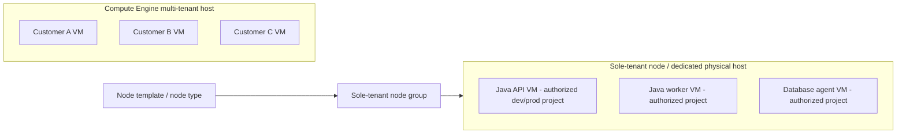
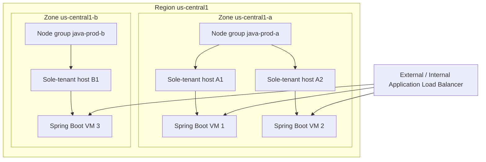
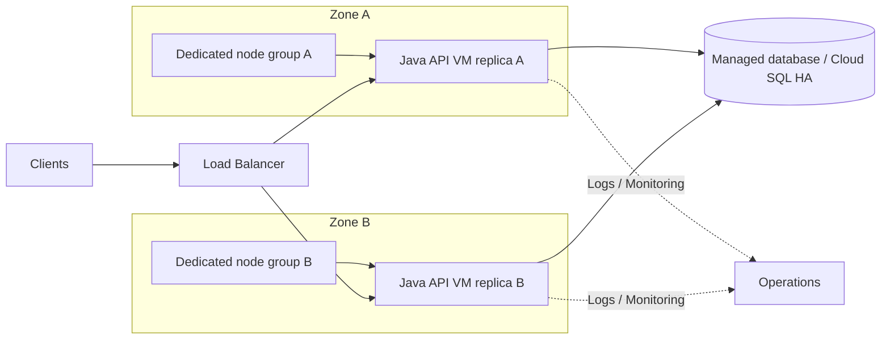
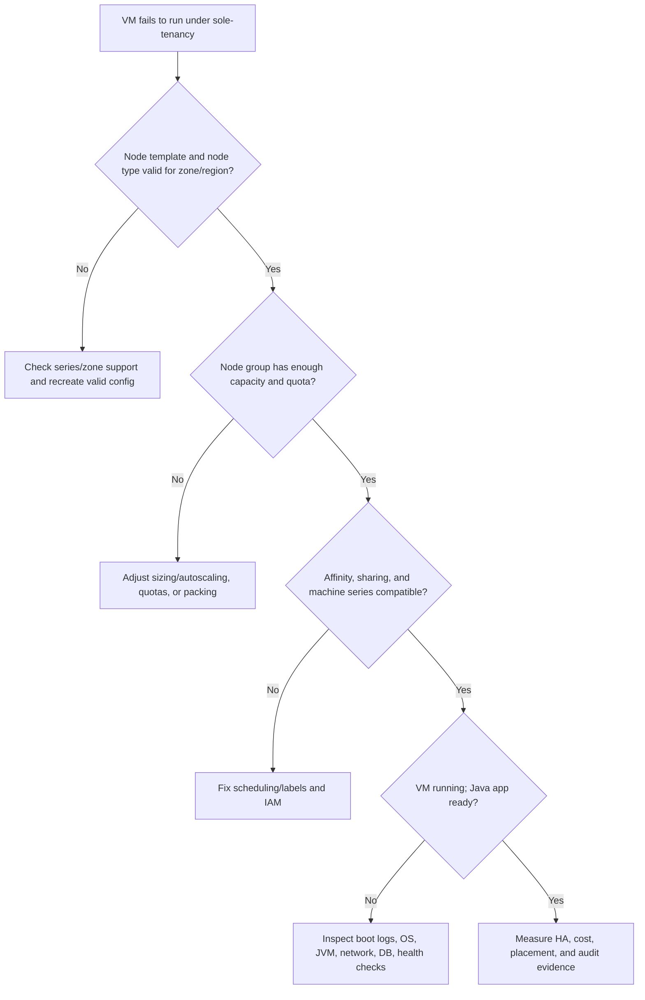

# Sole-Tenant Nodes and Physical Host Isolation Requirements

## 1. Scenario: When a Standard VM Does Not Meet Host Requirements

An enterprise runs a transaction-processing system written in **Java/Spring Boot** on Google Cloud. Most APIs can run on **Cloud Run** or **GKE**; however, some legacy components must run on **Compute Engine** with special requirements:

- Internal policies or contracts mandate that VMs do not share a **physical server** with VMs from external customers.
- Commercial software is licensed by **physical core count** or restricts migrating VMs across physical hosts.
- Operations wants control over relative VM placement, avoiding co-locating production and test VMs on the same host.
- Data-intensive workloads, stateful systems, or performance-sensitive workloads require a dedicated host capacity plan.

Compute Engine **sole-tenant nodes** allow a customer to allocate **dedicated physical servers** for running their VMs. A node maps **one-to-one** to an underlying physical host; VMs from other customers are never scheduled onto that host. This is **physical-server-layer isolation**, distinct from separating VPCs, subnets, or projects.

In the **Compute Engine** chapter of the **CLOUD_PROVIDERS_GCP** module, this lesson covers sole-tenancy models, node templates, node groups, VM placement, host maintenance, licensing, spare capacity, and cost. The goal is to know **when a dedicated host is truly needed**, implement it properly, and avoid mistaking this feature for an absolute compliance or security guarantee.

### Learning Outcomes

After this lesson, you will be able to:

1. Distinguish **multi-tenant VMs**, **sole-tenant nodes**, **bare metal**, **Confidential VMs**, **Shielded VMs**, VPC isolation, and serverless services.
2. Explain the hierarchy **node type → node template → node group → VM**, along with regional and zonal scopes.
3. Plan vCPU/RAM capacity, pick compatible machine types, place VMs using **node affinity/anti-affinity**, and segregate node groups by environment.
4. Compare **Default**, **Restart in place**, and **Migrate within node group** to balance downtime, host stability, and licensing.
5. Deploy a sole-tenant VM example with **gcloud**, define **Terraform** configs, and verify VM placement.
6. Estimate costs for **entire provisioned node resources + the sole-tenancy premium**, even when VMs underutilize capacity.
7. Design defense-in-depth using IAM, VPCs, encryption, logging, backups, and maintenance drills for Java systems.

## 2. What Isolation Does Sole-Tenancy Provide?

### 2.1. Shared Hosts vs. Dedicated Hosts

In standard Compute Engine, VMs from multiple customers can be placed on shared physical server infrastructure, isolated by the hypervisor and platform security layers. With a **sole-tenant node**, a physical server is dedicated to VMs from the node group's owning project or projects in the same organization **explicitly shared** by configuration.



**Exact scope of the guarantee:** VMs from other customers are excluded from the sole-tenant node's **physical server**. However, if you **share a node group** across multiple projects in your organization, VMs from those permitted projects **can share that host**. "Sole-tenant" does not automatically mean **one physical server per VM**, nor does it inherently separate dev and prod VMs.

### 2.2. Host Isolation Does Not Mean All-Layer Isolation

| Layer/Constraint | What Sole-Tenant Nodes Provide | What Else Is Required? |
| --- | --- | --- |
| **Physical host** | Reserves physical servers exclusively for VMs within sole-tenancy scope | Node group sharing/placement rules and audit evidence |
| **Network** | Does not create separate VPCs/firewalls | VPCs, subnets, firewalls, Cloud NAT/Private Google Access as needed |
| **Identity** | Does not manage user or service account permissions | Least-privilege IAM, OS Login, per-workload service accounts |
| **Data** | Does not encrypt data at the application layer | Disk encryption, CMEK if needed, TLS, secrets management, backups |
| **Operating system** | Does not patch Linux/Windows or Java runtimes | Standardized images, patching, EDR, vulnerability scanning |
| **Java application** | Does not prevent SQLi, token leaks, or authz bugs | Spring Security, parameterized SQL, rate limits, logging |
| **Availability** | Does not provide multi-zone HA or DR on its own | Multiple node groups across zones, LB/MIG, replicated/backed-up data |
| **Compliance** | Satisfies one physical isolation control | Legal/contractual policy review, audit artifacts, and supporting controls |

If the requirement is simply **stopping unauthorized VMs in other projects from reaching your app**, VPCs/IAM/firewalls may suffice without renting whole hosts. Only when a requirement explicitly states **"no sharing of physical CPUs/servers with other customers"** does sole-tenancy become the right candidate. If **direct OS control on bare metal** is required, evaluate bare-metal offerings instead; sole-tenant nodes still run **Compute Engine VMs** on a hypervisor.

## 3. Resource Components and How They Connect

### 3.1. Node Type

A **node type** specifies the capacity of one physical host, including **vCPU count and RAM size**; some node types include GPU or Local SSD options. For example, `n1-node-96-624` provides **96 vCPUs and 624 GB of RAM** per node. Not every node type exists in every zone, and only compatible VM series/machine types can run on a given node.

Key details:

- Multiple VMs can be packed onto one node until **vCPU/RAM** or placement/NUMA constraints are reached.
- Node types and machine types must match by **series**. You cannot place an arbitrary machine type onto a node merely because total RAM appears sufficient.
- Some machine lines have specific vCPU:RAM ratios, NUMA, GPU, or Local SSD constraints; check series limits.
- CPU overcommit is supported only on certain sole-tenant node types and requires evaluating performance/pricing; **RAM cannot be overcommitted via this CPU mechanism**.
- **Sole-tenant nodes do not support preemptible VMs**; never use Spot/preemptible pricing tables to estimate VMs on sole-tenant nodes.

### 3.2. Node Template: Regional Resource

A **node template** is the blueprint for creating node groups. It defines the **node type**, **node affinity labels**, and additional supported attributes. Templates have **regional** scope: one template can be used to create node groups across multiple zones within **that same region**.

Example:

```text
Node template: java-prod-template
Region: us-central1
Node type: n1-node-96-624
Custom affinity labels:
  environment=production
  workload=java-api
```

You cannot create a template in region A and apply it directly to a node group in region B. Cross-region DR requires planning templates and node type capacity in the target region.

### 3.3. Node Group: Zonal Resource

A **node group** is a collection of sole-tenant nodes sharing one node template inside **a single zone**. When creating a group, you configure size or autoscaling, maintenance policy, sharing settings, and optional maintenance windows. A group can contain multiple nodes, yet **cannot span multiple zones**.

Multi-zone distribution diagram for a Java API:



Two zones require **two node groups**. When running a **regional Managed Instance Group (MIG)** on sole-tenancy, node groups must exist in each target zone with matching node affinities and adhere to the **`targetDistributionShape = EVEN`** requirement documented by Compute Engine for this scenario.

### 3.4. VM Placement: Node Affinity and Anti-Affinity

When creating a VM, you can target a **node group** or **specific node** using labels:

| Label | Meaning |
| --- | --- |
| `compute.googleapis.com/node-group-name` | Places the VM into a specifically named node group |
| `compute.googleapis.com/node-name` | Pins the VM to a specific node when the maintenance policy permits |
| Custom labels such as `environment=production` | Selects node groups matching business rules |
| `NOT_IN` in an affinity rule | Excludes node groups carrying an unwanted label |

**Affinity** selects hosts/groups with matching attributes; **anti-affinity** excludes hosts/groups with specified attributes. These are **scheduler constraints**—they do not create firewalls, nor do they guarantee replicas land on separate physical hosts unless rules explicitly express that goal.

### 3.5. Sharing Across Projects

Compute Engine supports **sharing a node group** with specific projects in the same organization or the entire organization. Sharing improves host utilization, yet widens which VMs may co-reside on the physical server. As a best practice, **share only with explicitly approved projects** rather than organization-wide when environment isolation is required.

The project **owning the node group is billed for the host**, even if some VMs belong to shared projects. Therefore, if an infrastructure team hosts node groups in a platform project and app teams deploy from separate Java projects, establish **internal chargeback/showback** rather than looking solely at VM costs in the app project.

## 4. When to Choose Sole-Tenancy and When Not To?

| Scenario | Assessment | Options to Consider |
| --- | --- | --- |
| Contract forbids sharing physical hosts with external tenants | **Suitable**, though verify exact clauses | Sole-tenant Compute Engine nodes |
| Need physical core/host-migration control for BYOL | **Potentially suitable** | Sole-tenancy + compatible maintenance + license verification |
| Stateless Spring Boot REST API scaling by request volume | Sole-tenancy may cause **idle host waste** | Cloud Run, GKE, or multi-tenant VMs |
| Need data encryption with customer-managed keys | Sole-tenancy **does not replace encryption** | CMEK, TLS, KMS per service |
| Need confidential-computing memory isolation | Sole-tenancy does not provide Confidential Computing **memory-in-use** protection | Evaluate Confidential VMs and compatibility limits |
| Must keep prod and dev VMs off the same physical host | Requires **separate node groups or affinity** | Per-environment node groups with strict sharing |
| App must survive a zonal outage | One dedicated host is **not enough** | Multi-zone node groups + LB/MIG + storage/DB HA |
| Must run containers on a cluster | Depends on platform and host rules | Evaluate GKE Standard and supported node types; do not extrapolate from Cloud Run |

**Decision rule:** first state the requirement as a testable claim, e.g., "Payment-processing VMs never share a physical host with VMs from another organization." If the real goal is **blocking unauthorized network access**, dedicated hosts are usually indirect and unnecessarily expensive.

## 5. Capacity Planning: Renting Hosts, Not Just Placing VMs

### 5.1. Calculating by Node Resources

Suppose sample node `n1-node-96-624` has:

- **96 vCPUs** and **624 GB RAM** per node.
- One JVM worker uses `n1-standard-8`: **8 vCPUs, 30 GB RAM**.
- Eight workers consume **64 vCPUs, 240 GB RAM** total.

Looking strictly at nominal resources:

```text
vCPU utilization = 8 VMs × 8 / 96 = 66.7%
RAM utilization  = 8 VMs × 30 / 624 ≈ 38.5%
```

A node can run out of vCPUs while having RAM left, or vice versa. Beyond raw vCPU/RAM totals, placement can be constrained by **NUMA, vCPU:RAM ratios, GPU models, Local SSDs, CPU overcommit, and machine series rules**. Thus "20 vCPUs remaining" does not guarantee the scheduler can fit an arbitrary VM.

### 5.2. Capacity Efficiency

| Option | Total VMs per Node | Cost Impact |
| --- | ---: | --- |
| Single small Spring Boot VM | 1 | You pay for nearly an entire physical host while using little of it |
| Multiple well-packed Java workers | 8 | Better host utilization, though requires capacity and internal noisy-neighbor management |
| Split prod/dev into separate groups | Per environment | Increases isolation at the cost of lower overall utilization |
| Two zones, each with spare host capacity | Distributed | Higher availability, higher standby capacity cost |

The **node group autoscaler** can add nodes when VMs lack space and remove empty nodes per configuration; it does **not** mean Google Cloud bills only for running vCPUs. Keeping a minimum of one or more nodes still bills for idle host capacity.

### 5.3. Do Not Equate Host Capacity with Application Throughput

For Spring Boot, also evaluate:

- Actual CPU under peak traffic, garbage collection, and JIT warm-up times;
- Heap RAM, native memory, page cache, and OS/agent overhead;
- DB connections, network bandwidth, disk IOPS, and latency;
- Replica counts required to survive host or zone failures;
- Scaling headroom during host maintenance and full node groups.

Tuning `-Xmx` or concurrency limits may reduce the number of VMs needed, yet **will not lower host billing** unless you can also scale down the number of provisioned nodes. Aim to optimize **bin-packing and node count**, not merely individual process CPU.

## 6. Host Maintenance Policies: Choices Affecting Licensing and Uptime

Google Cloud provides three host maintenance policies for sole-tenant node groups. Do not confuse them with individual VM **on-host maintenance** settings.

| Node Group Policy | When Host Needs Maintenance | Advantages | Trade-offs |
| --- | --- | --- | --- |
| **Default** | VMs can **live migrate** to another sole-tenant node where VM and config support it | Ideal for general workloads minimizing downtime | Physical host can change; check BYOL terms |
| **Restart in place** | VMs **stop** during host maintenance and **restart on the exact same physical server** | Fits contracts requiring fixed hosts/physical cores | Noticeable downtime; VMs require `onHostMaintenance=TERMINATE` |
| **Migrate within node group** | VMs live migrate within a **fixed set of physical hosts** in the node group | Caps total physical hosts used, supporting certain BYOL models | Requires empty **holdback nodes**, loses usable capacity, incompatible with non-live-migratable VMs |

### 6.1. Default: Prioritizing Normal Operations

For VMs supporting live migration, Compute Engine moves the VM to another sole-tenant host before maintenance. The destination host remains **dedicated** to your authorized project/group scope—never an arbitrary multi-tenant machine. VMs that cannot live migrate may be **terminated and restarted** if automatic restart is enabled.

This fits stateless Spring Boot APIs and workloads without license clauses pinned to a fixed set of hosts. **Live migration minimizes disruption, yet does not replace application-level fault tolerance.**

### 6.2. Restart in Place: Keep the Host, Accept Downtime

Compute Engine stops VMs during host maintenance and restarts them on **the exact same host** afterward. Documentation notes disruptions of **around an hour** may occur in certain maintenance events; pick this option if workflows or license contracts mandate staying on the same physical host.

For example, a downtime-tolerant Java batch worker can use **queues and checkpoints** to resume work. However, a live payment API with strict SLOs **should never rely on a single Restart-in-place VM**; run replicas across separate nodes/zones with safe state handling.

### 6.3. Migrate Within Node Group: Fixed Hosts with Standby Capacity

This option live-migrates VMs strictly among a designated set of physical hosts. To guarantee migration targets during maintenance, Compute Engine reserves **one holdback node for up to every 20 reserved nodes**: a group of 2–20 nodes requires **at least one empty node** reserved for live migration. Do not use this policy with VMs that cannot live migrate.

For instance, a 4-node sole-tenant group of identical type may have only **3 nodes usable for workload placement**, with 1 node reserved as a holdback per rule. This policy does not allow pinning a VM to a specific **`node-name`** when using migrate-within-group; use **node-group affinity** and appropriate labels instead.

### 6.4. Maintenance Windows and Fault Simulation

With certain policies, node groups support **maintenance windows** to constrain when maintenance **starts**; this does not guarantee maintenance finishes within that exact window. Google Cloud also offers advanced maintenance controls under eligible conditions. **Migrate within node group** does not support standard maintenance windows per current documentation.

When validating stateful Java workloads, **simulate a host maintenance event** in an authorized test environment and observe error rates, restarts, session persistence, and DB reconnect behavior. Live host maintenance timing is not a fixed schedule application teams can rely on predicting precisely.

## 7. Licensing and Compliance: Never Treat Sole-Tenancy as Automatic BYOL Clearance

Some software agreements bill by **physical CPU cores/sockets**, the total count of hosts a VM has ever touched, or minimum intervals between host migrations. Sole-tenancy helps track and bound physical hosts, yet **does not alter vendor license terms**.

### 7.1. Questions to Confirm with Your Licensing Team

1. Which products/editions allow **Bring Your Own License (BYOL)** on public cloud?
2. Are licenses counted per **VM vCPU**, **physical core**, socket, device, user, or container?
3. Do **License Mobility** rules and host-migration intervals apply?
4. What audit evidence is required: host IDs, count of nodes used, maintenance/migration logs?
5. When resizing node counts, autoscaling, or using holdback nodes, are extra licenses triggered?
6. Are you running Windows Server, SQL Server, or middleware with Google Cloud-specific terms?

Never declare compliance solely because the CLI created a node successfully. Legal/contractual compliance must be signed off by license owners and may require supplementary audit records.

### 7.2. Preliminary Policy Selection Guide

| Scenario | Initial Option | What to Verify |
| --- | --- | --- |
| Per-user licensed Java app needing high uptime | **Default** | Whether VMs support live migration; fallback/restart behavior |
| Physical-core licensed software tolerant of downtime | **Restart in place** | Downtime window and same-host persistence requirements |
| Per-core licensing needing HA across a bounded host pool | **Migrate within node group** | Holdback capacity, total licensed hosts, VM live-migration support |
| GPU workloads or non-live-migratable VMs | Depends on support, often **terminate/restart** | GPU, Confidential VM, Local SSD, and series restrictions |

These suggestions guide **initial technical design** only and never override vendor contract terms.

## 8. Security, IAM, and Project Sharing Boundaries

Sole-tenancy does not grant IAM roles or OS access. Separate responsibilities cleanly:

- **Infrastructure team:** creates templates/groups and manages sharing, autoscaling, and maintenance policies per mandate.
- **Application team:** creates/places VMs inside approved node groups without unilaterally opening sharing to other projects.
- **Security/compliance team:** audits change logs, permissions, environment labels, and physical isolation evidence.
- **Runtime service account:** Java app SA holds only required permissions on Cloud Storage, Pub/Sub, Secret Manager, or dependent services.

Key API permissions may include `compute.nodeTemplates.create`, `compute.nodeTemplates.use`, `compute.nodeGroups.create`, `compute.instances.create`, plus network/subnet, disk, image, and service account permissions. Enforce **least privilege** instead of granting `roles/owner` to lab operators.

**Key control point:** a node group shared across projects A and B allows VMs from both A and B on the same physical host if placement permits. To enforce "production never shares a host with development," **separate node groups, affinity rules, and sharing** and verify actual VM placement. Shared VPC only shares **networking**; it does not create or alter node-group sharing.

## 9. Hands-On with gcloud: Creating a Sole-Tenant VM for a Java Workload

> **Cost Warning:** creating a **sole-tenant node group** can immediately begin billing **for all vCPUs/RAM of the provisioned physical host(s)**, even before any VMs are created. Run commands only when project, billing account, quotas, and permissions are approved. This lesson does not execute commands outside your authorized lab environment.

Illustrative values used below:

- `PROJECT_ID`: authorized sandbox project with active billing.
- `us-central1` / `us-central1-a`: illustrative region/zone; **use only after confirming the node type is available in that zone**.
- `n1-node-96-624`: sample node type (adjust if unsupported by your zone or quota).
- `n1-standard-4`: compatible N1 machine type.

### Step 1 — Check Quotas, Zones, and Node Types

```bash
gcloud config set project PROJECT_ID
gcloud services enable compute.googleapis.com

# List and verify before creating any nodes:
gcloud compute sole-tenancy node-types list \
  --zones=us-central1-a

gcloud compute sole-tenancy node-groups list
gcloud compute sole-tenancy node-templates list
```

Check regional **sole-tenant nodes / CPU** quotas, node type and machine type availability, IP/subnet capacity, and project IAM. With Shared VPC or cross-project setups, check both the node-group owning project and the VM project.

### Step 2 — Create a Regional Node Template

```bash
gcloud compute sole-tenancy node-templates create java-host-template \
  --region=us-central1 \
  --node-type=n1-node-96-624 \
  --node-affinity-labels=environment=lab,workload=java

gcloud compute sole-tenancy node-templates describe java-host-template \
  --region=us-central1
```

`environment=lab` is a **scheduler affinity label** for VM placement; it does not create a resource label for billing or firewalls. If you change the node type, verify the VM machine types remain compatible.

### Step 3 — Create a Zonal Node Group

```bash
gcloud compute sole-tenancy node-groups create java-host-group \
  --zone=us-central1-a \
  --node-template=java-host-template \
  --target-size=1 \
  --maintenance-policy=default

gcloud compute sole-tenancy node-groups describe java-host-group \
  --zone=us-central1-a

gcloud compute sole-tenancy nodes list \
  --zone=us-central1-a
```

This lab uses **Default**, so one node suffices to demonstrate placement—**not a production HA design**. If choosing `migrate-within-node-group`, provision at least two nodes with holdback headroom, and do not arbitrarily change flags on a running group.

### Step 4 — Create a VM on the Node Group

```bash
gcloud compute instances create java-worker-01 \
  --zone=us-central1-a \
  --machine-type=n1-standard-4 \
  --image-family=debian-12 \
  --image-project=debian-cloud \
  --node-group=java-host-group \
  --no-address

gcloud compute instances describe java-worker-01 \
  --zone=us-central1-a \
  --format="yaml(name,machineType,scheduling,networkInterfaces)"
```

`--no-address` ensures the VM has **no external IPv4 address**, though it does not automatically configure private subnets, SSH/IAP, NAT, or Private Google Access. To fetch Maven dependencies, container images, or OS patches, design a **valid egress path** and govern outbound traffic. Use OS Login/IAP for admin access instead of exposing Internet SSH.

### Step 5 — Verify the VM Actually Runs on the Sole-Tenant Node

Inspect both **`scheduling.nodeAffinities`** on the VM and **the VM list on each sole-tenant node** in Console/CLI. Example:

```bash
gcloud compute sole-tenancy nodes describe NODE_NAME_FROM_LIST \
  --zone=us-central1-a

gcloud compute instances describe java-worker-01 \
  --zone=us-central1-a \
  --format="json(scheduling)"
```

Never cite mere existence of a node group as proof that a VM ran on it. **Misplaced VMs or VMs from another shared project** can invalidate audit conclusions. Record the zone, node group, node type, placement, and sharing settings at verification time.

### Step 6 — Clean Up the Lab Environment

When done, verify all live resources attached to the node group and delete **in dependency order**. For a single-VM lab:

```bash
gcloud compute instances delete java-worker-01 \
  --zone=us-central1-a

gcloud compute sole-tenancy node-groups delete java-host-group \
  --zone=us-central1-a

gcloud compute sole-tenancy node-templates delete java-host-template \
  --region=us-central1
```

**Never delete a shared production node group** while VMs or other projects still rely on it. Deletions in shared environments require review; nodes and attached disks/network resources carry separate lifecycles and costs.

## 10. Advanced Node Affinity and Anti-Affinity

### 10.1. Placing VMs by Label Instead of Group Name Only

To place multiple VM types across labeled node groups, use a **node affinity file**. Example JSON file for the CLI:

```json
[
  {
    "key": "environment",
    "operator": "IN",
    "values": ["production"]
  },
  {
    "key": "workload",
    "operator": "IN",
    "values": ["java-api"]
  }
]
```

Once a template/group exists with those two labels, create the VM:

```bash
gcloud compute instances create java-api-01 \
  --zone=us-central1-a \
  --machine-type=n1-standard-4 \
  --image-family=debian-12 \
  --image-project=debian-cloud \
  --node-affinity-file=node-affinity-prod.json
```

`node-affinity-prod.json` must exist on the machine running the CLI and match live configurations. This is an **alternative** to `--node-group` from the previous lab; you do not need both. If labels are overly broad or groups are shared, add tighter constraints to avoid cross-environment placement.

### 10.2. Anti-Affinity for Test Workloads

To prevent dev/test workloads from landing on nodes labeled `environment=production`, use:

```json
[
  {
    "key": "environment",
    "operator": "NOT_IN",
    "values": ["production"]
  }
]
```

**Anti-affinity alone is insufficient for project-level security:** anyone able to edit templates, group sharing, or VM scheduling can alter placement boundaries. Pair it with IAM controls and approval workflows.

### 10.3. Combining MIGs and Load Balancing

For a Spring Boot API, a **Managed Instance Group** can manage uniform replicas:

- Instance template specifies machine type, image, startup config, and **node affinities** matching the node groups.
- A zonal MIG places VMs in the zone's node group; a regional MIG requires node groups in **all selected zones** with matching distribution shape.
- A load balancer runs health checks and routes traffic only to healthy VMs.
- Ensure node group capacity has headroom for **rolling updates, autoscaling, maintenance, and failure recovery**; if capacity fits only active VMs, the MIG cannot spin up replacement replicas.

Never assume the **MIG autoscaler** and **node group autoscaler** react instantaneously together. A MIG may request new VMs before the node group finishes provisioning physical hosts. Monitor for `ZONE_RESOURCE_POOL_EXHAUSTED` or `insufficient capacity` and plan scale-out headroom.

## 11. Terraform: Managing Node Templates and Node Groups as IaC

Managing sole-tenant resources with Terraform ensures consistency across environments and enables pull-request reviews. Example covering **the two core resources** (excluding VMs/VPC):

```hcl
variable "project_id" {
  type = string
}

variable "region" {
  type    = string
  default = "us-central1"
}

variable "zone" {
  type    = string
  default = "us-central1-a"
}

variable "node_type" {
  type    = string
  default = "n1-node-96-624"
}

provider "google" {
  project = var.project_id
  region  = var.region
}

resource "google_compute_node_template" "java_host" {
  name      = "java-host-template"
  region    = var.region
  node_type = var.node_type

  node_affinity_labels = {
    environment = "lab"
    workload    = "java"
  }
}

resource "google_compute_node_group" "java_host" {
  name               = "java-host-group"
  zone               = var.zone
  node_template      = google_compute_node_template.java_host.id
  initial_size       = 1
  maintenance_policy = "DEFAULT"
}
```

Before running `terraform apply`:

1. Verify **provider version**, zone/node type availability, quotas, billing, and permissions.
2. Inspect `terraform plan` for **node group replacement** triggers, especially changes to maintenance policy, node template, or shrinking nodes hosting active VMs.
3. Never use a production project as a lab; avoid mixing ad-hoc CLI edits and Terraform on the same resource without updating state.
4. For production, parameterize **sharing settings, sizing/autoscaling, labels, and maintenance strategy**, and protect Terraform state and CI/CD permissions.

**Billing starts as soon as resources are provisioned**, even if IaC creates only the node group with zero VMs. Configure appropriate lifecycle protections to prevent accidental deletion of active groups, while reviewing policies that might block environment teardown.

## 12. Sole-Tenancy Costs and How to Evaluate Efficiency

### 12.1. Biggest Difference from Multi-Tenant VMs

With standard Compute Engine VMs, CPU/RAM billing is based on the VM's **allocated machine resources** plus separate components. With sole-tenant nodes, you are billed for **all vCPUs/RAM of each provisioned physical node**, plus the **sole-tenancy premium**; VMs scheduled onto that node **are not double-billed for vCPUs/RAM** under that node's pricing model.

Per Google Cloud pricing documentation, the sole-tenancy premium is **10% of base vCPU/RAM node cost** before eligible discounts. Additional charges still apply for:

- Persistent Disks/Hyperdisks, snapshots, Local SSDs/GPUs if provisioned;
- Paid OS/image licenses and vendor BYOL software;
- External/static IPs, load balancing, network egress, Cloud Logging/Monitoring;
- Nodes reserved for maintenance holdback or standby headroom;
- Shared project charges and other data services if used.

**Never** add the price of an `n1-standard-4` VM on top of the price of an `n1-node-96-624` node as though vCPU/RAM were billed twice for the same compute capacity.

### 12.2. Estimation Formula

Let `C` be the base hourly CPU+RAM price of a node and `H` be billable hours. Before discounts:

```text
Base node CPU/RAM cost in period ≈ C × H
Sole-tenancy premium             ≈ 10% × C × H
Total node portion               ≈ 1.10 × C × H
Total system cost                = node portion + disks + licenses + networking
                                   + GPU/Local SSD if used + other services
```

**Hypothetical practice calculation** (not current GCP pricing): if `C = 5 USD/hour` and one node runs `730 hours` in a month, the node portion is:

```text
5 × 730 = 3,650 USD (base CPU/RAM)
10% × 3,650 = 365 USD (assumed premium)
Total node = 4,015 USD/month, before discounts and other charges.
```

If only **one 4-vCPU VM** sits on a **96-vCPU** node, you still pay for the entire provisioned host—not 4/96 of the bill. That is why sole-tenancy only makes economic sense when **the value of physical isolation, licensing compliance, or operational guarantees outweighs idle host overhead**.

### 12.3. Sustained Use and Committed Use Discounts

Sole-tenant nodes can qualify for **sustained use discounts (SUDs)** and **committed use discounts (CUDs)**, yet **the sole-tenancy premium has separate discount rules**: resource-based CUDs do not directly discount the premium, whereas flexible CUDs/SUDs have specific eligibility per pricing docs. Never assume a VM CUD automatically covers both whole hosts and premiums.

When budgeting, pull exact **regions, node types, runtime hours, standby capacity, and contract discounts** from [Sole-tenant node pricing](https://cloud.google.com/compute/sole-tenant-pricing) and the Cloud Pricing Calculator. Track actual spend in **Cloud Billing Reports**; shared node groups require **internal cost allocation** when multiple teams share hosts.

## 13. Reliability and Running Spring Boot on Dedicated Hosts

### 13.1. Physical Isolation Still Has a Failure Domain

If a Java API runs on **a single dedicated host**:

- host hardware failure → all VMs on that host can fail together;
- maintenance with **Restart in place** → the entire VM group stops simultaneously;
- node out of capacity → new replicas cannot schedule during traffic spikes;
- node group in **one zone** → a zonal outage takes down the entire workload.

To achieve high availability, run at least **two physical hosts across multiple zones** aligned with your SLO, paired with health checks, load balancers/MIGs, rolling deployments, and database backups/HA. Because each node group is single-zone, deploy multiple node groups for zonal fault tolerance.

### 13.2. Reference Architecture



This diagram illustrates **independent compute pools across two zones**. If the database is managed Cloud SQL, sole-tenancy on **Java VMs does not automatically extend** to Cloud SQL's physical hosts. If compliance requires dedicated hosts for the database too, evaluate **each service's isolation model** independently.

### 13.3. Java Workloads Must Tolerate Maintenance

Applications should implement:

- Accurate readiness/liveness or health endpoints for LB/MIG checks;
- Graceful shutdown and request draining when maintenance signals arrive;
- Bounded timeouts/retries and idempotency for transactions;
- Checkpointed workers or at-least-once message processing;
- DB connection pools that recover cleanly when TCP connections drop;
- Cloud Monitoring, structured logging, and alerts on error rate and latency.

Run **host maintenance simulations** in an authorized staging environment and measure recovery at the **application layer**, not just node group status. For large-heap JVMs, measure restart/warm-up behavior and traffic shift impact when one replica leaves the load balancer.

## 14. Monitoring, Auditing, and Troubleshooting

| Symptom | Likely Cause | How to Investigate |
| --- | --- | --- |
| `node type unavailable` | Zone lacks series/GPU support or insufficient quota | `node-types list`, check quotas and region/zone choice |
| Cannot create node group | Template in wrong region, missing IAM, quota/capacity | `node-templates describe`, API errors, permissions |
| VM placement error | Machine series mismatch, bad affinity, node group full | VM scheduling config, node group/individual node utilization |
| VM created but lands on unexpected host | Overly broad affinity rules or cross-project sharing | `instances describe`, node assignments, labels |
| MIG cannot create new replica | Node capacity exhausted or autoscaler hasn't added nodes | MIG events, node group autoscaler, max-nodes, quotas |
| Host maintenance causes downtime | Restart-in-place chosen or VM cannot live migrate | Node group policy, VM `onHostMaintenance`, event timeline |
| Cannot pin VM to `node-name` | Migrate-within-node-group disallows pinning by node-name | Use `node-group-name` and review maintenance policy |
| High bill despite low VM CPU | Billed per **provisioned host**, spare nodes, and premium | Billing SKUs, node count, utilization, chargeback |
| Compliance audit rejects dev/prod isolation | Shared node group or missing placement evidence | Sharing policy, node/group inventory, IAM audit logs |
| Java app errors while node is healthy | Network/DB fault, JVM GC, disk, auth | App logs/metrics, network/firewalls, DB state |

### Layered Troubleshooting Flow



When investigating incidents, gather **node group change timestamps**, maintenance events, VM logs, IAM audit logs, Billing data, and application metrics. Never infer from a Cloud Logging "VM booted" event that host isolation or licensing terms were automatically met.

## 15. Exercises and Checklist

### Exercise A — Classifying Isolation Needs

For three workloads—(1) stateless Java API, (2) Java batch job licensed by physical cores, and (3) sensitive data processor requiring physical host separation from other tenants—recommend **multi-tenant VMs, sole-tenant nodes, Cloud Run, or other security controls**. Name at least one requirement to confirm with security/compliance or the license vendor before finalizing.

### Exercise B — Capacity and Cost Math

A sample node has 96 vCPUs and 624 GB RAM. Each Java worker uses 8 vCPUs and 30 GB. With **8 workers**, calculate vCPU/RAM utilization and remaining capacity. Assuming a hypothetical base rate of 5 USD/hour, compute the node cost for 730 hours plus an **assumed 10% premium**, then compare against running just **2 workers** while still keeping one node.

### Exercise C — Creating a Node Group and Placing a VM

In an authorized test project with billing/quotas, list node types, create a template/group, and place a Debian VM on the node group using `--node-group`; inspect `instances describe` and the node's VM list. **You do not need to run a live lab** if lacking permissions/billing: you can complete this using a parameter table, sample commands, and an expected architecture diagram.

### Exercise D — Maintenance Policy Selection

Operations runs two apps: an API needing HA during maintenance and a batch engine licensed by physical cores that tolerates downtime. Pick one of the three host maintenance policies for each system, compute holdback nodes if using Migrate within node group, and outline a host maintenance test runbook.

### Exercise E — Cross-Project Sharing and Auditing

An infrastructure project shares a node group with two app projects. List the IAM permissions to check, where host charges appear, how to implement internal cost allocation, and how to prove production VMs never share a host with development VMs if required. Discuss why organization-wide sharing may violate environment isolation rules.

### Self-Check Checklist

- [ ] I can distinguish **physical host** isolation from VPC/IAM, Confidential VMs, and bare metal.
- [ ] I understand **node type**, **regional template**, **zonal node group**, and VM placement.
- [ ] I know how to check node types by zone, quotas, machine-series compatibility, and capacity.
- [ ] I can configure node groups, affinity/anti-affinity, and inspect live placement.
- [ ] I understand node group sharing conditions, environment boundaries, and which project pays for hosts.
- [ ] I can accurately compare Default, Restart in place, and Migrate within node group, including holdback nodes.
- [ ] I verify BYOL contracts rather than assuming sole-tenancy automatically satisfies licensing.
- [ ] I budget for **full hosts + premium** alongside disks, licenses, and networking.
- [ ] I design multi-zone/multi-replica setups, health checks, backups, and maintenance-tolerant Java apps.
- [ ] I have methods to verify isolation, monitor incidents, and govern changes via IaC.

**Conclusion:** sole-tenant nodes are valuable when you have **verifiable physical-server requirements**, host affinity needs, or licensing constraints; they are **not a default setting for every Java service**. Making the right call requires matching node types and maintenance policies to real constraints, governing sharing/affinity for true isolation, reserving failover headroom, and remembering that billing covers **provisioned physical hosts**, not just active VMs.

## 16. Official Documentation to Continue Learning

- [Compute Engine — Sole-tenancy overview](https://cloud.google.com/compute/docs/nodes/sole-tenant-nodes)
- [Create sole-tenant node templates](https://cloud.google.com/compute/docs/nodes/sole-tenancy-node-templates)
- [Create sole-tenant node groups](https://cloud.google.com/compute/docs/nodes/sole-tenancy-node-groups)
- [Provision VMs on sole-tenant nodes](https://cloud.google.com/compute/docs/nodes/provisioning-sole-tenant-vms)
- [Best practices for sole-tenant nodes](https://cloud.google.com/compute/docs/nodes/sole-tenant-best-practices)
- [Share sole-tenant node groups](https://cloud.google.com/compute/docs/nodes/share-node-groups)
- [Autoscale node groups](https://cloud.google.com/compute/docs/nodes/autoscaling-node-groups)
- [Simulate a host maintenance event](https://cloud.google.com/compute/docs/nodes/simulate-host-maintenance)
- [Sole-tenant node pricing](https://cloud.google.com/compute/sole-tenant-pricing)
- [Terraform google_compute_node_group](https://registry.terraform.io/providers/hashicorp/google/latest/docs/resources/compute_node_group)
