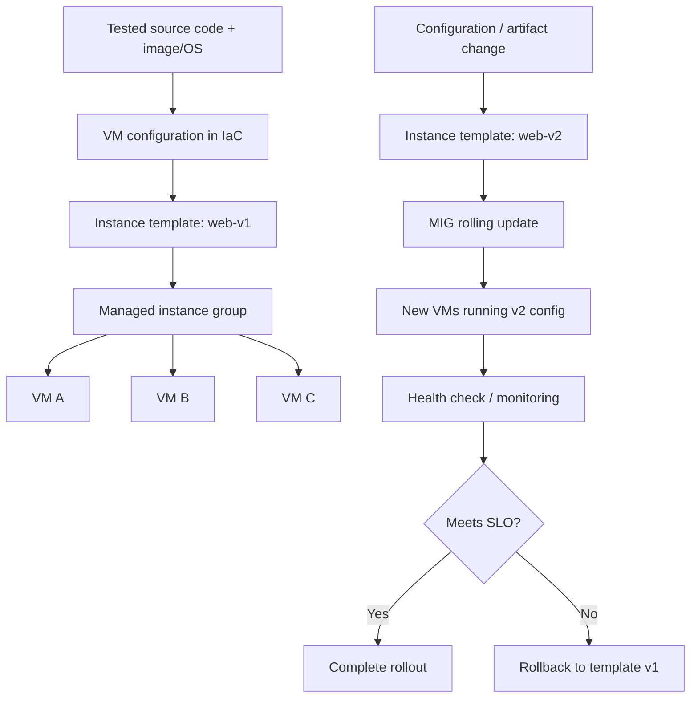
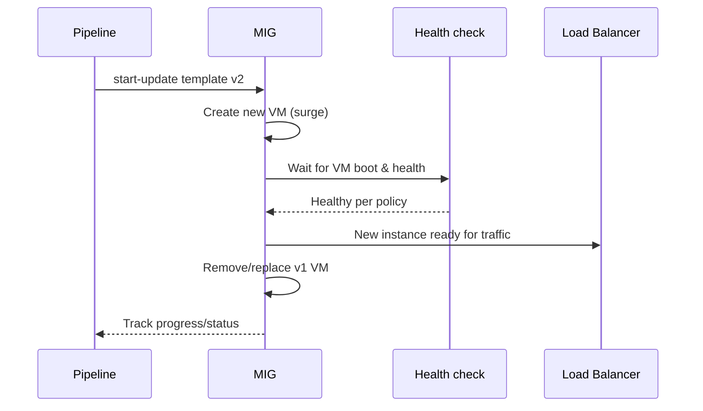

# Instance templates and immutable deployment configuration

When a web application runs on a single Compute Engine VM, fixing configuration directly over SSH might temporarily resolve an incident. However, if the application scales to **20 VMs**, and each VM is modified at a different time, operations teams struggle to know which machine is running the correct version, spend significant time recreating instances after failures, and easily introduce **configuration drift**. On Google Cloud, an **instance template** provides a configuration definition used to create identical VMs; combined with a **Managed Instance Group (MIG)**, it serves as the foundation for **immutable deployment** and autoscaling.

In the **Instance Groups and Autoscaling** chapter of the **CLOUD_PROVIDERS_GCP** module, this lesson covers template structure, creating configuration versions, staged deployments, canary/rolling updates, rollbacks, data protection, IAM/VPC, reliability measurement, and cost management. This knowledge applies when running applications on Compute Engine instead of choosing GKE or Cloud Run.

> The projects, VM names, deployment regions/zones, release versions, service accounts, and image paths used below are all **illustrative data**. Commands that create, update, or delete resources can incur charges and cause disruptions; execute them only within authorized projects and change windows.

## Learning objectives

After this lesson, you can:

1. Explain that an **instance template is an immutable VM configuration definition**, not a running VM or a backup.
2. Select appropriate properties in a template: machine type, boot disk/image, network, service account, metadata, labels, tags, and scheduling.
3. Distinguish between **global/regional instance templates**, public/custom images, snapshots, machine images, and MIGs.
4. Create and inspect templates using the Console/`gcloud`, and use templates to create instances or MIGs.
5. Apply the principle of **creating a new template for every change**, rather than modifying an existing template or running VMs directly.
6. Design rollouts/rollbacks with health checks, **max surge**, **max unavailable**, canary deployments, and resource limits.
7. Identify risks related to boot disks, stateful data, startup scripts, IAM, networking, autoscaling, and quotas.
8. Observe rollouts, verify configuration differences, and write safe deployment runbooks.

## 1. What problem does an instance template solve?

An **instance template** is a Compute Engine resource that captures the configuration used to **create new VMs** or serve as the blueprint for a Managed Instance Group. A template can specify the machine type, disks, image, VPC/subnet, network tags, metadata, startup script, service account, labels, guest accelerators, and certain scheduling settings. Once created, you **cannot modify the contents of an existing template**; to change the configuration, you must **create a new template**.

Visualize the workflow:



The arrows above represent a **logical model**: creating template v2 does not automatically trigger an update for the MIG. An administrator or pipeline must **select the new template and initiate the update action**.

### Goal of immutable deployment

Instead of SSHing into each VM to upgrade the application version, operations teams:

1. Build a new versioned artifact and/or machine image.
2. Create a **new instance template** pointing to the verified artifact/config.
3. Have the MIG **gradually replace old VMs with new VMs** according to the rollout policy.
4. Confirm the new VMs are healthy and meet service quality targets.
5. Retain the previous template/image version for as long as rollback capability is needed.

Benefits include **easier auditing, consistent configuration, change history, and reduced manual edits**. However, immutability at the VM layer does not automatically solve database migrations, schema changes, or application data handling; a separate release strategy is required for those components.

### Comparison with in-place configuration changes

| Criterion | Direct VM modification | New template + VM replacement |
| --- | --- | --- |
| Change history | Often scattered across SSH commands/scripts | Versioned configuration in IaC/templates |
| Reproducibility | Easily depends on local machine state | New VMs can be built from the template |
| Rollback | Requires undo scripts, hard to guarantee | Can revert to a previous template/image |
| Drift | High if multiple people make edits | Lower if manual changes are prevented |
| Disruption | Can update in place, but hard to manage | Controlled via surge/unavailable and health checks |
| Transition cost | Fewer machines running concurrently | May temporarily increase VMs/CPU/disks during rollout |
| Local data | May be preserved across edits | **Risk of loss when the VM is replaced** |

## 2. Distinguishing templates from related resources

| Resource | What does it store? | Primary use | Immutable? |
| --- | --- | --- | --- |
| **Instance template** | Configuration for creating VMs; references image, disk, NIC, metadata, etc. | MIGs and creating VMs from a template | Template contents cannot be edited after creation |
| **VM instance** | A specific VM in a zone, with running/stopped state and disks | Running workloads | Some properties can be updated |
| **Public/custom OS image** | OS image or disk image used as a boot source | Creating boot disks | A specific image version is a content snapshot per image management |
| **Image family** | Logical name pointing to a suitable/newer image in a family | Conveniently using newer images | **The reference can change over time** |
| **Disk snapshot** | Point-in-time copy of block disk data | Disk backup/restore | Does not describe full VM/network config |
| **Machine image** | Instance configuration and disk data supported for cloning/backup | Restoring or creating similar VMs | A different artifact type from instance template |
| **Managed instance group** | Group of VMs and policies for maintaining/repairing/updating | Autohealing, rollout, autoscaling | Version/target size can be updated |
| **Unmanaged instance group** | Group of self-managed VMs | Adding VMs to a load balancer backend | **Does not** automatically create/replace VMs from a template |

**Do not confuse "immutable template" with "every VM created from a template is unchangeable."** Administrators can still edit certain VM settings directly; a MIG may detect differences and replace/recreate instances depending on the action, but manual edits introduce **drift** and should not be standard practice.

### Global and regional instance templates

Instance templates come in **global** and, where supported by the product/tooling, **regional** scopes. Global templates can be referenced when creating VMs/MIGs across multiple regions (provided the image, machine type, and network configuration are compatible). Regional templates scope the template resource to a single region.

**What it does NOT mean:** a template automatically creates VMs in every region. VM placement is determined when creating the VM/MIG; availability of machine types, disks, GPUs, subnets, IPs, and policies must match the target region/zone.

## 3. What should be included in an instance template?

A template typically includes:

| Group | Example properties | Recommendation |
| --- | --- | --- |
| **Compute** | `machineType=e2-medium` | Right-size based on actual CPU/RAM and quota |
| **Boot disk** | Self-managed image, disk type, size, auto-delete | Pin image version; ensure OS boots properly |
| **Data disks** | New disks from image/size, supported attached disks | Avoid attaching a single stateful disk to multiple instances simultaneously |
| **Network** | VPC/subnet, NIC, internal/external IP | Design ingress/egress/firewall explicitly |
| **Identity** | Service account, OAuth scopes | Least-privilege IAM, do not use user credentials |
| **Security** | Shielded VM, confidential settings when supported | Choose compatible image/capabilities |
| **Metadata** | Startup script, enable OS Login, non-sensitive app config | Do not store secrets; keep scripts idempotent |
| **Network tags** | `web-frontend` | Use clearly scoped firewall policies |
| **Resource labels** | `environment=prod`, `release=v2` | Owner/cost attribution and querying |
| **Scheduling** | Maintenance, automatic restart, Spot provisioning | Match workload characteristics and SLO |

A template stores **declarative configuration**, not all runtime state. It does not capture data in RAM, application files created after boot, or active tokens on the machine.

### 3.1 Boot image and reproducibility

Two strategies:

- **Image family**, such as `debian-12`: convenient for automatically picking up new OS image releases, but the family can point to a different image over time. **The same template does not guarantee that every VM creation uses the exact same bitwise image if the source changes**.
- **Pin a specific image version/self-link**, such as a custom image identified by a fixed version name/ID: reduces silent changes and simplifies rollback. Build/publish a new image when OS updates are needed.

For immutable releases requiring reproducibility, **pin artifacts** at build time: image ID/self-link, package versions, container digest (if the VM runs containers), and configuration with commit SHA, and test those exact versions. Do not pin only the image while having the startup script download **latest** from a mutable URL.

### 3.2 Baked image or startup script?

| Approach | Advantages | Risks | When appropriate |
| --- | --- | --- | --- |
| **Baked image (golden image)** | Fast boot, pre-tested software, easy to reproduce | Must build a pipeline for image updates and OS patching | Production requiring consistent rollouts |
| **Startup script** | Flexible, easy to bootstrap simple configs | Slower boot, network/repository dependencies, non-idempotent script execution | Development or final-step configuration |
| **Hybrid** | Image contains heavy software; script only injects non-sensitive config | Requires version control and secret distribution management | Multiple environments sharing the same image |

A startup script that downloads `https://example.com/install-latest.sh` **does not guarantee immutability**: tomorrow the URL may serve a different script. For production, pin checksum/commit/tag or use a specific Cloud Storage object generation with IAM controls.

### 3.3 Metadata, secrets, and identity

The metadata server provides VMs with metadata and short-lived credentials for the **attached service account**. Do not put into a template:

- Service account JSON private keys.
- Database passwords, API tokens, or private TLS keys.
- Customer data, access tokens, or webhook secrets.

Use Secret Manager with least-privilege IAM; if a VM needs secrets at startup, design a secure retrieval, auditing, and rotation mechanism. Permissions on the service account must be controlled separately from permissions to create templates/MIGs.

## 4. How do instance templates work with Managed Instance Groups?

A **Managed Instance Group (MIG)** stores the group details and current template/version, and uses them to create or **recreate** VMs as needed. A MIG can be:

- **Zonal MIG:** VMs reside in a single zone; simpler, but the entire group still depends on that zone.
- **Regional MIG:** distributes VMs across multiple zones in a region according to a distribution policy; provides better zone-failure resilience when conditions are met.

MIG capabilities:

1. **Target size:** maintains the target number of VMs; the MIG adds VMs if any are missing.
2. **Autohealing:** checks health and recreates unhealthy VMs according to configuration.
3. **Rolling update:** replaces VMs with a new template version using surge/unavailable policies.
4. **Autoscaling:** adjusts target size based on CPU signals, load balancing serving capacity, Cloud Monitoring metrics, or schedules when supported.
5. **Named ports and load balancing:** supplies backend instances to a load balancer; health checks determine which instances receive traffic.

**Important:** Autoscaling adjusts the **number of VMs**; rolling update changes the **VM configuration/version**. The two processes are related but **not the same**. Increasing replicas does not automatically update the OS or application release; changing the template does not automatically adjust min/max replicas.

### Instance lifecycle management flow

```text
Instance template v1
      |
      v
MIG target_size = 3
      |
      +--> VM instance A (v1)
      +--> VM instance B (v1)
      +--> VM instance C (v1)

Create template v2 --> update MIG version
      |
      v
Rolling update replaces each v1 VM with a v2 VM
      |
      v
MIG target_size = 3, new VMs run v2
```

Without running a rolling update, updating the template referenced by a MIG **does not necessarily change all existing VMs immediately**. Check the **update policy** and actual deployment status, not just the version field in the group configuration.

## 5. Designing a reproducible VM configuration

For example, the `retail-web` application needs:

| Requirement | Illustrative decision |
| --- | --- |
| Project | `retail-prod-01` |
| Region and zone | `asia-southeast1`; run a zonal MIG in `asia-southeast1-b` in the lab |
| VPC/subnet | `retail-vpc`, subnet `app-sg` |
| Compute | `e2-medium` |
| OS image | Debian 12, **pin a specific image version for production** |
| Boot disk | `pd-balanced`, 30 GiB, auto-delete |
| External IP | Do not assign directly; egress via NAT if needed |
| Service account | `retail-web-vm@retail-prod-01.iam.gserviceaccount.com` |
| Application | Tested and versioned build artifact/image |
| Access | OS Login, firewall accepting only required traffic from load balancer |
| Logging/monitoring | Ops Agent or appropriate exporter |
| Availability | MIG + health check; production should evaluate a regional MIG |
| Release | `retail-web-v1` → `retail-web-v2` via rolling update |

### Networking principles

A template specifying only a subnet name does not guarantee the subnet exists or is usable in every region/Shared VPC. For multi-project deployments:

- Verify which project owns the subnet; it may be a **Shared VPC host project**.
- The identity creating the VM/MIG needs permission to use the subnet in the proper scope.
- Do not expose ports 22/80/443 to the Internet unless required; firewall rules/Firewall Policies must be created and reviewed separately.
- VMs without external IPs may need Cloud NAT, Private Google Access, or a proxy to download packages or access Google APIs along the appropriate path.
- Load balancer health checks have specific source ranges/requirements and need properly scoped firewall rules rather than opening all sources.

## 6. Creating an instance template via the Console

1. In the [Compute Engine Console](https://console.cloud.google.com/compute/instanceTemplates), select the correct project.
2. Open **Instance templates** and select **Create instance template**.
3. Choose a name with a version or build ID, such as `retail-web-v1`; if global/regional options are available, choose the scope appropriate for the architecture.
4. Select the machine type and boot disk image/size/type; verify the auto-delete policy.
5. Choose the VPC/subnet, whether an external IP is needed, network tags, and service account.
6. Configure security options, metadata, and appropriate startup scripts/guest configuration.
7. Review the configuration and create. **A created template cannot have its contents edited; changes require creating a new template.**
8. Inspect the template details; you can test by creating **one temporary VM from the template** before updating the production MIG.

For real verification, do not stop at API acceptance of the template: confirm that a VM created from the template boots, the app is ready, traffic/firewall rules work, logs are written, Cloud APIs are accessed per IAM, and no sensitive data is exposed.

## 7. gcloud commands: creating, reading, and using templates

Example commands run in Bash or Cloud Shell. They only succeed when the project, VPC, subnet, and service account already exist, quota is available, and the user has sufficient IAM permissions.

### 7.1 Check context (read-only)

```bash
PROJECT_ID="retail-prod-01"
TEMPLATE_V1="retail-web-v1"
ZONE="asia-southeast1-b"
MIG="retail-web-mig"

gcloud auth list
gcloud config get-value project
gcloud compute instance-templates list \
  --project="$PROJECT_ID"
```

### 7.2 Create an illustrative global template

This command **modifies resources**. It uses `--image-family=debian-12` to keep the syntax easy to follow; **production environments should pin a specific image** to avoid the image family changing over time.

```bash
gcloud compute instance-templates create retail-web-v1 \
  --project="retail-prod-01" \
  --machine-type="e2-medium" \
  --image-family="debian-12" \
  --image-project="debian-cloud" \
  --boot-disk-size="30GB" \
  --boot-disk-type="pd-balanced" \
  --subnet="app-sg" \
  --no-address \
  --service-account="retail-web-vm@retail-prod-01.iam.gserviceaccount.com" \
  --scopes="cloud-platform" \
  --tags="web-frontend" \
  --labels="environment=prod,release=v1" \
  --metadata="enable-oslogin=TRUE"
```

Having no external IP means the new VM may need a dedicated egress path. `--scopes=cloud-platform` does not mean the service account automatically has broad permissions: **IAM roles** still govern access and must follow least privilege.

**Immutability note:** Running `create` with an existing name will not overwrite the old template. To change machine type, image, metadata, or service account, create `retail-web-v2` or another versioned name.

### 7.3 Read back the template (read-only)

```bash
gcloud compute instance-templates describe retail-web-v1 \
  --project="retail-prod-01" \
  --format="yaml(name,properties)"
```

Inspect `properties.machineType`, `properties.disks`, `properties.networkInterfaces`, `properties.serviceAccounts`, `properties.metadata`, and tags. The `sourceImage` path or family name must match the release intent.

### 7.4 Create a VM from the template for testing

This step **creates a VM that may incur charges**, so use an authorized project/staging environment and zone:

```bash
gcloud compute instances create retail-web-smoke-01 \
  --project="retail-prod-01" \
  --zone="asia-southeast1-b" \
  --source-instance-template="retail-web-v1"
```

After creation, verify the VM state is `RUNNING` **and** check app readiness; inspect startup/serial logs, firewall rules, disks, DNS, database connectivity, and service account behavior. Delete the test VM per procedure only after confirming disk/backup/auto-delete settings.

## 8. Creating a Managed Instance Group from a template

### Zonal MIG for hands-on practice

Assuming the `retail-web-v1` template and subnet are valid, create a three-VM zonal MIG:

```bash
# CREATES A MIG AND VMs; may incur charges.
gcloud compute instance-groups managed create retail-web-mig \
  --project="retail-prod-01" \
  --zone="asia-southeast1-b" \
  --template="retail-web-v1" \
  --base-instance-name="retail-web" \
  --size=3
```

VMs managed by a MIG receive automatically generated names based on `base-instance-name` and a unique suffix. Do not write automation that depends on fixed names like `retail-web-1`, because instance names/identities can change upon recreation.

### View group status (read-only)

```bash
gcloud compute instance-groups managed describe retail-web-mig \
  --project="retail-prod-01" \
  --zone="asia-southeast1-b"

gcloud compute instance-groups managed list-instances retail-web-mig \
  --project="retail-prod-01" \
  --zone="asia-southeast1-b"
```

Check target size, instance template version, instance status, and current actions (creating, replacing, deleting) if any. **Target size = 3 does not mean three VMs are healthy at that exact moment**; cross-check health checks and operational status.

### Regional MIG

For production workloads requiring single-zone failure tolerance, choose a **regional MIG** to distribute VMs across multiple zones within a region, combined with a load balancer and health checks. All zones must support the machine type and have sufficient quota/capacity; instances in the group may become temporarily imbalanced if one zone runs short on resources.

Choosing a regional MIG **does not make the application multi-region**. Database, persistent state, networking, and recovery in another region remain separate design concerns.

## 9. Immutable configuration changes: template v2

Suppose `retail-web-v1` uses `e2-medium`. After benchmarking, the team wants to switch to a security-patched boot image and increase RAM. Do not edit template v1:

1. Build/publish the new image or confirm the specific image version.
2. Copy v1's configuration in **source control/IaC** and update the machine type or image.
3. Review the diff, IAM/VPC/firewall/boot disk settings, and pricing/quota impact.
4. Create **`retail-web-v2`** with updated metadata/labels.
5. Smoke test a standalone v2 VM.
6. Draft a MIG rollout plan: surge, unavailable, readiness, rollback.
7. Update the MIG with version v2; monitor until the entire group is healthy.

A configuration change record might look like:

```yaml
release:
  name: retail-web-v2
  project: retail-prod-01
  region: asia-southeast1
  instance_template: retail-web-v2
  os_image: "PINNED_IMAGE_SELF_LINK_HERE"
  artifact_version: "app-2.3.0+build.481"
  machine_type: "e2-standard-2"
  required_health_check: "HTTP GET /healthz"
  rollout:
    max_surge: 1
    max_unavailable: 0
  rollback_template: retail-web-v1
```

This is a **human-readable release specification**, **not a configuration YAML automatically understood by `gcloud`**. A formal rollout record should also include artifact checksum/commit ID, owner, timing, schema changes, risks, and rollback steps.

## 10. Rolling update: controlled batched VM replacement

A **rolling update** replaces VMs using the old template with VMs using the new template in controlled batches, rather than deleting all VMs at once.

Two key parameters:

- **`max-surge`:** The number of **additional VMs beyond target size** that the MIG can temporarily create during a rollout. Creating extra VMs can increase costs, quota usage, and load on dependent services.
- **`max-unavailable`:** The number of VMs that can be **unavailable** during the update relative to target size, subject to the rules for the MIG type and health policy.

For example, with target size 4, `max-surge=1`, and `max-unavailable=0`: the group may temporarily run up to **5 VMs** during replacement; the plan aims to maintain available capacity, but **does not guarantee zero downtime on its own** without proper health checks, readiness, load balancer configuration, and application behavior.



### Start the update (modifies resources)

Once template `retail-web-v2` exists and has been tested:

```bash
gcloud compute instance-groups managed rolling-action start-update retail-web-mig \
  --project="retail-prod-01" \
  --zone="asia-southeast1-b" \
  --version="template=retail-web-v2" \
  --max-surge=1 \
  --max-unavailable=0
```

Consult current documentation if using a **regional MIG**: percentage/count calculations for surge/unavailable, zone counts, and update policies have specific constraints. Do not blindly swap `--zone` for `--region` without verifying the syntax.

### Prerequisites for a safe rollout

1. **Health checks actually verify application readiness**, not just whether port 80/443 is open.
2. Set an appropriate **initial delay** for autohealing so new VMs have enough time to boot and initialize data.
3. Configure connection/session **draining** when the load balancer stops sending traffic to an instance.
4. Applications should be **stateless** or store sessions/data in Cloud SQL, Cloud Storage, or other durable services.
5. Ensure sufficient **quota/capacity for surge**, including IPs, boot disks, CPUs, SSDs, or GPUs if applicable.
6. Monitor 5xx rates, p95/p99 latency, error budget, CPU, memory, network egress, and logs before and after.
7. Test rollbacks against failure scenarios; define clear thresholds for halting the rollout automatically or manually.

**Do not confuse MIG autohealing health checks with load balancer health checks.** They can serve different purposes and use different thresholds; avoid overly sensitive health checks that cause VMs to be recreated repeatedly over brief spikes.

## 11. Canary and percentage-based releases

Before replacing the entire MIG, many teams use a **canary**: applying template v2 to a small fraction of VMs and observing before expanding.

| Stage | Goal | Verification gate |
| --- | --- | --- |
| 0 — Smoke | 1 isolated VM from template v2 | Boot, API, IAM, network, dependencies |
| 1 — Canary | Small portion of VMs running template v2 | Error/latency/CPU and business metrics match baseline |
| 2 — Rolling | Gradually increase v2 ratio/rollout | Within error budget, stable health |
| 3 — Full | All intended VMs on v2 | No instances stuck on the old version |
| 4 — Cleanup | Retain rollback artifacts long enough, remove test resources | Preserve recovery path |

MIGs support **multiple versions** and allocating target size to a canary version where supported. However, **a canary based on VM count does not guarantee an exact share of live requests**: load balancers, locality, sessions, capacity, and traffic distribution can skew proportions. Measure actual request metrics, or if tighter traffic control is required, choose a suitable load balancer/backend architecture and release routing approach.

When a canary uses 10% of the MIG's VMs but each VM receives different traffic volumes, the share of requests hitting the canary may not equal 10%. Key takeaway: **measure actual output, do not infer it from instance distribution**.

### Rollback triggers

Trigger a rollback when any agreed-upon signal occurs:

- New VMs fail to boot or reach readiness.
- 5xx error rates spike significantly; p95 latency violates the SLO.
- Authentication, IAM, database connectivity, or network configuration errors differ from baseline.
- A schema change breaks compatibility while v1 and v2 are running concurrently.
- Business/checkout flow metrics degrade even though infrastructure checks report healthy.

A rollback must revert to a **working older template/image**, though it does not automatically undo **database migrations, data mutations, or side effects** already produced by the new version.

## 12. Rolling back using a previous template

Because template v1 was never modified, it remains a reliable reference point. If v2 causes issues:

1. Stop/pause rollout expansion according to your operating procedure.
2. Confirm that **artifact v1 and image v1** still exist and repository/permissions remain valid.
3. Assess database/schema and session compatibility to avoid rolling back an incompatible application version.
4. Start a new update pointing the MIG back to template v1.
5. Monitor instance status, health checks, and SLOs, then review logs and conduct a postmortem.

CLI example (modifies resources):

```bash
gcloud compute instance-groups managed rolling-action start-update retail-web-mig \
  --project="retail-prod-01" \
  --zone="asia-southeast1-b" \
  --version="template=retail-web-v1" \
  --max-surge=1 \
  --max-unavailable=0
```

**Important limitation:** Rolling back a template only replaces/recreates VM configurations per MIG policy; **it does not restore deleted data, corrupted updates, or migrated schemas**. For databases, maintain backups, backward-compatibility rules, and separate migration/roll-forward plans.

## 13. Data state: Why are stateful workloads high-risk?

Immutable deployments routinely replace old VMs, so **data stored solely on an old machine can be lost**. Distinguish between data types:

| Data | Where should it be stored? | When a VM is recreated |
| --- | --- | --- |
| Application binaries | Baked image, artifact store, container registry | New VM has the same pinned version |
| Non-sensitive configuration | Version control, template metadata | New VM receives declared config |
| Secrets | Secret Manager or secrets management system | New VM fetches via IAM; not embedded in image |
| Web sessions | External session store / stateless mechanism | Independent of old VM RAM |
| File uploads | Cloud Storage or durable storage service | Not lost when a VM is replaced |
| Relational data | Cloud SQL or HA/backed-up DB | Not stored on the VM's boot disk |
| Logs | Cloud Logging/Monitoring and sinks | Not dependent on local log files when VM is deleted |
| Temporary cache | Local disk/RAM if regenerable | Can be lost and rebuilt |

**Stateful MIGs** provide mechanisms for managing stateful disks and metadata to preserve certain state across supported operations. However, they require dedicated configuration and testing and **do not guarantee data safety across all deletion operations or disasters**. The recommendation for web/API tiers is a **stateless MIG** with durable data stored in managed external services.

### Disk auto-delete and data

In templates, boot disks commonly have `autoDelete=true`. When a MIG replaces/recreates a VM, the old boot disk may be deleted per that setting. Check:

- Which disks are created from the template and which are externally attached.
- `autoDelete` for each attached disk.
- Snapshot/backup policies and acceptable data loss (RPO).
- Recovery time objective (RTO), with periodic restore testing.

Do not treat an **instance template as a data backup**. It only declares the configuration to create VMs; if the source image/disk is deleted or corrupted, the template cannot regenerate lost application data.

## 14. Terraform: versioning configuration and replacing templates

With Infrastructure as Code (IaC), changes to machine type, image, or service account go through review instead of manual edits in the Console. Minimal example:

```hcl
variable "project_id" {
  type = string
}

variable "zone" {
  type = string
}

variable "subnetwork_self_link" {
  type = string
}

variable "service_account_email" {
  type = string
}

variable "image_self_link" {
  type = string
  # Pass the self-link of a SPECIFIC tested IMAGE, do not use the latest family.
}

resource "google_compute_instance_template" "web" {
  project      = var.project_id
  name_prefix  = "retail-web-"
  machine_type = "e2-medium"

  disk {
    boot         = true
    auto_delete  = true
    source_image = var.image_self_link
    disk_size_gb = 30
    disk_type    = "pd-balanced"
  }

  network_interface {
    subnetwork = var.subnetwork_self_link
    # No access_config => no external IP assigned.
  }

  service_account {
    email  = var.service_account_email
    scopes = ["cloud-platform"]
  }

  metadata = {
    enable-oslogin = "TRUE"
  }

  labels = {
    environment = "prod"
    team        = "retail"
  }

  lifecycle {
    create_before_destroy = true
  }
}

resource "google_compute_instance_group_manager" "web" {
  project            = var.project_id
  zone               = var.zone
  name               = "retail-web-mig"
  base_instance_name = "retail-web"
  target_size        = 3

  version {
    instance_template = google_compute_instance_template.web.id
  }
}
```

This is a **minimal architectural sample**, omitting health checks, autohealing, load balancer, autoscaler, rollout policy, provider configuration, and CI/CD gates. Do not use as-is in production. Furthermore, referencing `google_compute_instance_template.web.id` and swapping templates via Terraform must be checked in the plan for **replace/rolling update** behavior; do not assume `terraform apply` automatically guarantees a zero-disruption rollout without appropriate policies.

### Why `create_before_destroy`?

Because templates are immutable, modifying attributes causes Terraform to create a new resource. `name_prefix` allows distinct names; `create_before_destroy=true` instructs Terraform to create the new template before destroying the old one, reducing the risk that a template actively used by a MIG is deleted before the new configuration is ready.

However:

- **Do not delete templates currently used by a MIG or rollback workflow** just to "clean up."
- Verify quotas, permissions, and affected resources in the replacement plan.
- Review `terraform plan`, especially any changes touching VMs, disks, or data.
- Retain previous artifacts, images, and templates for the agreed post-release verification window.

## 15. IAM and template security policies

Anyone who can create templates/MIGs can indirectly control workload identity, networking, and boot code. Therefore, treat **permissions to create/modify instance template configurations** as sensitive.

| Task | Related permission (reference) | Control |
| --- | --- | --- |
| View template | `compute.instanceTemplates.get`/`list` | Appropriate read-only role |
| Create template | `compute.instanceTemplates.create` | Change approval, image/network checks |
| Create or update MIG | `compute.instanceGroupManagers.create`/`update` and related resource permissions | Separate pipeline/ops ownership |
| Create VM from template | `compute.instances.create` plus permissions for template, disk, subnet, image | Clear project/zone scoping |
| Attach service account | `iam.serviceAccounts.actAs` on the target service account | Avoid project-wide grant where scoping is possible |
| Use Shared VPC subnet | `compute.subnetworks.use` on the relevant subnet | Correct host project and network |
| Read cross-project images | Appropriate image read/use permissions | Trusted image sources only |
| Manage secrets | IAM for Secret Manager on specific secrets | Audit/rotation, never embed in template |

The `roles/compute.instanceAdmin.v1` role covers many VM administration operations but does not implicitly grant `iam.serviceAccounts.actAs` or permissions in other projects. Use Policy Troubleshooter when encountering `PERMISSION_DENIED` instead of indiscriminately granting `Owner`.

### Supply chain risks

Do not let pipelines consume unvetted OS images or execute scripts from untrusted sources. Good practices:

1. Build images/artifacts from reviewed commits.
2. Run vulnerability scans and verify provenance/signatures per organizational policy.
3. Attach immutable versions, checksums/image IDs.
4. Only publish templates referencing approved builds.
5. Separate permissions for template creation, MIG management, image management, service accounts, and secrets.
6. Enable audit logs and monitor MIG configuration changes.

If VMs use startup scripts, restrict who can modify metadata/templates because startup scripts run with OS privileges and can access workload credentials via the metadata server as configured.

## 16. Availability, autoscaling, and quotas

Immutable rollouts are one component of reliability, but they **do not replace HA design**. A zonal MIG can be impacted if the entire zone experiences an outage; for production, evaluate a regional MIG or multi-region topology based on SLOs.

### 16.1 Calculating headroom during a rolling update

Suppose a MIG has a target size of 6, `max-surge=2`, and each VM uses 2 vCPUs:

```text
Target size               = 6 VMs
Max surge                 = 2 VMs
Temporary max VMs         = 6 + 2 = 8 VMs
Max vCPU headroom needed  = 8 × 2 = 16 vCPUs
Steady-state vCPUs        = 6 × 2 = 12 vCPUs
Temporary burst needed    = 4 vCPUs
```

This is a **capacity demand** calculation, not a guarantee that Compute Engine can allocate 8 VMs. Limits may still come from quotas, zonal capacity, disk throughput, IPs, resource policies, GPUs/SSDs, and networking. With a regional MIG, distribution across zones makes headroom requirements more complex.

### 16.2 Autoscaling during a rollout

When an autoscaler is enabled, target size can change concurrently with a template rollout. Align on:

- Min/max replicas and maintaining enough healthy VMs during updates.
- **Initialization period/cooldown** so the autoscaler does not misinterpret CPU spikes during VM boot.
- Peak periods or batch traffic that could trigger scale-out mid-rollout, increasing quota demand.
- New health checks or app changes that might cause autohealing to repeatedly recreate instances.
- Scale-in rules, session draining, and avoiding termination of VMs handling critical requests.

Observe a MIG by **target VMs, ready VMs, version, current action, load balancer health, and application SLOs**—not just the replica count reported by the autoscaler.

### 16.3 Release costs

Costs to account for:

- Old and new VMs **running concurrently** during the surge phase.
- Newly provisioned boot disks; retained snapshots/images and container artifact storage.
- Network egress when new VMs download images/packages; consider approved caches/mirrors.
- Load balancers, logging/monitoring, health checks, and cross-zone/inter-region data transfer if applicable.
- Smoke-test VMs, active canaries, and older templates/images retained for rollback.

**Creating an instance template creates a configuration definition**, not a VM incurring compute charges. Significant costs begin when VMs, disks, and supporting services are created/running. Use the Google Cloud Pricing Calculator to estimate costs and Cloud Billing to verify actual spend by project/SKU.

## 17. Testing and observing deployments

A pipeline should not treat an exit code of 0 from `gcloud ... start-update` as a successful rollout. It only indicates the request was accepted. In reality, VMs may still be creating, waiting for capacity, booting, or failing.

### Stage-by-stage checklist

| Stage | Required evidence | On failure |
| --- | --- | --- |
| **Preflight** | Pinned image, valid IAM/subnet, sufficient quota and budget | Abort before modifying the MIG |
| **Template creation** | Template created with accurate properties | Do not roll out a faulty template |
| **Smoke test** | VM boots, app readiness, DB/secret access, metrics | Fix and create a new template/artifact, never edit VMs manually |
| **Canary** | Error/latency/CPU no worse than baseline | Roll back or halt rollout |
| **Rolling update** | New VMs increasing, old VMs decreasing, healthy | Investigate stuck current actions, health, or quota |
| **Post-deploy** | All instances at desired version, SLOs stable | Postmortem, rollback, or roll-forward |
| **Cleanup** | Delete test VMs per plan; retain backup/rollback | Prevent orphaned resources and loss of recovery path |

### Rollout inspection commands (read-only)

```bash
PROJECT_ID="retail-prod-01"
ZONE="asia-southeast1-b"
MIG="retail-web-mig"

# View MIG status and version/policy.
gcloud compute instance-groups managed describe "$MIG" \
  --project="$PROJECT_ID" \
  --zone="$ZONE"

# List VMs and their current actions.
gcloud compute instance-groups managed list-instances "$MIG" \
  --project="$PROJECT_ID" \
  --zone="$ZONE"

# View the template scheduled for deployment.
gcloud compute instance-templates describe retail-web-v2 \
  --project="$PROJECT_ID"
```

Cross-check Cloud Monitoring and Cloud Logging by group/backend. Key signals include healthy/unhealthy instance counts, instance creation errors, startup script failures, 5xx rates, and p95 latency. For services behind a load balancer, ensure only ready backends receive traffic.

## 18. Case study: Deploying a security patch for a retail system

An order-intake application runs on a **regional MIG** in `asia-southeast1`, fronted by a load balancer and backed by Cloud SQL. The older VM version `retail-web-v41` uses an image containing a library that needs patching. The platform team wants to upgrade to `retail-web-v42` without interrupting users.

### Requirements

| Requirement | Illustrative value |
| --- | --- |
| Steady-state VM count | 6 instances |
| Availability | At least 2 zones within a region, meeting the chosen SLO |
| Time from boot to readiness | 60–120 seconds under load test |
| Rolling policy | Max surge 2; max unavailable 0, if compatible with regional MIG constraints |
| Artifact source | Golden image v42 and pinned app configuration |
| Sessions | Stored outside VMs |
| Database | Cloud SQL; migrations compatible with both v41 and v42 |
| Observability | Error rate, latency, backend health, CPU, log errors |

### Deployment process

1. **Build** image v42 and run security/functional tests.
2. **Create** template `retail-web-v42` referencing the specific v42 image; do not use `latest`.
3. **Smoke test** a test VM in staging; verify HTTPS/DB/IAM/secrets/metrics.
4. **Canary** with a small subset of VMs and measure real requests hitting v42.
5. **Rollout** gradually per max surge/unavailable, monitoring each batch.
6. **Rollback** to template v41 if error thresholds are breached; DB migrations must remain compatible.
7. **Post-check** VM versions, audit logs, Cloud Billing, and retain template and artifact v41 for the rollback window.

### Example timeline

| Illustrative time | Event | Responsible role |
| --- | --- | --- |
| 09:00 | Build and test image v42 | CI/Platform |
| 09:20 | Create template v42 | Infra pipeline |
| 09:30 | Staging smoke test | Developer/SRE |
| 10:00 | Canary on subset of VMs | SRE |
| 10:20 | Check SLOs and approve expansion | SRE/Release owner |
| 10:30 | Rolling update | Platform |
| 10:50 | All VMs healthy, archive evidence | Operations |

**Key takeaway:** If the canary succeeds but the full rollout fails due to a surge in database connections, the root cause may be **downstream dependency load** as many VMs bootstrap concurrently, rather than a broken v42 image. Check connection pooling, instance initialization timing, and backend capacity.

## 19. Common misconceptions

| Misconception | Accurate understanding |
| --- | --- |
| "Templates can be edited like VMs" | Templates are immutable; create a new template for configuration changes |
| "Creating a new template automatically updates old VMs" | VMs only change when the MIG/pipeline executes an update/recreate per policy |
| "A template is a VM backup" | It only stores creation configuration; use images/snapshots/backups separately for data |
| "Using an image family guarantees identical builds forever" | A family can change its target image over time; pin specific versions |
| "Baked images eliminate package management" | You still need a pipeline to rebuild/patch, test, and sign/approve images |
| "A startup script downloading latest is still immutable" | Changing sources cause new VMs to differ from old ones even with the same template |
| "MIG update means all VMs are immediately on v2" | Rollouts have transitional states; inspect current actions and health |
| "Max unavailable=0 guarantees 100% availability" | Availability also depends on health checks, load balancer, app, quota, and backend dependencies |
| "A 10% VM canary equals 10% of requests" | Request share can differ due to load balancing and session affinity |
| "MIGs are suitable for storing app data on boot disks" | Boot disks are routinely replaced/deleted; externalize state or design a stateful MIG |
| "Autoscaling and rolling updates are the same thing" | The autoscaler adjusts VM count; rolling updates change VM version/configuration |
| "A regional MIG is multi-region DR" | A regional MIG spans multiple zones **within one region**; DR requires a separate design |
| "Having IAM permission to create templates is enough" | You also need permissions for subnets, images, attaching service accounts, MIGs, and policies |
| "Terraform plan only replaces the template so it won't disrupt VMs" | Changing the template can trigger VM replacements if the MIG/update policy applies it |

## 20. Self-check exercises

### Exercise 1 — Distinguishing resources

A web cluster has an instance template, a custom OS image, a MIG, and 3 VMs. Identify which component declares the configuration, which holds the boot OS contents, which maintains the VM count, and which actually serves requests.

<details>
<summary>Suggested answer</summary>

The instance template declares the configuration; the OS image provides the boot disk contents; the MIG manages the group, size, and rollout; the RUNNING/healthy VMs behind the load balancer actually serve requests.
</details>

### Exercise 2 — Where does immutability apply?

Template `web-v1` uses the `debian-12` image family and startup script `curl https://example.com/latest.sh`. Are two VMs created one month apart guaranteed to be identical?

<details>
<summary>Answer</summary>

No. Even if the template stays unchanged, the image family and the `latest` script can change contents. To improve reproducibility, pin a specific image and the version/checksum of scripts/artifacts.
</details>

### Exercise 3 — Why not modify VMs directly?

In a three-VM MIG, an engineer SSHs into VM A to upgrade a package without updating the image/template. Later, MIG autohealing recreates VM A. What happens?

<details>
<summary>Suggested answer</summary>

The new VM is created from the current template and will likely **lose the manually installed package change**. Build a new image/template and roll it out via the MIG; never use manual VM edits as the authoritative configuration source.
</details>

### Exercise 4 — Calculating VMs during surge

A MIG has target size 8, `max-surge=2`, and `max-unavailable=1`. During a rolling update, what is the maximum number of VMs that may temporarily exist if quota allows? Why might the number of healthy VMs be lower?

<details>
<summary>Answer</summary>

Up to **10 VMs** can temporarily exist during surge. A new VM may still be booting or unhealthy, or an old VM may be undergoing replacement, so total existing VMs **do not equal** ready VMs. Check health checks and load balancer backends.
</details>

### Exercise 5 — Choosing a data protection mechanism

An application saves uploaded files to `/var/uploads` on the boot disk of VMs in a MIG. When a rolling update replaces instances, what happens to the data? How should you fix this?

<details>
<summary>Suggested answer</summary>

The data may be lost when old boot disks are deleted per `autoDelete`. Move uploads to Cloud Storage or another durable service with proper backups and permissions; if stateful disks are genuinely required, design a dedicated stateful MIG and test its limitations.
</details>

### Exercise 6 — Permission to attach a service account

CI has permission to create instance templates but receives `PERMISSION_DENIED` when specifying service account `retail-web-vm@retail-prod-01.iam.gserviceaccount.com`. What permissions should you check?

<details>
<summary>Suggested answer</summary>

Check `iam.serviceAccounts.actAs` on the target service account (depending on the operation and policies), along with permissions to create templates/MIGs, use subnets, and access images. Do not broadly grant `roles/editor` instead of analyzing the policy.
</details>

### Exercise 7 — Version rollback

The MIG was updated to v2, but business metrics degraded. Template v1 still exists. Describe the rollback procedure and a key limitation to remember.

<details>
<summary>Suggested answer</summary>

Verify that image/artifact v1 and the DB are compatible, halt the ongoing rollout per procedure, run a rolling update back to template v1, monitor health/SLOs, and preserve logs. Rolling back a template does not reverse database migrations or data modified by v2.
</details>

### Exercise 8 — Autoscaling during a rollout

An application has a target of 6 VMs and an autoscaler max of 15. Traffic spikes during the v2 rollout. What should you check to avoid capacity errors?

<details>
<summary>Suggested answer</summary>

Check autoscaler min/max, current target size, surge VMs, vCPU/disk/IP quotas, zonal capacity, readiness delay, bootstrap speed, DB connection pool, and load balancer health. Traffic spikes can trigger autoscaler scale-out while the MIG is simultaneously creating new VMs.
</details>

### Exercise 9 — Canary percentage

A deployment team configures 10% of MIG VMs on v2 and claims "only 10% of customers are hitting v2." Is that statement guaranteed to be true?

<details>
<summary>Answer</summary>

Not guaranteed. VM distribution does not guarantee exact request share due to load balancing, session affinity, instance capacity, and client behavior. Measure actual request routing or use an appropriate traffic-splitting mechanism if exact limits are required.
</details>

## 21. Production release checklist with instance templates

- [ ] Project/region/zone, VPC, subnet/Shared VPC, and IAM owners identified.
- [ ] Image/OS/artifacts tested and **version-pinned**, with no dependency on `latest`.
- [ ] New template has a distinct name/version; existing templates needed for rollback are not edited or deleted.
- [ ] Machine type, disk size/type/auto-delete, service account, metadata, and network reviewed.
- [ ] No secrets or long-lived credentials in images, metadata, scripts, or Terraform state.
- [ ] Smoke-tested a VM created from the new template, verifying app health rather than just VM RUNNING status.
- [ ] MIG rollout plan, max surge/unavailable, initialization delay, and health checks configured.
- [ ] Sufficient quota/capacity available for surge and concurrent autoscaler scale-out during deployment.
- [ ] Stateful data/sessions/uploads externalized from VMs or backed by a properly designed and backed-up stateful MIG.
- [ ] Canary/rollback thresholds defined for error rate, latency, SLOs, and business metrics.
- [ ] Database migrations compatible with both old and new versions, with a recovery plan.
- [ ] Monitoring, audit logs, alerts, and an owner authorized to halt the rollout in place.
- [ ] Post-deploy verification of each VM's version, ready count, and backend health completed.
- [ ] Costs of concurrent VMs, boot disks, networking, and test resources accounted for.
- [ ] Rollback templates and artifacts retained for an adequate period; old resources cleaned up in a controlled manner.

## Official references

- [Compute Engine — Instance templates](https://cloud.google.com/compute/docs/instance-templates): concepts, global/regional templates, and properties.
- [Create instance templates](https://cloud.google.com/compute/docs/instance-templates/create-instance-templates): Console, gcloud, REST, and versioning practices.
- [Create a VM from an instance template](https://cloud.google.com/compute/docs/instances/create-vm-from-instance-template): applying a template to a standalone VM.
- [Managed instance groups overview](https://cloud.google.com/compute/docs/instance-groups): zonal/regional MIGs, instance lifecycle, autohealing, and autoscaling.
- [Update instances in a MIG](https://cloud.google.com/compute/docs/instance-groups/rolling-out-updates-to-managed-instance-groups): rolling updates, max surge/max unavailable, canary, and rollback.
- [Autoscaling instance groups](https://cloud.google.com/compute/docs/autoscaler): target size, metrics, initialization, and capacity.
- [Apply configuration changes to VMs in a MIG](https://cloud.google.com/compute/docs/instance-groups/applying-config-changes-to-managed-instances): applying new templates and checking VM status.
- [Stateful managed instance groups](https://cloud.google.com/compute/docs/instance-groups/stateful-migs): stateful disks, metadata, and limitations.
- [Golden images and image families](https://cloud.google.com/compute/docs/images): image selection and version control.
- [Compute Engine IAM](https://cloud.google.com/compute/docs/access/iam): permissions for managing templates/MIGs/VMs.
- [Cloud Monitoring for Compute Engine](https://cloud.google.com/monitoring/docs/monitoring-compute-engine): observing health, metrics, and logs.
- [Compute Engine pricing](https://cloud.google.com/compute/vm-instance-pricing): VM pricing and rollout cost impacts.
- [Google Cloud Pricing Calculator](https://cloud.google.com/products/calculator): estimating VMs, disks, and supporting resources.
