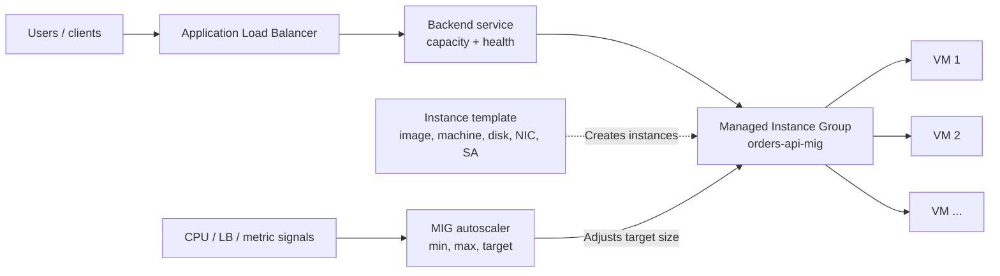
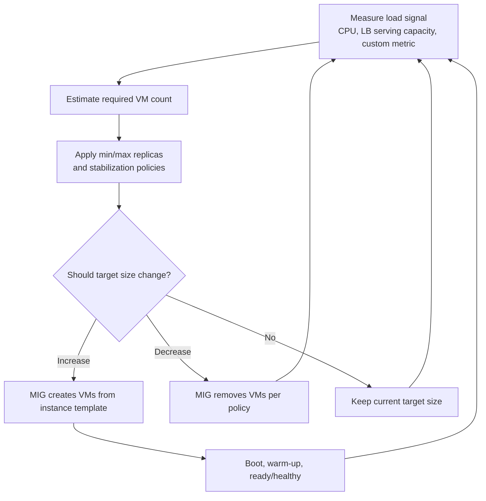

# Autoscaling by CPU, load balancing, and custom metrics on Google Cloud

A service running on a **Compute Engine Managed Instance Group (MIG)** may handle few requests at night yet experience several times the load during peak hours. Maintaining a fixed number of VMs sized for peak demand wastes money on idle capacity; keeping only enough VMs for low demand exposes users to latency, errors, or overload when traffic rises. **Autoscaling** adjusts the number of VMs in a MIG based on demand signals, within limits and policies configured by operators.

This lesson belongs to the **Instance Groups and Autoscaling** chapter of the `CLOUD_PROVIDERS_GCP` module. After learning project organization, IAM, VPC, Load Balancing, and Compute Engine VM creation, you combine these concepts to ensure reliability and cost efficiency when deploying applications. The focus here is on **three autoscaling signals: CPU utilization, load balancing serving capacity, and Cloud Monitoring custom metrics**, along with verifying autoscaler behavior on a real system.

> This lesson covers the **Compute Engine MIG autoscaler**, not GKE's Horizontal Pod Autoscaler or Cloud Run instance autoscaling. Those platforms have their own metric models and capacity controls, even though they share the same goal of adapting to load.

## 1. Learning objectives

After this lesson, you can:

1. Describe the roles of **instance templates, MIGs, autoscalers, backend services, and health checks** in a self-scaling VM application.
2. Distinguish between autoscaling based on **CPU**, **load balancing utilization**, and Cloud Monitoring **custom metrics**.
3. Apply the concepts of **minimum/maximum replicas, target utilization, initialization period, stabilization, and scale-in controls**.
4. Understand system behavior when configuring **multiple signals** and when demand exceeds VM limits or quotas.
5. Create a sample MIG and CPU autoscaler via the Console/`gcloud`, then verify configuration and behavior using read-only commands.
6. Design scaling capabilities for an HTTP API behind a Load Balancer and a queue-processing worker using appropriate metrics.
7. Avoid common pitfalls regarding warm-up, health checks, regional capacity, unreliable metrics, costs, and IAM permissions.

## 2. Architectural overview: who decides the VM count?

An HTTP architecture on Compute Engine may consist of:



**Distinct responsibilities:**

| Component | Role | What it does NOT do automatically |
| --- | --- | --- |
| **Instance template** | Defines configuration for created VMs: machine type, boot disk, NIC, service account, metadata/startup script. | Does not measure load or add VMs on its own. |
| **Managed Instance Group** | Creates and maintains a relatively uniform set of VMs from a template, managing their lifecycle. | Does not infer target CPU unless autoscaling is configured. |
| **Autoscaler** | Calculates required VM count from signals, limits, and policies. | Does not fix application code or raise quotas. |
| **Load Balancer + backend service** | Distributes traffic to supported backends and tracks serving capacity/health per product behavior. | Does not automatically decide VM counts in the MIG unless a matching autoscaler is configured. |
| **Health check / autohealing** | Detects unhealthy instances so the MIG can replace them per configuration. | Does not equal load-based autoscaling. |
| **Cloud Monitoring** | Supplies metrics and operational observability. | Does not create an autoscaler unless a policy is configured. |

A **zonal MIG** manages VMs in a single zone; a **regional MIG** can distribute VMs across multiple zones in a region according to distribution policies and regional capacity. **Multi-zone autoscaling in a regional MIG does not equal multi-region failover**. Surviving a full region outage requires multi-region architecture at the application, load balancing, and data layers.

## 3. How the autoscaler works: scaling VMs out and in

The autoscaler continuously evaluates configured signals. If predicted demand exceeds current capacity, the autoscaler instructs the MIG to **scale out** (increase instance count); when demand stays low long enough, the autoscaler can **scale in** (decrease instance count). All actions remain subject to min/max bounds and stabilization controls.



### 3.1. Min and max replicas

- **Minimum replicas** sets the baseline number of VMs the autoscaler maintains per configuration. For example, `min=2` is a common starting point for an HTTP service that wants to avoid cold starts under normal conditions.
- **Maximum replicas** caps the number of VMs the autoscaler can request. It bounds automated scale, though it is **not an absolute cost cap** because disks, load balancing, network egress, logging, and other services also incur charges.
- If demand requires more VMs than `max`, the autoscaler will not exceed the cap to meet the target; the application may continue experiencing overload.
- For regional MIGs, understand how `min/max` and cross-zone instance distribution apply for the feature in use; avoid accidentally setting the minimum too low to serve traffic if one zone goes down.

Configuring `min=2, max=10` neither means 10 VMs are always running nor guarantees 10 VMs can always be created when needed. **Compute Engine quotas, IP address limits, disk limits, zonal capacity, and network dependencies** can block adding instances.

### 3.2. Target utilization is a control setpoint, not an SLA

Suppose **target CPU utilization = 60%**. The autoscaler adjusts the VM count so the group's average CPU approaches that target according to its algorithm, rather than waiting until CPU reaches 100% before adding VMs.

To build intuition, you can use an **illustrative** formula (*not Google Cloud's exact internal algorithm*):

\[
N_{\text{estimated}} \approx
\left\lceil N_{\text{current}}\times
\frac{U_{\text{observed}}}{U_{\text{target}}}\right\rceil
\]

For example, 4 VMs averaging 90% CPU with a 60% target:

\[
N_{\text{estimated}} \approx \lceil 4 \times 0.90/0.60 \rceil = 6
\]

This explains why the autoscaler tends to scale up when CPU is high. **In practice**, scaling up and down also depends on sampling intervals, VM initialization, metric latency, bounds, stabilization, scale-in controls, and actual VM provisioning speed.

### 3.3. VMs need time to initialize

The moment an instance is created is **different** from the moment the application is ready to serve traffic:

```text
Create VM → boot OS → download/apply config → start application
     → readiness/health check passes → serve requests
```

The autoscaler has an **initialization period** parameter (called `cool-down period` in some older commands/docs) to estimate how long the workload takes to initialize and how metrics are handled during startup. Choose this value based on observed application startup time, rather than always picking the lowest number.

If an application needs 4 minutes to become ready but the configured initialization period is too short, metrics from VMs not yet handling real traffic can skew the autoscaler's estimates. If it is set too long, the autoscaler may react slower or differently than expected in certain situations. Validate behavior via load testing and the documentation for the specific feature.

### 3.4. Scale-in is typically more conservative than scale-out

Removing VMs too quickly can cause oscillation (`scale out → scale in → scale out`), especially under bursty traffic or noisy metrics. The autoscaler uses **stabilization** mechanisms and supports **scale-in controls** (where available) to limit how much capacity can be removed within a given time window.

Key points:

- **Stabilization** prevents scaling down too aggressively based on a brief dip in metrics.
- **Scale-in controls** cap the number or percentage of instances that can be removed within a configured time window.
- Load balancer **connection draining** and application **graceful shutdown** help finish in-flight requests/connections when an instance is removed.
- The **initialization period** should not be misunderstood as simply "wait X seconds before the next scaling action."

For long-running HTTP requests or workers with in-progress jobs, scaling in must be paired with job completion, checkpointing/retries, and idempotency; the autoscaler cannot infer full business state from CPU alone.

## 4. Autoscaling by CPU utilization

### 4.1. What does CPU measure?

**CPU utilization** represents the proportion of a VM's CPU capacity currently in use. For a MIG, the autoscaler can use average CPU data across instances and your chosen target to recommend the number of VMs to maintain.

CPU is suitable when:

- The application is genuinely **CPU-bound**: computation, encoding, parsing, rendering, or APIs with significant CPU time.
- Load shows a fairly consistent correlation between request volume and CPU usage.
- VMs have uniform configuration/processing power from the template, avoiding a few overloaded instances while others sit idle.
- Traffic is distributed evenly enough that CPU does not skew heavily across instances.

CPU may **fail to reflect demand** when the system slows down because of:

- Waiting on Cloud SQL, Redis, external APIs, or storage I/O.
- Concurrent requests hitting connection or worker pool limits while CPU stays low.
- Job queues growing while workers are blocked on external resources.
- Heavy requests concentrating on a few backends due to session affinity or routing.

Therefore, do not choose CPU merely because it is easy to enable. Confirm that it accurately represents **the capacity bottleneck that requires scaling**.

### 4.2. Example: 65% CPU target

A Node.js API runs 2 VMs in a MIG with `min=2`, `max=8`, and a 65% CPU target. As traffic climbs steadily, the autoscaler adds VMs to spread the load; as traffic drops, it gradually removes VMs per stabilization policies.

**Do not treat 65% as a universal "magic number" for every application.** JVM services requiring warm-up, video processors, shared-core VMs, and multi-threaded programs all exhibit different CPU-to-latency curves. Use load tests, p95/p99 latency, error rates, and queue depth to pick your target.

### 4.3. Pros and cons

| Pros | Limitations |
| --- | --- |
| Built-in infrastructure signal requiring minimal app instrumentation. | Low CPU does not guarantee the application has spare capacity. |
| Well suited to CPU-bound services and evenly distributed load. | Sudden traffic spikes can outpace VM boot times. |
| Relatively simple to configure. | Does not directly reflect HTTP SLAs or queue backlog. |
| Can be combined with other signals. | Averaging can mask localized hot spots on specific backends. |

## 5. Autoscaling by load balancing utilization

Certain **Load Balancing backend services** support configuring **serving capacity** for an instance group—for instance, balancing by utilization or request/connection rate depending on the LB and backend type. A MIG autoscaler can use **load balancing serving capacity** as a signal to scale VMs handling traffic.

### 5.1. How does serving capacity differ from CPU?

CPU observes **compute consumption**. Load balancing serving capacity reflects **how much of the backend's declared/measured traffic-serving capacity is being used**, as defined by the Load Balancing type.

For example, a backend service configured with **RATE** mode and a per-instance serving target:

```text
Backend service: orders-http-backend
Balancing mode : RATE (illustrative, depends on LB type)
Max rate/VM    : 100 requests/second
Autoscaler target load balancing utilization: 0.80
```

Intuitively, a VM reaches roughly 80% of its declared capacity when serving around 80 requests/second in this **hypothetical example**. If a group of 3 VMs must sustain roughly 400 requests/second, 3 VMs are clearly insufficient at that threshold. The autoscaler can add VMs depending on metric readings, serving calculations, and other constraints.

**Do not use this illustrative calculation as an exact forecast of VM counts created by the autoscaler.** How the backend service defines capacity, backend selection algorithms, metric aggregation, and initialization periods can change the outcome. `RATE`, `UTILIZATION`, and other options are not uniformly available across all Load Balancer types.

### 5.2. Important prerequisites

1. **The MIG must be attached as a backend** to a backend service of a load balancer type that supports serving-capacity autoscaling.
2. The backend service must configure an appropriate **balancing mode and maximum capacity** reflecting per-instance or group capacity.
3. The MIG autoscaler must be configured with a **load balancing utilization target**; simply attaching a MIG to an LB **does not automatically enable autoscaling**.
4. **Health checks** must accurately reflect backend readiness; if the LB marks many VMs unhealthy, traffic can overload the remaining instances.
5. Understand the resource requirements of your **Load Balancer**: external/internal, regional/global, backend type, health checks, and firewall/proxy ranges.

**Common pitfall:** setting `maxRatePerInstance` on a backend does **not** hard-cap requests sent to a VM at that exact number. It is a parameter used for backend selection and capacity modeling. When traffic exceeds usable capacity, latency and errors can still climb; the autoscaler does not magically give an overloaded backend infinite capacity.

### 5.3. When to choose load balancing autoscaling?

Ideal when the application is load-balanced and **request/connection demand** correlates directly with serving capacity, yet CPU stays low due to I/O waits. Examples include APIs holding many concurrent upstream connections, or services with a load-test-verified requests/second ceiling per VM.

Unsuitable when:

- VMs do not receive traffic through a supported LB backend service.
- The workload is a standalone queue worker not fronted by an LB.
- You have not benchmarked actual VM capacity and pick an arbitrary `maxRatePerInstance`.
- Complex LB routing/policies prevent the metric from accurately representing overall service demand.

## 6. Autoscaling by Cloud Monitoring custom metrics

When neither CPU nor Load Balancer signals accurately reflect demand, you can use **Cloud Monitoring metrics**, including custom metrics published by your application or agent, to let the autoscaler adjust the MIG within supported constraints.

### 6.1. What problem do custom metrics solve?

A worker pulling orders from a queue may show only 20% CPU while its `queue_backlog` balloons from 100 to 20,000 messages because each job waits on an external API. A 65% CPU autoscaler will not add VMs in time.

More meaningful business/application metrics include:

- **Pending jobs / queue backlog:** number of jobs waiting to be processed.
- **Requests in flight:** number of concurrent active tasks.
- **Work items per instance:** amount of work assigned per VM.
- **Processing lag:** delay relative to event arrival time.
- **Active sessions/connections:** number of sessions each VM can handle.

Not every metric can be used directly for autoscaling. You must verify **metric type, monitored resource, metric kind, value type, unit/aggregation definition, and whether the autoscaler evaluates it per-VM or per-group**. A well-named metric emitted under the wrong resource scope or data type may be rejected by the autoscaler.

### 6.2. Per-instance metrics vs. per-group metrics

Two common patterns:

| Model | Example | What to consider |
| --- | --- | --- |
| **Per-instance metric** | `custom.googleapis.com/orders/active_jobs` per VM. | Each VM publishes its own time series tied to its exact resource/instance. |
| **Per-group metric** | `custom.googleapis.com/orders/queue_backlog` describing total backlog of a queue serving the whole MIG. | Must define how total demand maps to per-VM capacity using an autoscaler-supported assignment configuration. |

For example, suppose a queue has 900 pending jobs, and each VM is benchmarked to handle roughly 150 pending jobs under operational targets. By an **illustrative** calculation:

\[
N_{\text{estimated}} \approx \left\lceil
\frac{900 \text{ jobs}}{150 \text{ jobs/VM}}
\right\rceil = 6
\]

In practice, the team must configure **single-instance assignment** or an equivalent Google Cloud-supported mechanism for group-level metrics. You cannot simply name a metric `queue_backlog` and expect the autoscaler to know the jobs-per-VM ratio. Verify how sampling, latency, and aggregation behave.

### 6.3. Designing a reliable metric

A metric used as an autoscaling control signal should have:

1. **Clear semantics:** `pending_jobs` counts only jobs waiting at observation time, not mixing in-progress or failed jobs.
2. **Correct unit and kind:** backlog is an instantaneous gauge; cumulative counters cannot be compared directly as backlog. Use an appropriate rate if measuring throughput.
3. **Consistent resource/labels:** data from MIG VMs or a group-level source follows an autoscaler-supported monitored resource format.
4. **Reasonable reporting interval:** metrics that lag too much create VMs after the spike has passed; overly noisy metrics can cause oscillation.
5. **Handling missing/zero data:** missing metrics are not the same as zero. Know how the autoscaler reacts if the agent or app stops emitting data.
6. **Evidence-based target:** derived from throughput benchmarks, processing duration, upstream limits, and backlog age/SLO targets.
7. **Testability:** dashboards showing raw metrics, instance count, throughput, backlog age, and errors to verify correlation.

**Design flaw example:** every instance publishes the total backlog of the same shared queue. If Cloud Monitoring collects multiple time series reporting that same total and the autoscaler interprets it as a per-instance metric, the signal is multiplied across instances and triggers erratic scaling. Always separate **per-VM** metrics from **group-wide** metrics.

### 6.4. Custom metrics do not bypass other limits

A custom metric can request more VMs, but it cannot resolve:

- **Quota/availability:** region/zone out of VM capacity.
- **External bottlenecks:** Cloud SQL connection exhaustion, partner API rate limits, or an overloaded queue broker.
- **Startup latency:** newly created VMs are not immediately processing work.
- **Cost:** adding VMs can inflate bills without shrinking backlog if the true bottleneck sits upstream.
- **Metric pipeline reliability:** dropped or misreported metrics feed bad signals into the autoscaler.

## 7. Multiple signals in one autoscaling policy

A MIG can configure **multiple autoscaling signals** where supported by signal types and feature rules. For example:

- CPU target 65%.
- Load balancing utilization target 80%.
- A custom metric for concurrent jobs with an appropriate target.

Conceptually, the autoscaler evaluates the VM count recommended by each signal and generally **selects the largest recommendation** so all constraints are satisfied. It is **not a simple sum** of all signals.

Hypothetical example:

| Signal | VM count suggested by illustrative model |
| --- | ---: |
| CPU | 5 |
| Load balancing | 7 |
| Custom metric | 6 |
| MIG max cap | 10 |

Control would aim toward **7 VMs**, not `5 + 7 + 6 = 18`. Actual behavior still depends on stabilization, metric timing, min/max bounds, and feature constraints. If `max=6`, the autoscaler will not exceed the cap even when the LB signal requests 7.

### 7.1. Watch out for conflicting signals

For example, CPU is low while load balancing utilization is high. This can be entirely valid: VMs may be constrained by socket/connection limits, requests may be blocked waiting on a database, or backend service capacity may be configured too low.

Conversely, high CPU with low LB utilization can point to heavy background jobs, GC pauses, application bugs, or traffic bypassing the LB. **The autoscaler is a capacity controller**, not a performance diagnostics tool. Always inspect dashboards and logs to isolate the real bottleneck.

### 7.2. Separating load-based scaling from schedules

Compute Engine also supports **autoscaling schedules** and predictive configurations in supported scenarios. Planning for predictable peak hours maintains an adequate baseline *before* load hits, rather than reacting only after CPU or queues climb.

However, schedules do not replace real-time signals: schedules only capture expected timing, whereas traffic can still spike unexpectedly off-schedule. Every signal and schedule must stay within the MIG's actual feature constraints and compatible min/max bounds.

## 8. Parameters affecting behavior and reliability

| Parameter | Meaning | If misconfigured |
| --- | --- | --- |
| **Minimum replicas** | Baseline minimum VMs. | Too low risks cold starts/single points of failure; too high wastes idle spend. |
| **Maximum replicas** | Autoscaler ceiling. | Too low bottlenecks traffic; too high drives rapid cost spikes if metrics misfire. |
| **CPU target** | Target CPU utilization. | Too high risks latency spikes; too low leaves excess unused capacity. |
| **LB utilization target** | Target LB serving capacity utilization. | Requires accurately measured/declared backend capacity. |
| **Custom metric target** | Desired per-VM capacity for the metric. | Wrong unit or scope causes inaccurate scaling. |
| **Initialization period** | Estimated VM startup time. | Scaling reacts unsteadily if misaligned with reality. |
| **Scale-in controls** | Caps scale-down rate within a time window. | Removes VMs too quickly, dropping jobs/connections. |
| **Health check/autohealing** | Detects and replaces unhealthy VMs. | Unhealthy VMs linger or traffic routes to broken backends. |
| **Regional distribution policy** | Places instances across zones. | A zone outage has oversized impact; uneven capacity distribution. |

### 8.1. Autoscaling vs. autohealing

**Autoscaling** answers: "How many VMs are needed to handle the load?"  
**Autohealing** answers: "Which VM is unhealthy and needs replacement?"

Suppose 5 VMs are running and one hangs. **Autohealing** replaces the hung VM to preserve serving capacity. **Autoscaling** may scale up to 6 VMs if load signals warrant it. Both mechanisms can run together, provided **health checks fit the application** and the initial delay gives new VMs enough time so they are not prematurely flagged as broken.

### 8.2. Instance templates and true scalability

A MIG provisions new instances from its **instance template**. Therefore, the template must contain configuration capable of bootstrapping without manual intervention:

- Versioned image and properly sized/typed boot disk.
- VPC/subnet/region, firewall rules, and network dependencies.
- Least-privilege runtime service account.
- Controlled startup script or configuration mechanism; never store plaintext secrets in metadata.
- Logging/monitoring agents, health endpoints, and config retrieval mechanisms.
- **Session state** externalized from VMs when scaling or recreating instances, never kept solely on ephemeral/lifecycle boot disks.

If newly scaled VMs boot up unable to reach Cloud SQL or Artifact Registry, the autoscaler may keep adding VMs **that cannot serve requests**, inflating costs without improving availability.

## 9. Hands-on walkthrough: CPU-based MIG autoscaling

Assume the test environment already has:

- Project `orders-dev` with the Compute Engine API enabled.
- A VPC/subnet in `asia-southeast1` with appropriate firewall rules and VM networking.
- An existing instance template named `orders-api-template-v1` capable of booting the application.
- Appropriate IAM permissions to manage MIGs/autoscalers and quota for up to 8 VMs.

If the template does not exist yet, create and verify a **separate template** per the VM creation lesson before continuing. This walkthrough **does not create VPCs, DNS, firewalls, or service accounts**. Every command creating or modifying autoscaling changes infrastructure and may incur charges.

### 9.1. Set variables and run pre-checks

```bash
PROJECT_ID="orders-dev"
ZONE="asia-southeast1-b"
MIG_NAME="orders-api-mig"
TEMPLATE_NAME="orders-api-template-v1"

gcloud auth list
gcloud compute instance-templates describe "$TEMPLATE_NAME" \
  --project="$PROJECT_ID" \
  --format="yaml(name,properties.machineType,properties.disks,properties.networkInterfaces)"

gcloud compute instance-groups managed list --project="$PROJECT_ID"
```

These **read-only** commands confirm that the template actually specifies the right boot disk, NIC, and service account. If a MIG with the same name already exists, **do not duplicate or overwrite it**—check its policy and owner first.

### 9.2. Create a zonal MIG

```bash
# INFRASTRUCTURE-MODIFYING COMMAND: run only in an approved lab.
gcloud compute instance-groups managed create "$MIG_NAME" \
  --project="$PROJECT_ID" \
  --zone="$ZONE" \
  --template="$TEMPLATE_NAME" \
  --size=2
```

This creates a **zonal MIG** with 2 VMs from the template. If the template assigns external IPs, an overly broad service account, or an unsafe startup script, those traits will be replicated across all new VMs. Inspect the template before creating the MIG.

If you need a **regional MIG** spanning multiple zones, use regional scope/commands and appropriate distribution settings rather than just renaming the MIG. This lab uses a zonal MIG to focus on autoscaling signals.

### 9.3. Enable CPU autoscaling

```bash
# INFRASTRUCTURE-MODIFYING COMMAND: dynamically adds/removes VMs while running.
gcloud compute instance-groups managed set-autoscaling "$MIG_NAME" \
  --project="$PROJECT_ID" \
  --zone="$ZONE" \
  --min-num-replicas=2 \
  --max-num-replicas=8 \
  --target-cpu-utilization=0.65 \
  --cool-down-period=180
```

Meaning:

- `min=2`: baseline of at least 2 VMs per configuration.
- `max=8`: will not automatically exceed 8 VMs even if CPU stays high.
- `target-cpu-utilization=0.65`: 65% target CPU.
- `--cool-down-period=180`: legacy CLI flag specifying an estimated 180-second startup window; product documentation generally refers to this as the **initialization period**. Check your `gcloud` version for currently supported flags.

180 seconds is just an example. Measure the actual duration from VM creation until the health check marks the backend ready to choose a better value.

### 9.4. Inspect the autoscaler and MIG status

```bash
gcloud compute instance-groups managed describe "$MIG_NAME" \
  --project="$PROJECT_ID" \
  --zone="$ZONE" \
  --format=yaml

gcloud compute instance-groups managed list-instances "$MIG_NAME" \
  --project="$PROJECT_ID" \
  --zone="$ZONE"

# List autoscalers in the corresponding scope
gcloud compute autoscalers list \
  --project="$PROJECT_ID"
```

In the Console, open **Compute Engine → Instance groups → MIG → Autoscaling** and verify target CPU, min/max replicas, initialization period, instance count history, and any error messages. Combine this with Cloud Monitoring to align CPU utilization, VM count, request latency, and error rate on the same timeline.

Never assume the autoscaler is working properly just because a policy exists. Confirm that **new VMs actually boot, pass health checks, and begin serving live traffic**.

### 9.5. Safe load testing

To observe scale-out, generate load only against your **lab application**—never send test traffic to production services or third-party endpoints. Use an approved load-testing tool with strict request-rate and duration limits.

Workflow:

1. Record baseline VM count, average CPU, latency, error rate, and backend status.
2. Gradually increase load and watch whether CPU stays steadily above 65%.
3. Check whether the autoscaler increases the target size and the MIG provisions new VMs.
4. Verify that new VMs transition to ready/healthy and that traffic distribution adjusts.
5. Lower load as planned, wait for stabilization, and observe scale-in; do not expect an instant drop back to minimum.
6. Document findings: initialization duration, peak VM count, peak latency/errors, estimated cost, and any quota errors.

**If scale-out does not happen**, do not immediately assume the autoscaler is broken: the metric may not have crossed the target, the load may have been too brief, `max` may already be reached, quota/capacity may have blocked provisioning, or the policy may be attached to the wrong scope.

## 10. Configuring load balancing autoscaling

For an HTTP system behind a Load Balancer:

1. Create or reuse a backend service belonging to an **LB type that supports MIG backends and serving-capacity autoscaling**.
2. Attach the MIG to the backend service; configure a benchmark-backed **balancing mode and maximum serving capacity**.
3. Configure health checks and firewall rules for the exact probe sources so VMs turn healthy when ready.
4. On the MIG's **Autoscaling** page, select **HTTP load balancing utilization** (or the matching option in your Console version) and set a target (e.g., 80% capacity).
5. Keep `min/max` aligned and measure VM readiness duration.
6. Ramp up request load and observe **backend serving capacity, requests per instance, VM count, p95 latency, and 5xx errors**.

Depending on the product and CLI version, options like `--target-load-balancing-utilization` may be available when configuring MIG autoscaling. **Never blindly run a policy-update command** if CPU or custom metric signals already exist: inspect the current policy first to verify whether the command appends a signal or overwrites existing settings.

### 10.1. Useful read-only commands

```bash
# List backend services; clearly verify global vs. regional scope
gcloud compute backend-services list \
  --project="$PROJECT_ID"

# Example global backend service; use --global only if the list output confirms global scope
gcloud compute backend-services describe orders-http-backend \
  --project="$PROJECT_ID" \
  --global \
  --format=yaml

# Inspect the MIG in the selected zone
gcloud compute instance-groups managed describe "$MIG_NAME" \
  --project="$PROJECT_ID" \
  --zone="$ZONE"
```

When reading the backend service, inspect **backends[]**, how the MIG is referenced, `balancingMode`, `maxRatePerInstance` (or the capacity field for that LB type), health checks, and timeouts. If the backend service is **regional**, replace `--global` with `--region=REGION`.

**Do not confuse:** health checks determine whether a VM is eligible to serve as a backend; load balancing autoscaling determines **how many VMs** to run based on capacity signals. A MIG can scale out while the LB still marks backends unhealthy if the startup script failed or firewalls block health probes.

## 11. Designing a custom metric for a queue worker

The `orders-batch-mig` system runs VM workers pulling tasks from a queue. Workers mostly wait on external API responses so CPU stays low, while `queue_backlog` grows rapidly. The goal is adding VMs as backlog rises without flooding the upstream API.

### 11.1. Proposed metric

Illustrative definition:

```yaml
metric_type: custom.googleapis.com/orders/queue_backlog
meaning: "Number of pending jobs waiting to be processed"
unit: "1"
kind: GAUGE
scope: "Per-group / queue-wide"
update_interval_seconds: 60
intended_capacity_per_instance: 150
```

This is a **metric design spec**, not a YAML/JSON payload you can pass directly to the Cloud Monitoring API to register a metric. The metric publisher must adhere to Cloud Monitoring schemas and monitored resource types; the autoscaler must be configured with the product's supported **per-group metric / single-instance assignment** settings.

### 11.2. Workflow to wire the metric into the autoscaler

1. **Instrument** the queue publisher/collector: emit `queue_backlog` with consistent resource/labels and ensure individual VMs do not duplicate the total queue backlog.
2. Verify the metric in **Metrics Explorer**: continuous data points, correct unit, and no negative or anomalous values.
3. Benchmark how many jobs one worker can handle without violating SLOs or upstream API rate limits. For instance, 150 jobs/VM is an **assumed target**, not a universal default for every VM.
4. In the MIG autoscaling settings, select **Cloud Monitoring metric**; configure the metric type, scope, target, and matching per-instance/per-group assignment.
5. Set min/max, initialization period, and scale-in controls. Use only options supported in the UI/API for that metric type.
6. Safely simulate queue backlog and measure `backlog age`, throughput, VM count, external API errors, and active job count.
7. Test **empty queue**, **missing metric**, and **upstream rate-limit** scenarios; confirm the autoscaler neither scales out endlessly nor scales in prematurely and drops jobs.

### 11.3. Why backlog count alone is not enough

A backlog of 1,000 jobs might be trivial if each job takes 10 ms, yet massive if each job takes 60 seconds. For heterogeneous job workloads, also monitor:

- Mean, p95/p99 processing time and variance.
- Backlog **age**, not just message count.
- Retry/dead-letter rates, in-flight jobs, and worker efficiency.
- Downstream API rate limits, concurrency caps, and quotas.
- Safe scale-in behavior while jobs are mid-flight; workers must finish and ack cleanly.

**Correct mindset:** the autoscaler optimizes a proxy signal for capacity demand. That signal is only effective when verified to correlate with **system SLOs and throughput**.

## 12. Comparing three operational scenarios

| Scenario | Starting signal | Why | What else to check |
| --- | --- | --- | --- |
| **A. Compute-heavy REST API** on a MIG, fairly uniform traffic. | **CPU utilization** | CPU correlates well with processed requests. | p95 latency, readiness, CPU hotspots, min/max, and warm-up. |
| **B. Connection-heavy HTTP API** behind a backend service, low CPU but hitting request/connection limits. | **Load balancing serving capacity** | HTTP demand approaches declared backend capacity. | Balancing mode, capacity benchmarks, health checks, supported LB type. |
| **C. Queue-processing worker** not behind an LB, low CPU due to I/O wait. | **Custom metric** for backlog/processing lag. | Signal reflects remaining work to process. | Metric kind/scope, single-instance assignment, idempotency, and upstream quotas. |

An application running both API endpoints and background jobs may need **two separate MIGs**. Combining both in one MIG muddies CPU and request capacity signals, making optimization difficult. Separating workloads by load profile lets you choose tailored metrics, templates, and IAM permissions.

### 12.1. When to consider multiple signals?

Suppose an API becomes CPU-bound during image processing yet occasionally hits high concurrent HTTP connections. Combining CPU + LB utilization can prevent one bottleneck from hiding behind low readings on the other. Measure each signal independently before combining them to avoid unexpected scaling behavior.

If a custom backlog metric **keeps rising as more VMs are added** because the system pulls more parallel work, raising min/max alone will not fix a flawed metric design. Re-evaluate the metric definition, throughput, and queue semantics.

## 13. Monitoring, testing, and troubleshooting autoscaling

### 13.1. Minimum dashboard

| Metric group | Examples | What to observe |
| --- | --- | --- |
| **Capacity** | Target size, current instance count, creating/healthy VMs. | Is the autoscaler creating enough VMs, and are new VMs becoming ready? |
| **CPU** | Average utilization, p95/p99 across VMs if available. | Does CPU correlate with throughput and latency? |
| **Load Balancing** | Requests/s, backend utilization/capacity, 4xx/5xx, latency. | How are incoming traffic and serving quality changing? |
| **Custom metrics** | Queue backlog, backlog age, active jobs. | Are business signals accurate and timely? |
| **Reliability** | Health checks, failed instance creations, error logs. | Is scaling blocked by startup failures, health checks, or quotas? |
| **Cost** | VM-hours, disks, network egress, LB/logging. | Is spend exceeding value or driven by faulty scaling? |

Specific metrics and logs depend on Compute Engine, LB, Cloud Monitoring, and application instrumentation. If a metric is missing, configure collection rather than assuming its value is zero.

### 13.2. Common troubleshooting table

| Symptom | Common causes | How to investigate |
| --- | --- | --- |
| CPU climbs but MIG does not scale out | Autoscaler disabled, wrong MIG/scope, target not reached, at max cap, or scaling restricted. | Inspect autoscaler policy, target size, CPU time series, min/max. |
| Autoscaler requests more VMs, but none are created | vCPU/disk/IP quota, unavailable machine type, exhausted subnet IPs, IAM, or zonal capacity. | Check MIG instance operations/errors, zonal/regional quotas, and networking. |
| VM count rises, yet HTTP 5xx stays high | New VMs not yet healthy, startup error, LB backend misconfiguration, database bottleneck. | Check health probes, app logs, LB errors, Cloud SQL connections. |
| Low CPU, yet high request latency | I/O waits, exhausted thread/connection pools, or growing internal queues. | Inspect APM/traces, LB utilization, in-flight requests, backlog. |
| Frequent scale-out/scale-in flapping | Noisy metric, poorly tuned target, unsuitable initialization/stabilization/scale-in controls. | Compare signal time series with instance count and tune conservatively. |
| Custom metric triggers no scaling | Missing data points, wrong scope/type, broken filter, metric lag, or wrong per-group config. | Check Metrics Explorer, resource labels, autoscaler errors, and API policy. |
| LB autoscaling shows no reaction | MIG not attached to a compatible backend service, wrong balancing mode/capacity. | Inspect backend service config, health, LB type, and autoscaler policy. |
| Cost spikes even though request volume is flat | Faulty metric, job retry storm, background CPU load, overly high max, boot disk/egress growth. | Correlate signals, instance counts, request/job counts, and Billing. |
| Scale-in drops jobs or active connections | Missing connection draining/graceful shutdown or unsafe job ack/retry handling. | Check worker lifecycle, shutdown hooks, session state, scale-in controls. |
| One zone lacks capacity | Regional distribution/quota/capacity cannot be met in that zone. | Review MIG distribution, quotas, and multi-zone design; adjust policies validly. |

### 13.3. Diagnostic workflow before changing policies

1. **Confirm the exact MIG**: project, zonal vs. regional, and active administrative identity.
2. **Verify target size and current instance count**; instances currently being created are not yet ready backends.
3. **Inspect policy signals, min/max, initialization period, and scale-in controls**.
4. **Inspect raw metrics**, not just averaged charts; check for missing data or outliers.
5. **Review operations/errors** for the MIG and autoscaler, plus quotas, capacity, startup, and health.
6. **Inspect the LB backend service** or corresponding Cloud Monitoring metric configuration.
7. **Apply small, planned adjustments**, monitoring 5xx rates, p95 latency, throughput, VM count, and cost.

Never bump `max replicas` from 10 to 500 just to "see what happens." Doing so can rapidly spike spend, crush downstream databases, and leave the root cause unresolved.

## 14. Autoscaling limits and cost optimization

### 14.1. The autoscaler cannot create capacity that doesn't exist

Suppose `max=20` and the autoscaler determines 16 VMs are needed, yet only 12 vCPUs of quota remain or the subnet has run out of internal IPs. The MIG cannot provision the extra VMs regardless of how valid the metric is. Therefore:

- Calculate CPU, disk, IP, forwarding rule, and supporting resource quotas at the **exact required scope**.
- Check regional/zonal resource availability, especially for scarce machine types or accelerators.
- Leave headroom for startup time and sudden bursts.
- Evaluate reservations/capacity assurances for critical workloads.

A multi-zone MIG reduces dependency on one zone, yet **it does not make regional quota infinite** and does not automatically protect data.

### 14.2. Simple cost model

If one VM has an assumed compute cost of `C`/hour and the daily average VM count is `N_avg`, baseline compute cost is roughly:

\[
\text{Compute cost/day} \approx 24 \times N_{\mathrm{avg}} \times C
\]

This **excludes** persistent disks, licenses, load balancing, egress, NAT, logging, Monitoring, external APIs, or data service costs. Even when the MIG scales down to minimum, running VMs and attached disks continue incurring charges per product pricing.

Autoscaling generally cuts waste compared to static peak provisioning, though it is not guaranteed to be **automatically cheapest**. For instance, a buggy custom metric can continuously add VMs, or scaling out workers can amplify per-request downstream charges.

### 14.3. Security when scaling out

Every new VM inherits the **runtime service account** and configuration from its template. If a template grants an overly broad service account, embeds secrets in a startup script, or opens unnecessary external IPs, **autoscaling multiplies security risk** just as fast as it multiplies capacity.

Checklist:

- Use approved instance templates/versions and patched OS images.
- Attach a least-privilege service account; never use long-lived JSON keys.
- Use private NICs, Cloud NAT/Private Google Access, and tightly scoped firewall rules.
- Expose health/readiness endpoints only on required ports and probe sources.
- Avoid storing critical business state on boot disks of disposable VMs.
- Restrict IAM permissions for modifying instance templates, MIGs/autoscalers, and backend services.

### 14.4. Rolling updates and autoscaling are not the same operation

A **rolling update** transitions VMs to a new template per update policy; **autoscaling** adjusts target size based on load. Both can happen near one another, requiring careful planning around total headroom, surge/unavailable policies, and health checks.

For production apps, validate rollouts in staging first, watch request errors, latency, and ready VM counts, and roll back on failure. Swapping a template without verifying bootstrap can cause the autoscaler to spin up even more broken VMs.

## 15. Practice exercises

### Exercise 1 — High CPU, no scale-out

A MIG has 4 VMs, a 60% CPU target, `min=2`, and `max=4`. CPU stays at 95% during peak hours.

**Question:** Why does it not scale out? What must you evaluate before raising max?

**Suggested answer:** The MIG has hit **`max=4`**. Check quotas/capacity, backend capacity, database dependencies, SLOs, and cost impact before raising the ceiling.

### Exercise 2 — Low CPU, high HTTP latency

A MIG serves HTTP behind an LB. Average CPU is only 30%, yet many requests hang for 10 seconds due to connection limits. A 70% CPU autoscaler does not add VMs.

**Question:** Which metrics should you consider?

**Suggested answer:** **Load balancing serving capacity**, in-flight requests, or a **custom metric** tracking connections/queues are strong candidates. First identify the true bottleneck; adding VMs will not help if all instances hit an external database limit together.

### Exercise 3 — Growing queue backlog

Workers pull 8,000 jobs from a queue while CPU sits at 15%. Each VM handles an average of 200 pending jobs at its benchmarked operating threshold.

**Question:** Which signal can be used, and what is the illustrative VM count?

**Suggested answer:** Use a **custom Cloud Monitoring metric** representing backlog in an autoscaler-supported format. In a simple model, `ceil(8000/200) = 40 VMs`, though reality is constrained by min/max, quotas, boot time, and upstream limits. Define it as a per-group metric with target/single-instance assignment and scale-in protection.

### Exercise 4 — Failing health checks

The autoscaler adds 3 VMs, yet the Load Balancer sends no traffic to them. The VMs show `RUNNING`.

**Question:** Why can you not conclude the autoscaler failed?

**Suggested answer:** A `RUNNING` VM does not prove the application is **ready/healthy**. Check startup scripts, listening ports, firewall rules for health checkers/proxies, backend attachment, the health endpoint, and the initialization period.

### Exercise 5 — Multiple signals

An autoscaler is configured with CPU, LB utilization, and a custom metric; each recommends 5, 9, and 7 VMs respectively. `max=8`.

**Question:** What is the conceptual target behavior?

**Suggested answer:** The highest signal requests 9 VMs, which is capped by **`max=8`**. It neither sums `5+9+7` nor exceeds the ceiling. Actual behavior still depends on time and stabilization controls.

### Exercise 6 — Scale-in drops jobs

Queue workers scale down from 6 to 2 VMs. Several long-running jobs are interrupted mid-flight and lose state.

**Question:** What needs fixing besides autoscaler settings?

**Suggested answer:** Implement graceful shutdown/draining, checkpointing or idempotent ack/retry, externalized state off the VM, scale-in controls, and appropriate wait times. An autoscaler cannot rescue jobs that lack recovery mechanisms.

### Exercise 7 — Unexpected cost spike

A custom metric reports 5× the actual backlog, pushing the MIG near `max`. After fixing the metric, the VM count drops slowly.

**Question:** Why? What should you monitor?

**Suggested answer:** The faulty signal inflated capacity demand; after fixing it, stabilization and scale-in controls cause gradual rather than instant scale-down. Monitor raw metrics, target size, current VMs, actual backlog, request errors, and costs, and review thresholds/data windows.

## 16. Production autoscaling checklist

- [ ] Selected **zonal/regional MIG** based on availability and topology requirements.
- [ ] Instance template specifies secure images, boot disks, NICs, service accounts, and bootstrap scripts.
- [ ] Health checks/autohealing, Load Balancer/backend service, and firewall rules are properly designed.
- [ ] Benchmarked CPU, requests/instance, or queue throughput to pick metrics and targets.
- [ ] Documented justification for **min/max replicas**, quota headroom, and potential cost growth.
- [ ] Initialization period reflects actual time until a VM is genuinely ready.
- [ ] Scale-in controls, graceful shutdown, and connection draining protect active requests/jobs.
- [ ] If using LB autoscaling, serving capacity/balancing mode and backend type are compatible.
- [ ] If using custom metrics, metric type, scope, unit, and frequency are verified in Metrics Explorer.
- [ ] If using multiple signals, behavior around max recommendation selection and ceilings is understood.
- [ ] Dashboards track instance counts, CPU/LB/custom metrics, p95 latency, 5xx rates, queue age, quotas, and costs.
- [ ] Tested scale-out/scale-in, bootstrap failures, backend loss, missing metrics, and upstream rate limits in a controlled environment.
- [ ] Production change approval, owner, audit logging, and rollback procedure are established.

## 17. Summary

To autoscale a **Managed Instance Group** successfully, you need the **right signal, the right target, and reliable VM provisioning**:

- **CPU utilization** works when CPU accurately reflects real load pressure and VMs share traffic evenly.
- **Load balancing utilization** works when traffic capacity through a backend service is properly configured and measured on a supported LB type.
- **Cloud Monitoring custom metrics** fit queue workers, job counts, or business limits that CPU fails to capture.
- **Min/max bounds, initialization period, stabilization, and scale-in controls** govern scaling stability, responsiveness, and cost.
- **Autoscaling does not replace autohealing, Load Balancing, IAM, networking, or data architecture**; the application itself must be built to scale and recover as VMs are created or replaced.
- Confidence comes only from **verifying load tests, ready VM counts, request latency/errors, backlog, and costs**—never merely from seeing a policy appear in the Console.

### Google Cloud official references

- [Autoscaling managed instance groups](https://cloud.google.com/compute/docs/autoscaler)
- [Autoscaling based on CPU utilization](https://cloud.google.com/compute/docs/autoscaler/scaling-cpu)
- [Autoscaling based on load balancing serving capacity](https://cloud.google.com/compute/docs/autoscaler/scaling-load-balancing)
- [Autoscaling based on Cloud Monitoring metrics](https://cloud.google.com/compute/docs/autoscaler/scaling-cloud-monitoring-metrics)
- [Autoscaler configuration and concepts](https://cloud.google.com/compute/docs/autoscaler/understanding-autoscaler-decisions)
- [Managed instance groups](https://cloud.google.com/compute/docs/instance-groups)
- [MIG autohealing](https://cloud.google.com/compute/docs/instance-groups/autohealing-instances-in-migs)
- [Cloud Monitoring custom metrics](https://cloud.google.com/monitoring/custom-metrics)
- [Backend services and balancing modes](https://cloud.google.com/load-balancing/docs/backend-service)
