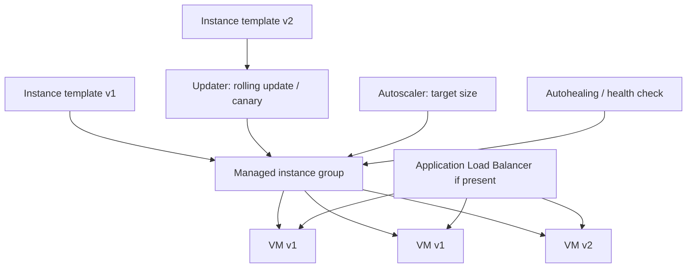
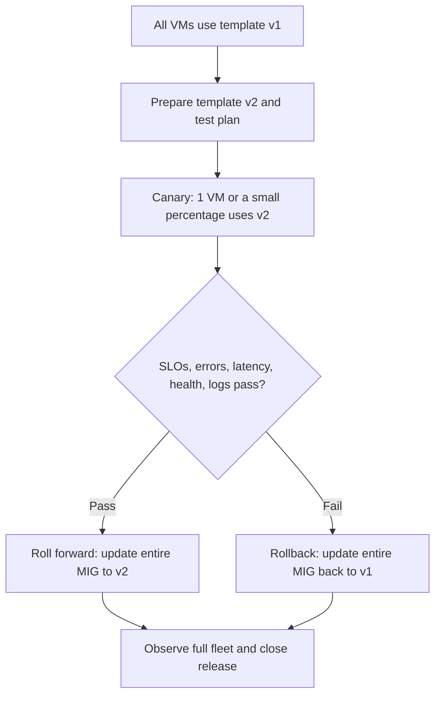

# Rolling updates, canaries, and VM version rollback

> **Chapter:** Instance Groups and Autoscaling  
> **Module:** CLOUD_PROVIDERS_GCP  
> **Module scope:** Explore Google Cloud from project organization, IAM, and VPCs to Compute Engine, GKE, Cloud Run, storage, and database services. Through deployment scenarios, learners select services, secure resources, automate releases, and track reliability alongside cost.

An application running on multiple Compute Engine VMs needs updates to its OS, patches, configuration, or application code. Shutting down all old machines and creating all new ones at once can cause an outage for users. Manually modifying only a few machines leaves the fleet in an inconsistent state where each VM runs a different configuration.

A **Managed Instance Group (MIG)** manages a fleet of VMs using an **instance template**. With a **rolling update**, the MIG gradually applies the new configuration across VMs within a predefined disruption budget. With a **canary update**, only a subset of VMs run the new template to observe risk before expanding. When errors occur, a **rollback** returns the group to the previous template via another update request.

Keep in mind from the start: **a rolling update does not guarantee zero downtime**, **a VM-count canary does not guarantee an exact request percentage**, and **rolling back to an old VM template does not automatically revert data or database schemas**. Safety depends on updater configuration, health checks, load balancing, quotas, application state handling, and data compatibility planning.

## Learning objectives

After this lesson, you can:

1. Distinguish between **MIGs**, unmanaged instance groups, **instance templates**, **versions**, and update policies.
2. Explain **proactive** and **opportunistic** update modes, along with `maxSurge`, `maxUnavailable`, `minimalAction`, `replacementMethod`, and readiness timing.
3. Design **canary → observe → roll forward or roll back** stages with explicit decision criteria.
4. Use the Console and `gcloud compute instance-groups managed rolling-action start-update` on an authorized lab MIG.
5. Monitor progress via `status.isStable`, `status.versionTarget.isReached`, VM instance lists, and application health signals.
6. Distinguish **VM configuration rollback** from **data recovery**, and handle capacity, health check, and compatibility failures.
7. Plan cleanly to avoid accidentally deleting active MIGs, templates, boot disks, data, or live user-facing systems.

## 1. Why use a Managed Instance Group?

A MIG is a collection of VMs managed by Compute Engine according to a desired configuration. Each group uses an **instance template** defining attributes such as machine type, image, boot disk, networking, metadata, startup script, and service account. Depending on the design, a MIG can include **autoscaling**, **autohealing**, **load balancing**, and **rolling updates**.



### 1.1. Managed vs. unmanaged instance groups

| Feature | Managed instance group | Unmanaged instance group |
|---|---|---|
| Standard VM configuration | Based on an instance template and supported overrides | Administrator manages each VM individually |
| Creating/replacing VMs to reach desired state | Managed by the MIG controller | No equivalent group-wide updater |
| Automated rolling updates and canaries | Supported in MIGs per product capabilities | Requires an external deployment mechanism |
| Autohealing | Can configure health checks and repairs | No built-in MIG autohealing |
| Autoscaling | Can enable based on supported signals | No MIG autoscaler |
| Stateful workloads | Offers a **stateful MIG** model with specific rules | Must manage VM state and lifecycle manually |

**Scope of this lesson:** focuses primarily on **stateless MIGs**, such as web/API VM fleets behind a load balancer. For databases or VMs requiring persistent disks/IPs/metadata, design a **stateful MIG** and review rolling update constraints beforehand.

### 1.2. Zonal vs. regional MIGs

- **Zonal MIG:** VMs reside in a single zone; suitable for simple labs or strict zone-pinning requirements.
- **Regional MIG:** spreads VMs across multiple zones within the same region per distribution policies and supported features, reducing single-zone dependency.

The MIG mode determines whether `gcloud` commands take `--zone` or `--region`. **Never pass both** in the same update command. Multi-zone regional MIGs also enforce specific rules for `maxSurge`, `maxUnavailable`, and VM placement, so never blindly copy a zonal example onto a production regional MIG without recalculating.

## 2. Instance templates as configuration version units

An **instance template** is a resource declaring VM configuration. When an attribute in an active template must change, the standard workflow is to **create a new template** and instruct the MIG to update its VMs. Do not edit an old template in place expecting the fleet to update automatically.

```text
web-template-v1
  image: app-image-v1
  machine type: e2-small
  service account: web-runtime-sa
  metadata: release=v1

web-template-v2
  image: app-image-v2
  machine type: e2-small
  service account: web-runtime-sa
  metadata: release=v2
```

**Tip for reproducible rollbacks:** retain old templates and reference **immutable versions of images and application artifacts**. If a template points only to an **image family** whose default target changes over time, VMs created later may boot a different image than the original deployment. Control base images, startup scripts, package versions, and artifact repositories.

### 2.1. Template vs. version inside a MIG

| Concept | Example | Meaning |
|---|---|---|
| Template resource | `web-template-v2` | VM configuration blueprint |
| Version in MIG | `template=web-template-v2` | Which template the MIG uses to create desired VMs |
| Canary target size | `target-size=1` | Target VM count assigned to the canary template |
| Group target size | `targetSize=6` | Total desired VM count in the MIG |
| Current action | `CREATING`, `RECREATING`, `NONE` | Action the updater is currently executing on a VM |
| Actual VM template | `web-template-v1` or `web-template-v2` | Actual configuration currently running on each VM |

A MIG supports at most **two instance template versions concurrently during a canary**. It is not an unlimited release-history archive. You must maintain your own catalog of artifacts, older templates, release records, and rollback plans.

### 2.2. Configurations outside the template

MIGs also support **all-instances configuration** (such as metadata/labels) and **stateful configuration** when certain state must be preserved. When investigating why a VM differs from its template, inspect **these override layers as well**. The template is the baseline, not always the sole configuration source affecting a VM.

## 3. How does a rolling update work?

Suppose a MIG has **6 VMs** running `web-template-v1`. You initiate an update to `web-template-v2` with **`maxSurge=1`** and **`maxUnavailable=0`**. Provided quotas and resources allow, the updater can create one new VM first, verify readiness, then replace an old VM, repeating in waves.

```text
Initial:       [v1] [v1] [v1] [v1] [v1] [v1]        6 VMs
First wave:    [v1] [v1] [v1] [v1] [v1] [v1] + [v2]  7 VMs temporarily
When v2 ready: [v1] [v1] [v1] [v1] [v1] [v2]        6 VMs
Continuing:    [v1] [v1] [v1] [v1] [v2] [v2]        6 VMs
...
Complete:      [v2] [v2] [v2] [v2] [v2] [v2]        6 VMs
```

This is a **logical illustration**, not a guarantee of the exact sequence or timing Compute Engine uses to replace each VM. In practice, updates proceed faster or slower depending on images, startup scripts, health checks, zone capacity, quotas, latency, and availability.

### 3.1. Proactive vs. opportunistic

| Update type | How it operates | When appropriate |
|---|---|---|
| **Proactive** | Updater actively applies the new configuration across VMs until desired state is reached | Planned rollouts, canaries, releases requiring uniform convergence |
| **Opportunistic** | Does not proactively replace all old VMs; applies when creating new VMs, resizing, repairing per config, or selectively requested | Less urgent changes where operators want exact control over timing |

With `opportunistic`, old and new VMs can coexist for extended periods. **New VMs added by autoscaler scale-out** may pick up the new target configuration even while older VMs remain untouched; never assume "opportunistic = absolute version freeze."

### 3.2. API acceptance does not equal deployment success

The `rolling-action start-update` command **declares desired state**. A successful API response means the request was valid and accepted—not that all VMs are already running the new code and serving healthy traffic. Always inspect **group status**, **individual VMs**, and **application signals** afterward.

## 4. Parameters governing speed and disruption

### 4.1. `maxSurge`

`maxSurge` is the number of VMs that **can be temporarily created beyond the group's target size** while the updater rolls out changes. For a 6-VM group, `maxSurge=2` allows up to 8 VMs temporarily during replacement, subject to quotas and policies.

Benefit: adds new capacity before removing old VMs, lowering the risk of capacity drops. Trade-off: requires spare CPU/VM, disk, and IP quotas and can increase temporary compute costs.

### 4.2. `maxUnavailable`

`maxUnavailable` caps how many VMs may be **unavailable** due to an update at any time per MIG calculation rules. For a 6-VM group, `maxUnavailable=1` permits limited disruption for faster turnover; `maxUnavailable=0` prioritizes keeping available VM count intact during replacement, though it **cannot guarantee zero request errors** if health checks or application logic fail to reflect true readiness.

### 4.3. Example parameter combinations

| Setting for a 6-VM zonal MIG | Meaning | Trade-off |
|---|---|---|
| `maxSurge=1`, `maxUnavailable=0` | Attempts to create a new VM before deleting an old one | Requires spare quota and wait time |
| `maxSurge=2`, `maxUnavailable=1` | Faster rollout, allowing partial unavailability | Higher quota demand and disruption risk |
| `maxSurge=0`, `maxUnavailable=1` | Creates no extra VMs; accepts reduced capacity during replacement | Unsuitable without spare capacity headroom |
| `maxSurge=0`, `maxUnavailable=0` | No progress possible for disruptive updates | Invalid configuration or stalled update |

In a **regional MIG**, these limits also depend on the number of active zones and rounding rules for fixed counts/percentages. Consult the `maxSurge`/`maxUnavailable` documentation before choosing values for small regional MIGs.

### 4.4. `minimalAction` and `mostDisruptiveAllowedAction`

Not every configuration change requires deleting and recreating a VM.

| Action level | Mechanism | Example |
|---|---|---|
| **REFRESH** | Updates supported attributes on a running VM | Labels or metadata in supported cases |
| **RESTART** | Stops and starts the VM without replacing it, if supported by the attribute | Changes requiring a service/OS reboot |
| **REPLACE** | Replaces the VM according to the replacement method | Boot image or attributes that cannot update via restart |

`minimalAction` sets the **minimum intervention** the updater applies; changes requiring a higher level will still escalate to replacement. `mostDisruptiveAllowedAction` sets an **upper bound** on permitted disruption; if a change requires an action above that cap, the update will not proceed as requested.

**Example:** changing the boot image requires `REPLACE`. Setting `mostDisruptiveAllowedAction=RESTART` to forbid replacement prevents the update from completing rather than silently swapping the image on a live boot disk.

### 4.5. `replacementMethod`: keep names or generate new ones?

- **SUBSTITUTE:** the updater can create a new VM with a **different name**, enabling create-before-delete workflows.
- **RECREATE:** deletes and recreates the VM with the **same name**, though its ID and creation timestamp may change. Using `RECREATE` requires `maxSurge=0` and `maxUnavailable` greater than 0, because a new VM cannot share the same name while the old VM still exists.

For **stateful MIGs**, rolling updates automatically require preserving VM names (`RECREATE`) per service constraints. Due to disk/IP/data risks, this lab favors **stateless MIGs and `SUBSTITUTE`**.

### 4.6. Readiness wait time

Google Cloud provides a **minimum ready time** (`minReadySec`) in the update policy: how long a new VM must remain ready before the updater considers it stable enough to advance. Some `gcloud` versions expose `--min-ready` in **beta**, or it can be set via Console/API.

**Distinguish three timing milestones**:

1. **Application startup:** the VM is RUNNING, yet the service may not be ready.
2. **Health check/autohealing:** the configured health probe plus any initial delay.
3. **Minimum ready time:** the updater's stabilization wait after a VM turns ready, catching delayed post-startup crashes before rolling further.

Never treat "VM is RUNNING" as proof the application can serve requests. Health checks should probe meaningful endpoints, and live traffic should be verified via load balancer and application metrics.

## 5. Canary updates: testing a new template on a subset of VMs

A **canary** instructs the MIG to run part of the fleet on the new template while the rest stay on the old template. After an observation window, you decide whether to **roll forward** (100% new template) or **roll back** (revert to the old template).



### 5.1. How many VMs can be in a canary?

A MIG supports **at most two template versions at once** during a canary. With `--canary-version`, **`target-size` is required**. Two options exist:

- **Fixed count**, e.g., `target-size=1`: test one new VM in a 6-VM group.
- **Percentage**, e.g., `target-size=10%`: **only supported when the MIG has at least 10 VMs** per service rules.

For MIGs smaller than 10 VMs, use a **fixed count**. Do not enter `1%` on a 4-VM group hoping the system rounds up to one machine.

### 5.2. VM-level canary is not a request-level canary

If 1 out of 10 VMs runs v2, there is **no guarantee** that exactly 10% of requests reach v2. The load balancer routes based on health status, backend capacity, session affinity, VM variance, and live load. Without a load balancer, client routing also depends on service discovery.

When **exact percentage-based traffic splitting** is required, implement it at the **load balancer, service mesh, or application layer** supporting traffic splitting; MIG canaries control only **the target VM count per template**.

### 5.3. Predefined canary decision criteria

| Signal category | Illustrative criterion | If not met |
|---|---|---|
| **Health** | v2 VM is healthy and actively receiving requests | Do not expand canary; inspect startup/health |
| **HTTP errors** | 5xx rate does not exceed agreed guardrail | Inspect URL map, application, dependencies |
| **Latency** | p95/p99 does not regress noticeably vs. v1 and SLO | Measure by version; consider rollback |
| **Resources** | CPU, memory, disk, network, quota stay within safe bounds | Evaluate resource sizing or memory leaks |
| **Business logic** | Read/write and auth test cases succeed | Roll back code if compatibility fails |
| **Data** | Schema and backward compatibility remain intact | Stop rollout; execute separate DB plan |
| **Security** | SA/IAM, images, and dependencies do not widen permissions unexpectedly | Fix template and re-verify |

**A canary is pointless if you cannot observe v1 and v2 separately.** Attach version labels/metadata and include release identifiers in application logs, traces, and metrics—while ensuring no sensitive data enters logs.

## 6. Release design: prepare rollback before deploying

Before creating v2:

1. **Keep template v1 and artifact v1**—do not delete them simply because a new build exists.
2. Pin **versioned images/app artifacts** so v1 can be recreated identically.
3. Ensure startup scripts and provisioning are **idempotent**, avoiding unpinned `latest` downloads if reproducible rollback matters.
4. Design database migrations using **expand → migrate → contract** or forward/backward compatibility; never let v2 write data v1 cannot read without a data-recovery plan.
5. Verify all secrets, firewall rules, IAM policies, and service accounts needed by v1 remain valid.
6. Prepare monitoring dashboards, approvers, stop thresholds, and communication channels.
7. Budget quota and surge VM costs; if `maxSurge=1`, reserve headroom for at least one extra VM of that spec in the lab zone.

### An example of database compatibility

Suppose API v2 splits a `name` column into `first_name` and `last_name`. If a migration immediately drops `name`, rolling code back to v1 will **fail**, even if every VM reverts cleanly to template v1.

A safer design adds the new columns first, keeps both v1 and v2 working during the canary, backfills data in a controlled step, and drops the old column only once no active version reads it. **VM template rollback is not database rollback**.

## 7. Hands-on preparation: use only authorized MIGs

Hands-on work begins with a **read-only inventory**. Creating instance templates or running real rolling updates **replaces or restarts VMs** and can cause downtime, local data loss, or charges. **Never run write commands against a production MIG** without an approved change window, backups, and sign-off.

### 7.1. Lab prerequisites

- A sandbox project with an **existing stateless zonal MIG** or one prepared specifically by an administrator.
- The MIG has **6 VMs** running a replaceable test app/workload; this size illustrates a `1 VM` canary.
- Both **template v1** and a separately tested **template v2** exist without sharing resources with unrelated workloads.
- Know whether MIG backends sit behind a load balancer, which health check drives autohealing, and how to reach the test endpoint.
- The operator holds appropriate Compute Engine IAM permissions for MIG/updater actions (and template creation if needed), following least privilege.
- Verified Compute Engine quotas, disk/IP limits, and Cloud Billing budgets. Budget alerts **do not cap or stop** spending automatically.

In the examples below, all names are placeholders:

| Variable | Illustrative value |
|---|---|
| `PROJECT_ID` | `my-mig-learning-project` |
| `ZONE` | `asia-southeast1-a` |
| `MIG_NAME` | `web-mig-lab` |
| `OLD_TEMPLATE` | `web-template-v1` |
| `NEW_TEMPLATE` | `web-template-v2` |
| `TARGET_SIZE` | `6` |
| `CANARY_SIZE` | `1` |

**Never create two templates differing only by name with no observable change.** To verify v2 results, template v2 should reference an application build or metadata/label version observable in your lab telemetry.

### 7.2. Preparing the v2 image and instance template

**Via Console:** open **Compute Engine → Instance templates**, locate the template currently used by the MIG, and select create similar/new template based on it. Modify only the intended properties, such as application image, startup script/artifact version, and metadata `release=v2`. Name it clearly (`web-template-v2`) and verify:

- VPC/subnet, machine type, boot disk, and firewall configuration remain compatible with v1.
- The VM's attached SA has least-privilege permissions and matching scopes.
- Image/startup script pulls the **exact v2 artifact**, not an uncontrolled `latest` path.
- Health check endpoint and serving port were not accidentally altered.
- Old template `web-template-v1` remains intact for rollback.

**Via gcloud:** creating a new template from a properly configured test source VM can use `gcloud compute instance-templates create --source-instance=... --source-instance-zone=...`, though you must ensure the source VM has no static IPs, disks, metadata, or secrets unsuitable for cloning. In this lesson, to avoid accidentally cloning production resources, prepare v2 via the Console or your organization's Infrastructure as Code; the updater commands below **assume v1 and v2 already exist**.

## 8. Read-only inventory before updating

### 8.1. Verify project, MIG, and templates

Run in Cloud Shell or Bash with Google Cloud CLI; replace placeholders for your environment:

```bash
PROJECT_ID="my-mig-learning-project"
ZONE="asia-southeast1-a"
MIG_NAME="web-mig-lab"
OLD_TEMPLATE="web-template-v1"
NEW_TEMPLATE="web-template-v2"

# Verify active account and target project
gcloud auth list --filter="status:ACTIVE"
gcloud projects describe "$PROJECT_ID" \
  --format="table(projectId,name,lifecycleState)"

# List MIGs and templates in the project
gcloud compute instance-groups managed list --project="$PROJECT_ID"
gcloud compute instance-templates list --project="$PROJECT_ID"

# Inspect the assigned zonal MIG status
gcloud compute instance-groups managed describe "$MIG_NAME" \
  --zone="$ZONE" --project="$PROJECT_ID" \
  --format="yaml(name,instanceTemplate,versions,targetSize,updatePolicy,status,autoHealingPolicies)"

# View actual VMs and the template each VM is currently using
gcloud compute instance-groups managed list-instances "$MIG_NAME" \
  --zone="$ZONE" --project="$PROJECT_ID"
```

### 8.2. Inspect instance templates before use

```bash
# In this example, both templates are global instance templates
gcloud compute instance-templates describe "$OLD_TEMPLATE" \
  --project="$PROJECT_ID"

gcloud compute instance-templates describe "$NEW_TEMPLATE" \
  --project="$PROJECT_ID"
```

Note: templates can be **global** or **regional**. For regional instance templates, commands and references require `--instance-template-region` or a full URL like `projects/PROJECT_ID/regions/REGION/instanceTemplates/TEMPLATE` depending on the API/CLI. Never assume a short regional template name works across regions.

### 8.3. Questions to answer before making changes

1. Is `OLD_TEMPLATE` truly the **template running on current VMs**?
2. What autohealing, autoscaling, backend service, or stateful settings are active on the MIG?
3. Can current quotas sustain **`maxSurge`**?
4. Do health checks verify the new version has loaded config and is ready to serve?
5. Do v1 and v2 share the same IAM/service account permissions, or have permission changes been reviewed?
6. Is there an approved change window and a designated owner for monitoring/rollback?

If any answer is unclear, stay read-only; **never run `start-update` "just to see what happens."**

## 9. Hands-on: one-VM canary in a zonal MIG

This is a live operation—**run only on a stateless lab MIG authorized for VM replacement with no local data to preserve**.

### 9.1. Submit the canary update request

```bash
# Template v1 for most VMs, v2 for exactly one canary VM
# Run only after both templates exist and are verified
gcloud compute instance-groups managed rolling-action start-update "$MIG_NAME" \
  --project="$PROJECT_ID" \
  --zone="$ZONE" \
  --version="template=$OLD_TEMPLATE" \
  --canary-version="template=$NEW_TEMPLATE,target-size=1" \
  --max-surge=1 \
  --max-unavailable=0
```

**Explanation:**

- `--version` specifies baseline template v1 for the remainder of the group.
- `--canary-version` specifies template v2 with `target-size=1` (one VM).
- `--max-surge=1` allows temporarily creating up to one extra VM above target size.
- `--max-unavailable=0` aims to preserve available VM count within updater rules, subject to quota and health checks.
- `--zone` targets a **zonal MIG**; for a regional MIG, use `--region` and recalculate disruption budgets across zones.

Command success means **desired state was recorded**, not that v2 works properly. If the group lacks quota to create a surge VM, the updater may stall or fail; never "fix" that by deleting live user-serving VMs.

### 9.2. Observe canary progress

```bash
# MIG overview, desired versions, and updater status
gcloud compute instance-groups managed describe "$MIG_NAME" \
  --zone="$ZONE" --project="$PROJECT_ID" \
  --format="yaml(targetSize,versions,updatePolicy,status)"

# Individual VMs, templates, VM status, health, and current action
gcloud compute instance-groups managed list-instances "$MIG_NAME" \
  --zone="$ZONE" --project="$PROJECT_ID"
```

Illustrative output once the canary stabilizes:

```text
MIG targetSize: 6
  5 VM -> web-template-v1
  1 VM -> web-template-v2

status.versionTarget.isReached: true
status.isStable: true
```

When `status.versionTarget.isReached=true`, Compute Engine reports that VMs match the target version specification. When `status.isStable=true`, the group has no pending lifecycle actions per system evaluation. **Neither flag replaces SLOs, application tests, or real response validation**.

Monitor **HTTP errors, request latency, backend health, per-version logs, CPU/memory, and business metrics**. If application version tags appear in logs, compare v1 and v2 side by side at the same timestamp rather than just counting VMs.

### 9.3. Criteria to proceed

Example release playbook gates:

| Criterion | Required outcome |
|---|---|
| v2 VM created and ready | No boot/startup errors or lingering health failures |
| Group stable | `versionTarget.isReached` and `isStable` as expected |
| Error rate | No increase beyond agreed guardrail |
| p95 latency | No degradation beyond agreed threshold |
| Sample transactions | Read/write and authentication tests pass |
| Quota and cost | No unexpected IP/disk/CPU exhaustion or cost spike |
| Release owner | Reviewed evidence and approved rolling forward |

Never launch a new canary version while an earlier rollout's state is unclear. To test **v3**, either **fully roll back v2** or finish v2 first, then start a clean canary cycle to avoid tangled multi-template state.

## 10. Roll forward to 100% of the new template

Once the canary meets all criteria, move the entire MIG to **a single target template v2**:

```bash
# Run only after the release owner approves full rollout
gcloud compute instance-groups managed rolling-action start-update "$MIG_NAME" \
  --project="$PROJECT_ID" \
  --zone="$ZONE" \
  --version="template=$NEW_TEMPLATE" \
  --max-surge=1 \
  --max-unavailable=0
```

This command **omits `--canary-version`**; the new target is **100% of VMs on v2**. The updater can keep VMs already running v2 and replace the remaining v1 VMs.

**Completion verification checkpoints:**

1. MIG `versions` shows only template v2 as desired.
2. Every VM in `list-instances` runs template v2.
3. No pending `currentAction` remains and `status.isStable` is true.
4. Backend health checks, error rates/latency, and live transactions all pass.
5. Template/artifact v1 stays preserved per **rollback policy**—do not delete it immediately after rollout.

### When the canary passes, yet full rollout fails

A v2 build might run smoothly on one VM while failing once every VM runs v2: database connection exhaustion, cache stampedes, downstream API bottlenecks, session issues, or quota limits. **Monitor continuously throughout the rollout**—a passing canary never guarantees a 100% risk-free full rollout.

## 11. Rolling back when errors appear

Compute Engine does not provide a single automatic "undo previous version" button that understands full application history. **A MIG rollback is simply a new update request pointing back to the retained older instance template**.

### 11.1. Rolling back a canary or v2 rollout to v1

```bash
# Revert to verified safe template v1
gcloud compute instance-groups managed rolling-action start-update "$MIG_NAME" \
  --project="$PROJECT_ID" \
  --zone="$ZONE" \
  --version="template=$OLD_TEMPLATE" \
  --max-surge=1 \
  --max-unavailable=0
```

This **availability-preserving rollback** fits a stateless zonal MIG with sufficient quota; it is not the "fastest possible rollback" in every outage. Google Cloud lets you raise `maxUnavailable` for faster turnover—even to high percentages—at the cost of service disruption. **Never run `--max-unavailable=100%` in production just for speed**, unless the outage impact has been explicitly approved.

**After running rollback:**

- Monitor `describe` and `list-instances` until all VMs reach template v1.
- Verify v1 receives traffic and functional tests pass.
- Inspect logs and application metrics to confirm v2 errors have cleared.
- Audit databases/schemas, queues/messages, and records created or altered by v2; VM rollback neither deletes nor restores external data changes.
- Record incident timeline, rollback trigger, start/end timestamps, versions, and follow-up actions.

### 11.2. "Stop rollout" is not "Rollback"

When you need to **pause replacing remaining VMs** during an investigation, Google Cloud provides:

```bash
# Use only after deciding to pause proactive rollout for investigation
gcloud compute instance-groups managed rolling-action stop-proactive-update "$MIG_NAME" \
  --project="$PROJECT_ID" \
  --zone="$ZONE"
```

This switches the update type to **opportunistic**, stopping the updater from proactively replacing remaining VMs. However:

- **VMs already on v2 do not automatically revert to v1**.
- New VMs created by autoscaling, resizing, or certain management actions may still use the newer desired configuration; thus, this is **not an absolute version freeze**.
- To perform a real rollback, issue **`start-update` back to v1**, track replacement progress, and verify the application.

Avoid firing `stop-proactive-update` and new update commands back-to-back before checking current desired versions; document current state first.

### 11.3. When can a rollback fail?

| Cause | Example | Remediation |
|---|---|---|
| Template v1 was deleted or is non-reproducible | Referenced image/artifact missing | Retain templates and artifacts per release policy; restore from controlled backup |
| Database incompatibility | v2 altered schema, breaking v1 | Execute dedicated compatible migration/data recovery plan |
| Insufficient quota/capacity | `maxSurge=1` yet zone has no spare quota | Check quota/capacity; adjust rollout plan with stakeholders |
| Faulty health check | VMs created cleanly, yet fail health checks | Check startup, readiness, firewall, routes, and probes |
| Non-idempotent startup script | v1 fetches newer packages or mutates data on boot | Pin artifacts and fix script before next release |
| IAM/secrets changed outside template | SA lost permissions or secret format changed | Restore compatible policy/config via separate workflow |
| Unprotected stateful disks/IPs | Update deleted VMs holding local data | Use stateful MIGs and backups; never treat template rollouts as backups |

## 12. Autoscaling, autohealing, and load balancing during updates

### 12.1. Autoscaler

An **autoscaler** adjusts **group target size** based on CPU, load balancing capacity, Cloud Monitoring metrics, or schedules where supported. During a rollout, autoscaler scale-out/scale-in can occur concurrently, causing:

- The count of VMs on each template to shift while you observe.
- **Percentage-based canaries** to change VM counts as target size fluctuates.
- Higher-than-expected quota demand from combined autoscaling and surge VMs.
- A canary v2 VM to receive varying load due to scaling and LB behavior.

Never disable production autoscalers carelessly; before launching a canary, understand **min/max replicas, initialization period, scale-in controls**, and expected traffic swings.

### 12.2. Autohealing

Autohealing uses a health check to detect unhealthy VMs and **repair/recreate** them per MIG policy. While an update runs, both autohealing and the updater act on VM lifecycles.

Autohealing's **initial delay** should reflect real application startup time. If too short, booting VMs get flagged for repair before starting, creating a loop. If too long, genuinely broken VMs take longer to detect. This is separate from the rolling updater's `minReadySec`.

### 12.3. Load balancing and draining

If the MIG backs an HTTP(S) load balancer, verify:

- The backend service uses a health check with the right protocol, path, and port.
- v2 VMs genuinely pass LB health checks and serve traffic.
- **Connection draining** or graceful shutdown is configured to minimize dropped in-flight requests during VM removal, where supported by the backend/mode.
- Session affinity, caching, retries, and timeouts can skew the share of requests reaching v2.
- Version-labeled Cloud Logging/Monitoring helps compare 5xx rates and latency across versions.

**Healthy in the MIG does not prove every request through the ALB succeeds**: health checks may miss downstream dependencies, migrations, or business flows. Run smoke tests and synthetic monitoring at the application layer.

## 13. Observing updates via Console and Cloud Monitoring

### 13.1. Google Cloud Console

1. Open **Compute Engine → Instance groups** in the correct project.
2. Select the MIG and inspect **Details**, **Instances**, **Instance template & overrides**, and **Update policy**.
3. Check the desired template, canary count/ratio, and `maxSurge`/`maxUnavailable` settings.
4. Inspect each VM: active template, current action, RUNNING status, and health.
5. Review group operation errors if the updater stalls.
6. If the MIG backs an LB, open **Network services → Load balancing → Backend service** to inspect backend health and request metrics.

### 13.2. Read-only `gcloud`

```bash
# Inspect versions, target size, update policy, and status
gcloud compute instance-groups managed describe "$MIG_NAME" \
  --zone="$ZONE" --project="$PROJECT_ID" \
  --format="yaml(targetSize,versions,updatePolicy,status)"

# List VMs and current actions without modifying resources
gcloud compute instance-groups managed list-instances "$MIG_NAME" \
  --zone="$ZONE" --project="$PROJECT_ID"
```

Two commonly checked status flags:

| Flag | How to read it | What it cannot prove on its own |
|---|---|---|
| `status.versionTarget.isReached` | VMs have reached the updater's target version spec | Does not guarantee business logic works |
| `status.isStable` | MIG has no active operations pending per service evaluation | Does not guarantee zero 5xx errors or healthy data |

If either flag stays `false`, inspect individual VMs and `currentAction`. The updater may be progressing normally, or blocked by quotas, timeouts, autohealing, or template errors—do not spam repeated update commands.

### 13.3. Recommended metrics and logs

| Signal | What to know | Action |
|---|---|---|
| **VM RUNNING/HEALTHY** | Did new machines boot and pass probes? | Check startup script, readiness, firewall |
| **Current action / errors** | Creating, deleting, repairing, or stuck? | Inspect MIG/Compute Engine operation errors |
| **5xx rate** | Did API/web errors climb as v2 rolled out? | Compare by release/version; roll back if needed |
| **p95/p99 latency** | Is v2 slower under load? | Check CPU, database, locks, I/O |
| **CPU/memory/disk** | Does v2 consume different resources than v1? | Adjust sizing, quotas, image/config |
| **Autoscaler target** | Did scale-out/scale-in overlap the rollout? | Separate deployment faults from traffic shifts |
| **Cost/quotas** | How long did surge add extra VMs/disks/IPs? | Review Billing Reports and quota alerts |

To isolate canary issues, emit a **release id** (`v1`/`v2`), hostname/instance ID, and timestamp in logs; include trace or request IDs where suitable to correlate telemetry.

## 14. Operational scenarios

### Scenario A — Zero-downtime-oriented website upgrade from v1 to v2

A stateless web MIG with 6 VMs sits behind an LB with `/readyz` health checks. The team prepares template v2 from a tested image, runs a 1-VM canary with `maxSurge=1` and `maxUnavailable=0`, confirms healthy status and steady error/p95 metrics across the observation window, and rolls forward across the fleet.

**Lesson:** surge preserves capacity but requires quota. A single-VM canary limits blast radius, though it does not guarantee 1/6 of requests hit v2.

### Scenario B — Release introduces data errors

A v2 canary returns HTTP 200 on `/healthz`, yet order placement fails due to an incompatible schema migration. The team catches it via business metrics and application logs and rolls the MIG back to template v1.

**Lesson:** shallow health checks can report healthy while business flows fail; code rollback may still require a **dedicated schema/data recovery plan**. Test critical business paths during the canary.

### Scenario C — Autoscaling and quotas stall a rollout

A MIG targets 12 VMs while the autoscaler scales up to 18 VMs during heavy traffic. The team specifies `maxSurge=3`, yet the project lacks CPU quota for the extra surge VMs. The updater stalls.

**Lesson:** besides update policy, check autoscalers, zonal quotas, disks/IPs, machine families, and capacity. Never hastily raise `maxUnavailable` in production without approving the capacity reduction.

### Scenario D — Stateful MIG needing preserved VM identity

A data-holding VM group has stateful disks/IPs and relies on VM names. Using `SUBSTITUTE` creates VMs with new names, breaking app assumptions. For stateful MIGs, evaluate `RECREATE`, `maxSurge=0`, `maxUnavailable>0`, stateful disk/IP preservation, and backups.

**Lesson:** stateless rolling update practices do not safely translate to stateful workloads. Follow a dedicated data-protection playbook.

## 15. Troubleshooting common failures

| Symptom | Possible causes | Investigation path |
|---|---|---|
| `start-update` rejected | Missing MIG IAM permissions, wrong zone/region, missing template | Verify principal, MIG scope, global/regional template |
| Invalid `--canary-version` | Missing `target-size` or using `%` on a group under 10 VMs | Use `target-size=1` for small MIGs |
| `maxSurge=1`, yet no new VM appears | Insufficient quota, capacity, IP/disk space, or policy constraints | Check VM/quota/operations and zonal limits |
| Update stalled with no progress | New VMs unhealthy, broken startup script, `min-ready` unmet | Check guest logs, health checks, initial delay |
| `status.isStable` true, yet API fails | Updater stability does not mean business logic works | Check request logs, 5xx, p95, functional tests |
| v2 receives disproportionate traffic | VM canary count != traffic share; LB affinity/capacity differs | Measure per-version traffic; use traffic splitting if needed |
| Recreated VMs get new names | Replacement method is `SUBSTITUTE` | If names must stay fixed, evaluate `RECREATE` with surge=0 |
| Need rollback, yet v1 was deleted | Old template/image/artifact not retained | Enforce release retention; restore approved artifacts |
| Rolled back to v1, yet features still fail | Schema, data, secrets, or external config changed | Execute separate data plan and check dependencies |
| New VMs appear right after `stop-proactive-update` | Autoscaler, resize, or repair created VMs from intended config | Inspect update policy, current versions, and autoscaling |
| Regional MIG updates unevenly across zones | Zonal distribution, quota, and rounding constraints | Check distribution policy and per-zone update limits |
| Unexpected cost increase | Surge VMs, disks/IPs, LB, logs, and rollout duration | Inspect Billing Reports; balance `maxSurge` and quotas |

### Investigation workflow when a rollout stalls

1. **Check desired versions:** how many VMs does the MIG currently target on v1 vs. v2?
2. **Inspect updater policy:** proactive/opportunistic, `maxSurge`, `maxUnavailable`, replacement method, `minimalAction`.
3. **Inspect individual VMs:** `currentAction`, instance status, health, last error.
4. **Verify quota and networking:** can new VMs provision, and can startup scripts fetch artifacts/secrets?
5. **Measure application health:** health checks, 5xx rates, latency, database, and error logs.
6. **Make an explicit decision:** continue, pause proactive updates, or roll back to the old template.
7. **Verify final state:** the whole fleet runs the desired version, the app works, and no data was lost.

## 16. Cleaning up resources and preserving rollback capability

In learning labs, **never delete a MIG holding real data or serving live traffic**. When using a shared team MIG, restore only the agreed baseline state—do not delete shared resources unilaterally.

### 16.1. Restoring the lab MIG back to template v1

If you ran a canary or roll-forward and need to restore the exact starting state:

```bash
# Run only on a lab MIG after verifying OLD_TEMPLATE remains valid
gcloud compute instance-groups managed rolling-action start-update "$MIG_NAME" \
  --project="$PROJECT_ID" \
  --zone="$ZONE" \
  --version="template=$OLD_TEMPLATE" \
  --max-surge=1 \
  --max-unavailable=0

# Wait for updater completion, then verify each VM and desired version
gcloud compute instance-groups managed describe "$MIG_NAME" \
  --project="$PROJECT_ID" --zone="$ZONE" \
  --format="yaml(versions,status,updatePolicy)"
gcloud compute instance-groups managed list-instances "$MIG_NAME" \
  --project="$PROJECT_ID" --zone="$ZONE"
```

Never delete template v2 while any VM or MIG config still references it. Only after all VMs are back on v1 and the owner no longer needs v2 should you consider deleting a **lab-specific v2 template**, after verifying no other group references it.

### 16.2. Inventory before deleting lab-created resources

```bash
# Read existing resources; causes no changes
gcloud compute instance-groups managed list --project="$PROJECT_ID"
gcloud compute instance-templates list --project="$PROJECT_ID"
gcloud compute instances list --project="$PROJECT_ID"
```

If you created a new MIG **solely for this lab**, deleting the MIG deletes its managed VMs and can affect boot disks, IPs, and data per resource settings. Perform cleanup only via the Console or a runbook confirming **exact owner, resource IDs, data to retain, and deletion order**; never run bulk delete commands in shared projects.

### 16.3. Template v1: keep or delete?

Do not delete v1 merely because v2 reached 100%. Retain artifacts per rollback/retention policies while weighing security and storage constraints. If an older image contains critical vulnerabilities, keeping it should serve strictly as a governed recovery option, not permission to leave vulnerable instances running indefinitely.

### 16.4. End-of-session Billing check

Additional VMs created during surge accrue usage-based Compute Engine charges; boot disks and related resources follow their own lifecycles. Autoscaling, load balancers, logging, and egress also contribute to total spend.

After the lab, review Cloud Billing Reports by project, service, and SKU; remember **budget alerts do not automatically stop charges**, and billing data can lag. Do not provision oversized VMs just to test a canary without an approved budget and quota.

## 17. Release evaluation checklist

| Check group | Required standard |
|---|---|
| **Scope** | Project, MIG, zone/region, owner, and change window confirmed |
| **Versions** | Templates v1/v2 exist; artifacts/images are version-pinned |
| **IAM** | Deployer holds proper permissions; VM SA follows least privilege |
| **Data** | Schema/formats compatible; separate backups and recovery plan ready |
| **Health** | Health check/autohealing, startup delay, and min ready aligned |
| **Capacity** | `maxSurge`/`maxUnavailable` justified; quota, IP, and disk space sufficient |
| **Canary** | Accurate target size; fixed count used for MIGs under 10 VMs |
| **Observability** | Logs/metrics tagged with v1/v2; p95/5xx and business signals tracked |
| **Go/no-go** | Clear advance/rollback thresholds and designated approver |
| **Roll forward** | Target version 100% v2; all VMs and app behavior verified |
| **Rollback** | Tested command to revert to v1; templates/artifacts kept; data limits understood |
| **Cleanup** | Shared resources untouched; lab artifacts cleaned up; final billing reviewed |

## 18. Self-check questions

**1. Why create a new instance template instead of editing template v1 directly?**  
**Answer:** Instance templates are versioned configurations used to create VMs; standard practice is creating template v2 and instructing the MIG to update, while keeping v1 for rollback capability.

**2. What does `maxSurge=2` mean for a MIG with target size 6?**  
**Answer:** The updater can temporarily create up to 2 extra VMs above target size—up to 8 VMs total during eligible phases—if quotas and other constraints allow.

**3. On a 6-VM MIG, can you run a canary with `target-size=10%`?**  
**Answer:** No, per supported limits for percentage-based canaries; for groups under 10 VMs, use a fixed count such as `target-size=1`.

**4. If 1 of 10 VMs runs v2, are 10% of HTTP requests guaranteed to hit v2?**  
**Answer:** No. That is a VM ratio, not a traffic split. Request distribution depends on the LB, health, capacity, and workload patterns.

**5. Does an API success response from `start-update` mean all VMs are already running v2?**  
**Answer:** No. You must inspect desired/current versions, `status.isStable`, `versionTarget.isReached`, and actual application status.

**6. Does `stop-proactive-update` revert canary VMs back to template v1?**  
**Answer:** No. It changes how updates are applied; an actual rollback requires starting a new update back to template v1.

**7. Why doesn't rolling back a VM template revert database changes?**  
**Answer:** Templates define VM configuration only. External data and schemas follow independent lifecycles and require separate recovery/migration plans.

**8. What should you choose if VM names must stay identical during replacement?**  
**Answer:** `replacementMethod=RECREATE`, paired with `maxSurge=0` and an appropriate `maxUnavailable`; VM names stay the same, though VM instance IDs can still change.

**9. What problems occur if new VMs report RUNNING before the app is ready?**  
**Answer:** If health/readiness fails to reflect real startup and rollout moves too fast, the updater or LB may route traffic or advance replacements prematurely; configure accurate health checks and readiness waits.

**10. How can an autoscaler affect a canary?**  
**Answer:** It changes the group's target size and VM counts per version, affecting quota/capacity demand and canary VM share; monitor it alongside the updater.

## Key takeaways

- **Rolling updates** gradually apply new configurations across a MIG within a disruption budget; **canaries** update only a subset of VMs to limit blast radius.
- **Instance templates are versioned configurations worth preserving**; images and software versions must be reproducible for reliable rollbacks.
- **`maxSurge`** controls extra VMs created during rollout, while **`maxUnavailable`** controls updater-induced disruption; size both around capacity, quotas, and fault tolerance.
- **Canary `target-size` counts VMs**, not traffic. Use fixed counts on MIGs with fewer than 10 VMs and inspect application telemetry rather than VM states alone.
- **Rollback is a new rolling update back to an older template**, not a data restore. `stop-proactive-update` only pauses proactive rollout.
- **Autoscaling, autohealing, and load balancing** interact with rollouts; declare success only when versions, health, logs, SLOs, and business metrics all pass.
- **Clean up labs carefully:** verify resource ownership and retain older templates/artifacts for the full rollback retention window.

## Official references

- [Google Cloud — Instance groups overview](https://cloud.google.com/compute/docs/instance-groups)
- [Google Cloud — Apply new VM configurations in a MIG](https://cloud.google.com/compute/docs/instance-groups/updating-migs)
- [Google Cloud — Automatically apply VM configuration updates in a MIG](https://cloud.google.com/compute/docs/instance-groups/rolling-out-updates-to-managed-instance-groups)
- [Google Cloud — Create instance templates](https://cloud.google.com/compute/docs/instance-templates/create-instance-templates)
- [Google Cloud SDK — rolling-action start-update](https://cloud.google.com/sdk/gcloud/reference/compute/instance-groups/managed/rolling-action/start-update)
- [Google Cloud SDK — stop-proactive-update](https://cloud.google.com/sdk/gcloud/reference/compute/instance-groups/managed/rolling-action/stop-proactive-update)
- [Google Cloud — Autoscaling groups of instances](https://cloud.google.com/compute/docs/autoscaler)
- [Google Cloud — Autohealing instances in MIGs](https://cloud.google.com/compute/docs/instance-groups/autohealing-instances-in-migs)
