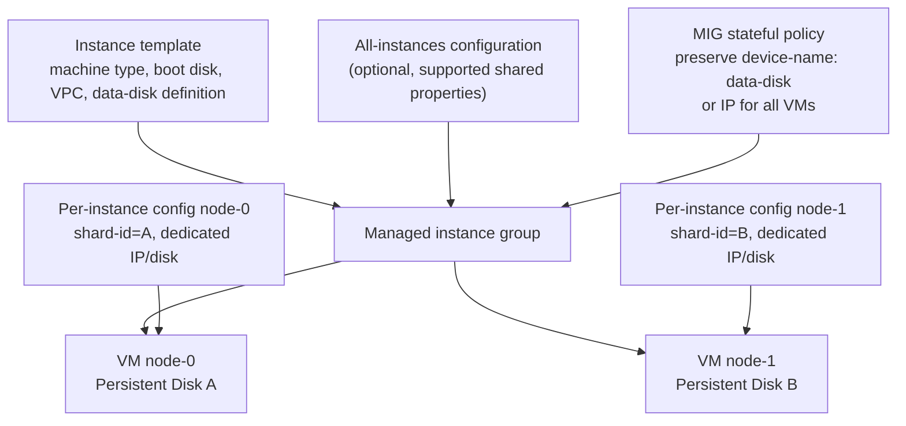
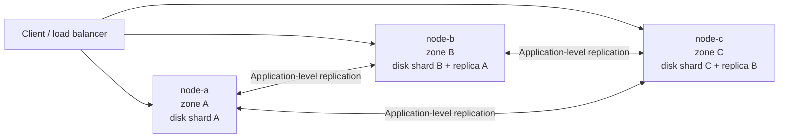
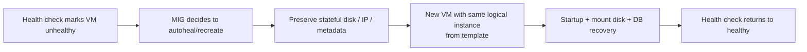

# Stateful managed instance groups

## 1. The problem: self-healing VMs without losing state

Suppose an enterprise runs a cluster of data-processing services on **Compute Engine**. Each VM handles a distinct data partition: `node-0` processes shard A, `node-1` processes shard B. Alongside the application, each VM has a **Persistent Disk** holding data or checkpoints, a stable IP address, and metadata defining its role.

With a **stateless managed instance group (MIG)**, a VM is recreated from an **instance template** when it fails. That works well for web frontends that store no local state, but it can wipe disks or node identity under default settings. A stateful service cannot treat every VM as disposable and interchangeable with a brand-new blank machine.

A **stateful managed instance group (stateful MIG)** lets Compute Engine manage VM lifecycles and **autohealing**, while preserving declared state components such as **Persistent Disks**, **IPv4 addresses**, and **instance-specific metadata** across supported recreations and updates. This model fits self-managed databases, sharded workloads, legacy systems, and long-running checkpointed jobs.

In the **CLOUD_PROVIDERS_GCP** module, this topic connects **Project/IAM, VPC, Compute Engine, load balancing, storage, CI/CD, reliability monitoring, and cost management**. The most important distinction is separating **preserving VM state** from **load-based autoscaling** and **cross-zone data recovery**.

### Learning objectives

After this lesson, you can:

1. Distinguish stateless MIGs from stateful MIGs in terms of data, machine identity, recovery behavior, and operational constraints.
2. Explain how **instance templates**, **stateful policies**, and **per-instance configurations** work together.
3. Configure and verify **stateful disks**, **stateful IPs**, and **stateful metadata**.
4. Understand how **autohealing**, **rolling updates**, **resizing**, **deletion**, **abandoning**, and **zone failures** affect preserved state.
5. Explain why stateful MIGs **do not support autoscaling or scaling schedules**, even though this lesson sits in the "Instance Groups and Autoscaling" chapter.
6. Read and understand `gcloud` commands to safely create and inspect a stateful MIG.
7. Design backups, replication, IAM controls, monitoring, and cost estimates for stateful workloads.

> **Convention:** Project IDs, group names, IPs, metadata values, and diagrams in this lesson are all **hypothetical examples**. Commands creating VMs, disks, or modifying groups can incur charges and cause data loss if misused. Run them only in authorized test projects and verify current documentation at deployment time.

## 2. Stateless MIG vs. stateful MIG

A **managed instance group** is a fleet of VMs managed by Compute Engine based on a template and group configurations. Both forms can use health checking and instance recreation, but what Compute Engine must preserve differs.

| Criterion | Stateless MIG | Stateful MIG |
|---|---|---|
| Workload type | Web/API frontends, workers holding no VM-local state | Self-managed databases, sharded nodes, checkpointed jobs, legacy apps |
| Are VMs freely interchangeable? | Usually **yes** | **Not completely**: each VM owns specific state or a unique role |
| Disk data across recreation | Disks can be deleted and recreated from the template by default | Configured **stateful disks** are preserved and reattached |
| IP across recreation | Can change | Can preserve **stateful internal/external IPv4 addresses** |
| Node-specific metadata | Not necessarily preserved unless configured | Preserved via **per-instance configuration** |
| VM name | MIGs can preserve names during autohealing even when stateless | Can preserve names alongside stateful items |
| Autohealing | Yes | Yes, recovers VMs with their declared preserved state |
| Rolling updates | Multiple VM replacement options | Constrained: automated rolling updates require **`RECREATE`**, not `SUBSTITUTE` |
| **Autoscaling** | **Yes**, by CPU, load balancing, metrics, etc. | **Not supported** when the group has stateful configuration |
| **Scaling schedules** | Supported where applicable | **Not supported** when the group has stateful configuration |
| Regional MIG | Can distribute VMs across multiple zones | Can hold replicas across zones, yet **never automatically moves shards/disks if a zone fails** |

### Stateful does not merely mean "a VM with a disk"

A stateless MIG still has a boot disk or data disks. The real distinction is **whether the MIG is instructed to preserve specific disk/IP/metadata state across recreations**. A group becomes **stateful** when it has a **non-empty stateful policy** or at least one **non-empty per-instance configuration**.

MIGs preserve VM names by default during many autohealing operations, so **needing fixed names alone does not automatically require a stateful MIG**. When a rolling update needs to preserve names, configure the `RECREATE` replacement method.

## 3. Architecture: templates, policies, and per-VM configurations

A stateful MIG is not a loose collection of manually administered VMs. Compute Engine still relies on **declarative configuration** to create or recover VMs.



### 3.1. Instance template — shared configuration

The template defines attributes common across the group: machine type, boot image, network interfaces, service account, startup script, and disks created at boot.

To include a disk in the MIG's group-wide **stateful policy**, that disk must appear in the template with a matching **device name**, such as `data-disk`. Disks unique to individual VMs can be declared in **per-instance configuration** without existing in the template.

### 3.2. Stateful policy — state preserved across the whole group

A **stateful policy** is a **group-level** configuration, for example:

- The disk with `device-name=data-disk` must be preserved across autohealing, updates, and recreations.
- The IP address on network interface `nic0` must stay stable across recreations.
- Choosing a **delete rule** for disks/IPs when a VM is **permanently deleted** from the group.

The MIG applies policy updates **asynchronously** to existing VMs and automatically to new VMs. Adding a disk to a stateful policy normally updates the disk's auto-delete attribute **without requiring an immediate reboot** just to record the stateful policy.

### 3.3. Per-instance configuration — properties unique to each VM

Each VM can hold distinct values:

- `shard-id=A` for `node-0`, `shard-id=B` for `node-1`.
- An existing disk, such as `disk-shard-a`, attached to that exact node.
- A specific internal or external IPv4 address for legacy apps or node identity.

Per-instance configuration is not "shared metadata applied to the whole group"; it specifies **state for one specific VM** and must be **applied** before expecting recreations to preserve that configuration.

### 3.4. Verifying effective preserved state

In the API, **preserved state** values can originate from:

- `preservedStateFromPolicy`: shared stateful policy.
- `preservedStateFromConfig`: per-instance configuration.

Before enabling autohealing or major changes, **inspect the managed instances list and actual preserved state**. Never assume a disk is protected merely by looking at the template.

## 4. Stateful Persistent Disks: the most critical state

### 4.1. How disks are preserved

For example, a VM has two disks:

```text
node-0
├── boot-disk (stateless): OS, app binaries, startup script
└── data-disk (stateful): shard A, checkpoints, and data to preserve

node-1
├── boot-disk (stateless): OS, app binaries, startup script
└── data-disk (stateful): shard B, checkpoints, and data to preserve
```

When autohealing replaces `node-0`:

1. The MIG detects that the VM requires recreation.
2. `node-0`'s `data-disk` is **preserved**, rather than replaced by a blank disk from the template.
3. VM `node-0` is recreated from the template, and the stateful disk is **reattached** to it.
4. The application starts, mounts the filesystem, and recovers state from disk/checkpoints.
5. Health checks confirm the application is ready to serve.

**Preserved VM names and disks do not guarantee transaction-level consistency.** Autohealing does not run database recovery, repair corrupted logs, or resolve half-committed transactions. The application and backup strategy remain responsible for data integrity.

### 4.2. Why keep the boot disk stateless?

Google Cloud recommends **keeping the boot disk stateless** whenever your architecture can separate application code from data:

- Boot disks can be recreated from updated images, enabling OS patching and recovery from OS corruption.
- Stateful data disks hold critical data and reattach cleanly after recreation.
- Rolling updates can deploy new templates/images without freezing the old boot OS forever.

If a legacy app forces you to make the **boot disk stateful**, recognize the trade-off: recreation **will not replace the boot disk with a newer image**, and the MIG cannot heal a corrupted OS/boot disk by provisioning a clean one. OS and binary patching must then be managed separately.

### 4.3. Delete rules: permanent deletion vs. autohealing

Stateful disks support deletion rules when a **VM is permanently deleted** from the group:

| Value in `gcloud` | When VM is permanently deleted | During VM autohealing/recreation |
| --- | --- | --- |
| `auto-delete=never` | **Detaches and keeps the disk**; disk continues existing and accruing charges | **Preserved and reattached** |
| `auto-delete=on-permanent-instance-deletion` | **Deletes the disk with the VM** during permanent deletion operations | **Preserved and reattached** |

Note that `auto-delete=never` does not protect data if someone **manually deletes the disk** or the disk suffers corruption; it strictly governs MIG behavior during managed VM deletions.

**Cost note:** disks left behind after VM deletion **continue incurring storage charges**. Never run automated cleanup scripts that blindly delete "all unattached disks" without checking whether a disk was retained for recovery.

## 5. Stateful IPs and stateful metadata

### 5.1. How are IP addresses preserved?

A stateful MIG can preserve declared **internal IPv4** or **external IPv4** addresses. Under the hood, the service uses **static Address resources** to maintain addresses across recreations.

With a group-wide policy, you can instruct the MIG to preserve `nic0`'s IP without pre-assigning an exact address to each VM. With per-instance configuration, you can assign a specific address—such as `10.20.10.15`—from the VM's subnet.

When planning stateful IPs:

- Ensure the network/subnet remains unchanged and the IP is valid for the region/subnet.
- For **Shared VPC**, check `roles/compute.networkUser` or IP/subnet permissions in the host project.
- Watch **static external IP costs** and orphaned addresses after VM deletion.
- Do not assume stateful IPv4 covers IPv6 or every specialized interface type.
- If clients connect via a load balancer or service discovery, evaluate whether fixed per-node IPs are genuinely necessary.

### 5.2. Stateful metadata

Example metadata:

| VM | Instance-specific metadata | Purpose |
| --- | --- | --- |
| `node-0` | `shard-id=A` | Binds node to shard A |
| `node-1` | `shard-id=B` | Binds node to shard B |
| `node-2` | `role=observer` | Assigns a distinct operational role |

In a stateful MIG, **stateful metadata is defined per VM**, not via a shared group stateful policy. Autohealing or recreation reapplies those key-value pairs to the replacement VM from its per-instance configuration.

**Security:** instance metadata is not a vault for passwords, private keys, or long-lived API tokens. Any user or process able to read VM metadata can view those values; use Secret Manager with least-privilege IAM for secrets.

## 6. How do lifecycle operations affect preserved state?

| Event | MIG behavior | What to verify |
| --- | --- | --- |
| **Reboot/stop/start** | Disks, IPs, and metadata stay attached per config | Does the app auto-start and mount disks cleanly? |
| **Autohealing an unhealthy VM** | Recreates the VM while **preserving declared stateful items** | Does the health check truly reflect a fault needing recreation? |
| **Rolling update with `RECREATE`** | Updates stateless properties while preserving stateful items | Template, boot disk, metadata, downtime, and readiness |
| **Changing stateful policy** | Applies new state asynchronously across the group | Wait for group stability and inspect preserved state |
| **Manually increasing target size** | Creates new nodes from template and stateful policy | Assign dedicated shard/metadata/IP to new nodes if needed |
| **Manually decreasing target size** | MIG picks VMs to **permanently delete**, removing their per-instance state config | Never use blindly to "scale down" VMs holding data |
| **Permanently deleting one VM from MIG** | Removes state config; disk/IP stay or vanish per delete rule | Backups and node identity verified before deletion |
| **Abandoning a VM** | Detaches VM from MIG management; VM may continue running independently | Check preserved state policies, disks/IPs, and post-detach ownership |
| **Zone outage** | Regional MIG does not automatically move stateful instances/disks from the failed zone | Requires **application-layer** replicas and failover |

**Always distinguish "permanent deletion" from "recreation for recovery."** On sharded workloads, letting a MIG arbitrarily pick VMs during a size reduction can delete a node holding critical data. Perform targeted removals after verifying backups and shard rebalancing.

## 7. Critical limitation: stateful MIGs do not autoscale

This chapter covers **instance groups and autoscaling**, yet a **stateful MIG is an explicit exception**: **autoscaling and scaling schedules are not supported** when a group has stateful configuration. **Never promise that a stateful MIG will automatically add or remove VMs based on CPU or HTTP load-balancing utilization.**

Why? Adding or removing a stateful node is far more complex than changing a machine count:

1. A new node may need **shard assignment**, data hydration, cluster registration, and synchronization.
2. A removed node might hold unreplicated data or belong to a consensus quorum.
3. CPU-triggered automatic scale-in could cause **data loss, quorum loss, or outages**.
4. A zonal disk or IP cannot be arbitrarily moved to another VM in a different zone without considering zone/replica constraints.

### Can you scale at all?

**Yes, through controlled workflows**, such as:

- **Manual resize** once shard assignments and permissions are prepared.
- **Creating a specific managed instance** with explicit per-instance configuration for disks, IPs, and metadata.
- **External automation** orchestrated via workflows that validate application health, backups, and approvals instead of native MIG autoscaling.
- Using **stateless MIG autoscaling** on frontend or worker tiers that hold no local state.

Google Cloud provides `stopInstances` and `startInstances` APIs, which can be paired with Cloud Scheduler or custom workflows to **start/stop** stateful nodes on a schedule where appropriate. That is **not** native MIG autoscaling schedules and still requires careful data management.

## 8. Regional stateful MIGs: multi-zone does not mean auto-failover

A regional MIG can distribute VMs across multiple zones in a region. This helps applications with **application-level replication**, yet **a stateful MIG does not automatically fail over a node's state or disk across zones**.



If zone A becomes unavailable, the MIG **does not detach `node-a`'s zonal disk and attach it in zone B**. Application-synchronized replicas in zones B and C must continue serving data under your quorum/consensus and failover design.

### Proactive redistribution must be disabled

For a **regional stateful MIG**, you must set:

```text
instanceRedistributionType: NONE
```

If proactive redistribution remains enabled, the MIG could attempt to rebalance VMs across zones by deleting and recreating instances, violating state preservation goals. Setting **redistribution to NONE** does not protect the app against a zone outage; it simply prevents the MIG from unexpectedly relocating stateful nodes.

### Real HA design

A system with real SLO/RPO/RTO targets needs:

- Replicas and data synchronization suited to the application.
- Node counts and quorum layouts capable of surviving a zone failure (avoiding two-node setups without a leader-election tie-breaker).
- Load balancers, readiness checks, and service discovery routing traffic to healthy nodes.
- Runbooks defining when to promote a replica and when to provision replacement nodes/shards.
- Snapshots, backups, and restore drills protecting against accidental deletion, software bugs, and data corruption.

**A stateful MIG protects VM lifecycle; it does not provide replication or distributed consensus.**

## 9. Preparing a lab with a stateful data disk

Example of building a **zonal stateful MIG** to demonstrate disk preservation. Assumptions:

```text
Project:           acme-state-lab
Zone:              asia-southeast1-a
Region:            asia-southeast1
VPC/subnet:        lab-vpc / lab-subnet (pre-existing)
Instance template: stateful-template-v1
MIG:               stateful-demo
Group size:        2
Boot disk:         stateless, from Debian image
Data disk:         device-name=data-disk, pd-balanced, 50 GB
Delete rule:       never (retain disk on permanent VM deletion)
```

**Prerequisites:** Compute Engine API enabled in the project, billing/quotas ready, valid VPC/subnet, principal authorized to create templates/MIGs/disks, and security policies allowing VM creation. Lab data contains no sensitive information.

### 9.1. Create the instance template

```bash
# CREATES RESOURCE: run only in an authorized lab; incurs charges when used
gcloud compute instance-templates create stateful-template-v1 \
  --project=acme-state-lab \
  --machine-type=e2-standard-2 \
  --image-family=debian-12 \
  --image-project=debian-cloud \
  --subnet=lab-subnet \
  --no-address \
  --create-disk=device-name=data-disk,size=50GB,type=pd-balanced,auto-delete=yes
```

The template defines a new disk with device name **`data-disk`**. `auto-delete=yes` in the template applies when no stateful policy exists; the next step marks `data-disk` as stateful and defines its lifecycle via `--stateful-disk`.

If using a Shared VPC, pass the host project's subnet URI to `--subnet` and grant `compute.networkUser` on the subnet to the relevant principals/service agents.

**Important:** creating a template **does not create VMs**. Actual disks are created when the MIG provisions instances. Inside the guest OS, you must still **format/mount the data disk and start the application** consistently—for instance via a startup script or pre-baked image. Never reformat an already populated disk when autohealing recreates a VM.

### 9.2. Create the stateful MIG with a preserved data disk

```bash
# CREATES VMs AND DISKS: billing begins as soon as resources are provisioned
gcloud compute instance-groups managed create stateful-demo \
  --project=acme-state-lab \
  --zone=asia-southeast1-a \
  --template=stateful-template-v1 \
  --base-instance-name=node \
  --size=2 \
  --stateful-disk=device-name=data-disk,auto-delete=never
```

This is a **zonal MIG**, isolating preserved-state mechanics from multi-zone replication complexity. On creation, the MIG applies the stateful policy to `data-disk` on both VMs.

### 9.3. Inspect status (read-only)

```bash
# View stateful policy, target size, template, and update policy
gcloud compute instance-groups managed describe stateful-demo \
  --project=acme-state-lab \
  --zone=asia-southeast1-a \
  --format="yaml(name,targetSize,instanceTemplate,statefulPolicy,updatePolicy,status)"

# View each VM and its preserved state status
gcloud compute instance-groups managed list-instances stateful-demo \
  --project=acme-state-lab \
  --zone=asia-southeast1-a

# View disk device names in the template
gcloud compute instance-templates describe stateful-template-v1 \
  --project=acme-state-lab \
  --format="yaml(properties.disks)"
```

The `PRESERVED_STATE` column in `list-instances` can show `POLICY`, `CONFIG`, or both. `POLICY` indicates an active group stateful policy; `CONFIG` indicates an active per-instance configuration.

### 9.4. Inspect a VM's disk configuration

Pick an actual VM name from `list-instances` and inspect:

```bash
gcloud compute instances describe ACTUAL_VM_NAME \
  --project=acme-state-lab \
  --zone=asia-southeast1-a \
  --format="yaml(name,status,disks,networkInterfaces,metadata)"
```

Verify the disk has `deviceName: data-disk`, check the backing disk resource URI, and confirm its auto-delete/preserve setting. Do not confuse the **guest device name** with the **disk resource name**: the MIG may generate a distinct resource name for the disk.

## 10. Adding stateful IPs and metadata as needed

### 10.1. Preserving internal IPs on the default network interface

When legacy workloads require fixed node IPs, update the MIG:

```bash
# CONFIGURATION CHANGE: may create corresponding static address resources
gcloud compute instance-groups managed update stateful-demo \
  --project=acme-state-lab \
  --zone=asia-southeast1-a \
  --stateful-internal-ip=enabled
```

The MIG configures preservation for `nic0`'s internal IP on VMs as supported. For external IPs, a separate `--stateful-external-ip` flag exists; never enable it in production just to experiment, as it increases attack surface and may incur charges.

### 10.2. Instance-specific metadata when creating a named managed instance

To add a specifically named node with `shard-id` instead of blindly resizing:

```bash
# Creates a new instance; incurs charges and modifies cluster membership
gcloud compute instance-groups managed create-instance stateful-demo \
  --project=acme-state-lab \
  --zone=asia-southeast1-a \
  --instance=node-shard-c \
  --stateful-metadata=shard-id=C
```

This creates the instance and a per-instance configuration containing `shard-id=C`. Before routing production traffic to the node, perform **data rebalancing**, wait for replication, and register the node in the cluster.

If the VM **already exists**, use `gcloud compute instance-groups managed instance-configs create/update` with `--stateful-metadata`, then apply the configuration per documentation. Never assume editing metadata inside the guest OS automatically updates the MIG's per-instance configuration.

### 10.3. Dedicated disks or IPs for a specific node

A legacy app may require attaching an existing disk `legacy-shard-c` to a MIG-managed node. You can specify the disk via `--stateful-disk` in per-instance configuration and, where appropriate, pass the **source disk URI**. For static IPs, per-instance configuration uses `--stateful-internal-ip=address=...` or `--stateful-external-ip=address=...`.

Because an existing disk may hold irreplaceable data, migration procedures must verify:

1. The disk lives in the exact zone (or is a supported regional disk).
2. No previous writer still holds the disk in an exclusive mode.
3. Data consistency, filesystem integrity, and mount settings are verified.
4. Node name and shard metadata match accurately.
5. Snapshots/backups and a rollback plan exist.

Never run an "attach arbitrary disk" command in production without confirming every condition above.

## 11. Autohealing: VM recovery, not backup replacement

### 11.1. Relationship between health checks and recreation

A MIG can use an **application-based health check**. When a VM becomes unhealthy, the MIG recreates the VM and reattaches its preserved state.



For autohealing to succeed, the application must **start automatically on boot**, mount the stateful disk at the expected path, and recover state safely. If a startup script reformats the disk on every boot, MIG state preservation cannot save overwritten data.

### 11.2. Configuring the health check

Suppose the application exposes a TCP health endpoint on port 7000:

```bash
# CREATES HEALTH CHECK: run only if the app actually listens on this port
gcloud compute health-checks create tcp stateful-hc \
  --project=acme-state-lab \
  --port=7000

# UPDATES MIG: configures autohealing after verifying readiness behavior
gcloud compute instance-groups managed update stateful-demo \
  --project=acme-state-lab \
  --zone=asia-southeast1-a \
  --health-check=stateful-hc \
  --initial-delay=300
```

**Do not enable this sample health check on VMs without an active service listening on port 7000.** If every VM fails checks, the MIG can repeatedly recreate machines, causing outages and extra charges.

### 11.3. Health checks for databases/shards require extra care

A database replaying logs or catching up on replica sync may appear temporarily unavailable. If the health check is too aggressive, the MIG repeatedly recreates the VM, preventing recovery from ever finishing.

- Set `initial-delay` based on real boot, disk mount, and recovery durations.
- Choose an endpoint indicating **failures fixable by recreation**, not merely "not yet caught up on replication."
- Separate the health check that **removes a backend from a load balancer** from the health check that **triggers VM autohealing**; the two goals often need different policies.
- Test application crashes, OS reboots, and disk mounting before enabling in production.

## 12. Rolling updates on a stateful MIG

Stateful MIGs still support updates, provided VM identity and state are preserved.

### The `RECREATE` rule

To use **automated rolling updates** with stateful configuration, the **replacement method** must be set to:

```text
RECREATE
```

Do not use `SUBSTITUTE`, because it creates replacement VMs with new names and new identity. For stateful instances, `RECREATE` preserves the VM's logical identity and reapplies its declared state.

Example policy update:

```bash
# Modifies update policy on the MIG
gcloud compute instance-groups managed update stateful-demo \
  --project=acme-state-lab \
  --zone=asia-southeast1-a \
  --update-policy-replacement-method=RECREATE
```

### What does a new template replace?

| Component | When updating the template, what happens? |
| --- | --- |
| **Stateless** boot disk | Can be recreated from the new boot image/template during recreation |
| **Stateful** data disk | **Preserved**; not overwritten by a blank disk from the template |
| **Stateful** boot disk | Does not automatically pick up a new boot image from the template; OS updates require another process |
| Stateful metadata from per-instance config | Preserved per config when the VM is recreated |
| Stateful IP | Preserved as long as rules/IPs remain valid |
| Other VM properties | Applied per MIG update capabilities; may require restart or recreation |

### Minimum rollout plan

1. Create the new template version and verify OS/app compatibility with existing data disks.
2. Take **application-consistent** snapshots/backups whenever possible.
3. Confirm replacement method `RECREATE`, disruption limits, and health checks.
4. Canary one node or a resilient subset with verified replica coverage.
5. Verify data integrity, disk attachments, IPs, metadata, replication lag, and application logs.
6. Update remaining nodes in controlled waves with a prepared rollback plan.

**Never blindly roll back a boot image** if database schema migrations or on-disk data formats are no longer compatible with the older application version.

## 13. Resizing and deleting instances: high-risk territory

### Scaling up size

```bash
# CREATES EXTRA VMs: prepare shards/replication first
gcloud compute instance-groups managed resize stateful-demo \
  --project=acme-state-lab \
  --zone=asia-southeast1-a \
  --size=3
```

The MIG creates an additional VM using the template and stateful policy. The new node **is not automatically assigned a shard or business role**; the application must bootstrap and synchronize data.

### Shrinking size: not a safe scale-down mechanism

```bash
# DO NOT RUN casually against live data:
gcloud compute instance-groups managed resize stateful-demo \
  --project=acme-state-lab \
  --zone=asia-southeast1-a \
  --size=1
```

The MIG chooses which instances to delete using platform selection logic, **with no promise to spare the node holding the most critical data**. Permanently deleting a node deletes its per-instance state configuration; whether disks and static IPs survive depends on their delete rules.

Safer alternative procedure:

1. Identify the **exact node/shard** to decommission from the cluster.
2. Replicate/migrate data to remaining nodes and confirm quorum health.
3. Take backups/snapshots and verify disk and IP delete rules.
4. Run a targeted deletion against that specific managed instance rather than a blind resize.
5. Inspect remaining detached disks/IPs and clean them up only after approval.

### Delete vs. abandon

- **Deleting an instance** via MIG management reduces the VM count and handles preserved state per deletion rules.
- **Abandoning an instance** removes the VM from MIG management, leaving the VM running independently while the **MIG stops autohealing or rolling out updates** to it.
- Never treat **abandon** as a backup or replication method. Once detached, the team must manage OS patches, disks, IPs, monitoring, and lifecycle through separate processes.

## 14. Design scenario: checkpointed event-processing cluster

A system consumes events from Pub/Sub, partitioning work across three workers. Each worker stores checkpoints and temporary state recoverable from upstream. The team wants to avoid losing progress if a VM crashes.

### Initial design choices

- Stateful MIG: each VM has a **data disk** preserved across recreations.
- Stateless boot disk so OS images and patches roll out cleanly.
- Per-instance metadata specifying `partition-id`.
- Health check tuned not to trigger recreation while replaying checkpoints.
- Atomic checkpoint writes and idempotent recovery in the application.
- Critical outputs persisted externally to Cloud Storage or a managed database to protect against disk loss/corruption.

### Failure matrix

| Failure | Does stateful MIG help? | What else is needed? |
| --- | --- | --- |
| Worker process crashes | Autoheals VM if health check detects failure | Idempotency, startup/recovery logic |
| VM recreated | Preserves configured data disk, IP, and metadata | Cleanly mount/replay checkpoints and test |
| Data disk corruption | **Does not repair corrupted data** | Snapshots/backups, checksums, recovery |
| Zone outage | Does not move zonal stateful disks across zones | Cross-zone replicas/checkpoints and app failover |
| Need more workers under higher load | No native autoscaling | Manual/orchestrated scaling with partition assignment |
| Need OS upgrade | Can replace boot disk if kept stateless | Canary + rolling `RECREATE` |
| Accidental node deletion | Disk may remain if `auto-delete=never`, yet full state isn't guaranteed | Backups, audit logs, recovery runbook |

### When to pick another option?

If workers can consume from Pub/Sub and store checkpoints centrally, an **autoscaled stateless MIG**, Cloud Run, or GKE may be far simpler. If running PostgreSQL or MySQL, **Cloud SQL** offloads backups and failover. For batch analytics, evaluate dedicated managed services. Never choose a stateful MIG simply because "the app uses a database"—pinpoint **where state truly lives** and who owns its recovery.

## 15. Design scenario: multi-zone replicated database

Suppose a company operates a self-managed three-node database:

```text
Regional stateful MIG: db-cluster
  zone A: db-a + disk-a
  zone B: db-b + disk-b
  zone C: db-c + disk-c

App replication: synchronizes data across db-a, db-b, db-c
Failover: election/promotion handled by database/cluster manager
MIG autohealing: repairs failed nodes in reachable zones
```

**Decisions you cannot skip:**

1. What are the database's maximum tolerable data loss (**RPO**) and downtime (**RTO**)?
2. Does replica placement keep quorum if an entire zone goes down?
3. When a node returns after autohealing, how does it **rejoin the cluster** and catch up via WAL/replication logs?
4. When the primary loses connectivity, what performs **fencing** to prevent split-brain and dual writers?
5. Are stateful disks **zonal or regional**, and under what conditions can they reattach?
6. Have backups, restores, and recovery from logical errors/accidental deletes been tested?

Never present a stateful MIG as a complete **managed database HA** service. It manages VMs and certain resource state; quorum, transaction consistency, replication, and schema migrations remain the responsibility of the database and application teams.

## 16. IAM, VPC, and safe automation

### Separation of duties

| Role | Permissions to manage | Risk if overly broad |
| --- | --- | --- |
| Platform/MIG admin | Appropriate `compute.instanceGroupManagers.*` permissions | Accidental resize/delete destroys nodes and state configs |
| VM admin | Create/edit VMs, templates, startup scripts, service accounts | Bad startup script could format stateful data disks |
| Storage admin | Disks, snapshots, and storage IAM | Deleting disks/backups or exposing sensitive data |
| Network admin | VPC/subnets, firewalls, static addresses | IP conflicts, broken routes, unreachable backends |
| Security/SRE | Logging, alerts, backup policies, audit access | Blind spots between benign autohealing and data loss |

Never grant `roles/owner` to CI/CD just to manage MIGs. Use least-privilege roles scoped to the project; with **Shared VPC**, grant Network User on the exact subnet and IP permissions only as needed.

### Critical automation rules

- Infrastructure as Code (Terraform or equivalent) must explicitly declare **stateful policies** and **per-instance configs**.
- CI/CD must never execute "destroy/recreate all" without checking preserved state and backup plans.
- Startup scripts must **distinguish blank disks from disks containing existing data**—never format unconditionally on boot.
- Node-identity metadata must **contain no secrets**; fetch secrets from Secret Manager using a least-privilege service account.
- Test retry loops, mid-operation autohealing, unapplied metadata, and disk mount failures.
- Every disk deletion, VM deletion, IP release, and update policy change should require audit logging and proper approval.

## 17. Monitoring, troubleshooting, and cost

### 17.1. Signals to monitor

| Signal | Purpose |
| --- | --- |
| **MIG stability / current actions** | Know if the group is creating, deleting, recreating, or applying config |
| **Managed instance health** | Spot unhealthy VMs or active autohealing |
| **Preserved state** | Confirm declared disks, IPs, and metadata remain preserved |
| **Disk mount/fs errors** | Catch disks that attached yet cannot be read by the app |
| **Replication lag / quorum / checkpoint age** | Track **application-layer** recoverability |
| **Data disk utilization / IOPS / throughput** | Prevent full disks or I/O bottlenecks from triggering autohealing loops |
| **Snapshot/backup success** | Prove recovery exists outside a single disk |
| **VM/disk/IP billing** | Watch for resources left behind after delete or abandon operations |

### 17.2. Common troubleshooting issues

| Symptom | Likely cause | Remediation |
| --- | --- | --- |
| Cannot enable autoscaler | MIG has stateful configuration | Use manual/orchestrated scaling or extract a stateless tier |
| Cannot create regional stateful MIG | Proactive redistribution not set to `NONE` | Set redistribution policy to `NONE` before adding stateful config |
| Update rejected with `SUBSTITUTE` | Stateful VMs require preserving identity/state | Switch to `RECREATE` and plan for disruption budget |
| VM autohealed yet lost data | Disk wasn't declared stateful or startup reformatted it | Inspect preserved state, disks, startup logs; restore backup |
| VM fails to boot after disk reattaches | Wrong mount UUID, corrupted filesystem, or script assumes blank disk | Fix mount/recovery script and test with populated disks |
| MIG autoheals repeatedly | Health check too strict; app needs longer recovery | Tune initial delay/readiness and fix root cause |
| New node lacks partition assignment | Resize created VM from template without per-instance metadata | Create/configure specific named node, then rebalance |
| IP changes after recreation | IP not configured as stateful or invalid reservation | Check stateful policy/config and static Address resources |
| VM deleted yet disk still billed | `auto-delete=never` retained the disk | Inventory disks, back up, and delete deliberately when unused |
| Outage when zone A fails | MIG does not move stateful nodes across zones | Rely on app-level replication/failover, restore, and DR runbooks |
| Hard to tell if policy took effect | Group updates asynchronously; MIG not yet stable | Wait for stability; check `list-instances` and preserved state |

### 17.3. Cost

Stateful MIGs **do not make Compute Engine or disks free**. Estimates must include:

- VM compute, machine types, OS licenses, and uptime.
- Persistent Disk capacity and type, plus provisioned IOPS/throughput where applicable.
- Detached disks retained because of `auto-delete=never`.
- Static external IP reservations/usage, load balancing, VPC traffic, and inter-zone egress.
- Snapshots, backups, Cloud Monitoring/Logging, replication traffic, and dependent services.

**Hypothetical example:** a 3-VM group where each VM has a 100 GiB data disk; after an incident, two nodes are deleted while disks are retained. Total existing data disk capacity remains **300 GiB**, even with only **1 VM running**. If those 2 remaining disks are no longer needed, delete them through an approved, backed-up procedure—never assume they vanished with the VMs.

Check Compute Engine/Disks/Network pricing and Billing by **SKU, region, timeframe, and account**. Compare total cost of ownership against managed database services before choosing to self-manage a stateful cluster.

## 18. Practice exercises and self-check questions

### Exercise 1: Identifying how to preserve state

A MIG has two VMs. Each VM has a boot disk for the OS and a data disk for checkpoints; node IPs must stay fixed, while application versions update frequently.

1. Which disk should stay stateless, and which should be stateful?
2. What must be declared so `nic0`'s IP stays unchanged across recreations?
3. Why would a stateful boot disk complicate image updates?

**Hint:** (1) Keep the boot disk stateless and the data disk stateful; (2) configure stateful internal IP in the policy or per-instance config; (3) preserving the old boot disk prevents automatic recreation from new template images.

### Exercise 2: Assessing permanent deletion impact

A group has 3 data disks of 200 GiB each with `auto-delete=never`. One VM undergoes **autohealing**; later, another VM is **permanently deleted**.

- Which disk is retained and reattached during autohealing?
- Does the permanently deleted VM's disk still exist?
- Can that surviving disk serve as a complete backup?

**Hint:** Autohealing preserves and reattaches disks declared stateful; the `never` delete rule leaves the deleted VM's disk detached and intact. However, it does not guarantee data consistency, protection against corruption, or DR.

### Exercise 3: Recognizing autoscaling limits

A team wants their MIG to scale from 3 to 10 VMs by CPU and scale down automatically at midnight. This MIG stores sharded data on each VM's data disk. Propose an alternative approach and list the steps required before adding or removing nodes.

**Hint:** Stateful MIGs do not support native autoscaling or scaling schedules. Build an external workflow that verifies data/quorum health, provisions specific nodes, bootstraps shards, and validates sync before resizing—or separate stateless workers into an autoscaled MIG.

### Exercise 4: Inspecting state with read-only commands

In an authorized project:

```bash
gcloud compute instance-groups managed describe MIG_NAME \
  --project=PROJECT_ID \
  --zone=ZONE \
  --format="yaml(statefulPolicy,updatePolicy,targetSize,status)"

gcloud compute instance-groups managed list-instances MIG_NAME \
  --project=PROJECT_ID \
  --zone=ZONE
```

Determine: Does the group have stateful configuration? Which VMs show `POLICY` or `CONFIG`? What is the replacement method? What additional details must you inspect before confirming the data disk is genuinely preserved across autohealing?

### Exercise 5: Zone outage scenario

A regional stateful MIG has 3 VMs across 3 zones, each holding an **unreplicated** shard. Zone A goes down. Will the MIG automatically recreate shard A in zone B so the system keeps operating normally?

**Hint:** No. Stateful MIGs do not fail over data or shards across zones. Continuity requires application-level replicas, backup restores, or custom failover logic.

### Exercise 6: Fixing a broken rolling update

An operator plans to update the instance template and run a rolling update using `SUBSTITUTE`. Why is this unsuitable? Describe the steps to update safely while preserving data disks and minimizing outage risk.

**Hint:** Switch to `RECREATE`, take backups, run a canary, inspect preserved state and readiness, set disruption limits, and handle data recovery if schemas change.

## 19. Production checklist for stateful MIGs

- [ ] Identified **exactly which state must persist**: disks, IPs, instance metadata, or merely VM names.
- [ ] Understood that a group is **stateful** due to stateful policies/per-instance configs, not merely having disks.
- [ ] Separated stateless boot disks from stateful data disks wherever architecture allows.
- [ ] Verified **device names**, source disks, and delete rules for every disk.
- [ ] Determined which internal/external IPv4 addresses need stability and accounted for static IP costs.
- [ ] Per-instance metadata contains zero secrets and is created/applied to exact target nodes.
- [ ] `list-instances` confirms expected preserved state; MIG reports stable.
- [ ] Autohealing readiness matches startup/recovery, and startup scripts never reformat populated disks.
- [ ] Native **autoscaling and scaling schedules** are not configured on the stateful MIG.
- [ ] Automated rolling updates use `RECREATE`, backed by canaries, backups, and rollback plans.
- [ ] Regional stateful MIGs set **proactive redistribution = NONE**.
- [ ] Application-level replication, quorum, and failover exist; never expect automatic cross-zone disk migration.
- [ ] Deletions, resizes, and abandons require approval; no orphaned disks/IPs or accidental data loss.
- [ ] Snapshots/backups, restore drills, and corruption recovery plans are in place.
- [ ] IAM, service accounts, Shared VPC, and firewall rules enforce least privilege.
- [ ] Monitored VM health, disk utilization, replication lag, costs, and audit events.
- [ ] Defined RPO/RTO targets and runbooks for VM loss, zone loss, logical errors, and failed rollouts.

## 20. Official Google Cloud documentation

Limits, CLI flags, and features evolve over time; consult official documentation when deploying:

1. [Stateful managed instance groups – Overview](https://cloud.google.com/compute/docs/instance-groups/stateful-migs)
2. [How stateful MIGs work](https://cloud.google.com/compute/docs/instance-groups/how-stateful-migs-work)
3. [Configuring stateful MIGs](https://cloud.google.com/compute/docs/instance-groups/configuring-stateful-migs)
4. [Create a MIG with stateful persistent disks](https://cloud.google.com/compute/docs/instance-groups/create-mig-with-basic-stateful-disks)
5. [Configure stateful persistent disks](https://cloud.google.com/compute/docs/instance-groups/configuring-stateful-disks-in-migs)
6. [Configure stateful IP addresses](https://cloud.google.com/compute/docs/instance-groups/configuring-stateful-ip-addresses-in-migs)
7. [Configure stateful metadata](https://cloud.google.com/compute/docs/instance-groups/configuring-stateful-metadata-in-migs)
8. [Applying, viewing and removing stateful configuration](https://cloud.google.com/compute/docs/instance-groups/applying-viewing-removing-stateful-config-in-migs)
9. [How operations affect preserved state](https://cloud.google.com/compute/docs/instance-groups/preserved-state)
10. [Set up application-based autohealing](https://cloud.google.com/compute/docs/instance-groups/autohealing-instances-in-migs)
11. [Rolling out updates to managed instance groups](https://cloud.google.com/compute/docs/instance-groups/rolling-out-updates-to-managed-instance-groups)
12. [Migrate a workload to a stateful MIG](https://cloud.google.com/compute/docs/tutorials/migrate-workload-to-stateful-mig)
13. [Google Cloud CLI – managed instance groups](https://cloud.google.com/sdk/gcloud/reference/compute/instance-groups/managed)
14. [Compute Engine and disk pricing](https://cloud.google.com/compute/all-pricing)

**Key takeaway:** **Stateful MIGs preserve per-VM state components across autohealing and recreation per policy**, without automatically providing autoscaling, data replication, or cross-zone failover. Sound designs combine **preserved state**, **self-starting/self-recovering applications**, **replication/backups**, **controlled deletions/rolling updates**, **IAM**, and **cost monitoring**. That lets you leverage Compute Engine's VM lifecycle automation without compromising data integrity.
