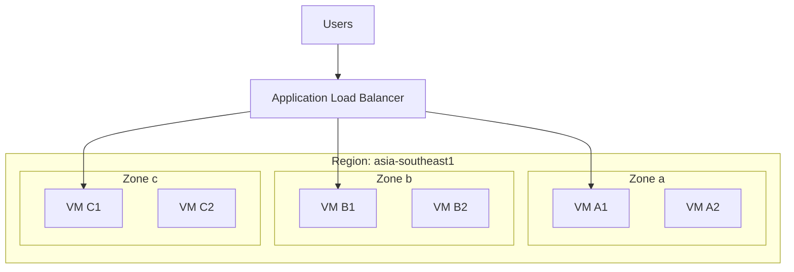
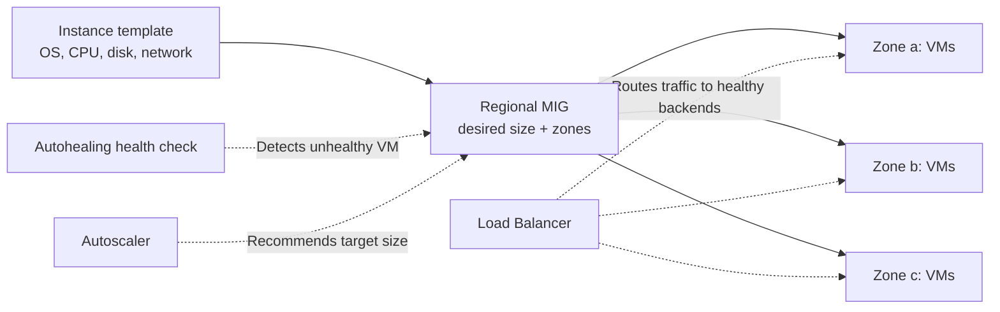
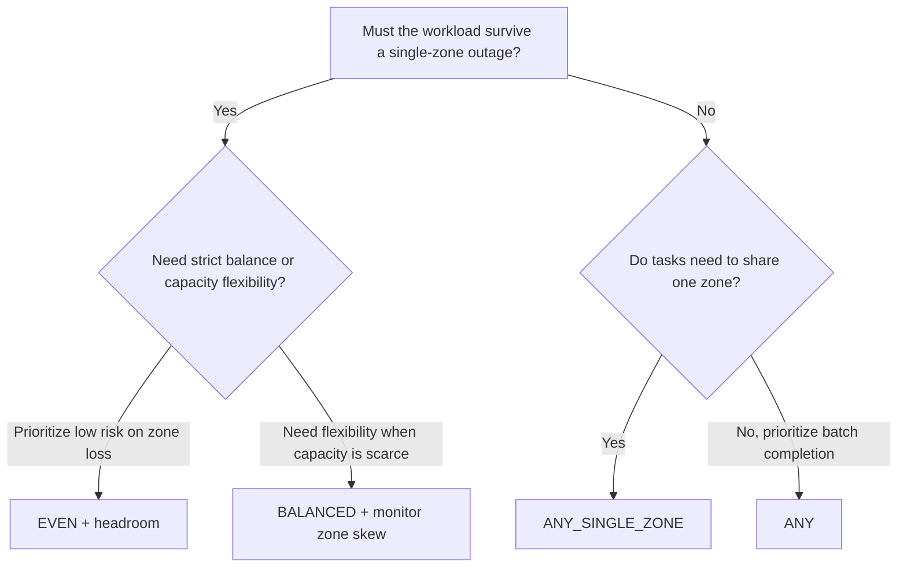
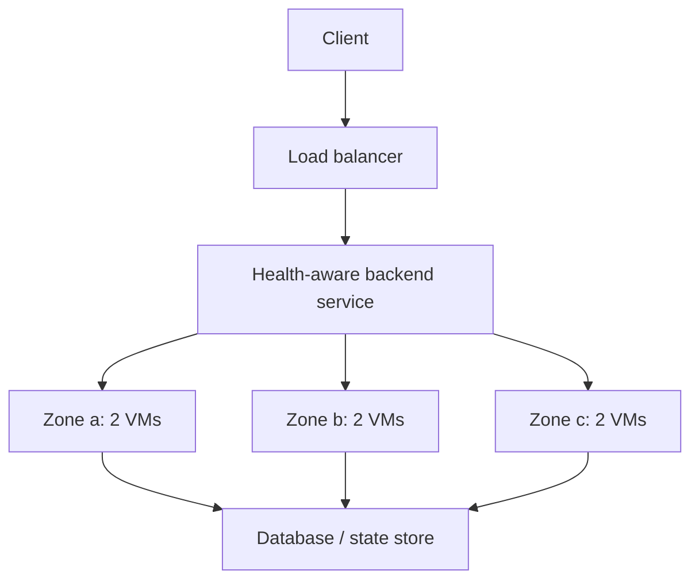

# VM distribution, capacity, and zonal fault tolerance

An application running on **Compute Engine** can operate reliably for months and still suffer an outage when a single **zone** fails, even if every VM has plenty of spare CPU. The root cause is usually not a missing autoscaler, but rather **where capacity is placed**, **which VMs receive traffic**, **how much capacity remains after a zone goes down**, and **whether the service can recover with replacement VMs**.

This lesson belongs to the **Instance Groups and Autoscaling** chapter of the `CLOUD_PROVIDERS_GCP` module. Along the path from Google Cloud project governance, IAM, and VPCs to Compute Engine, GKE, Cloud Run, storage, databases, release automation, and reliability/cost tracking, this lesson focuses on using **Managed Instance Groups (MIGs)** to distribute VMs across zones, plan capacity, and design fault tolerance. The goal is not "as many VMs as possible," but **meeting SLOs with reasonable resources even when part of the infrastructure becomes unavailable**.

## 1. Learning objectives

After this lesson, you can:

1. Distinguish between **regions**, **zones**, **zonal MIGs**, and **regional MIGs**.
2. Understand the distinct responsibilities of **instance templates**, target size, VM distribution, autoscalers, autohealing, and load balancers.
3. Compare **EVEN**, **BALANCED**, **ANY**, and **ANY_SINGLE_ZONE** in regional MIGs based on fault tolerance and resource availability needs.
4. Calculate **remaining capacity after losing one zone** and size headroom instead of relying on naive even division.
5. Distinguish between **quotas**, **physical capacity**, **reservations**, and **minimum replicas**.
6. Know when to use **autohealing**, **autoscaling**, **health checks**, **instance redistribution**, and **load balancing**.
7. Practice with `gcloud`: inspect regions/zones and quotas, create a small regional MIG across three zones, inspect actual distribution, and add bounded autoscaling.
8. Build a plan for zone-failure drills, rollbacks, SLO monitoring, and post-lab cleanup.

**Scope:** examples use a lab project, VMs holding no business data, and three zones within one region. Commands creating VMs, instance templates, MIGs, and autoscalers **provision resources and incur charges**, so run them only in authorized projects. This lesson does not induce a real zone outage and requires no destructive actions against production apps.

## 2. Regions, zones, and failure blast radius

A **region** is a Google Cloud geographical area, such as `asia-southeast1`. Each region contains multiple **zones**, such as `asia-southeast1-a`, `asia-southeast1-b`, and `asia-southeast1-c`. A zone is a deployment domain with relatively independent underlying infrastructure within a region.



The diagram depicts a replicated **stateless** application. When zone a becomes unavailable, the load balancer is expected to stop sending traffic to unhealthy VMs while remaining VMs keep serving. However, that works only if the **frontend, backend health checks, dependent data stores, firewall rules, routes, and capacity in zones b/c** are all adequate.

| Failure scope | What can be impacted | Prevention strategy |
| --- | --- | --- |
| Single app process | One VM stops responding | Health checks/autohealing, multiple replicas |
| Single VM or host | One instance in the MIG | MIG recreates the VM per policy |
| Single zone | All VMs or partial services in that zone | **Regional MIG** across multiple zones, LB, and spare capacity |
| Single region | Multiple zones and regional dependencies | Dedicated **multi-region** design, not just a regional MIG |
| Shared component | Database, bucket, IAM, DNS, network, or quota | Review architecture of every dependency and single point of failure |

**Key takeaway:** a **regional MIG spans multiple zones within *one region***. It does **not** protect against losing an entire region. A single-zone database can still become a single point of failure even if the web tier spans three zones.

## 3. How do zonal MIGs and regional MIGs differ?

A **Managed Instance Group (MIG)** manages a collection of Compute Engine VMs from a shared **instance template**, supporting instance replacement, version updates, autoscaling, and autohealing.

| Criterion | Zonal MIG | Regional MIG |
| --- | --- | --- |
| Scope | One zone | Multiple selected zones within the same region |
| Target size | Total VMs in one zone | Total VMs in the group distributed across zones |
| When the VM zone goes down | The entire group can be impacted | VMs in other zones can continue serving |
| VM distribution | Multi-zone not applicable | Uses target distribution shape |
| Capacity | Dependent on provisioning capacity in one zone | Can tap capacity across multiple zones depending on shape/quota/capacity |
| Autoscaling | Supported for eligible cases | Supported, with distribution shaped by policy |
| Autohealing | Repairs/recreates VMs within the group | Repairs in original zone; optional alternate-zone repair per configuration |
| Typical use case | Small dev/test, workloads intentionally pinned to one zone | Stateless web/API workloads requiring zone-level fault tolerance |

Using a **regional MIG** does not strictly force every VM to sit in the same region as data stores; however, network latency, database placement, and cross-zone/inter-region transfer fees must be factored into the design.

### 3.1. An instance template is a "blueprint," not a "running machine"

An **instance template** specifies machine type, boot image, disks, network/subnet, labels, service account, startup script, and VM settings. It does not launch machines by itself.



Changing a group's instance template is a **deployment configuration change** requiring rolling update/canary policies and disruption budgets. Templates neither distribute traffic nor replace a load balancer's backend service.

### 3.2. What does a MIG "manage" automatically?

A MIG tries to maintain its **target size** and desired instance configuration. If a VM fails or is deleted within policy rules, the MIG can recreate it. However:

- New VMs are **not ready to serve** until the OS, startup script, and application finish initializing.
- Without enough **quota/capacity**, replacement VMs cannot be provisioned.
- New VMs do not automatically recover data written to an old VM's ephemeral local disk.
- Without an **application health check**, the MIG cannot tell that a web process has hung while the VM OS stays running.

## 4. Target distribution shapes: choosing where VMs are placed

A regional MIG offers four target distribution shapes. These govern **how VMs are distributed across zones**, not load balancer request weighting.

| Shape | Primary distribution behavior | Best suited for | Primary risk |
| --- | --- | --- | --- |
| **EVEN** | Tries to keep VM counts per zone within a difference of at most 1 when conditions allow | Serving workloads needing zonal HA | May fall short of target size if a zone lacks capacity and no flexibility option is configured |
| **BALANCED** | Prioritizes zones with available capacity while keeping distribution as even as possible | Serving/batch needing HA alongside constrained resource availability | Under scarce capacity, VMs may cluster in fewer zones |
| **ANY** | Prioritizes zones with available resources/quotas or matching reservations | Batch jobs prioritizing throughput over zonal HA | All VMs could land in a single zone |
| **ANY_SINGLE_ZONE** | Places all VMs in **one** selected zone | Tightly coupled workloads needing low inter-VM latency/co-location | Zero HA if that zone goes down |

In the Console or CLI, shapes are named `EVEN`, `BALANCED`, `ANY`, and `ANY_SINGLE_ZONE`; `gcloud` flags typically use lowercase hyphenated forms such as `even`, `balanced`, `any`, and `any-single-zone`.

### 4.1. EVEN: balanced by instance count

Suppose a regional MIG has target size 6 across 3 zones:

```text
zone a: ● ●       2 VMs
zone b: ● ●       2 VMs
zone c: ● ●       2 VMs
total:            6 VMs
```

If target size rises to 7, one zone can hold 3 VMs while the other two hold 2 each. With **EVEN**, the expected skew between zones does not exceed 1 once the group reaches its desired distribution.

Under capacity constraints, provisioning still depends on autoscaling/group mechanics and quotas. **Never treat "target size = 6" as proof that "six VMs are running, healthy, and ready."** Inspect `list-instances` and live telemetry.

### 4.2. BALANCED: balanced, yet prioritizes actually creating VMs

If zone a runs out of the target machine type, a `BALANCED` group can place VMs in b/c instead of stalling to enforce an exact split. For example:

```text
zone a: ●         1 VM
zone b: ● ● ●     3 VMs
zone c: ● ●       2 VMs
total:            6 VMs
```

This increases the odds of hitting **total capacity** during resource shortages, yet **reduces fault tolerance if the heaviest zone fails**. Losing zone b above wipes out 50% of VMs, rather than 1/3.

### 4.3. ANY and ANY_SINGLE_ZONE: optimizing provisioning or placement

`ANY` provisions VMs in whichever zones have spare quota/capacity, optionally prioritizing unused zonal reservations. VM placement can become heavily skewed. `ANY_SINGLE_ZONE` tries to pack all VMs into one zone, fitting workloads requiring co-location, though it is **never a multi-zone HA choice**.

Choose the shape based on real requirements:



**Never change shapes casually in production.** Several shapes impose constraints on proactive instance redistribution, autoscaling, and related policies. For example, `BALANCED` and `ANY_SINGLE_ZONE` require disabling **proactive redistribution** per MIG configuration rules. Before switching, verify scale-in/scale-out behavior, reservations, and machine-type support.

## 5. Zone distribution differs from proactive redistribution

**Proactive instance redistribution** is a mechanism where a regional MIG actively rebalances instances across zones toward the target distribution when supported and enabled. This can **replace** VMs in an over-represented zone to restore even balance.

Distinguish three actions:

- **Adding VMs because target size increased:** a capacity count decision.
- **Creating a VM in another zone due to capacity shortage:** a placement decision.
- **Proactive redistributing:** actively shifts distribution by replacing existing VMs, which can disrupt live sessions or stateful workloads.

With **EVEN**, proactive redistribution is typically enabled by default where supported. With unsupported shapes, another setting is required. When autoscaling is active, placement also follows autoscaler logic and resource availability—never assume toggling redistribution fixes every capacity error.

**For stateful workloads**, relocating or replacing VMs can erase local state unless state-preservation mechanisms are explicitly configured. Do not enable redistribution without understanding your workload's disks, metadata, sessions, and lifecycle.

### 5.1. Choose the zone set carefully from the start

A regional MIG is created with a fixed set of zones. **You cannot directly modify a regional MIG's zone list after creation** per product rules; changing zones requires creating a new group, migrating traffic/state, and retiring the old group.

Therefore, verify before deployment:

1. Is the machine series/type offered in **every** intended zone?
2. Does each zone have capacity for the required GPUs, CPUs, memory, or disks?
3. Does the subnet belong to the matching region, and do IAM/organization policies permit it?
4. Do data locality, dependent backends, and network paths introduce bottlenecks or transfer fees?
5. If one zone fails, do the remaining zones hold enough capacity and quota to sustain SLOs?

## 6. Capacity: three concepts that must not be conflated

In Compute Engine operations, the following terms are frequently mixed up:

| Concept | What is it? | What does it NOT guarantee? |
| --- | --- | --- |
| **Quota** | Resource limit granted to a project by scope and quota type | Does not guarantee physical hardware availability |
| **Available capacity** | Actual hardware Compute Engine can allocate in a zone right now | Does not guarantee your project quota permits using it |
| **Reservation** | Mechanism reserving eligible Compute Engine capacity matching a configuration | Does not bypass compatibility, IAM permissions, schedules, or scope rules |
| **MIG target size** | Total VMs the group intends to manage | Does not guarantee all VMs are `RUNNING` or healthy |
| **Autoscaler min replicas** | Lower bound on target size under autoscaling | Does not mean "guaranteed healthy VMs" |
| **Autoscaler max replicas** | Upper bound on target size the autoscaler may request | Does not grant extra quota or guarantee capacity |

VM creation can fail due to exhausted quotas, lack of physical capacity, unavailable machine types in a zone, incompatible images/OSes, IAM/organization policies, or an invalid instance template.

### 6.1. Regional quotas vs. zonal limits

Many CPU quotas apply per **region** and CPU/machine family, while other limits carry different scopes. If a project has only 12 vCPUs of matching regional quota and each VM uses 2 vCPUs, quota allows at most 6 VMs before considering other CPU quotas and overhead. Yet even with quota for 6 VMs, a specific zone may temporarily **lack physical capacity** for that machine type.

Always inspect real project/region quotas and check machine types in each target zone before creating a group. Never infer from `machine-types list` that capacity is reserved for you.

### 6.2. Reservations: reducing capacity exhaustion risk

Reservations help assure capacity for VMs matching a configuration in a specific zone under product terms. However, reservations carry **zonal scope**, matching rules, charges, and permission requirements. A reservation in zone a will not automatically cover zone b.

For regional MIGs configured to consume named reservations, documentation requires creating matching reservations in each relevant zone and pointing the instance template to them. When designing for HA, **reserve sufficient headroom in surviving zones**, not just steady-state VM counts.

Never create reservations for a small lab without budgeting first; reserved resources can incur charges even when idle.

## 7. Calculating sufficient capacity for single-zone failure

This is the most critical design calculation.

Suppose stateless VMs sit behind a load balancer, each VM sustains **150 requests/second at the verified SLO**, there are three zones, and peak load is **500 requests/second**.

### 7.1. VM count without considering zone failures

\[
N_{\text{normal}}=
\left\lceil\frac{500}{150}\right\rceil=4
\]

Four VMs provide enough nominal throughput under fault-free conditions, **yet fail to prove** SLO compliance after losing a zone.

### 7.2. The worst-case zone loss rule

With `EVEN` across \(Z\) zones and \(N\) VMs, the most populated zone can hold up to \(\lceil N/Z\rceil\) VMs. If that exact zone fails, the surviving VM count is:

\[
N_{\text{remaining}}
=
N-\left\lceil\frac{N}{Z}\right\rceil
\]

To sustain load \(D\) given per-VM sustainable capacity \(C\):

\[
\left(N-\left\lceil\frac{N}{Z}\right\rceil\right)\times C
\ge D
\]

Test table with \(Z=3\), \(D=500\) req/s, and \(C=150\) req/s/VM:

| Total VMs \(N\) | Possible EVEN split | Losing heaviest zone | Remaining VMs | Remaining capacity |
| --- | --- | --- | --- | --- |
| 4 | 2–1–1 | Lose 2 | 2 | 300 req/s — **insufficient** |
| 5 | 2–2–1 | Lose 2 | 3 | 450 req/s — **insufficient** |
| 6 | 2–2–2 | Lose 2 | 4 | 600 req/s — **meets throughput** |
| 7 | 3–2–2 | Lose 3 | 4 | 600 req/s — meets throughput |

**Illustrative conclusion:** across three zones under these assumptions, at least **6 healthy, SLO-compliant VMs** allow surviving a single-zone outage without depending on instant VM creation.

That is **not yet an SLA**: real deployments must factor in session redistribution, LB health-check lag, JIT/warm-up duration, databases, networking, zone drift, rolling updates, and traffic spikes. Additional buffer may be needed per your error budget.

### 7.3. Why simple approximations can fail

A common shortcut multiplies required capacity by \(Z/(Z-1)\). However, VMs come in **integers**, and for small \(N\) the heaviest zone holds more than \(1/Z\) of the fleet. Always apply the **worst-case zone loss** formula directly and verify actual distribution.

When using `BALANCED` or `ANY`, you cannot assume each zone holds \(N/Z\) VMs. Inspect live placement and calculate:

\[
\text{Remaining capacity (simple)}
=
\sum_{\text{surviving zones}} \text{healthy VMs}_{z}\times C_z
\]

Values of \(C_z\) can differ when using instance flexibility or across heterogeneous machine performance. Always validate capacity via **application load testing**, not VM headcount alone.

## 8. Autoscaling does not guarantee fault tolerance on its own

An **autoscaler** tracks utilization signals and adjusts VM count within min/max bounds. It handles **load fluctuations**, whereas **zonal resilience** requires pre-existing capacity headroom.

### 8.1. Three common scaling signals

- **CPU utilization:** scales VMs toward a target average CPU, such as 60%.
- **HTTP load balancing serving capacity:** scales from serving-capacity signals on compatible load balancer backends.
- **Cloud Monitoring custom metrics:** scales on workload metrics (e.g., pending jobs) per supported autoscaler configuration.

**Scaling schedules** can pre-provision capacity ahead of predictable peaks, and **predictive autoscaling** fits workloads with recurring traffic patterns. Each feature carries specific metric, historical-data, and product constraints—never assume every MIG supports them identically.

### 8.2. Minimum replicas must match your fault model

If steady state needs 4 VMs for 500 req/s and the autoscaler uses `min=4`, during low-traffic hours it can shrink the group to 4 VMs. Losing the heaviest zone leaves only 2 VMs under EVEN—insufficient if a 500 req/s surge hits immediately.

If the system must **absorb peak load even after losing a zone**, the minimum baseline may need to match the N+1 zone calculation—such as `min=6` from Section 7—or pre-warm capacity ahead of peaks. That is a deliberate **cost-versus-recovery-speed trade-off**, not a Google Cloud default.

### 8.3. Autoscaling has latency

When a zone fails, the autoscaler/MIG can spin up new VMs in surviving zones **if quota and capacity allow**, but:

1. The autoscaler must detect elevated load and compute a new target size.
2. Compute Engine must allocate physical resources.
3. VMs must boot, run startup scripts, and start the application.
4. Health checks must mark the new backends healthy.
5. The load balancer must start routing traffic to those VMs.

Between steps 1 and 5, the application can suffer **capacity shortfalls**. Never promise "autoscaling recovers instantly" without an RTO proven in testing.

### 8.4. Scale-in also carries risk

Scale-in selects VMs to delete; if the app holds long-lived connections or unfinished jobs, abrupt termination causes errors. Design graceful shutdown/draining, stabilization periods, scale-in controls, and batch checkpoints. Remember that **stateful MIGs** carry specific limits—including no support for autoscaling or scaling schedules when stateful configuration is active per product docs; if VM-local state is required, reconsider data architecture and scaling strategy.

## 9. How does autohealing differ from load balancing health checks?

These mechanisms answer two distinct questions:

| Mechanism | Question | Action |
| --- | --- | --- |
| **LB health check** | "Can this VM/backend serve traffic right now?" | Stops or reduces traffic sent to unhealthy backends |
| **MIG autohealing** | "Does this MIG VM need to be repaired/recreated?" | Recreates unhealthy VMs per policy |
| **Autoscaler** | "How many VMs does the group need?" | Adjusts target size |
| **Distribution policy** | "Which zones should hold the VMs?" | Controls instance placement |
| **Monitoring/SLO alerts** | "Are users experiencing errors?" | Alerts operators to respond |

Autohealing health checks should evaluate **actual local application health** while avoiding sensitivity to brief external dependency blips. If the endpoint returns unhealthy because an external database hiccups, autohealing can trigger a *repair storm* across all VMs without fixing the database.

### 9.1. Initial delay and repair limits

Applications need time to boot, load libraries, and open database connections. **Initial delay** keeps the MIG from flagging a booting VM as broken too early—though it does not ignore errors forever.

Autohealing enforces **concurrency limits** when repairing multiple VMs to avoid wiping out capacity. Thus, even if many VMs turn unhealthy simultaneously, they are not all replaced at once. By default, a regional MIG attempts repairs **in the VM's original zone**; **alternate-zone** repair options exist where supported. Never assume autohealing automatically relocates VMs into healthy zones.

### 9.2. When an entire zone fails

For example:

- Zonal MIG in zone a: if zone a fails, the group cannot self-heal into zone b.
- Regional MIG across a/b/c: VMs in b/c can continue operating while the LB drains unhealthy backends in a; remaining capacity is what matters most.
- When zone a recovers, the MIG can replenish VMs; **rebalancing** depends on shape, redistribution policy, and capacity.
- If the app requires **immediate replacement in another zone**, evaluate alternate-zone repair compatibility with group/disk/state policies.

Never shut down a production zone just to "test" without an approved drill plan. In this lab, we **verify distribution** and model zone-loss math without causing real outages.

## 10. Load balancing and data: two prerequisites for HA

A regional MIG covers only the **VM tier**. Users need a frontend capable of shifting traffic to healthy VMs. Depending on protocol and architecture, **Application Load Balancers** or **Network Load Balancers** support instance groups as backends.



When zone a fails, the full path **client → LB → zones b/c → data** must keep working. If the database runs only in zone a, the app still returns 500s even with healthy VMs in b and c. True HA requires:

- **Stateless** web/API tiers or externalized shared session stores.
- Databases, queues, and storage with **durability and failover** matching RPO/RTO.
- Accurate firewall rules, health-check source ranges, and VPC routes.
- DNS and load balancing free of single points of failure.
- Enough surviving healthy VMs for peak load (or load shedding).
- Rollout policies capping simultaneously unavailable VMs.

Never place one VM per zone and declare "production HA" without validating the entire data path, capacity math, and health checks.

## 11. Planning zonal capacity, reservations, and release windows

### 11.1. Capacity worksheet for peak and failure

A simple pre-deploy worksheet:

| Item | Illustrative value | Verification source |
| --- | --- | --- |
| Peak request rate | 500 req/s | Monitoring, load tests |
| p95 latency SLO | Below product threshold | Official SLO |
| Sustainable capacity/VM | 150 req/s at SLO | App benchmark |
| Zone count | 3 | Regional plan |
| Minimum VMs for zone fault tolerance | 6 | Section 7 formula |
| Target distribution | EVEN | Regional MIG design |
| Surviving VMs after zone loss | 4 | 2–2–2 minus one zone |
| Remaining throughput | 600 req/s | 4 × 150 |
| Practical buffer | Requires further assessment | Traffic bursts, errors, capacity variability |

### 11.2. Deployments are also "planned disruptions"

During a rolling update, some VMs undergo replacement temporarily. If a zone fails while a pipeline continues replacing VMs in surviving zones, available capacity drops even lower than a single-zone failure alone. Configure **`maxSurge`**, **`maxUnavailable`**, readiness/health checks, canaries, and rollout pause controls.

Set clear guardrails: **never run automated deployments during an active incident**, unless the deployment is an approved remediation. When rolling updates overlap with autoscaling, watch size/distribution changes and startup times closely.

### 11.3. Instance flexibility

Some target distribution shapes support an **instance flexibility policy**, letting the group pick from eligible fallback machine types when one machine type is scarce. However, differing machine specs/performance reduce the accuracy of uniform "150 req/s per VM" estimates. When using instance flexibility, benchmark **each machine type** or calculate capacity using weighted capacities.

## 12. Lab A: inspecting region, zones, and VM provisioning capability

This lab uses **a small three-VM regional MIG** purely to observe distribution and configuration. It **does not prove** full web HA; validating application failover requires a load balancer and a live service.

### 12.1. Prerequisites and variables

You need a project with billing enabled, the Compute Engine API, three zones supporting `e2-small`, and a lab subnet in the same region. Use only authorized projects, subnets, and resource names.

```bash
PROJECT_ID="YOUR_LAB_PROJECT_ID"
REGION="asia-southeast1"
ZONE_A="asia-southeast1-a"
ZONE_B="asia-southeast1-b"
ZONE_C="asia-southeast1-c"
SUBNET="YOUR_LAB_SUBNET"

TEMPLATE="mig-zone-template-lab"
MIG="mig-zone-lab"
MACHINE_TYPE="e2-small"

gcloud --version
gcloud auth list
gcloud projects describe "$PROJECT_ID" \
  --format="yaml(projectId,projectNumber,lifecycleState)"
```

Lab names above are **placeholders/lab-scoped names**. Before creating anything, check if a template or MIG with that name already exists; if so, **do not overwrite it**—confirm ownership and pick another name.

### 12.2. Inspect region and three zones (read-only)

```bash
gcloud compute regions describe "$REGION" \
  --project="$PROJECT_ID" \
  --format="yaml(name,status,quotas)"

gcloud compute zones list \
  --project="$PROJECT_ID" \
  --filter="region:$REGION" \
  --format="table(name,region.basename(),status)"

# Is the machine type supported in all target zones?
gcloud compute machine-types list \
  --project="$PROJECT_ID" \
  --zones="$ZONE_A,$ZONE_B,$ZONE_C" \
  --filter="name=$MACHINE_TYPE" \
  --format="table(name,zone.basename(),guestCpus,memoryMb)"
```

Check quotas for the matching CPU/machine family in your project. `machine-types list` only confirms **type support**, not whether spare physical capacity is available at creation time.

### 12.3. Inspect networking and resource state (read-only)

```bash
gcloud compute networks subnets list \
  --project="$PROJECT_ID" \
  --filter="region:$REGION" \
  --format="table(name,network.basename(),region.basename(),ipCidrRange)"

gcloud compute instance-templates list \
  --project="$PROJECT_ID" \
  --filter="name=$TEMPLATE"

gcloud compute instance-groups managed list \
  --project="$PROJECT_ID" \
  --filter="name=$MIG"
```

**Do not proceed to VM creation** if the subnet is in the wrong region, a Shared VPC lacks permissions, a zone is blocked by Organization Policy, or the project lacks quota/budget.

## 13. Lab B: creating an instance template and an EVEN regional MIG

### 13.1. Create the instance template (write operation)

This sample uses a public Debian image, `e2-small`, no external IP, and no application service account since this lab only observes distribution.

```bash
gcloud compute instance-templates create "$TEMPLATE" \
  --project="$PROJECT_ID" \
  --machine-type="$MACHINE_TYPE" \
  --image-family="debian-12" \
  --image-project="debian-cloud" \
  --boot-disk-size="10GB" \
  --subnet="$SUBNET" \
  --region="$REGION" \
  --no-address \
  --no-service-account \
  --labels="purpose=mig-zone-lab,environment=dev"
```

**Warning:** without external IPs, VMs cannot reach the public Internet unless Cloud NAT or another egress path exists. This lab needs neither package downloads nor external requests. This minimal profile reduces exposure, not a complete production template.

Read back the template:

```bash
gcloud compute instance-templates describe "$TEMPLATE" \
  --project="$PROJECT_ID" \
  --format="yaml(name,properties.machineType,properties.disks,properties.networkInterfaces)"
```

If the Debian image or machine type is unavailable as configured, pick a compatible option from the official catalog. **Never grant Editor** to a default service account just to make creation succeed.

### 13.2. Create the three-zone regional MIG (write operation)

After verifying policies and confirming **no conflicting MIG exists**, run:

```bash
gcloud compute instance-groups managed create "$MIG" \
  --project="$PROJECT_ID" \
  --template="$TEMPLATE" \
  --size=3 \
  --region="$REGION" \
  --zones="$ZONE_A,$ZONE_B,$ZONE_C" \
  --target-distribution-shape=even
```

The group targets **3 VMs across three zones**. Given sufficient quota/capacity and once stable, the expected split is 1–1–1. A successful create command **does not guarantee** all three VMs are immediately booted and healthy.

### 13.3. Read back the group and list VMs

```bash
gcloud compute instance-groups managed describe "$MIG" \
  --project="$PROJECT_ID" \
  --region="$REGION" \
  --format="yaml(name,targetSize,distributionPolicy,status,instanceTemplate)"

gcloud compute instance-groups managed list-instances "$MIG" \
  --project="$PROJECT_ID" \
  --region="$REGION" \
  --format="table(instance,instanceStatus,currentAction)"

# Optionally list VMs by name prefix to cross-check zones.
gcloud compute instances list \
  --project="$PROJECT_ID" \
  --filter="name~'^mig-zone-lab-'" \
  --format="table(name,zone.basename(),status,machineType.basename())"
```

In `list-instances`, each `instance` path includes its zone name. Count `RUNNING` VMs per zone separately from **target size**. VMs still creating or recreating do not count as active serving capacity.

### 13.4. Results recording table

| Zone | Steady-state target | Actual VMs | Status |
| --- | --- | --- | --- |
| `ZONE_A` | 1 | Fill from readback | `RUNNING` / other |
| `ZONE_B` | 1 | Fill from readback | `RUNNING` / other |
| `ZONE_C` | 1 | Fill from readback | `RUNNING` / other |
| **Total** | 3 | Fill from readback | Compare to target size |

If only 2 VMs appear, inspect individual creation errors, quotas, machine capacity, and subnet/IAM permissions. **Never spill into a production project** just to get 3 lab VMs running.

## 14. Lab C: demonstrating bounded autoscaling

This step is **optional**. Understand first that these three lab VMs run no web app and carry no real CPU load; enabling CPU autoscaling alone will not trigger noticeable scale-out events.

If authorized to test autoscaling in the lab, this command sets a 60% CPU target with min 3 and max 6:

```bash
gcloud compute instance-groups managed set-autoscaling "$MIG" \
  --project="$PROJECT_ID" \
  --region="$REGION" \
  --min-num-replicas=3 \
  --max-num-replicas=6 \
  --target-cpu-utilization=0.60 \
  --cool-down-period=120
```

Readback:

```bash
gcloud compute instance-groups managed describe "$MIG" \
  --project="$PROJECT_ID" \
  --region="$REGION"

gcloud compute autoscalers list \
  --project="$PROJECT_ID" \
  --filter="name~'$MIG'"
```

For regional MIGs, the autoscaler is a regional resource and observed behavior can vary regionally. Verify settings via `describe` and Cloud Monitoring before concluding the autoscaler is active.

**Reminder:** `min=3` suffices for *observing lab distribution*, **not** for the 500 req/s workload modeled in Section 7. Production must derive `min` from your fault model and benchmarked per-VM capacity, while `max` respects quotas and budget.

### 14.1. Load generation must be strictly bounded

If extending the lab with a web app, send test traffic only to endpoints **you own** in a test project, with strict RPS/time caps and stakeholder notice. Never stress-test production or third-party endpoints. Measure CPU, instance count, zonal distribution, cold starts, and scale-out lag, then stop traffic and observe scale-in.

Manual target-size changes are **distinct from autoscaling**. When an autoscaler manages a group, manual `--size` edits can be overridden by the autoscaling policy. To test distribution across fixed sizes, use a non-autoscaled group or temporarily pause autoscaling per plan.

## 15. Do not simulate a zone failure by recklessly deleting VMs

Many labs stop a single VM and call it a "zone outage." Those are not equivalent:

- **Stopping a VM** simulates only a single-instance failure, not losing zone-wide networking, control plane, and backing resources.
- **Deleting a MIG VM** lets the MIG recreate it in place, proving nothing about recovery when the zone itself lacks capacity.
- **Breaking firewalls** or load balancers makes the test riskier without modeling an actual zone failure.

Instead, run a **tabletop exercise** in a small lab:

1. Read current placement from `list-instances`.
2. Assume every VM in one zone vanishes simultaneously.
3. Calculate remaining VMs under worst-case zone loss.
4. Multiply by load-tested per-VM capacity.
5. Trace the recovery sequence: LB health checks → traffic shifts zones → autoscaler → VM boot → app readiness.
6. Audit quotas/capacity/reservations, data stores, firewalls, DNS, and monitoring.
7. Document improvements before conducting live drills.

If your organization has an approved staging drill environment and permissions, you can evaluate Google Cloud's supported regional MIG zone-outage simulation features; **read all impacts and prerequisites thoroughly** before use, and never run destructive commands against production resources in this course.

## 16. Monitoring distribution and health in operations

Per-zone VM counts shift due to autoscaling, updates, provisioning failures, or redistribution. Operations therefore needs both **current snapshots** and **historical trends**.

### 16.1. Recommended dashboards and metrics

| Category | Signals | Why |
| --- | --- | --- |
| **MIG** | Target size, managed VM count, creating/recreating | Detect target drift |
| **Distribution** | VMs per zone vs. target shape | Detect capacity clustering in one zone |
| **Health** | Healthy/unhealthy counts and backend health ratio | Measure true serving capacity |
| **Autoscaling** | Recommended size, min/max, scaling events | Evaluate peak responsiveness |
| **Capacity** | Quota utilization, resource availability errors | Trace missing VMs |
| **LB** | Request rate, p95/p99, 4xx/5xx, backend latency | Track user-facing impact |
| **Application** | Ready replicas, in-flight requests, GC, CPU/RAM | Distinguish app bottlenecks from VM count |
| **FinOps** | VM-hours, boot disks, network egress, logs | Keep redundancy within budget |

Google Cloud provides **instance distribution monitoring** for MIGs. Combine Cloud Monitoring, Audit Logs, Compute Engine operations, and load balancer logs to tell whether changes came from the autoscaler, an operator, or a zone failure.

### 16.2. Spotting "silent capacity loss"

Some failures aren't obvious VM crashes:

- MIG targets 9 VMs, yet only 7 exist because zone c ran out of GPUs/CPUs.
- `BALANCED` placed 6/9 VMs in zone b during a shortage, amplifying zone b blast radius.
- LB returns 5xx even though all 9 VMs are `RUNNING` due to wrong readiness or port settings.
- Average CPU looks low while a few instances hotspot from long-lived connections or session affinity.
- Aggressive scale-in during unstable traffic causes constant VM churn.

Alert on **healthy serving capacity** and SLOs, not merely "VM RUNNING."

## 17. Incident response runbook for a zone outage

Summary runbook:

1. **Confirm the incident:** Cloud Monitoring, LB health, Compute status, logs, and Google Cloud service health.
2. **Assess impact:** which zone, which VMs, which unhealthy backends, error rates, and latency.
3. **Verify remaining capacity:** healthy VMs in surviving zones, throughput, and error budget burn.
4. **Halt risky changes:** pause conflicting rollouts/config edits if needed; never delete VMs or data records mid-investigation.
5. **Watch autoscaler and provisioning:** recommended vs. actual size, quota/capacity errors, need for fallback machine types/reservations.
6. **Protect data and dependencies:** verify databases, caches, shared files, and regional services remain healthy.
7. **Restore traffic cleanly:** let LB/readiness steer traffic; never force traffic to unhealthy backends.
8. **Monitor recovery:** once the zone returns, watch redistribution so rebalancing does not trigger instability.
9. **Postmortem:** compare capacity forecasts against reality; update min/max, health checks, reservations, and runbooks.

There is no single universal "fix zone failure" command. Remediate the exact bottleneck: backend health, capacity, BGP/VPC, quotas, or database.

## 18. Scenario: three-zone order API

An order service has the following profile:

- Peak 900 req/s.
- Each VM sustainably serves 200 req/s while keeping p95/p99 within SLO.
- Stateless API tier; sessions stored externally.
- Three-zone regional MIG with `EVEN`.
- Database designed for HA with verified failover.

**Ignoring zone failure:** \(\lceil 900/200\rceil=5\) VMs appears sufficient nominally.

**Accounting for losing the heaviest zone:** with N=7 (3–2–2), losing the 3-VM zone leaves 4 VMs providing roughly 800 req/s—**insufficient**.

With N=8 (3–3–2), losing a 3-VM zone leaves 5 VMs providing a theoretical 1,000 req/s, meeting 900 req/s if SLO assumptions hold. However, the 100 req/s margin is tight against traffic bursts, warm-up, retry storms, and cache/DB bottlenecks. N=9 (3–3–3) leaves 6 VMs (1,200 req/s) after losing one zone, offering healthier headroom at higher cost.

| Option | Normal | Worst-case zone loss | Remaining capacity | Assessment |
| --- | --- | --- | --- | --- |
| N=5 | 2–2–1 | 3 left | 600 req/s | Insufficient |
| N=7 | 3–2–2 | 4 left | 800 req/s | Insufficient |
| N=8 | 3–3–2 | 5 left | 1,000 req/s | Nominally sufficient, thin buffer |
| N=9 | 3–3–3 | 6 left | 1,200 req/s | Better buffer, higher cost |

**The decisive metric is not raw VM count**, but **requests meeting SLO sustained by healthy VMs in surviving zones**. If cross-zone database/network latency lowers per-VM throughput in surviving zones, adjust your per-VM capacity figure accordingly.

## 19. Costs and trade-offs: Availability versus Capacity

Multi-zone HA usually requires holding spare capacity. Running six VMs instead of four raises baseline compute spend, yet prevents lost revenue and downtime during outages. Costs extend beyond VM counts:

| Cost item | Drivers |
| --- | --- |
| **Compute Engine VM-hours** | VM count, machine series, provisioning model, zone/region, runtime |
| **Persistent Disk/Hyperdisk** | Template disks, IOPS/throughput, disk types |
| **Networking** | Egress, cross-zone/region traffic, load balancers, NAT |
| **Reservations** | Reservation scope, fees, and commitments |
| **Monitoring/Logging** | Metric/log volume and retention |
| **Build/deploy** | Images, artifacts, CI/CD, rollout surge |
| **Operations** | Incident analysis, HA drills, on-call staffing |

**Spot VMs** cost less yet carry higher preemption risk and are not guaranteed capacity for mandatory serving baselines. For retryable batch jobs, `ANY` + Spot may fit better than `EVEN` + on-demand; for strict-SLO APIs, prioritize availability when picking provisioning models.

Budget alerts provide cost visibility; they do not automatically stop groups at a dollar limit. Autoscaler `max replicas` caps autoscaler-requested VMs, while disks, egress, and other services still bill separately. Never treat `max replicas` as a "billing cap."

## 20. Safe lab cleanup

This lab created an **instance template** and a **regional MIG**, plus an autoscaler if enabled. Delete resources only when certain they were **created by this lab**, hold no important data, and serve no backend traffic.

### 20.1. Verify before deleting (read-only)

```bash
gcloud compute instance-groups managed describe "$MIG" \
  --project="$PROJECT_ID" \
  --region="$REGION"

gcloud compute instance-groups managed list-instances "$MIG" \
  --project="$PROJECT_ID" \
  --region="$REGION"

gcloud compute instance-templates describe "$TEMPLATE" \
  --project="$PROJECT_ID"
```

If the group backs a backend service or active jobs, detach or drain data per plan first. Never wipe production resources casually to cut costs.

### 20.2. Controlled deletion order (destructive operations)

The order is **stop autoscaling if enabled**, **delete the MIG**, then **delete the instance template**. Run only on approved lab resources:

```bash
# If autoscaling was enabled, remove the lab autoscaler.
gcloud compute instance-groups managed stop-autoscaling "$MIG" \
  --project="$PROJECT_ID" \
  --region="$REGION"

# Delete the regional MIG and its managed VMs.
gcloud compute instance-groups managed delete "$MIG" \
  --project="$PROJECT_ID" \
  --region="$REGION"

# Finally, delete the lab's global instance template.
gcloud compute instance-templates delete "$TEMPLATE" \
  --project="$PROJECT_ID"
```

If autoscaling was never enabled, `stop-autoscaling` reports no policy exists; **do not retry**. When the MIG is deleted, boot disks are deleted per `autoDelete`; verify any leftover disks or snapshots per storage policy. Never delete pre-existing VPCs, subnets, or projects.

### 20.3. Post-cleanup verification

- Lab MIG no longer appears in regional instance groups.
- No group-generated VMs remain in the three zones.
- Lab instance template is deleted.
- No unexpected boot disks, snapshots, or billing resources remain.
- Billing metrics may lag behind deletion timestamps; re-check after the appropriate billing cycle.

## 21. Self-practice exercises

### Exercise 1 — Distinguishing zonal and regional MIGs

An API service runs four VMs in a zonal MIG in `asia-southeast1-a`. The team claims "four VMs means we have HA."

*Guidance:* It can survive individual VM failures, not an outage of zone a. Surviving a zone outage requires a regional MIG or equivalent multi-zone architecture, LB failover, HA data dependencies, and sufficient capacity in other zones.

### Exercise 2 — Checking EVEN with odd VM counts

A three-zone regional MIG uses `EVEN` with target size 8.

*Guidance:* Expected distribution under sufficient capacity is **3–3–2** across zones. Losing the 3-VM zone leaves 5 VMs; never assume \(8\times 2/3\) VMs without integer rounding.

### Exercise 3 — Choosing a shape

A batch job has no real-time serving SLO; it prioritizes consuming existing reservations and completing as many jobs as possible.

*Guidance:* Consider `ANY` with checkpointing/retries, accepting that VMs may concentrate in one zone. If the job needs zonal HA, `BALANCED`/`EVEN` with headroom fits better.

### Exercise 4 — Quota does not equal capacity

A project has plenty of CPU quota, yet large GPU VMs fail to provision in zone b.

*Guidance:* Physical hardware/GPU capacity can be exhausted even when quota allows; check availability, provisioning errors, alternate zones, fallback machine types, and reservations. Never request quota increases when the failure is physical capacity.

### Exercise 5 — Autoscaler min set too low

An app peaks at 500 req/s; each VM handles 150 req/s at SLO. A three-zone regional MIG has autoscaler min 4.

*Guidance:* At `min=4`, `EVEN` splits 2–1–1; losing the 2-VM zone leaves 2 VMs (300 req/s), which is **insufficient**. In the theoretical model, N=6 (2–2–2) is required to leave 600 req/s after losing one zone.

### Exercise 6 — Autohealing misinterprets database errors

All six VMs have healthy OSes, yet temporary database overload makes the health endpoint return 500; autohealing starts recreating multiple VMs.

*Guidance:* The autohealing check is overly coupled to an external dependency. Separate liveness from readiness, tune checks/initial delay, fix the database bottleneck, and prevent repair storms.

### Exercise 7 — VMs exist, yet 503 errors persist

After zone a fails, the regional MIG still has enough VMs in b/c, yet the frontend still returns 503.

*Guidance:* Inspect backend services, LB health checks, firewall rules, routes, app readiness, instance registration, data dependencies, and actual capacity—never equate `RUNNING` VMs with serving capacity.

### Exercise 8 — Changing the zone list after creation

A team created a regional MIG with two zones and wants to add a third zone via an in-place update.

*Guidance:* A regional MIG's zone list is fixed at creation and cannot be updated directly per product rules. Create a new three-zone MIG, migrate traffic via canary, and retire the old group.

### Exercise 9 — Is a regional MIG enough for a regional outage?

An application spans VMs across three zones within one region; the team requires recovery if the entire region fails.

*Guidance:* Not enough. You need a **multi-region architecture**, replicated data, DNS/LB failover, permissions/quotas/capacity in the secondary region, and tested RTO/RPO.

## 22. Capacity design checklist for zone fault tolerance

- [ ] Defined **SLOs**, peak load, RTO/RPO, and fault model (VM, zone, or region).
- [ ] Selected a **regional MIG** for zone fault tolerance; understand zonal MIGs cover only one zone.
- [ ] Picked target distribution shape intentionally for HA/capacity/reservations rather than defaulting blindly.
- [ ] Verified machine types, subnets, quotas, physical capacity, and policies in every target zone.
- [ ] Selected the zone set carefully **before creating the MIG**, with a migration plan if changes are needed later.
- [ ] Calculated surviving capacity assuming loss of the **heaviest zone** and counting only remaining healthy VMs.
- [ ] Sized **autoscaler `min`** to match the fault model and **`max`** for peak load within quota and budget.
- [ ] Never assumed autoscaling or autohealing recovers instantaneously during a zone outage.
- [ ] Health checks distinguish backend readiness from faults needing VM recreation.
- [ ] Load balancer steers traffic to healthy backends with accurate firewall rules.
- [ ] Data, sessions, and state have independent HA mechanisms beyond VM zone distribution.
- [ ] Rolling updates and canaries do not remove too many VMs concurrently.
- [ ] Observability covers VMs per zone, target vs. actual size, healthy capacity, quotas, and SLOs.
- [ ] If using `BALANCED`, regularly audit **actual VM distribution**.
- [ ] Rollback/failover plans exist and have been validated via tabletop exercises or approved drills.
- [ ] Monitored costs for VMs, disks, load balancers, egress, reservations, and logs.

## 23. Official Google Cloud documentation

Verify documentation for your exact MIG type and feature version, especially options for autoscaling and alternate-zone repair:

- [Instance groups overview](https://cloud.google.com/compute/docs/instance-groups): zonal/regional MIGs and core capabilities.
- [About regional MIGs](https://cloud.google.com/compute/docs/instance-groups/regional-migs): zonal distribution, autoscaling, and updates.
- [Target distribution shape](https://cloud.google.com/compute/docs/instance-groups/regional-mig-distribution-shape): EVEN, BALANCED, ANY, ANY_SINGLE_ZONE, and constraints.
- [Set target distribution shape](https://cloud.google.com/compute/docs/instance-groups/regional-mig-set-target-distribution-shape): syntax to create/update groups and pick shapes.
- [Create a regional MIG](https://cloud.google.com/compute/docs/instance-groups/distributing-instances-with-regional-instance-groups): creating groups, zones, redistribution, and autohealing.
- [Understand autoscaler decisions](https://cloud.google.com/compute/docs/autoscaler/understanding-autoscaler-decisions): recommended size, min/max, stabilization, and scale-to-zero.
- [Set up application-based autohealing](https://cloud.google.com/compute/docs/instance-groups/autohealing-instances-in-migs): health checks, initial delay, and concurrent repairs.
- [About repairing VMs for HA](https://cloud.google.com/compute/docs/instance-groups/about-repair): original-zone repair and alternate-zone repair where supported.
- [Monitor instance distribution](https://cloud.google.com/compute/docs/instance-groups/monitor-instance-distribution): observing target shapes and zonal VM distribution.
- [Troubleshoot resource availability](https://cloud.google.com/compute/docs/troubleshooting/troubleshooting-resource-availability): quota shortages, capacity stockouts, and fallback placement.
- [gcloud managed instance groups](https://cloud.google.com/sdk/gcloud/reference/compute/instance-groups/managed): `create`, `list-instances`, `describe`, and `delete` commands.
- [Compute Engine pricing](https://cloud.google.com/compute/all-pricing): VMs, disks, and cost factors.

**Conclusion:** to build a service that survives a zone failure, do not ask merely "Does the MIG span three zones?" Instead ask **"If the heaviest zone vanishes right at peak load, how many genuinely healthy VMs remain, do they have enough capacity, can the load balancer shift traffic, and does data stay available?"** Headcount, distribution, recovery, and operational readiness must be verified together for a regional MIG to act as a true HA layer.
