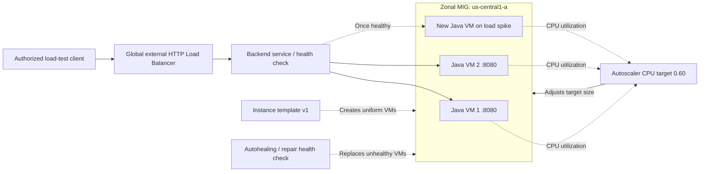
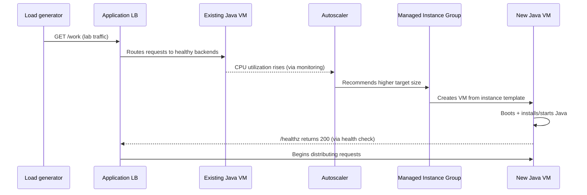
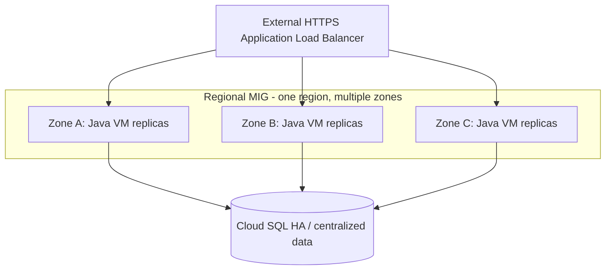
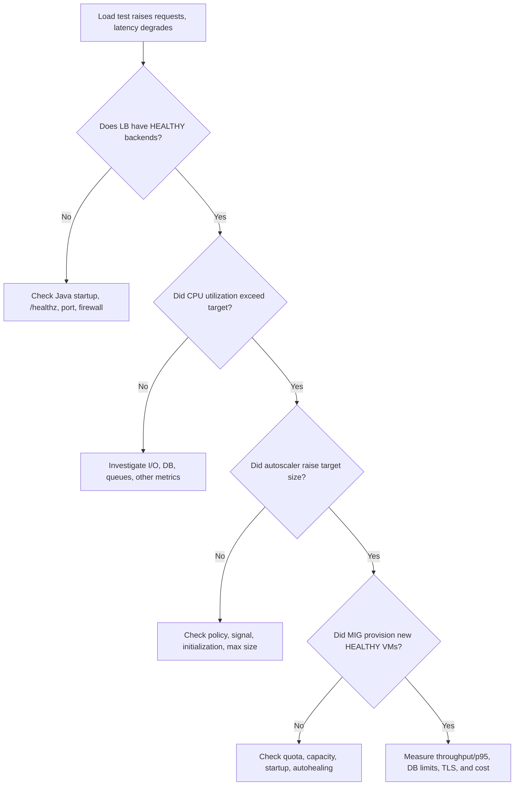

# Hands-on: scaling a Java application under load

## 1. Problem statement and lab objectives

A Java REST API processing orders on **Compute Engine** initially needs only two VMs. During a promotional campaign, traffic multiplies: CPU crosses thresholds, requests slow down, connection pools exhaust, and a machine may fail. If operators must manually spin up VMs or tear them down after peak hours, response times lag and disruptions occur. Conversely, leaving dozens of VMs running around the clock during low traffic inflates the bill unnecessarily.

A **Managed Instance Group (MIG)** paired with the **Compute Engine autoscaler** creates VMs from an **instance template**, maintains consistent configuration, and **automatically adjusts replica counts based on load signals** within defined bounds. Combined with an **Application Load Balancer** and **health checks**, the system admits healthy VMs into service, stops routing requests to failing VMs, automatically replaces broken machines, and scales capacity up and down.

In the **Instance Groups and Autoscaling** chapter of the **CLOUD_PROVIDERS_GCP** module, this lesson walks through an end-to-end lab: deploying a **small Java HTTP application** on Compute Engine, creating a MIG, attaching a load balancer, enabling CPU autoscaling, generating controlled load, inspecting metrics, and cleaning up resources. Afterward, it maps these hands-on principles to **production Spring Boot**, Cloud SQL, IAM/VPC, multi-zone availability, security, and cost.

**Learning objectives**

1. Distinguish instance templates, zonal/regional MIGs, health checks, autohealing, load balancing, and autoscalers.
2. Build a Java application with a health-check endpoint and a bounded CPU-load simulation endpoint, understanding why this test workload does not belong in production.
3. Create a **zonal MIG** with at least two VMs, health checks, a global external HTTP load balancer, and a CPU autoscaling policy.
4. Observe the **scale-out → stabilization → scale-in** cycle, distinguishing VM initialization period from stabilization period.
5. Compare CPU autoscaling, load balancing serving-capacity autoscaling, Monitoring/custom metrics, and scheduled scaling.
6. Design a production architecture covering rollout/rollback, stateless sessions, database connection limits, IAM/VPC controls, and budgets.

> **Scope and safety:** examples create VMs, a load balancer, a public IP, disks, and logging that **may incur charges**. Run only in an authorized lab project with appropriate permissions, quotas, and billing. Direct test load strictly at **endpoints you own in a test environment**; never use this lab to overload or test third-party services. This lesson provides illustrative commands only; it does not provision resources automatically.

## 2. Lab architecture

We use:

| Component | Illustrative configuration | Role |
| --- | --- | --- |
| VPC/subnet | `java-lab-vpc`, `java-lab-subnet`, `10.40.0.0/24` | Where VMs receive private IPs |
| Java HTTP app | Port `8080`, `/healthz` and `/work` | Serves responses and bounded CPU load |
| Instance template | `java-template-v1`, Debian 12, `e2-standard-2` | Immutable blueprint for creating VMs |
| Zonal MIG | `java-lab-mig` in `us-central1-a` | Manages identical VMs |
| Autohealing health check | `java-repair-hc` | Detects VMs needing repair/replacement when the app is unhealthy |
| Load balancer health check | `java-lb-hc` | Routes traffic only to healthy backends |
| Global external Application Load Balancer | HTTP port 80, backend service `java-backend` | Distributes requests to the MIG |
| Autoscaler | Min 2, max 6, target CPU 60% | Scales VM count up/down with load |
| Cloud Monitoring/Logging | VM CPU, MIG size, LB metrics, serial/startup logs | Evaluates scaling and troubleshoots errors |

These values are **test examples**, not default production sizing recommendations. In particular, a **zonal MIG lives in a single zone** and cannot keep serving if that entire zone goes down; Section 12 covers regional MIGs.



**Distinguish responsibilities:** the load balancer **routes requests**, health checks **evaluate whether a VM can serve**, autohealing **replaces broken VMs**, and the autoscaler **changes VM count for capacity demand**. They cooperate, yet they are not one single mechanism.

## 3. Prerequisites before running commands

### 3.1. Instance template: the blueprint for replication

An instance template defines machine type, image or boot disk, network interfaces, metadata/startup script, service account, tags, labels, and VM options. **Templates are immutable resources**: to change the startup script or image, **create a new template version**, rather than trying to edit the old template and expecting the MIG to update automatically.

VMs created by a MIG from the same template **do not share RAM, Java processes, or local disks**. If a VM is replaced, local files and in-memory sessions on that VM vanish. Therefore, horizontally scalable Java apps should be **stateless or store state externally**, such as in Cloud SQL, Memorystore, Cloud Storage, or Pub/Sub depending on requirements.

### 3.2. Unmanaged Instance Group vs. Managed Instance Group

| Type | Key characteristic | Autoscaling/autohealing |
| --- | --- | --- |
| **Unmanaged Instance Group** | You create and maintain the VM list manually; machines can differ in config | Lacks MIG's full automated management features |
| **Zonal MIG** | Uniform templated VMs in **one zone** | Supports autoscaling, autohealing, rolling updates |
| **Regional MIG** | VMs distributed across multiple zones in **one region** | Adds distribution policies, improving zone-failure tolerance when configured properly |

Do not confuse a regional MIG with a multi-region cluster; a regional MIG **does not span two geographical regions**. Surviving a full-region outage requires a multi-region architecture and matching data strategy.

### 3.3. Autoscaling is not autohealing

Suppose a group needs four VMs for load, and one VM hangs:

- **Autohealing** uses a health check to detect the broken VM and **recreates** it back to the desired state.
- The **autoscaler** computes how many VMs are needed from CPU, load balancing capacity, Monitoring metrics, or schedules; a hung VM **does not mean** CPU demand increased.
- The **load balancer health check** temporarily stops sending requests to the unhealthy backend, even before autohealing finishes replacing it.

Lumping all three into "autoscaling" makes it hard to tell whether a VM was replaced due to a startup crash or added because traffic grew.

### 3.4. Supported autoscaler signals

| Signal | When to use? | Limitations / warnings |
| --- | --- | --- |
| **Average CPU utilization** | CPU-bound Java processing or CPU correlates with request volume | I/O-bound apps can overload while CPU stays low |
| **Load balancing serving capacity** | Backends behind an Application Load Balancer scaling against declared capacity | Requires valid backend capacity and balancing mode config |
| **Cloud Monitoring metrics** | Metrics representing work such as queue depth or request backlog | Requires matching metric semantics, target setup, and resource limits |
| **Schedule-based scaling** | Known predictable peak hours | Schedules supplement signals; they do not replace real-time load reaction |
| **Predictive autoscaling** | Recurring CPU patterns predictable from history | Does not solve sudden anomalies or overly slow cold starts |

With **multiple autoscaling signals**, the autoscaler generally chooses the VM count required by the signal demanding **the most VMs**, within min/max bounds and active policies. It never blindly sums the results of individual signals.

## 4. Designing the Java application for the lab

To keep the lab repeatable without setting up a Maven repository or external JAR, the example uses **Java 17 JDK HttpServer**. This is a **plain Java** HTTP app, not Spring Boot; Section 11 explains how to translate these principles to Spring Boot. CPU load is generated by a bounded computation loop—**not an exploit** or flooding tool.

| Endpoint | Response | Purpose |
| --- | --- | --- |
| `GET /healthz` | HTTP 200 when the Java server is ready | LB and MIG health check |
| `GET /` | HTTP 200 with hostname | Verifies load balancer distribution across VMs |
| `GET /work` | Bounded computation returning hostname/result | Generates controlled CPU load during testing |

### 4.1. Complete startup script

On your **lab admin workstation**, create `startup-java.sh` with the following contents. The Compute Engine guest agent executes this script at VM boot. Because the script installs the JDK via `apt`, VMs must have an **outbound path to package repositories** via an external IP or Cloud NAT/proxy; otherwise startup fails. In production, use a **golden image** or pre-built artifact instead of downloading packages on every scale-out.

```bash
#!/usr/bin/env bash
set -euo pipefail

export DEBIAN_FRONTEND=noninteractive
apt-get update
apt-get install -y openjdk-17-jdk-headless

install -d -m 0755 /opt/java-load-lab

cat > /opt/java-load-lab/LoadApp.java <<'JAVA'
import com.sun.net.httpserver.HttpExchange;
import com.sun.net.httpserver.HttpServer;
import java.io.IOException;
import java.io.OutputStream;
import java.net.InetSocketAddress;
import java.nio.charset.StandardCharsets;
import java.nio.file.Files;
import java.nio.file.Path;
import java.util.concurrent.Executors;

public final class LoadApp {
    private static final String HOST = readHostName();

    private static String readHostName() {
        try {
            return Files.readString(Path.of("/etc/hostname")).trim();
        } catch (IOException e) {
            return "unknown-vm";
        }
    }

    private static void respond(HttpExchange exchange, String content)
            throws IOException {
        byte[] bytes = (content + "\n").getBytes(StandardCharsets.UTF_8);
        exchange.getResponseHeaders().set(
            "Content-Type", "text/plain; charset=utf-8");
        exchange.sendResponseHeaders(200, bytes.length);
        try (OutputStream stream = exchange.getResponseBody()) {
            stream.write(bytes);
        }
    }

    public static void main(String[] args) throws IOException {
        HttpServer server = HttpServer.create(
            new InetSocketAddress("0.0.0.0", 8080), 128);
        server.createContext("/healthz", exchange ->
            respond(exchange, "ok"));
        server.createContext("/work", exchange -> {
            // Bounded workload to illustrate a CPU-bound request.
            double total = 0;
            for (int i = 1; i <= 8_000_000; i++) {
                total += Math.sqrt(i);
            }
            respond(exchange, "host=" + HOST + " sum=" + total);
        });
        server.createContext("/", exchange ->
            respond(exchange, "host=" + HOST + " status=ready"));
        server.setExecutor(Executors.newFixedThreadPool(8));
        server.start();
    }
}
JAVA

javac --add-modules jdk.httpserver /opt/java-load-lab/LoadApp.java

cat > /etc/systemd/system/java-load-lab.service <<'UNIT'
[Unit]
Description=Java HTTP load lab
After=network-online.target
Wants=network-online.target

[Service]
Type=simple
WorkingDirectory=/opt/java-load-lab
ExecStart=/usr/bin/java --add-modules jdk.httpserver -cp /opt/java-load-lab LoadApp
Restart=always
RestartSec=3
User=nobody
NoNewPrivileges=true

[Install]
WantedBy=multi-user.target
UNIT

systemctl daemon-reload
systemctl enable --now java-load-lab.service
```

**Why use `systemd`?** If the Java process crashes after startup, systemd restarts it inside the VM; if the VM/app remains unhealthy, **MIG autohealing** provides the outer repair layer. The `/healthz` endpoint only checks whether the web server responds, not Cloud SQL or business logic; in production, design readiness carefully so transient dependency blips do not wipe out the whole group.

**Intentional lab limitations:** HTTP without TLS, no authentication, and CPU-burning `/work`. Expose it only through your test load balancer, send zero sensitive data, and never leave this configuration serving production Internet traffic. If `apt` fails to install the JDK due to missing egress or quota, fix networking/package sources or use a pre-built Java image—never raise VM counts to mask startup errors.

## 5. Preparing project, network, firewall, and permissions

### 5.1. Prerequisites before deploying

You need a **Google Cloud project** with active billing, quota for at least **2–6 `e2-standard-2` VMs** in the test zone, and permissions to create VMs, firewall rules, templates, MIGs, autoscalers, health checks, and load balancers. Enable the **Compute Engine API**. Permissions can be separated across network admins, load balancer admins, and app deployers; project Owner is not required.

The commands below run in Bash or Cloud Shell. Update `PROJECT_ID`, region/zone, and CIDRs if your environment already has networking. This example intentionally creates **a new lab VPC** to avoid impacting existing networks.

```bash
gcloud config set project PROJECT_ID
gcloud services enable compute.googleapis.com

gcloud compute networks create java-lab-vpc \
  --subnet-mode=custom

gcloud compute networks subnets create java-lab-subnet \
  --network=java-lab-vpc \
  --region=us-central1 \
  --range=10.40.0.0/24
```

These IPs/ranges are illustrative. If your project already has a VPC, **check for CIDR overlaps, firewalls, routes, and Shared VPC rules** first rather than creating a new network just to practice.

### 5.2. Allow only load balancing/health check sources to backends

For a **global external Application Load Balancer** with instance group backends, Google Cloud documentation specifies GFE/health-check IPv4 source ranges including `35.191.0.0/16` and `130.211.0.0/22` for eligible setups. The lab allows **TCP port 8080** to VMs with network tag `java-mig-backend` from those ranges:

```bash
gcloud compute firewall-rules create java-lab-allow-lb \
  --network=java-lab-vpc \
  --direction=INGRESS \
  --action=ALLOW \
  --rules=tcp:8080 \
  --source-ranges=35.191.0.0/16,130.211.0.0/22 \
  --target-tags=java-mig-backend
```

**Never open `0.0.0.0/0` to port 8080**. The load balancer receives public traffic at its frontend and proxies requests to VMs; backend connection sources are not arbitrary end-user public IPs. Check the IP range matrix for your exact **LB type** when switching to regional or other LB modes; these two ranges are not universal for every setup.

In this lab, the template creates VMs with **temporary external IPv4 addresses** to install the JDK over the Internet. In production, prefer **no external IP on VMs** and provide outbound egress via Cloud NAT or an approved proxy, alongside tailored firewall rules. Where external IPs exist, never open arbitrary public SSH rules; use OS Login/IAP or controlled admin workflows.

## 6. Creating the instance template and Managed Instance Group

### 6.1. Create the template

The `startup-java.sh` file from Section 4 must exist in the **working directory where you run the command**.

```bash
gcloud compute instance-templates create java-template-v1 \
  --machine-type=e2-standard-2 \
  --image-family=debian-12 \
  --image-project=debian-cloud \
  --network=java-lab-vpc \
  --subnet=java-lab-subnet \
  --tags=java-mig-backend \
  --metadata-from-file=startup-script=./startup-java.sh

gcloud compute instance-templates describe java-template-v1
```

A template declares VM configuration; **it neither creates VMs nor runs Java yet**. If using a custom VM service account, specify it in the template with least-privilege IAM. Never put database passwords or API keys into startup scripts or metadata, as unauthorized users or processes might read them.

### 6.2. Create a zonal MIG with two VMs

```bash
gcloud compute instance-groups managed create java-lab-mig \
  --template=java-template-v1 \
  --base-instance-name=java-lab \
  --size=2 \
  --zone=us-central1-a

gcloud compute instance-groups managed list-instances java-lab-mig \
  --zone=us-central1-a
```

VMs are provisioned from the template and run the guest startup script to install Java. Give VMs time to boot, install the JDK, and begin answering health checks. If a VM stays unhealthy, inspect **startup/serial logs**, systemd status, and firewall rules rather than adding more VMs.

### 6.3. Configure the named port

Application Load Balancer backend services use named ports to locate the serving port on instance groups. Map `http` to port `8080`:

```bash
gcloud compute instance-groups managed set-named-ports java-lab-mig \
  --named-ports=http:8080 \
  --zone=us-central1-a

gcloud compute instance-groups managed describe java-lab-mig \
  --zone=us-central1-a
```

Named ports **do not open firewalls** or start servers; they are strictly metadata aligning the load balancer/backend service with the VM group's port.

## 7. Health checks, autohealing, and load balancing

### 7.1. Using two health checks for two purposes

Google Cloud recommends making the **autohealing health check less aggressive than the load balancing health check**. The load balancer needs to pull failing instances out of rotation quickly; autohealing should not recreate VMs over brief glitches, avoiding mass replacement loops.

```bash
gcloud compute health-checks create http java-lb-hc \
  --port=8080 \
  --request-path=/healthz \
  --check-interval=10s \
  --timeout=5s \
  --unhealthy-threshold=2

gcloud compute health-checks create http java-repair-hc \
  --port=8080 \
  --request-path=/healthz \
  --check-interval=30s \
  --timeout=10s \
  --unhealthy-threshold=3

gcloud compute instance-groups managed set-autohealing java-lab-mig \
  --health-check=java-repair-hc \
  --initial-delay=300 \
  --zone=us-central1-a
```

**`--initial-delay=300` on autohealing** sets the grace period after VM creation so the app has time to boot before failed probes count against it. This **differs** from the autoscaler's `--cool-down-period` (the initialization period used when calculating scale-out). Base both values on measured **VM boot → Java ready** times, rather than copying example numbers into production.

### 7.2. Create a global external HTTP load balancer

This lab uses **HTTP** to keep the focus on autoscaling, which is **unsuitable for public production systems**. In production, configure **HTTPS**, TLS certificates via Certificate Manager, TLS policies, and Cloud Armor as appropriate.

```bash
gcloud compute backend-services create java-backend \
  --global \
  --load-balancing-scheme=EXTERNAL_MANAGED \
  --protocol=HTTP \
  --port-name=http \
  --health-checks=java-lb-hc

gcloud compute backend-services add-backend java-backend \
  --global \
  --instance-group=java-lab-mig \
  --instance-group-zone=us-central1-a \
  --balancing-mode=UTILIZATION \
  --max-utilization=0.8

gcloud compute url-maps create java-url-map \
  --default-service=java-backend

gcloud compute target-http-proxies create java-http-proxy \
  --url-map=java-url-map

gcloud compute addresses create java-lb-ip \
  --global \
  --ip-version=IPV4

gcloud compute forwarding-rules create java-http-rule \
  --global \
  --load-balancing-scheme=EXTERNAL_MANAGED \
  --network-tier=PREMIUM \
  --address=java-lb-ip \
  --target-http-proxy=java-http-proxy \
  --ports=80
```

Once applied, inspect:

```bash
gcloud compute backend-services get-health java-backend --global
gcloud compute addresses describe java-lb-ip --global \
  --format="get(address)"

# Replace LB_IP with the IP returned above:
curl -i http://LB_IP/healthz
curl -i http://LB_IP/
```

Expected outcome: the LB backend lists VMs as `HEALTHY`, and `/healthz` returns `200 OK`. If you see 502/503, do not ramp up load yet: verify startup scripts, app port, named port, VPC firewall, health checks, backend attachment, and readiness.

**Single-zone lab limitation:** the LB balances across VMs within the zone, yet it cannot keep the service alive if **the entire zone** loses connectivity.

## 8. Enabling the CPU autoscaler and understanding its parameters

### 8.1. Configuring a 60% CPU target policy

Google Cloud measures VM CPU utilization using the hypervisor metric `compute.googleapis.com/instance/cpu/utilization`. The autoscaler evaluates **average CPU utilization across all vCPUs in the group**, not the percentage shown for one Java process in `top`.

```bash
gcloud compute instance-groups managed set-autoscaling java-lab-mig \
  --zone=us-central1-a \
  --min-num-replicas=2 \
  --max-num-replicas=6 \
  --target-cpu-utilization=0.60 \
  --cool-down-period=300 \
  --stabilization-period=600

gcloud compute instance-groups managed describe java-lab-mig \
  --zone=us-central1-a
```

Parameters:

| Parameter | Meaning | In this lab |
| --- | --- | --- |
| `min-num-replicas` | Minimum VMs the MIG maintains while autoscaling is active | 2 |
| `max-num-replicas` | Maximum VMs the autoscaler may provision | 6 |
| `target-cpu-utilization` | Average CPU utilization target | 0.60 = 60% |
| `cool-down-period` | Historical flag name for **initialization period**: time the app needs to initialize so the autoscaler excludes startup CPU from **scale-out** calculations | 300 seconds |
| `stabilization-period` | Capacity retention window for **scale-in** to avoid removing VMs too quickly as traffic drops; default is typically 600 seconds | 600 seconds |

**Do not misunderstand `cool-down-period` as "the autoscaler must wait 300 seconds between every scaling action."** Google Cloud uses it to handle metrics from booting VMs properly, not to freeze all scale-out decisions. During scale-in calculations, data from VMs still inside their initialization period may still be considered. `stabilization-period` primarily governs **scale-in**, and does not block fast scale-out when load climbs.

### 8.2. Estimating VM count

Given `N` running VMs at average CPU `U` and target `T`, an intuitive approximation is:

```text
Desired VMs ≈ ceil(N × U / T)
Clamped within [minReplicas, maxReplicas].

Example: N=2, U=90%=0.90, T=60%=0.60
ceil(2 × 0.90 / 0.60) = 3 VMs.
```

This is a **mental model**, not Compute Engine autoscaler's exact internal formula: the real controller applies metric windows/smoothing, initialization, stabilization, min/max bounds, and other signals. If `/work` keeps CPU high across 3 VMs, the autoscaler can continue scaling up to the cap of 6.

### 8.3. Why CPU target isn't enough for every Java app

- **CPU-bound Java requests** (encryption, compression, heavy JSON parsing, math): CPU is often a useful signal.
- **I/O-bound requests** (waiting on Cloud SQL, downstream HTTP, Pub/Sub): CPU may sit at 20% while requests time out. Add queue-length/request signals or address DB limits.
- **Brief bursts:** spikes lasting a few seconds can finish before a new VM boots, leaving latency elevated. Maintain min capacity headroom for your SLO.
- **Slow JVM startup:** downloading Maven/JDK/container images at boot lengthens initialization; consider baked images, warm-up, Java CDS, or startup optimization.
- **GC and contention:** high CPU does not always mean "add VMs"; you may need heap/GC tuning or lock/contention fixes.

## 9. Generating controlled load and observing scale-out/scale-in

### 9.1. Record baseline before testing

Track these values:

| Metric | Before load | During load | After load stops |
| --- | --- | --- | --- |
| MIG target/actual size | 2 | Likely increases | Returns toward min after stabilization |
| Average CPU utilization | Low when idle | High while `/work` runs continuously | Drops gradually |
| Healthy VMs in backend | 2 | New VMs receive traffic only once healthy | No unexpected unhealthy VMs |
| LB request rate and latency | Baseline | Scales with requests | Returns to baseline |
| Java errors / VM boot logs | Clean | Clean startups during scale-out | Graceful shutdown on scale-in |
| Estimated cost | 2 VMs + LB | Higher with extra VMs | Drops as VMs scale in; never 0 due to min 2 |

Monitor via Google Cloud Console (**Compute Engine → Instance groups → java-lab-mig → Autoscaling/Monitoring**), **Cloud Monitoring → Metrics Explorer**, and backend service health. Or use the CLI:

```bash
gcloud compute instance-groups managed list-instances java-lab-mig \
  --zone=us-central1-a

gcloud compute instance-groups managed describe java-lab-mig \
  --zone=us-central1-a

gcloud compute backend-services get-health java-backend --global
```

**Note:** `list-instances` shows current VMs, not how many VMs the autoscaler currently wants; inspect target size, pending operations, and autoscaler status separately.

### 9.2. Send test requests to your controlled endpoint

From an **authorized load-testing machine** (such as a separate VM in your test project) with `apache2-utils` (`ab`) or an approved load-testing tool, run for at most **120 seconds** at **concurrency 20**—only after confirming `LB_IP` belongs to **your lab**:

```bash
# Run only from a test machine against an endpoint you own.
# Install apache2-utils via your package manager if ab is missing.
ab -t 120 -c 20 http://LB_IP/work
```

This generates **bounded traffic**, not a guarantee the autoscaler jumps from 2 to 6 VMs in exactly 120 seconds. Results depend on each VM's CPU speed, JIT execution cost of `Math.sqrt`, latency, request rate, load generator throughput, and metric sampling. If VMs do not scale out, first check whether **average CPU actually crossed the target** and backends received traffic—never crank up unbounded client concurrency.

To observe steady trends, run bounded test windows with cool-down breaks in between within your approved budget and quota. **Never leave continuous load running outside the test window.**

### 9.3. The scale-out timeline

When average CPU exceeds the target across the observation window, the autoscaler instructs the MIG to provision more VMs. Real sequence:



While a new VM is booting and `/healthz` has not yet returned 200, the LB withholds traffic; seeing a higher VM count in the Console **does not mean application capacity is ready**. Track **time-to-ready** from instance creation until the backend reports healthy.

### 9.4. After load stops: why doesn't scale-in happen immediately?

Once `ab` stops, CPU drops and the autoscaler calculates lower required capacity. However, the **stabilization period** intentionally retains enough capacity for peak demand observed during its window, preventing rapid create/delete **flapping**. MIG resize/delete operations, health checks, and metric pipelines also introduce lag.

**Never set stabilization to 0 just to watch fast scale-in** without understanding SLO impact. In production, scale-in must coordinate **connection draining**, shutdown grace periods, in-flight requests, and queue consumers; abrupt VM termination causes errors and duplicate processing.

### 9.5. Interpret results instead of merely counting VMs

After the test, answer:

1. From what level to what level did CPU rise? When did the autoscaler change target size?
2. How long did each new VM take to reach backend `HEALTHY` status?
3. As VMs were added, did p95 latency and throughput improve?
4. Did HTTP 502/503s, connection refused errors, or startup failures appear?
5. After load dropped, how did VM counts behave across the stabilization window?
6. Did total VMs hit `max-num-replicas=6`? If so, that is a **capacity cap**, not an autoscaler failure.
7. If CPU stayed low while user latency climbed, was the bottleneck in a DB, connection pool, or downstream service?

## 10. Scaling by load balancing capacity and other signals

### 10.1. Autoscaling by load balancing serving capacity

For a MIG behind an external Application Load Balancer, the autoscaler can use **load balancing utilization**. For this signal to be meaningful, the backend service must declare **capacity** using an appropriate balancing mode, such as `UTILIZATION` or `RATE`, rather than raw unscaled request counts.

Example **replacing** the CPU-only policy with a 70% LB serving capacity target (running this replaces rather than additively merging with CPU unless multiple signals are explicitly configured together):

```bash
gcloud compute instance-groups managed set-autoscaling java-lab-mig \
  --zone=us-central1-a \
  --min-num-replicas=2 \
  --max-num-replicas=6 \
  --target-load-balancing-utilization=0.70 \
  --cool-down-period=300 \
  --stabilization-period=600
```

**Distinguish the two percentages:** `--max-utilization=0.8` on the **backend service** defines traffic-distribution capacity; `--target-load-balancing-utilization=0.70` on the **autoscaler** sets the utilization target against that capacity. Never mistake them for 80%/70% CPU targets.

To combine **CPU + LB utilization**, declare both signals together per autoscaler CLI/API/config syntax and verify how recommendations combine. When multiple backend services share one MIG, capacity and LB signals also depend on attachment structure and product limits.

### 10.2. Custom Monitoring metrics

For Java APIs spending most of their time waiting on databases, **CPU misses queue depth**. You can emit a queue backlog or processing-demand metric via Cloud Monitoring or an exporter and configure **Monitoring metric** autoscaling. However:

- Choose a metric with clear units (requests, messages, seconds, utilization) and appropriate update frequency.
- Ensure the metric is **valid as an autoscaler signal** tied properly to the instance group; not every dashboard metric works for autoscaling.
- Define target values and behavior when metrics are missing or delayed so collector hiccups never wipe out VMs.
- Size min/max around DB capacity, API quotas, and budget.

Business example: a backlog of 5,000 pending orders may call for more workers, yet if Cloud SQL permits only 100 connections, scaling workers without bounds only multiplies connection errors.

### 10.3. Scheduled and predictive autoscaling

**Schedule-based scaling** raises minimum VMs ahead of scheduled promotions or daily peaks. **Predictive CPU autoscaling** learns recurring load patterns to provision VMs before requests hit, factoring in history and initialization period.

Both complement reactive autoscaling: schedules cover known events; CPU/LB metrics react to live demand; predictive mode needs clean historical data. Regardless of mode, check **budgets, max capacity, quotas, and app startup latency**.

## 11. From plain Java lab to production Spring Boot

### 11.1. Readiness and liveness serve distinct roles

In production, Spring Boot apps should use **Spring Boot Actuator** to expose proper health endpoints. Example configuration:

```yaml
server:
  port: 8080
  shutdown: graceful

spring:
  lifecycle:
    timeout-per-shutdown-phase: 30s

management:
  endpoint:
    health:
      probes:
        enabled: true
  endpoints:
    web:
      exposure:
        include: health,info
```

With a compatible Spring Boot configuration/version, `/actuator/health/readiness` indicates whether the app **can accept incoming requests**, while `/actuator/health/liveness` detects whether the process is unrecoverably broken. Verify actual URL paths, actuator dependencies, profiles, security filters, and health endpoint policies.

**Never turn health checks into heavy database queries running every few seconds.** If a downstream service fails briefly, consider what happens if the load balancer pulls VMs or autohealing recreates the entire fleet at once. Separate **LB** and **MIG autohealing** health checks in sensitivity and criteria.

### 11.2. Stateless APIs and session management

To scale horizontally cleanly:

- Never store shopping carts or one-time tokens exclusively in **one VM's RAM** without shared replication/recovery.
- Persist business records in **Cloud SQL/Firestore** or appropriate data stores; store file uploads in **Cloud Storage** instead of VM boot disks.
- For sessions, use secure signed tokens/cookies or a shared session store such as Cloud Memorystore where suitable.
- For message consumers, enforce **idempotency** and safe retries since scale-in or autohealing can replace VMs mid-flight.
- Separate long-running background jobs from HTTP API tiers if HTTP scaling signals do not reflect background work.

A client may send two consecutive requests that hit two different VMs. That must **neither lose state nor create duplicate transactions**.

### 11.3. Cloud SQL connection limits when scaling

Suppose each Spring Boot replica sets **HikariCP `maximumPoolSize = 10`**, and maximum replicas = 6:

```text
Approximate max pool DB connections
  = 6 VMs × 10 connections/VM
  = 60 connections
```

Real systems also open connections for migrations, admin tools, batch jobs, additional pools, and overhead. If the DB has a lower cap or is already under strain, scaling out the MIG can **choke the database**. Measure connection usage, eliminate N+1 queries, add controlled caching, tune pools, and cap autoscaling max against end-to-end capacity.

### 11.4. Fast startup and safe rollouts

Running `apt install` inside a startup script is strictly for labs. In production:

1. Build the application in CI and scan artifacts/dependencies for vulnerabilities.
2. Bake the Java runtime, JAR, Ops Agent, and static config into a **golden image**.
3. Have the instance template reference a pinned image/version, leaving startup scripts minimal; never download Maven dependencies at boot.
4. Report **readiness** only once the app is genuinely ready for traffic, not merely when VM status becomes `RUNNING`.
5. Use **MIG rolling updates** or canaries with the new instance template and bounded `max-surge`/`max-unavailable`.
6. Monitor error rates, readiness, latency, and Cloud SQL, ready to roll back to the previous template.

Example rollout command skeleton after creating `java-template-v2`:

```bash
gcloud compute instance-groups managed rolling-action start-update java-lab-mig \
  --version=template=java-template-v2 \
  --max-surge=1 \
  --max-unavailable=0 \
  --zone=us-central1-a
```

This is an **update command skeleton**—it does not create `java-template-v2` and does not imply every MIG config supports identical rolling options. If the group is at quota or lacks capacity, `max-surge=1` can stall; ensure headroom for temporary surge replicas.

## 12. Zonal MIG, regional MIG, and fault tolerance

### 12.1. Zonal lab vs. multi-zone production

A zonal MIG places all VMs in `us-central1-a`. If that zone goes down, the load balancer runs out of healthy backends regardless of how hard the autoscaler tries to add VMs. A **regional MIG** distributes VMs across multiple zones in one region to reduce single-zone risk, provided you choose the right **target distribution shape**, quotas, and zone list.



**A regional MIG does not automatically survive a full region outage**. Cross-region disaster recovery requires global load balancing, replicated/backed-up data, IAM/secrets, DNS, and tested recovery runbooks.

### 12.2. Min instances must account for N-1 scenarios

Suppose production needs at least 4 VMs for normal traffic; if **one zone fails** or VMs undergo rolling updates simultaneously, remaining capacity must still suffice. Choosing `min=2` just because the lab used 2 VMs is not a universal production baseline.

Size `minReplicas`, `maxReplicas`, CPU/LB targets, quotas, spare capacity, boot duration, DB limits, and SLOs together. If an app needs 5 minutes to boot and traffic jumps 5× instantaneously, the autoscaler cannot materialize capacity immediately—**headroom, caching, queuing, or predictive scaling** may be required.

## 13. Permissions, VPC, TLS, and cost control

### 13.1. IAM and networking

- Grant CI/CD pipelines **least-privilege** permissions to manage templates/MIGs/autoscalers, never Project Owner by default.
- Give VMs a **dedicated runtime service account** with minimum permissions for Cloud Storage, Secret Manager, and Pub/Sub; avoid project-wide admin service accounts.
- Never place database passwords or tokens in metadata or Git; use Secret Manager or proper secret management.
- Restrict backend port `8080` ingress strictly to **supported load balancer and health check ranges**. Where external IPs exist, block direct bypass paths to the app.
- In production, use HTTPS frontends with Certificate Manager, Cloud Armor for WAF/rate limiting if needed, OS Login/IAP, controlled egress/NAT, and regular OS patching.
- With Shared VPC, the host project owns networks/subnets/firewalls while service projects manage VMs and backends.

### 13.2. Costs grow with VM count and runtime

For MIGs, Compute Engine typically bills by **vCPU/RAM, VM uptime, boot disks, external IPs, network egress**, and related resources per pricing schedules. Autoscaling does not make VMs free; **`minReplicas=2`** keeps at least two VMs running continuously, and scale-outs add compute and disk charges. Load balancing, health-check/logging volume, Cloud NAT, and backing services carry separate charges.

**Purely hypothetical illustration**, not official Google Cloud pricing:

```text
Assume each VM (CPU+RAM) = $0.12/hour.
2 VMs running 24 hours:       2 × 24 × 0.12 = $5.76.
4 extra VMs for 3 hours:      4 × 3  × 0.12 = $1.44.
Illustrative compute total:   $7.20, excluding disks/LB/IPs/network/logs.
```

For real estimates, use **exact regional machine-type prices and applicable discounts** from [Compute Engine pricing](https://cloud.google.com/compute/all-pricing) and [Cloud Load Balancing pricing](https://cloud.google.com/load-balancing/pricing). Configure **Billing Budgets/alerts** for visibility, noting that **alert-only budgets do not automatically stop charges when exceeded**.

### 13.3. Guardrails against runaway autoscaling

1. Cap `max-num-replicas` around quotas, DB capacity, and budget.
2. Alert whenever the autoscaler repeatedly hits max size or CPU remains high after scale-out.
3. Apply rate limiting and Cloud Armor on external traffic where supported so bots do not trigger unbounded scale-outs.
4. Track VM counts, LB requests, DB connections, disk usage, egress, and Cloud Logging ingestion.
5. Schedule lab cleanup and avoid leaving unused global forwarding rules, static IPs, or disks behind.

## 14. Symptom-based diagnostics

| Symptom | Possible causes | Checks |
| --- | --- | --- |
| MIG creates VMs, yet `/healthz` fails | Startup script error, `apt` lacked egress, Java service failed | Serial/startup logs, systemd, `curl localhost:8080/healthz` |
| VMs recreate continuously | Autohealing too sensitive or Java failed to boot in time | Health check config, initial delay, app startup duration |
| LB returns 502/503 | Unhealthy backends, firewall, named port/port mismatch | `backend-services get-health`, `java-lb-hc`, firewall rules |
| High CPU, yet MIG doesn't scale | Autoscaler missing/no metrics, hit max/quota, still initializing | Autoscaler describe, min/max, operations, CPU metric |
| MIG raises target size, yet fewer VMs appear | Exhausted quota/capacity or VM startup errors | MIG operations/errors, quotas, zonal capacity |
| New VMs take too long to serve traffic | Downloading JDK/JAR, JVM warm-up, health check lag | Time-to-ready, startup logs, probe intervals |
| Low CPU, yet slow responses | DB/downstream HTTP bottleneck, locks/queues | HikariCP stats, p95 latency, HTTP metrics, thread dumps |
| Many HTTP 429s during load test | External rate limiter/WAF | Cloud Armor/LB logs, origin of app 429s |
| Scale-in drops active requests | Insufficient connection draining/graceful shutdown | Backend connection draining, SIGTERM handling, in-flight requests |
| No immediate scale-in after load test | Stabilization period, metrics, or scale-in controls | Autoscaler config and CPU timeline |
| Java VM external IP hit directly | Overly broad firewall or bypass path around LB | External IPs, firewall rules, access logs |
| Bill doesn't drop to 0 after stopping load | Min-size VMs, LB/IP/disks/logging remain active | Billing SKUs, uncleaned resources |

**Suggested debugging workflow**:



In Cloud Logging, separate **frontend HTTP responses**, **systemd/startup failures**, and **Spring Boot application errors**. A growing VM count alone does not mean SLOs are met; measure **latency, error rate, throughput, and cost per request**.

## 15. Cleaning up lab resources to avoid ongoing charges

Before deleting anything, verify this is your **test project** and every resource below belongs strictly to this lab; **never copy these commands into production**. Stop the load generator first, then clean up frontend, backend, autoscaler/MIG, templates, health checks, and networking in dependency order.

```bash
# 1. Delete lab frontend components.
gcloud compute forwarding-rules delete java-http-rule --global
gcloud compute target-http-proxies delete java-http-proxy
gcloud compute url-maps delete java-url-map
gcloud compute addresses delete java-lb-ip --global

# 2. Delete backend service (after no URL map references it).
gcloud compute backend-services delete java-backend --global

# 3. Delete the MIG. Run only on the lab MIG when ready to delete all managed VMs.
gcloud compute instance-groups managed delete java-lab-mig \
  --zone=us-central1-a

# 4. Delete unreferenced template and health checks.
gcloud compute instance-templates delete java-template-v1
gcloud compute health-checks delete java-lb-hc
gcloud compute health-checks delete java-repair-hc

# 5. Delete dedicated lab firewall, subnet, and VPC.
gcloud compute firewall-rules delete java-lab-allow-lb
gcloud compute networks subnets delete java-lab-subnet \
  --region=us-central1
gcloud compute networks delete java-lab-vpc
```

**Post-cleanup check:** ensure zero lab-created VMs/MIGs, forwarding rules/static IPs, backend services, stray disks, health checks, or network resources remain. If you tested a v2 template, a load-generator VM, Cloud NAT, snapshots, or extra resources, clean them up **explicitly**—never assume the sample list above covers everything in the project. Check Billing daily, as usage charges can post with a delay.

## 16. Extension exercises and checklist

### Exercise A — Comparing CPU and LB capacity policies

With two Java VMs running at 90% CPU and an autoscaler target of 60%, estimate the **approximate VM count** needed. Next, assume CPU is only 20% while LB latency spikes because Java waits on Cloud SQL: explain why the CPU policy does not scale as expected, which signals to monitor instead, and why adding VMs may fail to cure DB congestion.

### Exercise B — Intentionally marking one lab VM unhealthy

In an authorized test environment, stop the Java systemd service on **one VM** and observe: the LB health check drains the instance, while autohealing detects the failure after thresholds and replaces the VM per policy. Record the **timeline**, distinguishing systemd process restarts from MIG VM recreation. Never run this on a production MIG.

### Exercise C — Regional MIG and zonal headroom

Design a three-zone regional MIG in one region with min/max size, health checks, and rolling updates. If one zone goes down, do the remaining two zones hold enough CPU/VMs, Cloud SQL connections, quotas, and LB capacity? Propose headroom and load-shedding mechanisms aligned with your SLO.

### Exercise D — Stateful Spring Boot API

An API stores shopping carts in an in-memory static JVM map. When the MIG scales from 2 to 5 VMs, users keep losing their carts. Propose architectural changes to make it stateless, design external session/DB storage, handle versioning, and ensure idempotency on order creation. Explain why LB sticky sessions are not a durable solution when VMs are replaced.

### Exercise E — Cost and safety margins

Build an hourly table of off-peak and peak load across a day, autoscaler VM counts, and assumed VM hourly rates. Separate **VM-hours**, disks, LB, and egress. Compare running `min=2,max=6` against `min=6,max=6` across the same traffic curve.

### End-of-lesson checklist

- [ ] I can explain **instance templates, zonal/regional MIGs, autoscalers, autohealing, and load balancing**.
- [ ] I understand startup scripts, `/healthz`, named ports, LB health checks, and GFE firewall ranges.
- [ ] I can create a MIG and verify VM/backend health using the Console or `gcloud`.
- [ ] I properly configure `min/max`, CPU targets, **initialization period**, and **stabilization period**.
- [ ] I do not confuse autoscaler scale-out with autohealing VM recreation.
- [ ] I generate bounded load strictly against lab endpoints I own, recording CPU, latency, and target size.
- [ ] I know when to evaluate LB utilization, Monitoring metrics, and scheduled/predictive autoscaling.
- [ ] I understand Java statelessness/readiness, graceful shutdown, connection pooling, and Cloud SQL limits when scaling.
- [ ] I have plans for rolling updates, rollbacks, regional redundancy, quotas, and max-cost guardrails.
- [ ] I can delete test resources cleanly and verify billing after cleanup.

**Conclusion:** autoscaling Java on Compute Engine is far more than setting a CPU threshold. The architecture succeeds only when **VMs boot and become ready quickly, health checks never mistake brief hiccups for permanent failures, the load balancer steers traffic to healthy backends, the autoscaler tracks a true demand signal, and the Java app tolerates replicas spinning up or down at any moment**. Before going to production, validate SLOs, externalize state, lock down VPC/IAM, select the right regional topology, and cap cost growth.

## 17. Official Google Cloud references

- [Compute Engine — Managed instance groups](https://cloud.google.com/compute/docs/instance-groups)
- [Create a managed instance group](https://cloud.google.com/compute/docs/instance-groups/creating-groups-of-managed-instances)
- [Instance templates](https://cloud.google.com/compute/docs/instance-templates)
- [MIG autohealing and health checks](https://cloud.google.com/compute/docs/instance-groups/autohealing-instances-in-migs)
- [Autoscaling groups of instances — fundamentals](https://cloud.google.com/compute/docs/autoscaler)
- [Scaling based on CPU utilization](https://cloud.google.com/compute/docs/autoscaler/scaling-cpu)
- [Scaling based on load balancing serving capacity](https://cloud.google.com/compute/docs/autoscaler/scaling-load-balancing)
- [Scaling based on Cloud Monitoring metrics](https://cloud.google.com/compute/docs/autoscaler/scaling-cloud-monitoring-metrics)
- [Autoscaler stabilization period](https://cloud.google.com/compute/docs/autoscaler/understanding-autoscaler-decisions)
- [Global external Application Load Balancer with instance group backends](https://cloud.google.com/load-balancing/docs/https/setup-global-ext-https-compute)
- [Rolling updates to managed instance groups](https://cloud.google.com/compute/docs/instance-groups/rolling-out-updates-to-managed-instance-groups)
- [Compute Engine pricing](https://cloud.google.com/compute/all-pricing)
- [Cloud Load Balancing pricing](https://cloud.google.com/load-balancing/pricing)
