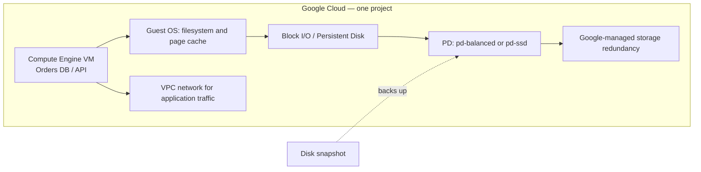
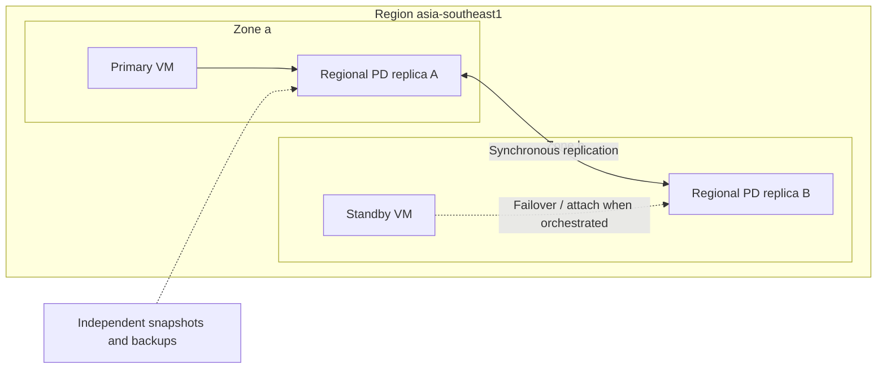
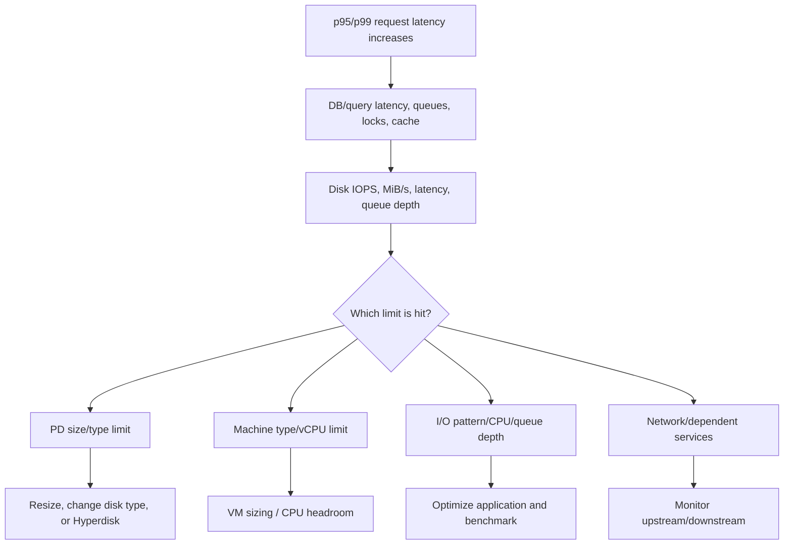

# Persistent Disk and Performance Options

An ordering application running on Compute Engine may handle several hundred requests per second smoothly, yet slow down noticeably as database data grows. CPU usage is only 40% and network bandwidth has headroom, while disk write latency rises and I/O wait tasks stay elevated. The issue may not lie in SQL queries: **Persistent Disk type, provisioned capacity, machine type, vCPU count, I/O size, and concurrency** all affect performance.

**Persistent Disk (PD)** is a durable block storage service connected to VMs through network infrastructure managed by Google Cloud. It can hold boot disks, application data, or databases running on Compute Engine. Disk data persists independently of the VM/process lifecycle according to the disk deletion policy; you can detach a disk and reattach it to another VM within supported scopes. However, PD **is not an automatic file share**, **does not equal a backup**, and increasing capacity **does not guarantee** that an application will reach the published maximum IOPS.

This lesson belongs to the **Block and File Storage** chapter of the `CLOUD_PROVIDERS_GCP` module. Decisions about PD relate to project structure, IAM, VPC, Compute Engine/GKE/Cloud Run selection, data protection, release automation, reliability, and cost. The focus is knowing how to **choose the right disk type, design appropriate capacity, and measure empirically before optimizing**.

## 1. Learning Objectives

After this lesson, you will be able to:

1. Explain the characteristics of `pd-standard`, `pd-balanced`, `pd-ssd`, and `pd-extreme`.
2. Distinguish between Persistent Disk, Hyperdisk, Local SSD, Cloud Storage, and file storage services such as Filestore.
3. Calculate IOPS and throughput limits by capacity and understand additional limits from machine series/vCPUs.
4. Analyze random/sequential I/O, read/write patterns, block size, queue depth, latency, and application requirements.
5. Create and attach disks to VMs, mount by stable device names, resize capacity, and migrate disk types via a new disk when needed.
6. Choose between zonal and regional Persistent Disks based on availability, backups, RPO/RTO, and cost.
7. Write a safe benchmark/monitoring process, troubleshoot poor performance, and evaluate upgrading to Hyperdisk.

## 2. Persistent Disk Is Block Storage, Not a VM's "Physical Hard Drive"

From the perspective of a Linux or Windows guest OS, PD appears as a block device that can be partitioned, formatted with ext4/XFS/NTFS, and mounted. However, the data **does not simply sit on the host's local hard drive**: Compute Engine manages a distributed storage layer and transfers I/O over infrastructure connected to the VM.



In this model, application network traffic and disk traffic are two distinct concepts, yet they can **compete for the VM's processing capacity/bandwidth** depending on the machine series. Therefore, increasing disk size alone without measuring CPU/network usage and per-VM limits may not improve performance.

### 2.1. Zonal Persistent Disk

A zonal PD belongs to a single **zone**; when used in normal read/write mode, the VM must reside in the same zone as the disk. The disk persists if the VM is stopped; when the VM is deleted, whether disk data is kept or deleted depends on the attachment's auto-delete configuration. A disk can be reattached to another VM in the same zone according to attachment and sharing rules.

Do not confuse "Google stores data redundantly across multiple devices" with "a zonal disk survives the loss of an entire zone." If the whole zone becomes unavailable, a VM in another zone cannot immediately use a zonal disk that resides only in the old zone.

### 2.2. Regional Persistent Disk

A regional PD replicates synchronously between **two zones within the same region**. With an appropriate architecture, you can fail over to a VM in the replica zone when one zone experiences an outage. However, disk replication protects only one layer: standby VMs, application services, database recovery, IP/DNS/load balancers, and other dependencies must still be designed.

Regional PD is typically suitable when **zone fault tolerance** is more critical than peak write throughput or lowest cost. It is not a backup against accidental deletion: if the application deletes valid data or ransomware overwrites files, those changes can also be replicated to the replica. Independent snapshots/backups are still required.

## 3. Four Types of Persistent Disk

| Disk type | Nature | Suitable workloads | Points to consider |
| --- | --- | --- | --- |
| **Standard PD** (`pd-standard`) | HDD-backed, cost-optimized capacity | Large data volumes, sequential access, workloads insensitive to random IOPS | Lower random I/O and higher latency than SSD; throughput scales with capacity. |
| **Balanced PD** (`pd-balanced`) | SSD-backed, balanced performance and price | Boot disks, web/API servers, moderate databases, most general-purpose workloads | IOPS/throughput scale with capacity and VM limits; not an application latency SLA. |
| **SSD (Performance) PD** (`pd-ssd`) | SSD-backed, higher IOPS per GiB | Databases with heavy random reads/writes, apps needing consistent I/O | Higher storage cost than balanced; may hit VM bottlenecks before disk limits. |
| **Extreme PD** (`pd-extreme`) | SSD-backed, **independently provisioned IOPS** from capacity | Very high-IOPS workloads on supported machine types | Zonal only, requires compatible machine types; more restrictions on sharing, images/backups, and tuning. |

The ordering above does not mean "choosing extreme is always fastest under all conditions." For an application writing sequentially at hundreds of MiB/s, throughput and queue depth may matter more than random IOPS. For a lightly loaded web server, `pd-balanced` may already have ample headroom, while extreme adds cost without making API responses faster.

### 3.1. Default Disk Type Differs Across Tools

When creating a disk via **Google Cloud Console**, the default value is typically `pd-balanced`; when using **gcloud CLI or REST**, the default may be `pd-standard`. Therefore, always specify `--type` explicitly in scripts/Terraform instead of relying on defaults. Switching from Console to automation can produce different performance even with the same VM name/capacity.

### 3.2. Capacity Limits and Supportability

The three zonal standard/balanced/SSD PD types generally start at **10 GiB** and can scale up to **64 TiB per disk**. Extreme PD typically ranges from **500 GiB** to 64 TiB. Regional `pd-standard` has a **200 GiB** minimum; regional balanced/SSD types typically start at 10 GiB. There are also limits on total disk count/total capacity per VM, and shared-core machines have lower limits.

Some modern machine series prefer or exclusively support Hyperdisk, so **not every VM can create every PD type**. Before designing, check the machine series, zone, and [Choose a disk type](https://cloud.google.com/compute/docs/disks) for the Compute Engine version in use.

## 4. Measuring Performance with IOPS, Throughput, Latency, and Queue Depth

| Metric | Explanation | Typically critical for |
| --- | --- | --- |
| **IOPS** | Number of block read/write operations per second | Random 4–16 KiB database I/O, many small queries |
| **Throughput** | Amount of data transferred through the disk per second, usually measured in MiB/s | Backups, large file scans, ETL, sequential reads/writes |
| **Latency** | Time from issuing an I/O request to completion; track average, p95/p99 | Synchronous transactions, commit logs, request latency |
| **Queue depth** | Number of concurrent pending/in-flight I/Os | Enough concurrency to utilize IOPS/bandwidth while avoiding excessive queue buildup |
| **Block size** | Size of each I/O operation | Random 4 KiB behaves completely differently from sequential 256 KiB |
| **Read/write ratio** | Proportion of read vs. write I/Os | Selecting disks, sizing headroom, designing representative benchmarks |

Approximate relationship:

\[
\mathrm{Throughput\ (MiB/s)}
\approx
\frac{\mathrm{IOPS}\times\mathrm{block\ size\ (KiB)}}{1024}
\]

For example, **10,000 IOPS × 4 KiB ≈ 39.1 MiB/s**, whereas **10,000 IOPS × 256 KiB ≈ 2,500 MiB/s** *provided no throughput or other resource limit is hit*. The latter condition is crucial: the disk/VM may cap at 1,200 MiB/s, making 2,500 purely a theoretical product.

A low-latency synchronous write stream can be bottlenecked by **per-I/O latency**, even when advertised aggregate IOPS is large. To increase measured IOPS, an application needs sufficient in-flight operations (*outstanding I/O*) without building a queue so deep that p99 latency degrades.

## 5. Capacity Planning Rules: Disk, VM, and Workload

A key characteristic of Persistent Disk: for `pd-standard`, `pd-balanced`, and `pd-ssd`, IOPS/throughput limits **scale with provisioned capacity**, up to the ceilings of the disk type and VM. For `pd-extreme`, IOPS are provisioned independently within service limits.

Planning model:

\[
\text{Actual performance}
\ \leq\
\min(\text{PD limit by capacity/type},\ \text{VM limit})
\]

This is an **upper bound**, not an SLA/guarantee of achieved performance. Busy CPUs, network contention, insufficient I/O concurrency, or storage throttling can still result in lower measured numbers.

### 5.1. Illustrative Formulas for Zonal Persistent Disk

Based on current limit tables, let `x` be the total GiB of disks of the **same type** attached to a VM, before applying machine-type caps:

| Zonal type | IOPS by x, before VM cap | Throughput MiB/s by x, before VM cap |
| --- | --- | --- |
| `pd-standard` | Read ≈ `0.75 × x`; write ≈ `1.5 × x` | Combined read/write ≈ `0.12 × x` |
| `pd-balanced` | ≈ `3,000 + 6 × x`, up to disk type ceiling | ≈ `140 + 0.28 × x`, up to disk type ceiling |
| `pd-ssd` | ≈ `6,000 + 30 × x`, up to disk type ceiling | ≈ `240 + 0.48 × x`, up to disk type ceiling |
| `pd-extreme` | Configured with target provisioned IOPS, subject to machine-type cap | Depends on provisioned IOPS, I/O size, and VM cap |

These formulas are used to **estimate maximum limits**, subject to caps and exceptions by zonal/regional scope, VM type, and vCPU count. Do not assume 500 GiB of pd-ssd will always deliver 21,000 IOPS, because a 2–4 vCPU VM may have a lower cap. Consult [Persistent Disk performance overview](https://cloud.google.com/compute/docs/disks/performance) to match the exact table row.

### 5.2. Three Examples at 500 GiB Capacity

| Disk | Theoretical capacity-based limit (excluding VM) | Evaluation fit |
| --- | --- | --- |
| `pd-standard` 500 GiB | Read ≈ **375 IOPS**, write ≈ **750 IOPS**, throughput ≈ **60 MiB/s** | Modest sequential backups; not ideal for random-I/O databases |
| `pd-balanced` 500 GiB | ≈ **6,000 IOPS**, ≈ **280 MiB/s** | General-purpose applications, moderate databases |
| `pd-ssd` 500 GiB | ≈ **21,000 IOPS**, ≈ **480 MiB/s** | Databases with heavy random access, higher I/O demands |

Counterintuitive example: an N2 **4-vCPU** VM can have a PD throughput cap lower than 280 MiB/s (documentation notes a **240 MiB/s** limit in that case). When attaching a 500 GiB `pd-balanced` disk, expected actual throughput is capped at roughly **min(280, 240) = 240 MiB/s**, even before considering workload behavior. Upgrading the disk to 1 TiB while keeping the 4-vCPU VM leaves the VM as the bottleneck.

### 5.3. Aggregating Capacity of the Same Type on One VM

Google Cloud evaluates the **total capacity of Persistent Disks of the same type** attached to a VM when determining achievable performance. For example, two 250 GiB `pd-ssd` disks attached to the same VM can share performance corresponding to 500 GiB total when one disk is idle. However, **this is not unlimited linear addition**: all I/O must still respect the VM and disk-type caps, as well as contention with other traffic.

Do not assume RAID0 across four disks quadruples IOPS. Persistent Disk is already distributed internally; striping additional disks just to "boost performance" is usually unnecessary and complicates operations/recovery. If RAID must be used for a specific purpose, verify application behavior, consistency, snapshots, and runbooks.

### 5.4. Simultaneous Read/Write

PD IOPS limits are **shared across reads and writes**, rather than each direction receiving the full maximum IOPS simultaneously. For `pd-balanced` and `pd-ssd`, read and write throughput have separate limits, yet both remain subject to the combined IOPS cap. `pd-standard` also shares an aggregate throughput limit. Therefore, running a read-only benchmark and expecting simultaneous reads and writes to hit independent peaks can be misleading.

## 6. When to Choose Hyperdisk, Local SSD, Cloud Storage, or Filestore

Persistent Disk is not the optimal choice for every requirement. Good design must also account for durability, access patterns, scalability, and management goals:

| Service/storage type | Interface | Performance and persistence characteristics | Typical scenarios |
| --- | --- | --- | --- |
| **Persistent Disk** | Block device on VM | Durable; standard/balanced/SSD performance depends on capacity and VM | VM boot/data disks, moderate DBs, apps needing a dedicated filesystem |
| **Hyperdisk** | Block device on supported VMs | Varies by type (Balanced, Extreme, Throughput, ML, Balanced HA...); can provision performance independently of capacity | DBs needing high provisioned IOPS, high-throughput ETL, workloads on modern machine series |
| **Local SSD** | Host/VM local block device | Very fast and low latency, but **ephemeral**; data is not durable across VM/host loss per documented scenarios | Scratch space, regenerable caches, temp files |
| **Cloud Storage** | Object API (bucket/object) | High durability, not a traditional block device; accessed via API | Images, log archives, backup artifacts, data lakes |
| **Filestore** | Managed NFS file share | Multiple clients share the same filesystem over NFS; tier/capacity provisioned accordingly | Shared files, POSIX-like access, apps requiring NFS |

**Do not call a Cloud Storage bucket a "Persistent Disk drive."** Even though tools exist to mount object storage like a filesystem for certain workloads, object semantics and POSIX block filesystem semantics differ. If multiple VMs need **the same writable shared filesystem**, consider Filestore or a supported clustered filesystem solution instead of assuming attaching a single PD read-write to multiple VMs is safe.

### 6.1. Hyperdisk Is Not Extreme PD

`pd-extreme` is a disk type within **Persistent Disk**, whereas `hyperdisk-extreme` belongs to the **Hyperdisk** family with different IOPS provisioning mechanisms and machine-type restrictions. You cannot simply swap the `--type` flag and expect identical backup, sharing, provisioning, or pricing behavior.

On newer machine series, Google Cloud generally recommends Hyperdisk over Extreme Persistent Disk when supported. For Hyperdisk, select the type based on random IOPS vs. sequential throughput requirements; review separate billing for **capacity and provisioned performance**, limits on performance modifications, and per-VM volume caps.

### 6.2. Local SSD Is Very Fast, Not a Durable Data Source

Local SSD is attached to the physical host/VM and optimized for latency and IOPS. Systems must tolerate data loss when the host/VM is terminated or experiences failures per Local SSD specifications, and be architected to rebuild data from Cloud Storage, databases, or other durable sources. Do not use Local SSD as the sole copy of critical transactional data.

## 7. Zonal PD, Regional PD, and Availability

When a database runs in `asia-southeast1-a`, a zonal PD exists only in that zone. Moving data via snapshots to another zone can support recovery, but takes time and incurs an RPO tied to the snapshot timestamp. **Regional PD** synchronously replicates between two zones in the same region to support HA and faster failover when properly configured.



**Replication does not equal application HA.** You still need a mechanism to decide which VM is the writer, prevent split-brain, monitor health, handle database/crash recovery, and update application endpoints. Using `--force-attach` during failover carries risk if the old VM is still writing; use it only after fencing and confirming the old writer is blocked per the runbook.

### 7.1. Limitations of Regional PD

- Regional `pd-standard`, `pd-balanced`, and `pd-ssd` exist; **there is no regional `pd-extreme`**.
- Regional PD supports only a specific set of machine types, such as **E2, N1, N2, and N2D** in current documentation; it does not apply to all VM series.
- Regional Standard PD has a **200 GiB** minimum; regional balanced/SSD have different minimums.
- Maximum write IOPS/throughput of regional PD can be **lower than zonal PD** of the same type/size due to synchronous replication. Check limits by machine series and replica status.
- A VM using a regional disk must be located in one of the supported **replica zones** within the same region. You cannot "move a regional disk to another region" simply by attaching it.
- Regional PD protects against losing **one zone**, not losing an entire region, accidental deletion, database corruption, or ransomware.

### 7.2. Example: Creating a Regional PD for a Sandbox

```bash
# MUTATING / INCURS COST: requires two valid replica zones.
PROJECT_ID="storage-lab"
REGION="asia-southeast1"

gcloud compute disks create orders-data-regional \
  --project="$PROJECT_ID" \
  --region="$REGION" \
  --replica-zones=asia-southeast1-a,asia-southeast1-b \
  --type=pd-balanced \
  --size=500GB

# READ-ONLY: inspect replication state and disk properties.
gcloud compute disks describe orders-data-regional \
  --project="$PROJECT_ID" \
  --region="$REGION"
```

To attach to an eligible VM in a replica zone:

```bash
# MUTATING: attach a regional data disk within the same region and replica zone.
gcloud compute instances attach-disk orders-standby-test \
  --project=storage-lab \
  --zone=asia-southeast1-b \
  --disk=orders-data-regional \
  --disk-scope=regional \
  --device-name=orders-regional
```

This is an example of attaching a disk to an eligible VM. In an HA database system, force-attach/mounting must be part of a fencing/failover procedure, never executed ad hoc while the primary is still active.

## 8. Creating and Attaching a Zonal PD to a Compute Engine VM

The following example is for a **new, empty data disk** on an existing sandbox VM. Do not run formatting steps on a disk that already contains data.

### 8.1. Create a Disk with an Explicit Type

```bash
PROJECT_ID="storage-lab"
ZONE="asia-southeast1-a"
DISK="orders-data-balanced"
VM="orders-lab-vm"

# MUTATING / INCURS COST:
gcloud compute disks create "$DISK" \
  --project="$PROJECT_ID" \
  --zone="$ZONE" \
  --type=pd-balanced \
  --size=500GB \
  --description="Orders data disk for performance lab"

# READ-ONLY:
gcloud compute disks describe "$DISK" \
  --project="$PROJECT_ID" --zone="$ZONE"
```

Newly created disks are unformatted by default. To attach:

```bash
# MUTATING: attach a zonal disk to a VM in the same zone.
gcloud compute instances attach-disk "$VM" \
  --project="$PROJECT_ID" \
  --zone="$ZONE" \
  --disk="$DISK" \
  --device-name=orders-data
```

Required permissions typically include `compute.disks.create` (create), `compute.instances.attachDisk` (attach), and `compute.disks.use` (use). Avoid granting broad Owner roles when least-privilege roles suffice.

### 8.2. Identifying the Right Disk in Linux

On the Linux VM:

```bash
# READ-ONLY: inspect block devices, filesystems, and mount points.
lsblk -f
ls -l /dev/disk/by-id/google-*
sudo blkid
```

**Do not rely rigidly on `/dev/sdb` or `/dev/nvme0n2`:** device names can change across OS/images and attachment order. Use the symlink path `/dev/disk/by-id/google-orders-data` or the filesystem UUID and verify that it genuinely points to the **newly created sandbox disk**.

Format the disk only when you are **certain it is empty**, and backups exist if any data is worth keeping:

```bash
# DESTRUCTIVE IF TARGETING THE WRONG DISK: run only on a blank volume.
sudo mkfs.ext4 -F /dev/disk/by-id/google-orders-data
sudo mkdir -p /mnt/orders-data
sudo mount /dev/disk/by-id/google-orders-data /mnt/orders-data
df -h /mnt/orders-data
```

When configuring automatic mounting, retrieve the UUID via `blkid` and declare it in `/etc/fstab` according to filesystem type and boot requirements. Validate syntax before rebooting; consider `nofail` for non-essential data disks so a missing disk does not prevent the VM from booting. Example *for reference only*—do not copy the placeholder UUID:

```text
UUID=<VERIFIED_DISK_UUID>  /mnt/orders-data  ext4  defaults,nofail  0  2
```

On Windows, use Disk Management/PowerShell to inspect the new disk, partition, and format with NTFS/ReFS as supported. Do not use Linux `mkfs` commands on Windows or on disks containing data.

## 9. Expanding Capacity, Changing Disk Types, and Recovery

### 9.1. Resizing Only Increases; No Direct Shrinking

When a 500 GiB `pd-balanced` disk runs low on space or needs higher throughput/IOPS limits, you can increase its capacity:

```bash
# MUTATING / COST: resize zonal PD from 500 to 750 GiB.
gcloud compute disks resize orders-data-balanced \
  --project=storage-lab \
  --zone=asia-southeast1-a \
  --size=750GB
```

Disks can be expanded while attached to a running VM where supported. **After resizing the disk in GCP, the partition and filesystem inside the guest OS may still retain the old size**. For an unpartitioned data disk with an ext4 filesystem, after verifying the exact block device:

```bash
# MUTATING FILESYSTEM: run only after taking a snapshot/backup and verifying the device.
sudo resize2fs /dev/disk/by-id/google-orders-data
df -h /mnt/orders-data
```

For XFS, use `xfs_growfs /mnt/orders-data`; for partitioned disks, expand the partition properly before growing the filesystem, e.g., using `growpart` as designed. Public OS images may automatically resize the boot filesystem in some cases; custom OS images and data disks may require manual steps.

**You cannot directly shrink an existing PD.** To move to a smaller disk, you must create another disk with sufficient space, copy data with verification (e.g., `rsync` for an appropriate filesystem), perform a planned cutover, and delete the old disk only after verifying the data.

### 9.2. Changing PD Type Is Not Toggling a Flag on an Active Disk

You cannot change a disk type directly from `pd-standard` to `pd-ssd` on the same disk. The approach is:

1. Measure IOPS, throughput, and latency to identify the actual bottleneck.
2. Take a consistent snapshot appropriate for the workload; for databases, consider quiescing/native backups.
3. Create a new disk of the **new type**, with required capacity and encryption, from the snapshot or by copying data.
4. Attach to a test VM, verify filesystem and application behavior, and run controlled benchmarks.
5. Schedule a cutover window, stop the old writer, update mount/app config, and run smoke tests.
6. Retain the old disk for the policy-defined rollback/retention period before deleting it.

Example of creating a new disk from a snapshot:

```bash
# MUTATING: requires an existing snapshot within an allowed scope.
gcloud compute disks create orders-data-ssd \
  --project=storage-lab \
  --zone=asia-southeast1-a \
  --type=pd-ssd \
  --size=750GB \
  --source-snapshot=ORDERS_DATA_SNAPSHOT
```

When migrating across projects/regions or using CMEK, check permissions on the source/snapshot, service agents/KMS keys, and data policies. Do not assume a new copy automatically retains all metadata, snapshot schedules, or encryption policies of the source disk.

## 10. Benchmarking Persistent Disk with a Representative Workload

You should not conclude whether a disk is fast or slow based solely on copying a single file. Benchmarks must reflect **real I/O patterns**, disk caching, and concurrency levels:

| Test variable | Examples | Impact |
| --- | --- | --- |
| I/O pattern | `randread`, `randwrite`, `randrw`, `read`, `write` | Random I/O tests IOPS; sequential tests throughput |
| Block size | 4 KiB, 16 KiB, 256 KiB, 1 MiB | Larger blocks usually raise MiB/s while lowering IOPS at the same bandwidth |
| Queue depth | 1, 8, 32, 64 | Increases concurrency until hitting a ceiling or latency rises |
| Number of jobs | 1, 4, 8 | Simulates multiple clients/threads |
| Read/write mix | 70/30, 90/10 | Reflects transactional workloads and shared IOPS |
| Dataset size | Larger than RAM/page cache when appropriate | Avoids measuring page cache instead of PD |
| Time | Warm-up, steady state, sufficient duration | Distinguishes short bursts from sustained performance |

### 10.1. Measure the Live System Before Running Benchmarks

On a Linux VM:

```bash
# READ-ONLY: inspect CPU, disks, filesystems, and utilization.
lsblk -o NAME,SIZE,TYPE,FSTYPE,MOUNTPOINTS
df -hT
free -h
nproc

# Observe per-device latency, utilization, and throughput if sysstat is installed.
iostat -xz 1 10
```

Also inspect Cloud Monitoring metrics for the VM, disk IOPS/bytes, VM CPU and network, and application/database latency. `iostat` reports `await`, `aqu-sz`, and `%util` from the guest perspective; Cloud Monitoring and guest metrics differ in sampling and visibility. High `%util` **does not by itself prove** PD has hit Google's published cap; check throughput, IOPS, queue depth, and CPU as well.

### 10.2. Safe `fio` Testing on a Dedicated Sandbox File

Example of testing file I/O on a **newly created filesystem in a test environment**—never point `fio` directly at a raw block device or production data files:

```bash
# SANDBOX ONLY: writes up to 4 GiB to a test file.
# Update the mount path after verifying the disk and free space.
fio --name=orders-pd-random-mix \
  --filename=/mnt/orders-data/fio-benchmark.tmp \
  --size=4G \
  --rw=randrw \
  --rwmixread=70 \
  --bs=4k \
  --ioengine=libaio \
  --iodepth=32 \
  --numjobs=1 \
  --direct=1 \
  --time_based \
  --runtime=60 \
  --group_reporting
```

Running `fio` **performs real data writes** and can saturate disk/CPU; run it only on authorized test disks, never on a production filesystem actively serving transactions. Ensure the dataset is large enough, free space is sufficient, the benchmark file path is explicitly tracked, and the test file is removed only after verifying its exact name/path.

You should also run workloads such as 4 KiB random read, 256 KiB sequential read/write, and varying queue depths, then record:

```text
Machine series / vCPUs:
Disk type / zonal or regional / size:
Filesystem / I/O scheduler / mount options:
Fio rw, bs, iodepth, numjobs, direct, runtime:
Read IOPS, write IOPS, read/write MiB/s:
Latency avg/p95/p99 and queue depth:
CPU utilization, network throughput, disk metrics:
Steady-state phase and variance across runs:
```

When comparing `pd-balanced` and `pd-ssd`, keep the **machine type, vCPU count, disk size or test definition, region, and workload** consistent. Peak throughput may not be the ultimate goal: a transactional application may require p99 latency below a threshold even at lower IOPS than a synthetic benchmark achieves.

## 11. Optimize the Workload Before Spending More on Disks

A disk may still be well below its provisioned capacity while the application remains slow. Inspect these layers:

### 11.1. Sufficient CPU and Queue Depth

Processing I/O consumes guest OS CPU. If the VM runs out of CPU due to database queries or TLS, observed disk performance drops as well. Google notes that high random-IOPS workloads require CPU headroom and adequate queue depth. However, raising queue depth into the hundreds is not free: tail queuing latency and p99 can rise sharply.

### 11.2. Random I/O vs. Sequential

HDD-backed `pd-standard` is better suited for sequential access than random I/O. If a database workload performs many random 4 KiB writes, upgrading to `pd-balanced`/`pd-ssd` may be more effective than simply adding HDD capacity. Conversely, if the workload primarily reads logs/backups sequentially, optimizing batch size, concurrency, and pipelines can be cheaper than moving to SSD.

### 11.3. Application-Layer Optimizations

- Database: indexes, query plans, connection pools, WAL/transaction logs, caching, backup patterns.
- Filesystem: appropriate ext4/XFS/NTFS choice, mount options, filesystem health, file count and directory traversal.
- OS: I/O scheduler for the device type, read-ahead, and page cache; adjust only after measuring and understanding risks.
- Batch/ETL: large I/O sizes, streaming, sequential reads/writes, coordinated with CPU and network.
- Kubernetes/GKE: inspect PV/PVC, StorageClass, filesystem, CSI driver, VM node, topology, and backups; do not treat PVC and physical disk as identical concepts.

If Cloud SQL latency rises, you cannot "upgrade a Compute Engine VM's PD" to fix it directly: Cloud SQL is a managed database with its own storage mechanisms and performance settings. Identify the actual service before applying PD optimization guides.

## 12. Monitoring Performance and Identifying Bottlenecks

Observability workflows typically start from **application SLOs**, then trace down to the DB and disk:



### Symptoms and Verification Questions

| Symptom | Possible cause | How to distinguish/resolve |
| --- | --- | --- |
| Large disk yet low IOPS | VM vCPU cap, low queue depth, busy CPU, app not issuing enough I/O | Compare size/model with VM limits, `iostat`, CPU, representative fio workload |
| Very slow `pd-standard` random writes | HDD random I/O bottleneck | Inspect I/O pattern; consider `pd-balanced`/`pd-ssd`, caching/indexes |
| IOPS rises but p99 latency worsens | Queue depth, contention, DB locks | Measure per-second queue/latency, transaction time; reduce concurrency or optimize queries |
| Throughput hits ceiling before IOPS | Large I/O block size, MiB/s cap | Compare bytes/s and IOPS; check PD/VM max throughput |
| Adding another disk does not speed things up | Disks of the same type share caps, VM bottleneck | Check total size of same type, VM cap, CPU/network contention |
| OS still sees old size after resize | Partition/filesystem not extended | `lsblk`, `df -hT`; expand the right layer and filesystem |
| Created new PD but no files appear | Disk not formatted/mounted or mounted incorrectly | `lsblk -f`; check by-id symlink and mountpoint |
| Missing data after migrating to SSD | Using blank disk, copy/snapshot incomplete | Compare checksums/application state; roll back to old disk |
| Cannot attach Regional PD | Wrong machine type, region/replica zone, disk held by another VM | Check disk scope, replica zones, and failover runbook |
| Data lost after deleting VM | Disk attachment had auto-delete or lacked backups | Inspect boot/data disk settings and execute restore drill |
| Good `fio` on test VM, slow in prod | Different real workload, app locks, cache, network, or CPU | Compare patterns, concurrency, working set, and measurement window |
| Sudden spike in disk cost | Over-provisioning, regional replicas, snapshots kept too long | Cloud Billing Reports/BigQuery by SKU, owner, retention |

Measure across **multiple time windows**, avoiding daily averages that mask 1-minute spikes causing timeouts. For SLO-bound workloads, what matters is peak headroom and p99 latency, not just peak synthetic benchmark bandwidth.

## 13. Backups, Encryption, and Disk IAM Permissions

**Durability does not equal backup.** PD provides redundancy, yet remains vulnerable to accidental deletion, malware, application bugs, or corrupted writes. You need snapshots, snapshot schedules, retention policies, application/database-level backups, and restore drills.

| Concern | Approach |
| --- | --- |
| Data disk backup | Snapshots per RPO/retention, verify backup success, and perform test restores |
| Database consistency | Native backups, quiesce/flush, or log-based recovery; a standalone disk snapshot is usually only crash-consistent |
| Deletion safeguards | Check boot/data disk auto-delete settings, IAM, and VM deletion protection where appropriate |
| Encryption | Default Google-managed encryption or CMEK when key control is required; protect KMS/service agents |
| Access | Role-based `compute.disks.create/get/use/delete`, `compute.instances.attachDisk`; restrict snapshot/export permissions |
| Region/zone | Control location, snapshot storage location, backups, and data residency |
| Audit | Logs of disk/snapshot/attach/resize actions, operators, and change IDs |

A snapshot or disk clone can contain **passwords, keys, personal data, and databases** within the filesystem. Granting permission to use a snapshot in another project is effectively sharing that data. Govern read/restore permissions with the same rigor as production data.

### 13.1. Snapshots vs. Regional Replication

Snapshots are **point-in-time recovery points** that help roll back to a state before accidental deletion. Regional PD provides **synchronous replicas**, improving recovery capability when a zone fails. These mechanisms address different failure modes and should complement—not replace—one another.

### 13.2. IAM and Attachment Rules

- Standard zonal disks attach read-write to a VM in the same zone subject to attachment constraints.
- Shared read-only or multi-writer modes are conditional on disk type/mode; **a conventional filesystem is not automatically safe when multiple writers write concurrently**. You must use a cluster-aware filesystem or properly coordinated protocol.
- A disk in a different project cannot be attached directly to a VM in the current project under the standard PD model; to share data across projects, use snapshots/copies or an appropriate file/object service.
- Regional disks must be attached within regional scope and replica zones; failover requires fencing to prevent two conflicting writers.

## 14. Costs and Avoiding "Buying Performance with Capacity"

Three frequently overlooked cost drivers are **provisioned capacity**, **storage pricing by region/type**, and **associated infrastructure costs** (VMs, replication, snapshots, KMS, transfers, operations). PD is generally billed on provisioned capacity rather than simply the actual bytes used inside the filesystem.

| Decision | Benefit | Trade-off |
| --- | --- | --- |
| Large `pd-standard` | Lower cost per GiB | Poor random IOPS/latency; requires large disk size for high throughput |
| `pd-balanced` | Balanced cost and performance for many workloads | High IOPS requires increasing size or changing disk type |
| `pd-ssd` | Higher random IOPS for the same capacity | Higher storage cost |
| `pd-extreme` / Hyperdisk | Target IOPS/throughput can be provisioned where supported | Provisioned performance can incur separate charges; machine-series limits |
| Regional PD | Two-zone replication, supports HA | Higher storage/replication costs; regional performance needs evaluation |
| Snapshots | Backups/rollbacks, incremental storage | Adds storage/retention cost and risk of retaining snapshots too long |

### 14.1. Optimizing Around Measured Needs

Suppose a database on a 500 GiB `pd-balanced` disk uses 150 GiB of data, yet requires **15,000 random IOPS** at peak. If you simply expand the balanced PD beyond 500 GiB to gain IOPS per the formula, you must weigh the provisioned capacity needed, the VM cap, and the extra cost. A smaller `pd-ssd` or a supported Hyperdisk might satisfy the IOPS target with a different design; the decision should rely on **regional pricing, SLOs, and real benchmarks**, not just the disk type name.

Conversely, if a workload only needs 1,000 IOPS, do not pay for `pd-extreme` just for "maximum performance." Calculate **cost per successful transaction** or cost/GiB-month, weighing it against latency, reliability, and business throughput.

### 14.2. Limitations of Optimizing via Resize

PD resizing **only increases capacity**. When load drops and you want to reduce the cost of an oversized disk, you must migrate to a smaller disk with data verification; you cannot shrink 2 TiB down to 500 GiB directly. Therefore, plan headroom upfront, monitor growth, and use alerts instead of scaling up unchecked.

## 15. Case Study: Orders System on Compute Engine

A company runs an Orders API on a MIG, a legacy transactional database on a Compute Engine VM, and a nightly reporting export system. Requirements:

- The API must meet a p95 latency under 200 ms.
- The database typically runs at 2,000–4,000 IOPS but spikes to 12,000 random IOPS, requiring stable tail latency.
- Nightly batch exports sequentially read 1 TiB of data.
- If a zone goes down, maximum database recovery time is 30 minutes; periodic backups are mandatory.

### 15.1. Proposed Disk Tiering

| Workload | Initial proposal | Verification |
| --- | --- | --- |
| API VM boot disks in MIG | `pd-balanced`, approved image/version | Fast boot, rolling updates, sufficient throughput |
| Transactional database | `pd-ssd` or Hyperdisk matching machine series | 4–16 KiB randrw, p95/p99 latency, CPU, VM cap |
| Sequential batch export | Appropriately sized `pd-standard`, `pd-balanced`, or Hyperdisk Throughput | 256 KiB+ sequential reads, MiB/s, completion time |
| Single-region HA | Regional PD / Hyperdisk Balanced HA where supported | Failover, fencing, write throughput, replica health, restore |
| Long-term backups | Disk snapshots + native DB backups if appropriate | RPO, restore tests, retention, data location |

This is a plan **to be validated**, not a final conclusion before benchmarking and checking pricing. For example, if the database's storage footprint is very small, expanding `pd-balanced` to multiple TiBs just for IOPS may be wasteful; `pd-ssd`/Hyperdisk is worth testing.

### 15.2. Implementation Process

1. Collect slow queries, disk metrics, peak/average IOPS and throughput, p99 latency, database wait events, and CPU/network usage.
2. Check the current machine type and PD limits per vCPU; determine whether the bottleneck is the VM or the disk.
3. Run representative benchmarks on a sandbox VM and dedicated test disk to compare `pd-balanced`/`pd-ssd`/Hyperdisk.
4. Select capacity based on 6–12 months of growth, headroom, and RPO/RTO; estimate snapshots, regional replication, and total cost.
5. Use IaC to provision disks/VMs and IAM, verifying CMEK, labels, and auto-delete settings; never run `mkfs` on production disks.
6. Migrate with snapshots/application-aware backups and a clear rollback plan; retest DB, API SLOs, and nightly jobs.
7. Schedule a DR drill: test failover, measure elapsed time, restore data, and verify the standby cannot run two writers concurrently.
8. Monitor post-release, comparing cost per transaction and p99 latency before and after.

### 15.3. Decisions That Can Backfire

If you simply expand `pd-balanced` from 500 GiB to 2 TiB while the 4-vCPU VM is already throughput-capped, costs rise without speeding up the application. If you move the entire data disk to Local SSD, batch jobs may run faster, but you lose essential durability. If you rely solely on regional PD without snapshots, accidental data deletion gets replicated as well. If you raise queue depth indefinitely, throughput might tick up slightly while p99 latency breaches the SLO.

## 16. Troubleshooting Matrix

| Symptom | Possible cause | Verification/remediation |
| --- | --- | --- |
| Large disk yet low IOPS | VM vCPU cap, low queue depth, busy CPU, workload not issuing enough I/O | Compare size/model against VM limits, `iostat`, CPU, representative fio workload |
| Very slow `pd-standard` random writes | HDD random I/O bottleneck | Inspect I/O pattern; consider `pd-balanced`/`pd-ssd`, caching/indexing |
| IOPS rises yet p99 latency worsens | Queue depth, contention, DB locks | Measure per-second queue/latency, transaction time; reduce concurrency or tune queries |
| Throughput hits cap before IOPS | Large I/O block size, MiB/s cap | Compare bytes/s and IOPS; check PD/VM max throughput |
| Adding disks does not increase speed | Disks of the same type share caps, VM bottleneck | Check aggregate size of same type, VM cap, CPU/network contention |
| OS still shows old size after resize | Partition/filesystem not extended | `lsblk`, `df -hT`; expand the right layer and filesystem |
| Created new PD but files are missing | Disk not formatted/mounted or mounted incorrectly | `lsblk -f`; check by-id symlink and mountpoint |
| Missing data after SSD migration | Using blank disk, incomplete copy/snapshot | Compare checksums/application state; roll back to old disk |
| Regional PD fails to attach | Wrong machine type, region/replica zone, disk still held by another VM | Check disk scope, replica zones, and failover runbook |
| Data lost after VM deletion | Disk attachment had auto-delete or lacked backups | Check boot/data disk configuration and run restore drill |
| `fio` fast on test VM, slow in prod | Different real workload, app locks, cache, network, or CPU | Compare patterns, concurrency, working set, and time windows |
| Sudden jump in disk billing | Over-provisioning, regional replicas, snapshots kept too long | Cloud Billing Reports/BigQuery by SKU, owner, retention |

## 17. Practice Exercises

### Exercise A — Calculating Capacity-Based Capability

A VM has one 500 GiB `pd-standard`, one 500 GiB `pd-balanced`, and one 500 GiB `pd-ssd` attached. Calculate the theoretical capacity-based IOPS/throughput limits for each type using the formulas in Section 5. Why must you still check the machine series/vCPU count before committing to performance?

### Exercise B — Checking VM Bottlenecks

An N2 4-vCPU VM has a 500 GiB balanced disk with a theoretical throughput of 280 MiB/s, while the VM's PD throughput cap is 240 MiB/s. Calculate the expected maximum and analyze upgrading the disk to 1 TiB while keeping the same VM. When does upgrading the machine type make more sense?

### Exercise C — Database Disk vs. Batch Disk

A database performs 70/30 random 4 KiB reads/writes peaking at 15,000 IOPS; a batch job sequentially reads large files and needs 500 MiB/s. Propose two disk types to benchmark, a measurement plan, and how to compare pricing. Why is a single disk type not necessarily optimal for both?

### Exercise D — Two-Zone HA

A legacy application must fail over from zone a to zone b and strictly prevent split-brain writers. Diagram the flow involving regional PD, standby VM, fencing, health checks, database recovery, and backups. Explain why regional replication does not replace snapshots/PITR.

### Exercise E — Choosing Storage Across Data Layers

A system includes VM boot disks, recomputable caches, uploaded images, NFS files written concurrently by multiple VMs, and a transactional database. Select Persistent Disk, Local SSD, Cloud Storage, Filestore, or Hyperdisk for each; identify the failure modes to guard against.

### Exercise F — Safe `gcloud` Practice

In a sandbox with a modifiable VM, create a 100 GiB `pd-balanced` disk, attach it with a distinct `--device-name`, confirm the device with `lsblk`, format **only the empty disk**, mount it, run `fio` on a dedicated test file, then resize the disk to 150 GiB and expand the filesystem. What checklist prevents formatting the wrong disk?

### Exercise G — Cost Optimization

A team uses only 200 GiB yet has provisioned a 2 TiB `pd-ssd`. Outline the investigation steps: data size, backups, IOPS requirements, VM caps, peak windows, and risks of migrating to a smaller disk. Why can PD size not be reduced directly?

### Self-Check Questions

1. How does Persistent Disk differ from Local SSD in data durability and latency?
2. How do IOPS and throughput relate when block size changes from 4 KiB to 256 KiB?
3. Why does a 500 GiB `pd-balanced` disk not always achieve its maximum capacity-based IOPS/throughput?
4. How does `pd-extreme` differ from `hyperdisk-extreme`?
5. What does Regional PD protect against, and what does it not protect against?
6. When can a disk be shared across multiple VMs; why do multiple writers require a specialized filesystem?
7. Why should you never run `fio` benchmarks directly against a production disk?
8. Does resizing a PD automatically expand the filesystem capacity?
9. Why are snapshots not equivalent to replication or application-consistent backups?
10. When reducing the cost of an oversized disk, why is migration required instead of just changing the size?

**Memorization workflow:** understand the workload by **IOPS–MiB/s–latency–block size** → choose Persistent Disk type and capacity → verify machine-series/vCPU caps → run representative benchmarks → decide zonal/regional and backups → configure IAM/KMS/mounts properly → monitor p99 and cost → upgrade using measured data, not tier names.

## 18. Official Documentation

- [Persistent Disk overview](https://cloud.google.com/compute/docs/disks/persistent-disks)
- [Persistent Disk performance overview](https://cloud.google.com/compute/docs/disks/performance)
- [Optimize Persistent Disk performance](https://cloud.google.com/compute/docs/disks/optimizing-pd-performance)
- [Create and attach a Persistent Disk](https://cloud.google.com/compute/docs/disks/add-persistent-disk)
- [Resize a Persistent Disk](https://cloud.google.com/compute/docs/disks/resize-persistent-disk)
- [Change the disk type](https://cloud.google.com/compute/docs/disks/migrate-to-hyperdisk)
- [Regional Persistent Disk](https://cloud.google.com/compute/docs/disks/regional-persistent-disk)
- [About synchronous disk replication](https://cloud.google.com/compute/docs/disks/about-regional-persistent-disk)
- [Extreme Persistent Disk](https://cloud.google.com/compute/docs/disks/extreme-persistent-disk)
- [Choose a disk type](https://cloud.google.com/compute/docs/disks)
- [Disk and image pricing](https://cloud.google.com/compute/disks-image-pricing)
- [Persistent Disk snapshots](https://cloud.google.com/compute/docs/disks/snapshots)

IOPS/throughput limits, compatible machine series, supported disk types, pricing, and replication behavior are subject to change. Before deploying, verify documentation for your **exact zone, machine type, disk type, capacity, RPO/RTO requirements, and organizational policies**; consider optimization successful only when the live application meets its SLO at a verified cost.
