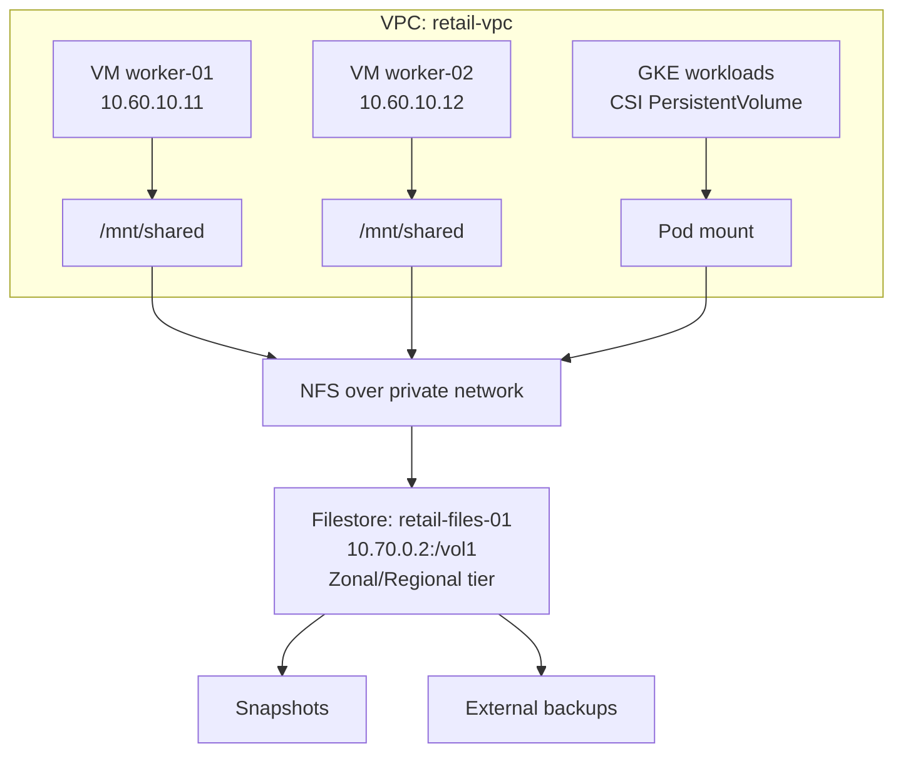
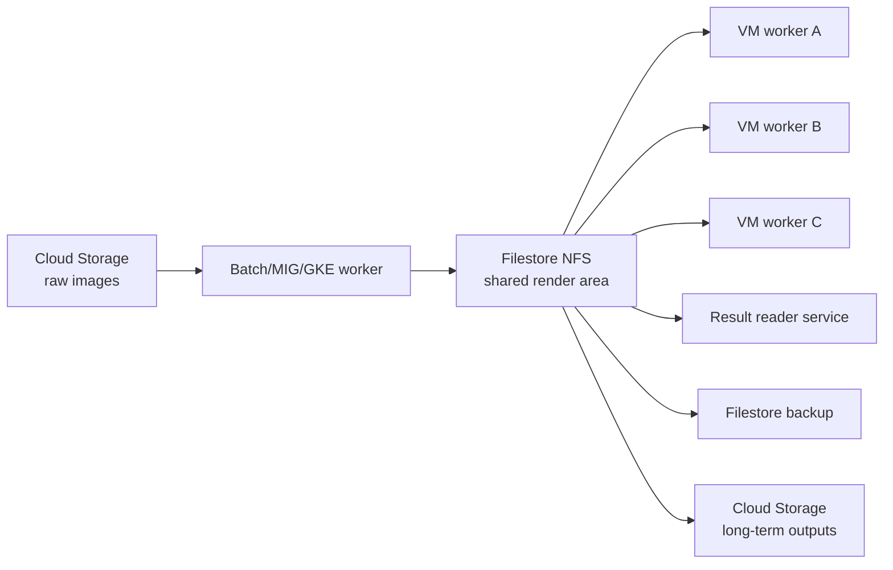

# Filestore and Sharing Files Over NFS

An image processing application runs across multiple Compute Engine virtual machines. All workers must read the same dataset, write outputs to shared directories, and continue operating if one VM is replaced. Storing files on each VM's boot disk scatters data; building a self-managed NFS server forces the operations team to manage the OS, disks, patching, and recovery themselves. **Google Cloud Filestore** provides a **managed file service**, allowing multiple clients to access a shared filesystem over **Network File System (NFS)**.

This lesson belongs to the **Block and File Storage** chapter of the `CLOUD_PROVIDERS_GCP` module. Across the Google Cloud landscape—from projects, IAM, and VPCs to Compute Engine, GKE, Cloud Run, storage, databases, and reliable operations—choosing the right **file storage** governs consistency, application coordination, performance, data safety, and cost. The content focuses on Filestore, NFSv3/NFSv4.1, private networking, file access permissions, deployment, and operations.

> All project names, IPs, VMs, share names, data, and load numbers in this lesson are **hypothetical**. Commands that create/delete resources or alter permissions can incur charges or cause data loss: run them only after verifying the project, permission scope, and backup plan.

## Learning Objectives

After this lesson, you will be able to:

1. Distinguish **block storage**, **file storage**, and **object storage**, and identify when Filestore is needed instead of Persistent Disk, Hyperdisk, or Cloud Storage.
2. Explain the architecture **Filestore instance → NFS file share → VPC → Linux client**, including location, IP, mount point, UID/GID, and permissions.
3. Choose between **NFSv3** and **NFSv4.1** based on service tier, security requirements, firewalls, file locking, and identity systems.
4. Create and inspect a Filestore instance, mount a share from Compute Engine Linux, and configure persistent mounts across reboots.
5. Apply **IAM for the control plane**, **IP-based export rules**, and **POSIX/UID/GID** for the data plane; understand the risks of `no_root_squash`.
6. Select appropriate tiers, capacities, and performance levels; explain the difference between **zonal** and **regional availability**.
7. Design **snapshots, backups, restores, monitoring, recovery testing**, and diagnose network/NFS failures.
8. Understand how the GKE Filestore CSI driver provides `ReadWriteMany` and build a production checklist for cost, permissions, and security.

## 1. Why Is Shared File Storage Needed?

Google Cloud offers three common storage models:

| Type | Application interface | Example resources | Typical use cases |
| --- | --- | --- | --- |
| **Block storage** | Block device; filesystem managed by VM/OS | Persistent Disk, Hyperdisk | Boot disks, database disks, one or a few VMs within multi-writer limits |
| **File storage** | Directories and files with paths, POSIX permissions, locking | **Filestore (NFS)** | Multiple VMs/Pods reading/writing shared files, shared workspaces, rendering, HPC |
| **Object storage** | API/URI, objects, and metadata | Cloud Storage | Images, backups, archives, static assets, data lakes |

For example, suppose an application must concurrently read `/data/catalog/items.csv` from five workers. With Filestore, every worker mounts **the same NFS export** at `/mnt/catalog`. From the application's perspective, it works with familiar file paths; changes from one client become visible to other clients according to **NFS cache/consistency semantics**.

### What Filestore Provides

- Google-managed NFS service: no need to build, patch, and monitor an NFS server on a VM yourself.
- Familiar file/directory APIs with POSIX permissions, hard links, file locking, and concurrent operations within protocol limits.
- Usable from **Compute Engine**, **GKE**, certain **Cloud Run** setups, VMware environments, and on-premises connections when networking is properly configured.
- Configurable tiers, capacity/performance, snapshots, backups, replication, and data encryption within product limits.

### What Filestore Does **Not** Automatically Solve

- It is not an object storage service for serving files directly to the Internet; NFS files require clients with network reachability and mount permissions.
- It does not replace database transactions or distributed application-layer locking.
- It does not automatically encrypt all NFS traffic in transit across the network.
- It does not automatically make arbitrary concurrent writes safe; applications must still use locking, atomic renames, or proper synchronization.
- It does not turn a single snapshot or a zonal instance into a complete disaster recovery strategy.

## 2. Filestore Instance and NFS Share Architecture

Filestore has **instances** and **file shares**:

- **Filestore instance:** a managed file server residing in a specific location, with a service tier, capacity, protocol, network connectivity config, and its own private IP address.
- **File share:** an exported directory named something like `vol1` or `shared`; clients use `SERVER_IP:/SHARE_NAME` to mount it.
- **Client:** a Compute Engine VM, GKE node/Pod via CSI, or an NFS-capable host with a valid network route.
- **Mount point:** the directory path on the client, e.g., `/mnt/shared`; does not have to match the export name.



**The address `10.70.0.2` is only an example**—never use it in real deployments. The real IP address and share name must come from the created instance; do not pick an arbitrary subnet IP and assume Filestore uses it.

### Path of a Write Operation

```text
Application open("/mnt/shared/result.json")
         ↓
Linux VFS + NFS client
         ↓
VPC route / private connectivity
         ↓
NFS export and client IP verification
         ↓
Check user/group, permissions, and locking
         ↓
Filestore persists data in the file share
```

Storing files on Filestore does not mean files are automatically copied onto every VM. **The VMs share one filesystem over the network**. If the network cannot reach the NFS server, read/write calls may hang or fail depending on mount options.

## 3. How Do NFSv3 and NFSv4.1 Differ?

Filestore supports **NFSv3 across all service tiers**. **NFSv4.1** is supported on **zonal, regional, and enterprise** tiers; do not assume a basic HDD/SSD instance supports NFSv4.1.

| Criterion | NFSv3 | NFSv4.1 |
| --- | --- | --- |
| Service tiers | All | Zonal, regional, enterprise |
| Connections | Bidirectional exchanges; multiple ports/RPC services | Client-initiated connections; primary NFS server port `2049` |
| State management | Fundamentally stateless protocol; locking via NLM | Stateful; integrated lease/lock management |
| User/Group | Primarily UID/GID with `AUTH_SYS` | Supports `AUTH_SYS` and stronger authentication/identity |
| File ACLs | Does not support NFSv4 ACLs over NFSv3 | Supports NFSv4.1 ACLs within product limits |
| Security flavor | `sys`, trusting client-asserted identity | `sys`, `krb5`, `krb5i`, `krb5p` when properly configured |
| In-transit security | Does not encrypt payloads automatically | Content encryption only with `krb5p` and valid authentication integration |
| Use case | Existing Linux NFS, simple setup | Organizations needing Kerberos auth, ACLs, and simpler firewalls |

**NFSv4.1 is not automatically more secure just because the version number is higher.** If using `sec=sys`, the server still trusts client-asserted identities and traffic lacks privacy like `krb5p`. Filestore supports `krb5` (authentication), `krb5i` (integrity), and `krb5p` (privacy/encryption) with **LDAP/Kerberos via Managed Microsoft AD** per product configuration.

### Why Does the Protocol Affect Firewalls?

NFSv3 uses multiple ports for RPC services and **NLM/statd** for locking; you must verify client-server flows and corresponding firewall rules. NFSv4.1 consolidates communication over NFS port `2049`, which is far cleaner in port-restricted networks. With NFSv3, **opening TCP/2049 alone does not guarantee features like file locking will work**.

### Concurrent Write Semantics and Consistency

NFS relies on client caching, locking, and specific synchronization rules. When two workers write to **the same file**:

1. Choose the right application protocol: lock files, write to a temp file and atomically rename (where appropriate), or partition outputs per worker.
2. Never assume a `write()` on client A immediately appears in order on client B in every situation.
3. If transactions, constraints, or atomic multi-record updates are required, a **database** fits far better than a shared file directory.
4. Inspect network/timeout/disconnect errors before retrying to avoid duplicating business actions.

## 4. Choosing Service Tier, Location, and Capacity

Google Cloud Filestore offers multiple **service tiers** differing in availability, performance, capacity, and features. Specific names/limits evolve over time; select a tier based on **SLOs, protocol, file count, IOPS, throughput, and budget**, not capacity alone.

| Tier | Availability/characteristics | Suggested usage |
| --- | --- | --- |
| **Basic HDD** (legacy) | Zonal, baseline performance, NFSv3 | Simple file shares/dev, modest requirements; check capacity bounds |
| **Basic SSD** (legacy) | Zonal, NFSv3 | Small workloads needing lower latency than basic HDD |
| **Zonal** | Zonal scope, NFSv3/NFSv4.1, performance options | Rendering, batch/HPC, workloads prioritizing throughput or latency |
| **Regional** | Regional availability mechanism; NFSv3/NFSv4.1 | Production systems needing resilience against zone outages |
| **Enterprise** | Regional class, NFSv3/NFSv4.1, suits GKE multishares where supported | Many workloads needing managed NFS shares |

Tier groups also have **capacity range** variants and **custom performance** capabilities. For example, a small regional instance in certain configurations requires supplying an IOPS parameter at creation; select values from **current tier documentation and quotas**, rather than copying configs from another tier.

### Zonal and Regional Do Not Mean Backup

- **Zonal:** the instance depends on a single zone; if the zone faces a prolonged outage, the application needs a continuity plan or restoration from a replica/backup.
- **Regional:** designed to withstand zone-level availability failures per service design; still requires backups for **accidental deletion, accidental file edits, ransomware, or application logic bugs**.
- **Cross-region DR:** requires a backup plan in another region or replication where the tier supports it, plus testing the application's ability to mount and recover.

**Do not conclude "regional = multi-region DR"**. Enterprise SLOs/RPO/RTO must be verified against SLA documentation and recovery drills.

### Placement of Clients and Filestore

Place Filestore close to workloads—usually **in the same region** as clients when supported—to minimize latency and avoid cross-region data transfer fees. With clients spread across multiple regions, examine metadata operation latency and data processing structure rather than forcing central reads/writes over long-haul links.

### Capacity Is Not Actual Used Percentage

Suppose an application stores **650 GiB** of data while provisioned for **1 TiB** of capacity:

```text
Provisioned capacity = 1 TiB = 1,024 GiB
Used capacity        = 650 GiB
Simple headroom      = 1,024 - 650 = 374 GiB
```

Filestore typically bills by **provisioned capacity**, not just used GiBs. With **custom performance**, there are also charges per **instance** and **provisioned IOPS**. On each tier, modifying capacity and performance may be constrained by step increments, capacity ranges, or irreversible actions; never scale production without checking fees and limits.

## 5. Networking: Private Connectivity to the NFS Server

Filestore uses **private addresses** to serve NFS within the configured network. When creating an instance, administrators select a VPC/Shared VPC and an appropriate networking mode (e.g., **Private Services Access**, **Private Service Connect** in supported models, or Filestore peering).

Networking options and tier support evolve; not every connection method applies to every instance. When operating, verify:

1. **Filestore IP** allocated and VPC/Shared VPC scope; avoid overlaps with IPAM, branch networks, or subnets.
2. **Routes** from clients to Filestore and return paths; especially for on-premises networks over Cloud VPN/Interconnect.
3. **Firewalls** for the NFS version in use; NFSv4.1 typically needs TCP/2049 on the server, while NFSv3 requires additional RPC ports.
4. **IP export rules** on the file share: client IPs or CIDRs must be permitted; NFS enforces more than VPC firewalls alone.
5. **Export name** in `SERVER_IP:/EXPORT`; do not confuse the instance name with the share name.
6. **No automatic transitive connectivity** across peered networks: standard peering does not support **transitive peering**.

### A Connectivity Scenario

```text
Project: retail-dev-01
VPC: retail-vpc
Client VM: nfs-client-01, subnet 10.60.10.0/24
Filestore: retail-files-01, hypothetical private IP 10.70.0.2
Share: /vol1
Client mount: /mnt/shared
NFS version: v3
```

In this setup, **the client needs no external IP to reach Filestore** once internal routing is valid. However, if the client needs to install `nfs-common` from the Internet, Cloud NAT, a proxy, or an internal repository mirror may be needed.

### Shared VPC and Network Isolation

In a Shared VPC, the network management project (host project) can differ from the project owning Filestore/clients (service project). IAM permissions to create instances, use the network, and establish service connections **are not automatically equivalent**. Furthermore, sharing a network does not isolate service projects at the NFS layer by default: enforce **IP-based access rules**, firewalls, and proper OS permissions.

## 6. IAM and File Access Permissions: Two Distinct Layers

A common misconception is that **granting `roles/file.editor` automatically allows reading/writing every file over NFS**.

| Layer | Controls | Applies to |
| --- | --- | --- |
| **Google Cloud IAM** | Permissions like `file.instances.create`, `file.instances.get`, `file.instances.delete` | Managing Filestore instance lifecycle/config via API/Console/CLI |
| **VPC/network** | Routing, firewalls, service connections | Whether clients can reach the NFS IP/ports |
| **NFS export rules** | Client CIDRs, READ_ONLY/READ_WRITE, root squash | Which hosts or address ranges can mount and operate |
| **POSIX permissions** | UID, GID, `rwx` mode bits, owner/group | Which users/processes can read/write/delete specific files |
| **NFSv4.1 Kerberos** (when configured) | `krb5`/`krb5i`/`krb5p`, LDAP/AD | Protocol-level identity and message protection |
| **Application** | Authentication, authorization, tenancy | Business logic and high-level data authorization |

### Default Exports and File Share Permissions

Per Filestore documentation, a default file share has:

- Exports open to eligible private addresses in the selected VPC;
- **Read/write** export permissions;
- **`no_root_squash`** configured by default;
- Root directory mode typically **`0755`**: root can write, while other users can mainly read/traverse.

**This is not a hardened production configuration.** If a client on the same network suffers root compromise, `no_root_squash` lets that principal act as root on the share. Shrink the access surface and manage permissions properly.

### IP-Based Access Control

Export rules can restrict which clients have access:

- `10.60.10.0/24`: read/write for worker nodes.
- `10.60.20.0/24`: read-only for analytics nodes.
- Specific admin IPs: used to set initial owner/mode, then restricted.

Current tiers differ in how overlapping CIDRs are handled: zonal/regional/enterprise may follow **most-specific prefix** precedence per docs, while basic tiers may disallow overlapping ranges. Always verify actual export rules rather than assuming a broad rule won't shadow a narrow rule.

### Root Squashing

`ROOT_SQUASH` maps client root privileges to an unprivileged account on the server; `NO_ROOT_SQUASH` lets client root retain elevated privileges. When enabling root squash:

1. Prepare directory owner/group/mode beforehand, or reserve an admin client scope for setting initial permissions.
2. Use `anonUid`/`anonGid` where supported by the feature and config to control the mapped identity.
3. Ensure application processes share consistent UID/GIDs across VMs/Pods.
4. Test using a **non-root user**, not just `sudo touch`.

### POSIX Permissions Example

Suppose workers run under UID/GID `2000`:

```bash
# RUN ONLY ON AN AUTHORIZED TEST SHARE.
# Update owner/group after verifying the application's UID/GID.
sudo mkdir -p /mnt/shared/jobs
sudo chown 2000:2000 /mnt/shared/jobs
sudo chmod 2770 /mnt/shared/jobs

# Verify owner/group permissions.
ls -ldn /mnt/shared/jobs
```

`2770` enables **setgid on the directory** so child files/subdirectories normally inherit the group. That **does not solve every permission issue automatically**, since `umask`, ACLs, and how clients create files still matter.

## 7. Creating a Filestore Instance with Google Cloud CLI

The following examples use:

```text
Project: retail-dev-01
Region: asia-southeast1
Instance: retail-files-01
Tier: REGIONAL
Share name: vol1
Capacity: 1TB (illustrative)
Network: retail-vpc
Protocol: NFSv3 per example defaults
```

**Prerequisites:** the Filestore API `file.googleapis.com` is enabled, the project has valid billing/quotas, the VPC exists, the operator holds Filestore permissions, and the network config is valid. Many projects start with **zonal/regional quota set to 0**, requiring a quota increase before creating instances.

### 7.1 Check Context First (Read-Only)

```bash
PROJECT_ID="retail-dev-01"
REGION="asia-southeast1"
INSTANCE_ID="retail-files-01"

gcloud auth list
gcloud config get-value project

# Is the API enabled?
gcloud services list --enabled --project="$PROJECT_ID" \
  --filter="config.name:file.googleapis.com"

# List existing Filestore instances.
gcloud filestore instances list --project="$PROJECT_ID"
```

If the API is not enabled, `serviceusage.services.enable` and administrative approval are needed before running `gcloud services enable file.googleapis.com`. Never grant project-wide Owner just because a command returns `PERMISSION_DENIED`.

### 7.2 Create the Instance (Billable, Mutates Infrastructure)

```bash
# VPC retail-vpc must exist and REGIONAL quota must be sufficient.
# CREATES a Filestore INSTANCE, incurring charges even before mounting.
gcloud filestore instances create retail-files-01 \
  --project="retail-dev-01" \
  --region="asia-southeast1" \
  --tier=REGIONAL \
  --file-share=name="vol1",capacity=1TB \
  --network=name="retail-vpc" \
  --labels=environment=dev,team=retail
```

This command illustrates **NFSv3**, without Kerberos/NFSv4.1 enabled. For **Shared VPC**, **Private Service Connect**, or other networking modes, use the dedicated flags and configurations per official documentation; do not swap `--network` arbitrarily.

### 7.3 Check Status and Retrieve the Mount Source (Read-Only)

```bash
gcloud filestore instances describe retail-files-01 \
  --project="retail-dev-01" \
  --region="asia-southeast1" \
  --format="yaml(name,state,tier,protocol,fileShares,networks)"
```

Proceed only once the instance reaches state **`READY`** and the network/file share fields match expectations. Read `networks[].ipAddresses` for the **real server IP**. Read `fileShares[].name` for the real export name.

Illustrative abbreviated output:

```yaml
state: READY
tier: REGIONAL
protocol: NFS_V3
fileShares:
  - name: vol1
    capacityGb: "1024"
networks:
  - network: retail-vpc
    ipAddresses:
      - 10.70.0.2  # hypothetical; must retrieve actual value from describe
```

## 8. Mounting an NFS Share on Compute Engine Linux

Assume `nfs-client-01` is in the right VPC with routing and access to Filestore. **Run these commands inside the Linux VM**, not on a Windows workstation or Cloud Shell unless Cloud Shell itself has NFS connectivity.

### 8.1 Install the NFS Client

```bash
# Debian/Ubuntu: requires sudo privileges and valid repository connectivity.
sudo apt-get update
sudo apt-get install -y nfs-common

# Check NFS client and kernel version.
uname -r
command -v mount.nfs
```

On RHEL/Rocky/CentOS, the package is usually `nfs-utils`, installed via `dnf`/`yum`; do not apply `apt-get` commands to every OS.

### 8.2 Test Mounting NFSv3

```bash
sudo mkdir -p /mnt/shared

# SERVER_IP and vol1 must match values from your Filestore instance.
# hard allows the client to retry when the NFS server is temporarily unresponsive.
sudo mount -t nfs -o vers=3,tcp,hard \
  10.70.0.2:/vol1 /mnt/shared

# Verify mount source, filesystem, and capacity.
findmnt /mnt/shared
df -hT /mnt/shared
mount | grep '/mnt/shared'
```

Note that a **`hard` mount** lets the client retry I/Os if NFS temporarily stops responding, though applications may **wait noticeably** during network drops. Never casually switch to `soft` to "avoid hangs": applications may receive I/O errors they were not built to handle, leading to partial writes or data corruption risks.

### 8.3 Test Read/Write from Two VMs

On **VM A**, once the directory has appropriate permissions:

```bash
echo "created-by-worker-a" > /mnt/shared/probe.txt
sync
stat /mnt/shared/probe.txt
```

On **VM B**, mounting the same `SERVER_IP:/vol1`:

```bash
cat /mnt/shared/probe.txt
stat /mnt/shared/probe.txt
```

If VM B cannot read the file or sees unexpected content, check **NFS caching/locking, UID/GID, export permissions, network paths, and application errors**. Do not treat this quick test as proof of full concurrent-write correctness.

### 8.4 Auto-Mount After Reboot

Add the configuration to `/etc/fstab` **on the exact VM** after verifying a manual mount succeeds:

```fstab
# SERVER_IP:/SHARE  MOUNT_POINT  TYPE  OPTIONS          DUMP PASS
10.70.0.2:/vol1     /mnt/shared  nfs   vers=3,hard,tcp,_netdev 0 0
```

`_netdev` informs init tools this is a network filesystem, yet **does not guarantee** the network is always up when application services start. In production, use systemd automount or mount readiness checks before the app writes data.

After editing `fstab`:

```bash
# Test only on a non-production/test VM:
sudo mount -a
findmnt /mnt/shared
```

**Avoid rebooting production "just to test"** without a rollback plan for `fstab`. A misconfiguration or unresponsive NFS server can stall system boot or service startup.

### 8.5 Performance Options

Filestore documentation recommends reviewing `hard`, `timeo`, `retrans`, `rsize/wsize`, and sometimes `nconnect`. On Linux kernel 5.3+ with supported tiers, `nconnect` opens multiple TCP connections from a single client to improve parallelism; pick the value **based on tier, capacity, and benchmarks**, rather than applying one number everywhere.

With NFSv4.1, mounts can use `vers=4.1` and security flavors like `sec=krb5p` **only when** the Filestore instance, AD/Kerberos, client, and tickets are all configured properly. Adding `sec=krb5p` to mount options **does not automatically enable encryption** if the authentication infrastructure is not ready.

## 9. Using Filestore on GKE with the CSI Driver

A GKE application where multiple Pods need read/write access to the same directory should consider the **Filestore CSI driver**, rather than having individual containers mount NFS with elevated privileges.

Kubernetes separates three concepts:

- **StorageClass:** defines how storage is dynamically provisioned.
- **PersistentVolume (PV):** the storage resource managed by CSI or pre-declared.
- **PersistentVolumeClaim (PVC):** an application's request for storage.

Filestore enables eligible workloads to use **`ReadWriteMany` (RWX)** when supported by the CSI driver and tier, unlike block disk setups that normally limit writers.

### 9.1 Inspect Drivers and StorageClasses

```bash
# Read-only in the selected GKE cluster:
kubectl get storageclass
kubectl get pvc -A
kubectl get pv
```

GKE-provided StorageClass names may include `zonal-rwx`, `enterprise-rwx`, or other classes **depending on cluster version**. Never assume every cluster has every class, and never reference nonexistent classes in manifests.

### 9.2 Example PVC Using an Existing StorageClass

```yaml
apiVersion: v1
kind: PersistentVolumeClaim
metadata:
  name: app-shared-data
  namespace: apps
spec:
  accessModes:
    - ReadWriteMany
  storageClassName: zonal-rwx
  resources:
    requests:
      storage: 1Ti
```

This **example can provision billable resources** if the CSI driver, class, and quota permit. GKE often uses `WaitForFirstConsumer` on certain Filestore StorageClasses: the PVC begins provisioning storage only once a consuming Pod is scheduled. Check PVC/Pod events before assuming a `Pending` PVC is broken.

### 9.3 Pod Consuming the PVC

```yaml
apiVersion: apps/v1
kind: Deployment
metadata:
  name: catalog-worker
  namespace: apps
spec:
  replicas: 2
  selector:
    matchLabels:
      app: catalog-worker
  template:
    metadata:
      labels:
        app: catalog-worker
    spec:
      securityContext:
        fsGroup: 2000
      containers:
        - name: worker
          image: example-registry.invalid/catalog-worker@sha256:REPLACE_WITH_REAL_DIGEST
          volumeMounts:
            - name: shared
              mountPath: /data/shared
          securityContext:
            runAsUser: 2000
            runAsGroup: 2000
      volumes:
        - name: shared
          persistentVolumeClaim:
            claimName: app-shared-data
```

The image `example-registry.invalid` is a **non-runnable placeholder**; replace it with a reviewed real image digest. Setting `runAsUser`/`fsGroup` keeps UNIX permissions consistent, yet must align with export rules, root squashing, and share owner/group settings.

### Two Notes on PVC Lifecycle

1. If the PVC/StorageClass uses `persistentVolumeReclaimPolicy: Delete`, deleting the PVC/PV can **delete the underlying storage resource** depending on the CSI provisioner; check policies and backups before deleting.
2. When CSI uses a **pre-provisioned** Filestore instance, the PV must specify `volumeHandle` and `volumeAttributes` in the exact required format; do not copy AWS/EBS formats. For Filestore multishares, policies differ from single-share; consult documentation for the exact mode.

## 10. Snapshots, Backups, Replication, and Recovery

**Allowing multiple machines to access files does not protect data against accidental deletion.** RPO/RTO designs must distinguish snapshots from backups.

| Mechanism | Storage location / nature | Goal | What to verify |
| --- | --- | --- | --- |
| **Snapshot** | Data version managed inside the instance, typically copy-on-write | Fast recovery of recent files/state | Does the tier support it? How much instance space do snapshots consume? |
| **Backup** | Separate resource outside the instance, in a chosen region | Recovery after deletion/outage, DR, and data cloning | Backup location, retention, cost, tier restore capability |
| **Replication** (where tier supports) | Maintains a copy in another location per config | DR with specific RPO/RTO targets | Replication lag, failover/failback, and cost |
| **Application backup** | Data captured in an application-consistent state | Complex DB/app recovery | Flush/quiesce, restore tests, and dependencies |

### Snapshots Are Not Independent External Backups

Filestore snapshots retain data versions using the instance's own capacity. As source files change, snapshots hold onto old blocks, which can **reduce free capacity**; if the instance fails or is deleted, snapshots **do not replace independent backups**. Basic tiers do not support snapshots per standard product matrices.

### Backups Have Tier-Specific Restore Limits

A Filestore backup is a regional resource stored **outside** the instance; it can reside in another region per service capabilities. For **zonal/regional/enterprise** tiers, current documentation supports restoring backups into a **new instance**, not in-place restoration into the existing instance by default. Some **basic tiers** provide options to restore into the existing/source instance per documentation.

Never copy an **in-place restore** runbook from a basic tier to a regional tier: the workflow can differ completely and risk overwriting production data.

### Minimum Backup Workflow

1. Identify the instance's tier, file share, project, and location.
2. Define RPO (maximum acceptable data loss) and an appropriate backup schedule.
3. If the application requires consistency, **quiesce** writes or create an application-consistent checkpoint before snapshotting/backing up.
4. Store backups in a location/retention matching risk; protect backup deletion permissions.
5. **Run periodic restore tests** into an isolated environment; verify owner/group, application data, file locking, and restore speed.
6. Record completion time, size, errors, and evidence proving RPO/RTO compliance.

### Inspecting Backup/Snapshot Information

```bash
# These commands only list resources; they do not create copies.
gcloud filestore backups list --project="retail-dev-01"
gcloud filestore instances snapshots list \
  --project="retail-dev-01" \
  --instance="retail-files-01" \
  --instance-region="asia-southeast1"
```

Depending on tier and location, snapshot commands may use `--instance-location` instead of `--instance-region`; when building automation, check `gcloud filestore instances snapshots` and `gcloud filestore backups` docs in your target environment to verify parameters and permissions.

## 11. Monitoring Performance and Capacity

File storage has two easily confused limit domains:

- **Capacity:** used GiB, provisioned GiB, snapshot overhead, and growth rate.
- **Performance:** IOPS, throughput, latency, client connections, access patterns, and request sizes.

Applications rendering large sequential files tend to be throughput-bound; systems with millions of small files can bottleneck on **metadata operations, directory listings, open/close calls**, and client concurrency. Increasing provisioned capacity sometimes boosts performance on capacity-linked tiers, whereas **custom performance** requires sizing purchased IOPS.

### Metrics to Measure

| Signal | Explanation | Operational response |
| --- | --- | --- |
| Capacity used / free | Share filling up; snapshots holding old blocks | Expand capacity cleanly or prune data per retention |
| Read/write throughput | Data transferred per second | Compare against tier/capacity and client network |
| Read/write IOPS | I/O operations per second | Inspect request sizes and workload mix |
| Server/client latency | Time to complete NFS operations | Isolate network, queuing, client CPU, metadata |
| Client connections | Number of NFS connections | Check tier limits and `nconnect` |
| NFS retrans/timeouts | Slow/unresponsive RPCs | Check networking, firewalls, instance health |
| Snapshot/backup duration | Is data protection finishing on schedule? | Assess impact on RPO and cost |
| Application errors | `EIO`, `ESTALE`, `EACCES`, timeouts | Cross-check NFS logs, UID/GID, and mounts |

### Read-Only Linux Client Tools

```bash
# Check mount, capacity, and filesystem state.
findmnt /mnt/shared
df -hT /mnt/shared
df -i /mnt/shared

# View kernel NFS messages (requires journal read permissions).
sudo dmesg --ctime | grep -i nfs | tail -n 30

# When nfs-common provides this tool:
nfsstat -m
```

Never benchmark by writing tens of TiBs directly onto production. For performance tests, pick a representative dataset, bound duration/IOPS, avoid starving live apps, and clean up test data after verification.

## 12. Filestore Costs: Billed by Provisioned Resources

An instance **incurs charges even with no mounted clients or an empty share**. Google Cloud Filestore pricing depends on:

1. **Region** and **service tier**.
2. **Provisioned capacity**, billed per GiB-hour/month per pricing table.
3. With **custom performance**: potentially an additional **fixed instance fee** and **provisioned IOPS**.
4. **Backups**: stored volume and retention/region policies.
5. Other network charges, such as cross-region transfer, VPN/Interconnect/Cloud NAT, or client infrastructure.

### Illustrative Cost Estimate (Do Not Treat as Real Pricing)

Suppose a share is provisioned at **2 TiB** and an exercise assumes a hypothetical unit rate of **0.20 USD/GiB-month** for capacity:

```text
2 TiB = 2,048 GiB
Hypothetical capacity charge = 2,048 × 0.20 = 409.60 USD/month

This is ONLY a practice calculation; not a Google Cloud price quote.
```

If custom performance is enabled, add instance and provisioned IOPS charges. Even if the app currently uses only 300 GiB while provisioned for 2 TiB, billing remains based on **2 TiB** under this model. Conversely, never shrink capacity without measuring peak usage, snapshot overhead, and growth projections.

### How to Optimize Costs

- Select tiers and capacities based on **real SLOs**—do not put all development docs on regional tiers if HA is unnecessary.
- Never leave test instances running long after labs; establish cleanup and pre-delete backup workflows.
- Audit unowned instances/backups, snapshot retention, and storage growth.
- For cold, read-mostly data that does not require POSIX/NFS, consider **Cloud Storage** instead of keeping an online file share mounted.
- Keep Filestore close to clients to reduce transfer charges and latency.
- Use Cloud Billing budgets/alerts, owner/environment labels, and periodic SKU reviews.

## 13. Case Study: Multiple Worker VMs Processing Shared Images

A retail enterprise stores raw images in Cloud Storage. A thumbnail-generation batch runs on three Compute Engine workers; the workers must write results into shared directories so another service can read them via POSIX paths.

### Hypothetical Requirements

| Requirement | Example |
| --- | --- |
| Cloud project | `retail-prod-01` |
| Worker region | `asia-southeast1` |
| Clients | 3 worker VMs, potentially migrating to MIG/GKE later |
| Resident data | 650 GiB, growing ~50 GiB/month |
| Access | Workers read/write `/data/render` concurrently |
| SLO | No data loss when a VM is recreated |
| Security | Only worker subnet gets RW; analytics team gets RO |
| Backups | Recover rendered images/metadata per agreed RPO |

### Proposed Architecture



Data flow summary: all workers mount the same NFS share; Cloud Storage holds raw objects and long-term outputs for serving. Exporting from Filestore to Cloud Storage requires a dedicated job or pipeline—Filestore does not automatically sync every file to Cloud Storage.

### Implementation Steps

1. Choose a zonal or regional tier based on availability goals and budget. To survive single-zone failures, consider regional, while still mandating backups.
2. Provision the share with enough capacity for current data, growth, snapshot headroom, and peak bursts.
3. Configure network connectivity and export rules: worker subnet RW, analytics subnet RO, blocking unneeded clients.
4. Create directories with consistent UID/GID ownership, avoiding giving arbitrary Pods/VMs root across the entire share.
5. Mount the same `SERVER_IP:/vol1` across all three workers with consistent paths/permissions.
6. Design **file naming/locking**: each job writes into its own folder or a temp file followed by atomic rename; never let two workers overwrite the same output if logic does not support it.
7. Enable metrics/alerts for capacity, IOPS/throughput, errors, and latency; schedule backups and rehearse restores.
8. For long-lived outputs served solely via API, upload to Cloud Storage and use Cloud CDN if public distribution is needed.

### When One VM Is Replaced

If VM A is recreated in a MIG, **the Filestore instance and file share persist independently** of VM A's boot disk. The new VM remounts the share and resumes work once the application handles retries/checkpoints. However:

- The old VM's **RAM** state is lost.
- Partially written files must be detected; stale temp files or locks may need cleanup.
- Network hiccups or Filestore restarts can cause NFS clients to retry and slow down the app.
- If the new worker runs under a different UID/GID, it may fail to read/write data even though mounting succeeds.

## 14. Layered NFS Troubleshooting

Before modifying permissions or rebooting, isolate whether the fault lies in the **control plane, network, export, POSIX, protocol, capacity, or application**.

| Symptom | Causes to check | Suggested action |
| --- | --- | --- |
| Instance creation fails | Filestore API disabled, regional quota = 0, invalid tier/capacity | Check Service Usage, quotas, region/tier |
| `gcloud ... describe` fails | Missing IAM or wrong project/location | Check identity, scope, `file.instances.get` |
| NFS client cannot reach server | Wrong IP, routing, firewall, export rules | Check VPC, `ip route`, CIDRs, and protocol ports |
| `mount.nfs: access denied by server` | Export rules disallow CIDR, wrong share path, wrong security flavor | Verify server IP, export name, rules, and protocol |
| Mounts OK yet `Permission denied` on write | Owner UID/GID, `0755`, `ROOT_SQUASH`, ACLs | Compare `id`, `ls -ln`, export settings |
| Client reports `stale file handle` | Rename/remove/mount state changed | Trace filesystem lifecycle; remount per runbook |
| I/O hangs | Hard mount retrying while server/network is slow | Check NFS logs/network/server health; do not rush to kill app |
| Slow performance with many small files | Metadata/IOPS limit, client concurrency, directory layout | Benchmark workload; reduce metadata contention |
| Clients see different data | Client caching, locking, write ordering, application logic | Verify synchronization and file update rules |
| Instance has free space yet backup fails | Quota/backup region/IAM/retention or snapshot overhead | Check operation logs, free capacity, backup limits |
| High cost despite little data used | Provisioned capacity or provisioned IOPS | Check Billing SKUs; reduce over-provisioning per tier |
| GKE PVC `Pending` | CSI driver/class, quota, `WaitForFirstConsumer`, topology | Inspect `kubectl describe pvc/pod` and events |

### Inspection Commands (Read-Only)

```bash
# On the client VM:
ip route
findmnt /mnt/shared
df -hT /mnt/shared
id
ls -ldn /mnt/shared
nfsstat -m

# Test TCP/2049 against the real server IP if nc is installed:
nc -vz -w 3 10.70.0.2 2049
```

**Note:** `nc` succeeding on port 2049 **does not prove** NFSv3 will mount or locking will work (additional RPC ports are involved). Conversely, `nc` timing out does not prove Filestore is down, since firewalls/routes/client policies can block probes too. Inspect logs and metrics on both sides.

### GKE: Separating Provisioning Errors from Filesystem Errors

```bash
kubectl describe pvc app-shared-data -n apps
kubectl get events -n apps --sort-by=.metadata.creationTimestamp
kubectl describe pod POD_NAME -n apps
```

If the PVC fails to bind, check CSI, StorageClass/region/quotas. If the PVC is bound yet the Pod fails with `EACCES`, check `fsGroup`/UID/GID/root squashing and export rules. Never fix every Pod error by granting IAM Admin to its service account.

## 15. Operations and Cleanup Runbook

### Pre-Deployment

- Define RPO/RTO, SLOs, tier, capacity/IOPS, region, and client count.
- Verify IPAM, VPC/Shared VPC, network connectivity, and VPN/Interconnect if used.
- Choose NFSv3 or NFSv4.1, required ports, and encryption/authentication requirements.
- Design minimal export CIDRs, root squash, UID/GIDs, app groups, and NFS permissions.
- Choose backup location, retention, owner, and recovery workflow.
- Review IAM and automation so instance/backup deletion permissions are tightly restricted.

### During Deployment

- Create the instance only in the exact project, tier, location, and share; verify `READY`.
- Retrieve IP/export via `gcloud describe`; test mounting from an authorized client.
- Test read/write using the application account, not solely as root.
- Test concurrent access from two clients; bound benchmarks so production is unaffected.
- Record health/latency baselines, NFS operations, file permissions, and access controls.

### In Operations

- Alert on capacity, latency, IOPS, timeouts, NFS errors, and backup status.
- Run periodic restore drills, especially when changing tiers, growing capacity, or altering network architecture.
- Manage application versions and UID/GIDs when migrating VMs to MIG/GKE.
- Track instance/backup costs and clean up test resources.
- During maintenance/migrations, **quiesce writes**, notify stakeholders, and prepare rollbacks.

### Decommissioning

Deleting a Filestore instance **can permanently destroy all data stored in the share**. Before deleting:

1. Confirm instance ID, location, project, and all mounted clients.
2. Stop/drain write workloads and check for unsynced files.
3. Create/verify backups or copy data to durable storage as required.
4. Check **deletion protection**, replication, snapshots/backups, and retention obligations.
5. Update client/PVC/fstab configs so nothing keeps trying to mount the deleted address.
6. After deletion, audit remaining resources and billing charges.

The command below **is illustrative only—never run it during learning exercises without verifying data**:

```bash
# WARNING: deletes the Filestore instance and all data inside.
# Run only after backups, review, and approval.
gcloud filestore instances delete retail-files-01 \
  --project="retail-dev-01" \
  --region="asia-southeast1"
```

## 16. Misconceptions to Avoid

| Misconception | Accurate understanding |
| --- | --- |
| "Filestore is a shared Persistent Disk." | Filestore is a **managed NFS file service**, distinct from block devices |
| "With `roles/file.editor`, every Pod can write files." | IAM governs the control plane; NFS read/write depends on network, exports, and POSIX |
| "NFS uses a private IP, so payloads are always encrypted." | NFSv3/`sec=sys` does not encrypt payloads; NFSv4.1 `krb5p` requires proper AD/Kerberos setup |
| "NFSv3 and NFSv4.1 use identical firewall rules." | NFSv3 uses extra RPC ports; NFSv4.1 primarily uses TCP/2049 |
| "Multiple writers can freely write to one file and stay consistent." | Requires application synchronization, locking, and understanding NFS cache semantics |
| "Regional Filestore needs no backups." | Regional availability does not protect against accidental deletion, ransomware, or app bugs |
| "Snapshots are identical to cross-region backups." | Snapshots live inside the instance; backups are independent resources |
| "A successful mount proves the user has write access." | The share may be `0755`, root-squashed, or have mismatched UID/GIDs |
| "NFS `no_root_squash` is safe inside a VPC." | Root on any trusted client gains broad privileges; restrict CIDRs and squash where appropriate |
| "A `Pending` PVC is always a Filestore failure." | It may simply be `WaitForFirstConsumer` waiting for a Pod to be scheduled |
| "Filestore bills only for actual used data." | Usually billed by **provisioned capacity**, plus IOPS and instance fees for custom performance |
| "Deleting a VM deletes the share." | Filestore exists independently of client VMs |
| "Deleting Filestore won't lose data because clients mounted it." | Data resides on the Filestore server; deletion destroys data |

## 17. Practice Exercises

### Exercise 1 — Choosing Block, File, or Object

Three VMs need concurrent POSIX-path writes for image files; a web frontend needs to serve public images over URLs; a database needs a high-performance block device. Pick the right storage type for each need.

<details>
<summary>Suggested answer</summary>

VMs sharing POSIX paths: **Filestore/NFS**. Serving public content: **Cloud Storage**, paired with Cloud CDN if appropriate. Database needing block I/O: **Persistent Disk/Hyperdisk** or a managed database service like Cloud SQL.
</details>

### Exercise 2 — Identifying the Mount Source

Filestore has IP `10.70.0.2` and share name `vol1`. A Linux client wants to mount it at `/mnt/shared`. Write the NFSv3 mount command and explain its three components.

<details>
<summary>Suggested answer</summary>

`sudo mount -t nfs -o vers=3,tcp,hard 10.70.0.2:/vol1 /mnt/shared`. The IP is the NFS server; `/vol1` is the export; `/mnt/shared` is the client mount directory. The IP is illustrative—retrieve the real one via instance `describe`.
</details>

### Exercise 3 — IAM Does Not Fix POSIX Errors

An engineer has `roles/file.editor`, yet the app on the VM cannot create `/mnt/shared/out.csv`; the command returns `Permission denied`. What do you inspect?

<details>
<summary>Suggested answer</summary>

Check the process's `id`, `ls -ldn` on the mount, `0755` owner/mode, export CIDR/mode, root squashing, and whether the mount is read-only or read/write. IAM roles do not override Unix permissions. Modify POSIX/export settings only within approved application scopes.
</details>

### Exercise 4 — NFSv3 or NFSv4.1?

A system requires Kerberos authentication, encrypted NFS payloads in transit, and minimal open network ports. Can you simply choose a basic HDD tier and add `sec=krb5p` to the mount command?

<details>
<summary>Answer</summary>

No. NFSv4.1 with `krb5p` requires a **tier supporting NFSv4.1**, proper LDAP/Kerberos/Managed Microsoft AD configuration, and client credentials. Basic HDD supports NFSv3 only. Passing `sec=krb5p` alone does not create authentication or encryption.
</details>

### Exercise 5 — Choosing Availability

A production application must keep accessing data during a zone outage, yet also needs to recover an accidentally deleted directory. Is choosing Filestore regional enough?

<details>
<summary>Suggested answer</summary>

Regional fits better for resilience against certain zone failures, yet is **not enough** to recover from accidental deletion. You need scheduled backups, snapshots where supported by the tier, proper retention, and restore drills; verify real RPO/RTO.
</details>

### Exercise 6 — Calculating Capacity and Cost

An enterprise provisions 3 TiB of Filestore while storing only 800 GiB of data. Assuming a hypothetical unit rate of `0.15 USD/GiB-month`, what is the provisioned capacity charge?

<details>
<summary>Answer</summary>

3 TiB = 3,072 GiB; hypothetical fee = 3,072 × 0.15 = **460.80 USD/month**. Do not treat this as real Google Cloud pricing. With custom performance, instance and IOPS fees may also apply.
</details>

### Exercise 7 — GKE RWX

Three Pods across different GKE nodes need concurrent read/write access to one directory. Which Kubernetes mechanism integrates Filestore into the workload, and which permission settings require attention?

<details>
<summary>Suggested answer</summary>

Use the **Filestore CSI driver** and StorageClass/PV/PVC with `ReadWriteMany`, ensuring topology/quotas/driver support. Configure `runAsUser`, `fsGroup`, POSIX ownership, export rules/root squash, and appropriate namespaces/service accounts.
</details>

### Exercise 8 — Backups vs. Snapshots

A zonal instance has multiple internal snapshots. When data must be restored to another region after a major outage, can snapshots replace backups?

<details>
<summary>Suggested answer</summary>

They should not. Snapshots store history inside the instance for local recovery within tier limits; a **Filestore backup** is an external resource that can reside in a target region and restore into a new instance where supported. Verify retention and test restores.
</details>

### Exercise 9 — Mount Hanging After Network Maintenance

A VM remains RUNNING, yet `ls /mnt/shared` hangs. Why shouldn't you immediately switch the NFS mount from `hard` to `soft` as a "quick fix"?

<details>
<summary>Suggested answer</summary>

A hard mount may simply be retrying because Filestore or the network is unresponsive. A soft mount returns I/O errors to the application, risking incomplete writes if the app is not built to handle them. Inspect networking, NFS server health, timeouts, logs, and consistency requirements before changing mount policy.
</details>

## 18. Production Filestore Deployment Checklist

- [ ] Verified the workload needs a **POSIX/NFS shared filesystem**, not just an object API or block disk.
- [ ] Selected tier, availability, NFS version, and location based on SLOs and application needs.
- [ ] Checked quotas, capacity ranges, custom performance/IOPS, and budget.
- [ ] Designed VPC/Shared VPC/PSC or PSA connectivity, IPAM, firewalls, and bidirectional routing.
- [ ] Configured minimal export CIDRs, READ_ONLY/READ_WRITE, and appropriate root squashing.
- [ ] Enforced consistent UID/GIDs across clients, user/group ownership, and proper POSIX permissions.
- [ ] If NFS encryption in transit is required, verified NFSv4.1 `krb5p`, AD/Kerberos, and tier support.
- [ ] Tested mounting, I/O under the application account, and concurrent client behavior.
- [ ] Configured `/etc/fstab` or CSI mounts to survive reboots/Pod rescheduling reliably.
- [ ] Tested application locking, consistency, retries, and NFS error handling.
- [ ] Put snapshot/backup/replication plans, retention, and **restore tests** in place.
- [ ] Built dashboards for capacity, latency, throughput, IOPS, NFS timeouts, client connections, and backup status.
- [ ] Separated Filestore admin IAM permissions from NFS data access permissions.
- [ ] Documented runbooks for incidents, capacity changes, backup/restore, migrations, and deletion protection.
- [ ] Calculated total costs across instance capacity, custom IOPS, backups, and client networking, and audited Billing SKUs.

## Official References

- [Filestore overview](https://cloud.google.com/filestore/docs/overview): managed NFS architecture, use cases, and tiers.
- [About service tiers](https://cloud.google.com/filestore/docs/service-tiers): capacity, performance, availability, and support scope.
- [Supported file system protocols](https://cloud.google.com/filestore/docs/about-supported-protocols): NFSv3, NFSv4.1, locking, and Kerberos.
- [About NFSv4.1](https://cloud.google.com/filestore/docs/configure-nfsv4): `krb5`/`krb5i`/`krb5p` and authentication integration.
- [Create a Filestore instance](https://cloud.google.com/filestore/docs/creating-instances): Console/gcloud, networking, quotas, and file share provisioning.
- [Filestore gcloud quickstart](https://cloud.google.com/filestore/docs/create-instance-gcloud): creating instances, mounting from VMs, and cleanup.
- [Mounting file shares](https://cloud.google.com/filestore/docs/mounting-fileshares): Linux mounts, NFS options, `/etc/fstab`, and `nconnect`.
- [Filestore access control](https://cloud.google.com/filestore/docs/access-control): IAM, POSIX, IP-based export rules, and root squash.
- [Network/IP requirements](https://cloud.google.com/filestore/docs/network-ip-requirements): VPC connectivity options, VPN/Interconnect, and peering limits.
- [GKE Filestore CSI driver](https://cloud.google.com/filestore/docs/csi-driver): Kubernetes PV/PVC/StorageClass, RWX, and shared access.
- [Compare snapshots and backups](https://cloud.google.com/filestore/docs/compare-snapshots-and-backups): storage locations, data recovery, and limits.
- [About Filestore backups](https://cloud.google.com/filestore/docs/backups): data protection, retention, and restores.
- [Filestore quotas and limits](https://cloud.google.com/filestore/docs/limits): instances, clients, snapshots, and other constraints.
- [Filestore pricing](https://cloud.google.com/filestore/pricing): pricing by tier, region, capacity, custom performance, and backups.
- [Google Cloud Pricing Calculator](https://cloud.google.com/products/calculator): cost estimation and architecture comparisons.
