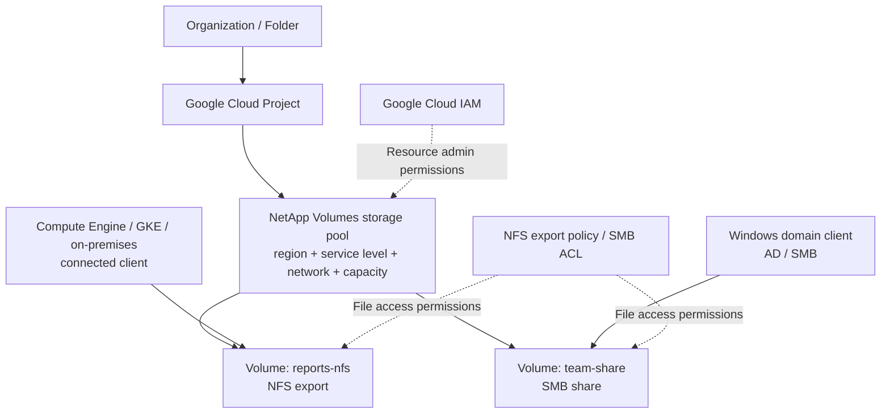
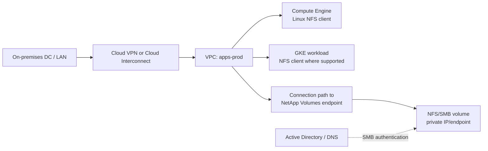
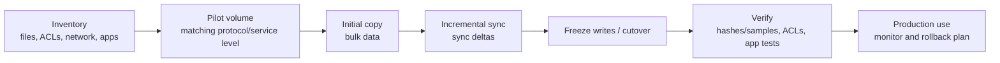

# Google Cloud NetApp Volumes and Enterprise File Needs

When migrating enterprise systems to Google Cloud, data does not always fit as objects in a bucket or block devices attached to a single VM. Many legacy applications require a **shared file system**: Windows staff opening the same folder over SMB, Linux servers mounting NFS, multiple content-processing machines accessing a common directory tree, or analytics software strictly requiring POSIX paths rather than calling an Object Storage API. In these scenarios, **Google Cloud NetApp Volumes** is a managed file storage service worth evaluating.

This lesson belongs to the **Block and File Storage** chapter in the `CLOUD_PROVIDERS_GCP` module. The knowledge connects project organization, IAM/VPC, Compute Engine, GKE, Cloud Run, and storage/databases, while serving **resource protection, release automation, reliability monitoring, and cost control** requirements. The focus is not memorizing product names, but **identifying file storage needs**, designing access paths, data permissions, performance, recovery, and operations.

> NetApp Volumes feature scope, service levels, protocols, regions/zones, capacities, and pricing can vary across Google Cloud-supported configurations. Examples in this lesson are for educational purposes only; verify current feature matrices and limits before production deployment.

## 1. Learning Objectives

After this lesson, you will be able to:

1. Distinguish **file storage** from **block storage** and **object storage**, and recognize when an application needs NFS/SMB.
2. Explain the **storage pool → volume → NFS export/SMB share → client** model in Google Cloud NetApp Volumes.
3. Analyze choices for **service level, capacity, network connectivity, protocol, identity, and access permissions**.
4. Understand data management mechanisms—**snapshots, backups, replication**—and how they support RPO/RTO without replacing recovery design.
5. Outline the workflow to create an NFS or SMB volume via Console, verify connectivity, and mount from Compute Engine/Windows.
6. Compare NetApp Volumes with **Filestore, Persistent Disk/Hyperdisk, and Cloud Storage** against application requirements.
7. Build checklists for security, performance monitoring, billing, data migration, and recovery testing for enterprise workloads.

## 2. Typical Scenario: Why Do Enterprises Need a File Storage Service?

Suppose a company operates three system groups:

- **Design department:** hundreds of project files organized in folder hierarchies; Windows users need to open shared folders, apps use SMB, and file permissions tie to employee identities.
- **Linux reporting system:** multiple Compute Engine VMs need concurrent read/write access to `/mnt/reports` over NFS.
- **New web app on Cloud Run:** public images and documents are accessed via HTTP/API without requiring traditional network folders.

You should not choose the same storage type for all three merely because they all contain "files."

| Model | Access interface | Best suited when | Limitations to consider |
| --- | --- | --- | --- |
| **Block storage** (Persistent Disk, Hyperdisk) | Block device attached to supported VM/workload; OS manages filesystem. | Boot disks, database disks, VM-dedicated filesystems. | Does not inherently provide a multi-client **NAS share** with NFS/SMB semantics. |
| **File storage** (NetApp Volumes, Filestore) | NFS or SMB share/export per product; apps manipulate paths, files, and folders. | Existing NAS-based apps, multi-client access, POSIX/Windows file access. | Affected by networking, file locking behavior, metadata I/O, and service capacity. |
| **Object storage** (Cloud Storage) | Bucket/object via API or supported interfaces. | Assets, unstructured data, archival, cloud-native integrations, content delivery. | Object storage is not a conventional POSIX/SMB filesystem; never assume NAS-like rename/locking. |

**Selection rule:** if the application requires **SMB shares, NFS exports, file locking, file permissions, and stable path names**, evaluate file storage. If the app primarily fetches objects over HTTP, Cloud Storage is usually easier to integrate. If you need a block device with an OS-managed filesystem on one VM, look at Persistent Disk/Hyperdisk.

## 3. What Is Google Cloud NetApp Volumes?

**Google Cloud NetApp Volumes** is a managed file storage service on Google Cloud that combines NetApp file storage capabilities with Google Cloud resource management. It lets organizations provision volumes for clients using **NFS**, **SMB**, or dual-protocol configurations where supported, without self-managing a pair of NAS VMs, storage OS, file server daemons, and redundancy from scratch.

Key capabilities for architects:

- **Structured file sharing:** mount from Linux VMs or access Windows UNC shares, depending on the selected protocol.
- **Centralized management:** create storage pools and volumes inside Google Cloud; govern administrative access via IAM.
- **Performance by service level and capacity:** choose service tiers suited to I/O, throughput, latency, and budget.
- **Data protection:** snapshots, backups, and replication per product/configuration capabilities for recovery and outage protection.
- **Enterprise integration:** SMB with Active Directory where supported; NFS for Linux workloads; filesystem permissions separate from Google Cloud admin roles.
- **Private networking:** clients connect via VPC/hybrid connectivity per service architecture, rather than treating volumes as public web endpoints.

A "managed service" reduces responsibility for the underlying storage infrastructure; it **does not eliminate** customer responsibility for data governance, identity, applications, backups, monitoring, quotas, and cost.

## 4. Resource Model: Storage Pools and Volumes

To design properly, distinguish **where storage capacity is provisioned** from **the filesystem clients actually mount**.



### 4.1. Storage Pool

A **storage pool** is the resource used to organize and provision file storage capacity. Your design must specify:

- **Project and location:** owning project, region (and specific placement constraints per service level).
- **Service level:** defines the performance tier, features, and storage provisioning model.
- **Pool capacity:** must cover volume demands per the service level's sizing/overcommit rules, while staying within quotas and budget.
- **Network:** VPC/service connectivity configured appropriately so clients can connect.
- **Admin permissions:** only authorized teams can create/modify pools and related bindings.

Do not treat a pool as a drive Linux can mount directly. **Clients mount volumes**, using the corresponding endpoint/export/share and protocol.

### 4.2. Volume

A **volume** represents a specific shared filesystem. When creating one, you normally select or configure:

| Attribute | Illustrative example | Impact |
| --- | --- | --- |
| Volume name | `reports-nfs` | Resource identity for administration and auditing. |
| Storage pool | `orders-filepool-prod` | Provides service level/location/network and capacity for the volume. |
| Capacity | `1 TiB` | Must cover current data, growth, snapshots, and service limits. |
| Protocol | NFSv4.1 | Determines clients, identity/file access mechanics, and mounting. |
| Share/export name | `reports` | NFS export path or SMB share formatted per service requirements. |
| Export/SMB policy | Allow approved networks/identities | Blocks unauthorized clients from accessing data. |
| Snapshot/backup policy | Per application RPO/RTO | Determines recovery points and retention. |

**Do not confuse volume capacity with bytes currently written.** Storage billing and provisioning policies depend on service level; snapshots can consume space and incur separate charges per policy. Track **provisioned size, used space, snapshot usage, and expansion capability**.

### 4.3. Region, Zone, and Failure Domain

Compute Engine VMs are placed in a **zone**, whereas pools/volumes follow **region/service-level** location rules. Designs must verify:

1. Which region houses clients and file services for low latency and data residency.
2. Which zones can access a volume per product capabilities.
3. Which availability model the service commits to, and whether **cross-region** copies are required.
4. Whether hybrid connectivity from on-premises offers adequate latency, bandwidth, and redundant paths.

Never conclude that "regional storage" means every workload using it automatically has **multi-region disaster recovery**. Separate provider-managed infrastructure fault tolerance from application-level data replication and recovery plans.

## 5. Choosing Service Levels and Sizing

Service levels commonly cited when evaluating NetApp Volumes include **Flex, Standard, Premium, and Extreme**, though **availability, included features, pool/volume creation rules, and pricing models vary by location and over time**. The comparison below guides evaluation rather than guaranteeing absolute IOPS/throughput numbers.

| Service level | Evaluation focus | Illustrative workloads | What to verify |
| --- | --- | --- | --- |
| **Flex** | Focuses on flexible capacity and cost choices within supported configs. | General file shares, moderate performance needs. | Region, protocols, backup/replication support, capacity, and performance limits. |
| **Standard** | Balances file storage capacity and cost in traditional performance tiers. | User data, standard NFS/SMB shares. | Minimum capacity, throughput per capacity, client/connection counts. |
| **Premium** | Higher capability tier for workloads with significant I/O demand. | File-heavy enterprise apps, data processing. | Workload benchmarks, latency, metadata throughput, and cost. |
| **Extreme** | High-performance tier for heavy throughput/I/O demand where supported. | Parallel file processing, high-throughput workloads. | Compatibility, resource limits, sustained performance, pricing. |

**Do not pick Extreme solely because it sounds "fastest."** Observed throughput also depends on:

- Block size and I/O type: sequential reads of large files differ from creating/deleting many small files.
- Client count and concurrency; a single client may be unable to saturate service capacity.
- RTT/latency and network path between client and volume, especially over VPN/Interconnect.
- NFS/SMB version, mount options, SMB sessions, locking mechanisms, and caching.
- Provisioned capacity, service-level throughput/IOPS caps, and pool scaling limits.
- CPU/RAM and network throughput of the Compute Engine VMs or GKE nodes acting as clients.

### 5.1. Capacity Sizing Example

Example for a reporting system:

| Line item | Estimate |
| --- | ---: |
| Current data | 600 GiB |
| Projected 12-month growth | 250 GiB |
| Headroom for logs, metadata, and spikes | 150 GiB |
| **Illustrative initial demand** | **1,000 GiB** |

The 1,000 GiB figure is merely an arithmetic starting point—**it does not yet fully account for snapshots/backups, service-level minimums, allocation units, filesystem overhead, or billing rules**. Express planned capacity in **GiB/TiB**, verify in Console, and monitor well before volumes near full.

### 5.2. Separating Workloads to Avoid Resource Contention

You do not have to cram user file shares, build artifact pipelines, and workloads churning millions of small files into one volume. Groups with distinct I/O profiles may need **separate volumes or pools**, subject to quotas and cost:

- **Home directories:** many small files, many users, ACL and recovery requirements.
- **Media/analytics:** large files, sequential throughput, parallel workers.
- **Shared configuration:** small capacity yet strict consistency and access controls.
- **Legacy application data:** file locking, path semantics, specific NFS/SMB compatibility.

Separating volumes also lets you tailor **snapshot schedules, quotas, export policies, SMB permissions, and owners** per dataset instead of maintaining one overly broad configuration.

## 6. NFS for Linux and Compute Workloads

**Network File System (NFS)** lets Unix/Linux clients mount a filesystem from a file server over the network. NetApp Volumes supports NFS variants such as NFSv3/NFSv4.1 depending on service level and configuration; choose the version supported by both workload and volume.

### 6.1. NFS Access Involves Multiple Layers

A successful mount typically requires:

1. **VPC routing and connectivity:** the client can reach the volume's IP/endpoint over a supported network.
2. **Firewall/network path:** NFS protocols and ports permitted per NFS version and product rules.
3. **Export policy:** source client IP/CIDR and read-only/read-write permissions allowed.
4. **Unix identity and filesystem permissions:** matching UID/GID, mode bits, or ACLs per NFS version/config.
5. **Volume state:** volume is active, has free space, and is not read-only due to snapshots/replication or other reasons.

**Google Cloud IAM does not replace export policies or Unix permissions.** Someone with NetApp volume admin rights in Console cannot automatically read every file inside the volume over NFS, and a process with a matching UID on a client cannot automatically delete a storage pool via the Google Cloud API.

### 6.2. NFSv3 vs. NFSv4.1

| Criterion | NFSv3 | NFSv4.1 |
| --- | --- | --- |
| Protocol | Older NFS design, common with legacy apps. | Newer NFS protocol with integrated session/state/locking mechanics. |
| Ports and services | May require additional RPC services/ports depending on config. | Typically centers on TCP 2049 in compliant NFSv4.1 setups. |
| Identity | Usually relies on UID/GID and export policies. | Requires attention to identity mapping/NFSv4 ACLs and domain settings when used. |
| Compatibility | Suits apps certified solely for NFSv3. | Prefer evaluating when apps/clients support it and policies align. |

Never switch production from NFSv3 to NFSv4.1 without testing file locking, permission mapping, application behavior, and performance. **A higher NFS version does not guarantee every application behaves identically**.

### 6.3. Export Policies and Root Access

Export policies define which clients or networks can mount and with what access level. Depending on service capabilities, review **read-only/read-write, NFS version, root access/root squash**, and source network ranges.

Target policy example:

```text
Volume: reports-nfs
Export path: /reports
Allowed client subnet: 10.20.10.0/24
Access: read/write
Root access: only when explicitly approved
```

This is a **target policy description**, not an API payload to apply verbatim. Opening exports to `0.0.0.0/0` or overly broad VPC ranges exposes the share to any reachable client, increasing data exposure risk.

Never use the `root` account on a client as a "quick fix" for permission errors. Verify whether UID/GID, ownership, and mappings align across machines, then configure filesystem permissions properly.

## 7. SMB for Windows and Enterprise Systems

**Server Message Block (SMB)** is widely used in Windows environments for file shares, team folders, application data, and domain-identity permissions.

### 7.1. Active Directory in the SMB Model

With SMB, NetApp Volumes may require **Active Directory (AD) integration** per supported service mechanics. Designs typically address:

- **AD domain and DNS:** clients and volumes can resolve and reach appropriate domain controllers.
- **AD connection details:** service-required settings such as domain, DNS servers, OU, or delegated service credentials per supported method.
- **User/group identities:** users authenticate with domain accounts, not solely Google Cloud IAM principals.
- **SMB share permissions and file/directory ACLs:** share-level permissions and filesystem ACLs must align; effective permissions depend on both layers in SMB.
- **Time and networking:** DNS, Kerberos/NTLM per supported mode, connectivity to domain controllers, and network policies.

**Never place domain admin passwords in scripts, VM metadata, public Terraform state, or runbooks.** Use proper secrets/credential management and least privilege per AD integration requirements.

### 7.2. Permissions by Group Rather Than Individual Accounts

Example groups:

| AD group | Desired permissions on `finance` share | Rationale |
| --- | --- | --- |
| `Finance-Readers` | Read reports folder | Staff need to view without modifying. |
| `Finance-Editors` | Read/write assigned folders | Staff update reports. |
| `Finance-Owners` | Content administration per workflow | Point of contact for permissions and recovery. |
| `Everyone` | Grant no unnecessary broad access | Prevents exposing data to other users. |

When users report "I can log into Windows, yet opening the share gives Access Denied," check **domain identity, group membership, share permissions, file ACLs, and connectivity**. **A successful Windows login** does not automatically prove permission on a specific folder.

### 7.3. Connecting via SMB from Windows

Windows clients typically access shares via a UNC path:

```text
\\fileserver.example.internal\finance
```

Hostnames/shares must come from the **SMB volume's access details** and real DNS/AD configuration; `fileserver.example.internal` is only an example. In Windows PowerShell:

```powershell
# Read-only: check DNS resolution and SMB connectivity
Resolve-DnsName fileserver.example.internal
Test-NetConnection fileserver.example.internal -Port 445

# Open share path in Windows Explorer or test permissions from active session
Test-Path "\\fileserver.example.internal\finance"
```

If mapping a network drive, follow Windows/AD-approved methods and avoid putting passwords on the command line. For SMB, **never expose TCP 445 publicly to the Internet** for remote users; use VPN, Interconnect, or an approved private hybrid access method.

## 8. Dual-Protocol NFS/SMB: When to Consider It

Some enterprises have both Linux applications and Windows users accessing **the same dataset**. NetApp Volumes' **dual-protocol** capability, when supported by the service level/volume and properly configured, makes evaluating this pattern possible.

However, dual-protocol **is not simply turning on both NFS and SMB so every user gets identical access**:

1. **Identity mapping:** Windows AD users and Linux UID/GIDs must map consistently.
2. **ACL semantics:** NTFS ACLs and POSIX/NFS permissions differ; translation and effective permissions depend on security style and supported configuration.
3. **File locking:** Linux/Windows apps concurrently editing the same file depend on lock behavior, caching, and interoperability.
4. **Case sensitivity and file naming:** applications may disagree on case sensitivity and valid filename characters.
5. **Protocol versions/features:** not every service level/region provides identical options.

**Design recommendation:** choose dual-protocol only when two operating systems truly must operate on shared live data and you have tested **create/read/write/rename/delete/ACL/locking** from both sides. If two teams merely exchange files in batches, a sync workflow or ETL pipeline can be simpler and safer.

## 9. Network Connectivity: Where Does Traffic Flow?

NetApp Volumes operates over **private network connectivity** in supported environments. For Compute Engine, GKE, or on-premises clients, verify **VPC, IP routing, firewalls, DNS, service networking method, and pool/volume region scope**.



This diagram **does not assert a single fixed VPC service networking type across all service levels**. Different models use mechanisms such as private service connectivity/peering per product documentation; confirm the exact requirements of your chosen service level and pool configuration.

### 9.1. Network Path Checklist

1. **Right VPC/subnet/region:** confirm client network, volume location, and valid reachability.
2. **Non-overlapping IP ranges:** especially across VPC peering, partner networks, or on-premises.
3. **Bidirectional routing:** clients reach the volume endpoint and return traffic flows per supported architecture.
4. **Firewalls:** open the right NFS/SMB protocols and ports to endpoints, plus dependencies like AD/DNS for SMB.
5. **DNS:** SMB hostnames and NFS endpoints resolve accurately per mount instructions.
6. **Latency and bandwidth:** remote-region or on-premises clients can face noticeable RTT; benchmark the network path.
7. **In-transit protection:** encrypt in transit per protocol and network capabilities; do not assume all NFS traffic has application-layer encryption by default.

### 9.2. GKE and Shared Filesystems

Containerized applications may need shared filesystems, yet exact requirements depend on GKE, CSI drivers, NetApp Trident, or Google Cloud/NetApp storage integrations supported in your version. Before deciding:

- Check supported **StorageClass/CSI drivers** and volume provisioning mechanics.
- Confirm required access modes—such as multiple Pods mounting read/write—and volume compatibility.
- Account for **Pod/node scheduling, network reachability, UID/GID, fsGroup, and NFS mount flags**.
- Avoid sharing a read-write volume across Pods if the application/database lacks required concurrency/locking support.

A shared NFS filesystem **does not automatically make an application stateless**. Sessions, database transactions, and consistency still require proper design.

### 9.3. Cloud Run, Cloud Storage, and Application Systems

Cloud Run is serverless; mounting file storage via network mounts or other supported integrations depends on **current features and limits**. Do not assume every GKE CSI/NFS option applies directly to Cloud Run.

If a Cloud Run application only needs to read images, documents, or export reports via API, evaluate **Cloud Storage** before adding NFS/SMB dependencies. When using file storage, verify network paths, timeouts, concurrency, file permissions, and scaling behavior.

## 10. Security: Permissions Across Both Planes

Secure NetApp Volumes designs always address both the **management plane** and the **data plane**:

| Plane | Mechanisms | Questions |
| --- | --- | --- |
| **Google Cloud administration** | IAM on project and related resources. | Who can create/edit/delete storage pools, volumes, backups, snapshots, and replication? |
| **Network connectivity** | VPC connectivity, routes, firewalls, allowed client sources. | Which machines can reach the volume's IP/endpoint? |
| **NFS data access** | Export policies, UID/GID, permission bits/ACLs. | Which Linux processes can read/write which files? |
| **SMB data access** | AD identities, share permissions, filesystem ACLs. | Which Windows users/groups have access? |
| **Data protection** | Encryption, key policies, snapshots, backups, replicas. | How do we keep data confidential and recover from failures? |
| **Observability/auditing** | Cloud audit/metrics/logs plus OS/AD logging. | Who changed configurations; is file access logged per policy? |

**Common mistake:** granting `roles/owner` to an app team to fix an NFS mount failure. If the client is blocked by export policies or Unix permissions, adding IAM Owner **does not fix the root cause** while expanding governance risk.

### 10.1. IAM and Separation of Duties

Separate roles:

- **Storage Admin:** creates pools, volumes, policies, and backups within approved scope.
- **Network Admin:** configures VPC connectivity, firewalls, and routing.
- **Security/IAM Admin:** governs permissions, encryption keys, and audit policies.
- **Application Owner:** defines data path needs, users/groups, backup windows, performance, and SLOs.
- **Backup/DR Operator:** executes restores/failovers under controlled procedures.

Review built-in IAM roles for NetApp Volumes for **exact permissions and scope** before assigning. Never grant volume deletion permissions to a pipeline that only needs to mount/read data.

### 10.2. Encryption and Keys

Managed file storage normally provides **encryption at rest**. When **CMEK/Cloud KMS** is required, verify service level/location support, service agent IAM, and real compatibility. Do not treat enabling CMEK as checking a box with zero key lifecycle responsibility.

Governance items:

1. Select an encryption-at-rest option meeting compliance rules.
2. Protect **encryption keys and key-usage permissions**; unavailable keys can block data access.
3. Determine **encryption-in-transit** needs for NFS/SMB or VPN/Interconnect over long links.
4. Never store AD secrets, access tokens, or KMS keys in plaintext scripts.
5. Monitor changes to IAM, network policies, export policies, and data sharing.

### 10.3. Ransomware, Accidental Deletion, and Recovery Controls

A broadly writable file share can suffer mass file modification from malware or user error. Defenses must combine:

- **Least privilege** on shares/exports and filesystem ACLs.
- Snapshots with appropriate retention, restricted snapshot deletion permissions, and snapshot protection policies where supported.
- Independent backups aligned with RPO/RTO; avoid relying on a single in-environment snapshot as your sole DR plan.
- **Test restore** workflows into isolated environments, verifying integrity and permissions post-restore.
- Monitoring for sudden spikes in file deletions/writes and permission changes using available logging/monitoring tools.

No snapshot schedule alone guarantees complete immunity to ransomware. If admin accounts or source systems are compromised, recovery also hinges on **privilege separation, isolated copies, retention, and verifying clean backups**.

## 11. Snapshots, Backups, and Replication: How Do They Differ?

For enterprises, "having a managed NAS" is not enough. Define **RPO (Recovery Point Objective)** and **RTO (Recovery Time Objective)** before choosing data protection tools.

| Mechanism | Meaning | Usually suited for | Do not confuse with |
| --- | --- | --- | --- |
| **Snapshot** | Point-in-time recovery point of a volume/filesystem per product mechanics. | Fast recovery of accidentally edited/deleted files; reverting pre-change state. | Not automatically an independent backup isolated from all failure domains. |
| **Backup** | Data copy stored in a supported backup service/target with separate retention and restore. | Long-term protection and recovery when primary is unusable. | Does not automatically guarantee continuous RPO or instant restores. |
| **Volume replication** | Synchronizes/protects data to another destination per supported replication mechanics, potentially cross-region. | Regional outage recovery and reduced data loss. | Replicas are not historical backups: deletions/corruptions can propagate to the destination. |

Snapshot/backup/replication capabilities vary by service level, region, and service terms; verify **replication direction, schedules, source/destination roles, admin permissions, and failover runbooks** before designing.

### 11.1. RPO/RTO Example

An enterprise wants design department folders to have:

- At most **4 hours** of data loss: `RPO ≤ 4 hours`.
- Access restored within **8 hours**: `RTO ≤ 8 hours`.

A 4-hour snapshot schedule **can contribute** toward RPO if snapshots complete on time and the incident falls within snapshot scope. However, recovering from a regional disaster makes source-resident snapshots **insufficient** if the source is unreachable. Design backups/replication across scopes matching DR requirements and measure real restore times.

### 11.2. Application-Consistent Recovery

Filesystem-level snapshots may not simultaneously put all actively writing applications into a consistent state:

- Databases inside the filesystem may hold unflushed transactions/buffers.
- Multi-file writers need synchronized locking/quiescing at the right moment.
- SMB users holding open files or NFS clients mid-write may leave in-flight data unstable.

Therefore, for workloads requiring **application consistency**, coordinate snapshots with application hooks (quiesce, flush, database-native backups, or backup agents) and test end-to-end recovery.

### 11.3. High Availability vs. Disaster Recovery

**High availability** reduces downtime from routine faults, whereas **disaster recovery** addresses restoring operations when a major failure domain (such as an entire region or widespread data destruction) becomes unusable. Managed storage cuts infrastructure toil, yet:

- A single client VM can still be a single point of failure.
- A single-path VPN/Interconnect link can still drop.
- Applications may need updated DNS/mount settings when switching to a replica.
- NFS/SMB/AD permissions and network routes at the DR site must be ready—not just the raw data.

DR plans must state **who declares failover**, **how clients switch targets**, **data validation**, **handling partial failovers**, and **failback steps**.

## 12. Hands-on: Pre-Creation Assessment Before Provisioning a Volume

Suppose an organization wants to migrate an NFS reporting directory from an on-premises NAS to NetApp Volumes for VMs in `asia-southeast1`.

### 12.1. Hypothetical Environment

| Component | Illustrative value |
| --- | --- |
| Project | `reports-prod` |
| VPC | `reports-vpc` |
| Client region | `asia-southeast1` |
| Volume name | `reports-nfs` |
| Protocol | NFSv4.1 |
| Capacity need | 1 TiB (adjust per limits/billing) |
| Allowed client subnet | `10.20.10.0/24` |
| Linux mount point | `/mnt/reports` |
| Owner | Reports Platform Team |
| RPO/RTO | Example 4 hours / 8 hours; feasibility must be verified |

**All values are placeholders.** Before starting, confirm:

- Project permissions/billing are active and required service APIs are enabled.
- The region supports NetApp Volumes with the desired service level and protocol.
- Pool and volume fit within approved quotas/capacity.
- Service networking/VPC connectivity is ready without CIDR conflicts.
- Owners are assigned for IAM, NFS export policies, snapshots, backups, and billing.

### 12.2. Create a Storage Pool in Console

1. Open **Google Cloud Console** and select project `reports-prod`.
2. Locate **NetApp Volumes** under storage/services.
3. Open **Storage pools** and choose to create a new pool if no suitable pool exists.
4. Choose the target **region/location**; verify supported service levels there.
5. Select **network/VPC connectivity** per pool-type instructions, set capacity, and fill required parameters.
6. Verify **encryption, data protection, and network configuration** settings.
7. Review cost estimates, quotas, and blast radius, then create the pool once approved.

Do not create a new pool for every single volume out of habit. If a shared pool meets isolation, performance, and ownership needs, compare cost and operations across options.

### 12.3. Create an NFS Volume

1. In **NetApp Volumes → Volumes**, click **Create volume**.
2. Choose storage pool `reports-filepool-prod` (example) and name the volume `reports-nfs`.
3. Enter capacity after checking min/max limits and budget.
4. Select the appropriate **NFS protocol version**, e.g., NFSv4.1 if supported by service level and clients.
5. Set the **share/export name** per service format requirements.
6. Create an **export policy** restricting client source subnet to `10.20.10.0/24`, with required read/write access and policy-compliant root access.
7. Configure snapshot schedules, backups, and provided data protection options.
8. Confirm volume creation; once ready, read **mount instructions** to get the actual endpoint IP/hostname and export path.

**Never guess the NFS IP from a subnet range or volume name.** The service provides exact endpoint/mount instructions; use those exact details. For VMs in Shared VPC or hybrid setups, verify routing before attempting to mount.

## 13. Hands-on: Mounting NFS on Compute Engine Linux

Run the following commands **on an authorized Linux client VM**, never on a system holding unbacked-up production data. Substitute endpoint/export values from your real volume's **mount instructions** page.

### 13.1. Prepare the NFS Client

Example on Debian/Ubuntu:

```bash
# Inspect OS, network interfaces, and routes (read-only)
cat /etc/os-release
ip -brief address
ip route

# Install NFS client if missing; mutates OS packages.
sudo apt-get update
sudo apt-get install -y nfs-common

# Create mount directory if absent
sudo mkdir -p /mnt/reports
```

If a private VM lacks package access, provision repositories/proxies/Cloud NAT or pre-baked images with the NFS client per policy. **Do not attach a temporary external IP just to work around package issues** when your organization enforces managed egress.

### 13.2. Verify Endpoint and Mount

```bash
# Replace with the IP/address and export path provided by NetApp Volumes.
NFS_IP="10.30.40.50"
NFS_EXPORT="/reports"

# Check route to the endpoint
ip route get "$NFS_IP"

# Example NFSv4.1 mount; run only after policy/connectivity permits
sudo mount -t nfs -o vers=4.1 \
  "$NFS_IP:$NFS_EXPORT" /mnt/reports

# Verify mounted from the exact expected endpoint
findmnt /mnt/reports
df -hT /mnt/reports
mount | grep /mnt/reports
```

`10.30.40.50:/reports` is an **illustrative address/path**, not necessarily the export syntax of a live volume. If mounting fails, **cross-check the exact command provided by Console** before altering filesystems or export policies.

### 13.3. Test Read/Write Permissions Safely

If administrators allow writing inside a test folder:

```bash
# Current Linux identity info (read-only)
id
ls -ld /mnt/reports

# Read-only check
ls -la /mnt/reports | head

# ONLY write inside an authorized lab directory:
# touch /mnt/reports/lab-write-test
# rm /mnt/reports/lab-write-test
```

If creating a file returns `Permission denied` while mounting succeeded, the cause likely lies in **export policy, UID/GID, mode bits, ACLs, or root squashing**—not missing `roles/owner` in Google Cloud. Never run `chmod 777` across the entire filesystem as a quick workaround.

### 13.4. Persistent Mount Across Reboots

Once mounting works, design an `/etc/fstab` entry or systemd mount unit per OS and NetApp Volumes guidance. Sample **not to be pasted blindly**:

```fstab
# <endpoint>:<export>  <mountpoint>  nfs  <options>  <dump> <pass>
10.30.40.50:/reports  /mnt/reports  nfs  vers=4.1,_netdev  0  0
```

Before promoting to production:

- Verify mount options match NFS version, service level, and kernel.
- Review `_netdev`, timeouts/retries, and behavior when the volume is temporarily unreachable; **never use mount options that risk data loss just to boot faster**.
- Test rebooting in a lab environment, verifying applications wait for the mount before accessing the path.
- Prepare handling for unavailable networks/volumes to avoid hanging boots or writing data onto a local directory when NFS is unmounted.

## 14. Hands-on: SMB for Windows Teams

For the `finance` shared folder use case:

1. Confirm the service level/region supports SMB and configure the **AD connection** per service docs.
2. Verify AD DNS, domain controller reachability, required permissions, and name resolution.
3. Create the SMB volume, choose share name and permission strategy, and designate the owning AD group.
4. From a **domain-joined Windows machine (or properly authenticated client)**, access the hostname/share via UNC path per mount instructions.
5. Verify authorized users read/write within scope while non-members are denied.
6. Configure backups/snapshots and rehearse restoring a test folder.

Example Windows checks:

```powershell
$server = "fileserver.example.internal"
Resolve-DnsName $server
Test-NetConnection $server -Port 445

# Test share access under current login session:
Test-Path "\\fileserver.example.internal\finance"
```

**Never embed usernames/passwords in scripts.** When access fails, beyond TCP 445 also inspect **AD, DNS, Kerberos/authentication, share permissions, and NTFS-style ACLs**. Opening wide firewall rules or changing ACLs to Everyone Full Control expands your attack surface.

## 15. Migrating Data from On-Premises NAS to NetApp Volumes

Migrating file storage differs from copying an object bucket: applications may rely on **paths, inodes/file handles, locking, UID/GID/ACLs, ownership, file metadata, and cutover timing**.

### 15.1. Pre-Migration Discovery

Gather:

- Total capacity, file/directory counts, average file size, and size distribution.
- **Data churn:** files created/modified/deleted per day, peak windows, and acceptable downtime.
- NFS/SMB protocols and versions; do any apps rely on NFSv3-specific behavior?
- UID/GIDs, AD groups, POSIX/NTFS ACLs, symlinks, hard links, timestamps, and permission models.
- Peak throughput, IOPS, metadata operations, latency, and concurrent client count.
- Hybrid connectivity: RTT, bandwidth, routes, firewalls, and data transfer limits.
- **RPO/RTO, retention, compliance, data residency**, and applicable ingress/egress costs.

### 15.2. Phased Migration Plan



A practical sequence:

1. **Pilot:** migrate a small subset, test SMB/NFS mounts, file permissions, and application behavior.
2. **Initial copy:** copy bulk data with appropriate tooling (e.g., `rsync` for Unix file data or supported Windows/NetApp tools) within network bandwidth limits.
3. **Incremental sync:** sync deltas while users remain active, logging errors and file count discrepancies.
4. **Cutover:** schedule a write freeze or switch apps to read-only; run the final sync.
5. **Verify:** compare file counts, checksums via sampling or full scan where feasible; check ACLs, owners, timestamps, symlinks, and live app checks.
6. **Rollback:** keep the old source uncorrupted for an appropriate window with clear rollback criteria if mounts/app tests fail.
7. **Decommission:** shut down the old NAS only after completing acceptance, backups, and retention requirements.

Do not copy files and declare migration done while **ACLs/owners are wrong**, paths changed, or apps still point to the old share. For open files, use proper locking/quiescing to avoid inconsistent copies.

### 15.3. Migrating NFS Data with Unix Tools

Illustrative `rsync` example **for reference only** once both source and destination are validly mounted:

```bash
# DO NOT run on production data without a migration/backup plan.
# Dry-run copy; verify permissions and symlinks per application needs.
sudo rsync -aHAX --numeric-ids --dry-run \
  /mnt/source-nas/reports/ /mnt/reports/

# After reviewing dry-run output, remove --dry-run
# inside an approved change window.
```

The `-aHAX --numeric-ids` flags aim to preserve many POSIX attributes, yet **do not guarantee every ACL, extended attribute, or Windows metadata transfers cleanly** across different filesystems/protocols. Validate against real data.

## 16. Performance: From Filesystem to Application Experience

Even a high service-level volume can feel slow if an application reads millions of small files across a high-RTT network link.

### 16.1. Key Metrics

| Metric | What it reflects | Scenarios to measure |
| --- | --- | --- |
| **Throughput (MiB/s)** | Data read/written per unit time. | Large file copies, analytics, media processing. |
| **IOPS** | I/O operations per second. | Many small requests and random I/O. |
| **Latency (ms)** | Response time per operation. | Small files, metadata lookups, and interactive apps. |
| **Metadata operations** | File/dir create/stat/list/rename/delete. | Build pipelines, home directories, dense folders. |
| **Concurrent clients** | Parallelism across VMs/desktops. | Multiple concurrent jobs or peak-hour users. |
| **Used/provisioned capacity** | Data volume and allocated capacity. | Capacity planning, snapshot usage, and cost. |

### 16.2. Benchmarks Must Match Real Workloads

An ETL job writing 2 GiB files sequentially behaves completely differently from a finance app creating 10,000 4 KiB files in one folder. When benchmarking:

1. Match client count, VM size, region, and protocol to production.
2. Measure network bandwidth and RTT from VMs to the endpoint.
3. Use datasets with representative sizes, file counts, and concurrency.
4. Separate **read vs. write**, sequential vs. random, and small-file metadata vs. large-file throughput.
5. Track CPU, memory, network, and storage metrics on both clients and service.
6. Test variance during snapshots/backups or when multiple workloads share a pool.

Never rely on a single `dd` run or one file copy to declare a service level passes or fails its SLO. Filesystem benchmarks can be skewed by OS/client caching; control measurement methodology for meaningful results.

### 16.3. When to Upgrade Service Level or Split Volumes

Consider changing service level/size only after ruling out:

- Client VM CPU/network bottlenecks or firewall/routing limits.
- Suboptimal mount options.
- Latency from on-premises over VPN/Interconnect or cross-region links.
- Multiple applications contending on one volume/pool.
- Overly tiny files or unnecessary metadata operations.
- Applications bottlenecked by databases or locking rather than storage throughput.

Modifying size/service level carries constraints and cost impact; execute via change control within product capabilities rather than assuming arbitrary downgrades or shrinks are always supported.

## 17. Monitoring, Alerting, and Cost Optimization

### 17.1. Operations Dashboard

A baseline dashboard should answer:

| Question | Signals to monitor |
| --- | --- |
| Is the volume nearing full? | Used capacity, provisioned capacity, utilization %, and growth rate. |
| Is storage meeting throughput/latency? | Read/write bytes/s, IOPS/latency metrics exposed by the service level. |
| Are clients mounting and operating cleanly? | Mount errors, NFS timeouts, SMB session/auth errors from clients/AD. |
| Are snapshots/backups running on schedule? | Backup/snapshot status, latest success timestamp, and restore errors. |
| Is replication meeting RPO? | Replication status, lag/last successful sync per supported features. |
| Is the network stable? | RTT, packet loss, VPN/Interconnect state, firewall logs, client network metrics. |
| Are costs on forecast? | Pool/volume provisioned capacity, service level, backups/snapshots, network egress, and billing. |

Exact Cloud Monitoring metric names depend on NetApp Volumes and supported features. **Never invent metric types or time-series names**; inspect Metrics Explorer, product docs, and resource descriptors before creating alert policies.

### 17.2. Actionable Alerts

- **Capacity alert:** if space grows rapidly past approved thresholds, alert the Storage Owner before apps hit `No space left on device`.
- **Performance alert:** sustained latency spikes paired with unusual throughput/IOPS trigger checks on both client/network and service level.
- **Backup alert:** missed scheduled snapshot/backup opens a data-protection ticket.
- **Replication alert:** sync lag or replica status breaching RPO triggers DR procedures.
- **Access alert:** mount/authentication error spikes after export policy/AD/ACL edits prompt controlled rollback if needed.

Never route alerts solely to one personal email. Maintain **on-call rotations, owners, runbooks, severity thresholds, and acknowledgment checks**.

### 17.3. Costs and Forecasting Principles

A guiding model:

\[
\text{Total cost} \approx
\text{billable file storage}
+\text{backups/snapshots/replication}
+\text{networking and connectivity}
+\text{logging/monitoring}
\]

Where:

- File storage bills by **service level, capacity, and applicable pricing criteria**; distinguish provisioned capacity billed at the pool/volume level from actual used space.
- Snapshots, backups, replication, and cross-region storage can incur separate fees.
- Hybrid links, egress, and Compute Engine/GKE resources consuming volumes incur their own charges outside NetApp.
- Not all internal traffic is free; check pricing tables by region and topology.

**Example:** a volume holding little data yet provisioned at large capacity on a high service level wastes money; conversely, under-sizing capacity risks outages and emergency expansions. Forecast growth, retention, and workload performance, and review monthly.

## 18. Comparing Architectural Choices by Need

| Need | Candidate to evaluate first | Rationale |
| --- | --- | --- |
| Linux VM needing a block device for OS or private filesystem | **Persistent Disk / Hyperdisk** | Block storage fits OSes and direct disk I/O per attach rules. |
| Linux VM/GKE workload needing a simple NFS share | **Filestore** or **NetApp Volumes** | Both are file storage options; pick based on protocols, data features, performance, and price. |
| Windows users needing an SMB share with AD ACLs | **NetApp Volumes** or other managed SMB option | Requires SMB and identity/ACL integration; cannot automatically swap in an NFS-only service. |
| Linux/Windows systems sharing files (dual-protocol) | **NetApp Volumes if supported** | NFS/SMB with identity mapping and cross-platform permission testing. |
| Images/docs accessed over HTTP API needing lifecycle/archival | **Cloud Storage** | Object storage with cloud-native ecosystem, distinct from POSIX/SMB. |
| File share requiring snapshots, backups/replication, and complex DR | **NetApp Volumes** or other RPO/RTO-compliant solution | Choose by verified capabilities rather than treating product names as DR guarantees. |
| Database on Cloud SQL | **Cloud SQL native storage** | Do not attach a NetApp volume like a block disk to a Cloud SQL managed database. |
| Stateless app on Cloud Run storing only assets | **Cloud Storage** where appropriate | Avoid unnecessary NFS/SMB dependencies in serverless runtimes. |

### 18.1. NetApp Volumes vs. Filestore: Do Not Pick by Name Alone

**Filestore** is Google Cloud's native managed file storage service commonly evaluated for NFS workloads; **NetApp Volumes** expands enterprise file options such as SMB/AD, NFS, and tier-specific data management features. However:

- NFS capabilities, networking, service tiers, and snapshot/backup features differ across **each product** and evolve over time.
- Never assume one product is always faster or cheaper; **benchmark the exact workload and topology**.
- If an app only needs a POSIX filesystem on one VM without sharing, block storage can be simpler and more economical.
- If simply serving static public files over HTTP, Cloud Storage + CDN usually fits better than a file share.

## 19. Common Deployment Errors

| Symptom | Possible cause | Investigation steps |
| --- | --- | --- |
| Cannot create storage pool | Unsupported region/service level, insufficient quota/capacity, unready network, missing IAM. | Check error details, location, service capabilities, quotas, and pool creation permissions. |
| Volume created yet NFS mount times out | Missing routes, wrong VPC connectivity, firewall, IP, or NFS protocol/port. | Read mount instructions, routes, firewalls, network diagnostics, and exact endpoint. |
| NFS mount succeeds yet writes give `Permission denied` | Read-only export, wrong UID/GID/ACL, restricted root access. | Check `id`, owner/mode, export policy, and NFS version. |
| Windows SMB share shows Access Denied | Wrong AD identity, share/NTFS ACL, DNS, or domain trust. | Verify user/group, DNS, AD connection, share ACL, and file ACL. |
| SMB cannot connect on TCP 445 | Wrong route/VPN/Interconnect/firewall or wrong endpoint. | Run `Test-NetConnection`, check DNS and network policies. |
| NFS mount hangs after reboot | Network not ready yet, bad fstab/mount options, unreachable volume. | Check `journalctl`, `findmnt`, and post-boot service dependencies. |
| Throughput lower than expected | Client network, metadata-heavy I/O, service level/capacity, high RTT. | Parallel benchmarks, Cloud Monitoring, client metrics, sizing review. |
| Volume fills despite modest primary data growth | Snapshot/retention/backup policy or open deleted files and metadata. | Check allocated capacity, snapshot consumption, and growth trends. |
| Restoring snapshot fails to recover app | Snapshot not application-consistent or missing external config/DB. | Test full restore; back up app data and dependencies. |
| Replication exists yet DR fails | Missing failover runbook, unready network/AD/DNS at target. | Drill regional outage/cutover; verify client access. |
| IAM Admin still cannot read files | Admin IAM and file/NFS/SMB permissions are two independent layers. | Check export policy/ACL/identity; never scatter IAM Owner. |
| High cost with few users | Over-provisioned capacity/service level, backups, replicas, hybrid network. | Inspect billing by SKU; forecast, right-size, and adjust retention. |

## 20. Applied Exercises

### Exercise 1 — Choosing Storage Type

An internal application running on 4 Linux VMs requires all VMs to mount `/shared/jobs`, create and rename files, and use locking; data is not accessed via Object Storage APIs.

**Question:** Should you start with block, object, or file storage?

**Suggested answer:** **File storage** with NFS is the right starting point. Evaluate NetApp Volumes and Filestore; check NFS versions, locking, client concurrency, latency, and snapshots/backups. A single VM's Persistent Disk does not natively offer equivalent NAS semantics.

### Exercise 2 — SMB and Windows Permissions

The Finance team wants a share for Active Directory Windows users. An employee logs into the domain successfully, yet opening `\\fileserver\finance` is denied.

**Question:** Should you grant Google Cloud IAM Owner to that employee?

**Suggested answer:** **No.** Successful domain authentication does not automatically grant SMB permissions. Check share permissions, file ACLs, AD groups, DNS/connectivity, and access policies; IAM for administering NetApp resources is a separate layer.

### Exercise 3 — RPO and Snapshots

An organization requires a maximum 2-hour RPO and recovery from a full region outage. The Storage Owner schedules snapshots every 2 hours on the source volume.

**Question:** Can you conclude DR requirements are satisfied?

**Suggested answer:** **Not yet.** Source-side snapshots help meet RPO in some scenarios, yet do not ensure data stays accessible if the entire region goes down. You need cross-region backups/replication to an appropriate target, working network/AD/DNS at the DR site, and restore drills to measure real RPO/RTO.

### Exercise 4 — Dual-Protocol

A Linux group uses UID 1001 and a Windows group uses AD group `Engineering-Editors`; both must update the same files.

**Question:** Is simply enabling NFS + SMB enough?

**Suggested answer:** **No.** You must design identity mapping, ACL/security style, file locking, file naming conventions, and test operations from both OSes. If consistency is hard to guarantee, consider a decoupled file exchange workflow.

### Exercise 5 — Optimizing Performance

A high-tier volume responds sluggishly with 500,000 2 KiB files, yet copying a single 5 GiB file is fast.

**Question:** Is upgrading the service level guaranteed to help?

**Suggested answer:** **No.** Many-small-files workloads depend heavily on metadata operations, latency, and directory structure, whereas large files reflect sequential throughput. Benchmark with the real I/O pattern and inspect client/network and application behavior before raising capacity/tier.

### Exercise 6 — Lost Connectivity from On-Premises

VMs in the same VPC mount NFS cleanly, yet an on-premises server over VPN cannot mount.

**Question:** What are the first three causes to check?

**Suggested answer:** Check **bidirectional** routing over the VPN, whether firewalls/export policies allow the on-premises CIDR, and whether DNS/NFS endpoint resolution works from on-premises. Next check NFS version/ports, MTU, latency, and supported NetApp Volumes connectivity scopes.

### Exercise 7 — Cost and Retention

A department uses only 300 GiB yet maintains a 4 TiB volume on a high service level with long backup retention. They plan to move to a lower tier.

**Question:** What should they inspect?

**Suggested answer:** Check pool/volume/tier billing rules, snapshot/backup consumption, resize/tier-change capabilities, performance benchmarks, and safe migration workflows. Never assume volume size can be shrunk or tiers downgraded anytime in place.

## 21. Pre-Production Checklist

- [ ] Clear requirement for **NFS, SMB, or dual-protocol**; application genuinely needs a shared filesystem.
- [ ] Compared against **Filestore, Cloud Storage, Persistent Disk/Hyperdisk** by workload.
- [ ] Selected **region, service level, pool/volume capacity** based on benchmarks and growth.
- [ ] Verified required features are supported by the chosen **region/tier/protocol**.
- [ ] Diagrammed client ↔ VPC ↔ NetApp Volumes, routes, firewalls, DNS, and hybrid networking if used.
- [ ] NFS export policy permits only required sources; UID/GID/ACLs tested.
- [ ] SMB AD, DNS, groups, and share/filesystem ACLs tested end-to-end.
- [ ] If dual-protocol, identity mapping/locking/metadata semantics verified.
- [ ] Admin IAM, network permissions, and file permissions enforce **separation of duties**.
- [ ] Encryption, KMS (if used), auditing, and secrets managed securely.
- [ ] Snapshots, backups, and replication configured within supported features to meet real RPO/RTO.
- [ ] Rehearsed **restores/cutovers/failbacks** with representative data and application checks.
- [ ] Monitoring configured for capacity, latency, throughput, mount/auth errors, and backup/replica status.
- [ ] Migration/cutover/rollback plan in place, verifying ownership/ACLs and file consistency.
- [ ] Reviewed quotas, storage rates, snapshot/backup fees, networking, client VMs, and related costs.
- [ ] Documented runbooks, owner, backup contacts, and change procedures for IAM/policies/volumes.

## 22. Summary

**Google Cloud NetApp Volumes is worth evaluating when workloads need enterprise file shares—especially NFS/SMB and data management capabilities** that block or object storage do not provide with the same semantics.

The design sequence should be:

1. **Identify application needs:** path semantics, protocol, file permissions, client count, locking, consistency.
2. **Select resources:** service level, storage pool, volume, capacity, and location.
3. **Design the data path:** VPC/connectivity, firewalls, DNS, hybrid networking, and client mounting.
4. **Protect identity and data:** Google Cloud IAM for administration; NFS exports/Unix permissions or SMB/AD ACLs for files.
5. **Measure performance and cost:** throughput, IOPS, metadata operations, latency, provisioning, backups, and networking.
6. **Verify recovery:** snapshots, backups, replication, and DR with empirically measured RPO/RTO.

A sound decision is not always picking the highest tier, but **meeting the application's SLO, security, and recoverability requirements at predictable cost**.

### Google Cloud References

- [Google Cloud NetApp Volumes overview](https://cloud.google.com/netapp/volumes/docs/discover/overview)
- [Google Cloud NetApp Volumes documentation](https://cloud.google.com/netapp/volumes/docs)
- [Storage pools](https://cloud.google.com/netapp/volumes/docs/configure-and-use/storage-pools/overview)
- [Volumes](https://cloud.google.com/netapp/volumes/docs/configure-and-use/volumes/overview)
- [NFS volume access](https://cloud.google.com/netapp/volumes/docs)
- [SMB and Active Directory integration](https://cloud.google.com/netapp/volumes/docs)
- [Data protection and snapshots](https://cloud.google.com/netapp/volumes/docs)
- [Filestore overview](https://cloud.google.com/filestore/docs/overview)
- [Persistent Disk overview](https://cloud.google.com/compute/docs/disks/persistent-disks)
- [Cloud Storage overview](https://cloud.google.com/storage/docs/introduction)
