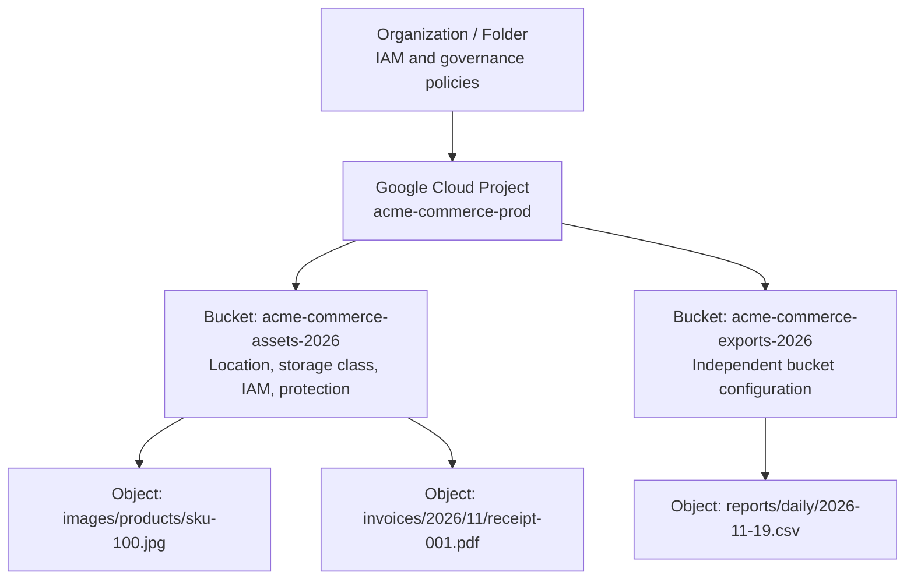
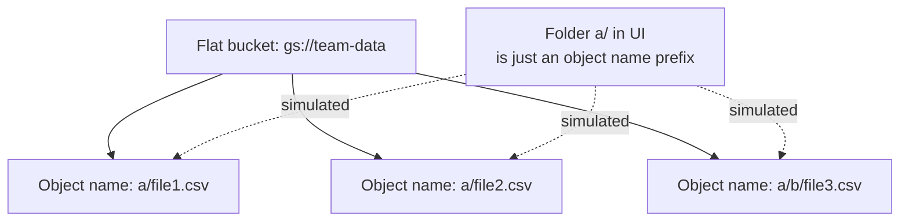
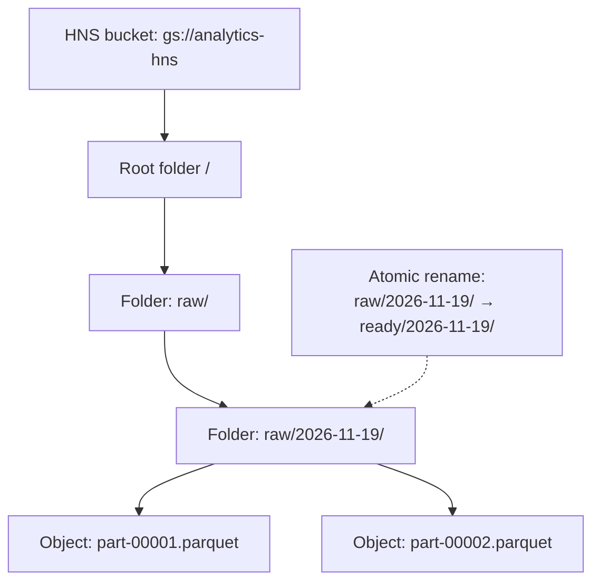
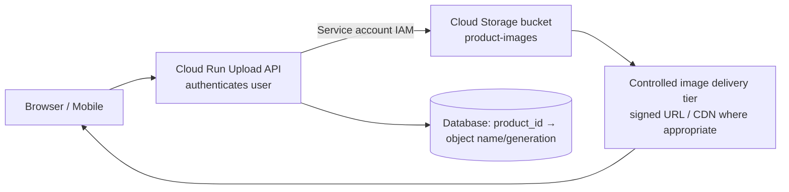

# Cloud Storage Buckets, Objects, and Namespaces

## 1. What Data Model Does Cloud Storage Use?

When building applications on Google Cloud, we often need to store data that does not fit well on a disk attached to a single VM: user-uploaded images, report files, exported logs, AI training data, backups, raw data for analytics systems, or files shared across multiple services. A replaced VM or a recreated Cloud Run container should not cause this data to be lost.

**Cloud Storage** is a managed **object storage** service on Google Cloud. Instead of treating data as blocks on a disk or rows in a database, Cloud Storage organizes data into:

- **Bucket:** a container for data with its own name and governance configuration.
- **Object:** the unit of data stored in a bucket, consisting of content and metadata.
- **Namespace:** how objects are named and organized within a bucket; there are two important modes: **flat namespace** and **hierarchical namespace**.

In the **CLOUD_PROVIDERS_GCP** module, Cloud Storage connects concepts across **Organization/Project, IAM, VPC, Compute Engine, GKE, Cloud Run, storage, security, automated delivery, and cost control**. A sound design does not just pick a place to upload files; it also determines naming, structure, access control, recoverability, and how applications read and write safely.

After this lesson, you will be able to:

1. Describe the **Project → Bucket → Object** hierarchy and distinguish a `gs://` URI from a filesystem path.
2. Explain the naming rules for buckets and objects, as well as **generation** and **metageneration**.
3. Distinguish between a **simulated folder**, a **managed folder**, and a **real folder** in a hierarchical namespace.
4. Choose between a flat or hierarchical namespace based on application needs and incompatible features.
5. Use core `gcloud storage` commands to create buckets, upload objects, list contents, and inspect metadata.
6. Analyze how IAM, uniform bucket-level access, public access prevention, soft delete, location, and storage classes affect design.
7. Apply naming conventions, overwrite controls, and cost governance principles to Cloud Run, Compute Engine, or data pipeline scenarios.

> **Lab Disclaimer:** All Project IDs, bucket names, and object names in the examples are hypothetical. Bucket names must be globally unique, so you must choose an unused name yourself. Commands that create buckets or upload data may incur charges; do not run them against production accounts or data without authorization.

## 2. Resource Hierarchy: Project, Bucket, and Object



Here:

- **Project** is the boundary for resource management, IAM, APIs, quotas, and typically where billing and organization policies attach.
- **Bucket** is created inside a project, but has a **globally unique name**, not just unique within the project. It holds location settings, access control configurations, and data protection properties.
- **Object** is identified by **bucket name + object name**, and when identifying an exact content version, additionally by **generation**.
- **Buckets cannot be nested inside buckets.** There is no `bucket-A/bucket-B` model like directories on a disk.

The path `gs://acme-commerce-assets-2026/images/products/sku-100.jpg` is a **Cloud Storage URI**:

```text
gs://acme-commerce-assets-2026/images/products/sku-100.jpg
     └──────── bucket ────────┘ └──── object name ────┘
```

In a bucket using a flat namespace, `images/products/` is **only part of the object name**; Cloud Storage does not require an intermediate directory resource to exist.

### Comparison with Other Storage Services

| Storage Type | How Data Is Organized | When to Evaluate |
| --- | --- | --- |
| **Cloud Storage** | Buckets and objects | Images, file uploads, backups, data lakes, analytics files |
| **Persistent Disk / Hyperdisk** | Block device attached to a VM | Boot disks, operating systems, workloads requiring block I/O |
| **Filestore** | NFS file system | Applications requiring shared file/POSIX semantics |
| **Cloud SQL** | Database/schema/table/row | Relational data, transactions, SQL queries |
| **BigQuery** | Dataset/table/partition | Large-scale data analytics using SQL |

Cloud Storage **is not** a full POSIX filesystem: by default, it does not support opening an object and appending a few bytes at an arbitrary offset like a file on a disk. If you need frequent small partial file updates or filesystem-level locking, review your application requirements before choosing object storage.

## 3. Bucket: Container and Configuration Boundary

### 3.1. Common Properties

| Bucket Property | Design Question to Answer |
| --- | --- |
| **Name** | Is the name globally unique, free of sensitive info, and practical to operate? |
| **Project** | Who owns the resource? Where do billing, Organization Policies, and admin permissions live? |
| **Location** | Is data stored in a region, dual-region, multi-region, or another supported location option? |
| **Storage class** | Is data accessed frequently or stored long-term? Should Autoclass be used? |
| **Namespace mode** | Flat or hierarchical namespace? Is atomic folder rename required? |
| **IAM/UBLA/PAP** | Who can read/write/delete? Should public access be prevented? |
| **Encryption** | Use default encryption or CMEK/another solution as required? |
| **Soft delete/retention/lifecycle** | How are accidentally deleted files recovered, and when is data cleaned up? |
| **Logging/auditing** | How are access events and critical changes monitored? |

**Settings applied at the bucket level affect the entire system using that bucket.** For example, changing retention or granting broad read permissions on a bucket can impact multiple applications even if each application uses a different object prefix.

### 3.2. Globally Unique Bucket Names

Cloud Storage buckets share a **single global namespace** across all Cloud Storage users. Two different projects—even belonging to two unrelated companies—**cannot own two buckets with the same name**.

Examples:

```text
gs://commerce-prod-assets-2026
gs://acme-analytics-ingest-2026
gs://team-data-public-demo-2026
```

The names above are for illustration only and may already be taken. Key considerations:

- Bucket names must comply with Google Cloud character and length rules, primarily using lowercase letters, digits, `-`, `_`, and dots under supported conditions.
- Do not use uppercase letters, spaces, IPv4-address-like formats, or prefixes/names prohibited by Google Cloud.
- For names containing dots that resemble a domain, **domain ownership verification** may be required.
- Bucket names **can be publicly observable**; do not put passwords, personal emails, record IDs, sensitive customer names, or confidential internal data in bucket names.
- After a bucket is deleted, its name can be reused by someone else. Do not leave old paths or URLs pointing to a released name without evaluating the risk.

**A bucket is not like a project-scoped folder name.** When you see a "bucket name already exists" error, you usually have to choose a different name; merely switching the Project ID or region will not resolve it.

## 4. Object: Content and Metadata

An **object** has two groups of information:

1. **Data**: the file/byte content of the object (JPEG image, CSV, JSON, Parquet, backup archive, etc.).
2. **Metadata**: attributes that describe and control how the data is stored or served.

For example, the object `gs://acme-commerce-assets-2026/images/sku-100.jpg` might have:

| Property | Sample Value | Meaning |
| --- | --- | --- |
| `name` | `images/sku-100.jpg` | Object name within the bucket |
| `bucket` | `acme-commerce-assets-2026` | Bucket containing the object |
| `size` | `245760` | Size in bytes |
| `contentType` | `image/jpeg` | MIME type used when serving content |
| `storageClass` | `STANDARD` | Storage class of the object |
| `generation` | `1760000000000000` | Content version ID (illustrative number only) |
| `metageneration` | `1` | Metadata version of that generation |
| `crc32c` | Service-formatted checksum | Data integrity verification during transfer/storage |
| `custom metadata` | e.g., `source=app-upload` | Custom fields; do not store secrets |

### 4.1. Object Content Is Immutable

Cloud Storage stores objects under an **immutable content** model: once uploaded successfully, you cannot edit a few bytes in the middle of existing content in place.

If an application uploads a new object with the **same bucket + object name**, Cloud Storage performs an **atomic content replacement**: before the write succeeds, readers continue to see the old object; once the write succeeds, readers see the new object. The new object receives a **different generation**.

**Metadata can be updated** without changing the content bytes; when updated successfully, the `metageneration` of the corresponding generation increments.

> **Do not equate an "object name" with a permanently immutable dataset.** The name `reports/latest.csv` can sequentially point to different generations as the system produces new reports.

### 4.2. Generation and Metageneration

| Concept | When It Changes | What It Is Used For |
| --- | --- | --- |
| **Object generation** | When a new content version is created | Pinpointing an exact data version; controlling overwrites |
| **Object metageneration** | When the metadata of that generation is updated | Controlling metadata updates; preventing concurrent edit overwrites |

Two key points to remember:

- `generation` is **unique within the scope of the same object name**, but should **not be treated as a global clock or global sequence number** across all objects.
- `metageneration` must be evaluated **together with generation**. Metageneration `2` of object A has no meaningful comparison with metageneration `2` of object B.

Example:

```text
gs://bucket/reports/monthly.csv
    generation = 10001, metageneration = 1
       ↓ update Content-Type
    generation = 10001, metageneration = 2
       ↓ upload new data with the same name
    generation = 10099, metageneration = 1
```

The numbers `10001` and `10099` only illustrate differing IDs, not the exact spacing or values that appear in practice.

## 5. Object Naming Rules

Object names are scoped **within a bucket** and are **case-sensitive**. For example:

```text
images/logo.png
Images/logo.png
images/Logo.png
```

These can be **three distinct object names** in the same bucket. Do not design applications that rely on object names being automatically lowercased or having spaces/Unicode characters normalized.

### Important Rules

- Object names can contain many valid Unicode characters, but **must not contain CR/LF newline characters** and certain prefixes are restricted.
- In a **flat namespace**, an object name has a limit of **1,024 UTF-8 bytes**. Multi-byte Unicode characters mean the visible character count may be smaller than the byte limit.
- In a **hierarchical namespace**, the full object name is still limited to **1,024 UTF-8 bytes**, while the **folder path and base name each have a separate 512-byte limit** per documentation.
- The `/` character in a name is treated by tools as a directory separator. In a flat namespace, `/` **does not automatically create a real folder resource**.
- Characters such as `#`, `?`, `*`, spaces, and escape sequences can behave differently across shells, URIs, wildcards, or HTTP. Escape/quote properly and **never concatenate URL strings from unvalidated input**.
- Avoid ambiguous paths like `foo//bar.txt` or `../foo` if your code handles object names like local filesystem paths.

### Stable Naming for Data Pipelines

Example of a query-friendly convention:

```text
raw/source=crm/date=2026-11-19/part-00001.jsonl
raw/source=crm/date=2026-11-19/part-00002.jsonl
processed/orders/date=2026-11-19/part-00001.parquet
reports/2026/11/summary.csv
```

A tool can filter object names **starting with the prefix** `raw/source=crm/date=2026-11-19/` without querying a database to locate individual objects. Avoid putting personally identifiable information in object names because names can appear in paths, logs, events, and error messages.

For systems with **very high write rates**, review the request distribution guidelines; strictly sequential naming strings can create hot ranges. Do not apply a single prefix convention across every workload without measuring throughput.

## 6. Flat Namespace: Flat Listing with Folder-Like Prefixes

Most beginners looking at Cloud Storage in the Console see "folders" like `images/` and `reports/`. In a **flat namespace bucket**, this is how the UI **simulates directories**, while actual objects are stored in a flat namespace.



If object `a/file1.csv` is created first, you **do not need to create folder `a/`**. Tools split object names at `/` to render a tree view.

### Behavior When "Renaming" a Flat Folder

Suppose there are 1 million objects starting with `raw/2026/`. In a flat namespace, changing the prefix to `archive/2026/` typically requires **operating on every single object** (copy/move and deleting the old copy). This is not an atomic filesystem rename across the entire tree.

Consequences:

- It can take significant time, incur operation costs, and potentially incur transfer/storage costs depending on how objects are moved.
- There may be a window where both prefixes contain data or where only part of the data has been moved.
- Applications must handle retries, delete permissions, and idempotency.
- For large pipelines, **avoid relying on renaming an entire "folder"** as a commit step.

Flat namespaces are typically well suited when applications primarily **upload, read, and list objects**, without needing to rename large directory trees.

## 7. Three Types of "Folders" in Cloud Storage

Cloud Storage has **three different folder models**. Distinguishing them prevents confusion when managing permissions and writing code.

| Folder Type | Is It a Real Resource? | Purpose | Which Buckets Support It? |
| --- | --- | --- | --- |
| **Simulated folder** | **No**: just an object name prefix | Displaying directory-like structure, listing by prefix | **Flat namespace** |
| **Managed folder** | **Yes**, an IAM management resource | Assigning IAM to a group of objects sharing a prefix or corresponding folder path | **Flat and hierarchical** |
| **Hierarchical folder** | **Yes**, a folder resource in a hierarchical namespace | Organizing objects in a real tree; supports **atomic folder rename** | **Hierarchical namespace** only |

### 7.1. Simulated Folder

With object `finance/2026/report.csv` in a flat bucket, the Console may display "finance → 2026 → report.csv". If you delete that single object, the simulated folder may **disappear from the UI** because no object names with that prefix remain.

Some tools create a marker object like `finance/` to keep an empty folder visible. A marker object **is still just an object**, not a real directory with separate IAM permissions.

### 7.2. Managed Folder

A **managed folder** is a resource primarily designed to **control IAM for objects under a prefix**. For example, you create a managed folder `finance/` and grant read permissions to the Finance group on that resource; the IAM policy can apply to `finance/reports/2026.csv`.

A managed folder can exist **even when no objects** match the prefix. In a flat namespace, it does not turn the entire namespace into a filesystem with real directories.

**Security note:** Managed-folder IAM can grant permissions on a narrower scope than the bucket, but **it does not revoke a broader allow grant already issued at the bucket or project level**. If a user already holds `roles/storage.objectViewer` across the entire bucket, granting a narrower role on a managed folder will not restrict them to seeing only that folder. Least-privilege permissions must be designed from the top down.

### 7.3. Hierarchical Folder

When a bucket has **hierarchical namespace (HNS)** enabled, Cloud Storage maintains **real folder resources**. The object `finance/2026/report.csv` belongs to folder `finance/2026/`; parent folders are managed as components of a tree structure.

HNS supports folder operations such as **create, list, delete, and rename/move** under supported conditions. Renaming a folder can be an **atomic operation** for the object tree inside that folder, unlike multi-object copy/delete in a flat namespace.

An object named `finance/` can still exist as a **separate object** inside folder `finance/`; a trailing slash does not automatically turn an object into a folder resource.

## 8. Hierarchical Namespace (HNS): When Do You Need Real Folders?

HNS is designed for workloads that require **directory semantics** and efficient rename/move operations across many objects, such as certain Hadoop, Spark, AI/ML pipelines, or analytics data organized into many directories.

### 8.1. Folder Mechanism and Atomic Rename



In a batch processing flow, a pipeline can write temporary outputs into `staging/job-123/` and then rename it to `ready/job-123/`. With HNS, the rename operation is designed to be **atomic** instead of copying objects one by one.

However, "atomic rename" **does not automatically mean** that every downstream consumer, database catalog, Pub/Sub event, or downstream cache updates consistently with your business logic. Applications still need publishing rules, retry handling, and job tracking.

### 8.2. HNS Constraints You Must Decide Up Front

According to Cloud Storage documentation:

- **HNS can only be enabled at bucket creation time**; you cannot toggle this option directly on an existing bucket.
- HNS **requires uniform bucket-level access**.
- Folders can be nested up to **50 levels**; folders with associated managed folders have a narrower depth limit (**15 levels**) per documentation.
- Full object names and folder/base name parts are subject to the byte limits noted earlier.
- Several features are **incompatible with HNS** under current documentation: **Object Versioning**, Bucket Lock, object holds, Object Retention Lock, object-level ACLs, cross-bucket replication, and certain bucket relocation options.
- Always check compatibility limits with integrated tools and services (gcloud, Hadoop connector, Storage Transfer Service, backup solutions) before choosing HNS.

**Major implication:** If your application strictly requires **Object Versioning** to retain multiple object versions live within the same bucket, do not create an HNS bucket assuming you can turn on Object Versioning later. Choose a different architecture or recovery strategy.

### 8.3. HNS and Managed Folders

Managed folders still work with HNS, but they have a **relationship with the corresponding folder resource**. When a folder is renamed, its managed folder may be renamed along with it; when a folder is deleted, the attached managed folder and IAM policy may be deleted according to system rules.

Therefore, renaming or deleting an HNS folder is not just an operation on data bytes: it can affect **IAM scope**. Review `storage.folders.*`, `storage.managedFolders.*` permissions, and resulting access after changes.

## 9. Choosing Between Flat and Hierarchical Namespace

| Application Requirement | Flat Namespace | Hierarchical Namespace |
| --- | --- | --- |
| Storing images, file uploads, logs, standard backups | **Well suited** | Can be used, though usually unnecessary |
| Listing objects by prefix | **Yes** | **Yes** |
| Restricting permissions on a prefix with managed folders | **Yes** | **Yes** |
| Creating folder resources independent of objects | No under the simulated folder model | **Yes** |
| Atomically renaming an entire folder tree | **No** under the traditional flat model | **Yes** |
| Requires **Object Versioning** | **Supported** | **Unsupported** under current limits |
| Keeping individual object ACLs | Possible when not using uniform bucket-level access | **No**, because HNS requires UBLA |
| Switching namespace mode after creation | Cannot be switched directly | Cannot be switched directly |
| Large file analytics pipelines that frequently rename folders | Can require costly copy/delete operations | Often worth evaluating |

**How to decide:** Start from **application behavior**. If the application mostly uses upload/read/list APIs and folders are just for visual organization, a flat namespace is usually enough. If the application performs heavy real directory operations and needs atomic rename to publish datasets, HNS is worth evaluating—provided you verify incompatible features when designing the bucket.

If you have an existing flat bucket that needs to move to HNS, the approach is to **create a new HNS bucket and migrate the data** according to a plan, not flip a flag on the existing bucket. Migration planning must account for IAM, metadata, generations, soft delete, client URLs, downtime, and cost.

## 10. IAM: Who Can View, Create, and Delete Objects?

Cloud Storage uses **IAM** to grant permissions on buckets, objects, or managed folders under supported models.

| Common Role | Primary Capabilities | Suitable For |
| --- | --- | --- |
| `roles/storage.objectViewer` | View object content and metadata; corresponding list permissions | Applications/engineers needing read-only access |
| `roles/storage.objectCreator` | Create new objects; should not be treated as having permission to manage/delete all objects | Ingestion pipelines that only write input data |
| `roles/storage.objectUser` | Broader object operations per current role definition | Workers reading/writing/updating data as needed |
| `roles/storage.admin` | Broad bucket and object administration | Storage administrators; **do not** grant by default to every app |

Roles can be attached at the project, bucket, or managed folder level as supported. The **effective principal** for Cloud Run, GKE, or Compute Engine is typically the **workload's service account**, not necessarily the engineer who deployed it.

### 10.1. Uniform Bucket-Level Access (UBLA)

**UBLA** disables **per-object ACLs** so access is controlled strictly via **IAM**. When UBLA is enabled, organizations gain a permissions model that is easier to manage and audit. HNS **requires UBLA**, whereas a flat namespace can use UBLA or legacy mechanisms if still supported.

Do not confuse "UBLA" with "everyone in the bucket has the same permissions." IAM can still scope permissions at the bucket or managed folder level using supported roles and conditions.

### 10.2. Public Access Prevention (PAP)

**Public Access Prevention** helps block public exposure via public principals such as `allUsers` or `allAuthenticatedUsers` according to applicable policies. For internal buckets holding customer files, you should evaluate enabling PAP.

**A `gs://...` URL does not automatically make an object public.** Read access is still governed by IAM. If an application needs to serve files over the internet, choose an intentional design: short-lived signed URLs, an authenticated backend service, an appropriate CDN/load balancer, or controlled public access if genuinely needed.

### 10.3. Managed Folders Are Not "Deny Folders"

Suppose the Finance team has viewer access on the managed folder `finance/`. The Marketing team is not granted access there, but holds `objectViewer` across the **entire bucket** via project IAM. Marketing can still read Finance objects thanks to the broader grant.

To isolate teams, inspect **all effective IAM bindings inherited from ancestors** and consider separate buckets if security or governance requirements diverge significantly.

### 10.4. Combining Application Boundaries

For a Cloud Run image upload application:

```text
User ─HTTPS─> Cloud Run
                │  service account with minimal write permissions
                └─API─> gs://acme-uploads-prod/images/...
```

Cloud Run must authenticate the user and check business authorization **before uploading**. Cloud Run's service account should only hold the necessary Cloud Storage permissions. Never embed service account JSON keys in code or grant `roles/storage.admin` just to upload an image.

## 11. Data Protection: Soft Delete, Versioning, Retention

Because objects can be overwritten or deleted by an authorized principal, you need a recovery plan independent of good naming conventions.

### 11.1. Soft Delete

**Soft delete** retains recently deleted or overwritten objects or buckets for a **recovery window**. Under current default configurations, most buckets supporting soft delete have it enabled by default for **7 days**; you can configure a different duration or disable it where allowed.

Key points:

- Soft-deleted objects **cannot be read or modified like live objects**, though they can be listed/restored via supported APIs and permissions.
- Soft delete is **different from backups**: keeping data in the same bucket with protection policies may not satisfy RPO/RTO or multi-region failure resilience requirements.
- Soft-deleted data **can still incur storage charges** during the retention window.
- If restoring a bucket via CLI/API, you may need to **restore objects separately** after restoring the empty bucket; do not assume one command brings back every file.

### 11.2. Object Versioning

In a **flat namespace bucket** with Object Versioning enabled, uploading over the same object name or deleting the live version under versioning rules allows Cloud Storage to retain **noncurrent generations** so you can access or restore them.

Example:

```text
reports/latest.csv
  generation 100 (noncurrent)
  generation 105 (noncurrent)
  generation 109 (live)
```

**Distinction:**

- **Object Versioning** retains multiple generations so applications can manage version history.
- **Soft delete** keeps deleted objects/buckets in a deleted state for a configured window for recovery.
- **HNS** does not support Object Versioning under current limits; do not design an HNS application assuming versioning can be enabled later.

### 11.3. Lifecycle and Retention

**Object Lifecycle Management** can transition storage classes or delete data based on age, date, and supported conditions. **Retention policy / object retention** protects data from premature deletion under the corresponding mechanism; locking a policy can restrict further changes to it.

Do not conflate these mechanisms:

| Need | Tool to Evaluate |
| --- | --- |
| Recovering a recently deleted file | Soft delete |
| Retaining content versions by generation | Object Versioning on a supported bucket |
| Automatically cleaning up temporary files after an age | Lifecycle rules |
| Preventing data deletion before a compliance period | Retention policy/lock as supported |
| Recovering from major application bugs or regional outages | Dedicated backup/replication/DR design |

**Testing restores** matters far more than seeing an "enabled" checkbox in the Console.

## 12. Location, Storage Class, and Cost

### 12.1. Choosing a Location

A bucket has a **location** that determines where data is stored. Common types include:

| Location | Concept | When to Evaluate |
| --- | --- | --- |
| **Region** | Data within a single region | VM/GKE/Cloud Run apps co-located near data, specific residency needs |
| **Dual-region** | Two configured/supported regions | Need regional fault tolerance and appropriate RPO/replication |
| **Multi-region** | A large geographic area | Content consumed widely across a broad region, matching availability/cost needs |
| **Zone** | For specially supported bucket features like Rapid Bucket | Workloads requiring single-zone locality; must review specific limits |

For example, `asia-southeast1` is a Google Cloud region; choosing it makes sense only when it satisfies residency, latency, and related service requirements. **Do not assume every dual-region/multi-region is cheaper or always delivers the same latency.**

### 12.2. Storage Class Is Not a Folder

Common storage classes:

| Storage Class | Access Pattern | Cost Notes |
| --- | --- | --- |
| **Standard** | Frequent reads, active data | Suitable for many default workloads |
| **Nearline** | Infrequent access | Has retrieval fees and minimum storage duration per pricing |
| **Coldline** | Very infrequent access | Higher retrieval fees and longer minimum storage duration than Nearline |
| **Archive** | Long-term archival, rarely read | Must evaluate retrieval fees and minimum storage duration |
| **Rapid** | Storage for supported Rapid Bucket features | Only available with corresponding location/bucket configurations |

**Storage class is an object property**, with a default class configurable on the bucket; placing an object under `archive/` in its name **does not automatically change** its storage class to Archive. Lifecycle rules or Autoclass can be used to manage class transitions where supported.

### 12.3. Cost Categories

```text
Total Cloud Storage cost typically includes:
  storage capacity per GB/GiB-month by class and location
  + operations (Class A/B or equivalent categories)
  + retrieval / early deletion fees if required by the class
  + network egress / transfer depending on path
  + retained noncurrent versions / soft-deleted objects
  + related features or services if billable
```

For example, consider a bucket holding 1 TiB of temporary files with 7-day soft delete. If a pipeline continuously overwrites or deletes large files, **soft-deleted data can still generate storage charges**, even though applications no longer see them in live object listings. This is why you must estimate costs over the **object lifecycle**, rather than just summing the size of currently visible objects.

Unit prices vary by location, storage class, usage/discounts, and time; do not assume a fixed USD/GB rate across all buckets. Check [Cloud Storage pricing](https://cloud.google.com/storage/pricing) and actual Cloud Billing SKUs.

## 13. CLI Lab: Flat Buckets and Objects

### 13.1. Environment Setup

Suppose:

```text
Project ID: acme-storage-lab
Region: asia-southeast1
Hypothetical flat bucket: acme-storage-lab-unique-2026
Local file: ./sample-report.csv
Object name: reports/2026-11-19/sample-report.csv
```

`gcloud` is installed and authenticated; Compute Engine or Cloud Run does not need to be provisioned just for this exercise. The principal must have appropriate Cloud Storage permissions and the project must have billing configured per policy.

**Read-only** commands:

```bash
gcloud auth list
gcloud config get-value project
gcloud storage ls --project=acme-storage-lab
```

### 13.2. Create a Flat Bucket

```bash
# MUTATING RESOURCE: may incur charges when storing data
# Bucket name must not already be in use anywhere in Cloud Storage
gcloud storage buckets create gs://acme-storage-lab-unique-2026 \
  --project=acme-storage-lab \
  --location=asia-southeast1 \
  --default-storage-class=STANDARD \
  --uniform-bucket-level-access \
  --public-access-prevention
```

This command sets **uniform bucket-level access** and **public access prevention** to initialize an internal lab bucket with safer defaults; application permissions will be granted later. Publishing files to the internet requires a separate, controlled design.

Inspect the bucket:

```bash
gcloud storage buckets describe gs://acme-storage-lab-unique-2026 \
  --format="yaml(name,location,storageClass,iamConfiguration,softDeletePolicy)"
```

Read the actual output and verify the location, storage class, UBLA, PAP, and soft delete settings. Displayed field names may differ between normalized CLI output and JSON API output.

### 13.3. Upload, List, Inspect Metadata, and Download

```bash
# Upload a file: creates an object whose name contains multiple slashes
gcloud storage cp ./sample-report.csv \
  gs://acme-storage-lab-unique-2026/reports/2026-11-19/sample-report.csv

# Read-only: list objects under a prefix
gcloud storage ls \
  gs://acme-storage-lab-unique-2026/reports/2026-11-19/

# Read-only: view object metadata
gcloud storage objects describe \
  gs://acme-storage-lab-unique-2026/reports/2026-11-19/sample-report.csv

# Download to a new file to verify content
gcloud storage cp \
  gs://acme-storage-lab-unique-2026/reports/2026-11-19/sample-report.csv \
  ./downloaded-report.csv
```

After uploading, inspect **object name**, `generation`, `metageneration`, `size`, `contentType`, and `storageClass`. Does the downloaded file match the original? If you upload a different file to the **same path**, how does the new generation change?

> **Do not re-upload over a production object just to test generation behavior.** When a name already exists, an upload command can replace the current live version; versioning, preconditions, and soft delete determine whether recovery is possible.

### 13.4. Inspect Soft Delete Status

```bash
# Read-only: soft delete policy on the bucket
gcloud storage buckets describe gs://acme-storage-lab-unique-2026 \
  --format="default(soft_delete_policy)"
```

Do not delete production data in this lesson. If you want to test restore, use a **test object** and a procedure that verifies all required `storage.objects.restore` permissions.

## 14. CLI Lab: Hierarchical Folders and Managed Folders

### 14.1. Create a New HNS Bucket

Because HNS can only be selected at bucket creation time, use a **different bucket**:

```bash
# MUTATING RESOURCE: do not run in production
gcloud storage buckets create gs://acme-hns-lab-unique-2026 \
  --project=acme-storage-lab \
  --location=asia-southeast1 \
  --uniform-bucket-level-access \
  --enable-hierarchical-namespace
```

The `--enable-hierarchical-namespace` flag must be combined with `--uniform-bucket-level-access` per CLI requirements. HNS cannot be enabled on an existing flat bucket.

### 14.2. Create Real Folders

```bash
# Create a folder resource in an HNS bucket
gcloud storage folders create \
  gs://acme-hns-lab-unique-2026/datasets/

# Create missing intermediate folder levels in a path
gcloud storage folders create --recursive \
  gs://acme-hns-lab-unique-2026/datasets/2026/11/
```

When uploading object `datasets/2026/11/part-001.parquet` into an HNS bucket, missing folders along the path may also be created per service behavior. This differs from a flat namespace: in HNS, folders **actually exist** and have their own lifecycle/metadata.

### 14.3. Create a Managed Folder for IAM Management

Managed folders can be used **in both flat buckets and HNS buckets**:

```bash
# CREATE a resource for managing IAM on the finance/ prefix
gcloud storage managed-folders create \
  gs://acme-storage-lab-unique-2026/finance/

# Read-only: inspect the managed folder
gcloud storage managed-folders describe \
  gs://acme-storage-lab-unique-2026/finance/
```

Once a managed folder is created, an administrator can grant an IAM policy on that folder using supported tools and permissions. **Creating a managed folder does not automatically grant access to anyone**, nor does it turn a simulated folder into a hierarchical folder.

**A deletion distinction:** a managed folder carrying IAM policies and underlying data should not be deleted carelessly. With HNS, folder rename/delete operations can affect managed folders attached to the same path; review permissions beforehand.

## 15. Strong Consistency, Caching, and Concurrent Writes

### 15.1. Strong Consistency

Cloud Storage guarantees **strong global consistency** for key operations such as:

- Reading an object after a successful upload or replacement.
- Reading object metadata after a successful update.
- Listing objects and buckets under published consistency guarantees.
- Reading after a successful delete under the corresponding state model.

For example, once an upload command returns success, an authorized client can **read the new object** without waiting an arbitrary synchronization delay. There is no need to add `sleep 30` to guarantee consistency for normal object writes.

**Design exception to remember:** if an object is served through a **CDN, browser cache, or intermediate proxy cache**, cached content may continue to appear until its TTL/cache headers expire. That is caching behavior, not inconsistency in Cloud Storage. IAM/policy changes also have their own propagation delay.

### 15.2. Overwrites and Preconditions

Suppose two workers, A and B, both generate `reports/latest.csv`. If both upload directly without checks, a **lost update** can occur: the latest generation silently overwrites the other worker's result.

Cloud Storage supports **request preconditions**, for example:

| Precondition | Meaning |
| --- | --- |
| `ifGenerationMatch=0` | Create the object only if no live version with that name currently exists |
| `ifGenerationMatch=N` | Execute only if the current generation matches N |
| `ifMetagenerationMatch=M` | Update metadata only if the metageneration matches M |

Example of a safe execution sequence:

```text
1. Worker A reads metadata: generation = 100
2. Worker B reads metadata: generation = 100
3. Worker A uploads with ifGenerationMatch=100 → succeeds, new generation
4. Worker B uploads with ifGenerationMatch=100 → fails because condition no longer matches
5. Worker B decides to re-read, merge data, or report a conflict
```

This is an **API logic illustration**, not fixed values you will observe in Google Cloud. In code, use client libraries or REST APIs that support **generation/metageneration preconditions**, and handle precondition errors (e.g., HTTP `412 Precondition Failed`) appropriately.

### 15.3. Designing Object Names to Avoid Races

For pipeline outputs, it is better to create **immutable names per job/run**, such as `jobs/run-20261119-001/output.parquet`, and then update a small manifest or database record pointing to the completed generation. This approach:

- Prevents two jobs from unknowingly overwriting a shared `latest.parquet` file.
- Enables controlled retries.
- Supports auditing and identifying the exact object version used in a report.
- Reduces the risk of downstream consumers reading objects that are not part of a finalized publication.

## 16. Design Scenario 1: Product Image Application

A Cloud Run service receives product images, stores them in Cloud Storage, and returns URLs to the frontend. The data must be served to many users, while only the product owner is allowed to update images.

### Recommended Architecture to Evaluate



Design:

1. Choose a bucket location meeting latency/residency needs and a storage class suited for frequently read images.
2. Choose a **flat namespace** if you mainly store, read, and list images without needing atomic directory tree renames.
3. Do not use sensitive user emails or names as object prefixes; use product codes and random/unpredictable IDs if needed.
4. Give the Cloud Run service account only the required Cloud Storage permissions; let the API enforce who is allowed to update a product.
5. When replacing images, track **generation** or use versioned URLs to avoid stale caches.
6. Enable appropriate safeguards such as UBLA, PAP, soft delete, and lifecycle rules for old images.
7. Monitor storage usage, request counts, egress, cache hit rate, and billing.

**Avoid:** making the entire bucket publicly readable just because some images need public display; evaluate signed URLs or a controlled distribution tier.

## 17. Design Scenario 2: Data Lake and Batch Processing

An analytics team runs pipelines on GKE/Compute Engine. Millions of Parquet objects are produced daily; a job must finish generating the entire daily dataset before publishing it to readers.

### When a Flat Namespace Suffices

The pipeline writes immutable objects:

```text
gs://analytics-flat/events/date=2026-11-19/part-00001.parquet
gs://analytics-flat/events/date=2026-11-19/part-00002.parquet
gs://analytics-flat/manifests/date=2026-11-19.json
```

After all parts finish, it creates a manifest containing the object list and generations. Readers only consume objects listed in a valid manifest. This pattern requires **no folder renames** and works well on a flat namespace.

### When HNS Is Worth Evaluating

A legacy data processing system expects filesystem-like semantics:

```text
staging/job-934/
    part-00001.parquet
    part-00002.parquet
        ↓ atomic folder rename
ready/job-934/
    part-00001.parquet
    part-00002.parquet
```

HNS can provide a suitable atomic folder rename. However, you must evaluate:

- Are any features restricted by HNS (especially **Object Versioning**) required by the workflow?
- Do IAM managed folders change when renamed?
- Do the Hadoop/Spark tools and data catalog support the chosen namespace mode?
- What are the job output file boundaries, idempotency guarantees, and retry behaviors?
- What are the storage, operations, soft delete, egress, and data growth costs?

**There is no single mandatory choice for every data lake.** HNS solves folder-manipulation requirements, yet an application-level manifest/transaction layer may still be necessary.

## 18. Common Errors and How to Diagnose Them

| Symptom | Common Cause | How to Verify |
| --- | --- | --- |
| Bucket creation fails even though the project is empty | Bucket name is already taken elsewhere | Pick a different globally unique name; check naming rules |
| `403 Forbidden` on upload | Service account lacks `storage.objects.create` or related permission | Check effective principal and IAM on project/bucket/managed folder |
| Cannot list objects, but can read a specific object | Principal lacks `storage.objects.list` | Distinguish between `get` and `list` permissions |
| Uploaded just now, but folder is missing in Console | Flat prefix has no object, UI filter, or wrong path | List raw object names directly; understand simulated folders |
| Folder disappears after deleting the last file | It was a simulated folder | Do not confuse with a managed folder or an HNS folder |
| Cannot enable HNS on an old bucket | Namespace mode is chosen at creation time | Create a new HNS bucket and plan a migration |
| Cannot enable Object Versioning on an HNS bucket | HNS does not support Object Versioning under current limits | Use a flat bucket or an alternative backup/restore strategy |
| "Folder" rename is very slow | Flat rename performs many individual object operations | Evaluate HNS or a manifest workflow that avoids renames |
| Users can still read data outside a managed folder | Broad IAM allow grant exists at bucket/project level | Inspect all effective IAM bindings |
| Deleted files still incur charges | Soft delete/noncurrent versions/lifecycle/retention | Check policies, billing SKUs, and object states |
| Reading an old URL shows stale content | CDN/browser/proxy cache | Check Cache-Control headers, versioned URLs, and TTL |
| `report.csv` gets overwritten by another job | Not using generation preconditions or per-run names | Use `ifGenerationMatch`, manifests, and safe retries |
| Object names with `/` behave differently from a filesystem | Flat namespace has no real directory hierarchy | Check raw object names and URL encoding |
| Cloud Run upload API fails even though admin CLI works | Cloud Run runs under a different service account | Check runtime identity and IAM scope of the service |

### Short Investigation Workflow

1. Identify the **project, bucket name, object name, and generation** (if applicable).
2. Inspect bucket location, namespace mode, UBLA, PAP, and soft delete settings.
3. Identify the **actual principal** executing the command/API (user, VM, Cloud Run, or GKE).
4. Check IAM roles at the project, bucket, and managed folder levels along with any conditions.
5. Distinguish among **object not found**, **permission denied**, **caching**, **soft-deleted state**, and **precondition failure**.
6. Inspect Cloud Audit Logs, Cloud Monitoring, request/response codes, and billing if the issue persists.
7. Make only the smallest necessary permission or configuration change; never make a bucket public just to troubleshoot a `403`.

## 19. Self-Assessment Exercises

### Exercise 1: Parsing a URI

Given the URI:

```text
gs://acme-exports-prod/reports/2026/11/order-summary.csv
```

Identify the bucket name and object name. In a flat namespace, must the three real folders `reports/`, `2026/`, and `11/` exist?

**Answer:** The bucket is `acme-exports-prod`; the object name is `reports/2026/11/order-summary.csv`. No folder resources are required in a flat namespace.

### Exercise 2: Naming and Versioning

An application re-uploads `images/logo.png` three times, each with different content. Explain why the same object name can have three different generations; distinguish between a metadata update and uploading new content.

**Hint:** Re-uploading creates a new content generation; updating metadata on an existing generation increments its metageneration. Object Versioning or soft delete determines whether earlier generations remain accessible or recoverable.

### Exercise 3: Choosing a Namespace Mode

A Spark pipeline continuously renames a folder containing hundreds of thousands of objects as a publish step. The team also wants to enable Object Versioning. Explain the **conflict** and propose two design options.

**Hint:** HNS provides atomic folder renames but does not support Object Versioning under current restrictions. You can either choose HNS and implement backups/versioning at the application layer, or choose a flat namespace with a manifest/commit protocol to eliminate folder renames while keeping versioning.

### Exercise 4: Managed Folder Permissions

One team only has viewer access on the managed folder `finance/`. However, another team holds `roles/storage.objectViewer` across the entire bucket. Can you conclude that the second team cannot read `finance/payroll.csv`?

**Answer:** No. You must evaluate all allow grants; managed folders do not automatically deny broad permissions inherited from the bucket or project.

### Exercise 5: Concurrent Writes

Two workers both read object generation `500` and want to replace its content. If both send `ifGenerationMatch=500`, what happens to the second worker? Why does this prevent lost updates?

**Hint:** After the first worker succeeds and the generation changes, the second write using the old generation is rejected by the precondition. The second worker must re-read and decide whether to retry or handle the conflict.

### Exercise 6: Storage Estimation

A bucket holds 1,000 live objects, each 10 MiB. The system overwrites all of them daily and uses a 7-day soft delete window. Why might the storage bill exceed the byte size of the 1,000 visible objects?

**Hint:** Overwritten object versions may remain in a soft-deleted state and continue incurring storage charges; there are also operation, network, and retrieval costs depending on the storage class. You cannot estimate the bill from the live object list alone.

## 20. Cloud Storage Design Checklist

- [ ] Bucket name is **globally unique**, free of sensitive data or risky identifiers.
- [ ] Project/billing owner and Organization Policies are identified.
- [ ] Location meets residency, latency, multi-region, and cost requirements.
- [ ] Storage class / Autoclass matches access frequency and retention duration.
- [ ] **Flat vs. HNS chosen prior to creation**; HNS constraints, especially Object Versioning, are understood.
- [ ] Clear object naming convention in place, avoiding PII and Unicode/slash ambiguities.
- [ ] Application distinguishes **object name, generation, and metageneration**.
- [ ] Critical update/overwrite operations use preconditions or race-avoidance patterns.
- [ ] IAM is granted to the correct runtime service account at the proper bucket/managed folder scope.
- [ ] UBLA and public access prevention are evaluated; no unintended broad allow grants exist.
- [ ] Soft delete, versioning/retention/lifecycle, and restore testing plans are in place.
- [ ] Simulated folders are not treated as real IAM resources; managed folders are not confused with HNS folders.
- [ ] If HNS renames/deletes folders, impacts on managed folders and IAM have been reviewed.
- [ ] Logging/metrics, handling for 403/404/412 errors, retries, and idempotency are implemented.
- [ ] Storage, operations, retrieval, early deletion, soft-deleted/noncurrent data, and egress are estimated.
- [ ] Migration plan exists for any future change to bucket name, namespace mode, or location.

## 21. Official Google Cloud Documentation

The following links provide current specifications and limits:

1. [Cloud Storage overview](https://cloud.google.com/storage/docs/introduction)
2. [About Cloud Storage buckets](https://cloud.google.com/storage/docs/buckets)
3. [About Cloud Storage objects](https://cloud.google.com/storage/docs/objects)
4. [Folder types in Cloud Storage](https://cloud.google.com/storage/docs/folder-types)
5. [Hierarchical namespace overview and limitations](https://cloud.google.com/storage/docs/hns-overview)
6. [Folders in hierarchical namespace buckets](https://cloud.google.com/storage/docs/folders-overview)
7. [Create buckets with hierarchical namespace](https://cloud.google.com/storage/docs/create-hns-bucket)
8. [Managed folders](https://cloud.google.com/storage/docs/managed-folders)
9. [Cloud Storage object metadata](https://cloud.google.com/storage/docs/metadata)
10. [Cloud Storage consistency](https://cloud.google.com/storage/docs/consistency)
11. [Object Versioning](https://cloud.google.com/storage/docs/object-versioning)
12. [Soft delete overview](https://cloud.google.com/storage/docs/soft-delete)
13. [Bucket locations](https://cloud.google.com/storage/docs/locations)
14. [Storage classes](https://cloud.google.com/storage/docs/storage-classes)
15. [Cloud Storage pricing](https://cloud.google.com/storage/pricing)
16. [gcloud storage CLI reference](https://cloud.google.com/sdk/gcloud/reference/storage)

**Key Takeaway:** A bucket is a **container with its own governance configuration**, an object is a **data unit with metadata and generation**, and the namespace determines **how object names are organized**. A **flat namespace** suits many file-storage apps and simulates directories via prefixes; a **hierarchical namespace** provides real folders with atomic folder renames, but carries feature constraints that must be evaluated at bucket creation time. IAM permissions, data protection policies, and object lifecycles are just as critical as naming conventions.
