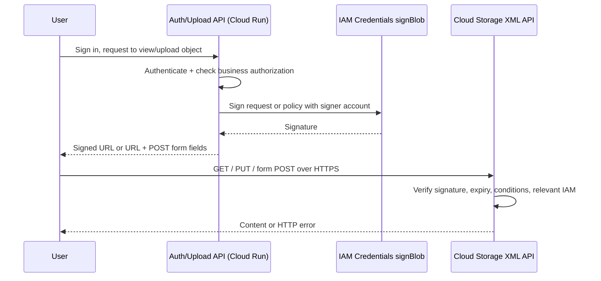
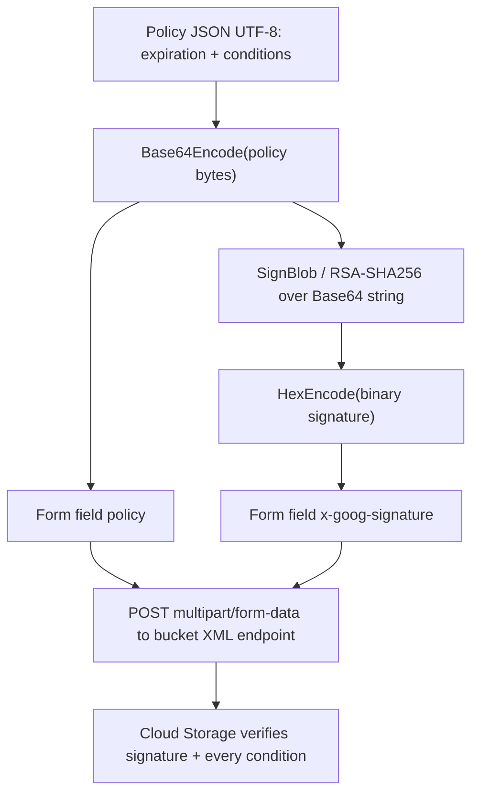
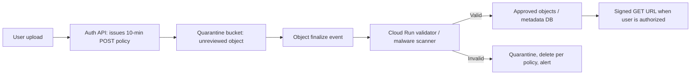

# Signed URLs and Signed Policy Documents

An e-commerce application stores PDF invoices and product images in Cloud Storage. Customers need to download invoices through their browsers, yet **should not be granted direct IAM permissions on the bucket**. When submitting review photos, customers need to upload files straight to Cloud Storage without routing through the app server—while being prevented from writing to arbitrary object names or uploading oversized files. These two requirements have similar signature-based solutions, yet **they are not the same mechanism**:

- **Cloud Storage signed URL**: grants temporary permission to execute one specific HTTP request—such as `GET` or `PUT`—on a specific resource.
- **Signed policy document**: describes and signs the **conditions for an HTML form upload** using `POST`, including bucket, object name/prefix, content type, file size, and expiration.

This lesson belongs to the **Cloud Storage** chapter in the `CLOUD_PROVIDERS_GCP` module. It connects project organization, IAM, VPC, Compute Engine, GKE, Cloud Run, storage, deployment, and system monitoring with resource security, scalability, and cost requirements. The goal is **scoped delegation, never sharing private keys, never accidentally making buckets public, and end-to-end verification of upload/download paths**.

> **Security Note:** Signed URLs and signed policy forms are *bearer credentials*. Anyone holding a valid token or form fields can use them until expiration or until the associated key/permissions are invalidated. A signature does not verify the user's login session, does not encrypt the object, and does not stop someone who has downloaded the data from saving or resharing it.

## 1. Learning Outcomes

After this lesson, you will be able to:

1. Distinguish signed URLs, signed policy documents, IAM OAuth, public access, and Cloud CDN signed URLs/cookies.
2. Explain V4 parameters such as `X-Goog-Algorithm`, `X-Goog-Credential`, `X-Goog-Date`, `X-Goog-Expires`, `X-Goog-SignedHeaders`, and `X-Goog-Signature`.
3. Use `gcloud storage sign-url` to issue download URLs or `PUT` upload URLs.
4. Design V4 POST policies with `expiration`, `conditions`, `eq`, `starts-with`, and `content-length-range`.
5. Assign permissions for the signing service account and the object-accessing service account, using the IAM Credentials API instead of distributing private keys.
6. Handle CORS, object-name collisions, overwrite permissions, malicious content, token lifetimes, upload verification, and `403` error scenarios.
7. Analyze reliability, cost controls, testing, and deployment workflows on Cloud Run, Compute Engine, or GKE.

## 2. Authorization Model: Backend Signs, Client Uses

Normally **end users do not hold service account keys or GCP access tokens**. The application authenticates the user, decides which object they may access, and issues a short-lived credential.



In a real system, client libraries can call the IAM Credentials API on your behalf; you do not necessarily issue raw `signBlob` requests manually. Signing permission for the application must be separated from object-access permissions:

- **Permission to issue signatures**: the backend is authorized to call `iam.serviceAccounts.signBlob` on the signing service account.
- **Permission to perform the operation**: the service account named in the signature must hold `storage.objects.get`, `storage.objects.create`, and/or `storage.objects.delete` matching the intended action.
- **In-app user authorization**: for example, a user may only download their own invoices or upload images into a path containing their own upload identifier.

If a backend accidentally issues a signed URL that writes to an arbitrary object path, keeping the bucket private will not stop anyone holding that URL from exercising **the permission delegated by the backend**.

### 2.1. Comparing Access Mechanisms

| Mechanism | Where Verified | Use Case | Limitations to Watch |
| --- | --- | --- | --- |
| **Cloud Storage V4 signed URL** | Cloud Storage **XML API endpoint** | GET/HEAD/PUT and supported requests on a specific resource | HTTP method, URL, signed headers/query, TTL; bearer link can be shared |
| **Cloud Storage signed policy document** | Cloud Storage XML API **HTML form POST** | Browser uploads one file to a bucket under multiple conditions | Form policy, prefix/key, size, metadata; one object per POST |
| **OAuth 2.0 + IAM** | Cloud Storage API with client/service identity | Backends, GKE/Compute Engine jobs, trusted services accessing GCS regularly | Caller needs real credentials and IAM permissions |
| **Cloud CDN signed URL/cookie** | Cloud CDN on a configured load balancer/backend | Serving cached content, multi-segment video | Algorithms/fields and origin protection are completely different from Storage V4 |
| **Public object** | No viewer token required | Intentionally public static assets | Unsuitable for invoices, unreviewed images, or personal data |

Cloud Storage signed URLs **apply only to XML API endpoints**, such as `https://storage.googleapis.com/BUCKET/OBJECT`; they do not turn JSON API links or `gs://` paths into browser download URLs. In particular, **HTML form POST does not use a signed URL**: you need a signed policy document to grant form upload access without opening the bucket to anonymous writes.

## 3. What Are the Components of a V4 Signed URL?

Illustrative example—the placeholder signature cannot be executed:

```text
https://storage.googleapis.com/orders-private/invoices/INV-1001.pdf
  ?X-Goog-Algorithm=GOOG4-RSA-SHA256
  &X-Goog-Credential=signer%40project.iam.gserviceaccount.com%2F20261119%2Fauto%2Fstorage%2Fgoog4_request
  &X-Goog-Date=20261119T090000Z
  &X-Goog-Expires=900
  &X-Goog-SignedHeaders=host
  &X-Goog-Signature=HEX_SIGNATURE
```

In a real URL, the segments are joined onto **one line** and special characters are properly URL-encoded. Dates and times above are illustrative only, not active credentials.

| Parameter | Meaning | Common Errors |
| --- | --- | --- |
| `X-Goog-Algorithm` | Usually `GOOG4-RSA-SHA256` with a service account signer, or `GOOG4-HMAC-SHA256` with an HMAC key | Using an algorithm that does not match the key type |
| `X-Goog-Credential` | Signer identity and credential scope `DATE/LOCATION/storage/goog4_request` | Scope mismatch on date, email, or encoding |
| `X-Goog-Date` | Start timestamp in UTC format `YYYYMMDDTHHMMSSZ` | Server clock skew or using local timezone |
| `X-Goog-Expires` | TTL in seconds from `X-Goog-Date` | V4 URLs allow at most **604,800 seconds (7 days)** |
| `X-Goog-SignedHeaders` | List of signed headers; must include `host` | Client fails to send the exact signed headers |
| `X-Goog-Signature` | Signature authenticating the canonical request | Modifying path/query/method after signing |

Google Cloud recommends **short** TTLs rather than defaulting to the maximum. Signatures created via `signBlob` using Google-managed service account keys also have a **key rotation** caveat: if you issue a signature with a TTL over 12 hours, the signature may become invalid before its intended expiration after at least 12 hours. For sensitive access paths, TTLs of a few minutes or tens of minutes align much better with revocation and monitoring.

### 3.1. Signed URLs Are Bound by Both Method and Headers

When a backend signs a `GET` URL, a client cannot treat it as a valid `PUT` URL. A URL signed for `PUT` with the header `Content-Type: image/png` must be sent with the matching header; if the client changes it to `image/jpeg`, the signature will fail validation.

Post-signing changes that commonly produce `403 SignatureDoesNotMatch`:

- Changing the hostname from `storage.googleapis.com` to a host not in the canonical request;
- Adding or removing signed query parameters, or altering path/object name encoding;
- Using the wrong HTTP method or signed header;
- Adding an `x-goog-*` header that must be signed without including it in the canonical request;
- Routing a signed URL through a proxy that rewrites the host, query, or signed headers.

Conversely, headers **not listed in `X-Goog-SignedHeaders`** are not constrained by the signature; do not assume a URL automatically restricts every property of a request. To enforce **upload size limits**, a POST policy with `content-length-range` is generally clearer than a PUT URL lacking proper size restrictions.

### 3.2. Canonical Request Model (Conceptual—Do Not Fabricate Bytes)

V4 signing is built from a canonical request string:

```text
HTTP_METHOD
CANONICAL_URI
CANONICAL_QUERY_STRING
CANONICAL_HEADERS

SIGNED_HEADERS
PAYLOAD_HASH
```

This string is SHA-256 hashed and placed into a **string-to-sign** containing algorithm, timestamp, credential scope, and digest, then signed with RSA-SHA256 or HMAC-SHA256 depending on the key mechanism. The canonical query string must be sorted strictly, with header names lowercased and values normalized. Implementing this manually requires exact handling of percent-encoding, `/` characters, and UTF-8 bytes; **prefer Google Cloud client libraries or `gcloud`**.

## 4. Setting Up IAM for a Signing Service

A secure layout can look like:

```text
Project: orders-prod
  Bucket: gs://orders-private
    invoices/  -> read by signer-download
    uploads/   -> object creation by signer-upload
  Cloud Run: orders-auth-api
    Runtime identity: orders-api-runtime@...
  Signer accounts:
    signer-download@...
    signer-upload@...
```

| Principal | Required Permissions | Scope |
| --- | --- | --- |
| `signer-download` | `storage.objects.get`, e.g. `roles/storage.objectViewer` | Bucket or appropriately narrower scope |
| `signer-upload` | `storage.objects.create`, e.g. `roles/storage.objectCreator` | Only where new object creation is allowed |
| Signer permitted to overwrite | Also needs `storage.objects.delete` when overwriting existing objects per Cloud Storage rules | Avoid granting unless genuinely needed |
| Signing runtime | `iam.serviceAccounts.signBlob` on each signer account, typically via `roles/iam.serviceAccountTokenCreator` | Grant directly on the specific signer, not organization-wide |
| End user | Needs no Cloud Storage IAM when using signed links/policies | Needs only in-app authorization and an unexpired bearer credential |

In many setups, `roles/storage.objectUser` bundles read/write/delete capabilities, which is **broader** than separating the two roles above. Consider IAM Conditions, managed folders, or separate buckets per permission boundary; signing a `PUT` with an overwritable object name carries clear risk.

To sign using the IAM Credentials API:

1. Enable the **Service Account Credentials API** for the relevant project.
2. Ensure the runtime has `iam.serviceAccounts.signBlob` on the signing service account.
3. Ensure the signing service account has permission to read or create the corresponding objects in the bucket.
4. Use ADC/workload identity on Cloud Run, GKE, or Compute Engine; never download JSON private keys into your repository.
5. Protect the token-issuing endpoint with authentication, rate limits, redacted logging, and anti-abuse controls.

**Distinguish two permission checks:** a runtime holding `signBlob` does not automatically hold `storage.objects.get`; a signer holding `storage.objects.get` does not automatically grant the runtime permission to sign on its behalf.

## 5. Issuing a Signed GET URL with `gcloud`

Assuming private bucket `orders-private` already exists and contains `invoices/INV-1001.pdf`. The following command **only issues a bearer URL**; it does not modify IAM or the bucket and does not download the file:

```bash
gcloud storage sign-url \
  gs://orders-private/invoices/INV-1001.pdf \
  --impersonate-service-account=signer-download@orders-prod.iam.gserviceaccount.com \
  --duration=10m
```

Prerequisites: the caller has signing permission via the IAM Credentials API, and the signer has read permission on the object. The output contains a live credential URL, so **never paste it into CI logs, issues, analytics, error trackers, or public chats**.

The client receiving the URL can run:

```bash
# SANDBOX: set variable in an isolated session; never commit bearer URLs.
SIGNED_URL="SIGNED_GET_URL_FROM_BACKEND"

# Download using the exact issued URL; do not alter query, method, or hostname.
curl --fail --show-error --location \
  --output invoice.pdf \
  "$SIGNED_URL"
```

This downloads the file to the client machine, succeeding only while the URL is unexpired, the object exists, the signer holds permission, and the request preserves all signed components. For sensitive documents, ensure the local destination is secure.

## 6. Signed PUT URL: Uploading a Specific Object

Unlike GET, PUT can create or replace an object. Example granting upload access for a PNG image with a backend-generated name:

```bash
# ISSUES URL ONLY: signs request; requires signer to hold storage.objects.create.
gcloud storage sign-url \
  gs://orders-private/uploads/user-42/9d4e8b2c.png \
  --impersonate-service-account=signer-upload@orders-prod.iam.gserviceaccount.com \
  --http-verb=PUT \
  --duration=10m \
  --headers=content-type=image/png
```

The client uses the server-issued URL:

```bash
SIGNED_PUT_URL="SIGNED_PUT_URL_FROM_BACKEND"

# WRITES OBJECT TO CLOUD STORAGE: test only against authorized sandbox buckets/objects.
curl --fail --show-error \
  --request PUT \
  --header "Content-Type: image/png" \
  --upload-file ./picture.png \
  "$SIGNED_PUT_URL"
```

**Do not use `-F file=@...` with a signed PUT URL**: that sends `multipart/form-data` for a form POST instead of the raw body bytes expected by a PUT Object request. If the server signed `Content-Type`, the client must send the exact matching value.

### 6.1. Preventing Overwrites and Upload Abuse

An existing object with the same name can be replaced by a new upload if the signer has sufficient permissions. Safe practices:

- Have the backend generate **random, unpredictable, per-upload object names**; never let clients pick paths directly.
- Namespace as `uploads/USER_ID/UPLOAD_ID`, linked to a server-side record to verify ownership.
- Use a signer with only `storage.objects.create` when the workflow **does not need overwrites**; where generation/precondition parameters are supported by the API, consider `ifGenerationMatch=0` or equivalent logic to block races/overwrites and test thoroughly.
- Limit TTLs, token issuance rates, and app quotas; a bearer URL can be reused multiple times before expiration if requests and permissions permit.
- Validate file size, actual MIME type, malware scans, and malicious payloads **after upload** before moving objects to a public area.

Signing `Content-Type: image/png` constrains the **metadata header** sent by the client; it does not prove the bytes actually represent a valid PNG. Nor is a signed PUT URL a multi-condition file-size enforcement mechanism like a POST policy.

## 7. Python Backend Example for Generating Signed URLs

The Google Cloud Storage client library provides `blob.generate_signed_url()`. The short snippet below illustrates **V4 GET** and **V4 PUT** in an environment with signing-capable credentials:

```python
from datetime import timedelta
from google.cloud import storage


def make_get_url(bucket_name: str, object_name: str) -> str:
    client = storage.Client()
    blob = client.bucket(bucket_name).blob(object_name)
    return blob.generate_signed_url(
        version="v4",
        expiration=timedelta(minutes=10),
        method="GET",
    )


def make_put_url(bucket_name: str, object_name: str) -> str:
    client = storage.Client()
    blob = client.bucket(bucket_name).blob(object_name)
    return blob.generate_signed_url(
        version="v4",
        expiration=timedelta(minutes=10),
        method="PUT",
        content_type="image/png",
    )
```

This illustrates the API surface and is **not standalone runnable**. Credentials must support signing: some local ADCs containing only a user access token **cannot sign directly**. On Cloud Run or Compute Engine with keyless service accounts, configure signing via IAM `signBlob` / service account impersonation or the library's supported signing parameters; check your library version carefully. Official docs also provide examples in `gcloud`, Go, Java, Node.js, and C#.

To avoid issuing misscoped signed URLs in production APIs, **authenticate and check ownership before calling the signing function**. When returning URLs in JSON, never log the full response and never let a CDN or proxy cache API responses containing private tokens.

## 8. Signed Policy Document: Signatures for HTML Form POST

A V4 **signed policy document** authorizes uploading an object via an HTML form to the Cloud Storage **XML POST Object API**. Unlike a signed URL, the server does not sign a fixed `PUT` URL; instead, it signs a **policy JSON defining the conditions the form must satisfy**.

A signed upload form includes:

1. `action` pointing to the XML API bucket endpoint, e.g. `https://storage.googleapis.com/orders-private`;
2. `method="post"` and `enctype="multipart/form-data"`;
3. `key` field specifying the target object name;
4. `policy` field containing the Base64-encoded UTF-8 JSON policy;
5. signing fields `x-goog-algorithm`, `x-goog-credential`, `x-goog-date`, and `x-goog-signature`;
6. `file` field containing the file content, which **must be the last field in the form request**.

Form POST handles **one object per request**. It is not a multipart upload protocol in the sense of splitting a large file into parts with an upload ID, nor is it a Cloud Storage JSON API multipart upload. The name `multipart/form-data` merely describes the HTTP form encoding.

### 8.1. Illustrative Policy JSON

Example policy allowing PNG uploads only to an **exact object name**, sized from 1 byte to 5 MiB:

```json
{
  "expiration": "2027-01-10T12:00:00Z",
  "conditions": [
    {"bucket": "orders-private"},
    ["eq", "$key", "uploads/user-42/9d4e8b2c.png"],
    ["eq", "$Content-Type", "image/png"],
    ["content-length-range", 1, 5242880],
    {"success_action_status": "201"},
    {"x-goog-algorithm": "GOOG4-RSA-SHA256"},
    {
      "x-goog-credential": "signer-upload@orders-prod.iam.gserviceaccount.com/20270110/auto/storage/goog4_request"
    },
    {"x-goog-date": "20270110T115000Z"}
  ]
}
```

Dates, bucket, and credentials above are illustrative values and **not a signed policy**. In production, the backend generates the UTC timestamp and short expiration at request time. Issue it to users only after authentication and authorization—never pre-sign policies months ahead.

| Component | Role | Pitfall to Avoid |
| --- | --- | --- |
| `expiration` | Policy expiration (UTC timestamp) | Uploads after expiry are rejected |
| `conditions` | **Every condition must match** | Adding a form field without a matching condition |
| `{"bucket": "..."}` | Binds target bucket; required in policy | Omitting bucket condition risks uploads to unintended buckets |
| `["eq","$key", "..."]` | Allows an exact object name | Letting clients change `key` when restricting to one object |
| `["starts-with","$key","uploads/user-42/"]` | Allows a prefix when intentional | Overbroad prefix lets clients write into other namespaces |
| `["eq","$Content-Type","image/png"]` | Requires the declared MIME field to match | Does not validate actual image bytes |
| `["content-length-range",1,5242880]` | Restricts uploaded object size | Omitting allows huge file uploads |
| `success_action_status` | HTTP status returned on success, e.g. `201` | Form includes the field while policy omits its condition |

**Do not mix conflicting `eq` and `starts-with` conditions for the same field** in ad-hoc ways; if you need multiple permission shapes, issue separate policies/forms per scope. For `Content-Length` restrictions, use `content-length-range` rather than string-matching `Content-Length`.

Cloud Storage requires **every field submitted in the form to have a matching condition**, except `policy`, `file`, and `x-goog-signature`. Even though no `bucket` form field is submitted, the policy **must still include** a condition specifying the bucket.

### 8.2. How Is the Policy Signature Computed?

V4 RSA-based signing flow:



Critical detail: **the policy JSON uses standard Base64** (not CDN base64url), and **the V4 signature is hex-encoded**. With an RSA signer, the signature is computed via RSA-SHA256 over the **Base64-encoded policy string**, not the raw JSON before Base64 encoding, and not Cloud CDN's HMAC-SHA1.

V4 HMAC signing is also possible using Cloud Storage HMAC keys with `GOOG4-HMAC-SHA256` and a key derived from the credential scope. However, HMAC key secrets require separate protection and rotation workflows; in most Google Cloud apps, prefer service account signing via the IAM Credentials API to avoid long-lived private keys.

### 8.3. Matching HTML Form

Example form structure; all `SIGNED_...` values are server-generated placeholders—**uploads will fail unless properly signed**:

```html
<form action="https://storage.googleapis.com/orders-private"
      method="post" enctype="multipart/form-data">
  <input type="hidden" name="key"
         value="uploads/user-42/9d4e8b2c.png">
  <input type="hidden" name="Content-Type" value="image/png">
  <input type="hidden" name="success_action_status" value="201">
  <input type="hidden" name="policy" value="SIGNED_POLICY_BASE64">
  <input type="hidden" name="x-goog-algorithm" value="GOOG4-RSA-SHA256">
  <input type="hidden" name="x-goog-credential"
         value="SIGNED_CREDENTIAL_SCOPE">
  <input type="hidden" name="x-goog-date" value="SIGNED_UTC_TIMESTAMP">
  <input type="hidden" name="x-goog-signature" value="SIGNED_POLICY_HEX">
  <input type="file" name="file" accept="image/png">
  <button type="submit">Upload</button>
</form>
```

In production forms, never assemble `x-goog-credential` or `policy` from user-supplied values; the backend signs the complete condition set and returns exact fields. HTML can be rendered server-side or built safely from a JSON response using proper DOM escaping. `accept="image/png"` is only a browser UI hint, **not** security validation.

The `file` field must be the last field in the `multipart/form-data` body. When building `FormData` on the frontend, append all signed fields first, then append `file`. For multiple files, each object requires its own request or a supported multi-upload workflow.

### 8.4. HTTP Response After POST

With `success_action_status=201`, Cloud Storage returns an XML body describing the created object; with `200` or `204`, the body may be empty. This is the **XML POST Object API** response format, which differs from JSON API responses.

A POST upload with the same `key` **can overwrite an existing object** if the signer has permission. Therefore, the backend should generate a unique upload ID, issue short-lived policies, and grant create-only permissions when overwrites are not needed. When strict non-overwrite guarantees are required, verify IAM semantics, preconditions, and dedicated workflows before deploying to production.

## 9. Generating a Signed POST Policy with the Python Client Library

The `google-cloud-storage` library provides `Client.generate_signed_post_policy_v4()`. Example generating a policy for a PNG file capped at 5 MiB:

```python
from datetime import timedelta
from google.cloud import storage


def create_post_policy(bucket_name: str, object_name: str) -> dict:
    client = storage.Client()
    policy = client.generate_signed_post_policy_v4(
        bucket_name,
        object_name,
        expiration=timedelta(minutes=10),
        fields={
            "Content-Type": "image/png",
        },
        conditions=[
            ["eq", "$Content-Type", "image/png"],
            ["content-length-range", 1, 5 * 1024 * 1024],
        ],
    )
    # Response: {"url": "...", "fields": {"policy": "...", ...}}
    # Return this response only to a user authorized to upload object_name.
    return policy
```

This snippet illustrates the API and **requires signing-capable credentials**, just like V4 signed URLs. In keyless runtimes, configure IAM `signBlob` and an appropriate signer service account; the method supports `service_account_email` and `access_token` parameters per library version docs, requiring accurate token and permission management. Never drop a service account JSON private key into source code just to run an example.

The library may automatically include default signing fields in the policy/form. **The client must submit every `fields` entry returned by the library**—never drop "unused" fields or reorder the `file` field. When a prefix is needed for multiple object names, check the `conditions` API and `blob_name` semantics carefully; the safe default is **one upload ID → one fixed object key**.

### 9.1. Frontend Building `FormData` from the Response

The backend returns JSON containing `url` and `fields` after checking login and ownership. Frontend JavaScript:

```javascript
async function uploadWithPolicy(signedPost, file) {
  const body = new FormData();

  for (const [name, value] of Object.entries(signedPost.fields)) {
    body.append(name, value);
  }
  // The file field must be last in the multipart form.
  body.append("file", file);

  const response = await fetch(signedPost.url, {
    method: "POST",
    body,
  });
  if (!response.ok) {
    throw new Error("Upload failed: HTTP " + response.status);
  }
  return response.status;
}
```

**Do not manually set the `Content-Type: multipart/form-data` header** on this `fetch` call; the browser automatically sets it along with the matching boundary for the body. Setting it manually without the boundary prevents Cloud Storage from parsing the form.

When the frontend origin differs from `storage.googleapis.com`, you must also configure **CORS on the bucket** with the proper origins, methods, and response headers. CORS governs whether the browser may read responses—it does not replace signatures or IAM; a successful `curl` upload does not guarantee a browser will pass CORS preflight.

## 10. Signed PUT vs. Signed POST Policy: Quick Decision Guide

| Scenario | Recommendation | Rationale |
| --- | --- | --- |
| Downloading a private invoice file | `GET` signed URL | Grants read access to a single object without bucket IAM for customers |
| Mobile app uploading an image to a fixed name | `PUT` signed URL | Sends raw body; straightforward for native apps / `curl` |
| Browser form uploading an image needing MIME + 5 MiB limit | **Signed POST policy** | `eq`, `starts-with`, and `content-length-range` are enforced by Cloud Storage |
| Backend service processing thousands of objects/hour | IAM OAuth / client library | Backend already has workload identity; no need to mint bearer links |
| Uploading huge files over unstable networks | Evaluate **resumable upload** with signed initiation or suitable API | Avoids restarting from zero on drops; manage session URI lifecycle |
| Streaming multi-segment video via CDN | Cloud CDN signed cookies/URLs where appropriate | CDN uses its own signing format/algorithm and origin protection |
| Highly sensitive uploads needing AV/processing before release | Quarantine bucket + scanning + promote | Signed policy checks metadata/conditions only, not whether file content is safe |

Both signed URLs and signed POST policies **delegate authority via the signer's identity** with an expiration, yet differ in enforcement granularity. Do not use a POST policy to grant downloads, and do not use a signed GET URL for form uploads.

## 11. Securing the Bucket and Data After Upload

Cloud Storage accepting a signature only proves the request met **the signer's permissions and signed constraints**. It does not guarantee the file fits business rules, has an honest MIME type, is malware-free, or avoids colliding with someone else's data.

### 11.1. Keep Buckets Private

- **Uniform bucket-level access** centralizes permissions via IAM rather than scattered per-object ACLs.
- **Public access prevention** blocks unintended public exposure per policy.
- Separate **quarantine/raw upload** buckets from **approved/public asset** buckets for user-supplied files.
- Separate the service account issuing signed GETs from the one issuing signed PUT/POSTs; scope permissions to the right bucket/managed folder.
- Never add `allUsers` or `allAuthenticatedUsers` just to make signed uploads or signed downloads work.
- Configure Object Versioning, soft delete, retention, lifecycle policies, and backup/recovery matching RPO/RTO.

Example data flow:



This is a logical workflow. Event delivery can be **at-least-once**; workers must be idempotent on **bucket + object name + generation** to prevent duplicate processing, state races, or picking the wrong generation if a user re-uploads. Ensure scanners do not expose files via temporary URLs and keep an audit trail of scan results.

### 11.2. Never Trust Client-Declared Filenames, MIME Types, or Metadata

A policy enforcing `Content-Type=image/png` only checks *the header value submitted in the request*; it does not verify that the byte stream is a valid PNG. Applications must inspect magic bytes, decode files with hardened libraries, check actual size and resolution, and guard against archive bombs or embedded macros/executables where applicable.

Cloud Storage object names are strings; `/` gives a directory-like appearance, yet string concatenation provides no safety guarantee. Never construct paths directly from user-supplied filenames such as `../../tenant-b/private.pdf`. Generate object names server-side from an **upload ID bound to the user**, validate syntax, and avoid signing broad multi-tenant prefixes.

Object metadata such as `owner_user_id` also does not replace an application authorization table: if a form lets clients submit arbitrary metadata, clients can spoof the owner. Trust only metadata written/verified by the backend or reconciled against server-side records.

### 11.3. Overwrites and Replay

An unexpired signed URL or policy **is not single-use by default**. Anyone holding the token can replay the same request while IAM and conditions allow it. To mitigate this:

1. Give every upload a unique random object name and a `PENDING` record in the database.
2. Grant the upload signer **create** permission only—no overwrite or delete—unless strictly required.
3. Finalize state in the app via transaction / compare-and-set once the created object generation is observed.
4. Check the upload protocol's precondition/generation semantics if strict overwrite prevention is required.
5. Transition database state after verification/approval so no further signed uploads are issued for that upload ID.

Do not rely solely on short expiration times to prevent replay within the active window; combine least-privilege IAM with server-side workflow state.

### 11.4. TTL and Revocation

V4 signed URLs have a maximum TTL of 7 days, though you should usually sign for only a few minutes. If a user's access is revoked after a URL has already been issued, the backend can **stop issuing new URLs**, yet existing URLs remain usable until expiration as long as the signer's permissions and key remain valid.

Immediate revocation measures carry a **blast radius**:

- Removing/changing the signer's bucket/object permissions affects all other URLs signed by that signer;
- Disabling/deleting the service account or rotating signing keys impacts multiple tokens and systems;
- Deleting/renaming the object breaks old URLs, but can disrupt legitimate workflows;
- Using distinct object versions, generation conditions where supported, or proxying ultra-sensitive content through an authenticated backend on every request is needed when instant per-user revocation is mandatory.

When using IAM `signBlob` with Google-managed keys, also account for signing key lifecycle/rotation; do not assume every 7-day URL will remain valid for a full seven days. Choose TTLs based on operational usability, not just API maximums.

## 12. Browsers, CORS, Large Uploads, and Network Paths

### 12.1. CORS Is Not Authentication

A browser app at `https://app.example.com` calling `fetch` against `https://storage.googleapis.com` makes a cross-origin request. For PUT requests, headers like `Content-Type` trigger a **CORS preflight OPTIONS** request. The bucket needs a CORS configuration allowing the exact origin, methods, and response headers needed by the workflow.

Illustrative **sample configuration**—apply only after reviewing your domains and upload flow:

```json
[
  {
    "origin": ["https://app.example.com"],
    "method": ["GET", "PUT", "POST", "HEAD"],
    "responseHeader": ["Content-Type", "ETag", "x-goog-generation"],
    "maxAgeSeconds": 3600
  }
]
```

Never set `origin=["*"]` just to silence a browser CORS error, especially for authenticated applications. CORS **does not replace IAM, signatures, token expiry, or firewalls**, and does not block `curl` or server-side scripts outside browsers. Check Console/CLI behavior and the exact endpoint type, as XML and JSON APIs have different CORS details.

If the user cannot read the upload response in the browser even though the object appears in the bucket, **the server request may have succeeded while CORS blocked the browser from reading the response**. Verify object status by upload ID/generation rather than immediately issuing a fresh token and overwriting.

### 12.2. Large Files and Resumable Uploads

PUT and signed POST forms suit simple uploads. For very large files or flaky mobile networks, evaluate **Cloud Storage resumable uploads**. You can sign the **resumable session initiation request** per supported flow or have the authenticated backend initiate the session, then let the client upload chunks via the **session URI**.

A session URI is also a sensitive credential: anyone holding it can continue uploading to that session. Never log or expose it publicly, and enforce appropriate quotas and timeouts. Do not mix HTML POST form policies with `uploadId`-based multipart completion APIs.

### 12.3. VPC and Data Paths

A Cloud Run signer inside a GCP project can sign URLs for browsers on the internet; **object bytes flow directly from the browser to Cloud Storage**, bypassing the Cloud Run service. This reduces signer egress/bandwidth and CPU usage, while requiring clean CORS, client reachability, and per-upload observability.

When Compute Engine, GKE, or on-prem systems need private GCS access from a VPC, evaluate Private Google Access, Private Service Connect for Google APIs, or appropriate hybrid routing. Network controls **do not replace** IAM and signatures; signed URLs must still target a supported endpoint with a host matching the signature.

## 13. Post-Upload Reconciliation and State Control

In production, **never treat an HTTP 201/200/204 as the end of the business workflow**. Once the client reports completion, the backend should:

1. Receive the completion signal carrying the server-issued **upload ID**.
2. Use the backend's own IAM identity to fetch object metadata via the Cloud Storage client library or JSON API, verifying **bucket, object name, generation, size, content type, and checksum if needed**.
3. Confirm the object has not already been processed and no race occurred between two uploads.
4. Run file checks such as scanning, decoding, schema validation, or antivirus per content type.
5. Record `VERIFIED`, `REJECTED`, or `PROCESSING` and notify the user per workflow.
6. Allow public reads or CDN distribution only after approval and ownership verification.

Database tracking columns might look like:

```text
upload_id | user_id | bucket | object_name | generation
created_at | policy_expires_at | content_type_claimed
size_verified | checksum_verified | scan_status
state=PENDING|UPLOADED|APPROVED|REJECTED
```

If an object accumulates multiple generations from overwrites, pin processing to a **specific generation** so scanners do not validate one version while the app publishes another. When enabling object versioning, lifecycle rules, and retention, budget for storing multiple versions.

## 14. Logging, Reliability, and Cost

| Area | Risk / Cost | Mitigation |
| --- | --- | --- |
| Signing API | Traffic spikes, IAM `signBlob` rate limits, latency | Short-lived caching only where safe; per-user rate limits; alert on signer failures |
| Cloud Storage operations | GET/PUT/POST requests, storage class operations | Monitor request rates and SKU costs; prevent unbounded token issuance |
| Data transfer | Repeated downloads or large uploads | Forecast by user geography, egress, lifecycle, and CDN where suitable |
| Quarantine/scan | Malicious uploads, scan CPU/memory, orphaned objects | Quotas, size caps, TTL cleanup, isolated malware scanning |
| Object versions | Repeated overwrites or rollback/soft delete | Intentional retention/soft delete/versioning; monitor storage cost |
| Audit/logs | Accidentally logging query signatures, POST policy fields, URLs | Redact tokens; log only privacy-safe upload ID, object key, and status |
| Client failures | Timeouts, 403 expiration, CORS errors, bad retries | Refresh endpoint, idempotent workflows, stage-specific error handling |

Signed URL/policy traffic goes directly to Cloud Storage; logs on the **token-issuing app** do not prove a client successfully uploaded or downloaded the file. Correlate Cloud Storage metrics/audit logs, upload metadata, event processors, and frontend telemetry to observe full system state.

To optimize costs, take advantage of payloads bypassing your backend—yet still account for **request charges, stored bytes, data retrieval, and egress** by storage class and location. Signed URLs do not make downloads free.

## 15. Case Study: Review Photo Uploads and Private Invoices

Suppose the Commerce team runs project `orders-prod` and private bucket `orders-private` (not public). The app runs on Cloud Run:

- Buyers download their own PDF invoices;
- Buyers upload PNG/JPEG order review photos up to 5 MiB;
- Photos become visible only after scanning and approval;
- Operations wants to avoid storing service account keys on disk or in containers.

### 15.1. Invoice Download Flow

1. User sends an authenticated request `GET /orders/{orderId}/invoice-download`.
2. Auth API verifies `orderId` belongs to the user and the invoice is in a downloadable state.
3. Backend generates a signed **GET** URL for the exact object `invoices/ORDER_ID.pdf` with a 5–10 minute TTL, using a signer that can read but cannot delete.
4. Browser downloads the PDF from the Cloud Storage XML endpoint without needing GCP IAM.
5. Once expired, the client must request a fresh link; never include the URL in analytics or public browser logs.

### 15.2. Photo Upload Flow

1. User requests `POST /reviews/{reviewId}/upload-token`.
2. Backend verifies ownership and allowed photo count, generating a collision-free object key `quarantine/user-42/UPLOAD_ID.png`.
3. Backend issues a V4 **signed POST policy** enforcing bucket, key, `Content-Type`, 5 MiB max size, and a 10-minute TTL.
4. Browser submits a `multipart/form-data` form directly to Cloud Storage using the server's `url` and `fields`.
5. Cloud Storage accepts the request if all conditions, the signature, and signer permissions are valid.
6. Backend receives the finalize event or client completion call, checks generation/size, scans content, and marks it `APPROVED`.
7. When others view the photo, the app issues a signed GET URL or promotes the approved image to a dedicated delivery zone.

### 15.3. Security Decisions to Review

| Decision | Approach | What to Verify |
| --- | --- | --- |
| Namespace isolation | Backend builds object names from user ID and random upload ID | Users cannot alter paths into another user's namespace |
| File restrictions | POST conditions: max 5 MiB and declared MIME | Post-upload byte decoding, malware scanning, true file-type check |
| Signer permissions | Read signer has viewer only; upload signer has create only | No accidental bucket-wide overwrite/delete permissions |
| Keyless signing | Cloud Run workload identity + IAM `signBlob` | IAM Credentials API enabled and signer permissions set; no JSON keys |
| CORS | Only `https://app.example.com` or approved origins | Browser reads responses without unjustified wildcards |
| Anti-duplication/replay | Unique object key + upload state and generation | Never publish unscanned files; reject duplicate finalizations |
| Monitoring | Cloud Storage + Cloud Run + event scanner | Upload success SLO, 4xx rate, latency, quarantine backlog count |

### 15.4. SLOs and Release Verification

Track 5-minute upload success rate, p95/p99 latency of the token-issuing endpoint, `403` rate from signer/expiry issues, scan failure rate, and time from upload to photo approval. Before changing IAM/CORS or rotating keys, run canary tests with GET/PUT/POST on test objects and verify direct anonymous object access **is blocked**.

## 16. Layered Troubleshooting Table

| Symptom | Possible Cause | Investigation Steps |
| --- | --- | --- |
| Backend cannot generate signed URL | ADC cannot sign, missing `signBlob`, IAM Credentials API disabled | Check runtime principal, signer account, and `iam.serviceAccounts.signBlob` permission |
| Have URL, but GET returns `403` | Signer lacks `storage.objects.get`, expired, invalid signature, org policy | Verify bucket/object IAM, `X-Goog-Date`, scope, and canonical request |
| PUT returns `SignatureDoesNotMatch` | HTTP method, `Content-Type`, host, or query differs from signed request | Compare `--headers`, client headers, and exact URL |
| PUT to existing object returns `403` | Create-only signer lacks overwrite/delete permission | Use unique keys; grant overwrite only when explicitly approved |
| POST form reports missing field / invalid policy | Field lacks condition, malformed Base64 JSON, `x-goog-*` mismatch | Print **redacted** policy in a safe env; compare all fields and conditions |
| POST fails even with valid file type | Client sent a different `Content-Type` or size exceeded condition | Compare form fields, actual byte size, expiry, and constraints |
| Browser reports CORS error while `curl` works | Bucket lacks CORS origin/method/response header or preflight failed | Inspect Network/OPTIONS and CORS config; never alter signatures to fix CORS |
| HTTP upload succeeded, yet app does not see file | Event not yet processed, different key/generation, scanner failed | Check object metadata via backend, event retries, and DB state |
| File passes MIME header yet fails scan | File bytes do not match format or contain malicious payload | Inspect raw file bytes/structure post-upload |
| Signed URL expires before 7 days | IAM signer key rotation, permission change, or clock skew | Check `signBlob` method, effective TTL, and signer audit logs |
| Browser modified URL/path and got 403 | Canonical request no longer matches | Do not re-encode after signing; sign the final exact URL |
| Client accesses bucket directly without a signature | Bucket/object is public or another path is exposed | Audit IAM/ACL, Public Access Prevention, and run anonymous test |

**Investigation order:** determine whether the failure occurs at **token issuance**, **client request**, **Cloud Storage verification**, **browser CORS**, or **scanner/post-processing**. Never open `allUsers` or grant Owner as a "quick fix" before identifying the failing layer.

## 17. Common Mistakes

1. **Confusing Cloud Storage signed URLs with Cloud CDN signed URLs:** they differ in verification point, structure, algorithm, and scope.
2. **Using a signed PUT URL for an HTML form POST:** HTTP method and request bodies differ; form POSTs require a policy.
3. **Signing with an account that lacks object permissions:** holding `signBlob` is not enough if the signer lacks `storage.objects.get`/`create`.
4. **Shipping a service account JSON key to the frontend:** exposes a long-lived private key capable of minting arbitrary URLs.
5. **Using 7-day expirations just because the API allows it:** widens the window for leaked bearer links and complicates revocation.
6. **Omitting bucket/key/size constraints in a POST policy:** enables out-of-scope uploads, storage waste, and security risks.
7. **Trusting browser-supplied `Content-Type`:** declared content type does not verify actual file bytes.
8. **Ignoring object name collisions:** uploads can overwrite data or introduce state inconsistencies.
9. **Treating `201`/`204` as proof a file is safe:** you still need scanning, generation verification, and app state reconciliation.
10. **Confusing CORS with authentication:** CORS does not protect a bucket from `curl` or server-side requests.
11. **Logging signed URLs or full form fields:** leaks bearer credentials into traces, issues, referrers, or analytics.
12. **Assuming an upload policy is single-use:** replays within the active window must be prevented via IAM, unique keys, and workflow state.

## 18. Practice Exercises

### Exercise A — Choosing the Authorization Mechanism

An application needs to download PDF invoices, upload 5 MiB review photos via browser, upload 2 GiB videos from a mobile app, and stream video through Cloud CDN. Choose among signed GET URLs, PUT signed URLs, POST signed policies, resumable uploads, or Cloud CDN signed cookies as appropriate. State the HTTP method, verification point, and token scope.

### Exercise B — Reading a V4 URL

Suppose a signed URL has `X-Goog-Date=20261119T090000Z`, `X-Goog-Expires=900`, and `X-Goog-SignedHeaders=content-type%3Bhost`. Calculate the UTC expiration timestamp, explain why a client omitting the signed `Content-Type` header can receive `403`, and explain why the hostname cannot be changed after signing.

### Exercise C — Designing a POST Policy

Write a policy JSON permitting uploads only to bucket `orders-private`, exact key `quarantine/user-42/UPLOAD_ID.png`, `Content-Type=image/png`, size 1 byte to 5 MiB, returning HTTP 201 on success, expiring in 10 minutes. List all required signed form fields and explain why the bucket condition is mandatory even though the form `action` URL already names the bucket.

### Exercise D — IAM Security

The Cloud Run runtime only holds `roles/iam.serviceAccountTokenCreator` on `signer-upload`, while the signer lacks `storage.objects.create` on the bucket. Will signing succeed? Will uploading succeed? Propose least-privilege IAM for the read signer, upload signer, and runtime. When does a signer need `storage.objects.delete`?

### Exercise E — Overwrite Vulnerability

An upload page lets clients pick `reviews/file.png`; another user has already uploaded a file with that name. Describe the overwrite/replay risks and propose unique server-generated object names, create-only IAM, preconditions where supported, generation tracking, and a quarantine-to-approved promotion flow.

### Exercise F — Works in `curl`, Fails in Browser

A form POST upload succeeds with `curl`, yet the browser reports a CORS error. List what to check across request Origin, preflight, CORS config, response headers, and how to confirm whether the object was written. Why must you never make the bucket public or drop the policy to fix this?

### Exercise G — Token Lifecycle and Cost

An application issues 5,000 signed URLs/second with a 7-day TTL, and users can re-download videos repeatedly. Identify the impacts on IAM signing, URL exposure, storage operations, egress, and logging; propose rate limiting, short TTLs, download telemetry, and evaluating CDN with its own signing mechanism.

### Self-Check Questions

1. How do signed URLs and signed policy documents differ in HTTP method and purpose?
2. Why are both bearer credentials and not substitutes for session authentication?
3. Why do signed URLs target XML API endpoints?
4. What is the maximum TTL of a V4 signed URL, and why do long-lived `signBlob` signatures require caution?
5. How does `iam.serviceAccounts.signBlob` differ from `storage.objects.create`?
6. Why must the `file` field in an HTML form POST be the last field?
7. How do the three condition operators `eq`, `starts-with`, and `content-length-range` work?
8. Does a signed policy enforcing `Content-Type` replace byte inspection and malware scanning?
9. How does CORS differ from authorization and IAM?
10. How can you prevent users from overwriting objects or replaying unexpired tokens?
11. Why should you verify object generation after an upload?
12. When should you use Cloud CDN signed cookies instead of GCS signed GET URLs?

**Workflow Summary:** authenticate user and check ownership → choose **GET/PUT signed URL** or **POST signed policy** → use a least-privilege signer with keyless signing → constrain object/method/headers, TTL, size/prefix → client submits to the exact XML API endpoint → verify response and object state → scan/approve → monitor, handle errors, and revoke access when needed.

## 19. Official Documentation

- [Cloud Storage Signed URLs](https://cloud.google.com/storage/docs/access-control/signed-urls)
- [V4 signing with Cloud Storage tools](https://cloud.google.com/storage/docs/access-control/signing-urls-with-helpers)
- [V4 signing process with your own program](https://cloud.google.com/storage/docs/access-control/signing-urls-manually)
- [Cloud Storage signatures and policy documents](https://cloud.google.com/storage/docs/authentication/signatures)
- [Create signatures using signBlob](https://cloud.google.com/storage/docs/authentication/creating-signatures)
- [XML API: Upload object with HTML forms](https://cloud.google.com/storage/docs/xml-api/post-object-forms)
- [Python Client.generate_signed_post_policy_v4](https://cloud.google.com/python/docs/reference/storage/latest/google.cloud.storage.client.Client#google_cloud_storage_client_Client_generate_signed_post_policy_v4)
- [Cloud Storage IAM](https://cloud.google.com/storage/docs/access-control/iam)
- [CORS for Cloud Storage](https://cloud.google.com/storage/docs/cross-origin)
- [Cloud Storage resumable uploads](https://cloud.google.com/storage/docs/resumable-uploads)
- [Cloud CDN signed URLs](https://cloud.google.com/cdn/docs/using-signed-urls)
- [Cloud Storage pricing](https://cloud.google.com/storage/pricing)

APIs, signing mechanisms, IAM roles, upload capabilities, CORS, time limits, and Cloud Storage billing rules are subject to change. Before deploying to production, verify documentation for the **exact XML API, signer identity, bucket/object permissions, upload method, and browser environment**, test all valid/invalid/expired paths, and publish content only after verification.
