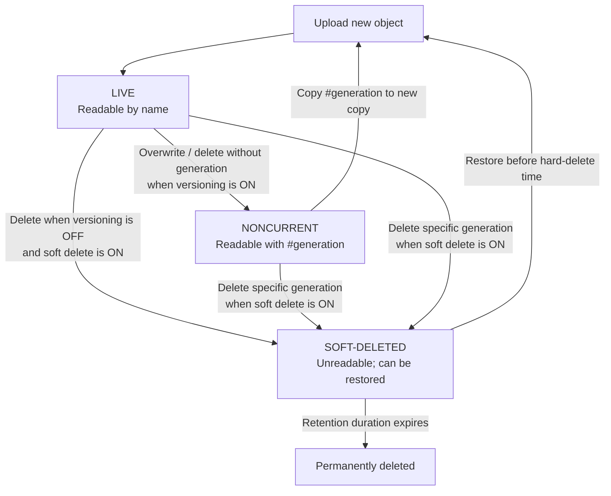
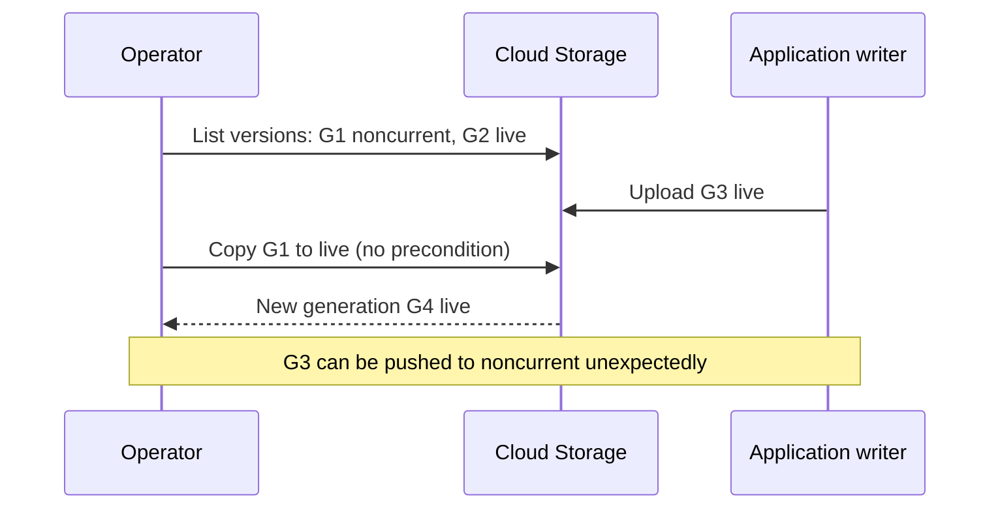

# Object Versioning, Soft Delete, and Object Recovery

A backend team stores deployment configurations, product images, documents, and exported reports in **Google Cloud Storage**. One day, a pipeline accidentally overwrites `config.json` with a broken version; the next day, someone accidentally deletes an important image. Although Cloud Storage provides very high data durability, that **does not prevent authorized yet unintended deletions or overwrites**. To recover, the team needs to know whether an object is **live**, **noncurrent**, or **soft-deleted**, and which policies govern recovery.

This lesson belongs to the **Cloud Storage** chapter of the `CLOUD_PROVIDERS_GCP` module. The module explores Google Cloud from projects, IAM, VPCs, Compute Engine, GKE, and Cloud Run to storage services, databases, automated releases, and monitoring reliability and cost. This lesson ties those skills together through **Object Versioning**, **soft delete**, choosing the right **generation**, and safe recovery procedures with `gcloud storage`.

## 1. Learning Objectives

After this lesson, you will be able to:

1. Distinguish **bucket, object name, generation, metageneration**, and the **live**, **noncurrent**, and **soft-deleted** states.
2. Explain how Object Versioning retains old content when an object is overwritten or deleted, whereas soft delete protects data from immediate permanent removal from accessible storage.
3. Understand that **Object Versioning and soft delete can be enabled together**, with different behavior depending on whether you delete by object name or delete a specific generation.
4. Choose the exact recovery method: **copying a noncurrent generation** or **restoring a soft-deleted generation**.
5. Use `gcloud storage buckets`, `objects describe`, `ls --all-versions`, `ls --soft-deleted`, `cp`, and `restore` in an authorized lab bucket.
6. Account for **retention duration, lifecycle rules, object holds, IAM, costs, and detecting risky operations**.
7. Build runbooks for mass overwrites, accidental deletions, or bucket deletions, avoiding poorly timed restores that clobber newer live data.
8. Design recovery tests with clear verification criteria for data integrity, access permissions, and recovery time.

**Lab Scope:** All mutating commands are strictly for a **new lab bucket** and objects **created during the lab**. The bucket name `YOUR_GLOBALLY_UNIQUE_LAB_BUCKET` is a placeholder; you must own an appropriate project, Cloud Storage permissions, and budget. Never run delete, retention-change, or overwrite-restore commands on production data without review.

## 2. Objects in Cloud Storage Are Not Like Files on a VM Disk

Cloud Storage is an **object storage** service. An object consists of byte content, an object name (e.g., `reports/2026-11/orders.csv`), metadata, and version identifiers. It resides inside a **bucket** that defines location, storage class, and access/retention policies.

| Component | Role | Example |
| --- | --- | --- |
| **Bucket** | Management boundary for objects and policies | `gs://demo-recovery-bucket` |
| **Object name** | Name of the object inside the bucket; `/` usually simulates directory structure | `app/config.json` |
| **Live generation** | Object version accessed when specifying the name without a generation | `gs://.../app/config.json` |
| **Noncurrent generation** | An older version still stored and readable when specifying its generation | `gs://.../app/config.json#123456789` |
| **Soft-deleted generation** | A version removed from active listings, retained for recovery during the retention window | Viewed with `--soft-deleted` |
| **Object metadata** | Content-Type, Cache-Control, create/update time, storage class, custom metadata, etc. | `Content-Type: application/json` |
| **Bucket protection** | Versioning, soft delete, retention, holds, IAM, lifecycle | E.g., 7-day soft delete |

The word "folder" in `app/config.json` on a standard bucket does not imply a full POSIX filesystem. Buckets with **hierarchical namespace** manage real folders separately; the lab uses a standard bucket to focus on object versions.

### 2.1. High Durability Does Not Prevent Accidental Deletion

Cloud Storage protects data against infrastructure failures, yet an authenticated `DELETE` request can still be a valid operation. To recover content overwritten or deleted by an operator, lifecycle rule, or application bug, you need a **pre-designed** recovery policy.

Similarly, **backup** is not synonymous with Object Versioning or soft delete. Recovering from regional outages, ransomware, project deletion, IAM/encryption key tampering, or independent retention mandates may require **copies in another bucket/project with separate IAM boundaries** and a tested DR plan.

## 3. Generation and Metageneration: The Foundation for Restoring the Right Copy

### 3.1. Generation Is the Content Version Identifier

Every time content is written to the same object name, Cloud Storage assigns a new **generation**. Generation is an identifier meaningful within that object's scope; do not guess it from display timestamps or sort solely by filename.

Illustrative example:

| Time | Action | Generation | State After Action |
| --- | --- | --- | --- |
| T1 | Upload `config.json` containing `version=1` | `1711000000000000` | Live |
| T2 | Overwrite same name with `version=2` | `1711000000000123` | New live; T1 copy becomes noncurrent if versioning is enabled |
| T3 | Copy T1 back to the same name | New generation | Original T1 may still remain noncurrent |

**Note:** Generation numbers in the table are examples, not real CLI output. In runbooks, record **object name + generation + desired checksum/version**, not just "yesterday's version."

For a live object, the URI `gs://BUCKET/OBJECT` without a generation selects the current live version. For a noncurrent or soft-deleted copy, include the generation to target an exact version:

```text
gs://BUCKET_NAME/app/config.json#1711000000000000
```

Quote paths containing `#` in your shell so different shells do not misinterpret them. In HTTP/JSON API URLs, generation is passed as the corresponding query parameter; the `#generation` syntax is a Google Cloud CLI convenience, **not** a path segment inside the bucket.

### 3.2. Metageneration Tracks Metadata Changes

**Metageneration** increments when metadata on the *same generation* is updated. For example, changing `Cache-Control` or custom metadata increments metageneration without **creating a new content generation**.

| Identifier | Changes When | Used For |
| --- | --- | --- |
| **generation** | Object content is written as a new version | Pinpointing a data version; preconditions to prevent accidental overwrites |
| **metageneration** | Metadata of the current generation is modified | Preconditions to prevent overwriting concurrent metadata updates |

An application protecting **read–modify–write** workflows can pass API preconditions like `ifGenerationMatch` or `ifMetagenerationMatch` rather than blindly overwriting the latest version. `ifGenerationMatch=0` means **create the object only if no live object with that name currently exists** per API semantics; use it properly in client libraries and operations. Never treat Object Versioning as an excuse to skip concurrency control.

## 4. Three Object States: Live, Noncurrent, Soft-Deleted



This diagram summarizes common behaviors; **object holds**, bucket/object retention, IAM, and constraints can block operations before state transitions occur. If **soft delete is disabled**, an eligible delete can permanently remove data from the bucket immediately.

### 4.1. Behavior Matrix by Protection Settings

| Object Versioning | Soft Delete | Operation | Result |
| --- | --- | --- | --- |
| Off | Off | Delete live | Object removed from bucket; no recovery window from these two features |
| Off | On | Delete live | Live becomes **soft-deleted**, restorable within retention window |
| On | Off | Delete live **without specifying generation** | Live becomes **noncurrent**, still readable/copyable |
| On | On | Delete live **without specifying generation** | Live becomes **noncurrent**, **not yet soft-deleted** |
| On | On | Delete **a specific generation** | That generation becomes **soft-deleted** |
| On | On | Overwrite live with a new upload | Old copy becomes **noncurrent**; new copy is live |
| On | On | Delete a noncurrent generation | Noncurrent becomes **soft-deleted** |

This is the most common source of confusion: enabling soft delete **does not** cause a normal name-based deletion of a live object in a versioned bucket to skip the noncurrent state. You must distinguish **deleting by name** from **deleting `#generation`**.

## 5. How Does Object Versioning Work?

Enabling **Object Versioning** at the bucket level causes Cloud Storage to retain older copies as **noncurrent** whenever a live object is overwritten or deleted (without specifying a generation). Noncurrent versions can be read by generation, downloaded, or copied back to restore them.

```mermaid
sequenceDiagram
  participant APP as Application
  participant GCS as Cloud Storage
  APP->>GCS: PUT settings.json (v1)
  GCS-->>APP: Generation G1 LIVE
  APP->>GCS: PUT settings.json (v2)
  GCS-->>APP: G1 NONCURRENT; G2 LIVE
  APP->>GCS: Copy G1 -> settings.json
  GCS-->>APP: G1 NONCURRENT; G2 NONCURRENT; G3 LIVE (v1 content)
```

**Restoring a noncurrent version does not "turn back the clock" on generation numbers.** Cloud Storage creates a **new copy with a new generation** as live. While versioning remains on and a live copy existed, that previous live copy becomes noncurrent; source G1 also remains unless deleted separately. Consequently, restoring can **increase** storage usage rather than reduce it.

### 5.1. Versioning Does Not Protect a Deleted Bucket

Object Versioning only manages versions **inside an existing bucket**; it does not protect against deleting the bucket itself. To recover a deleted **bucket**, Cloud Storage recommends **soft delete** where supported. Project deletion or encryption key loss still requires broader backup/DR planning.

### 5.2. Turning Off Versioning Does Not Automatically Delete History

Running `--no-versioning` stops the bucket from creating new noncurrent versions, **but previously retained noncurrent copies do not vanish automatically**. They continue existing, accruing storage charges, and remain subject to relevant lifecycle/soft-delete rules.

### 5.3. When Should You Retain Version History?

- Rolling back application configuration after a bad deploy.
- Comparing batch input datasets before and after a run.
- Restoring reports or assets after accidental overwrites.
- Retaining a small number of recent versions for investigations within budget limits.

If you only need accidental-deletion protection over a short window without needing multi-version history, **soft delete** may fit better than keeping versioning enabled long-term on every bucket.

## 6. Soft Delete: Recovery Holding Area for Deleted Objects and Buckets

**Soft delete** retains deleted objects or buckets for a configured **retention duration**. While an object is soft-deleted, its contents **cannot be read directly**, nor can its metadata be edited or overwritten; the primary actions are **listing** and **restoring**.

Under common current Cloud Storage configurations:

- Soft delete is **enabled by default** on supported buckets with a default duration of **7 days**.
- Duration can be set from **3 to 90 days**; setting `0` or using the disable option turns it off for future deletions.
- When changing the retention duration, the new value affects only objects/buckets **deleted after the change takes effect**. Already soft-deleted items keep their original deadline.
- Once the retention window expires, objects may be **permanently deleted**; never assume recovery is possible past that point.
- Certain specialized buckets/features do not support soft delete, so always inspect live configuration before planning.

### 6.1. Soft-Deleted Objects Are Not Equivalent to Noncurrent Objects

| Aspect | Noncurrent (Object Versioning) | Soft-Deleted |
| --- | --- | --- |
| Directly readable by generation? | **Yes**, with sufficient IAM | **No**, must restore first |
| Appears in default listings? | No | No |
| How to list | `gcloud storage ls --all-versions` | `gcloud storage ls --soft-deleted` |
| How to recover | `gcloud storage cp` from `#generation` to live name | `gcloud storage restore` generation |
| Expires automatically? | Not just for being noncurrent; requires delete/lifecycle | Yes, after soft delete retention window |
| Cost | Continues incurring storage charges | Continues incurring storage charges during retention window |
| Protects against bucket deletion? | No | Yes, subject to conditions and exceptions |

**`gcloud storage cp` is not the tool to download a soft-deleted object before restoring it.** Conversely, `gcloud storage restore` is not for recovering a readable noncurrent version; use `cp` to create a live copy.

### 6.2. Restoring a Soft-Deleted Object Creates a New Generation

Restoring a soft-deleted generation creates a **new live object** with a new generation and the **Standard** storage class, even if the deleted source was in another storage class. The original soft-deleted copy **is still retained** until its expiration window and continues incurring storage charges.

If a live object with the same name already exists, restoring risks **overwriting the live copy**; whether the overwritten copy is preserved depends on versioning settings. **Never overwrite-restore in production without inspecting the current live generation.** The CLI provides overwrite controls like `--allow-overwrite` for specific cases; this lab uses non-conflicting names to avoid that flag.

## 7. Comparing Related Data Protection Mechanisms

Cloud Storage has several mechanisms that mention "retention," yet they do not replace one another.

| Mechanism | Purpose | Key Detail |
| --- | --- | --- |
| **Object Versioning** | Keeps old copies when content is overwritten/deleted | Noncurrent versions remain readable; no automatic expiry from versioning alone |
| **Soft delete** | Provides a recovery window for deleted objects/buckets | Soft-deleted objects are unreadable; retained 3–90 days when enabled |
| **Bucket retention policy** | Blocks deletion/overwrite before a minimum age | An operational restriction, not just a "restorable" mechanism |
| **Object holds** | Temporarily blocks deletion/replacement per governance needs | Must be properly released before deletion |
| **Object Retention Lock** | Locks retention period per object | Has specific modes/limits; check legal implications |
| **Bucket Lock** | Locks the bucket's retention policy | May **prevent shortening/removing** once locked; do not use in lab |
| **Object Lifecycle Management** | Automatically changes storage classes or deletes by condition | When soft delete is on, lifecycle-deleted items can move to soft-deleted |
| **IAM + UBLA + public access prevention** | Controls who can read/modify/delete data | Does not replace version history or recovery |
| **Independent backup/replication** | Recovers from broader outages or compromised identities/configs | Requires separate access boundaries and independent restore testing |

For example, a bucket storing financial records that **must not be deleted for 7 years** requires a legal retention/lock design—you cannot set 7-day soft delete and call it 7-year retention.

## 8. Choosing Combinations of Versioning, Soft Delete, and Lifecycle

| Scenario | Configuration to Consider | Rationale |
| --- | --- | --- |
| Product images with accidental deletion risk | Soft delete with appropriate retention | Provides a recovery window upon deletion |
| Config files prone to overwrites needing fast rollback | Object Versioning + soft delete | Read/copy old versions directly, plus an extra layer if a generation is deleted |
| Temporary scratch/cache objects created & deleted constantly | Evaluate soft delete duration and cost; consider disabling in scoped buckets | Accumulated soft-deleted bytes can cost more than live data |
| Reports needing a few recent versions | Versioning + lifecycle cleanup, soft delete per risk model | Avoids accumulating hundreds of noncurrent generations |
| Compliance records requiring immutability | Retention policy/lock combined with proper safeguards | Versioning/soft delete alone is not a WORM guarantee |
| Disaster recovery backups | Copies/backups in separate IAM boundaries and locations | Avoids single-bucket/single-project dependency |

**Strategy pattern:** For a config bucket needing 30-day rollback, enable versioning, add lifecycle rules to prune older noncurrent versions per policy, and keep soft delete active so lifecycle-deleted copies still have a final recovery window. Because this increases stored versions, budget for it beforehand.

## 9. IAM Permissions for Reading, Restoring, and Policy Administration

These tasks should not share one all-powerful service account:

| Action | Key Permissions to Check | Example Suitable Role |
| --- | --- | --- |
| List objects/generations | `storage.objects.list` | Viewer role or specialized role |
| Read noncurrent content | `storage.objects.get` | Scoped object reader role |
| Copy noncurrent to live | `storage.objects.get`, `storage.objects.create`; may need `delete` if overwriting | `roles/storage.objectUser` or tailored custom role |
| List soft-deleted | `storage.objects.list` | Check tool-specific permissions as needed |
| Restore soft-deleted | `storage.objects.restore` and `storage.objects.create` | `roles/storage.admin` includes these per docs; custom role possible |
| Restore overwriting a live object | Also `storage.objects.delete` when needed | Grant only to authorized operators |
| Edit bucket versioning/soft delete | `storage.buckets.get`, `storage.buckets.update` | Bucket administration |
| Bucket restore / bulk restore | Bucket restore and corresponding long-running operation permissions | Administrators scoped appropriately |

Never grant `roles/storage.admin` project-wide just so an app can read images. **Separate day-to-day permissions from recovery permissions**: ingestion pipelines only need create/read permissions as appropriate, while recovery operators use audited administrative identities scoped to the target bucket.

Administrators should enable **uniform bucket-level access** for unified IAM, configure **public access prevention** when data must remain private, monitor IAM changes, and periodically test recovery permissions. ACLs, managed folders, and hierarchical namespaces carry distinct rules; never assume from a role name that every operation is allowed.

## 10. Lab A — Create a Dedicated Bucket and Inspect Protection Settings

### 10.1. Preparation

This lab uses **Bash** in Cloud Shell or Linux/macOS with `gcloud`. All files (`v1.txt`, `v2.txt`) are created **inside your personal lab directory**, never inside the documentation repository. Never use personal or production data.

```bash
PROJECT_ID="YOUR_LAB_PROJECT_ID"
LOCATION="asia-southeast1"
BUCKET="YOUR_GLOBALLY_UNIQUE_LAB_BUCKET"

gcloud --version
gcloud auth list

# Read-only: confirm project.
gcloud projects describe "$PROJECT_ID" \
  --format="yaml(projectId,projectNumber,lifecycleState)"

# Read-only: list buckets in project.
gcloud storage buckets list --project="$PROJECT_ID"
```

**Bucket names must be globally unique**; do not pick an existing name or include sensitive info, and follow your organization's naming policy. The lab requires billing, bucket creation permissions, enabled APIs, and a region permitted by Organization Policies. If a project lacks permissions, never switch to another project to bypass controls.

### 10.2. Create a Private Bucket with Soft Delete (Mutating Operation)

Run only after confirming the bucket name **does not exist** and you are authorized:

```bash
gcloud storage buckets create "gs://$BUCKET" \
  --project="$PROJECT_ID" \
  --location="$LOCATION" \
  --default-storage-class=STANDARD \
  --uniform-bucket-level-access \
  --public-access-prevention \
  --soft-delete-duration=7d
```

This creates a regional Standard bucket with UBLA, public access prevention, and 7-day soft delete. Do not create retention locks or object holds in the lab; those can prevent you from cleaning up data after the session.

Readback:

```bash
gcloud storage buckets describe "gs://$BUCKET"

# Inspect soft delete section only.
gcloud storage buckets describe "gs://$BUCKET" \
  --format="default(soft_delete_policy)"
```

Verify bucket name, location, storage class, public access settings, and soft delete configuration. Soft delete defaults to 7 days on supported buckets, yet **never rely on defaults as proof**: always inspect the live bucket policy.

### 10.3. Enable Object Versioning (Mutating Operation)

```bash
gcloud storage buckets update "gs://$BUCKET" --versioning

gcloud storage buckets describe "gs://$BUCKET"
```

In the output, look for **Object Versioning enabled**. After updating the versioning policy, wait **at least 30 seconds** before overwriting or deleting objects so operations do not encounter stale policy propagation.

## 11. Lab B — Write Two Versions and Observe Generations

### 11.1. Upload the First Version

```bash
printf 'release=1\nfeature=stable\n' > v1.txt

gcloud storage cp ./v1.txt \
  "gs://$BUCKET/lab/config/release.txt"

# Read live metadata and store the first generation.
gcloud storage objects describe \
  "gs://$BUCKET/lab/config/release.txt"

G1="$(gcloud storage objects describe \
  "gs://$BUCKET/lab/config/release.txt" \
  --format='value(generation)')"

echo "G1=$G1"
```

Do not proceed if `G1` is empty, the CLI errors, or the object path points outside your lab bucket. Record the actual generation value in your lab notes since you will use it to select the older version.

### 11.2. Overwrite with the Second Version

```bash
printf 'release=2\nfeature=experimental\n' > v2.txt

gcloud storage cp ./v2.txt \
  "gs://$BUCKET/lab/config/release.txt"

G2="$(gcloud storage objects describe \
  "gs://$BUCKET/lab/config/release.txt" \
  --format='value(generation)')"

echo "G1=$G1"
echo "G2=$G2"

# List both live and noncurrent versions.
gcloud storage ls --all-versions \
  "gs://$BUCKET/lab/config/release.txt"
```

**Expected:** `G2` is live and `G1` becomes noncurrent. The two generations differ, and standard `ls` shows only the live copy. That is why "old file vanished" incidents require checking `--all-versions` before concluding data was permanently deleted.

### 11.3. Verify Each Version's Contents Without Touching Live

```bash
# Download noncurrent copy to lab machine for safe comparison.
gcloud storage cp \
  "gs://$BUCKET/lab/config/release.txt#$G1" \
  ./recovered-v1.txt

cat ./recovered-v1.txt

# Download live copy to compare.
gcloud storage cp \
  "gs://$BUCKET/lab/config/release.txt" \
  ./current-v2.txt

cat ./current-v2.txt
```

These commands **only read objects from the bucket** and write to local lab files. Confirm `release=1` and `release=2` match their respective generations before choosing a recovery step. For real data, verify **checksums/hashes, metadata, and source-of-truth**, not just the first few lines.

## 12. Restoring a Noncurrent Generation by Copying

Suppose `release=2` breaks the application and you need to roll back to `release=1`. Two options exist:

- **Restore to a new name** to inspect without touching live traffic.
- **Restore to the same name** to make it live, only after approval and confirming exact generations.

### 12.1. Safer Approach: Copy to a Different Name

```bash
gcloud storage cp \
  "gs://$BUCKET/lab/config/release.txt#$G1" \
  "gs://$BUCKET/lab/review/release-v1.txt"

gcloud storage objects describe \
  "gs://$BUCKET/lab/review/release-v1.txt"
```

Download `lab/review/release-v1.txt` or validate with tooling. This creates a new object name and new generation without disturbing live `lab/config/release.txt`. This is useful when operators need to confirm an older file remains compatible with newer code or database schemas.

### 12.2. Copy Back to the Same Name (Replace Live)

When strictly in the lab and after confirming `G1` is right:

```bash
# MUTATING: G1 is copied to become a NEW LIVE generation.
gcloud storage cp \
  "gs://$BUCKET/lab/config/release.txt#$G1" \
  "gs://$BUCKET/lab/config/release.txt"

gcloud storage ls --all-versions \
  "gs://$BUCKET/lab/config/release.txt"

gcloud storage objects describe \
  "gs://$BUCKET/lab/config/release.txt"
```

With versioning still enabled, you should now see **G1 noncurrent, G2 noncurrent, and G3 live** (where G3 holds a copy of G1's content). Do not assume copying "reverts the object back to generation G1"; **G3 is a brand-new generation**. G2 has not vanished, and the total retained versions affect storage costs.

**Production:** copying to the same name can overwrite a newer live version uploaded after you checked. In multi-writer systems, use **generation preconditions** in the API/client library or pause writers per runbook, then re-read the live generation immediately before restoring to avoid race conditions.

## 13. Lab C — Create a Soft-Deleted Generation Safely

With both versioning and soft delete enabled, a normal `rm gs://BUCKET/name` turns live into **noncurrent**, not soft-deleted. To observe soft delete in our versioned lab bucket, we will **target a specific generation** on a second object so we do not clutter `release.txt`'s history.

### 13.1. Create a Second Lab Object

```bash
printf 'important=test-only\n' > recover-me.txt

gcloud storage cp ./recover-me.txt \
  "gs://$BUCKET/lab/trash/recover-me.txt"

G_TRASH="$(gcloud storage objects describe \
  "gs://$BUCKET/lab/trash/recover-me.txt" \
  --format='value(generation)')"

echo "Generation about to be tested: $G_TRASH"
```

Proceed only after confirming the path is in your lab bucket and the generation came from the step above.

### 13.2. Delete the Specific Generation (Risky Mutating Operation)

```bash
# ONLY FOR THE LAB OBJECT just created.
gcloud storage rm \
  "gs://$BUCKET/lab/trash/recover-me.txt#$G_TRASH"
```

Because **soft delete is enabled**, the deleted generation enters the soft-deleted state. **Never use** `--all-versions` or `--recursive` when testing a single object; such flags can wipe entire prefixes or buckets.

If instead you ran:

```bash
# FOR COMPARISON ONLY; DO NOT RUN ON REAL DATA.
gcloud storage rm \
  "gs://$BUCKET/lab/config/release.txt"
```

then in a versioned bucket, deleting **without a generation** moves `release.txt`'s live copy to **noncurrent**, rather than soft-deleting it. That is why exact delete command syntax must be part of reviewed runbooks.

### 13.3. List the Soft-Deleted Object

```bash
# List only soft-deleted generations of the lab object.
gcloud storage ls --soft-deleted \
  "gs://$BUCKET/lab/trash/recover-me.txt"

# You can inspect soft-deleted metadata when specifying the generation.
gcloud storage objects describe \
  "gs://$BUCKET/lab/trash/recover-me.txt#$G_TRASH" \
  --soft-deleted
```

You should see the recoverable generation along with state/timestamp fields such as **softDeleteTime** or **hardDeleteTime** as displayed by the CLI. Running `gcloud storage cp` to read that object as live/noncurrent will not work like reading a noncurrent version: the data is locked in the soft-deleted state.

## 14. Restoring a Soft-Deleted Generation

### 14.1. Restore the Exact Deleted Generation

```bash
# MUTATING restore operation: creates a NEW LIVE generation.
gcloud storage restore \
  "gs://$BUCKET/lab/trash/recover-me.txt#$G_TRASH"

# Read back live metadata and content.
gcloud storage objects describe \
  "gs://$BUCKET/lab/trash/recover-me.txt"

gcloud storage cp \
  "gs://$BUCKET/lab/trash/recover-me.txt" \
  ./restored-recover-me.txt

cat ./restored-recover-me.txt
```

Expected: `important=test-only` returns under a **new live generation**. The original soft-deleted copy remains until its expiration deadline rather than being moved in place back to live, and may continue appearing under `--soft-deleted`.

**For real workloads**, beyond checking byte content, verify metadata, storage class (a soft-delete restore produces **Standard**), access permissions, encryption context, cache/HTTP headers, application reads, and resulting costs.

### 14.2. What If a Live Object Already Exists with the Same Name?

If a new object with the same name was created after deletion, restoring risks **overwriting the newer live version**. CLI docs provide `--allow-overwrite` for intentional overwrite restores, yet **never include that flag by default**. First:

1. List live, noncurrent, and soft-deleted generations.
2. Identify which version users actually need, along with checksums and timestamps.
3. Pause or coordinate writers to avoid version races.
4. Consider publishing recovered data to a **different name** using an approach matching the object state/restore type; soft-deleted objects must be restored before copying if needed.
5. If overwriting the same name is unavoidable, execute only after approval and with a rollback plan.

**Avoid running `gcloud storage restore gs://BUCKET/OBJECT` without a generation** when multiple soft-deleted copies exist and a specific version is needed: omitting generation may pick the newest copy rather than the business-required one.

## 15. Bulk Recovery After Accidental Mass Deletion

A production incident can delete thousands of objects within a time window. Restoring one object at a time is hard to control, so Cloud Storage provides **bulk restore** for soft-deleted objects.

### 15.1. Inspect and Scope Before Executing

Identify:

- Bucket, prefix, and **deletion window** time range.
- Which objects were genuinely deleted by mistake versus planned lifecycle actions.
- Whether new live objects with the same names appeared after the incident.
- Whether every generation needs restoring or only specific generations.
- RTO/RPO and application recovery priority order.
- Restore permissions, permissions to manage **long-running operations**, and accountable owners.

List soft-deleted objects with:

```bash
gcloud storage ls --soft-deleted \
  "gs://$BUCKET/lab/**"
```

In Bash, quote wildcard expressions so the shell does not expand them locally. On large buckets, listing involves paging, runtime, and API costs; an empty output from one narrow command does not prove data is permanently gone.

### 15.2. Time-Bounded Bulk Restore Template

**Do not run the example below without replacing placeholders and approving scope.** This is a bulk mutating operation that creates live objects and can overwrite data if overwrite flags are enabled.

```bash
# ILLUSTRATIVE ONLY: determine the real deletion window before running.
DELETED_AFTER="2026-11-01T00:00:00Z"
DELETED_BEFORE="2026-11-01T02:00:00Z"

gcloud storage restore \
  "gs://$BUCKET/lab/**" \
  --async \
  --deleted-after-time="$DELETED_AFTER" \
  --deleted-before-time="$DELETED_BEFORE"
```

`--async` starts a **long-running operation**. A "submitted" status **does not** mean thousands of objects are already restored. Save the operation ID, monitor progress and errors, and perform final readbacks. If overwrites are needed, carefully review `--allow-overwrite` semantics and audit every colliding object beforehand.

### 15.3. Reducing the Risk of Mis-Restoration

Recommended sequence:

1. Stop the faulty pipeline/lifecycle rule or fix the root trigger.
2. Build a **manifest** of target objects from logs/inventory within the approved scope.
3. Restore a small high-priority batch first and verify checksums/metadata.
4. Scale up in batches while monitoring error rates, counts, and costs.
5. Re-enable application reads against restored data only after validation passes.
6. Log succeeded/failed object counts, new generations, and any conflicts.

If data passed its hard-delete deadline or encryption keys are no longer usable, soft delete alone cannot guarantee recovery.

## 16. Deleted Buckets: Why You Cannot Just Restore Objects

If the **bucket itself** is soft-deleted, you must **restore the bucket first** before restoring objects when using the corresponding CLI/API workflow.

Important points:

- Soft-deleted buckets have a retention duration; you need the **bucket generation** to target it accurately via CLI.
- If **another live bucket with the same name** already exists, the soft-deleted bucket cannot be restored until the naming conflict is resolved per procedure.
- The **Console** offers a workflow restoring bucket and objects together; with **gcloud CLI / JSON API**, restoring the bucket can bring it back **empty**, requiring separate object restores.
- Whole-project deletion has separate recovery mechanisms and limits. Never treat soft delete as a promise that "you can delete a project and always bring everything back."
- Object Versioning **does not** protect against bucket deletion.

`gcloud storage restore gs://BUCKET#BUCKET_GENERATION` is intended for soft-deleted buckets; **do not run it unless you have verified the bucket is deleted and confirmed its exact generation**. This is excluded from the lab to avoid destructive bucket operations.

## 17. Lifecycle Management: Auto-Cleaning Old Versions, Yet Not Bypassing Soft Delete

A versioned bucket can accumulate many noncurrent generations and rack up storage charges. **Object Lifecycle Management** lets you automatically delete noncurrent objects by rule, after which soft delete provides one final recovery window.

Illustrative JSON example (save on an **administrator's workstation** after review):

```json
{
  "rule": [
    {
      "action": {
        "type": "Delete"
      },
      "condition": {
        "isLive": false,
        "age": 30,
        "numNewerVersions": 3
      }
    }
  ]
}
```

This rule is strictly a **design example**: deleting a noncurrent version requires **all conditions** to hold—not live, at least 30 days old, and at least 3 newer versions exist. It does not mean "always keep exactly three copies" at all times.

You can apply lifecycle rules to an authorized bucket via `gcloud storage buckets update gs://... --lifecycle-file=...`, but **never apply a sample file straight to a real bucket** without reading existing policies, validating behavior, and ensuring you do not overwrite another team's rules.

**Important:** Lifecycle rules cannot directly hard-delete or change the storage class of an already **soft-deleted** object. When lifecycle deletes a noncurrent version in a bucket with soft delete on, that copy can move into soft-deleted state and keep accruing charges until the retention window ends.

### 17.1. Distinguishing Version Age from Soft Delete Age

A noncurrent object might sit for years; when lifecycle deletes it, the soft delete window starts from the **soft deletion timestamp**, not the content's original creation time. Total storage costs can therefore include both **noncurrent lifespan** and **soft-deleted retention**.

### 17.2. Do Not Confuse Lifecycle with Recovery Governance

Lifecycle rules exist to manage costs and retention lifespans. During an incident investigation, operations needs to know:

- Which rules just ran or were modified.
- Whether there is time to halt unintended deletions before more objects are processed.
- Which resources became noncurrent versus soft-deleted.
- Which versions must be restored before their retention window expires.

## 18. Changing Soft-Delete Duration and Cost Implications

### 18.1. Retention Policy for Deleted Items

Suppose an administrator selects **14 days** of soft delete after evaluating recovery requirements and budget:

```bash
# MUTATING: alters policy on an authorized bucket.
gcloud storage buckets update \
  "gs://YOUR_APPROVED_BUCKET" \
  --soft-delete-duration=14d
```

Risks to understand:

- Changes may take a brief moment to propagate (documentation notes propagation waits on the order of seconds).
- **Objects soft-deleted before the change** retain their original deadline; they are not retroactively extended or shortened.
- There is no way to "immediately purge" already soft-deleted items merely by setting duration to 0.
- After retention expires, objects are hard-deleted; base the duration on **measured RTO**, not guesswork.

**Do not disable soft delete in this lab** casually to cut costs, since doing so neither removes existing soft-deleted copies nor preserves recovery for future deletions.

### 18.2. Costs of Versioning and Soft Delete

| Component | What Generates Charges |
| --- | --- |
| **Live objects** | Capacity by storage class/location and duration |
| **Noncurrent objects** | Retained old versions, generally billed similarly to live objects |
| **Soft-deleted objects** | Capacity continues billing throughout the retention duration |
| **Restore** | Creates new live objects, plus operations and storage/egress per feature |
| **Lifecycle and API requests** | Operations and request volume; bulk restores can consume many requests |
| **Network egress** | Reading/downloading across regions or to the internet per pricing |
| **Minimum storage duration** | Classes like Nearline/Coldline/Archive carry early deletion rules and fees |

A simple cost example (not official Cloud Storage pricing): a bucket holding a 10 GiB file overwritten daily with 30 noncurrent versions retains many multiples of the original file size. If lifecycle deletes old versions and soft delete holds them another 7 days, billable bytes climb even higher. Set **budgets/alerts** and track noncurrent and soft-deleted bytes rather than looking only at live data size.

### 18.3. Temporary Scratch Buckets

A bucket with 1 GiB of intermediate files created and deleted thousands of times per day may show minimal **live storage** while soft-deleted storage balloons rapidly. If organizational policy permits, evaluate tailored settings for **scratch/cache buckets** with appropriate protection rather than applying the exact same retention used for backups or financial records.

## 19. Safe Recovery in Multi-Writer Systems

Services like Cloud Run, GKE, Compute Engine, or CI/CD pipelines may write to the same object name. If an operator checks G1 and copies G1 back to live seconds later, another writer could have uploaded G3 in between and gotten overwritten.

### 19.1. Race Condition Risk



Mitigations:

- Identify the **application owner** and pause or scope writers during a maintenance window.
- Record both current generation and **expected generation** right before executing.
- Use **generation-match preconditions** from the Cloud Storage API/client libraries where supported so operations fail if the object changed.
- If writers cannot be frozen, **restore to a staging name** and perform a controlled cutover.
- After restoring, run checksums and application tests to verify content rather than merely checking object existence.
- Keep an audit trail: operator, source generation, new generation, timestamp, and reason.

Versioning preserves history, yet a bad live copy can still break the application until rollback completes.

### 19.2. Distinguish Metadata from Content

An object may have the right bytes while having the wrong `Content-Type`, `Cache-Control`, custom metadata, ACL, or encryption metadata. After recovery, inspect metadata too—especially when objects are served through a load balancer and CDN. An object restored from soft delete is written as a **new object in the Standard storage class**, affecting pricing and governance policies.

## 20. Incident Response Workflow for Data Loss

| Step | Action | Completion Evidence |
| --- | --- | --- |
| 1. Confirm scope | Bucket, prefix, object names, overwrite/deletion window | Incident ticket + object manifest |
| 2. Contain | Stop faulty job/pipeline if authorized; preserve evidence | No ongoing unintended deletions |
| 3. Check policies | Are versioning and soft delete enabled? Remaining retention? | `buckets describe`, recent policy changes |
| 4. List versions | Live, noncurrent, soft-deleted + generations | `--all-versions`, `--soft-deleted` outputs |
| 5. Pick method | Noncurrent → copy; soft-deleted → restore | Runbook listing exact source generations |
| 6. Check conflicts | Any newer live copies or active writers? | Current generation and precondition plan |
| 7. Small restore | Restore/copy a few sample objects and verify | Checksums, metadata, app smoke tests |
| 8. Scale up | Batch restore, monitor LROs, prevent overwrites | Reconciled success/failure manifest |
| 9. Resume service | Re-enable reads/writes once data is verified | Health checks, app logs, SLOs |
| 10. Follow up | Review IAM, lifecycle, alerts, and restore drills | Postmortem and updated documentation |

**Never restore blindly based on "the newest version in soft delete" without knowing the incident cause.** If multiple versions were deleted in sequence, the newest copy might actually be the corrupted data.

## 21. Monitoring, Auditing, and Drills

### 21.1. Signals to Collect

- Counts and byte totals for live, noncurrent, and soft-deleted data via supported tools—avoid viewing only live bytes.
- Changes to `versioning`, `soft delete duration`, lifecycle rules, retention/holds, and IAM.
- Rates of object overwrites and deletions by prefix or application identity.
- Spikes in `403`/`404`, `NotFound`, and read errors after deployments.
- Cloud Storage charges by SKU, location, and storage class, including retained deleted bytes.
- Restore drill results: recovery duration, error counts, checksum/metadata accuracy.

**Cloud Audit Logs** capture Admin Activity for many management actions; **Data Access logs** for data operations require checking opt-in, collection, cost, and coverage limits. To detect mass deletions, combine audit logs, Cloud Monitoring, and anomaly detection workflows—never assume every object deletion is logged automatically without proper configuration.

### 21.2. Meaningful Recovery Drills

A proper drill should include:

1. A non-sensitive lab bucket/prefix and an accountable owner.
2. Sample files with recorded checksums, generations, and metadata.
3. Separate overwrite and soft-delete scenarios.
4. Measured RTO from detection until the application reads the correct version.
5. A report covering permissions, errors, and incurred charges.
6. Post-drill bucket state readback and a cleanup plan.

Seeing a `restore` command return "success" is not enough; the system must read the right bytes with the right permissions and work end-to-end in downstream services.

## 22. Real-World Design Scenarios

### 22.1. Bad Config Deployment on Cloud Run

A pipeline writes a broken `services/orders/config.json` containing the wrong database endpoint. Because the bucket has Object Versioning enabled, the prior version G1 sits in noncurrent state. Operations can **download and inspect G1**, stage a test copy, run smoke tests, and copy it back to live after coordinating writers.

**Avoid** indiscriminately killing Cloud Run services or deleting all generations; rollback must align with active releases and database schema compatibility.

### 22.2. Accidental Deletion of a Product Image

A user or job deletes `products/images/a123.jpg`. If the bucket has versioning off but 7-day soft delete on, the image enters **soft-deleted** state. An operator locates it with `--soft-deleted` and restores the generation, ensuring the image was not **renamed** or replaced with a valid new upload to avoid overwriting.

### 22.3. Mass Deletion by a Lifecycle Rule

A misconfigured lifecycle rule causes many noncurrent versions to become soft-deleted. **Stop the deletion trigger**, pull an object manifest, run bulk restore with a delete-time window, and monitor the operation. Short retention windows mean incidents must be detected promptly.

### 22.4. Ransomware or Project Deletion Defense

Soft delete adds one recovery layer, yet does not replace isolated permissions, cross-project/cross-location backups, appropriate retention/locks, and full restore testing. When an attacker compromises an administrative identity, policies inside the same permission domain may not satisfy DR objectives.

## 23. Troubleshooting

| Symptom | Possible Cause | Resolution |
| --- | --- | --- |
| `gcloud storage ls` does not show deleted copy | Noncurrent/soft-deleted items are hidden by default | Try `--all-versions` or `--soft-deleted` as appropriate |
| Deleted live object, but nothing shows in `--soft-deleted` | Versioning is on; live copy moved to noncurrent | Check `--all-versions` and generation |
| Deleted `#generation`, then reading with `cp` fails | Version became soft-deleted | Use `restore` within the retention window |
| `gcloud storage restore` fails on a noncurrent object | Noncurrent object is not soft-deleted | Use `gcloud storage cp` from `#generation` |
| `403 Permission denied` | Missing `storage.objects.restore`/`create` or other permissions | Check bucket IAM; do not request Owner by default |
| `404 Not Found` on restore | Wrong generation, past retention window, wrong bucket, or not soft-deleted | Check `--soft-deleted`, bucket, and timestamps |
| Duplicate/live conflict error on restore | A live object with the same name already exists | Review overwrite policy, source generation, and rollback |
| Object restored, yet application still fails | Metadata, cache/CDN, permissions, wrong generation content, or downstream state | Verify checksums, HTTP headers, and application logs |
| Restored copy is in Standard class | Normal behavior of soft-delete restore | Review tier cost and lifecycle; not a bug |
| Turned off versioning, yet old copies remain | Existing noncurrent versions are preserved | Set up lifecycle/cleanup per policy |
| Turned off soft delete, yet charges continue | Previously soft-deleted items keep original retention | Check hard-delete times and lingering usage |
| Lifecycle does not delete soft-deleted items | Lifecycle does not act on soft-deleted objects | Wait for retention/hard delete; do not try to force-delete |
| Cannot delete object | Object hold or bucket/object retention | Inspect retention policy/holds and authorization flow |
| Cannot restore soft-deleted bucket | Name conflict, missing bucket generation, or permissions | Check bucket state and bucket restore documentation |
| Bulk restore returns operation ID, yet objects are missing | Asynchronous job still running | Monitor long-running operation status and error report |
| Total bill exceeds live storage volume | Noncurrent + soft-deleted bytes, multiple restore copies | Inspect Billing and storage breakdown |

## 24. Lab Cleanup and Limiting Residual Costs

Unlike many Compute Engine labs, **deleting objects does not necessarily remove billable bytes immediately** in buckets with versioning or soft delete. Cleanup must be planned rather than relying on one recursive delete command.

### 24.1. Inventory Created Objects (Read-Only)

```bash
gcloud storage ls --all-versions "gs://$BUCKET/lab/**"

gcloud storage ls --soft-deleted "gs://$BUCKET/lab/**"

gcloud storage buckets describe "gs://$BUCKET"
```

**Never delete a bucket if it contains data outside this lab or if someone may still need recovery.** Never run `gcloud storage rm --recursive gs://...` without knowing exactly which objects and buckets will be affected.

### 24.2. Safe Cleanup Plan

1. Confirm the bucket and all objects under `lab/` were **created exclusively by the lab**.
2. Check which generations remain noncurrent and which are soft-deleted.
3. Confirm who is authorized to **retain protection** or disable protection for subsequent deletions.
4. To stop generating new noncurrent versions, an admin can disable versioning **for future operations** with `--no-versioning`; this does not purge prior history.
5. If organizational policy permits disabling soft delete on a lab bucket, `--clear-soft-delete` changes **the policy for future deletions only** and **does not** immediately purge existing soft-deleted copies.
6. Clean up remaining live/noncurrent objects using a **generation-specific manifest** to avoid accidental deletions and preserve anything needed.
7. Evaluate deleting the lab bucket per Google Cloud docs. Soft-deleted buckets/objects may persist and incur charges until retention/hard delete completes.
8. Monitor Billing afterward since billing exports have reporting lag.

**Mutating** commands, shown strictly for authorized and inventoried cleanup:

```bash
# Dedicated lab bucket only: stop creating new noncurrent versions.
gcloud storage buckets update \
  "gs://YOUR_GLOBALLY_UNIQUE_LAB_BUCKET" \
  --no-versioning

# Dedicated lab bucket only: disable soft delete for future deletions.
# DOES NOT purge already soft-deleted copies.
gcloud storage buckets update \
  "gs://YOUR_GLOBALLY_UNIQUE_LAB_BUCKET" \
  --clear-soft-delete
```

**You are not required to run these two commands to complete the lesson.** Neither command accelerates purging previously soft-deleted copies. Use tiny test objects in temporary lab buckets so residual retention costs stay negligible.

## 25. Self-Practice Exercises

### Exercise 1 — Distinguishing States

A bucket has versioning and soft delete enabled. You run `gcloud storage rm gs://bucket/config.json` **without a generation**.

*Guided Answer:* The live copy becomes **noncurrent**; it does not immediately become soft-deleted. List it with `--all-versions`.

### Exercise 2 — Deleting a Specific Generation

In the same bucket, you run `gcloud storage rm "gs://bucket/config.json#123"` targeting a real noncurrent generation.

*Guided Answer:* That version becomes **soft-deleted** while the policy is active and retention applies. List with `--soft-deleted`, then use `gcloud storage restore` with the exact generation.

### Exercise 3 — Restoring a Noncurrent Copy

You have noncurrent `G1` and live `G2`. You want to roll back to `G1`'s content while keeping `G2` in history.

*Guided Answer:* Run `gcloud storage cp` from `gs://bucket/object#G1` to `gs://bucket/object` after coordinating writers. The bucket creates a new live `G3` containing `G1`'s content, and `G2` becomes noncurrent.

### Exercise 4 — Cannot Download Soft-Deleted Directly

An operator tries `gcloud storage cp gs://bucket/object#G1 ./backup`, but `G1` is already soft-deleted.

*Guided Answer:* Soft-deleted data cannot be read directly. Use `gcloud storage restore` first, then download from the new live version—making sure not to overwrite an unintended live object.

### Exercise 5 — Changing Retention Duration

An object was soft-deleted while the bucket had a 7-day retention window. The next day, an admin changes soft delete duration to 30 days.

*Guided Answer:* The already soft-deleted copy keeps the **original 7-day deadline**; the new configuration applies only to deletions occurring after the update takes effect. Restore promptly if you need to keep it.

### Exercise 6 — Lifecycle and Cost

A bucket writes a new version of a 1 GiB object daily. Versioning is on, no lifecycle rules exist, and soft delete is 7 days.

*Guided Answer:* Noncurrent versions grow continuously and keep incurring charges; soft delete does not cap noncurrent version counts. Add lifecycle cleanup for old versions aligned with rollback needs, and budget for the extra soft-delete retention window.

### Exercise 7 — Race Condition

An operator lists `G1`/`G2` and begins copying `G1`. At the same moment, the app uploads `G3`. What can happen?

*Guided Answer:* A restore without preconditions can promote the old copy to live `G4`, pushing the newer `G3` out of live state. Coordinate writers, use generation preconditions, or restore to staging to validate first.

### Exercise 8 — Why Is Bucket Deletion Harder?

Object Versioning was enabled long ago, yet the entire bucket was deleted; the team hopes `--all-versions` will find all objects.

*Guided Answer:* Versioning does not protect against bucket deletion. Evaluate **restoring the soft-deleted bucket** within its retention window, then recover objects via the corresponding CLI or Console workflow.

### Exercise 9 — Choosing the Right Protection Mechanism

Contract records must not be deleted for 5 years due to legal compliance.

*Guided Answer:* 7-day soft delete or versioning is insufficient. Design bucket/object retention and locks matching legal requirements, enforce strict permissions, and review irreversible lock implications before deploying.

### Exercise 10 — Residual Lab Costs After Cleanup

You disabled soft delete, yet soft-deleted storage charges still show up for a few days.

*Guided Answer:* Objects soft-deleted while the policy was active remain retained until their respective hard-delete timestamps. Disabling the policy does not purge existing soft-deleted data; wait for retention to expire and verify updated Billing reports.

## 26. Versioning and Soft Delete Operations Checklist

- [ ] Bucket has a designated **owner**, IAM scope, and confirmed recovery policy.
- [ ] Knows whether **versioning is enabled/disabled** and the actual soft delete retention duration.
- [ ] Distinguishes **live / noncurrent / soft-deleted** states.
- [ ] Records complete **object name + generation + checksum** for target recovery items.
- [ ] Does not confuse `gcloud storage cp` (noncurrent) with `gcloud storage restore` (soft-deleted).
- [ ] Knows how to query `--all-versions` and `--soft-deleted`.
- [ ] Never runs an overwrite-restore while newer live objects or active writers are uncontrolled.
- [ ] Verified `storage.objects.restore`, `create`, and `delete` permissions where needed.
- [ ] Understands soft delete retention is fixed at **deletion time**, not updated retroactively.
- [ ] Understands soft-delete restores create a **new generation in the Standard storage class**.
- [ ] Lifecycle policies clean up noncurrent generations where needed to control cost.
- [ ] Does not expect lifecycle rules to purge soft-deleted objects early.
- [ ] Distinguishes soft delete from retention policies, holds, Bucket Lock, and independent backups.
- [ ] Auditing, alerts, and anomaly detection track unusual deletions or overwrites.
- [ ] Bulk restores use manifests, time filters, and long-running operation monitoring.
- [ ] Plan covers restoring a soft-deleted bucket before restoring its objects.
- [ ] Practiced RTO/RPO, checksums, metadata, and post-restore access verification.
- [ ] Lab cleaned up via manifest; understands storage charges may persist until hard-delete time.

## 27. Official Documentation

The Google Cloud documentation below helps verify CLI flags, policy behavior, permissions, and feature support before applying changes in production:

- [Object Versioning](https://cloud.google.com/storage/docs/object-versioning): live/noncurrent behavior and recommendations for combining with soft delete.
- [Use versioned objects](https://cloud.google.com/storage/docs/using-versioned-objects): `--all-versions`, viewing/copying/deleting by `#generation`.
- [Soft delete overview](https://cloud.google.com/storage/docs/soft-delete): default duration, exceptions, states, and pricing.
- [Use soft-deleted objects](https://cloud.google.com/storage/docs/use-soft-deleted-objects): `--soft-deleted`, single-object and bulk restores.
- [Set and manage soft delete policies](https://cloud.google.com/storage/docs/use-soft-delete): updating and verifying retention durations.
- [Use soft-deleted buckets](https://cloud.google.com/storage/docs/use-soft-deleted-buckets): bucket restore conditions and naming conflicts.
- [Object immutability](https://cloud.google.com/storage/docs/objects): generation and metageneration.
- [Object Lifecycle Management](https://cloud.google.com/storage/docs/lifecycle): rules for transitioning storage classes and deleting objects.
- [Bucket Lock](https://cloud.google.com/storage/docs/bucket-lock): retention policies and irreversible lock risks.
- [Object holds](https://cloud.google.com/storage/docs/object-holds): holds to prevent policy-based deletion.
- [gcloud storage restore](https://cloud.google.com/sdk/gcloud/reference/storage/restore): flags and long-running operations.
- [gcloud storage buckets update](https://cloud.google.com/sdk/gcloud/reference/storage/buckets/update): `--versioning`, `--no-versioning`, and `--soft-delete-duration`.
- [Cloud Storage pricing](https://cloud.google.com/storage/pricing): live, noncurrent, and soft-deleted storage, operations, and minimum storage durations.
- [Cloud Audit Logs for Cloud Storage](https://cloud.google.com/storage/docs/audit-logging): logged operations, permissions, and log configuration.

**Conclusion:** "Restoring a lost file" is not a single uniform command. First identify the exact **state and generation**; then choose **copying from noncurrent** or **restoring from soft-deleted**, coordinate writers and live conflicts, validate data after restoration, and only then reopen application traffic. Combining Versioning, soft delete, lifecycle rules, and IAM around clear business goals increases recoverability while keeping costs under control.
