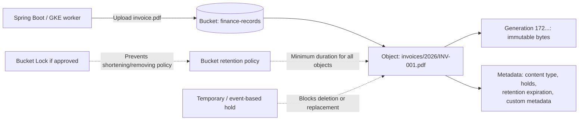
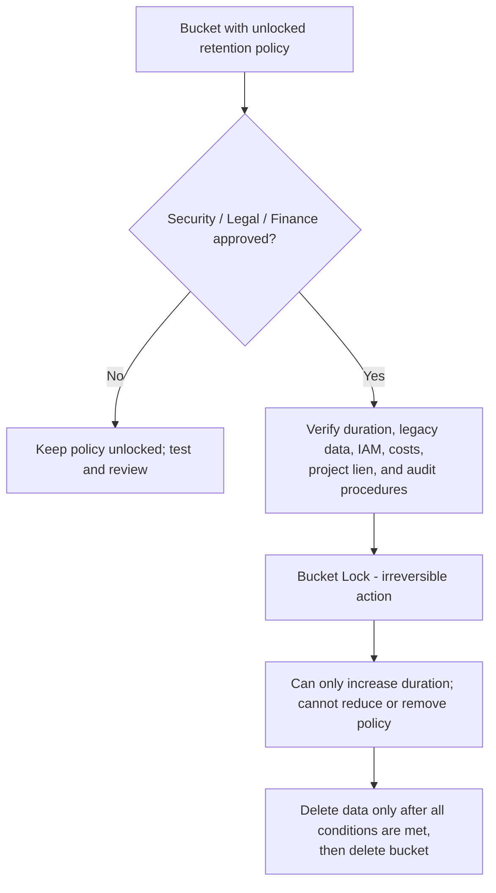
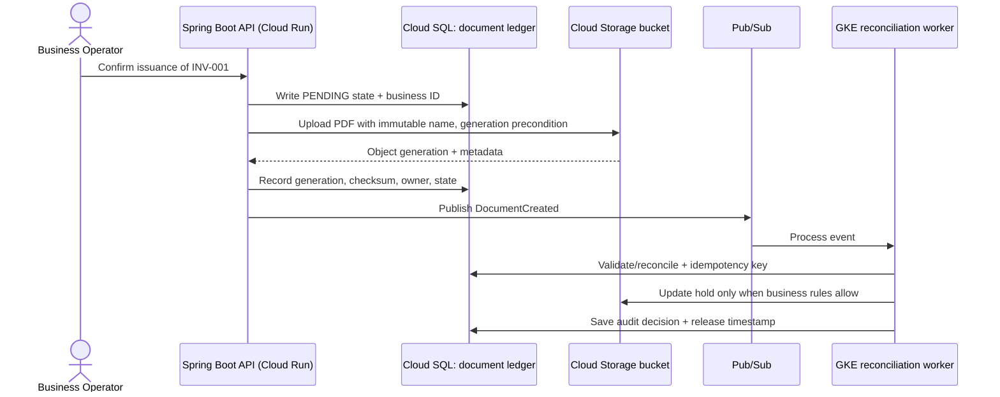
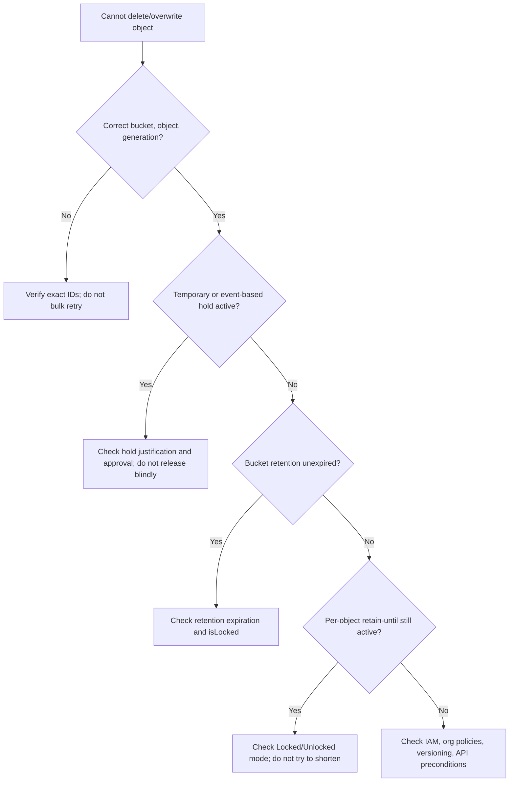

# Retention Policies, Bucket Lock, and Object Holds

## 1. The Problem: Keeping Records Safe from Premature Deletion or Replacement

A **Java/Spring Boot** system writes PDF invoices, reconciliation files, transaction logs, and contracts to **Google Cloud Storage**. The API runs on **Cloud Run**, a worker on **GKE** consumes events via **Pub/Sub**, and the audit team needs to retrieve records months or years later. An accidental `DELETE`, an overwrite under the same object name, or an unchecked lifecycle rule could remove data before the organization's required retention period ends.

**Retention** is the requirement to **keep data for a minimum duration**, usually to protect financial records, support audits, or meet compliance mandates. In Cloud Storage, the three core mechanisms covered in this lesson are:

1. **Bucket retention policy:** enforces a minimum retention period for **every existing and new object** in a bucket.
2. **Bucket Lock:** locks a bucket's retention policy so it **can never be shortened or removed**; this is an **irreversible operation**.
3. **Object holds:** attaches a **temporary hold** or **event-based hold** flag to **individual objects**, blocking deletion or replacement while the hold is active.

This lesson also distinguishes **Object Retention Lock** (per-object retention configuration), **Object Versioning**, **soft delete**, and **Object Lifecycle Management** so you never confuse similarly named features.

Within the **Cloud Storage** chapter of the **CLOUD_PROVIDERS_GCP** module, the goal is to help Java developers choose retention modes, protect resources with IAM, integrate publishing and reconciliation workflows, monitor costs, and know **when not to enable permanent locks**.

### Learning Outcomes

After this lesson, you will be able to:

- Explain the differences among `retention period`, `retention expiration time`, `effective time`, `temporary hold`, and `event-based hold`.
- Determine exactly what happens during **delete, overwrite, same-name upload, metadata updates**, and transitions to **noncurrent generations**.
- Understand the irreversible consequences of **Bucket Lock**, both for the bucket and for project deletion.
- Configure an **unlocked** bucket retention policy, manage holds via `gcloud storage`, and verify results in a lab environment.
- Distinguish Bucket Lock from per-object **Object Retention Lock** and identify incompatible combinations.
- Integrate the Java client library using **generation preconditions**, least-privilege IAM, audit logging, and data lifecycle governance.
- Design testing, operations, and long-term storage cost estimates without accidentally creating an undeletable bucket.

> **Upfront Warning:** Locking a bucket retention policy or setting an object retention configuration to `Locked` can render resources undeletable for **years**, continue incurring charges, and block project deletion. **Never perform lock operations in regular lab exercises.** Lock examples in this lesson are strictly to explain mechanics; production locks require formal sign-off from data, legal, and compliance teams along with long-term budget approval.

## 2. Data Model: Bucket, Object, Generation, and Metadata

Cloud Storage is **object storage**. A bucket holds objects; each object has a **name**, content (bytes), a **generation** identifying its content version, and a **metageneration** identifying its metadata version. When writing new content under the same name, behavior depends on Object Versioning, retention policies, and holds.



**Generation** matters because an object name like `reports/current.csv` can correspond to multiple versions over time. If Object Versioning is enabled, an older version can become **noncurrent** when a new version is uploaded. Retention protection applies to **each generation's data**, which does not mean the object name/URL permanently points to a single version.

### 2.1. Key Timestamps

| Concept | Interpretation | Impact |
| --- | --- | --- |
| **Creation time** | Timestamp when an object generation was created | Usual starting point for calculating the bucket retention period |
| **Retention period** | Minimum duration configured on the bucket, in seconds | E.g. `30 days`, where one day is 86,400 seconds |
| **Retention expiration time** | Metadata timestamp when the object satisfies the bucket's retention requirement | Before this time, deleting or replacing content is rejected |
| **Effective time** | Timestamp when the bucket retention policy is guaranteed active per bucket metadata | Used when auditing policy changes |
| **Retain-until time** | Specific timestamp of a **per-object retention configuration**, if present | Protects the individual object per its own setting |
| **Event-based hold release time** | Timestamp when an event-based hold is removed | **Resets the bucket retention clock** for that object |

Suppose a bucket has a `30-day` retention period. An object uploaded on Jan 01 (assuming no hold) becomes eligible for deletion only after 30 days per actual metadata. If the object carries an **event-based hold**, the bucket retention period is recalculated from **when the event-based hold is released**, not simply from upload time.

### 2.2. Retention Is Not a TTL and Does Not Auto-Delete Data

A retention policy answers **"When is the earliest time an object may be deleted or replaced?"**, not **"When will it be automatically deleted?"** To delete upon expiration, run authorized explicit deletes or configure **Object Lifecycle Management** with appropriate conditions. Conversely, lifecycle `Delete` **cannot** override an active retention policy or hold.

## 3. Bucket Retention Policy: Minimum Hold Across the Entire Bucket

When you set a retention policy on a bucket, Cloud Storage applies the minimum duration to **both existing objects and new objects**, not only files uploaded after configuration. This distinction is critical when enabling a policy on a bucket holding years of existing data.

Suppose a bucket contains two objects:

- Object A was created **1 month ago**, leaving roughly 11 months remaining under a **1-year** policy.
- Object B was created **2 years ago**, already satisfies the **1-year** policy, and can be deleted if **no hold or other protection applies**.

To enforce the period, Cloud Storage rejects premature deletes or overwrites, typically returning **`403 retentionPolicyNotMet`**. Certain metadata updates **can still succeed**; retention protects **a generation's bytes**, not every mutable metadata field.

### 3.1. Unlocked vs. Locked Bucket Policies

| Action | **Unlocked** Policy | **Bucket-Locked** Policy |
| --- | --- | --- |
| Create policy | Yes, with sufficient permissions | Policy already exists prior to locking |
| Increase retention period | Yes | **Yes** |
| Decrease retention period | **Yes**, with sufficient permissions | **No** |
| Remove retention policy | **Yes**, with sufficient permissions | **No** |
| Delete an object before expiration | **No**, while policy is active | **No** |
| Delete a bucket with unexpired objects | No, while policy is active | No; policy cannot be lowered or removed to release objects early |
| Delete a bucket after all objects expire and are deleted | Yes, per standard rules | Yes, after resolving objects, holds, versioning, and project constraints |

**Do not confuse "policy set" with "policy locked."** An unlocked retention policy still blocks premature deletes while active, yet **anyone with bucket-update permissions can shorten or remove it**. Bucket Lock blocks shortening or removal at the service layer even for normal administrators.

### 3.2. Retention Length and Units

According to Cloud Storage documentation, the maximum retention period can reach **100 years** (3,155,760,000 seconds). One day equals 86,400 seconds; a month in CLI unit conventions may equal **31 days**, and a year **365.25 days**. When a legal requirement says "7 years from contract termination," clarify how the **start milestone**, timezone, and duration math are defined rather than assuming "7 × 365 days from upload."

In `gcloud storage`, you can pass durations such as `3600s`, `30d`, or supported ISO-8601 formats. **Read back the actual stored values** on the bucket/object after updating rather than treating UI input formatting as proof.

## 4. Bucket Lock: What Is Truly Irreversible?

**Bucket Lock** locks the retention policy **for the entire bucket**. Once locked:

1. You cannot **remove** the retention policy.
2. You cannot **decrease** the retention period; you can only **increase** it.
3. You cannot delete the bucket while any objects or generations remain within retention or held by other controls.
4. Cloud Storage places a **project lien** associated with the locked bucket to prevent routine project deletion while the lien holds; lien handling must be governed independently with legal accountability.



**Command shown for recognition only—never run in regular labs:**

```text
# DO NOT RUN THIS COMMAND IN THE LAB:
gcloud storage buckets update gs://BUCKET_NAME --lock-retention-period
```

This is **not** a lab cleanup step or harmless test command. Running it in a demo project with a 7-year policy can lock you into maintaining those objects, bucket, and billing charges for years. **There is no "unlock."** A project lien does not make early bucket deletion valid; removing a lien to delete a project **is not a workaround to bypass data protection**.

### 4.1. What Approvals Are Needed Before Locking?

- **Legal/Compliance:** covered data categories, applicable regulations, retention duration and trigger dates, and deletion/exception governance.
- **Data owner:** exact target bucket, whether existing objects belong under the same duration, and whether records should be split into separate buckets.
- **Security/IAM:** which accounts may modify retention, who approves locking, and who may release holds.
- **Finance/FinOps:** projected capacity growth, storage class, replication, soft delete/versioning, and minimum retention periods.
- **Operations:** monitoring, lifecycle, migration, project liens, backups, incident response, and audit evidence.

**Bucket Lock helps satisfy part of WORM requirements**, yet it does not by itself certify compliance with FINRA/SEC/CFTC, industry regulations, or national laws. Compliance also depends on processes, audits, access controls, data accuracy, and vendor agreements.

## 5. Object Holds: Temporary and Event-Based

An **object hold** is a metadata flag on an **individual object/generation**. While held, the object cannot be **deleted or replaced**, though permitted metadata fields can still be updated. Both hold types can coexist on the same object unless restricted by per-object retention limits.

| Characteristic | **Temporary hold** | **Event-based hold** |
| --- | --- | --- |
| Purpose | Hold during investigations, disputes, or legal holds with no known end date | Wait for a business event before starting the retention countdown |
| How applied | Flag set on the object | Flag set on the object, or enable **default event-based hold** on the bucket for new objects |
| While held | Generation cannot be deleted or overwritten | Generation cannot be deleted or overwritten |
| Upon release with a bucket retention policy | **Does not alter** the object's retention expiration | **Restarts** the bucket retention clock from the release timestamp |
| Without a retention policy or per-object retention | Release → deletable if no other constraints apply | Release → deletable if no other constraints apply |
| Compatible with per-object retention configuration | Can coexist | **Cannot** coexist on the same object |

### 5.1. Common Pitfall: Two Files Retained for 1 Year

A bucket has a **1-year** policy. On 2026-01-01, you upload **A** with an event-based hold and **B** with a temporary hold.

```text
2026-01-01          A and B created, both with holds.
2027-01-01          One year passes; neither can be deleted due to holds.
2027-03-01          Holds released on A and B.

A (event-based):    begins counting another 1 year from 2027-03-01;
                    cannot be deleted yet.
B (temporary):      keeps original retention timestamp;
                    can be deleted if no other protections remain.
```

That is why **event-based holds fit records retained X years after an event** (such as loan closure), whereas **temporary holds** fit open-ended investigations where releasing the hold should not reset the record's retention period.

### 5.2. Bucket Default Event-Based Hold

You can enable **default event-based hold** so **every object created afterward** automatically carries an event-based hold. This suits workflows like "upload first, wait for approval/event later, then retain for 7 years." Depending on configuration, this setting **is not retroactive across all existing objects**: adding holds to pre-existing objects requires separate updates, such as via Storage Batch Operations.

If a pipeline forgets to release a hold, objects can **remain indefinitely** while held, even past lifecycle Delete thresholds. Maintain a **business-event tracking ledger, release approvals, and alerts for stale holds**. Enabling default holds on a bucket mixing temporary files or personal data can block routine cleanup or erasure workflows.

### 5.3. Limits to Remember

- **Object holds are not supported in hierarchical namespace buckets** per current Cloud Storage documentation. Verify compatibility **before creating the bucket**.
- You cannot place an **event-based hold** on an object that already has a **per-object retention configuration**, and vice versa.
- A **temporary hold** can coexist with a per-object retention configuration; releasing the temporary hold **does not change `retain-until`**.
- Hold flags are managed through supported interfaces such as the Console, `gcloud storage`, or JSON API; **the XML API does not manage hold flags**, even though deletes via the XML API are still blocked while an object is held.

## 6. Distinguishing Object Retention Lock from Bucket Lock and Holds

In addition to the three primary mechanisms, **Object Retention Lock** lets each object have its own **retain-until time** and **retention mode**. Using this feature requires enabling **per-object retention** on the bucket; once enabled, it **cannot be disabled** on that bucket. For existing buckets, enabling it must be done through the **Google Cloud console** per the supported procedure.

| Mechanism | Scope | Editable or Removable? | When to Choose? |
| --- | --- | --- | --- |
| Bucket retention policy (**unlocked**) | All bucket objects, old and new | Authorized admins can shorten/remove policy | Enforce a minimum retention baseline before locking governance |
| **Bucket Lock** | Locks retention policy for the **entire bucket** | **Cannot** shorten or remove policy | Uniform-retention records with approved irreversible lock requirements |
| **Temporary hold** | One object | Removable with proper permissions | Investigations/litigation holds with unknown end dates |
| **Event-based hold** | One object; optionally default for new objects | Removable; release resets bucket retention clock | Retain X years after a business event |
| Per-object retention (**Unlocked**) | One object with its own `retain-until` | Adjustable/removable with appropriate permissions | Records with differing retention dates needing flexibility |
| Per-object retention (**Locked**) | One object with its own `retain-until` | **Cannot** shorten/remove; can only extend | Object-level WORM with varying retention dates and formal approval |

In JSON/XML APIs, per-object mode `Unlocked` corresponds to **GOVERNANCE**, and `Locked` corresponds to **COMPLIANCE** in related interfaces. Distinguish an object's **Locked mode** from **Bucket Lock** on a bucket policy: they are separate mechanisms with different scopes.

### 6.1. Multiple Retention Layers Applied Together

An object can simultaneously be subject to a **bucket retention policy** and a **per-object retain-until time**. It becomes eligible for deletion only once **both** time thresholds have passed, **no holds remain**, and no other restrictions apply.

Example:

```text
Bucket retention expires:     2028-02-01
Object-specific retain-until: 2028-07-01
Temporary hold:               enabled

=> Cannot be deleted before 2028-07-01.
=> After 2028-07-01, still cannot be deleted while temporary hold is active.
=> Deletable only once every constraint has been satisfied or validly released.
```

**Warning:** Never switch an object's retention mode to `Locked` just to test the API. You cannot downgrade back to `Unlocked` or shorten `retain-until`, and deadlines can extend up to **100 years**. Enabling per-object retention can also place a **project lien** preventing project deletion under feature rules.

## 7. Interactions with Versioning, Soft Delete, and Lifecycle

### 7.1. Object Versioning: Noncurrent Does Not Mean Permanently Deleted

With **Object Versioning** enabled, overwriting the same object name turns the old generation **noncurrent**; that old generation remains in the bucket and remains bound by retention. Cloud Storage documentation notes that **a live version still under retention can transition to noncurrent** under versioning semantics, yet **that generation cannot be permanently deleted** before satisfying retention.

This is especially important for `invoices/INV-001.pdf`: the live object name might point to a **revised copy** while the original remains retained. If auditing requires retrieving the exact issued document, store **generation ID, checksum, and business document ID** in your database rather than just the `gs://bucket/name` path.

### 7.2. Soft Delete: Post-Deletion Recovery Window

**Soft delete** retains deleted or overwritten objects in a recoverable state for an additional window. Under common current defaults, soft delete is **enabled by default for 7 days** on supported buckets and can be adjusted within limits and policies. **Soft delete is not a retention policy**: it is primarily a **post-deletion recovery** safety net, whereas a retention policy **prevents premature deletion**.

Once an object satisfies retention and is deleted, it can enter the **soft-deleted** state before permanent removal after the soft-delete duration expires. Soft-deleted data still incurs **storage charges**. Never look at an empty live object listing and assume storage billing is zero.

### 7.3. Lifecycle: Timely Automated Cleanup Without Bypassing Protections

**Object Lifecycle Management** can run `Delete` or `SetStorageClass` automatically when conditions match. A `Delete` rule will not take effect while an object has an active hold or has not met its retention policy; once eligible, the service can delete it asynchronously.

An example rule:

```json
{
  "rule": [
    {
      "action": {"type": "Delete"},
      "condition": {"age": 90}
    }
  ]
}
```

This is an illustrative `lifecycle.json` configuration: "reaching 90 days" **does not override** holds or retention periods longer than 90 days. When combining with Versioning, understand how actions apply to **live vs. noncurrent generations** and conditions like generation age or `numNewerVersions`; never deploy a simple rule like this on a bucket with mixed retention needs without simulation.

### 7.4. Cost Notes When Choosing a Storage Class

Nearline, Coldline, and Archive have different storage, retrieval, operation, and **minimum storage duration** charges than Standard. Setting a long retention period does not automatically make Archive optimal: factor in **document read frequency, retrieval fees, network egress, early deletion charges**, soft delete, and retained generations. Use Cloud Storage pricing for the actual region/dual-region/multi-region.

### 7.5. Combinations That Easily Create "Trapped Resources"

| Combination | Risk |
| --- | --- |
| 7-year Bucket Lock + hourly temporary uploads | Temporary files cannot be deleted early; costs climb continuously |
| Default event-based hold + missing release workflow | Files stay held forever; lifecycle cannot clean them up |
| Object Versioning + long retention | Multiple noncurrent generations accumulate charges and cannot be deleted |
| Soft delete + retention + multiple versions | After retention ends, a billable soft-delete window still follows |
| CMEK key version encrypting locked-retention objects | Cannot casually destroy the key version while locked objects rely on it |
| Locked per-object retention + wrong date | Cannot shorten; must wait until the chosen `retain-until` |

## 8. Business Architecture: Spring Boot, Pub/Sub, and Retained Records

Suppose an invoicing system issues official documents:



For records whose retention starts **at issuance**, you can use a bucket retention policy matching the legal duration. For records **waiting on a completion event**, consider an event-based hold released once the event is verified. For records under investigation, apply a **temporary hold** via an approved workflow. Never grant every worker permission to release holds or alter bucket retention.

### 8.1. Recommended Fields in the Business Ledger Table

| Suggested Field | Purpose |
| --- | --- |
| `document_id` | Business identifier independent of filename |
| `bucket`, `object_name`, `generation` | Retrieve the exact generation needed for reconciliation |
| `crc32c` or verified checksum | Detect unexpected data mismatches |
| `retention_category`, `retention_basis` | Justification for retention duration |
| `hold_type`, `hold_reason`, `hold_approved_by` | Audit trail for placing/releasing holds |
| `event_at`, `release_at` | Business start/end event timestamps |
| `retention_expiration_time` | Reconcile against live Cloud Storage metadata |
| `storage_class`, `location` | Track costs, residency scope, and policies |

**Cloud Storage metadata is the authoritative source to verify**, not just the Cloud SQL table. If the DB says "hold released" while object metadata still shows `eventBasedHold=true`, Cloud Storage will still block deletion. Build error handling, idempotent retries, and reconciliation jobs for out-of-sync states.

## 9. Safe `gcloud` Lab: Unlocked Retention and Temporary Hold

This lab **does not execute Bucket Lock**, **does not enable Locked per-object retention**, and uses only a new dedicated test bucket. Run inside an **authorized project** with billing, Cloud Storage API, and proper permissions, and with no real legal obligations attached. Commands use **Bash** syntax with an authenticated `gcloud` CLI; PowerShell uses different line-continuation syntax.

### Step 1 — Create a New Lab Bucket

Pick a **globally unique** bucket name, such as `gcs-retention-lab-UNIQUE_SUFFIX`. Never use production buckets or someone else's domain name:

```bash
gcloud config set project PROJECT_ID
gcloud services enable storage.googleapis.com

gcloud storage buckets create gs://BUCKET_NAME \
  --project=PROJECT_ID \
  --location=us-central1 \
  --uniform-bucket-level-access

gcloud storage buckets describe gs://BUCKET_NAME
```

**UBLA** standardizes access control on IAM instead of mixing object ACLs. Check the default `soft delete` policy (if enabled) so you know deleted objects may remain in a recoverable, billable state temporarily.

### Step 2 — Set an **Unlocked** 1-Hour Retention Policy

```bash
gcloud storage buckets update gs://BUCKET_NAME \
  --retention-period=3600s

gcloud storage buckets describe gs://BUCKET_NAME \
  --format="default(retention_policy)"
```

This is an **active retention policy even while unlocked**. In this lab, clearing the policy at the end lets us clean up resources; if you intentionally set a 1-year policy or Bucket Lock, cleanup changes drastically. Inspect `isLocked`/`retention_policy` and `effectiveTime` if displayed in metadata.

### Step 3 — Upload a File and Inspect Object Metadata

```bash
printf 'Document for retention lab\n' > lab-record.txt

gcloud storage cp lab-record.txt gs://BUCKET_NAME/lab-record.txt
gcloud storage objects describe gs://BUCKET_NAME/lab-record.txt

# Expected to FAIL while retention is active:
gcloud storage rm gs://BUCKET_NAME/lab-record.txt
```

Expect an **error from the retention policy**, not a successful deletion. If deletion succeeds, stop and verify your bucket, project, and policy before drawing conclusions. **Never use `--force` or escalate to Owner** to "bypass" retention: this is an enforced Cloud Storage safeguard.

### Step 4 — Test Temporary Hold

```bash
gcloud storage objects update gs://BUCKET_NAME/lab-record.txt \
  --temporary-hold

gcloud storage objects describe gs://BUCKET_NAME/lab-record.txt

# Still blocked while the object has a hold:
gcloud storage rm gs://BUCKET_NAME/lab-record.txt
```

In this lab, the object is protected for **two reasons**: bucket retention and temporary hold. A deletion error may surface one reason first, which does not mean the other constraint vanished.

### Step 5 — Release Temporary Hold and Clear the Unlocked Retention Policy

```bash
gcloud storage objects update gs://BUCKET_NAME/lab-record.txt \
  --no-temporary-hold

gcloud storage buckets update gs://BUCKET_NAME \
  --clear-retention-period

gcloud storage buckets describe gs://BUCKET_NAME \
  --format="default(retention_policy)"
```

`--clear-retention-period` **succeeds only because the policy is unlocked** and no organization policy prohibits it. Even after clearing the bucket policy, an object can remain protected if **another hold or per-object retention** was added in an extended lab.

### Step 6 — Cleanup and Post-Delete Verification

```bash
gcloud storage rm gs://BUCKET_NAME/lab-record.txt
gcloud storage buckets delete gs://BUCKET_NAME
```

Delete **only the verified lab bucket**. If the bucket has soft delete enabled, deleted items may remain retained during the recovery window and continue incurring minor charges. If cleanup returns `403`, **do not delete the project or try removing project liens** to sidestep the error; inspect `retention_policy`, holds, object generations, and IAM. If other objects/versions remain undeleted, the bucket is not empty yet.

## 10. Extended Lab: Event-Based Hold and Retention Start Time

Use a **separate lab bucket** or recreate the bucket after Section 9. Set a short **unlocked** retention period to validate the flow. To avoid waiting in real time, inspect the **timeline diagram** and metadata first rather than intentionally retaining an object for years.

```bash
# Enable default event-based hold for objects CREATED AFTER this point.
gcloud storage buckets update gs://BUCKET_NAME \
  --default-event-based-hold

printf 'Loan closed event demonstration\n' > loan-record.txt
gcloud storage cp loan-record.txt gs://BUCKET_NAME/loan-record.txt
gcloud storage objects describe gs://BUCKET_NAME/loan-record.txt

# Release hold only once the business event is verified:
gcloud storage objects update gs://BUCKET_NAME/loan-record.txt \
  --no-event-based-hold

gcloud storage objects describe gs://BUCKET_NAME/loan-record.txt
```

When the event-based hold is released, **the bucket retention clock restarts**. With a `3600s` bucket retention, the object remains protected for roughly one more hour even though it was uploaded earlier. To clean up the lab, disable default hold for new uploads first, clear the unlocked retention policy, and delete the object only after verifying states:

```bash
gcloud storage buckets update gs://BUCKET_NAME \
  --no-default-event-based-hold

gcloud storage buckets update gs://BUCKET_NAME \
  --clear-retention-period

gcloud storage rm gs://BUCKET_NAME/loan-record.txt
gcloud storage buckets delete gs://BUCKET_NAME
```

**Never run these sample commands on a bucket holding real records**: releasing an event-based hold can start a legal retention cycle, and clearing an unlocked policy can violate governance. In production, release requires an approval ticket or verified business event, not a speculative cron job.

## 11. Object Retention Lock: Separate Example, Do Not Mix into Lab Cleanup

Object Retention Lock requires a bucket with **per-object retention enabled**. When creating a new bucket, you can enable it via `--enable-per-object-retention`. **Once enabled, it cannot be disabled**; therefore, **never reuse a regular lab bucket to experiment recklessly**.

Example declaration in an approved environment (illustrative only—**do not run without an impact assessment**):

```text
# Create a bucket capable of per-object retention settings:
gcloud storage buckets create gs://APPROVED_BUCKET \
  --project=PROJECT_ID \
  --location=us-central1 \
  --enable-per-object-retention

# Use only Unlocked mode during verification:
gcloud storage objects update gs://APPROVED_BUCKET/record.pdf \
  --retain-until=2028-02-15T05:30:00Z \
  --retention-mode=Unlocked

# Never switch to Locked just for a lab exercise.
```

The timestamp `2028-02-15T05:30:00Z` is an RFC 3339 syntax example, **not a real deadline for organizational documents**. Reducing or removing an **Unlocked** retention configuration requires special permissions and the `--override-unlocked-retention` confirmation flag per CLI rules. No equivalent flag exists to shorten **Locked** mode.

To inspect the configuration:

```bash
gcloud storage buckets describe gs://APPROVED_BUCKET \
  --format="default(per_object_retention)"

gcloud storage objects describe gs://APPROVED_BUCKET/record.pdf \
  --format="default(retention_settings)"
```

**An event-based hold and a per-object retention configuration cannot both be applied to the same object.** If the business needs retention triggered by an event for N years afterward, choose **event-based hold + bucket retention**; if each record needs its own `retain-until` date, evaluate **per-object retention** (plus temporary holds when an ad-hoc litigation pause is required).

## 12. Java Client Library: Setting Conditional Holds and Reading Metadata

In **Spring Boot** services or Java workers, use the **Cloud Storage Client Library for Java** (`com.google.cloud:google-cloud-storage`) with **Application Default Credentials (ADC)**. On Cloud Run, GKE, or Compute Engine, prefer a properly scoped runtime identity / service account rather than embedding a service account JSON key in code or container images.

The example below intentionally **exposes no public HTTP endpoint to remove holds**. Operations changing compliance-related storage flags should only be invoked from authenticated, audited business workflows.

```java
package dev.example.documents;

import com.google.cloud.storage.Blob;
import com.google.cloud.storage.BlobId;
import com.google.cloud.storage.Storage;
import com.google.cloud.storage.StorageOptions;
import java.util.Objects;

/** Operate only on objects in organization-approved buckets. */
public final class DocumentHoldService {
    private final Storage storage = StorageOptions.getDefaultInstance().getService();

    /** Read the exact generation; essential when Object Versioning is enabled. */
    public void inspect(String bucket, String name, long generation) {
        Blob blob = requireBlob(bucket, name, generation);
        System.out.println("generation=" + blob.getGeneration());
        System.out.println("temporaryHold=" + blob.getTemporaryHold());
        System.out.println("eventBasedHold=" + blob.getEventBasedHold());
        System.out.println("bucketRetentionExpires=" +
                blob.getRetentionExpirationTimeOffsetDateTime());
    }

    /** Call only after confirming the record requires a legal/investigation hold. */
    public void placeTemporaryHold(String bucket, String name, long generation) {
        Blob blob = requireBlob(bucket, name, generation);
        if (Boolean.TRUE.equals(blob.getTemporaryHold())) {
            return; // Idempotent: hold is already set.
        }
        blob.toBuilder()
            .setTemporaryHold(true)
            .build()
            .update(Storage.BlobTargetOption.generationMatch());
    }

    private Blob requireBlob(String bucket, String name, long generation) {
        Objects.requireNonNull(bucket);
        Objects.requireNonNull(name);
        Blob blob = storage.get(BlobId.of(bucket, name, generation));
        if (blob == null) {
            throw new IllegalArgumentException("Object generation not found");
        }
        return blob;
    }
}
```

**Code explanation:**

- `BlobId.of(bucket, name, generation)` avoids acting on the wrong live version when an object has multiple generations.
- `generationMatch()` prevents applying an update to a different generation due to a race condition; where multiple workers concurrently edit metadata, also evaluate **metageneration preconditions** per your API and Java client library version.
- `getTemporaryHold()` and `getEventBasedHold()` can return `null` if the field was not requested; fetch metadata with proper field selection and never assume `null` means `false` without knowing which fields were retrieved.
- `placeTemporaryHold` is a **privileged operation**. Releasing a hold should be a **separate workflow** that authenticates the actor, verifies approval, logs an audit event, and verifies updated metadata.
- The Java Cloud Storage SDK **cannot bypass** retention policies, IAM denies, or holds: prohibited operations throw `StorageException` with the underlying API error.

### 12.1. Service Account Registration and Application Permissions

Workers that generate records only need appropriate **object creation permissions**; they should not hold `storage.buckets.update` or retention-management permissions. Workers setting holds need appropriate object-metadata update permissions. Only a dedicated **retention administration** service should modify bucket policies or release holds after approval.

For production apps, adopt **uniform bucket-level access**, **public access prevention**, IAM Conditions where helpful, VPC Service Controls within supported perimeters, and **Cloud Audit Logs Data Access** configured per audit requirements. Separate the **Cloud Run runtime service account** from bucket/compliance administrators.

## 13. IAM, Organization Policies, Auditing, and Compliance Evidence

### 13.1. Separation of Duties

| Job Role | Required Capabilities | Should Not Have by Default |
| --- | --- | --- |
| Java uploader | Create objects and read metadata in allowed scope | Permission to shorten/delete bucket retention or release holds |
| Case investigation officer | Request/approve temporary holds and releases | Permission to alter bucket-wide policies unnecessarily |
| Compliance retention admin | Manage retention policies and approved lock workflows | Routine access to sensitive data contents outside duties |
| Infrastructure operator | View bucket state, lifecycle, costs, health | Ability to delete locked policies (impossible anyway) |
| Auditor | Read audit logs, inventory, retention states | Permission to overwrite objects or grant broad IAM |

Suggested permissions include `storage.buckets.get`, `storage.buckets.update`, `storage.objects.get`, `storage.objects.update`; per-object retention additionally involves `storage.objects.setRetention` and `storage.objects.overrideUnlockedRetention`. **Never grant `roles/storage.admin` to every service account** just to simplify deployment. Verify exact permissions per task and API surface.

### 13.2. Organization Policy and Change Management

The Organization Policy Service supports **bucket retention policy constraints** to require minimum durations or valid ranges when creating or updating buckets, depending on configuration. This governance guardrail prevents teams from creating non-compliant buckets, yet **does not replace Bucket Lock decisions** for WORM data and does not automatically enforce business approval workflows.

When modifying a retention period (even unlocked), require:

1. Data purpose/justification and bucket scope.
2. Impact assessment for existing objects affected **retroactively**.
3. Byte-hour estimates plus soft delete and versioning overhead.
4. Reviewed pull request / IaC plan or change ticket.
5. An approver independent from the implementer.
6. Post-change verification of policies/holds and tamper-evident audit evidence.

### 13.3. Audit Logging

Monitor **Admin Activity** logs for bucket/IAM configuration changes and enable **Data Access logs** for object reads/writes per audit policy. Cloud Storage also supports a **Detailed audit logging mode** that captures additional request/response details for compliance mechanisms. Note that Data Access logging is not enabled by default for all operations and can incur logging costs.

Never write access tokens, signed URLs, private keys, PII documents, or object payloads into debug logs. Retain **generation ID, timestamp, principal, action, request ID, change ticket**, and outcome per approved procedures.

## 14. Costs and Long-Term Operational Planning

Retention is a **deletion restriction**, so increasing duration causes stored data to accumulate. Estimate **data intake**, retention, replication/storage class, versioning, soft delete, retrieval, and operations.

### 14.1. Illustrative Capacity Calculation

Suppose a system generates **10 GiB** of records daily, retained at least **365 days**, with no early deletion and ignoring compression, growth, and versioning:

```text
Steady-state storage is approximately:
10 GiB/day × 365 days = 3,650 GiB ≈ 3.56 TiB.

If Object Versioning is enabled and each object averages 1 extra generation:
Capacity can grow significantly depending on overwrite rates and noncurrent lifecycles.
```

With unreleased event-based holds or prolonged investigations, storage size can **keep growing beyond the 365-day steady state**. With soft delete enabled, deleted data continues accruing storage charges during its recovery window. This is a **capacity model**, not Google Cloud unit pricing.

### 14.2. Budget Line Items to Include

- **Storage GiB-month** by region, class, and location type.
- **Object Versioning**: charges for noncurrent generations.
- **Soft delete**: charges for objects in soft-deleted state.
- **Minimum storage duration and retrieval** when using Nearline, Coldline, or Archive.
- **Operations, Class A/B requests**, data retrieval, and network egress; cross-region replication if configured.
- **Cloud Logging / Data Access** and surrounding Cloud Run/GKE/Cloud SQL services.

To control costs, separate buckets by **retention tier**, apply properly conditioned Lifecycle Management, match storage class to read frequency, and set **Cloud Billing budgets/alerts**. **A budget alert does not automatically delete objects or shut off billing.** Never treat removing a locked retention policy as a "cost-optimization option," because Cloud Storage does not allow it.

## 15. Troubleshooting Retention and Holds

| Symptom | Possible Cause | Investigation Steps |
| --- | --- | --- |
| `403 retentionPolicyNotMet` on object delete | Bucket retention has not expired | Check bucket policy, object `retentionExpirationTime`, and event-based hold history |
| `400` when reducing retention period | Bucket retention policy is locked | Check `retention_policy.isLocked` and change history; no unlock exists |
| Released temporary hold, yet still cannot delete | Retention unexpired, event-based hold, or per-object retention still applies | Inspect **all** active protection flags |
| Released event-based hold, and object must stay years longer | Bucket retention clock restarted upon release | Check retention period and actual release timestamp |
| Same-name upload fails | Object is held/retained, or generation precondition failed | Check versioning, source generation, and API error |
| Lifecycle `Delete` did not remove an aged object | Hold or retention remains active, or lifecycle job has not run yet | Inspect object metadata, rule conditions, and event timeline |
| Cannot delete bucket | Objects/noncurrent generations/retained items remain, or soft-delete bucket workflow | List versions, holds, retention, and soft-delete settings |
| Cannot delete project | Project lien from locked bucket/object retention or another policy | List project liens and approvals; never remove liens as a "quick fix" |
| `403` when creating/updating policy | Missing IAM or Organization Policy constraint | Check IAM permissions, project/bucket policy, and org constraints |
| Placing event-based hold fails | Object already has a per-object retention configuration | Check `retention_settings` and use compatible mechanism |
| Hold flags not visible via XML API | XML API does not manage hold flags | Use Console, `gcloud storage`, or JSON API |
| High bill after deletion | Soft-delete retention, versions, storage class, or request charges | Check Billing SKUs, soft-deleted inventory, and data growth |

### Non-Destructive Investigation Flow



**Never run `--force`, escalate IAM to Owner, or launch bulk delete scripts before identifying the root cause.** For legal or investigative records, a rejected deletion may be the exact intended protection.

## 16. Exercises and Checklist

### Exercise A — Choosing the Right Tool

Classify five scenarios:

1. Invoices must be kept **at least 7 years from issuance** → bucket retention policy; consider Bucket Lock **after formal approval**.
2. Contracts must be kept **5 years from termination date** → event-based hold + retention policy, released after verifying the event.
3. A file placed on legal hold by investigators with **no known end date** → temporary hold.
4. Each customer has a distinct cancellation date, giving files different `retain-until` dates → consider per-object Object Retention Lock.
5. A user accidentally deleted a file and needs recovery within 7 days → soft delete/Versioning as appropriate; do not confuse with mandatory retention.

Explain why mechanisms can coexist and which conditions determine **final eligibility for deletion**.

### Exercise B — Calculating Retention and Hold Release

A bucket has a **1-year** retention policy. Files A and B are uploaded on the same day and held for one year; A has an event-based hold, and B has a temporary hold. After **18 months**, both holds are released. Explain which file can be deleted immediately, which must stay another year, and why.

### Exercise C — Unlocked Policy Lab

In an authorized test project, create a bucket, set an **unlocked** `--retention-period=3600s`, upload a file, attempt deletion, set a temporary hold, release the hold, **clear the policy**, and clean up the bucket. Record before/after metadata and error codes. Do not run Bucket Lock or set `Locked` retention mode.

### Exercise D — Designing Java Ingestion

Design an API/pipeline receiving PDF invoices on Cloud Run, uploading to Cloud Storage, recording **generation and checksum** in Cloud SQL, publishing Pub/Sub events, and reconciling via a GKE worker. Specify idempotency, runtime permissions, generation-match preconditions, and hold-change auditing.

### Exercise E — Long-Term Estimation and Compliance

At 10 GiB of new records/day with a 365-day retention period, calculate approximate steady-state storage. Add assumptions for Versioning, soft delete, class minimum storage duration, audit logs, and approvals prior to Bucket Lock. Explain why mistaking 10 years for 10 days is a severe operational risk.

### Pre-Production Checklist

- [ ] Clearly identified **data type, owner, retention period, and retention start trigger**.
- [ ] Distinguished an unlocked bucket retention policy from an **irreversible Bucket Lock**.
- [ ] Understood that releasing an event-based hold **resets the bucket retention clock**, unlike a temporary hold.
- [ ] Knows that event-based holds and per-object retention cannot coexist on the same object.
- [ ] Distinguished per-object `Unlocked`/`Locked` from bucket policy locks.
- [ ] Checked compatibility across Object Versioning, soft delete, lifecycle, storage class, and holds.
- [ ] Established least-privilege IAM, independent approvals, audit logging, and project lien governance.
- [ ] Java service records object `generation`, uses concurrency preconditions, and has an approved hold-release workflow.
- [ ] Tested `403` handling, cleanup in an **unlocked lab bucket**, and metadata verification.
- [ ] Estimated byte-hour growth, old versions, soft-delete windows, and audit logs.
- [ ] **Never locks** a retention policy or object mode just to try out a feature.

**Conclusion:** Retention policies, Bucket Lock, and object holds enable Cloud Storage to protect records from premature deletion or replacement, yet **each mechanism has distinct boundaries and consequences**. For Java systems on GCP, a solid design combines records tracked by **generation ID**, approval-gated business workflows, separated IAM duties, audit logging, Lifecycle Management, and storage budgeting. Above all, **lock permanently only once retention duration, data scope, and operational accountability are fully confirmed**.

## 17. Official Google Cloud References

- [Bucket Lock — concepts, retention policies, and irreversibility](https://cloud.google.com/storage/docs/bucket-lock)
- [Use and lock retention policies — Console, gcloud, and Java](https://cloud.google.com/storage/docs/using-bucket-lock)
- [Object holds — temporary vs. event-based, resetting retention clock](https://cloud.google.com/storage/docs/object-holds)
- [Use object holds — default event-based and CLI commands](https://cloud.google.com/storage/docs/holding-objects)
- [Object Retention Lock — per-object Locked/Unlocked](https://cloud.google.com/storage/docs/object-lock)
- [Enable and use object retention configurations](https://cloud.google.com/storage/docs/using-object-lock)
- [Object Versioning](https://cloud.google.com/storage/docs/object-versioning)
- [Soft delete overview](https://cloud.google.com/storage/docs/soft-delete)
- [Object Lifecycle Management](https://cloud.google.com/storage/docs/lifecycle)
- [Cloud Storage Audit Logs](https://cloud.google.com/storage/docs/audit-logging)
- [Cloud Storage IAM roles](https://cloud.google.com/storage/docs/access-control/iam-roles)
- [Cloud Storage pricing](https://cloud.google.com/storage/pricing)
