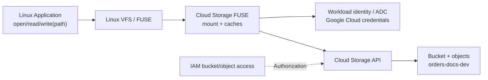
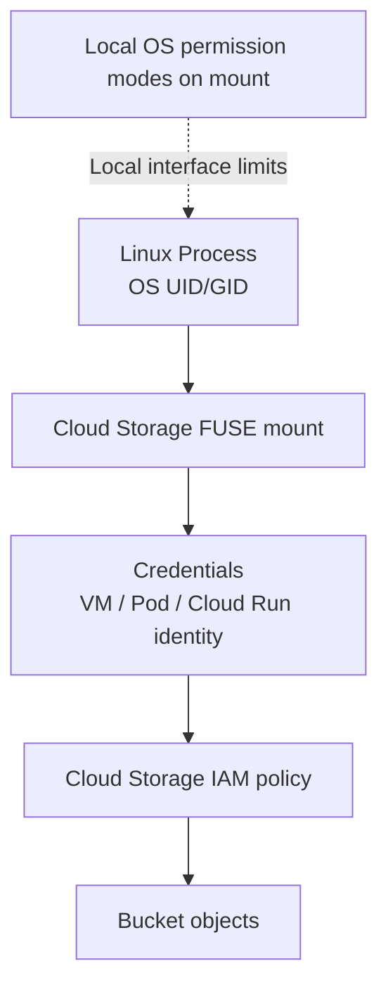
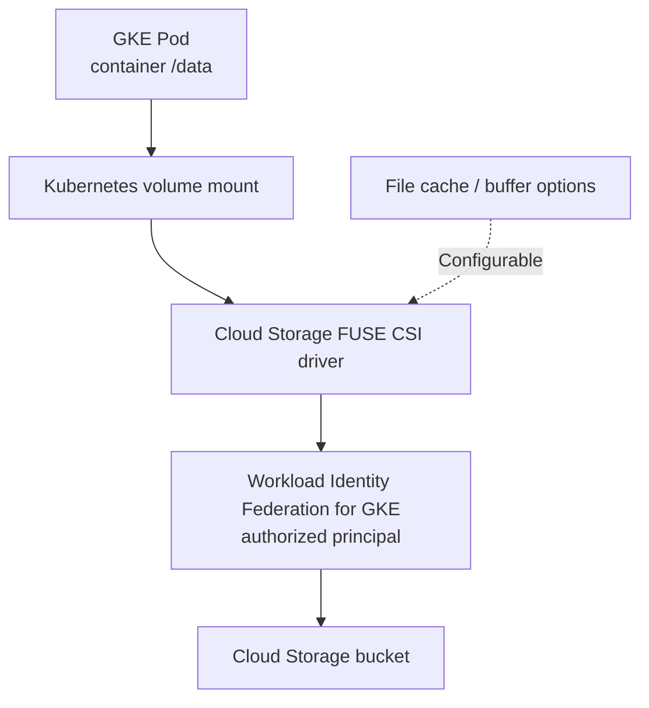

# Cloud Storage FUSE and Limits When Using It as a Filesystem

Many applications only know how to read and write file paths such as `/data/images/product-001.jpg`, whereas Google Cloud Storage provides **object storage** with buckets, objects, and APIs. **Cloud Storage FUSE** (often called `gcsfuse`) lets a Linux process or supported integration access objects in a bucket through **filesystem-like paths**. This capability is very convenient when migrating apps to Google Cloud, yet **the mount interface does not turn Cloud Storage into a full POSIX filesystem**.

This lesson belongs to the **Cloud Storage** chapter of the `CLOUD_PROVIDERS_GCP` module. It connects with projects/IAM, VPCs, Compute Engine, GKE, Cloud Run, and data-processing systems. Learners need to know when to use Cloud Storage FUSE to reuse applications, when to use the Cloud Storage API directly or switch to block/file storage, and how to safeguard data, automate deployments, and monitor reliability and costs.

> The commands and resource names below use hypothetical projects, buckets, and service accounts. Execute only in authorized environments and verify the current Cloud Storage FUSE version, mount method, IAM permissions, feature support, quotas, and pricing before deploying to production.

## 1. Learning Objectives

After this lesson, you will be able to:

1. Distinguish a **Cloud Storage object** from traditional filesystem **files, directories, and inodes**.
2. Explain how Cloud Storage FUSE maps **bucket/object names** to **mount points/paths** and sends requests to Cloud Storage.
3. Identify limitations around **POSIX semantics, renames, in-place edits, file locking, concurrent writes, metadata, and directory behavior**.
4. Understand the difference between **Cloud Storage consistency** and **data freshness observed through FUSE caches**.
5. Design **authentication via Application Default Credentials (ADC) / workload identity**, IAM, bucket access, and network paths.
6. Practice mounting a bucket on Compute Engine, verifying uploads/reads, unmounting, and diagnosing common errors.
7. Analyze using the **Cloud Storage FUSE CSI driver on GKE** and the volume mount options supported by Cloud Run.
8. Decide when to use **Cloud Storage FUSE, Cloud Storage client libraries/APIs, Filestore/NetApp Volumes, or Persistent Disk/Hyperdisk**.
9. Plan performance, request costs, egress, caching, and data protection before entering production.

## 2. Cloud Storage Is Object Storage, Not a POSIX Disk

Cloud Storage stores objects inside a **bucket**. Each object has a **name/key**, content (bytes), metadata, and a generation; normally you interact via API operations like create/upload, read/download, list, and delete. A name like `reports/2026/q4.csv` looks like a nested directory path, yet fundamentally it is an **object name** under the bucket's namespace model.

On a Linux filesystem, applications expect:

- `open()`, `read()`, `write()`, `close()`.
- Directories, symbolic links, permission bits, ownership, and sometimes extended attributes.
- `rename()`, `append`, partial in-place edits, or holding multiple file descriptors open.
- File locks and coordination across multiple processes or even multiple hosts.
- **Low-latency** local metadata operations.

In Cloud Storage, each object is stored via a distributed service with **API semantics and network round trips**. Cloud Storage FUSE must translate POSIX-like calls into object operations. Consequently, **not every file operation has an exact equivalent**, and applications cannot assume a Cloud Storage mount behaves like ext4, XFS, NFS, or SMB.

### 2.1. Name Mapping Example

Suppose a bucket holds:

```text
gs://orders-docs-dev/
├── images/product-001.jpg
├── images/product-002.jpg
└── reports/2026/q4.csv
```

When mounted at `/mnt/orders-docs` on Linux, an application might see:

```text
/mnt/orders-docs/
├── images/
│   ├── product-001.jpg
│   └── product-002.jpg
└── reports/
    └── 2026/
        └── q4.csv
```

In a **flat namespace** bucket, "directories" are either inferred from object name prefixes or represented by marker objects per tool behavior. A bucket with **hierarchical namespace** supports folders under its own service capabilities; that is a distinct bucket configuration and does not turn the entire Cloud Storage API into a POSIX filesystem.

### 2.2. Comparing Three Ways to Access Data

| Access Method | Example Operation | Best Fit | Key Takeaways |
| --- | --- | --- | --- |
| **Cloud Storage API/SDK** | `storage.Client().bucket(...).blob(...).upload_from_file(...)` | Cloud-native apps manipulating objects that need control over retries, generations, and metadata. | Exposes object semantics cleanly; easy to manage concurrency/preconditions. |
| **Cloud Storage FUSE** | `open("/mnt/orders-docs/images/a.jpg")` | Existing apps expecting file paths, reading large datasets, ML/data processing, or tools lacking API integration. | Convenient compatibility, yet does not guarantee full POSIX behavior. |
| **File/block storage** | Mount NFS/SMB or attach a disk to a VM. | Requires file locking, shared POSIX/Windows file semantics, or low-latency in-place disk edits. | Different performance, governance, and sharing model from object storage. |

## 3. How Does Cloud Storage FUSE Work?

Cloud Storage FUSE uses **Filesystem in Userspace (FUSE)** to route file system calls from an application to the FUSE process/integration, which exchanges data with Cloud Storage over supported APIs.



Read/write flows vary by version and caching/streaming settings. Never assume every `read()` maps to one API request, or every `write()` immediately creates a readable object visible to other machines.

### 3.1. Role of Each Layer

| Layer | Responsibility | Operational Consequence |
| --- | --- | --- |
| Application | Reads/writes paths like Linux files. | May need app changes if relying on unsupported POSIX features. |
| Kernel FUSE/VFS | Forwards filesystem calls to the userspace daemon/integration. | Context-switch overhead and OS behavior differing from local disks. |
| Cloud Storage FUSE | Maps paths and calls; uses caches/temp files when configured. | Caches impact performance, memory/disk usage, and data freshness. |
| Cloud Storage API | Reads/creates/lists/deletes objects per service rules and permissions. | Subject to network latency, request quotas, retries, and operation costs. |
| Bucket/IAM | Stores objects and authenticates caller identity. | OS users/UIDs on a VM do not automatically grant IAM access to buckets. |

### 3.2. It Is Not Two-Way Sync of a Local Directory

A FUSE mount **is not** an `rsync` daemon automatically mirroring an entire bucket onto local disk. It presents a path interface; operations call the service on demand per cache policies. Conversely, unmounting never deletes buckets or objects in Google Cloud.

When an app writes a new file, exactly when the object upload/update finalizes depends on **FUSE version, write mode, and API constraints**; always close and verify files, check for upload errors, and never assume data is durable merely because a `write()` call succeeded.

## 4. Most Important Filesystem Limitations

### 4.1. Cloud Storage FUSE Does Not Provide Full POSIX Semantics

Treat FUSE as a **file-path compatibility layer** for object storage, not a drop-in replacement for ext4, XFS, NFS, or SMB across every workload.

| Expected Application Behavior | Caveat with Cloud Storage FUSE | Consequence |
| --- | --- | --- |
| **In-place edit of part of an existing file** | Cloud Storage does not update arbitrary byte offsets inside an object via standard block writes. | Edits may trigger re-uploading the object or writeback caching, consuming bandwidth and operations. |
| **Frequent small appends** | Each close/commit can rewrite the entire object rather than appending in place. | Unsuitable for continuous append-only log files like a local disk. |
| **Renaming a file** | In flat namespaces, renaming an object usually requires copy/rewrite plus deleting the old name; not atomic by default. | Consumers can observe intermediate states; never rely on rename as an atomic commit without verifying. |
| **Renaming a directory** | Flat namespaces require processing every underlying object; hierarchical namespaces offer specialized folder ops where supported. | Check bucket type and FUSE version; never assume atomic whole-directory renames. |
| **Multi-client file locking** | Cloud Storage FUSE does not provide distributed file locking equivalent to shared POSIX filesystems. | Never let two writers rely on `flock()`/`fcntl()` as their sole synchronization mechanism. |
| **Multiple processes editing the same path** | No built-in NFS/SMB-style write coordination. | Risk of overwrites or lost updates; requires object/app-level ownership or preconditions. |
| **Ownership, chmod/chown, ACLs, xattrs** | POSIX metadata may only be simulated or unsupported as on real filesystems. | Real security rests on IAM and service policies, not permission bits displayed at the mount. |
| **Filesystem watchers / inotify** | Object changes from other clients do not trigger local filesystem watcher events as expected. | Never rely on `inotify` for reliable object-change notifications. |
| **Random I/O, mmap, hard links, symlinks** | Certain syscalls/behaviors may be unsupported or behave differently depending on version. | Test your app's exact syscalls rather than testing only `ls` and `cp`. |
| **Low-latency metadata lookups** | `stat`, `list`, or opening many files can trigger API/network calls on cache misses. | Workloads with millions of tiny files can run slowly and incur high request fees. |

Do not infer from a generic summary table that every syscall always fails: **each Cloud Storage FUSE version and feature has its own support matrix**. The key is validating your app's specific POSIX requirements on the target platform before moving to production.

### 4.2. Dangerous Scenario: Using Rename as an Atomic Commit

On traditional filesystems, a common pattern is:

```text
1. Write to report.tmp
2. fsync/close
3. rename(report.tmp, report.csv)
4. Reader reads report.csv
```

Many apps rely on **rename being an atomic state transition**. When files map to objects in Cloud Storage, renaming can translate into **copy + delete**, lacking the same atomicity guarantee by default.

**Alternative design:** write objects with **immutable versioned names**, such as `reports/2026/q4/v0007.csv`; once finished, update a **manifest/pointer** using generation preconditions or a transactional metadata store. Readers consume only the object version referenced by the manifest. Also design handling for writers that crash mid-flight.

### 4.3. Dangerous Scenario: Placing a Database on a FUSE Mount

Databases like PostgreSQL, MySQL, or SQLite typically depend on:

- Random writes and filesystem-guaranteed `fsync`/durability.
- File locking, atomic renames, and transaction logs / WALs.
- Low latency and consistency across concurrent processes.

**Never place an active database data directory on Cloud Storage FUSE** if the engine requires those POSIX/block storage guarantees. For managed relational databases, prefer **Cloud SQL** or an appropriate database service; if self-managing a database on Compute Engine, choose **Persistent Disk / Hyperdisk** per the database's guidelines. Cloud Storage remains ideal for storing database **backups and exports** via proper export workflows.

### 4.4. Dangerous Scenario: Continuous Log Appending

A service appending a line to `app.log` every few milliseconds generates excessive small operations. Cloud Storage FUSE is not an optimal local append-log destination. Better alternatives:

- Emit stdout/stderr or structured logs to **Cloud Logging**.
- If log files are needed, batch/finalize them into **immutable objects** by time window or size.
- Use Cloud Storage lifecycle and retention for log archival rather than real-time log streaming.

## 5. Directory Semantics: Flat Namespace vs. Hierarchical Namespace

### 5.1. Flat Namespace

In a flat-namespace bucket, an object named `assets/icons/logo.svg` **is not necessarily** stored as an entry inside a real `assets/icons` directory. Listing tools infer directory structure from `/` characters in object names and related marker rules.

This raises practical questions:

- Are empty directories displayed or preserved under the active configuration?
- What does deleting or renaming a "directory" mean when thousands of objects sit underneath?
- Does the program distinguish real folders from prefixes?
- Does the mount use `--implicit-dirs` or an equivalent directory option?

Do not assume `mkdir empty-dir` in a flat-namespace bucket behaves identically to creating a directory inode on ext4 across all configurations.

### 5.2. Hierarchical Namespace (HNS)

Cloud Storage offers **hierarchical namespace-enabled buckets** supporting folder management operations under their own model. Certain folder operations—including efficient/atomic folder renames within supported limits—differ from flat-namespace prefix emulation.

However:

- You must **create the bucket with HNS enabled**; do not assume existing buckets support it.
- Cloud Storage FUSE / the driver must be a compatible version with the right feature flags.
- HNS **does not remove all POSIX limits** around file locking, random byte edits, or file ownership.
- Evaluate bucket location, integrated product compatibility, and data layout before picking HNS solely for rename.

### 5.3. Managed Folders, IAM, and Filesystem Directories

**Managed folders** are Cloud Storage resources that manage IAM permissions over groups of prefix-matched objects in supported configurations. They exist for access-policy governance and **do not** automatically provide full directory semantics to Linux programs.

Distinguish three concepts:

1. **Prefix** in an object name.
2. **Folder** in a hierarchical namespace.
3. **Managed folder** for IAM governance.

Never treat those three as identical to a POSIX directory with owner/mode bits.

## 6. Data Consistency and the Impact of Caches

### 6.1. Cloud Storage Is Consistent, Yet FUSE Mounts Can Read Stale Caches

Cloud Storage provides **strong consistency** guarantees for documented object operations—including object reads, listings, and metadata after successful updates within supported scope.

However, apps accessing via Cloud Storage FUSE pass through **FUSE and OS caches**. Example:

1. VM A runs `stat`/reads `config.json` and caches it.
2. VM B replaces the object via the Cloud Storage API.
3. VM A reads again while its cache remains valid.
4. VM A **may still see stale metadata or content** per cache policy, even though Cloud Storage already holds the new version.

**Thus "Cloud Storage is strongly consistent" does not mean "every FUSE mount sees updates immediately under every configuration."**

### 6.2. Common Cache Types

| Cache Type | Helpful For | Risk / Cost |
| --- | --- | --- |
| **Stat cache** | Reducing metadata requests across repeated `stat`/`open` calls on the same path. | Can hold stale sizes/mtimes; consumes memory per configuration. |
| **Type cache** | Reducing requests checking whether a path is a file or directory. | Can show stale state after create/delete/rename. |
| **List cache** (when supported) | Speeding up repeated directory/prefix listings. | Directory listings may not reflect new objects right away. |
| **File cache** (when enabled) | Reusing frequently read object data and cutting network traffic. | Consumes local disk; requires capacity, eviction, and invalidation management. |
| **Kernel/page cache** | Reducing reads from userspace/network. | Adds another caching layer affecting data freshness. |

**Trade-off:** Long TTLs boost performance and cut API requests at the risk of stale reads. Short TTLs improve freshness while generating more metadata requests, latency, and cost.

### 6.3. When Should You Reduce Caching?

If multiple writers update an object and readers need near-real-time visibility, lowering TTLs or disabling specific caches where supported can surface newer state—**yet it still does not provide distributed locking or transaction semantics**.

Stronger designs:

- **Immutable/versioned object names:** writers create new objects so readers never contend on old names.
- **Object generation preconditions:** when calling the Cloud Storage API, block unexpected overwrites using `ifGenerationMatch`.
- **Manifest or metadata DB:** track the current active version in a store with clear concurrency rules.
- **Event-driven pipelines:** react to object changes via supported events with idempotency and retries.

Never use `sleep 2` or manual cache-flushing hacks as your sole synchronization mechanism in critical workflows.

## 7. Performance: What Makes a FUSE Mount Fast or Slow?

### 7.1. Well-Suited Workloads

Cloud Storage FUSE shines when:

- Multiple processes **read large files or immutable objects** by file path, such as ML training datasets and inference assets.
- Batch jobs read input files, process them, and **write separate output objects**.
- Pipelines reuse libraries expecting **filesystem paths** while actual data lives in Cloud Storage.
- Workloads can **cache repeatedly read data**, batch operations, and tolerate network latency.

### 7.2. Workloads Requiring Extreme Caution

- Apps calling `stat` or `readdir` across millions of tiny files.
- Databases, queue states, active Git repositories, or package caches requiring low-latency random writes or atomic renames.
- Compilers constantly creating and deleting thousands of small files.
- Multiple VMs updating a shared config/manifest file without a coordination protocol.
- Workloads writing to mid-file offsets, calling `fsync` frequently, or relying on file locks.
- Apps expecting **filesystem permission bits/ACLs** to replace IAM.

### 7.3. Metrics You Must Measure

| Metric | Meaning | Compare Against |
| --- | --- | --- |
| **Read throughput (MiB/s)** | Speed reading bucket data via the mount. | Target read speed, VM network/CPU, cache hit rate. |
| **Write throughput (MiB/s)** | Speed creating/finalizing object uploads. | File sizes, commit speed, quotas/API limits. |
| **Open/stat/list latency** | Metadata and network overhead. | Demands of small-file-heavy apps. |
| **Object operations/s** | API request rate generated by FUSE. | Quotas, service limits, and operation costs. |
| **Cache hit ratio** | Share of data/metadata served from cache. | Local disk/RAM capacity and freshness requirements. |
| **Mount errors/retries** | Auth, network, quota, and service issues. | FUSE and application logs/metrics. |
| **Time-to-first-byte / p95 latency** | Real tail latency experienced by users. | SLOs and batch processing windows. |

Never rely on one quick `dd` benchmark over cached data to claim Cloud Storage throughput meets targets. Measure both **cold cache** and **warm cache**, small files and large files matching real app patterns.

### 7.4. Location, Networking, and Request Costs

A Compute Engine VM or GKE cluster near the bucket's location usually lowers latency and can reduce certain network fees compared to cross-region topologies, depending on pricing. Still, calls to Cloud Storage **traverse API and network paths**, not a locally attached disk.

Factors:

1. Bucket location: region/dual-region/multi-region aligned with data needs.
2. Workload location: VM zone/region or GKE cluster location.
3. Object sizes and request patterns.
4. Cache hit ratios and file mutation frequency.
5. IAM, DNS, Private Google Access / Private Service Connect for Google APIs, or Cloud NAT where required by topology.
6. Quotas, retry/backoff, and request rates per bucket/prefix.

Never treat caching as the only performance lever; if an app fundamentally needs file locks and random writes, **switching storage types** is often wiser than endlessly tuning FUSE.

## 8. Security: Mount Identity and Real Bucket Permissions

### 8.1. Cloud Storage FUSE Uses Workload Identity

On Compute Engine, the FUSE process can use **Application Default Credentials (ADC)** from the VM's attached service account per Google Cloud auth setup. On GKE and Cloud Run, use the platform's **workload identity / service identity** mechanisms.

Authorization flow:



**Key point:** running `chmod` or `sudo` on the VM **never grants extra IAM permissions** against the Cloud Storage API. Actual access is governed by the **authenticated principal** and IAM policies.

### 8.2. Least-Privilege Role Design

| Workload Role | Roles Typically Evaluated | Recommended Scope |
| --- | --- | --- |
| Read-only object consumer | `roles/storage.objectViewer` | Target data bucket only. |
| Producer creating new objects without reading/deleting | `roles/storage.objectCreator` | Target upload bucket; note FUSE apps may require list/read to function. |
| Workload needing read, create, update, delete | `roles/storage.objectUser` or tailored permissions | Dedicated workload bucket; validate exact mount calls. |
| Bucket/IAM administration | Platform-assigned admin roles | Platform/storage admins, not runtime workloads by default. |

**Distinguish "app only uploads new objects" from "app mounts read-write."** Operations issued by FUSE (`lookup`/`list`/`read`/`replace`/`delete`) often require permissions beyond `storage.objects.create`. Never grant `roles/storage.admin` just to silence a `403`; identify the exact denied API call, principal, and scope first.

### 8.3. Uniform Bucket-Level Access and ACLs

For new designs, evaluate **Uniform bucket-level access (UBLA)** to govern object access consistently via **IAM** without scattered object ACLs. IAM policies can incorporate supported conditions and resource scopes.

**POSIX permissions shown on a FUSE mount do not replace Cloud Storage IAM or bucket policies.** Setting `uid`/`gid`/`file-mode`/`dir-mode` in mount options is mainly for local app compatibility and local OS-level interface control where supported. Backend API access must still be enforced through IAM.

### 8.4. Protecting Data and Endpoints

Production designs should verify:

- **Encryption at rest**, plus CMEK if required and supported.
- Least-privilege IAM, dedicated workload service accounts, and no long-lived JSON keys in repos or metadata.
- **Public access prevention** and appropriate public/uniform access policies.
- **Versioning, soft delete/retention, and lifecycle** where recoverability is required.
- **Audit logs** within supported feature scope; Data Access logs may carry separate configuration and charges.
- Network path to Cloud Storage APIs: private VMs need no external IP when Private Google Access or supported Google API paths with proper DNS/routing are configured.
- Exposure of temporary data in **local caches**: file caches on VMs/nodes can hold sensitive objects; protect and purge them per policy.

**Do not misunderstand:** mounting a bucket via FUSE does not encrypt or isolate data better than the Cloud Storage API. You are still accessing the same objects, plus managing an extra local cache/filesystem layer.

## 9. Compute Engine Lab: Mounting a Bucket with `gcsfuse`

Lab variables:

```text
Project ID        : orders-dev
Bucket            : gs://orders-docs-dev
Compute Engine VM : orders-worker-01 (Linux)
Mount point       : /mnt/orders-docs
Runtime identity  : orders-worker@orders-dev.iam.gserviceaccount.com
Access            : test read/write on lab bucket
```

All values are placeholders. Assume the bucket exists, Compute Engine and Cloud Storage APIs are enabled, the VM has network reachability to Google Cloud APIs, and the operator has OS permissions to mount.

### 9.1. Inspect Data Source and Permissions

From an authorized admin's `gcloud` terminal:

```bash
PROJECT_ID="orders-dev"
BUCKET_NAME="orders-docs-dev"
VM_SA="orders-worker@$PROJECT_ID.iam.gserviceaccount.com"

# Read-only commands: inspect bucket and policy (requires corresponding permissions)
gcloud storage buckets describe "gs://$BUCKET_NAME" \
  --project="$PROJECT_ID"

gcloud storage buckets get-iam-policy "gs://$BUCKET_NAME"

# Inspect workload service account
gcloud iam service-accounts describe "$VM_SA" \
  --project="$PROJECT_ID"
```

If this bucket serves a single workload, grant a narrow bucket-level role. For example, if the lab workload genuinely needs read/write/delete:

```bash
# GRANTS REAL PERMISSION: run only in an approved lab.
gcloud storage buckets add-iam-policy-binding "gs://$BUCKET_NAME" \
  --member="serviceAccount:$VM_SA" \
  --role="roles/storage.objectUser"
```

For read-only workloads, substitute an appropriate read-only role. Never grant permissions project-wide if a single bucket suffices. Verify the VM actually runs under the **intended runtime service account**; being logged into `gcloud` as an authorized user does not prove the VM's service account holds those permissions.

### 9.2. Prepare the Linux VM

Connect to the VM using an organization-approved SSH method (such as IAP) and check:

```bash
cat /etc/os-release
id
which gcsfuse || true
gcsfuse --version

# Create mount directory if missing
sudo mkdir -p /mnt/orders-docs
sudo chown "$(id -u):$(id -g)" /mnt/orders-docs
```

If Cloud Storage FUSE is not yet installed, **follow official installation docs for your exact distribution/version**. On Debian/Ubuntu, installation normally uses the official `gcsfuse` package/repository; follow current documentation rather than adding unverified apt sources.

Notes:

- The user running FUSE needs appropriate FUSE mount privileges and an existing target directory.
- VMs without external IPs can reach Google APIs via **Private Google Access** or supported egress paths; installing packages from external repositories may require Cloud NAT or a proxy.
- The VM's service account and OAuth access scopes (if used) must allow the target APIs, with IAM roles acting as the primary authorization layer.

### 9.3. Mount the Bucket

In the **Linux VM** shell:

```bash
BUCKET_NAME="orders-docs-dev"
MOUNT_POINT="/mnt/orders-docs"

# Creates a FUSE mount on the VM; does not create or delete buckets.
gcsfuse --implicit-dirs "$BUCKET_NAME" "$MOUNT_POINT"

# Verify mount and inspect paths
findmnt "$MOUNT_POINT"
ls -lah "$MOUNT_POINT"
```

Depending on FUSE version and bucket type, `--implicit-dirs` and other options behave differently. In flat-namespace buckets containing `/` in object names without folder marker objects, `--implicit-dirs` exposes prefix-inferred directories. Consult `gcsfuse --help` or docs for your installed version before finalizing production flags.

**Important:** a working `ls` proves basic mount connectivity, **not** that every read/write works, multi-client consistency holds, or SLOs are met.

### 9.4. Write a Small Test Object and Verify via API

Test writes only against an authorized **lab bucket**:

```bash
BUCKET_NAME="orders-docs-dev"
MOUNT_POINT="/mnt/orders-docs"

# Write a new file with a unique name; file closes when command finishes.
printf 'cloud-storage-fuse-lab\n' > "$MOUNT_POINT/fuse-check.txt"

# Read file back through the mount
cat "$MOUNT_POINT/fuse-check.txt"

# Inspect object via API using an authorized reader identity
gcloud storage objects describe \
  "gs://$BUCKET_NAME/fuse-check.txt"

# Read object via API to cross-check content
gcloud storage cat "gs://$BUCKET_NAME/fuse-check.txt"
```

When verifying, remember **FUSE may use caching, buffering, or streaming writes depending on flags**. To prove bytes persisted in Cloud Storage, inspect the **object via the Cloud Storage API from an independent client** and check FUSE logs for errors. Never treat data sitting in the same VM's page cache as durability proof.

If writing returns `Permission denied` or the API returns `403`, check the **actual identity**, bucket, IAM role, and operation. If overwriting or deleting, a create-only role will not suffice.

### 9.5. Unmount and Clean Up

After closing all processes using the mount:

```bash
MOUNT_POINT="/mnt/orders-docs"

# Unmount FUSE (depending on OS, use fusermount3 or fusermount).
fusermount3 -u "$MOUNT_POINT"

# Check local directory only after unmounting:
findmnt "$MOUNT_POINT" || true
```

Unmounting **does not delete objects**. To remove the test object, run an explicit Cloud Storage command with proper permissions, confirming exact names and targeting only lab data:

```bash
# DELETES A REAL OBJECT in the lab bucket; run only when authorized.
gcloud storage rm gs://orders-docs-dev/fuse-check.txt
```

In production, never unmount or delete data while apps are actively writing; wait for in-flight uploads to finish and quiesce the workload per runbook. If your OS provides `fusermount` instead of `fusermount3`, check distro documentation rather than assuming both exist.

## 10. Mounting in GKE and Cloud Run: Workload Lifecycle Differences

### 10.1. GKE Cloud Storage FUSE CSI Driver

In GKE, the **Cloud Storage FUSE CSI driver** is the supported integration allowing containers to mount buckets into Pods via cluster/driver configuration. This differs from SSHing onto nodes and running `gcsfuse` manually.

Typical flow:



Items to verify:

1. Whether your **GKE version/mode** supports the add-on/driver and how to enable it properly.
2. **Workload Identity Federation for GKE** is configured so Pods use the right principal instead of JSON keys in Kubernetes Secrets.
3. The Pod's identity holds appropriate read/write permissions on the bucket.
4. **Volume/CSI configuration** and mount options match application needs; never assume every Pod gets read-write by default.
5. Ephemeral storage, file caches, node resources, and **Pod lifecycles** directly affect performance.
6. Multiple Pods mounting the same bucket **do not get shared POSIX file locking**; apps must avoid uncoordinated concurrent writes.

When scaling Pods, each Pod maintains independent caches. Consequently, cache settings suited for **single-writer / many-readers** differ from **multiple writers touching the same object**.

### 10.2. Cloud Run Volume Mounts

Cloud Run supports **Cloud Storage volume mounts** backed by Cloud Storage FUSE integration per product capabilities. Do not copy Compute Engine daemon/systemd mount configs straight into Cloud Run.

When using Cloud Run:

- Check **service vs. job**, execution environment generation, and current volume mount limits at deployment time.
- Identify Cloud Run's **service identity** used to access the bucket and its IAM roles.
- Account for **concurrency, request duration, data location, and timeouts**.
- Never treat the mount as a local disk capable of sharing file locks across Cloud Run instances.
- Test scale-in events, canceled requests, incomplete uploads, and memory/cache exhaustion.
- If the app simply uploads or downloads objects, **direct client libraries/APIs** usually make retries, generations, and durability easier to control.

**Critical distinction:** Both GKE and Cloud Run can expose buckets as file paths via supported integrations, yet **container lifecycles, identities, mount limits, and caching behavior** do not necessarily mirror Compute Engine.

## 11. Choosing the Right Data Layout and Write Strategy

### 11.1. Good Pattern: Immutable Inputs, Versioned Outputs

An ML batch system reads immutable datasets and writes outputs by job ID:

```text
Bucket: gs://ml-data-prod
├── datasets/v2026-11/part-00001.parquet
├── datasets/v2026-11/part-00002.parquet
└── results/job-7d42/output.json
```

Readers mount the bucket and read only finalized dataset files. Writers output results to **new, unique paths**, then publish results downstream via a manifest or job status. This approach:

- Eliminates write contention on shared objects.
- Allows aggressive caching of immutable input files.
- Simplifies versioned rollbacks and lineage tracking.
- Makes migrating from FUSE to direct APIs straightforward later.

### 11.2. Risky Pattern: Shared Mutable Control Files

Suppose 20 VMs concurrently read/write `/mnt/shared/current-state.json` and call `rename` to update state. On a POSIX filesystem with locks/transactions, that might appear workable. Over Cloud Storage FUSE, it invites **lost updates and torn intermediate states**.

Alternatives:

- Store mutable state in **Cloud SQL, Firestore**, or a data store with proper transactions/concurrency.
- Store large payloads in separate immutable objects.
- Update pointers/objects via the Cloud Storage API using **generation preconditions** when optimistic concurrency fits.
- Never use local mount file locks as distributed locks across VMs or Pods.

### 11.3. Risky Pattern: Datasets of Millions of Tiny Files

A dataset contains 10 million 1 KiB JSON files. The app calls `listdir`, `stat`, and `open` for every file. Each call can trigger object metadata requests, network round trips, and operation charges. Even with modest byte volume, total runtime can soar.

Optimizations:

1. **Bundle/compact files** into larger formats (Parquet, Avro, archives, or shards) where workloads permit.
2. Maintain a **manifest/shard index** instead of scanning the entire prefix on every run.
3. Configure **local file caches** and controlled warm-up if data rarely changes.
4. Read in bounded parallel batches to avoid throttling.
5. Evaluate **Cloud Storage APIs/SDKs** or managed data pipelines when direct streaming fits better.

## 12. Costs and Operational Limits

### 12.1. Do Not Count Storage Capacity Alone

A FUSE workload can generate costs across several areas:

| Component | Potential Cost / Impact | Example |
| --- | --- | --- |
| **Storage capacity** | Bytes stored in the bucket by storage class and region. | 2 TiB dataset. |
| **Operations / API requests** | Read/list/write/metadata requests by operation type and storage class. | App running `stat` on millions of files. |
| **Network transfer** | Egress/cross-region charges per pricing rules. | VMs running in a different region from the bucket. |
| **Local cache / temp storage** | Disk/ephemeral storage on VMs/nodes, I/O, and RAM. | 200 GiB cache to accelerate reads. |
| **Compute** | VM/GKE/Cloud Run runtime charges continue while waiting on I/O. | Batch readers and workers. |
| **Data protection** | Versioning, soft delete, retention, replication, or backups per design. | Retained old object generations. |
| **Observability** | Cloud Logging/Monitoring ingestion and retention. | Debugging FUSE errors and API traffic. |

**Storage class matters:** classes designed for infrequent access carry **retrieval charges, minimum storage duration, and early deletion charges** per current pricing. Frequent listing/reading via FUSE can make colder storage classes uneconomical.

Cloud Storage FUSE is not a free accelerator: if a workload triggers massive API calls or requires huge cache disks, total cost can exceed direct SDK usage or another storage service.

### 12.2. Simple Estimation Model

Hypothetical example:

```text
Dataset:                 500 GiB
File count:              2,000,000 objects
Batch jobs/day:          20
Avg metadata ops:        1 stat + 1 list/lookup per object per job
Cache hit:               depends on cache TTL and VM distribution
```

If every job generates millions of uncached lookups, **request operations** can dominate costs even when read bytes are modest. You cannot calculate an exact bill from those numbers alone without knowing:

- Exact API request types and pricing tiers.
- Actual cache hit rates and FUSE-generated calls.
- Storage class, location, retrieval, and network paths.
- Retry and throttling rates.
- Cache disk capacity and compute hours.

Load-test on a representative sample, then inspect **Cloud Billing**, Cloud Storage request metrics, and logs before committing.

### 12.3. Common Misconfiguration Scenarios

A team sets an ultra-short cache TTL to avoid stale reads, then runs a tool scanning the directory tree every second. API request volume and latency skyrocket. Switching to a very long TTL lowers operations, yet pipelines fail to spot new objects promptly.

**The right decision** defines data freshness via an SLO—such as "datasets update strictly by versioned batch" or "configs must refresh within seconds"—and derives object naming, cache policy, and version-discovery logic from that SLO.

## 13. Monitoring, Error Handling, and Data Verification

### 13.1. Diagnostic Checklist

When `gcsfuse` fails to mount or behaves unexpectedly, check in order:

1. **Client OS/driver:** is FUSE installed, compatible version, mount permissions present, and mount point free of existing mounts?
2. **Bucket name/location:** does the bucket exist and is the name exact (without passing `gs://` when the command expects a bare bucket name)?
3. **Identity:** is the mount using the VM service account, GKE workload identity, or user credentials?
4. **IAM permissions:** missing `storage.objects.list`, `get`, `create`, or `delete` for the attempted call?
5. **Network/DNS:** can the client reach Cloud Storage APIs; do private VMs have valid Google APIs routing?
6. **Cache/temp disk:** out of memory, temp disk space, or write permissions for the local cache?
7. **Concurrency/semantics:** did another process overwrite the file while caches served stale data?
8. **Quotas/throttling/API errors:** high request rates, retries, or `429`/`5xx` errors?

### 13.2. Common Errors Table

| Symptom | Likely Cause | Resolution |
| --- | --- | --- |
| `403 AccessDenied` on `ls` | Missing list permission or wrong principal. | Verify ADC/SA, bucket IAM policy, and role scope. |
| `403` on write or rename | Missing create/delete/overwrite permission for the pattern. | Identify exact API operation; grant least-privilege role or adjust write flow. |
| Mount appears empty despite objects existing | Flat namespace/prefixes, implicit directories, or filters/caches. | Check with `gcloud storage ls`, mount options, and type/list caches. |
| Newly written file invisible on another client | Upload uncommitted, remote cache stale, or upload error. | Close file, verify object via independent API call, inspect FUSE logs. |
| Directory rename is very slow | Many objects copied/rewritten in flat namespace. | Use immutable versioned prefixes/objects, or evaluate HNS if suitable. |
| Large file writes crawl or run out of disk | Small local disk buffer/cache or low VM/network throughput. | Measure cache usage, disk space, and read/write patterns; tune accordingly. |
| App throws locking or atomic-rename errors | Relies on semantics not guaranteed by FUSE. | Switch to POSIX/NFS file storage or refactor app protocol. |
| GKE Pod fails to mount | CSI driver, WIF, IAM, version, or volume config error. | Inspect Pod events, CSI logs, KSA/IAM principal, and driver matrix. |
| Cloud Run cannot access mounted bucket | Service identity, mount config, egress, or platform limit. | Check service revision/volume mounts, IAM, and logs. |
| Unexpected billing spike | Excessive metadata/list calls, retrieval fees, egress, or cache disks. | Analyze Billing + request patterns; tune workload and caching. |

### 13.3. Observe Both Sides

**Client / FUSE side:**

- Duration of `open`, `read`, `write`, `stat`, `list`, and close/flush.
- Permission errors, timeouts, retries, and mount availability.
- CPU, RAM, local cache disk usage, and open file descriptor counts.
- Job success/failure counts and p95/p99 processing times.

**Cloud Storage side:**

- Request rates, latency, and error rates from service metrics.
- Object counts, bucket bytes, storage classes, retrievals, and versioning/retention.
- Audit logs (where enabled/supported) and IAM policy changes.
- Costs by SKU, operation, network, and trend.

Never guess Cloud Monitoring metric names without checking Metrics Explorer or official resource docs. FUSE logs and Cloud Storage service metrics observe **different layers**; correlate them by timestamp and principal to pinpoint root causes.

## 14. When Should You Choose an Alternative?

| Primary Requirement | Option to Evaluate | Why |
| --- | --- | --- |
| Cloud-native app manipulating objects with optimistic concurrency | **Cloud Storage client library/API** | Explicit generation preconditions and clean object semantics. |
| Legacy app needing file paths to read mostly static data | **Cloud Storage FUSE** | Minimizes code changes while leveraging buckets and caching. |
| Multiple Linux VMs needing shared file locking and NFS semantics | **Filestore** or **NetApp Volumes** | True shared file storage protocols; verify exact feature specs. |
| Windows workloads needing SMB / AD ACLs | **NetApp Volumes** or compatible SMB systems | Requires Windows share/security semantics rather than FUSE object mounts. |
| VM needing a filesystem for databases, WALs, or random writes | **Persistent Disk / Hyperdisk** or managed DB like Cloud SQL | Meets block, durability, and locking requirements. |
| GKE batch jobs reading dataset objects via file paths | **Cloud Storage FUSE CSI driver**, after testing | Kubernetes integration reduces application refactoring. |
| Cloud Run serving/uploading objects per HTTP request | **Direct SDK/API** or Cloud Storage volume mount if beneficial | Choose based on lifecycle, concurrency, consistency, and platform limits. |
| Static assets distributed globally to end users | **Cloud Storage + CDN / Load Balancer** by design | No FUSE mount needed just to serve web objects. |

**Never try turning a FUSE mount into a NAS** by throwing infinite cache or bigger VMs at it. If correctness demands file locks, atomic renames, and in-place edits, pick a storage service built to guarantee them.

## 15. Three Architectural Scenarios

### 15.1. Scenario A — Model Training Datasets

An ML team trains models on hundreds of GiB of batch-updated images. Existing code expects local file paths and cannot be rewritten immediately for the Cloud Storage SDK.

**Approach:** mount the data bucket using Cloud Storage FUSE in a supported environment with **versioned/immutable datasets** and benchmarked file caching.

Checklist:

1. Co-locate the bucket in a region compatible with training compute.
2. Grant the workload identity read-only access to the dataset.
3. Shard/pack data if small-file counts are excessive.
4. Size caches for the hot working set without filling node/VM disks.
5. Benchmark cold/warm reads and epoch times; measure request costs.
6. Never overwrite a dataset version while a training job is reading it.

This is the classic sweet spot for FUSE: **read-heavy, immutable data, path-based app**.

### 15.2. Scenario B — Multiple APIs Writing `status.json`

Three Cloud Run services mount the same bucket and update `jobs/current/status.json` every second. When scaling up concurrency, updates overwrite each other.

**Problem:** Cloud Storage FUSE provides no distributed transactions or file locks to coordinate updates on that path. Disabling caches reduces stale reads yet **does not eliminate race conditions**.

**Approach:** store mutable state in Firestore, Cloud SQL, or a store with concurrency control; keep large payloads in immutable objects; update manifests via the Cloud Storage API using generation preconditions.

### 15.3. Scenario C — Reporting App Writing and Renaming Files

A Compute Engine job writes `monthly.csv.tmp` and renames it to `monthly.csv` to signal completion. A second app scans `/mnt/reports` and reads `monthly.csv`.

**Risk:** renames are not guaranteed POSIX-atomic under a flat-namespace object model. Readers can observe unexpected intermediate states if relying on rename as an atomic commit.

**Approach:** write versioned object `reports/2026-11/v2.csv`, verify upload completion, and update a **manifest** publishing the verified name/generation. Readers consume only published versions. If true POSIX semantics are mandatory, evaluate Filestore or NetApp Volumes.

## 16. Practice Exercises and Answers

### Exercise 1 — Recognizing POSIX Limits

An SQLite app opens `/mnt/gcs/mydb.sqlite` as its database file and requires concurrent processes to write, lock, and `fsync`.

**Question:** Is Cloud Storage FUSE a suitable choice? Why or why not?

**Answer:** No, because the database requires random writes, locking, and filesystem-level durability/atomicity; FUSE fronts object storage and does not guarantee those semantics. Use Cloud SQL / a managed DB, or Persistent Disk / Hyperdisk with an appropriate database architecture.

### Exercise 2 — Access Permissions

A VM mounts a bucket fine, yet `ls` on certain prefixes fails with `403`. The engineer who created the VM holds `roles/owner` on the project, while the VM's runtime SA holds only `roles/storage.objectCreator` on the bucket.

**Question:** Why does this happen, and what should you check?

**Answer:** FUSE authenticates as the runtime identity, not the VM creator's IAM. `objectCreator` does not imply `list` or `get`. Identify the denied API operation and principal, then grant the appropriate read-only or scoped role on the bucket instead of broad Editor/Owner.

### Exercise 3 — Caches and Data Freshness

VM A reads `config.json` through FUSE; VM B updates the object via API. VM A keeps seeing old content for a while.

**Question:** Did Cloud Storage lose strong consistency?

**Answer:** No. FUSE and the OS maintain **metadata/file caches** with TTLs. Verify the object independently via the Cloud Storage API, inspect cache policies, and avoid mutating a shared name in place when readers need tight consistency.

### Exercise 4 — Rename and Atomicity

An app wants to write a temp file and rename it to "commit" data using POSIX patterns.

**Question:** What is the risk in a flat-namespace bucket, and what are the alternatives?

**Answer:** Object renames typically execute as copy/rewrite + delete without POSIX atomicity guarantees. Write immutable versioned objects and update a manifest via generation preconditions/APIs, or use file storage if atomic filesystem renames are required.

### Exercise 5 — Performance

A job calls `os.listdir()` and `os.stat()` across 5 million small files on every run. Although read bytes are small, the job is slow and operation costs spike.

**Question:** Name three optimization approaches.

**Answer:** Reduce file counts via sharding/packaging, use a manifest/index instead of listing the whole prefix, benchmark appropriate stat/list caches, or switch to streaming/batch SDK/API workflows. Measure both cache hit/miss rates and request counts.

### Exercise 6 — GKE CSI

Two GKE Pods mount the same bucket; one Pod writes a large file while the other repeatedly reads the same path. Later a third Pod sees unexpected data.

**Question:** Should you fix this by adding file locks?

**Answer:** No. The CSI driver/FUSE does not provide distributed POSIX locks. Adopt single-writer/immutable-version patterns, verify upload commits and per-Pod caches, or move to storage/DB with required concurrency semantics.

### Exercise 7 — Cloud Storage FUSE vs. Filestore

A legacy CRM requires NFS directory sharing, file locking, continuous appends, and atomic renames. A team proposes Cloud Storage FUSE to cut storage rates.

**Question:** How should you decide?

**Answer:** Evaluate **Filestore or NetApp Volumes** first, since the core requirement is shared filesystem semantics. Never pick FUSE solely on per-GB storage price; account for app compatibility, reliability, operation costs, and data-corruption risk.

### Exercise 8 — Costs

A workload processes 20 million objects in a storage class with retrieval fees, frequently calling `stat` and `read` on previously accessed objects.

**Question:** Which cost items besides capacity must be evaluated?

**Answer:** API operations, class retrieval charges, network egress/cross-region transfer, cache disk/RAM, VM/GKE/Cloud Run compute, logging, retries, and minimum storage duration / early deletion charges per policy.

## 17. Pre-Production Checklist

- [ ] Application **genuinely requires file paths** and critical syscalls/semantics were tested.
- [ ] Team distinguishes object storage from POSIX filesystems; no databases, WALs, or lock-dependent state run on FUSE.
- [ ] Selected appropriate **flat or HNS** bucket and verified directory/rename semantics and limits.
- [ ] Data layout uses **immutable/versioned objects** when multiple readers/writers interact.
- [ ] Cache policies (stat/type/list/file) are tuned to freshness SLOs and throughput needs.
- [ ] Dedicated VM/GKE/Cloud Run identity with **least-privilege** IAM on the bucket.
- [ ] Never relies on `chmod/chown` or local UID/GID in place of Cloud Storage IAM.
- [ ] Public access prevention, retention/soft delete/versioning, and encryption are configured.
- [ ] Private workloads use proper Google APIs routing/DNS without unnecessary public IPs.
- [ ] Uses platform-supported drivers/integrations rather than ad-hoc FUSE installs in every container.
- [ ] Benchmarked file counts, metadata ops, cold/warm caches, latency, and throughput against real workloads.
- [ ] Estimated storage, operation, retrieval, egress, local cache, compute, and monitoring costs.
- [ ] Verifies upload commits via independent Cloud Storage API calls, not solely via local mount views.
- [ ] Dashboards and alerts cover FUSE errors, API errors, latency, quotas, and billing.
- [ ] Tested **Pod/VM termination, cleared caches, network timeouts, incomplete uploads, and concurrent writers**.
- [ ] Fallback plan exists to migrate to API/SDK or NFS/block storage if consistency or SLOs fall short.

## 18. Summary

**Cloud Storage FUSE bridges file-path interfaces and object storage**. It is valuable when Compute Engine, GKE, or Cloud Run workloads need Cloud Storage data without rewriting every file-I/O path.

To use it safely, keep five principles in mind:

1. **Never treat Cloud Storage FUSE as a full POSIX filesystem.** Locking, renames, appends, random updates, and metadata permissions carry real limits.
2. **Design data around objects:** favor immutable objects, versioned paths, and generation preconditions for coordinating updates.
3. **Separate Cloud Storage consistency from FUSE caching:** TTLs and cache layers can show stale data to clients.
4. **Manage IAM and networking via workload identity:** true read/write access lives in the Cloud Storage API, not Linux file modes.
5. **Measure performance and total cost:** throughput, latency, metadata/list API calls, retrieval/egress, and local caches can decide the architecture.

If an app needs a **shared NAS** with NFS/SMB/locking, evaluate Filestore or NetApp Volumes. If it needs **random writes and transaction logs**, use block storage or an appropriate database service. If an app simply uploads and downloads objects, **direct Cloud Storage APIs/SDKs** usually give cleaner control over semantics, concurrency, and errors.

### Official Google Cloud References

- [Cloud Storage FUSE overview](https://cloud.google.com/storage/docs/cloud-storage-fuse/overview)
- [Cloud Storage FUSE filesystem semantics](https://cloud.google.com/storage/docs/cloud-storage-fuse/overview#differences)
- [Install Cloud Storage FUSE](https://cloud.google.com/storage/docs/cloud-storage-fuse/install)
- [Mount Cloud Storage buckets](https://cloud.google.com/storage/docs/cloud-storage-fuse/mount-bucket)
- [Cloud Storage FUSE caching](https://cloud.google.com/storage/docs/cloud-storage-fuse/caching)
- [Cloud Storage consistency](https://cloud.google.com/storage/docs/consistency)
- [Cloud Storage hierarchical namespace](https://cloud.google.com/storage/docs/hierarchical-namespace)
- [GKE Cloud Storage FUSE CSI driver](https://cloud.google.com/kubernetes-engine/docs/concepts/cloud-storage-fuse-csi-driver)
- [Cloud Run Cloud Storage volume mounts](https://cloud.google.com/run/docs/configuring/services/cloud-storage-volume-mounts)
- [Cloud Storage IAM permissions](https://cloud.google.com/storage/docs/access-control/iam-roles)
- [Cloud Storage pricing](https://cloud.google.com/storage/pricing)
