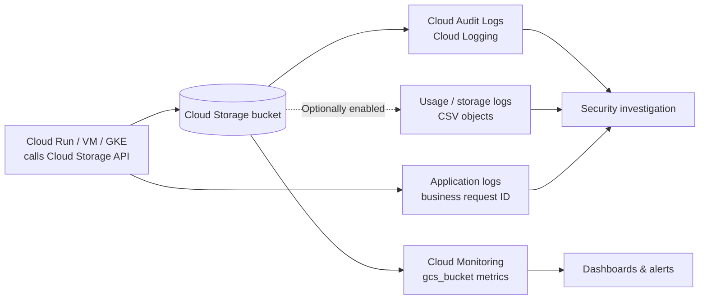
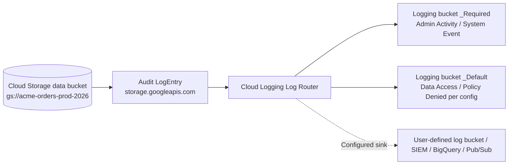

# Logging, Metrics, and Bucket Access Auditing

## 1. Why Observe and Audit Cloud Storage?

An application may run smoothly on **Compute Engine**, **GKE**, or **Cloud Run**, yet data in **Cloud Storage** still faces subtle risks: a service account downloading thousands of objects after hours, an employee accidentally deleting files, overly broad bucket permissions, a pipeline overwriting exported reports, or unexpected billing spikes from anomalous downloads.

Checking whether a bucket merely exists is not enough. Operators must be able to answer:

- **Who** created, read, modified, or deleted data and bucket configurations?
- **Which action** occurred on **which bucket/object**, and **when**?
- How many requests **succeeded, were denied, or failed server-side**?
- How are **live, noncurrent, and soft-deleted** storage volumes and ingress/egress traffic changing?
- When an incident occurs, is there enough evidence to distinguish **an app bug, IAM, policies, administrative actions**, and anomalous activity?

Google Cloud provides three key signal groups:

1. **Cloud Audit Logs / Cloud Logging:** audit events identifying recorded operations.
2. **Cloud Monitoring metrics:** quantitative time-series metrics tracking operational health, request rates, bytes transferred, and storage volume.
3. **Cloud Storage usage logs / storage logs and supplementary tools:** CSV-formatted access or storage records useful where Cloud Audit Logs do not provide full coverage.

In the **CLOUD_PROVIDERS_GCP** module, this topic connects governance across **projects, IAM, VPC networking, Compute Engine, GKE, Cloud Run, storage, CI/CD, reliability monitoring, and cost control**. Good logging design provides **investigative capability** while avoiding storing sensitive payloads and runaway logging bills.

### Learning Objectives

After this lesson, you will be able to:

1. Distinguish **Admin Activity**, **Data Access**, **System Event**, and **Policy Denied** audit logs.
2. Know when you must **enable Data Access logs** and when Cloud Audit Logs **do not record** activity.
3. Read key log fields: `timestamp`, `protoPayload.methodName`, `authenticationInfo.principalEmail`, `resourceName`, `status`, and caller metadata.
4. Use **Logs Explorer** and `gcloud logging read` to query bucket changes or object operations.
5. Analyze metrics such as `storage.googleapis.com/api/request_count`, `storage/total_bytes`, and `storage/v2/total_bytes`.
6. Design dashboards, logs-based metrics, alerts, log-viewer permissions, and log retention.
7. Investigate object deletions, anomalous access, 403/404 errors, storage growth, and egress cost spikes.

> **Example Conventions:** `acme-storage-prod` is a Project ID, `acme-orders-prod-2026` is a bucket, and all principals/emails, object names, and figures are **hypothetical**. Read-only commands may be run in authorized environments; policy/logging changes should be applied only after assessing scope and cost.

## 2. Three Perspectives: Logs, Metrics, and Business Telemetry

| Question | Primary Tool | Data Obtained | Limitations |
| --- | --- | --- | --- |
| Who edited bucket IAM at 10:05? | **Cloud Audit Logs – Admin Activity** | Principal, method, resource, timestamp, outcome | Requires log-view permissions and selecting the right project |
| Who read `exports/report.csv`? | **Data Access audit logs** (if enabled) | Object read requests and principal when recorded | Does not fully log public access via `allUsers`/`allAuthenticatedUsers` |
| Are API GET/PUT errors spiking? | **Cloud Monitoring** | Request counts by method and response code | Does not list individual callers |
| How much did soft-deleted capacity grow? | **Cloud Monitoring `storage/v2` metrics** | Bytes/counts by storage class and object type | Capacity metrics typically update daily, not instantaneously |
| How much did public website visitors download? | **Cloud Storage usage logs** (when configured) | Request metadata, URL, status, size, latency | Has delivery delay and no absolute completeness/timeliness guarantee |
| Which file did a specific order generate? | **Application logs + business IDs** | Request/trace/order IDs and object name/generation | Cloud Audit Logs do not replace business application logs |
| Why did the bill increase? | **Cloud Billing + Monitoring** | SKUs, location, storage class, operations, egress | A request-count metric alone is not a price sheet |

A Cloud Run service might log `upload_success` with `request_id` and `object_generation`. Cloud Storage may emit a Data Access audit log for that object creation, while Monitoring shows write requests rising during that minute. **These three sources complement each other rather than duplicating the same data.**



**Key principle:** No single log field answers every question. Solid investigations place evidence in the context of **timing, identity, IAM configuration, object versions, application state**, and the limits of each signal source.

## 3. Cloud Audit Logs: Audit Log Types for Cloud Storage

Cloud Audit Logs answer **"Who did what, where, and when?"** For Cloud Storage, the service name is `storage.googleapis.com`, and the monitored resource type is typically `gcs_bucket`.

### 3.1. Admin Activity: Configuration and Administrative Changes

**Admin Activity audit logs** are always generated and cannot be turned off. For Cloud Storage, typical operations include:

- Creating or deleting a bucket.
- Modifying bucket metadata/settings, retention, or certain protection settings.
- Modifying **IAM policies** on a bucket or managed folder.
- Creating/deleting managed folders or tag bindings on a bucket.
- Other administrative changes listed in the service's audited operations table.

For example, `storage.buckets.setIamPolicy` or `storage.buckets.update` may appear when admins modify policies or settings. **Inspect the actual `methodName` in logs before writing exact filters**, since APIs may log multiple operation types or check multiple permissions.

### 3.2. Data Access: Reading, Writing, and Deleting Object Contents

Cloud Storage **Data Access audit logs** are **disabled by default** and must be **explicitly enabled** to record data operations. There are three categories:

| Category | Sample Operations | Why It Matters |
| --- | --- | --- |
| `ADMIN_READ` | Reading bucket metadata, reading bucket IAM policy, listing buckets | Detects administrative reconnaissance |
| `DATA_READ` | Reading objects, reading object metadata, listing objects/folders | Investigates sensitive data access and unusual read activity |
| `DATA_WRITE` | Creating, updating metadata, deleting, restoring objects; renaming HNS folders | Investigates overwritten, deleted, or altered data |

**Common misconception:** Deleting **object data** is normally **Data Access – `DATA_WRITE`**, not Admin Activity. Reading only Admin Activity logs **never proves who deleted an object**. A copy or compose operation may log both read and write entries.

### 3.3. System Event and Policy Denied

- **System Event:** certain Google Cloud-initiated actions, such as starting/completing a *bucket relocation* per published lists. It does not log every object automatically deleted by lifecycle rules.
- **Policy Denied:** requests denied due to security policies as supported by logging; helps detect blocked access. **An ordinary 403 error does not always produce a Policy Denied log**; it may stem from missing IAM permissions or another control.

**System Events do not log every automated service action.** In particular, Cloud Storage Audit Logs **do not track changes performed by Object Lifecycle Management or Autoclass**. Use supplementary sources when those operations must be audited.

### 3.4. Summary Table

| Audit Log Type | Enabled by Default? | Example Actions | Cost / Log Reading |
| --- | --- | --- | --- |
| **Admin Activity** | Yes, cannot be disabled | Bucket create/delete, IAM/config updates | Mandatory audit logs stored in `_Required` |
| **Data Access** | **No** for Cloud Storage | Object get/list/create/delete, bucket metadata reads | Can generate high volume and ingestion/routing charges |
| **System Event** | Yes | Certain system-initiated operations | Narrow scope; does not replace usage logs |
| **Policy Denied** | Generated per supported policies/actions | Requests blocked by security policies | May incur charges; check log sinks and exclusions |

## 4. Cloud Audit Logs Limitations to Know Before Designing

Google Cloud documents several crucial limitations:

1. **Public access is not logged** when granted via `allUsers` or `allAuthenticatedUsers`, even with Data Access audit logs enabled. To study public traffic, inspect **Cloud Storage usage logs**, CDN/LB logs, or application logs.
2. **Changes by Object Lifecycle Management or Autoclass are not logged**; check usage logs, lifecycle policies, storage history, and supplementary signals.
3. For certain **authenticated browser downloads outside the Google Cloud Console**, `principalEmail` and `callerIp` may be **redacted** in Data Access logs.
4. A single request may check multiple permissions or perform both reads and writes, so **audit entry counts can differ from HTTP request counts**.
5. Logs are **not retained forever**. Retention, log routing, and read permissions determine whether records remain queryable months later.
6. **Enabling Data Access today does not backfill logs** for past unrecorded operations.

Example: a bucket serving product images with **public read**. Data Access audit logs are not a reliable source for identifying individual image downloaders. For private data read by service accounts, enabling Data Access logs is valuable, while still checking redaction/anonymization rules.

> **Never infer from "no audit log found" that "no access or deletion occurred."** Verify **log type, enablement time, resource scope, read permissions, routing, retention, and product limitations**.

## 5. Enabling Data Access Audit Logs for Cloud Storage

### 5.1. Determine Configuration Scope

Data Access audit logging can be configured at the **Organization, Folder, or Project** level. For Cloud Storage, the service name is:

```text
storage.googleapis.com
```

Configurations inherit down the hierarchy as a **union**. A Project can enable additional log types, yet **cannot disable** log types enabled by a parent Organization or Folder. **Exempted principals** lists also behave within this inheritance model.

Because Data Access is configured per **service at the Project/Folder/Organization level**, do not assume you can turn on Cloud Storage Data Access audit logs for just one bucket in a Project without affecting other buckets. To isolate tracking to one bucket, use **Logging filters/sinks** or evaluate **Cloud Storage usage logs** per bucket as needed.

### 5.2. Enabling via Google Cloud Console

Recommended steps:

1. Select the right **Project** or approved administrative scope.
2. Open **IAM & Admin → Audit Logs**.
3. Locate **Cloud Storage / Google Cloud Storage (`storage.googleapis.com`)**.
4. Enable the required categories: **Admin Read**, **Data Read**, and/or **Data Write**. You do not have to enable all three if your scope is narrower.
5. Review **exempted principals**, if your organization uses exemptions.
6. Save changes per project IAM change procedures.
7. Trigger one authorized test request in a lab environment and verify the log arrives.

### 5.3. IAM `AuditConfig` Snippet to Understand the API

In the IAM API, an audit configuration takes the form:

```json
{
  "auditConfigs": [
    {
      "service": "storage.googleapis.com",
      "auditLogConfigs": [
        { "logType": "ADMIN_READ" },
        { "logType": "DATA_READ" },
        { "logType": "DATA_WRITE" }
      ]
    }
  ]
}
```

This is an **illustrative JSON fragment**, **not a complete IAM policy** safe to send in an overwrite command. A live IAM policy also holds `bindings`, `etag`, `version`, and possibly audit configs for other services. When updating via API or Terraform, perform a **controlled merge** preserving existing settings—**never overwrite an entire policy with a snippet**.

Read the current IAM policy with:

```bash
# READ-ONLY: inspect Project IAM bindings and audit configs
gcloud projects get-iam-policy acme-storage-prod \
  --format=json
```

Never alter `auditConfigs` at the Organization level without estimating **log volume across every child project**, administrative authority, and compliance rules.

### 5.4. Verification After Enabling

Suppose a service account in a test project downloads `reports/demo.csv`:

1. Confirm IAM Data Access is active at the effective scope.
2. Execute **one valid request** as a known principal.
3. Open **Logging → Logs Explorer** and filter by `resource.type="gcs_bucket"`, `protoPayload.serviceName="storage.googleapis.com"`, and the target bucket.
4. Inspect the `data_access` log, timestamp, method, principal, and resource.
5. Confirm **the log appeared** before declaring the audit pipeline active.

A common mistake is seeing **bucket Admin Activity** and assuming **object reads** are also captured; explicitly verify **Data Access** entries.

## 6. Structure of a Cloud Storage Audit Log

Cloud Audit Logs are stored as `LogEntry` records; the audit payload typically sits inside `protoPayload`.

```json
{
  "logName": "projects/acme-storage-prod/logs/cloudaudit.googleapis.com%2Fdata_access",
  "resource": {
    "type": "gcs_bucket",
    "labels": {
      "bucket_name": "acme-orders-prod-2026"
    }
  },
  "timestamp": "2026-11-19T02:15:00Z",
  "protoPayload": {
    "@type": "type.googleapis.com/google.cloud.audit.AuditLog",
    "serviceName": "storage.googleapis.com",
    "methodName": "storage.objects.get",
    "resourceName": "projects/_/buckets/acme-orders-prod-2026/objects/reports%2Fdemo.csv",
    "authenticationInfo": {
      "principalEmail": "app-reader@acme-storage-prod.iam.gserviceaccount.com"
    },
    "requestMetadata": {
      "callerIp": "198.51.100.20"
    }
  }
}
```

**This is a simulated log** using illustrative names, emails, and IPs. Actual fields vary by API method, caller, status, detailed audit logging mode, and redaction rules; **not every entry contains all fields**.

| Field | Role | Investigation Notes |
| --- | --- | --- |
| `timestamp` | When the event was recorded | Use UTC when correlating across systems; watch timezones |
| `logName` | Log-owning resource and log type | `activity` vs. `data_access`; `/` in log names is URL-encoded as `%2F` |
| `resource.type` | Monitored resource type | Usually `gcs_bucket` for Cloud Storage audit logs |
| `resource.labels.bucket_name` | Monitored bucket | Distinguish the target bucket from a Logging log bucket |
| `protoPayload.serviceName` | Emitting service | `storage.googleapis.com` |
| `protoPayload.methodName` | API operation or audited permission path | May differ from the CLI command name a user ran |
| `protoPayload.resourceName` | Affected resource | May contain URL-encoded object names; do not assume a single format |
| `protoPayload.authenticationInfo.principalEmail` | Authenticated principal | Often a service account; may be redacted or absent in some cases |
| `protoPayload.requestMetadata.callerIp` | Recorded caller IP | May be redacted or an intermediary's IP; not always the end user |
| `protoPayload.status.code` | gRPC status code if present | `7` usually means `PERMISSION_DENIED`; inspect message and request details |

### Principals vs. End-User Identities

If Cloud Run uses service account `app-reader@...` to read Cloud Storage on behalf of customers, the audit log records the **service account**, **not the customer's email**. To trace which end user requested a download:

- The application must authenticate users properly.
- Record **request/correlation IDs**, normalized internal user IDs, and `objectName/generation` in **application logs** under PII protection policies.
- Correlate timestamps and request IDs when linking evidence—never assume a service account's `principalEmail` identifies the end user.

## 7. Querying Logs Explorer for a Bucket

Open **Google Cloud Console → Logging → Logs Explorer**, select the Project owning the bucket, and enter filters.

### 7.1. View All Cloud Storage Audit Logs

```text
resource.type="gcs_bucket"
protoPayload.serviceName="storage.googleapis.com"
```

### 7.2. View Admin Activity Only

```text
resource.type="gcs_bucket"
logName="projects/acme-storage-prod/logs/cloudaudit.googleapis.com%2Factivity"
protoPayload.serviceName="storage.googleapis.com"
```

This is a starting point for spotting IAM or bucket changes; narrow by time window, bucket, and method after viewing initial results.

### 7.3. View Data Access for One Bucket

```text
resource.type="gcs_bucket"
resource.labels.bucket_name="acme-orders-prod-2026"
logName="projects/acme-storage-prod/logs/cloudaudit.googleapis.com%2Fdata_access"
protoPayload.serviceName="storage.googleapis.com"
```

**If no results appear**, verify whether Data Access was enabled **before the time window in question** and whether the requests fall under documented audit exclusions.

### 7.4. Trace a Specific Principal

```text
resource.type="gcs_bucket"
protoPayload.serviceName="storage.googleapis.com"
protoPayload.authenticationInfo.principalEmail="app-reader@acme-storage-prod.iam.gserviceaccount.com"
```

Combine with bucket, time range, and method. If a principal was redacted, filtering by email skips that entry; never treat empty results as proof of zero access.

### 7.5. Search Object Delete Operations

```text
resource.type="gcs_bucket"
resource.labels.bucket_name="acme-orders-prod-2026"
logName:"cloudaudit.googleapis.com%2Fdata_access"
protoPayload.serviceName="storage.googleapis.com"
protoPayload.methodName:"storage.objects.delete"
```

This filter uses **substring matching** on method. Inspect actual `methodName` values in your project since multi-object deletes, HNS folder operations, or other API calls may emit different method names/formats. Exact equality checks can miss alternative API methods.

### 7.6. Filter Denied Requests

```text
resource.type="gcs_bucket"
protoPayload.serviceName="storage.googleapis.com"
protoPayload.status.code=7
```

`7` is gRPC **`PERMISSION_DENIED`**; this filter finds events carrying a matching `status.code`, though **it does not guarantee every HTTP 403 error is recorded as a Data Access audit log**.

> **Tip:** Inspect one sample entry in Logs Explorer first, then use **Copy/Show similar entries** or click fields directly to build filters matching the live schema. Never write alerts by guessing field names.

## 8. Reading Audit Logs with `gcloud`

Assuming project `acme-storage-prod` contains logs you are authorized to read.

### 8.1. Read Storage Logs from the Last 24 Hours

```bash
# READ-ONLY: Cloud Storage audit logs
gcloud logging read \
  'resource.type="gcs_bucket" AND protoPayload.serviceName="storage.googleapis.com"' \
  --project=acme-storage-prod \
  --freshness=1d \
  --limit=50 \
  --format=json
```

### 8.2. Read Data Access Logs for a Specific Bucket

```bash
gcloud logging read \
  'resource.type="gcs_bucket" AND resource.labels.bucket_name="acme-orders-prod-2026" AND logName:"cloudaudit.googleapis.com%2Fdata_access"' \
  --project=acme-storage-prod \
  --freshness=7d \
  --limit=100 \
  --format="table(timestamp,protoPayload.methodName,protoPayload.authenticationInfo.principalEmail,protoPayload.resourceName)"
```

### 8.3. Read Logs Within a Specific Time Window

```bash
gcloud logging read \
  'resource.type="gcs_bucket" AND protoPayload.serviceName="storage.googleapis.com" AND timestamp>="2026-11-19T00:00:00Z" AND timestamp<"2026-11-20T00:00:00Z"' \
  --project=acme-storage-prod \
  --limit=100 \
  --format=json
```

When querying older logs, adjust `--freshness` and timestamps accordingly. Output is capped by `--limit`; **never treat the first 100 entries as the daily total**.

### 8.4. PowerShell Note

In Windows PowerShell, you can write the query on **one line**:

```powershell
gcloud logging read 'resource.type="gcs_bucket" AND protoPayload.serviceName="storage.googleapis.com"' --project=acme-storage-prod --freshness=1d --limit=50 --format=json
```

The multi-line examples above use Bash `\` continuations; never paste Bash line continuations into PowerShell assuming identical syntax.

## 9. Granting Log-View Access and Limiting Sensitive Data

### 9.1. Viewer Roles

| Role | Common Permissions | Notes |
| --- | --- | --- |
| `roles/logging.viewer` | Reads Admin Activity, System Event, and Policy Denied in default log buckets | **Insufficient** to view Data Access logs in `_Default`/`_Required` |
| `roles/logging.privateLogViewer` | Includes viewing Data Access logs in `_Default`/`_Required` | Sensitive permission; do not grant broadly without need |
| Custom log bucket / log view roles | Reads specific log sets permitted by the organization | User-defined log buckets/views follow their own IAM model |
| `roles/monitoring.viewer` | Views Monitoring metrics and dashboards | Does not grant permission to read audit log entries |

**Note:** Roles can be attached at the project or resource level depending on model. If Data Access audit logs are **routed to a user-defined Logging bucket**, anyone authorized on that log bucket/view can read them per granted policies. Never rely solely on `privateLogViewer` assumptions when designing centralized logging.

### 9.2. What Sensitive Information Can Appear in Logs?

Object names can expose:

- Customer IDs, order IDs, internal paths.
- Record names, employee IDs, or data labels.
- Service account identities.
- Caller IPs, user agents, and request metadata.

**Never write access tokens, full signed URLs, private keys, or raw record payloads to application logs.** Because Cloud Audit Logs inherently capture sensitive audit details, scope log-reading access strictly to **legitimate investigative roles**.

### 9.3. Protecting Logs from Tampering or Deletion

Cloud Audit Logs are forensic evidence; consider:

1. Separating **log-reading** permissions from **log routing/sink administration**.
2. Setting retention aligned with legal mandates or internal policy.
3. Using dedicated log buckets or routing to a separate security project when separation of duties is needed.
4. Auditing destination IAM, sink writer identity permissions, and policy-edit risks.
5. Never deleting or overwriting investigative artifacts without formal approval.

**Do not assume having audit logs guarantees absolute immutability** in every setup. Log admin permissions, retention configs, and sink exclusions can all impact future investigations.

## 10. Log Router, Log Buckets, and Retention

Cloud Logging uses **log buckets** to store log entries. A **Logging bucket** is completely different from a **Cloud Storage data bucket** despite sharing the word "bucket."



### What to Check

- **`_Required`:** retains mandatory audit logs such as Admin Activity and System Event per Cloud Logging rules; standard sink exclusions cannot turn off these mandatory logs.
- **`_Default`:** typically receives Data Access (when enabled) and Policy Denied logs; sink/exclusion filters govern what gets stored.
- **User-defined log bucket:** separates data residency, retention, access permissions, and analytics.
- **Log sink:** forwards logs to supported destinations such as Logging buckets, BigQuery, Cloud Storage, or Pub/Sub; grant write permission to the sink's writer identity.

### Two Cost Sources and One Risk

1. **Cloud Logging ingestion/storage:** Data Access, Policy Denied, and extended retention can incur usage charges.
2. **Cloud Storage usage log objects:** if CSV usage logging is enabled, log files are stored as **objects** in a Cloud Storage bucket, incurring storage, operations, and egress fees.
3. **Enabling everything and forgetting governance:** can generate large bills or retain sensitive data beyond allowed limits.

Some mandatory audit logs are stored free under `_Required` rules, yet **never assume all Data Access logs, sinks, Log Analytics, or external storage are free**. Check current Logging and Storage pricing.

## 11. Cloud Monitoring: Key Cloud Storage Metrics

Metrics are designed for **counting, charting, tracking trends, and alerting**; they do not list every principal who accessed data.

Cloud Storage exposes metrics under `storage.googleapis.com/`, typically attached to monitored resource:

```text
resource.type = "gcs_bucket"
resource.labels.bucket_name = "acme-orders-prod-2026"
```

### Commonly Used Metric Types

| Full Metric Type | Purpose | Key Characteristics |
| --- | --- | --- |
| `storage.googleapis.com/api/request_count` | API request counts by method and response code | `DELTA`, ~60-second sampling, slight display delay |
| `storage.googleapis.com/network/received_bytes_count` | Network bytes **received** by the bucket | Filterable by method and response code |
| `storage.googleapis.com/network/sent_bytes_count` | Bytes **sent** from the bucket | Helpful for spotting download/egress spikes; not a direct bill |
| `storage.googleapis.com/storage/object_count` | Object count by storage class | Reported roughly **daily**; legacy metric excludes soft-deleted |
| `storage.googleapis.com/storage/total_bytes` | Object capacity by storage class | Updated daily; **excludes soft-deleted objects** |
| `storage.googleapis.com/storage/v2/total_bytes` | Total bytes broken down by live/noncurrent/soft-deleted/multipart | Use for detailed capacity breakdowns |
| `storage.googleapis.com/storage/v2/total_count` | Object/multipart counts by state | Labeled by `type` and `storage_class` |

**Uneven update intervals:** request/traffic metrics sample roughly **every minute** and take a few minutes to appear; many storage size/count metrics are **measured once per day**. Never look at a flat storage-size datapoint right after an upload and conclude the upload failed.

### 11.1. Metric Labels

`api/request_count` commonly includes labels:

- `method`: API method name such as `ReadObject` (varies by client/API).
- `response_code`: request status in Monitoring terminology.

Storage `v2` metrics include labels:

- `storage_class`: Standard, Nearline, Coldline, Archive, etc. per actual metric.
- `type`: `live-object`, `noncurrent-object`, `soft-deleted-object`, or `multipart-upload`.

**Select the right label before summing values.** If you want live bytes and accidentally sum soft-deleted and noncurrent objects too, totals will not match live object listings.

### 11.2. Metrics Are Not Request Logs

`api/request_count` tells you request counts by label and time, **not who sent those requests**. To identify callers, inspect audit logs or application logs. Conversely, audit entries are poor for measuring real-time storage capacity compared to Storage Monitoring metrics.

### 11.3. Application Latency

Cloud Storage **does not provide a generic per-request bucket-level latency metric** equivalent to end-user app latency in the SLI metrics table. If your goal is tracking p95 user upload/download latency, **instrument your client, Cloud Run, or VM** to measure end-to-end latency inside the app. **Usage logs** can include per-HTTP-request latency, though they have delivery delay and no completeness guarantee.

## 12. Building Meaningful Cloud Storage Dashboards

In **Cloud Monitoring → Metrics Explorer** or **Dashboards**, start from operational questions rather than adding dozens of unused charts.

| Chart | Metric and Filter | Operational Value |
| --- | --- | --- |
| Read requests/min | `api/request_count`, filtered to read `method`s | Spot abnormal read spikes |
| Write requests/min | `api/request_count`, write `method`s | Track ingestion pipelines |
| Request error rate | `api/request_count` grouped by `response_code` | Detect 4xx/5xx issues and trends |
| Bytes downloaded/min | `network/sent_bytes_count` | Spot egress or download surges |
| Bytes uploaded/min | `network/received_bytes_count` | Detect unusual ingestion volume |
| Live bytes | `storage/v2/total_bytes` with `type=live-object` | Track active data growth |
| Soft-deleted bytes | `storage/v2/total_bytes` with `type=soft-deleted-object` | Analyze retention cost and recovery data |
| Noncurrent bytes | `storage/v2/total_bytes` with `type=noncurrent-object` | Track versioned history size |

### Example Design for a Reports Bucket

Bucket `acme-orders-prod-2026` receives hourly reports. The SRE team can:

1. Chart `api/request_count` by `method`, `response_code`, and bucket.
2. Chart `network/sent_bytes_count` to catch unscheduled large downloads.
3. Track `storage/v2/total_bytes` daily by `type` and `storage_class`.
4. Host the dashboard in the bucket's project or an authorized Monitoring scoping project.
5. Add an **application metric** like "report files generated on schedule," because Cloud Storage only sees object calls and **does not know if report content is business-valid**.

**A good dashboard has clear accountability:** each chart should answer one specific question and link to a runbook when abnormal.

## 13. SLIs, SLOs, and Request Error Analysis

A **Service Level Indicator (SLI)** measures a service property, such as successful request ratio. A **Service Level Objective (SLO)** is the internal target for that SLI over a time window.

### 13.1. Availability SLI for Object Reads

Illustrative SLI:

```text
Object Read SLI =
   count of "good" ReadObject requests
 / total ReadObject requests in window
```

With Cloud Storage Monitoring, filter `storage.googleapis.com/api/request_count`:

```text
metric.type = "storage.googleapis.com/api/request_count"
resource.type = "gcs_bucket"
resource.label.bucket_name = "acme-orders-prod-2026"
metric.label.method = "ReadObject"
```

When configuring in Metrics Explorer or the API, follow the exact current label syntax (e.g., `resource.label."bucket_name"` and `metric.label."method"` in Monitoring filters). The snippet above is a **logical representation**, not a complete alerting policy JSON.

For the numerator, pick `response_code` values defined as good (such as `OK` in Google Cloud's SLI guidance). **Do not automatically count all 4xx errors as service failures**: `403` from IAM or `404` from missing objects may reflect client bugs or app logic.

### 13.2. Error-Rate Calculation Example

Suppose 20,000 read requests occur over 5 minutes:

```text
Successful reads   = 19,700
Failed reads       =    300
Success rate       = 19,700 / 20,000 = 98.5%
Failure rate       =    300 / 20,000 =  1.5%
```

These numbers are **hypothetical**, not a Google Cloud SLA. SLO targets must match application needs and cover the full path from users through the backend, not Cloud Storage alone.

### 13.3. Separating 4xx and 5xx

- **401/403:** check authentication/IAM, uniform bucket-level access, public access prevention, signed URLs, or VPC Service Controls.
- **404:** wrong bucket/object name, expired/missing generation, deleted object, or prefix/key logic bug.
- **409/412:** update conflict or unmet precondition; may indicate **proper** optimistic concurrency protection working as designed.
- **429/5xx:** check quotas/rate limits, retry/backoff, service health, and client behavior.

Monitoring should separate **expected rejections** (like unauthorized probes) from **real user-impacting outages**.

## 14. Logs-Based Metrics and Security Alerts

To detect discrete events such as **sensitive object deletions**, **bucket IAM changes**, or **spikes in `PERMISSION_DENIED`**, evaluate **logs-based metrics** or **log-based alerts**.

### 14.1. What Is a Counter Metric?

A **counter logs-based metric** counts log entries matching a Logging filter. When Data Access logs record an object deletion, the counter increments so Cloud Monitoring can fire an alert.

Test the filter before creating the metric:

```text
resource.type="gcs_bucket"
resource.labels.bucket_name="acme-orders-prod-2026"
protoPayload.serviceName="storage.googleapis.com"
logName:"cloudaudit.googleapis.com%2Fdata_access"
protoPayload.methodName:"storage.objects.delete"
```

**Prerequisite:** Data Access `DATA_WRITE` must be enabled **before the event**; without source logs, the logs-based metric counts nothing. Test the filter in Logs Explorer to verify exact `methodName` values first.

### 14.2. Creating a Counter Metric with `gcloud`

```bash
# MUTATING MONITORING/LOGGING CONFIG
# Run only after verifying the filter and obtaining approval
gcloud logging metrics create storage_object_delete_count \
  --project=acme-storage-prod \
  --description="Count object delete audit entries in orders bucket" \
  --log-filter='resource.type="gcs_bucket" AND resource.labels.bucket_name="acme-orders-prod-2026" AND protoPayload.serviceName="storage.googleapis.com" AND logName:"cloudaudit.googleapis.com%2Fdata_access" AND protoPayload.methodName:"storage.objects.delete"'
```

Cloud Monitoring exposes the metric as:

```text
logging.googleapis.com/user/storage_object_delete_count
```

**Read back the definition**:

```bash
gcloud logging metrics describe storage_object_delete_count \
  --project=acme-storage-prod
```

Once created, use Cloud Monitoring to attach an alerting policy, notification channel, and evaluation window. **Creating the metric does not automatically create an alert.**

### 14.3. Alerting Policy Example

A sample policy design:

```text
Source: logging.googleapis.com/user/storage_object_delete_count
Condition: > 0 events in a 5-minute window
Scope: bucket acme-orders-prod-2026
Notify: Security on-call
Runbook: inspect principal, method, object generation, and change ticket
```

This is a **design outline**, not a complete alert creation command. To avoid alert fatigue, exclude expected scheduled pipeline cleanups and preserve event details for triage.

### 14.4. Two Alerting Forms

- **Log-based alerts:** suited for single critical log matches needing immediate action, such as unexpected public IAM changes.
- **Alerts on logs-based metrics:** suited for counting rates over time windows across buckets or principals.

Watch **label cardinality** when extracting fields into metric labels; never use random object names, request IDs, or user emails as unbounded metric labels. Keep high-cardinality details in log entries and use metric labels for bounded aggregations.

## 15. Cloud Storage Usage Logs and Storage Logs

Cloud Storage offers CSV-formatted **usage logs** and **storage logs**, distinct from Cloud Audit Logs:

| Property | Usage Logs | Storage Logs |
| --- | --- | --- |
| Purpose | HTTP request details against a bucket | Bucket storage consumption |
| Generation frequency | **Hourly** when activity occurs | **Daily** |
| Where stored | Objects in a **destination Cloud Storage bucket** | Objects in the destination bucket |
| Notable fields | URL, response, request/response bytes, latency, protocol fields | Reported storage capacity |
| Suitable for near-real-time alerts? | **No**; generation and delivery incur latency | **No** |
| What Google recommends instead in most cases | **Cloud Audit Logs** for API operation auditing | **Cloud Monitoring** for storage consumption |

Google Cloud explicitly notes **there is no absolute guarantee of timeliness or completeness** for usage/storage logs. Usage logs can arrive late and entries may occasionally duplicate; when computing exact counts, deduplicate using `s_request_id` in your analytics pipeline.

### When Are Usage Logs Genuinely Useful?

- Investigating **public** access via `allUsers`/`allAuthenticatedUsers` not captured by Cloud Audit Logs.
- Observing **Object Lifecycle Management or Autoclass** activity via a supplementary log source.
- Inspecting request-level **latency, request/response sizes, URL paths, and query parameters**.
- Collecting usage logs for **only a few specific buckets** without enabling Cloud Storage Data Access audit logs across the entire Project.

**Usage logs are not a universal default:** they emit raw CSV objects requiring destination write permissions, lifecycle cleanup, storage budget, and CSV/BigQuery ETL pipelines.

## 16. Configuring Usage/Storage Logs to a Destination Bucket

Suppose:

```text
Monitored bucket:      gs://acme-orders-prod-2026
CSV log bucket:        gs://acme-storage-usage-logs-2026
Log object prefix:     orders-prod
```

### 16.1. Log Destination Requirements

Before enabling:

1. The log-receiving bucket already exists in the **same Organization** as the source bucket (or same project if the source is not in an Organization, per rules).
2. Both buckets share the **same location** (matching region/dual-region/multi-region).
3. If using **VPC Service Controls**, the log destination resides in the **same security perimeter** per documentation.
4. IAM grants the Cloud Storage analytics group permission to write log objects to the destination.
5. The destination has appropriate **lifecycle/retention and access controls**; never make logs public since they can expose URLs and client metadata.

### 16.2. Grant Writer Permission to Cloud Storage Analytics

Per Google Cloud guidelines:

```bash
# MUTATES IAM on log destination bucket
gcloud storage buckets add-iam-policy-binding \
  gs://acme-storage-usage-logs-2026 \
  --member=group:cloud-storage-analytics@google.com \
  --role=roles/storage.objectCreator
```

Do not confuse `cloud-storage-analytics@google.com` with your Cloud Run app's principal. That is the Google-documented group identity used by the service to deliver usage/storage log objects.

### 16.3. Enable Logging on the Source Bucket

```bash
# MUTATES BUCKET CONFIG: run only after approving IAM and costs
gcloud storage buckets update gs://acme-orders-prod-2026 \
  --log-bucket=gs://acme-storage-usage-logs-2026 \
  --log-object-prefix=orders-prod
```

Verify status:

```bash
# READ-ONLY
gcloud storage buckets describe gs://acme-orders-prod-2026 \
  --format="default(logging_config)"
```

`describe` should show `logBucket` and `logObjectPrefix`. Cloud Storage **does not verify for you that the destination log bucket exists or is writable when setting the flag**, so configuration success **does not guarantee CSV logs will appear** if destination permissions or locations are misconfigured.

### 16.4. Reading Log Objects

Log object names typically follow patterns like:

```text
orders-prod_usage_YYYY_MM_DD_HH_MM_SS_<ID>_v0
orders-prod_storage_YYYY_MM_DD_HH_MM_SS_<ID>_v0
```

Read-only listing:

```bash
gcloud storage ls gs://acme-storage-usage-logs-2026/orders-prod*
```

To download a selected log object locally:

```bash
gcloud storage cp \
  gs://acme-storage-usage-logs-2026/ACTUAL_LOG_OBJECT_NAME \
  ./storage-usage-log.csv
```

CSV logs can contain sensitive system details; never upload them to public tools or paste them into unprotected tickets.

### 16.5. Disabling When No Longer Needed

```bash
# MUTATES configuration; do not run while audit mandates apply
gcloud storage buckets update gs://acme-orders-prod-2026 \
  --clear-log-bucket
```

Disabling logging **does not delete previously stored CSV log objects**. The log destination's lifecycle/retention policies govern how long historical CSVs remain and incur charges.

## 17. Analyzing Access Logs with BigQuery

With millions of requests, opening individual CSVs in spreadsheets does not scale. Instead:

1. Create a BigQuery dataset in a region meeting data residency rules.
2. Create a table matching the published **usage log CSV** schema (or an external table if suitable).
3. Load logs hourly/daily, handling late arrivals and deduplicating `s_request_id` as needed.
4. Query by time, URL prefix, response status, bytes transferred, and request latency.
5. Restrict table read permissions and set retention, as URLs/query strings can contain sensitive parameters.

**Illustrative** SQL query after normalizing into columns `event_time`, `object_path`, `response_code`, and `response_bytes`:

```sql
SELECT
  TIMESTAMP_TRUNC(event_time, HOUR) AS hour_utc,
  response_code,
  COUNT(*) AS requests,
  SUM(response_bytes) AS bytes_sent
FROM `acme_audit.storage_usage_normalized`
WHERE event_time >= TIMESTAMP('2026-11-19')
  AND event_time < TIMESTAMP('2026-11-20')
GROUP BY hour_utc, response_code
ORDER BY hour_utc, response_code;
```

**This is not the raw CSV schema.** Actual raw columns follow `s_*` naming per Cloud Storage documentation and require mapping/ETL before querying. This SQL illustrates analytical goals only—**do not create tables or run queries against live data in this lesson**.

If using Cloud Logging **Log Analytics** for audit logs, select the right Logging bucket, log view, and SQL features; do not confuse Log Analytics with BigQuery tables holding CSV usage logs.

## 18. Investigation Scenario: A Critical Object Was Deleted

On Thursday evening, an application fails to find:

```text
gs://acme-orders-prod-2026/exports/2026-11-19/orders.parquet
```

The service returns 404; on-call engineers notice the missing output. **Investigation playbook**:

### Step 1: Confirm the Incident

- Verify exact bucket, object name, generation, and when the app started failing.
- Check whether the app uses a **generation precondition** or specific object version.
- Check **soft delete**, Object Versioning (if enabled), and retention; distinguish a deleted object from an IAM block hiding access.
- Never overwrite the object with test data before determining recovery options.

### Step 2: Query Data Access Audit Logs

```text
resource.type="gcs_bucket"
resource.labels.bucket_name="acme-orders-prod-2026"
logName:"cloudaudit.googleapis.com%2Fdata_access"
protoPayload.serviceName="storage.googleapis.com"
protoPayload.methodName:"storage.objects.delete"
```

Inspect `timestamp`, `principalEmail`, `resourceName`, `status.code`, and related metadata. Cross-reference with **Cloud Run revisions**, VM logs, or scheduler jobs.

### Step 3: Check Causes Not Covered by Audit Logs

- Did **Object Lifecycle Management** delete the object per policy (which does not appear as a standard Data Access deletion audit log)?
- Was Data Access logging enabled **before the deletion occurred**?
- Were there copy/rename/HNS folder operations or batch deletes via another API?
- Did signed URLs or public access obscure caller identity?
- Did log routing exclusions or retention drop the logs?

### Step 4: Recover and Prevent Recurrence

If soft delete or versioning allows recovery, follow your runbook with an authorized identity and verify checksums, generations, and application consistency. Afterward:

1. Fix the IAM grant or pipeline bug that caused the unintended deletion.
2. Evaluate adding **preconditions** to writes and deletes.
3. Add a logs-based alert for unscheduled deletions.
4. Review lifecycle/retention, backups, and delete permissions.
5. Write a postmortem with timeline and evidence rather than merely writing "Cloud Storage lost a file."

## 19. Investigation Scenario: Read Traffic and Egress Costs Spiked

A project runs two apps: a Cloud Run API and a public static website. After one day, the dashboard reports:

```text
Read request rate:      8x increase (hypothetical)
Network sent bytes:     12x increase (hypothetical)
Storage total bytes:    nearly unchanged
Estimated cost:         unusual spike
```

**Logical investigation steps:**

1. Break down `api/request_count` and `network/sent_bytes_count` by bucket, method, and response code.
2. Distinguish legitimate campaign traffic from bots, scrapers, cache misses, or client retry loops.
3. Use **Cloud Billing by SKU** to identify exact charge drivers: storage operations, network egress, data processing, Logging, or another service.
4. If the bucket is public, do not expect Data Access logs to record public requester identities; inspect **usage logs**, CDN/load balancer logs, and app analytics.
5. Check `Cache-Control`/CDN design, signed URLs, frontend rate limiting where supported, permissions, and client download behavior.
6. Apply small, verifiable fixes—never block all public reads if the website serves real users.

**Two different measurements:** bytes **sent out of a bucket** do not equal exact bytes **billed as internet egress**. Billing depends on network path, locations, caching, products, and SKUs. Always reconcile against real Billing SKUs rather than multiplying a network metric by a guessed rate.

## 20. Investigation Scenario: Sudden 403 Spike After Deployment

A new Cloud Run revision starts logging `403 PermissionDenied` on object uploads. No data is lost, yet the pipeline halts.

### Top Hypotheses

- The new Cloud Run revision runs under a **different service account** or lost `storage.objects.create`.
- The bucket enabled **uniform bucket-level access** or public access prevention, invalidating legacy ACLs.
- Managed folder IAM does not cover the target prefix, or an Organization Policy / VPC Service Controls perimeter blocks the call.
- The app changed object names, bucket/project targets, or passed a failing precondition—not every error is IAM.
- Data Access logging is disabled or fields are redacted.

### Combine Signal Sources

1. **Application logs:** inspect request ID, runtime service account identity, bucket/object, and exact error.
2. **Cloud Audit Logs:** check the denied write method, principal, and status if logged.
3. **Cloud Monitoring:** pinpoint when the error rate spiked and which API methods failed.
4. **IAM policies and service config:** verify effective bindings and check Admin Activity logs for recent edits.
5. **Scoped verification:** test with one non-sensitive test object after fixing.

**Never "fix" this by granting `roles/storage.admin` across the service account or adding `allUsers`.** Those workarounds hide the root cause while dangerously expanding blast radius and data exposure.

## 21. Proactive Production Observability Workflow

### Layered Design

| Layer | Objective | Suggested Owner |
| --- | --- | --- |
| **Bucket configuration audit** | Detect IAM/retention/PAP/UBLA changes | Security / Platform |
| **Object data audit** | Trace reads/writes/deletes where enabled and supported | Data owner / Security |
| **Request / traffic metrics** | Detect errors and traffic surges | SRE / Platform |
| **Storage v2 metrics** | Track live/noncurrent/soft-deleted capacity and cost | Data / FinOps |
| **Application audit logs** | Link business users to object/generation | Application team |
| **Usage logs (when needed)** | Cover public access, lifecycle, request latency, and audit gaps | Security / Data platform |
| **Alerts & runbooks** | Detect anomalies and respond safely | On-call team |

### Rollout Steps

1. **Inventory:** catalog critical buckets, projects, owners, locations, data classes, retention, and IAM.
2. **Define audit requirements:** who/what must be tracked, for how long, and at what scope?
3. **Enable Data Access selectively:** assess traffic volume and inheritance before enabling broadly.
4. **Design log routing, retention, and IAM:** protect sensitive fields while preserving forensic evidence.
5. **Build dashboards:** requests/errors/network, storage v2 capacity, and application SLIs.
6. **Create alerts:** unscheduled IAM edits, critical object deletes, 403/5xx spikes, anomalous egress.
7. **Test end-to-end:** trigger lab requests and verify audit entries, metric updates, alert routing, and runbooks.
8. **Run periodic drills:** accidental test-object deletion, IAM loss, traffic spikes, and data recovery.
9. **Review costs:** Cloud Logging ingestion, log buckets, export sinks, Storage log objects, and Billing SKUs.

### Choosing Retention Based on Need

No single retention period fits every log type. Examples:

- Short-term operational logs needed for troubleshooting over a few weeks.
- Security audit logs retained longer per legal mandates, internal policy, and budget.
- Usage log CSVs holding URLs/IPs whose retention may be shortened to limit PII exposure.

**Retention must align with read access:** keeping logs for 1 year does not satisfy audits if the security team lacks access to the right Log View or logs were routed to the wrong project.

## 22. Common Misconceptions

| Misconception | Accurate Reality |
| --- | --- |
| "Admin Activity is on, so we know who deleted every object." | Object deletion is **Data Access – `DATA_WRITE`**; enable and verify those logs. |
| "Enabling Data Access on one bucket in a Project affects only that bucket." | Data Access audit config normally applies per service at Project/Folder/Organization scope; evaluate every affected bucket. |
| "No audit log means nobody accessed or deleted anything." | Exclusions exist for public access, lifecycle/Autoclass, late enablement, redaction, routing, and retention. |
| "Metrics show the email of who downloaded an object." | Monitoring aggregates requests/bytes; use audit or application logs for caller identity. |
| "`storage/total_bytes` equals all billable bytes." | The legacy metric excludes soft-deleted objects; check `storage/v2/total_bytes` and Billing. |
| "Upload finished, yet storage metrics didn't rise—the upload must have failed." | Capacity metrics generally measure daily with reporting latency. |
| "Usage logs are real-time security alerts." | Usage logs emit hourly, can lag, and do not guarantee completeness. |
| "Granting `logging.viewer` lets users read all Data Access logs." | Reading `_Default`/`_Required` Data Access logs requires `privateLogViewer` or explicit log bucket/view permissions. |
| "A Log Router sink is a Cloud Storage bucket." | A **Logging log bucket** differs from a **Cloud Storage data bucket**; sinks can target several destination types. |
| "Every API request creates exactly one audit entry." | One request may check multiple permissions or perform both reads and writes, causing entry counts to differ from request counts. |
| "403 errors always mean a Storage service outage." | Usually caused by IAM/policies or caller identity; check error details and app state. |
| "Turning on all logs everywhere is always better." | Balance cost, sensitive data exposure, log access control, and genuine operational need. |

## 23. Practice Exercises and Quiz Questions

### Exercise 1: Classify Logs by Operation

Choose the appropriate audit log type:

1. An admin edits a bucket's IAM policy.
2. A pipeline reads `reports/monthly.csv`.
3. A service account deletes a live object.
4. An admin inspects a bucket's IAM policy.
5. A lifecycle policy automatically deletes an expired object.

**Suggested Answer:** (1) Admin Activity; (2) Data Access – `DATA_READ`; (3) Data Access – `DATA_WRITE`; (4) Data Access – `ADMIN_READ`; (5) not logged by Cloud Audit Logs as a standard object operation—requires supplementary sources.

### Exercise 2: Write a Logs Explorer Filter

Given project `acme-storage-prod` and bucket `acme-orders-prod-2026`, write a filter matching all Data Access logs for the bucket and explain why it is insufficient to measure public downloads.

**Hint:**

```text
resource.type="gcs_bucket"
resource.labels.bucket_name="acme-orders-prod-2026"
logName:"cloudaudit.googleapis.com%2Fdata_access"
protoPayload.serviceName="storage.googleapis.com"
```

Public access via `allUsers`/`allAuthenticatedUsers` is not fully captured by Cloud Audit Logs.

### Exercise 3: Pick the Right Metric

Choose the metric/source to:

- Count `ReadObject` requests per minute.
- Measure network bytes sent out of a bucket.
- Measure soft-deleted bytes by storage class.
- Identify the exact service account email that deleted an object.

**Answer:** `api/request_count`; `network/sent_bytes_count`; `storage/v2/total_bytes` with `type=soft-deleted-object`; and **Data Access audit logs** for the principal (not a Monitoring metric).

### Exercise 4: Investigate a Hypothetical Incident

Object `exports/invoices-2026-11-19.csv` is missing. Data Access audit logs were never enabled in the project. Can you recover from Cloud Audit Logs who deleted the object a week ago? What other sources would you check?

**Hint:** You cannot retroactively recover unrecorded Data Access audit entries. Check application logs, CI/CD logs, Cloud Storage usage logs (if previously enabled), lifecycle policies, object generations, soft delete/retention, Billing/Monitoring, and timelines.

### Exercise 5: Read Metrics Without Misjudging Update Cadence

A job uploads an extra 50 GiB at 10:00, yet `storage/v2/total_bytes` has not changed at 10:05. `api/request_count` already recorded many successful writes. What should you check and why?

**Hint:** Storage size/count metrics update daily with reporting lag; verify object metadata, live listings, and upload generations rather than judging from a storage capacity datapoint. API metrics also have a few minutes of delay.

### Exercise 6: Design an Alert

The security team wants to know when bucket permissions change unexpectedly and when dozens of objects are deleted within 5 minutes. Choose:

1. The audit log type for each activity.
2. Logs-based metric vs. log-based alert.
3. How to prevent false positives from approved workflows.
4. Who receives alerts, can view Data Access logs, and is authorized to restore objects.

### Exercise 7: Read-Only Observation

In an authorized project, run:

```bash
gcloud logging read \
  'resource.type="gcs_bucket" AND protoPayload.serviceName="storage.googleapis.com"' \
  --project=PROJECT_ID \
  --freshness=7d \
  --limit=20 \
  --format=json
```

Pick one event and identify `timestamp`, log type, method, resource, and principal if present. If you cannot read Data Access logs, **do not ask for Owner**; check `privateLogViewer` or log-bucket permissions per procedure.

## 24. Bucket Auditing and Monitoring Checklist

- [ ] Inventory of buckets, projects, owners, data classifications, and retention targets exists.
- [ ] Understands **Admin Activity is on by default**, whereas **Data Access requires explicit configuration**.
- [ ] Enabled exact `ADMIN_READ`, `DATA_READ`, `DATA_WRITE` categories matching organizational scope.
- [ ] Understands exclusions for **public access, lifecycle/Autoclass, redaction**, and when usage logs are needed.
- [ ] Standard Logs Explorer / `gcloud` filters prepared for `storage.googleapis.com` and `gcs_bucket`.
- [ ] Verified in practice that expected read/write/delete operations actually emit logs.
- [ ] Separated Admin Activity and Data Access viewing permissions to protect sensitive logs.
- [ ] Tested Log Router, log buckets, sinks, retention, and IAM end-to-end.
- [ ] Uses Monitoring `api/request_count` and network byte metrics for operational visibility.
- [ ] Uses `storage/v2/total_bytes` and `storage/v2/total_count` to distinguish live/noncurrent/soft-deleted data.
- [ ] Never uses daily-updated storage size metrics to verify immediate uploads.
- [ ] Creates logs-based metrics/alerts only after confirming source logs exist and testing filters.
- [ ] Alerts cover IAM edits, object deletions, access errors, egress spikes, and missing exports.
- [ ] Application logs include correlation IDs / object generations without logging secrets or URL tokens.
- [ ] If usage logs are enabled, destination matches location/organization/perimeter and has writer IAM.
- [ ] Pipeline handles delayed/duplicate CSV logs and protects sensitive data inside them.
- [ ] Tested soft-delete/versioning restore runbooks with scoped recovery permissions.
- [ ] Estimated Cloud Logging, storage log objects, BigQuery, Monitoring, network, and related SKU costs.
- [ ] Periodically reviews alert noise, query latency, log access permissions, and retention windows.

## 25. Official Google Cloud Documentation

Verify details against current features and versions at implementation time:

1. [Cloud Audit Logs with Cloud Storage](https://cloud.google.com/storage/docs/audit-logging) – audit log types, audited operations, limitations, and read permissions.
2. [Cloud Audit Logs overview](https://cloud.google.com/logging/docs/audit) – `_Required`/`_Default`, log types, retention, and routing.
3. [Enable Data Access audit logs](https://cloud.google.com/logging/docs/audit/configure-data-access) – project/folder/organization configuration and inheritance.
4. [Cloud Storage usage logs and storage logs](https://cloud.google.com/storage/docs/access-logs) – when usage logs are needed, enabling them, and delivery limits.
5. [Overview of monitoring in Cloud Storage](https://cloud.google.com/storage/docs/monitoring) – request, capacity, and network traffic charts.
6. [Google Cloud metrics for Storage](https://cloud.google.com/monitoring/api/metrics_gcp_p_z#storage) – metric types, labels, sampling, and latency.
7. [Cloud Monitoring metric model](https://cloud.google.com/monitoring/api/v3/metric-model) – metric/resource labels, delta/gauge, and units.
8. [Cloud Storage availability SLI metrics](https://cloud.google.com/stackdriver/docs/solutions/slo-monitoring/sli-metrics/data-storage-metrics) – calculating successful `ReadObject` request ratios.
9. [Build queries in Logs Explorer](https://cloud.google.com/logging/docs/view/building-queries) – filter syntax.
10. [gcloud logging read](https://cloud.google.com/sdk/gcloud/reference/logging/read) – querying audit logs via CLI.
11. [Logs-based metrics](https://cloud.google.com/logging/docs/logs-based-metrics) – creating counter/distribution metrics and alerts.
12. [Log-based metric creation CLI](https://cloud.google.com/sdk/gcloud/reference/logging/metrics/create) – `gcloud logging metrics create` examples.
13. [Configure Cloud Storage usage logging](https://cloud.google.com/storage/docs/access-logs) – `gcloud storage buckets update --log-bucket`.
14. [Cloud Logging pricing](https://cloud.google.com/stackdriver/pricing) – log storage and routing fees.
15. [Cloud Storage pricing](https://cloud.google.com/storage/pricing) – storage, operations, retrieval, and network pricing.

**Key Takeaway:** **Audit logs** answer **who did what**, **Monitoring metrics** answer **usage volume and trends**, and **usage/storage logs** fill specific gaps such as public access and HTTP request details. Reliable bucket auditing requires managing **Data Access logging scope, log-view permissions, recording limitations, retention, alerts, application correlation, and cost** together—no single "turn on logs" switch replaces those controls.
