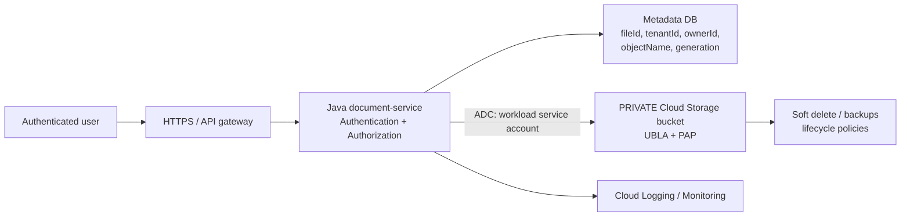
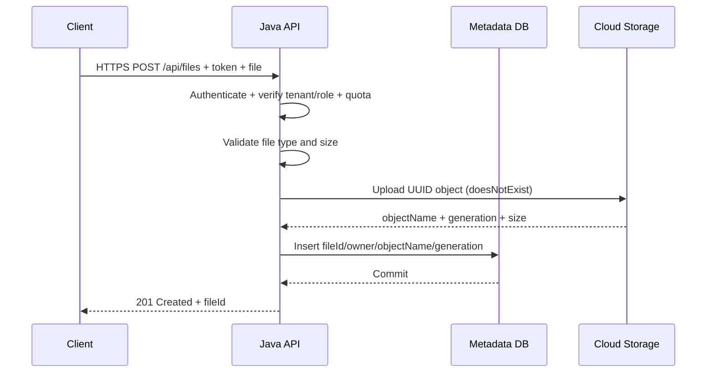

# Lab: Private File Repository for a Java Application

Java applications often need to store invoices, contracts, attachments, or customer-uploaded documents. Storing those files on a VM's local directory risks losing them when the VM is replaced; storing them in a public bucket means anyone who guesses a URL can download the data. This lab builds a **private file repository on Google Cloud Storage**, where **the Java application authenticates users, decides who may view each file, and accesses Cloud Storage on their behalf** using a least-privilege workload identity.

This lesson belongs to the **Cloud Storage** chapter of the `CLOUD_PROVIDERS_GCP` module, connecting project/IAM organization, VPCs, Compute Engine, GKE/Cloud Run, storage, deployment automation, reliability monitoring, and cost control. Learners will create a private bucket, configure security, write Java code to upload/download/list/delete objects, and test unauthorized-access rejection and recovery from accidental operations.

> Project IDs, bucket names, service account addresses, tenants, paths, and users below are **hypothetical**. Commands that may create billable resources or delete data are explicitly noted. Never write service-account private keys, access tokens, or real personal data into source code or terminal logs.

## Learning Objectives

After this lesson, you will be able to:

1. Explain **bucket, object, object name, generation, and metadata** structures in Cloud Storage and why a "private bucket" alone is not enough to isolate multi-user data.
2. Create a bucket with **Uniform bucket-level access (UBLA)** and **Public Access Prevention (PAP)**, verifying there are no `allUsers`/`allAuthenticatedUsers` IAM bindings.
3. Create and attach a **dedicated service account for the Java workload**, using **Application Default Credentials (ADC)** instead of long-lived JSON keys.
4. Use the **Google Cloud Storage Client Library for Java** to upload, download, list by prefix, and delete files.
5. Key objects with random UUIDs, store business metadata separately, enforce tenant/owner authorization, and use **generation preconditions** to prevent accidental overwrites or deletes.
6. Analyze **proxy downloads** vs. **V4 signed URLs**, PAP boundaries, and token/URL leakage risks.
7. Design **soft delete, Object Versioning, lifecycle, retention, encryption, audit logs, and cost** strategies.
8. Build checklists for authorization testing, error handling, monitoring, and lab cleanup.

## 1. Requirements and Trust Boundaries for the Lab

The sample `document-service` application runs on Java 17. Users from two tenants, `tenant-a` and `tenant-b`, sign in through an application-managed authentication layer. Each user may access only documents permitted by business rules.

| Requirement | Design Choice |
| --- | --- |
| Non-public files | Bucket enforces **UBLA + PAP** with no public principals granted |
| Java calling Cloud Storage | Dedicated service account; production uses **ADC** on the workload |
| End users | Authenticated by the app, verified against business ownership/ACL tables |
| Object names | `tenants/{tenantId}/files/{UUID}` generated **server-side** |
| Upload | Enforce size/file-type limits; use `doesNotExist()` |
| Download | Verify **owner/tenant** before reading; serve via backend or controlled signed URL |
| Delete | Bucket soft delete; consider history retention and **generation match** |
| Logging | Log request ID, business principal, object ID/generation, operation type, outcome; never log file bytes |
| Recovery | Appropriate soft delete/retention/backup policies and tested restore drills |

### Separating Three Identity Types

1. **Application user**: e.g., `user-123`, possibly belonging to `tenant-a`. Must pass application authentication and authorization.
2. **Java workload identity**: e.g., `sa-documents@retail-dev-01.iam.gserviceaccount.com`, authorized to call the Storage API on the specific bucket.
3. **Cloud administrator / deployer**: creates buckets, configures IAM/PAP, and attaches service accounts. This role does not necessarily read stored files.

**Critical insight:** Cloud Storage sees the Java service account as the caller performing API requests. It **cannot automatically tell** whether the end user is Alice or Bob. If your app lets users pass a raw `objectName` and reads it using the service account's privileges, attackers can exploit **IDOR/BOLA** vulnerabilities to read other users' documents.

## 2. Proposed Architecture Diagram



A download request flow:

```text
GET /api/files/FILE_ID
  -> verify end-user session/JWT
  -> fetch FILE_ID metadata from database
  -> verify tenantId/ownerId/download permission
  -> read objectName + generation from database
  -> Java Cloud Storage client uses ADC to download object
  -> return secure HTTPS response to user
```

The application must never rely solely on `objectName.startsWith("tenants/tenant-a/")` if `tenant-a` came from an HTTP client. **Tenant and owner must come from verified identity and trusted server-side data.** Prefixes organize keys; they are not a substitute for application authorization.

### Cloud Storage Is Not a POSIX Filesystem

Cloud Storage is **object storage**: each object has a name and metadata, not a file on a local disk. In a standard bucket, `/` characters in object names are **logical prefixes**; `tenants/tenant-a/files/abc` does not automatically create three directories with independent ACLs. Hierarchical namespace buckets and managed folders add specific folder/IAM models, whereas this lab uses a standard object bucket.

## 3. Lab Setup and Budget

### Prerequisites

- A Google Cloud project with billing enabled per organization policy.
- **Cloud Storage API** (`storage.googleapis.com`) available in the environment.
- Google Cloud CLI installed and authenticated, or Cloud Shell.
- Java Development Kit **17+**, Maven, and an IDE/terminal to run examples.
- An admin identity authorized to create buckets, create service accounts, and set bucket IAM; these admin permissions are not granted to the application itself.
- A harmless sample file (e.g., `hello.txt`) to upload; **never use files containing real PII**.

Sample variables:

```bash
PROJECT_ID="retail-dev-01"
LOCATION="asia-southeast1"
BUCKET="retail-dev-private-docs-UNIQUE-SUFFIX"
SA_NAME="sa-documents"
SA_EMAIL="$SA_NAME@$PROJECT_ID.iam.gserviceaccount.com"
```

**Replace `UNIQUE-SUFFIX`** with a unique string. Bucket names must be **globally unique across the entire Cloud Storage namespace**, not just within your project. Never embed personal emails, customer names, secrets, or account numbers in bucket names since resource names appear in logs and admin metadata.

### Context Check — Read-Only

```bash
gcloud auth list
gcloud config get-value project
gcloud projects describe "$PROJECT_ID" \
  --format="table(projectId,projectNumber,name)"

gcloud services list --enabled \
  --project="$PROJECT_ID" \
  --filter="config.name:storage.googleapis.com"
```

**`gcloud auth list` and ADC do not necessarily share the same credentials.** The Google Cloud CLI maintains its own credentials, whereas Java clients use Application Default Credentials. A working CLI login does not prove Java has credentials or permissions.

## 4. Creating a Truly Private Bucket

### Four Initial Configuration Choices

| Setting | Choice for This Lab | Rationale |
| --- | --- | --- |
| **Location** | `asia-southeast1` | Close to sample app deployment; evaluate data residency and pricing |
| **Storage class** | `STANDARD` | Suited for frequent access during the lab |
| **Uniform bucket-level access** | **Enabled** | Disables bucket/object ACLs; standardizes permissions on IAM |
| **Public Access Prevention** | **Enforced** | Blocks public grants via `allUsers` or `allAuthenticatedUsers` |

### Create Bucket Command — Mutates Infrastructure, May Incur Charges

```bash
gcloud storage buckets create "gs://$BUCKET" \
  --project="$PROJECT_ID" \
  --location="$LOCATION" \
  --default-storage-class=STANDARD \
  --uniform-bucket-level-access \
  --public-access-prevention
```

`gcloud storage buckets create` does not automatically create a service account or grant read/write access to your Java app. A new bucket may still inherit IAM from its project, folder, or organization; always check effective permissions, not just direct bucket bindings.

### Inspect Bucket After Creation — Read-Only

```bash
gcloud storage buckets describe "gs://$BUCKET"
gcloud storage buckets get-iam-policy "gs://$BUCKET"
```

Verify:

- `uniformBucketLevelAccess.enabled` is `true` (exact field casing may vary by CLI version).
- `publicAccessPrevention` is `enforced` or enforced equivalently by organization policy.
- IAM contains no file-access grants for `allUsers` or `allAuthenticatedUsers`.
- No broad project/folder roles let unrelated principals read the bucket.

**UBLA and PAP solve two different problems.** UBLA disables ACLs so IAM is uniform; PAP blocks public principals. UBLA **does not guarantee** a bucket is private if IAM grants overly broad roles. PAP **does not block valid signed URLs**, because signed URLs delegate scoped, time-limited access via signatures. See the official references at the end.

### Anonymous Access Test

For an uploaded object whose name you know, send a request **without an `Authorization` header**:

```bash
# Test only: DO NOT pass an access token.
# Replace OBJECT_NAME with an object created in the lab.
curl -I "https://storage.googleapis.com/$BUCKET/OBJECT_NAME"
```

Expect the anonymous request **not to retrieve the content**; the API may return `401`, `403`, or `404` depending on endpoint, method, and obscurity behavior. **Never rely on a single HTTP status code alone**: verify response body, object path, IAM, and auth state. HEAD is not GET; when needed, verify an unauthenticated GET against a known test object.

## 5. Creating the Service Account and Least-Privilege Permissions

The Java application needs its own identity:

```bash
# Mutates IAM: create a user-managed service account for the workload.
gcloud iam service-accounts create "$SA_NAME" \
  --project="$PROJECT_ID" \
  --display-name="Private document service"
```

### Required Cloud Storage Permissions

| Java Action | IAM Permission | Reference Role |
| --- | --- | --- |
| Upload new object | `storage.objects.create` | `roles/storage.objectCreator` |
| Download object | `storage.objects.get` | `roles/storage.objectViewer` |
| List objects by prefix | `storage.objects.list` | `roles/storage.objectViewer` |
| Delete object | `storage.objects.delete` | `roles/storage.objectUser` or custom role |
| Read/edit bucket IAM/config | Corresponding `storage.buckets.*` permissions | **IAM admins only**, never the app |

An application genuinely needing CRUD can use `roles/storage.objectUser` scoped **to the bucket** for this lab. Since this role includes more permissions than strictly create/get/list/delete, in production consider a **custom role** or separating writer/reader identities and gating deletes behind approval workflows.

### Grant CRUD Permissions on the Bucket — Mutates IAM

```bash
gcloud storage buckets add-iam-policy-binding "gs://$BUCKET" \
  --member="serviceAccount:$SA_EMAIL" \
  --role="roles/storage.objectUser"
```

Never grant `roles/storage.admin`, `roles/editor`, or `roles/owner` to an app just to upload and download files. Verify IAM afterward:

```bash
gcloud storage buckets get-iam-policy "gs://$BUCKET"
```

In multi-tenant designs, **one service account holding `objectUser` across the entire bucket can read, write, and delete every tenant's objects in that bucket**. Tenant isolation ultimately **depends on authorization inside your Java application**. If independent IAM boundaries are needed, evaluate **separate buckets**, **managed folders with IAM**, or tenant-isolated service accounts per organizational policy.

## 6. Application Default Credentials (ADC) for Java

**ADC** lets the Google Cloud Java client library locate credentials from the environment without embedding JSON private keys in code. The common search order is:

1. File path set in `GOOGLE_APPLICATION_CREDENTIALS`, if configured.
2. Local user credentials created by `gcloud auth application-default login`.
3. The **service account attached to the Google Cloud runtime**, fetched from the metadata server.

**In production**, prefer an attached user-managed service account on Cloud Run, Compute Engine, or GKE with Workload Identity. Never mount service account JSON keys into containers, Git repositories, or CI pipelines when keyless authentication is available.

### Local Environment

```bash
# Use only on trusted development workstations.
gcloud auth application-default login

# If hitting quota project errors and you have permission:
gcloud auth application-default set-quota-project "$PROJECT_ID"
```

Logging in locally as a developer **does not mean** you are running as `sa-documents`. To test production-like permissions locally, use **service account impersonation** per ADC docs with appropriate `iam.serviceAccounts.getAccessToken` permissions rather than downloading key files. Impersonation permissions for developers should be time-bound and scoped to need.

### Deploying to Cloud Run

Partial deploy command illustration; the image and service must exist, and ingress/caller authorization must still be controlled:

```bash
# Use only after validating image, IAM, and production environment.
gcloud run deploy document-service \
  --project="$PROJECT_ID" \
  --region="$LOCATION" \
  --image="REGION-docker.pkg.dev/PROJECT/REPO/IMAGE:PINNED-TAG" \
  --service-account="$SA_EMAIL" \
  --no-allow-unauthenticated \
  --set-env-vars="PRIVATE_BUCKET=$BUCKET"
```

This command only configures the **workload identity**, not a complete end-user authentication layer. If a web frontend calls the API for end users, design IAM invocation, IAP, API Gateway, or OAuth/JWT/session handling per your architecture. Never set `--allow-unauthenticated` assuming a private bucket automatically stops outsiders from abusing API endpoints.

## 7. Adding the Cloud Storage Java Client Library

This lab uses **Java 17** and Maven with:

```xml
<dependency>
  <groupId>com.google.cloud</groupId>
  <artifactId>google-cloud-storage</artifactId>
  <version>2.75.0</version>
</dependency>
```

Version `2.75.0` is an example matching the API reference checked when writing this lesson. In real deployments, use the **Google Cloud Java libraries BOM** and a team-tested version; never use dynamic `LATEST` versions or blindly auto-bump dependencies in production.

### Reference Maven Project Layout

```text
private-storage-lab/
├── pom.xml
└── src/
    └── main/
        └── java/
            └── example/
                └── PrivateStorageLab.java
```

Minimal `pom.xml`:

```xml
<?xml version="1.0" encoding="UTF-8"?>
<project xmlns="http://maven.apache.org/POM/4.0.0"
         xmlns:xsi="http://www.w3.org/2001/XMLSchema-instance"
         xsi:schemaLocation="http://maven.apache.org/POM/4.0.0 https://maven.apache.org/xsd/maven-4.0.0.xsd">
  <modelVersion>4.0.0</modelVersion>
  <groupId>example</groupId>
  <artifactId>private-storage-lab</artifactId>
  <version>1.0.0-SNAPSHOT</version>
  <properties>
    <maven.compiler.release>17</maven.compiler.release>
    <project.build.sourceEncoding>UTF-8</project.build.sourceEncoding>
  </properties>
  <dependencies>
    <dependency>
      <groupId>com.google.cloud</groupId>
      <artifactId>google-cloud-storage</artifactId>
      <version>2.75.0</version>
    </dependency>
  </dependencies>
  <build>
    <plugins>
      <plugin>
        <groupId>org.apache.maven.plugins</groupId>
        <artifactId>maven-compiler-plugin</artifactId>
        <version>3.13.0</version>
      </plugin>
      <plugin>
        <groupId>org.codehaus.mojo</groupId>
        <artifactId>exec-maven-plugin</artifactId>
        <version>3.5.0</version>
      </plugin>
    </plugins>
  </build>
</project>
```

This is a console app for the lab, **not a public REST service**. In production, isolate storage logic inside a service/repository layer invoked only after application authorization succeeds.

## 8. Object Key Model and Business Metadata

Suppose user `u-123` of `tenant-a` uploads `contract.pdf`. **Never use the user-supplied filename** directly as the object name:

```text
Bucket: retail-dev-private-docs-UNIQUE-SUFFIX
Object name: tenants/tenant-a/files/83b346f9-2dcc-4a45-91ad-7e1a1cf9270c
Content-Type: application/pdf
Cache-Control: private, no-store
Object generation: 1730000000000000  (illustrative value)
```

Store metadata in the **application database**:

| Attribute | Meaning |
| --- | --- |
| `fileId` | Public/opaque ID issued by the app, not the object path |
| `tenantId` | Tenant resolved from verified identity |
| `ownerId` | Owner or business entity linked to the file |
| `bucketName` | Server-configured bucket, never client-supplied |
| `objectName` | Server-generated opaque key |
| `generation` | Object content version returned by Cloud Storage |
| `fileSize` | Stored byte count |
| `contentType` | Validated content type |
| `scanStatus` | Malware scan status, if required by the app |
| `createdAt`/`deletedAt` | Supports auditing, retention, and business soft delete |

**Never embed PII in object names** (emails, national IDs, full names, or sensitive order numbers). Object names appear in logs, monitoring, and metadata even when the bucket is private. Random IDs mapped in the database reduce leakage and make storage restructuring easier.

### Prefixes Are Not Access Policies

`tenants/tenant-a/files/` helps organize listings and prefix queries. In a standard bucket where a service account holds `roles/storage.objectUser` bucket-wide, that principal **can access every other prefix too**. Only application authorization or real IAM boundaries (managed folders, separate buckets, etc.) enforce security boundaries.

## 9. Java Demo: Upload, Download, List, and Delete

The code below uses the official `com.google.cloud:google-cloud-storage` API. It intentionally accepts only a **trusted tenant key** and a **local lab file**. In real APIs, derive the tenant from a verified JWT/session, verify ownership in the DB, and never expose object keys to unauthorized users.

```java
package example;

import com.google.api.gax.paging.Page;
import com.google.cloud.storage.Blob;
import com.google.cloud.storage.BlobId;
import com.google.cloud.storage.BlobInfo;
import com.google.cloud.storage.Storage;
import com.google.cloud.storage.StorageOptions;
import java.io.IOException;
import java.nio.file.Files;
import java.nio.file.Path;
import java.util.ArrayList;
import java.util.List;
import java.util.Objects;
import java.util.UUID;

public final class PrivateStorageLab {
  private static final long MAX_UPLOAD_BYTES = 10L * 1024 * 1024;
  private final Storage storage;
  private final String bucket;

  public record StoredObject(String objectName, long generation, long size) {}

  public PrivateStorageLab(String bucket) {
    this.bucket = Objects.requireNonNull(bucket);
    if (bucket.isBlank()) throw new IllegalArgumentException("bucket missing");
    // ADC: local gcloud application-default login or attached service account.
    this.storage = StorageOptions.getDefaultInstance().getService();
  }

  private static String prefix(String trustedTenantId) {
    // Tenant ID must come only after application authentication/authorization.
    if (trustedTenantId == null
        || !trustedTenantId.matches("[A-Za-z0-9_-]{1,48}")) {
      throw new IllegalArgumentException("invalid tenant");
    }
    return "tenants/" + trustedTenantId + "/files/";
  }

  private static void checkObject(String trustedTenantId, String objectName) {
    if (objectName == null || !objectName.startsWith(prefix(trustedTenantId))) {
      throw new SecurityException("Object outside authorized tenant prefix");
    }
  }

  public StoredObject upload(
      String trustedTenantId, Path sourceFile, String approvedContentType)
      throws IOException {
    if (!Files.isRegularFile(sourceFile)) {
      throw new IllegalArgumentException("not a regular file");
    }
    long fileSize = Files.size(sourceFile);
    if (fileSize <= 0 || fileSize > MAX_UPLOAD_BYTES) {
      throw new IllegalArgumentException("file size outside lab limit");
    }
    // Lab accepts only text/plain or application/pdf.
    if (!"text/plain".equals(approvedContentType)
        && !"application/pdf".equals(approvedContentType)) {
      throw new IllegalArgumentException("unsupported content type");
    }

    String objectName = prefix(trustedTenantId) + UUID.randomUUID();
    BlobInfo info =
        BlobInfo.newBuilder(BlobId.of(bucket, objectName))
            .setContentType(approvedContentType)
            .setCacheControl("private, no-store")
            .build();

    // Does-not-exist condition -> prevents overwriting on name collision/race.
    Blob created =
        storage.createFrom(
            info, sourceFile, Storage.BlobWriteOption.doesNotExist());
    return new StoredObject(
        created.getName(), created.getGeneration(), created.getSize());
  }

  public void download(
      String trustedTenantId, String objectName, long generation, Path output) {
    checkObject(trustedTenantId, objectName);
    if (generation <= 0) throw new IllegalArgumentException("bad generation");
    BlobId id = BlobId.of(bucket, objectName, generation);
    Blob metadata = storage.get(id);
    if (metadata == null) throw new IllegalArgumentException("object not found");

    // Read the exact saved version; never silently switch to a newer generation.
    storage.downloadTo(
        id, output, Storage.BlobSourceOption.generationMatch(generation));
  }

  // Returns first page only; production should iterate via pageToken.
  public List<String> listFirstPage(String trustedTenantId) {
    String keyPrefix = prefix(trustedTenantId);
    Page<Blob> page =
        storage.list(
            bucket,
            Storage.BlobListOption.prefix(keyPrefix),
            Storage.BlobListOption.pageSize(50));
    List<String> result = new ArrayList<>();
    for (Blob blob : page.getValues()) result.add(blob.getName());
    return result;
  }

  public boolean delete(
      String trustedTenantId, String objectName, long generation) {
    checkObject(trustedTenantId, objectName);
    if (generation <= 0) throw new IllegalArgumentException("bad generation");
    // Delete only if the live object still has the generation recorded by the app.
    return storage.delete(
        BlobId.of(bucket, objectName),
        Storage.BlobSourceOption.generationMatch(generation));
  }

  public static void main(String[] args) throws Exception {
    if (args.length < 3 || args.length > 4) {
      System.err.println(
          "Usage: BUCKET TRUSTED_TENANT LOCAL_FILE [--delete]");
      System.exit(2);
    }
    PrivateStorageLab repo = new PrivateStorageLab(args[0]);
    // Local demo only: in production never accept tenant from raw HTTP input.
    StoredObject file = repo.upload(
        args[1], Path.of(args[2]), "text/plain");
    System.out.println("Uploaded: " + file.objectName());
    System.out.println("Generation: " + file.generation());
    System.out.println("First page: " + repo.listFirstPage(args[1]));

    Path destination = Path.of("downloaded-lab-file.txt");
    repo.download(args[1], file.objectName(), file.generation(), destination);
    System.out.println("Downloaded to " + destination.toAbsolutePath());

    // Delete does NOT run automatically; --delete must be passed explicitly.
    if (args.length == 4 && "--delete".equals(args[3])) {
      boolean deleted = repo.delete(args[1], file.objectName(), file.generation());
      System.out.println("Deleted: " + deleted);
    }
  }
}
```

### What the Java Sample Intentionally Enforces

| Measure | Reason |
| --- | --- |
| `StorageOptions.getDefaultInstance().getService()` | Uses ADC; no keys in code |
| `UUID.randomUUID()` | Avoids user-supplied object names and cuts collisions |
| `Storage.BlobWriteOption.doesNotExist()` | Conditional create; returns `412` if name exists |
| `getGeneration()` | Records the exact object version |
| `BlobId.of(bucket, objectName, generation)` | Prevents reading a different version if overwritten |
| `generationMatch(generation)` on delete | Avoids deleting a newer live version |
| `setCacheControl("private, no-store")` | Reduces shared-cache exposure of sensitive content |
| `pageSize(50)` | Bounds page size instead of returning everything in one call |

**Demo limitations:** In the snippet, `trustedTenantId` assumes the caller is already authenticated—it is **not real authentication**. It lacks HTTP controllers, database ACLs, anti-malware, magic-byte validation, per-user upload quotas, streaming HTTPS responses, idempotency records, audit trails, and metadata transactions. Never copy it straight to production without those layers.

### Reading the Right Generation and Versioning

Cloud Storage assigns a `generation` to each object content version. Once a live object is overwritten or deleted, older generations are unreadable unless Object Versioning or soft delete retains them and allows restoration. In this lab, UUID names avoid overwrites. **The application must persist metadata to the DB after upload succeeds**, handling "object created, DB transaction failed" via safe, idempotent cleanup jobs.

## 10. Running the Lab with Maven

Create a **non-sensitive** file `hello.txt`:

```bash
printf 'Private document storage lab\n' > hello.txt

# Run using locally configured ADC, file <= 10 MiB.
mvn -q compile exec:java \
  -Dexec.mainClass=example.PrivateStorageLab \
  -Dexec.args="$BUCKET tenant-a hello.txt"
```

Expected output (illustrative):

```text
Uploaded: tenants/tenant-a/files/83b346f9-2dcc-4a45-91ad-7e1a1cf9270c
Generation: 1730000000000000
First page: [tenants/tenant-a/files/83b346f9-2dcc-4a45-91ad-7e1a1cf9270c]
Downloaded to .../downloaded-lab-file.txt
```

Verify:

```bash
cat downloaded-lab-file.txt

gcloud storage ls "gs://$BUCKET/tenants/tenant-a/files/"

# Inspect metadata using the actual OBJECT_NAME from output.
gcloud storage objects describe "gs://$BUCKET/OBJECT_NAME"
```

`gcloud storage ls` runs as your **CLI principal**, not necessarily the Java service account. If Java uploads fine yet `gcloud ls` returns `403`, it may simply reflect **two principals holding different roles**.

### Optional Deletion of the Created Object

Only if you want to test deletion, pass `--delete`:

```bash
# Creates a NEW object, then deletes the exact returned generation in the same run.
mvn -q compile exec:java \
  -Dexec.mainClass=example.PrivateStorageLab \
  -Dexec.args="$BUCKET tenant-a hello.txt --delete"
```

This does not delete the bucket. If soft delete is enabled, the deleted object remains recoverable for its retention window and continues accruing soft-deleted storage charges.

## 11. From Console Lab to a Secure Java REST API

Typical production endpoints:

```text
POST   /api/files           upload, auth, verify tenant permission
GET    /api/files/{fileId}  download with ownership check
GET    /api/files           list files belonging to user/tenant
DELETE /api/files/{fileId}  mark deleted + conditional object delete
```

Never map `/{objectName}` straight to bucket reads under a broad service account. Use an **opaque `fileId`** generated by the application and looked up in the database.

### Required Steps in an Upload Flow



If Cloud Storage upload succeeds yet the DB commit fails, **do not return 201**. Record an event/ticket to clean up the orphaned object after confirming no DB row references it; never run unconditional deletes or wipe an entire prefix. Consider **outbox/saga** patterns or reconciliation jobs for high reliability.

### Download Flow

```text
1. Verify JWT/session -> authenticatedUserId, tenantId.
2. Query DB by fileId AND tenantId (and check owner/role).
3. Verify file is not deleted, locked, or quarantined.
4. Retrieve objectName and generation from trusted metadata.
5. Cloud Storage downloadTo/read stream pinned to generation.
6. Return HTTPS response with validated Content-Type,
   Content-Disposition: attachment when needed.
7. Audit: who read which file, when, and outcome.
```

**Never pass a user-supplied `objectName` into local temp file paths**; if the server uses temp files, canonicalize paths, cap disk usage, clean up after responses, and prevent path traversal. For large files, stream directly to the HTTP response rather than buffering into `byte[]`.

### Handling API Errors

| Storage / API Error | App-Layer HTTP Status to Consider | Meaning |
| --- | --- | --- |
| Object does not exist | `404 Not Found` | Does not leak another tenant's data |
| End user does not own file | `403 Forbidden` or `404` per obscurity policy | **Application** authorization failure, not a bucket issue |
| Service account lacks `storage.objects.get` | `403` from Cloud Storage; backend returns `5xx`/`503` | Operational IAM misconfiguration—do not blame end users |
| Preconditions unmet | `412 Precondition Failed` from Storage → `409 Conflict` or `412` | Race condition or version changed |
| Upload size exceeded | `413 Payload Too Large` | Reject before uploading full payload |
| Unsupported file type | `415 Unsupported Media Type` or `422` | Invalid MIME/format |
| Quota exceeded / transient failure | `429`, `503`, or categorized error | Retry with backoff and idempotency |
| Retention/hold blocks delete | `403` or corresponding API error | Never bypass policy; escalate to data owner |

Never leak internal errors containing object keys, service accounts, request signatures, access tokens, or stack traces in HTTP responses to end users.

## 12. Safe Writes and Deletes with Generation Preconditions

Cloud Storage provides **strong consistency** for many object operations (create, read, delete, listing) as documented. Nonetheless, **two independent clients can still race** when modifying the same object name. Strong consistency does not replace **optimistic concurrency control**.

| Intent | Preconditions | Result |
| --- | --- | --- |
| Create only if no live object exists | `ifGenerationMatch=0` / `doesNotExist()` | Prevents overwrites on key collisions |
| Overwrite only if live generation matches | `generationMatch(oldGeneration)` | Prevents overwriting another client's newer write |
| Delete only if live generation unchanged | `BlobSourceOption.generationMatch(oldGeneration)` | Prevents deleting a newer version |
| Controlled metadata update | `metagenerationMatch(...)` paired with generation | Prevents lost metadata updates |

If a precondition fails, the API returns **`412 Precondition Failed`**. This is not a transient network error to retry blindly; the app must re-read state or report a conflict to the caller.

### Java: Overwrite Only If Generation Matches

The snippet below targets a **fixed-version object** case (unlike the UUID design in the main demo):

```java
import com.google.cloud.storage.BlobId;
import com.google.cloud.storage.BlobInfo;
import com.google.cloud.storage.Storage;
import java.nio.charset.StandardCharsets;

BlobId id = BlobId.of(bucketName, "shared/config.json");
BlobInfo info = BlobInfo.newBuilder(id)
    .setContentType("application/json")
    .setCacheControl("private, no-store")
    .build();

long versionReadEarlier = 1730000000000000L; // example from previously read metadata
storage.create(
    info,
    "{\"enabled\":true}".getBytes(StandardCharsets.UTF_8),
    Storage.BlobTargetOption.generationMatch(versionReadEarlier));
```

If `shared/config.json`'s generation changed, the write is rejected rather than silently overwriting. Never hardcode generations in real applications; read them from a synchronized database/metadata workflow.

## 13. Signed URLs: When to Use Them and When Not To

Two common ways to serve content from a private bucket:

| Approach | Data Flow | Strengths | Risks / Conditions |
| --- | --- | --- | --- |
| **Java backend proxy** | Client → Java API → Cloud Storage → Java → Client | Enforces authZ/headers/logging on every request | Increases backend bandwidth, CPU, and latency |
| **V4 signed URL** | Java authenticates user, signs URL → client downloads directly from Storage | Offloads backend; great for large files | URL is a **bearer capability**: anyone holding an unexpired URL can use it within scope |

**Public Access Prevention does not block valid V4 signed URLs.** A signed URL is not a public IAM role; access is authorized by the signature of an authorized account. Consequently, a `PAP=enforced` bucket still lets holders of valid signed URLs download objects until expiration.

### When Issuing Signed URLs

1. Authenticate the user and verify **`fileId` → ownership/tenant** in the DB.
2. Sign the **exact object name, exact HTTP method** (GET or PUT), a short lifetime (e.g., 5–15 minutes), and required request constraints.
3. For uploads, pair with content-type checks, size enforcement, and post-upload scanning; a bare signed PUT does not enforce full size/scan policies.
4. Never write signed URLs into logs, analytics, referrers, error trackers, or public messages.
5. When immediate revocation is needed, remember signed URLs remain valid until expiry while signing conditions hold; plan revocation via object/generation changes, signer controls, or proxy delivery. **Never assume invalidating an app session revokes an already-issued signed URL.**
6. For browser uploads, configure **CORS** for exact origins and HTTP methods; CORS **is not an authorization mechanism**.

### Java Signing Caveats

In some environments, an attached service account via ADC **has no local private key for signing**. You may need the IAM Credentials API and `iam.serviceAccounts.signBlob` on the signing identity, or a library-compatible signer configuration. **Never work around this by exporting JSON private keys** to Cloud Run/GKE when keyless signing is supported.

For highly sensitive files requiring per-request revocation or preventing capability-link sharing, a **backend proxy** is often better suited.

## 14. Tenant and User Security Testing

A private bucket can still leak data through **Java API logic bugs**. Build tests before connecting the frontend:

| Test | Action | Expected Result |
| --- | --- | --- |
| `T1` | Call `GET /api/files/file-a` without a token | `401` |
| `T2` | Tenant A user requests a file owned by Tenant B | `403`/`404`, **never returns content** |
| `T3` | Tenant A user lists files | Returns only DB-authorized files |
| `T4` | Client sends `objectName=tenants/tenant-b/...` | App ignores client-supplied `objectName`; looks up by `fileId` only |
| `T5` | Anonymous request hits a real object's Storage URL | Denied; payload cannot be downloaded |
| `T6` | Upload `.pdf` file whose bytes are an executable | Detected/quarantined by file-type and scan policies |
| `T7` | Upload 50 MiB when lab cap is 10 MiB | Rejected before storing |
| `T8` | Two concurrent streams write the same object key | One fails with `412` under proper preconditions |
| `T9` | User requests deletion of an unowned object | Storage delete is never executed |
| `T10` | User leaves tenant or account is disabled | API denies access; handle any active signed URLs if used |
| `T11` | Revoke Storage permissions on service account | Java gets 403; operational alert fires without leaking internal details |
| `T12` | DB metadata insert fails after upload | Reconciliation cleans up the orphaned object |

For unverified uploads, **land files in a quarantine zone** and run AV/content-policy checks before allowing downloads. Checking MIME solely from filenames or client `Content-Type` headers **is insufficient**; combine magic bytes, hardened parsers, per-user quotas, and rate limiting.

### Browser Download Controls

- Return `Content-Disposition: attachment; filename="sanitized-name.ext"` when browsers should download rather than execute content inline.
- Add `X-Content-Type-Options: nosniff` and a Content Security Policy when serving files over the web.
- Never let user input flow straight into response headers (prevents CRLF injection).
- Beware HTML/SVG/PDF uploads carrying active scripts; isolate serving origins away from app auth cookies where possible.
- Never allow shared caching of personalized content on Cloud CDN without proper authorization/cache-key design.

## 15. Data Protection: Soft Delete, Versioning, Lifecycle, Retention

A private repository must not only stop outsiders from reading files—it must also minimize data loss from accidental deletions, app bugs, or compromised accounts.

### 15.1 Soft Delete

**Soft delete** retains deleted or overwritten objects/buckets for a configured retention window so they can be restored. On standard buckets supporting the feature, the **current default is 7 days**, adjustable or disableable per policy. Soft-deleted objects **cannot be read like live objects**; they must go through restore workflows.

Pros: recovers accidental deletions and lowers permanent data-loss risk. Cost: soft-deleted items still incur storage fees, especially in buckets with many temporary files or high churn.

### 15.2 Object Versioning

**Object Versioning** keeps **noncurrent generations** whenever a live object is replaced or deleted per service rules. Older generations remain accessible and manageable while retained. Versioning **does not protect against bucket deletion** the way soft delete can.

In a UUID-keyed object design, overwrites are rare; you may **not need Object Versioning** if soft delete and backups already meet your RPO/RTO. For user files edited repeatedly under the same name, actively govern version history and cost.

### 15.3 Object Lifecycle Management

Lifecycle rules can delete aged objects or transition storage classes by condition. A Delete rule **does not guarantee bytes vanish immediately**: when soft delete applies, deleted objects transition to soft-deleted state until retention ends.

Example business policies:

```text
Quarantine objects: inspect and purge after 14 days
Temporary exports: delete live objects after 30 days
Invoices: retain per dedicated legal policy
Audit logs: separate retention and access permissions
```

**Never apply a 30-day Delete rule bucket-wide if the bucket also holds multi-year contracts.** Segment buckets or prefixes, account for retention/holds and legal mandates, and review before deploying.

### 15.4 Retention Policies and Holds

Bucket retention policies, per-object retention, and object holds **block object deletion** for mandatory periods. These are compliance controls, distinct from soft delete. Once a retention policy is locked with Bucket Lock, shortening or removing it becomes impossible. Obtain legal and security sign-off before enabling locks in production.

## 16. Encryption, Networking, and Protecting Sensitive Data

### Encryption at Rest and in Transit

- Cloud Storage **encrypts data at rest by default** using Google Cloud encryption.
- Java clients connect to the Storage API over **HTTPS/TLS** for encryption in transit.
- If policy demands independent key control, evaluate **CMEK via Cloud KMS**; the service agent needs key permissions, and you must plan key rotation and availability.
- **Customer-supplied encryption keys** or client-side encryption impose separate key custody duties and are unnecessary for this lab.

Never build DIY "encryption" by storing a secret key in object metadata or embedding private keys in source code.

### A Private Bucket Does Not Mean a Private Network

Cloud Storage is exposed as Google APIs; a **private bucket** means IAM and access policies restrict who can access objects. That is **distinct from** whether API traffic traverses the internet or private routing.

If Compute Engine VMs lack external IPs, configure **Private Google Access** or an appropriate egress path to reach the Storage API. To prevent perimeter exfiltration, evaluate **VPC Service Controls**, Private Service Connect for Google APIs, Cloud NAT, proxies, and Organization Policies per architecture. Network controls **do not replace** per-tenant application authorization.

### Bucket IP Filtering and Perimeters

Cloud Storage supports bucket IP filtering in supported models, though misconfigurations can lock out apps, Cloud Shell, or CI runners. Enable it only after verifying real ingress paths, VPC/network resource IDs, and required exemptions.

## 17. Logs, Monitoring, Alerts, and Troubleshooting

The application should track:

| Metric / Log | Why Needed |
| --- | --- |
| Upload/download/delete success rate | Detect app bugs, IAM issues, and network errors |
| `401`/`403`/`404` on the API | Detect unauthorized probes and BOLA/IDOR attempts |
| Storage API `403`/`412`/`429`/`5xx` | Separate permission errors, races, rate limits, and transient faults |
| P95/P99 latency | Monitor file-transfer experience and throughput |
| Bytes uploaded/downloaded | Track quotas and bandwidth costs |
| Orphaned object count | Catch failed DB transactions or reconciliation gaps |
| Soft-deleted bytes / version count | Spot billing growth from file churn |
| IAM changes, bucket config changes | Detect accidental public grants or weakened PAP/UBLA |

### Cloud Audit Logs

Cloud Storage emits Admin Activity and Data Access logs by operation type. **Data Access logs for most object reads/writes are off by default** and can increase logging bills; enable them before you need to investigate, with appropriate retention, sinks, and viewer permissions.

Logs Explorer example:

```text
protoPayload.serviceName="storage.googleapis.com"
protoPayload.resourceName:"retail-dev-private-docs"
```

This is a starting filter only; exact `resourceName` and `methodName` depend on operation and API. Inspect timestamp, `principalEmail`, request ID, and status when investigating. Never log full signed URLs, bearer tokens, document contents, or PII in bucket/object names.

### Common Errors

| Symptom | Common Cause | How to Check |
| --- | --- | --- |
| Java throws `401 UNAUTHENTICATED` | Missing ADC or expired token | `gcloud auth application-default login` locally; attached SA in prod |
| Java throws `403 PERMISSION_DENIED` | SA lacks bucket role or uses a different principal | Check runtime SA, inherited IAM, and Policy Troubleshooter |
| `gcloud ls` works, yet Java gets `403` | CLI and ADC use different identities | Compare `gcloud auth list` with ADC/runtime SA |
| `412 Precondition Failed` on upload | Live object key already exists | Check UUID generation / collisions; never blindly retry an overwrite |
| `412` on delete | Generation changed | Re-read metadata, reconcile DB, resolve conflict |
| Upload succeeds, API cannot find file | DB commit failed or wrong tenant lookup | Reconcile object/DB; never bypass authZ |
| User A downloads Tenant B's file | Backend BOLA/IDOR flaw | Block access immediately, fix authZ, audit and handle security incident |
| Large file uploads fail | RAM, timeouts, proxy body caps, or quotas | Use streaming/resumable uploads; tune limits and timeouts |
| Deleted objects still incur charges | Soft delete, noncurrent versions, or retention | Inspect bucket policies and Billing SKUs |
| Signed URL used after logout | URL remains valid until TTL expires | Shorten TTLs, implement dedicated revocation, never log URLs |
| Cloud Run cannot reach Storage | SA/ADC, APIs, VPC/egress, or org policy | Check IAM, network config, and audit logs |
| Browser caches old object after replacement | HTTP `Cache-Control`, CDN, or signed URL | Inspect headers, cache keys, versioned URLs, and invalidation |

### Retries and Idempotency

Retry only appropriate transient errors like `429` and `503` using exponential backoff with jitter and a total timeout cap. **For uploads**, use preconditions or idempotency-keyed object IDs so timeout retries never create duplicate files. Never infinitely retry `403` permission errors or `412` conflicts.

## 18. Case Study: Private Invoice Vault in a Java App

Suppose an e-commerce platform serves two tenants and customers download PDF invoices:

| Property | Hypothetical Value |
| --- | --- |
| Project | `retail-prod-01` |
| Bucket | `retail-prod-invoices-unique` |
| Java runtime | Cloud Run with user-managed service account |
| Object key | `tenants/{tenant}/invoices/{UUID}` |
| Storage class | Standard if accessed frequently |
| Data | PDF invoices containing PII |
| Access | Buyers, authorized staff, and auditors |
| Retention | Per approved legal mandates |
| Download | Backend proxy verifying owner on every request |
| Logs | Business audit logs + Cloud Audit Logs per policy |

### Invoice Creation Flow

1. The app authenticates the merchant/service creating the invoice and verifies tenant authorization.
2. Renders the PDF from validated data, enforcing size limits and ignoring untrusted filenames.
3. Generates an opaque `fileId` and a random `objectName`.
4. Uploads the PDF with `Content-Type: application/pdf`, `Cache-Control: private, no-store`, and `doesNotExist()`.
5. Persists `fileId`, owner, generation, and size in the DB with status `AVAILABLE`.
6. Returns only `fileId` to the frontend—never exposes raw object paths unnecessarily.
7. When a buyer downloads, the API authenticates, verifies ownership, and streams from Storage.
8. On deletion requests, verifies legal retention rules before calling Cloud Storage and writes an audit record.

### Incident Scenario to Investigate

One day, a `tenant-a` customer sends a request with a `fileId` belonging to `tenant-b`:

```text
GET /api/files/file-b-456
Authorization: Bearer <VERIFIED_TOKEN>
```

Correct behavior: the app returns `403` or `404` and **never calls the Storage API with `tenant-b`'s `objectName`**. If the backend calls Storage and returns bytes because the service account holds bucket-wide permissions, the private bucket **still suffers a data breach**. Fix authorization ordering prior to Storage calls, add negative tests, and audit unauthorized attempts.

## 19. Deployment Costs and Limits

Cloud Storage bills across distinct components:

- **Storage bytes**: stored capacity by storage class and location.
- **Operations**: uploads, lists, metadata gets, copies, deletes, and other billable calls.
- **Data transfer / egress**: bytes read from Cloud Storage to clients, other regions, or the internet.
- **Retrieval / early deletion**: applies to Nearline, Coldline, Archive, and classes with minimum storage durations.
- **Soft delete, Object Versioning, and backups**: retained copies continue accruing charges.
- **Cloud KMS, Logging/Monitoring, and Cloud Run/network**: supporting service costs if used.

### Illustrative Estimation Problem

Suppose:

```text
10,000 invoices/month × 200 KiB/invoice
= 2,000,000 KiB ≈ 1.91 GiB uploaded/month.

If each invoice is downloaded an average of 2 times:
20,000 downloads × 200 KiB ≈ 3.81 GiB downloaded body/month.
```

These are **not Google Cloud prices**. A full estimate must add operation charges, location-based egress, multi-month cumulative storage, soft-deleted data, lifecycle/retention, and surrounding services. Use current Cloud Storage pricing and the Google Cloud Pricing Calculator, then reconcile against Cloud Billing by SKU.

### Lab Cleanup

Once finished, if no longer needed:

1. Confirm every object in the bucket is test data with zero real customer documents.
2. Check soft delete, retention, object holds, and versioning; never try deleting past retention locks.
3. Remove the service account's bucket IAM binding once the workload is retired.
4. Only after confirming data is safe to discard and you have permission, delete objects and the bucket per official docs.
5. Check Cloud Run services, service accounts, logs, snapshots/soft delete, and lingering charges.

Never embed `gcloud storage rm -r gs://...` in automated scripts without strict confirmation and bucket-name checks. Follow backup/restore verification procedures before destroying resources.

## 20. Common Misconceptions

| Misconception | Accurate Reality |
| --- | --- |
| "If the bucket isn't public, User A can't see User B's files." | An app using a bucket-wide SA can still have BOLA bugs; enforce ownership checks |
| "UBLA means nobody can access without an ACL." | UBLA **disables ACLs**, while IAM can still grant very broad access |
| "PAP blocks all signed URLs." | PAP does not block valid signed URLs |
| "Prefix IAM exists automatically because names contain `/`." | Prefixes are just object name strings; you need managed folder IAM, separate buckets, or app ACLs |
| "`gcloud auth login` gives Java ADC." | `gcloud auth application-default login` is a separate credential store from CLI login |
| "Service account JSON keys are required on Cloud Run." | Attached service accounts / Workload Identity and ADC are preferred |
| "Client-supplied `Content-Type` is always trustworthy." | Verify magic bytes / file signatures with hardened parsers |
| "Using UUIDs eliminates the need for preconditions." | UUIDs cut collisions, while preconditions block overwrites/races |
| "Upload returning 200 means DB metadata definitely committed." | Two services have separate transactions; reconcile failures |
| "Deleting an object makes bytes vanish permanently right away." | Soft delete, versioning, or retention can keep data around |
| "`Cache-Control: no-store` handles IAM." | Headers control caching, not authorization |
| "A leaked signed URL only works for logged-in users." | Anyone holding the URL can use it within its TTL and signed scope |
| "Archive class fits all rarely read documents." | Account for retrieval and early deletion charges |
| "Private Cloud Storage means requests never traverse the internet." | IAM/PAP and network routing are separate layers |

## 21. Practice Exercises

### Exercise 1 — Designing Access Control

A Java app stores documents for 10 tenants in one bucket. Its service account holds `roles/storage.objectUser` on the bucket. Tenant A submits a `fileId` belonging to Tenant B. Which control must reject the request?

<details>
<summary>Suggested Answer</summary>

**Java application authorization** must look up metadata by `fileId` and verified tenant/owner, rejecting the request before calling Storage. Service account IAM does not know which end user belongs to which tenant. For stronger isolation, consider separate buckets, separate service accounts, or managed-folder IAM.
</details>

### Exercise 2 — UBLA and PAP

Why does enabling Uniform bucket-level access alone not guarantee a bucket cannot become public?

<details>
<summary>Answer</summary>

UBLA disables ACLs and standardizes on IAM; an `allUsers` IAM binding can still expose data publicly unless blocked. PAP prevents creating or applying public grants via `allUsers` and `allAuthenticatedUsers`. Combine both, and audit effective IAM and organization policies.
</details>

### Exercise 3 — Local Credentials

`gcloud storage ls` succeeds, yet `PrivateStorageLab` throws `403`. Give three possible causes and how to verify them.

<details>
<summary>Suggested Answer</summary>

CLI and ADC may use different identities; local ADC may not be logged in or its quota project may differ; the Java identity may lack `storage.objects.*` on the bucket. Check `gcloud auth list`, `gcloud auth application-default login` / attached SA, and bucket IAM, using Policy Troubleshooter where appropriate.
</details>

### Exercise 4 — Generation Precondition

Object `shared/config.json` currently has generation `100`. Clients A and B both read generation `100`. A updates it to generation `101`; B attempts to write with `generationMatch(100)`. What happens?

<details>
<summary>Answer</summary>

Cloud Storage rejects B's write with `412 Precondition Failed`, preserving generation `101`. B must re-read the state, resolve the conflict, or notify the caller—never retry infinitely with the stale precondition.
</details>

### Exercise 5 — Signed URLs and Logout

An app issues a 15-minute signed GET URL, and the user logs out immediately afterward. Is the URL automatically invalidated?

<details>
<summary>Answer</summary>

Not by default. A signed URL is a time-limited signed capability; anyone holding the link can use it until expiration or until signing keys/resource conditions change. Keep TTLs short, avoid logging URLs, and build explicit revocation flows if business logic requires it.
</details>

### Exercise 6 — Choosing Delete and Recovery Strategy

A document vault faces occasional accidental deletions by users, yet does not need multiple historical versions per object name. Should you evaluate soft delete or Object Versioning first?

<details>
<summary>Suggested Answer</summary>

**Soft delete** is usually the right starting point to recover accidental deletions/overwrites and also protects at the bucket level. Versioning helps when you need direct access to multiple noncurrent generations, though it adds cost and does not protect against bucket deletion the way soft delete does. Decide based on RPO/RTO, retention, and cost.
</details>

### Exercise 7 — Upload Path Protection

A user uploads a file named `../admin/secret.pdf`. Why must you never use this string as the `objectName` or a local temporary file path?

<details>
<summary>Suggested Answer</summary>

Filenames are untrusted input capable of causing local path traversal and prefix confusion/leakage in object namespaces. Have the server generate a UUID object key, store a sanitized display name separately, and enforce business authorization.
</details>

### Exercise 8 — Storage and Egress Cost

A system holds 10,000 PDFs × 200 KiB with 20,000 downloads. Calculate approximate uploaded and downloaded body data, and name at least three other cost items to evaluate.

<details>
<summary>Answer</summary>

Roughly **1.91 GiB** uploaded and **3.81 GiB** downloaded. Additional costs include multi-month storage, operations, regional/internet egress, soft delete/versioning, and Logging/KMS/Cloud Run. Never treat raw payload bytes alone as the full bill.
</details>

### Exercise 9 — Preventing Data Exposure via MIME

A Java API receives an upload named `.png` whose actual bytes are HTML with JavaScript. What safeguards are required?

<details>
<summary>Suggested Answer</summary>

Never trust client-supplied filenames or `Content-Type` alone; check magic bytes with hardened parsers, enforce size caps, quarantine/scan, serve downloads with `Content-Disposition: attachment` where appropriate and `X-Content-Type-Options: nosniff`, and isolate origins/cookie domains to prevent active-content execution.
</details>

### Exercise 10 — Handling 412 on Delete

The app DB records generation `42`, while the live object was updated to generation `43`. Code calls `delete(... generationMatch(42))`. How should this be handled?

<details>
<summary>Suggested Answer</summary>

Reject the operation as a conflict; re-read metadata, verify who updated it, and reconcile with the DB. Never drop the precondition to blindly delete generation `43`. Deleting a specific version requires appropriate versioning/API and retention checks.
</details>

## 22. Production Checklist for a Private Java Storage Vault

- [ ] Bucket name contains no sensitive data; location and storage class match requirements.
- [ ] UBLA enabled, PAP enforced, with zero public IAM or inherited access.
- [ ] Separated identities for bucket administrators, deployers, and workload service accounts.
- [ ] Java uses ADC / attached service accounts without storing JSON private keys.
- [ ] Storage roles scoped strictly to required bucket/managed folder; no broad Editor/Owner grants.
- [ ] API authenticates users and checks tenant/owner/role **before calling Storage**.
- [ ] Server generates opaque `fileId`s and random `objectName`s rather than trusting client filenames.
- [ ] Database stores `fileId` → bucket/object/generation/owner/scan status mappings.
- [ ] Uploads enforce size/type caps, anti-malware scanning, true MIME validation, and rate limits.
- [ ] Writes use `doesNotExist()` or generation preconditions to prevent races.
- [ ] Downloads stream over HTTPS, block cross-tenant reads, and set `attachment`/`nosniff` where needed.
- [ ] Signed URLs (if used) have short TTLs, are never logged, and have a revocation strategy.
- [ ] Soft delete, retention/lifecycle/backups, and tested restore drills are in place.
- [ ] Audit logs, metrics, and alerts cover 403/412/5xx errors, egress, and orphaned objects.
- [ ] Tested anonymous GETs, cross-tenant users, disabled accounts, and missing SA permissions.
- [ ] Reconciliation handles uploads that succeed when the DB commit fails.
- [ ] Budgeted storage, operations, egress, soft delete, KMS, networking, and Cloud Run costs.
- [ ] Runbooks cover recovery, rollback, cost control, and cleanup without recklessly deleting prod buckets.

## Official Reference Documentation

- [Cloud Storage overview](https://cloud.google.com/storage/docs/introduction): buckets, objects, storage classes, and core concepts.
- [Create buckets](https://cloud.google.com/storage/docs/creating-buckets): bucket location, UBLA, PAP, and soft delete.
- [Uniform bucket-level access](https://cloud.google.com/storage/docs/uniform-bucket-level-access): IAM replacing object ACLs.
- [Public Access Prevention](https://cloud.google.com/storage/docs/public-access-prevention): blocking public IAM/ACLs and limitations.
- [Cloud Storage IAM roles](https://cloud.google.com/storage/docs/access-control/iam-roles): `storage.objectCreator`, `objectViewer`, `objectUser`, and permissions.
- [Application Default Credentials](https://cloud.google.com/docs/authentication/application-default-credentials): credential resolution order for Java.
- [ADC with attached service accounts](https://cloud.google.com/docs/authentication/set-up-adc-attached-service-account): keyless authentication in production.
- [Google Cloud Storage Java client](https://cloud.google.com/java/docs/reference/google-cloud-storage/latest/com.google.cloud.storage.Storage): `createFrom`, `downloadTo`, `list`, `delete`, and options.
- [Upload objects](https://cloud.google.com/storage/docs/uploading-objects): filesystem uploads and Java examples.
- [Download objects](https://cloud.google.com/storage/docs/downloading-objects): Java downloads and permissions.
- [Request preconditions](https://cloud.google.com/storage/docs/request-preconditions): generation/metageneration and `412` responses.
- [Signed URLs](https://cloud.google.com/storage/docs/access-control/signed-urls): V4 signed URLs, lifetimes, and risks.
- [Soft delete](https://cloud.google.com/storage/docs/soft-delete): accidental deletion recovery, retention, and costs.
- [Object Versioning](https://cloud.google.com/storage/docs/object-versioning): generations and noncurrent objects.
- [Object Lifecycle Management](https://cloud.google.com/storage/docs/lifecycle): conditional deletion and class transitions.
- [Cloud Storage audit logging](https://cloud.google.com/storage/docs/audit-logging): audit log types and Data Access configuration.
- [Cloud Storage pricing](https://cloud.google.com/storage/pricing): storage, operations, retrieval, network, and soft delete.
- [Google Cloud Pricing Calculator](https://cloud.google.com/products/calculator): estimating application costs.
