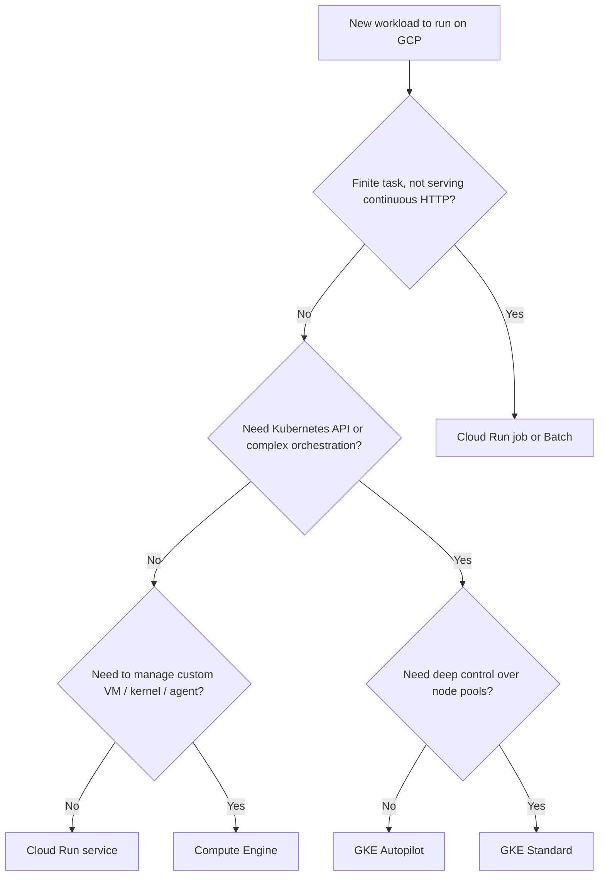
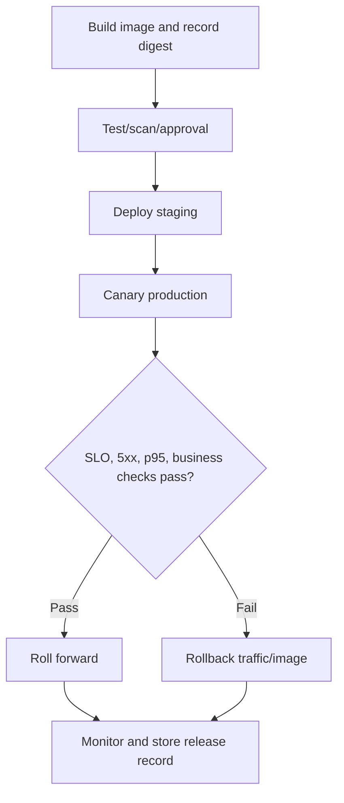

# Organizing Container Workloads in the GCP Ecosystem

> **Chapter:** Containers and Artifact Registry  
> **Module:** CLOUD_PROVIDERS_GCP  
> **Module scope:** Explore Google Cloud from project organization, IAM, and VPC to Compute Engine, GKE, Cloud Run, storage services, and databases. Through deployment scenarios, learners learn how to choose services, protect resources, automate releases, and monitor reliability and cost.

Containers package an application and the components needed to run it into an **image** that can be distributed across multiple environments. On Google Cloud, images are stored in **Artifact Registry**, can be built with **Cloud Build** or other CI tools, and then run on **Cloud Run**, **Google Kubernetes Engine (GKE)**, Compute Engine, or appropriate batch processing services. Each service addresses a different level of infrastructure management, workload lifespan, and networking requirements.

A successful container architecture does not stop at the `docker build` command. The development team needs to answer: **which image is a trusted release**, **who is allowed to build and deploy**, **which identity the workload runs under**, **where the service receives requests from**, **whether data persists across container replacements**, and **how to observe, update, and roll back at a reasonable cost**.

This lesson builds a comprehensive big picture, then walks through a hands-on workflow of **source code → Cloud Build → Artifact Registry → Cloud Run** with a small HTTP application that **requires authentication** by default to avoid accidentally exposing the service to the Internet.

## Learning Objectives

After this lesson, you will be able to:

1. Distinguish between **container image**, **container instance**, **registry**, **revision**, **pod**, **service**, and **job**.
2. Choose between **Cloud Run services/jobs**, **GKE Autopilot/Standard**, **Compute Engine running containers**, and **Google Cloud Batch** based on actual requirements.
3. Explain the role of Artifact Registry, Cloud Build, image tag/digest, repository location, and promotion across environments.
4. Design IAM boundaries for the **build identity**, **deployment identity**, **runtime identity**, and service-calling clients.
5. Identify ingress, egress, VPC, DNS, load balancing, secrets, configuration, and data storage for container workloads.
6. Deploy a Cloud Run service from an image in Artifact Registry using verifiable steps and clean up resources properly.
7. Establish a safe release mindset: immutable versions, health/readiness, rollout, monitoring, rollback, and cost optimization.

## 1. Foundational Concepts

### 1.1. A Container Image Is Different from a Running Container

An **image** is a content-immutable package containing filesystem layers, metadata, programs, and startup instructions. A **container** is a running execution of an image with a process, a temporary writable filesystem, environment variables, and allocated CPU/memory resources.

```text
Source code + Dockerfile
       │
       ▼
OCI/Docker image  ──push──>  Artifact Registry
       │                          │
       │                          └── image:tag or image@sha256:digest
       ▼
Cloud Run revision / GKE Pod / VM container
       │
       ├── Application process
       ├── Runtime environment variables and secrets
       ├── CPU, memory, network
       └── Temporary writable filesystem (do not treat as a database)
```

**An image is not a VM image.** A container image typically contains the application and the required user-space components, but uses the kernel provided by the runtime environment. A Compute Engine VM image describes the operating system disk for a virtual machine. Both can be versioned, but their execution mechanisms and operational responsibilities differ.

### 1.2. Easily Confused Terms

| Term | Meaning | Example |
|---|---|---|
| **Repository** | Place that manages artifacts/images by format | Docker repository `services-dev` in Artifact Registry |
| **Image path** | Image identifier inside a repository | `asia-southeast1-docker.pkg.dev/PROJECT/services-dev/hello-api` |
| **Tag** | Mutable label pointing to an image digest | `:v1.0.0`, `:commit-abc123`, `:latest` |
| **Digest** | Content-based identifier of an image | `@sha256:...` |
| **Cloud Run service** | Managed HTTP service with revisions and scaling capabilities | `hello-api` |
| **Cloud Run job** | Runs a task to completion and exits; does not continuously serve HTTP | Daily report processing |
| **Kubernetes Pod** | Unit running one or more containers sharing network/lifecycle | Application Pod in GKE |
| **Kubernetes Deployment** | Controls the number of replicas and Pod rollouts | Deployment `web-api` |
| **Kubernetes Service** | Stable endpoint/virtual address reaching a set of Pods via selector | `web-api.default.svc.cluster.local` |
| **Compute Engine VM** | Virtual machine managed by the operations team | VM running a custom container runtime/agent |

The name **"service"** in Cloud Run and Kubernetes Service does not have the same semantics. A Cloud Run service is the deployment unit for an HTTP application with revisions; a Kubernetes Service is a stable networking mechanism for reaching Pods.

### 1.3. Stateless and Stateful

A container should be treated as **replaceable** at any time when the runtime scales, recovers from errors, or deploys a new revision. Data that needs to persist long-term must be managed separately from the container's temporary filesystem.

- **Stateless:** HTTP APIs, web frontends, idempotent workers, consumers with external checkpoints.
- **Stateful:** databases, systems requiring durable disks and specific startup/recovery ordering.
- **Shared data:** Cloud Storage (object), Cloud SQL/AlloyDB (relational), Memorystore (cache), Pub/Sub (messaging), Filestore/NFS, or Persistent Disk via supported solutions.

**Note:** Cloud Run supports certain volume/in-memory mounting mechanisms and data connection options depending on supported features, but it does not by default turn the writable container filesystem into a durable disk. In GKE, PersistentVolume/PersistentVolumeClaim along with CSI drivers are used when storage tied to workload lifecycle is needed, subject to zone, access mode, and disk type constraints.

## 2. Container Service Landscape on Google Cloud

No single container-running service fits every type of workload. The main differences are **who manages the servers**, **whether the application serves requests or runs tasks**, **the level of system control**, and **the scaling/cost model**.

| Service | Best suited for | Managed by Google Cloud | Application team remains responsible for |
|---|---|---|---|
| **Cloud Run services** | HTTP APIs, webhooks, request-driven backends, microservices without needing node control | Container runtime infrastructure, revisions, load-based scaling | Image, IAM/ingress, app health, data, cost |
| **Cloud Run jobs** | Finite batch jobs, cron, migrations, or batch file processing | Task execution, retries/parallelism per configuration | Idempotency, job deadlines, inputs/outputs, permissions |
| **GKE Autopilot** | Applications needing Kubernetes API, multiple services/Pods, policy/orchestration | Most node operations and provisioning under the Autopilot model | Kubernetes objects, images, security, resources, app SLOs |
| **GKE Standard** | Need control over node pools, machine types, daemons/drivers, and deep configuration | Control plane under the GKE model | Node pools, capacity, upgrades, workload configuration, and applications |
| **Compute Engine + container runtime** | Specific OS/VM dependencies, legacy agents, special custom modes | VM infrastructure | OS patching, runtime, scheduling, HA, rollout, and scaling |
| **Google Cloud Batch** | Multi-task batch, HPC, or data processing with specific machine/queue requirements | Orchestrating batch jobs onto Compute Engine resources | Task code/images, resource limits, outputs, and retries |

In addition, **Cloud Run functions** (the functions model) serve small event-driven needs and are also part of Google Cloud's modern runtime/build ecosystem. Distinguish between the need to **write a function** and the need to **manage a service/container image**; deployment limits and triggers may differ for each product.

### 2.1. Quick Decision Tree



The tree above is a **reference framework**, not a mandatory rule. For example, an application running batch tasks might fit GKE Jobs if the entire enterprise has already built a Kubernetes platform, or fit Cloud Run jobs when prioritizing reduced operational overhead. Governance rights, supported regions, compliance, and technical limits can change the choice.

### 2.2. Cloud Run Services

A Cloud Run service receives HTTP/HTTPS traffic via a managed endpoint and has the concept of a **revision**. When deploying a changed image or configuration, the service creates a new revision; you can split traffic across revisions, roll back to an older revision, and customize parameters such as concurrency and min/max instances within service limits.

The application typically must **listen on `0.0.0.0` and the port provided by the `PORT` environment variable**. A containerized service does not necessarily need a separate load balancer to have a managed HTTPS URL; an ALB is needed when there are specific requirements such as centralized host/path routing, policies, or multi-backend architectures.

### 2.3. Cloud Run Jobs

A Cloud Run job **does not provide a continuous HTTP endpoint like a service**. You trigger an execution and can configure task count, parallelism, and retries based on the workload type. Jobs fit finite tasks, such as nightly report aggregation or processing data received from Cloud Storage.

Jobs must support **safe re-execution**: a task may be retried if it fails. Do not assume "run once" guarantees side effects happen strictly once; use idempotency keys, checkpoints, and transactions when interacting with data.

### 2.4. GKE Autopilot and Standard

GKE uses Kubernetes: Deployment, Service, Ingress/Gateway, ConfigMap, Secret, HorizontalPodAutoscaler, StatefulSet, CronJob, and other components. **Autopilot** reduces node operational responsibility and includes its own resource and security limits/controls. **Standard** allows tuning node pools and more system options, in exchange for more management work.

Do not choose GKE solely because an application is packaged as a container. If the requirement is simply a stateless HTTP API, Cloud Run can significantly reduce operational effort.

## 3. Path from Source Code to Running Workload

```mermaid
flowchart LR
    S[Source code + Dockerfile]
    CI[Cloud Build / CI]
    REG[Artifact Registry]
    SEC[Scan / policy / approval]
    DEP[Deployment pipeline]
    RUN[Cloud Run or GKE or VM]
    OBS[Cloud Logging + Monitoring]
    S --> CI
    CI -->|Build image| REG
    REG --> SEC
    SEC --> DEP
    DEP -->|Image digest| RUN
    RUN --> OBS
```



This chain consists of four boundaries that must be managed separately:

1. **Trusted source:** code, dependencies, and Dockerfile are reviewed; CI does not use secrets indiscriminately.
2. **Trusted artifact:** images are stored in a repository with appropriate IAM and retention policies, and can attach build provenance/attestations.
3. **Deployment unit:** Cloud Run revision, GKE Deployment/Pod, or VM running the selected image.
4. **Runtime trust:** the workload uses the right service account, network policy, secrets, and monitoring system.

**One image can run in many places**, but YAML manifests, service accounts, storage volumes, ports, and networking for Cloud Run/GKE/VMs are **not automatically interchangeable**.

## 4. Artifact Registry: Organizing and Distributing Images

**Artifact Registry** manages multiple artifact types; for containers, you use a **Docker-format repository** and URLs of the form:

```text
LOCATION-docker.pkg.dev/PROJECT_ID/REPOSITORY/IMAGE:TAG
LOCATION-docker.pkg.dev/PROJECT_ID/REPOSITORY/IMAGE@sha256:DIGEST
```

Illustrative example:

```text
asia-southeast1-docker.pkg.dev/demo-apps/services-dev/hello-api:lab-v1
```

Where:

- `asia-southeast1`: repository location, which must be supported and match workload location, latency, and data residency requirements.
- `demo-apps`: project owning the Artifact Registry repository.
- `services-dev`: Docker repository; IAM and cleanup policies can be managed at the repository scope.
- `hello-api`: image name inside the repository.
- `lab-v1`: tag. Tags help humans identify releases but **can be repointed** to a different digest.

### 4.1. Tags and Digests Are Not the Same

| Reference | Advantages | Risks/Limitations |
|---|---|---|
| `:latest` | Short, convenient for local testing | Ambiguous, mutable; hard to audit/roll back |
| `:v1.4.2` | Human-readable version | Tag can still be overwritten without controls |
| `:commit-a1b2c3d` | Traceable back to commit | Requires clear CI-to-commit binding; tag is still mutable |
| `@sha256:...` | Bound to the built image contents, enabling reproducible deployments | Less readable; requires release metadata to know which version a digest belongs to |

**Production deployment recommendation:** record both the **release version/commit** and the **image digest** in manifests/IaC or release records. Never assume that every use of a tag will always run the exact same bytes.

### 4.2. Repository Location, Permissions, and Lifecycle

When creating a repository, you need to decide:

- **Region or multi-region:** close to Cloud Run/GKE/CI and meeting data residency requirements, reducing the risk of unintended cross-region data transfer.
- **Scope by environment:** one or multiple repositories for `dev`, `staging`, `prod` depending on IAM isolation needs.
- **Who can push/pull/delete:** use Artifact Registry Reader/Writer/Repo Admin roles at the proper scope; do not grant admin permissions to a runtime just to pull images.
- **Retention/cleanup policies:** retain images still used by deployments, rollback candidates, and audit evidence; clean up unneeded images according to process.
- **Vulnerability scanning:** consider Artifact Analysis and supported scanning features, which may incur costs and require enabling/configuration.

**Do not automatically delete old digests** simply because a new image built successfully. A Cloud Run revision or GKE release may need that digest for recovery or scaling back out; retention must account for the rollback window.

### 4.3. Comparing Artifact Registry with Container Registry

Artifact Registry is the recommended repository service for modern artifact workflows on GCP. Systems that previously used Container Registry (`gcr.io`) need to understand the migration path and **where the repository actually stores images**. Do not assume every `gcr.io` URL shares the same IAM, networking, or features as a newly created `pkg.dev` repository.

## 5. Building Images: Dockerfile, Cloud Build, and CI

### 5.1. The Dockerfile Is the Build Contract

The Dockerfile specifies the base image, files included, dependency installation steps, and command to run the application. A good Dockerfile typically:

- Uses a trusted base image with controlled versions, ideally pinned by **digest** in production.
- Does not add `.env`, JSON private keys, tokens, or internal data into image layers.
- Keeps the image small, removing build tools if not needed at runtime; considers multi-stage builds.
- Runs as a **non-root user** when supported by the image and platform.
- Uses reproducible builds with pinned dependency versions and scanning capability.
- Distinguishes **build-time arguments** from **runtime environment/secrets**; neither is a place to store passwords carelessly.

### 5.2. Cloud Build and the Image Registry

Cloud Build can run a build from source, execute build steps, and push images to Artifact Registry. Other CI platforms can also build/push if using appropriate identities and permissions. Using Cloud Build for every container is not mandatory.

**Permissions note:** the identity **Cloud Build actually uses** may vary between older/newer projects and trigger/organization configurations. Do not assume a default service account address always exists and has Editor/Writer permissions. Before building, identify the build service account or specify an appropriate service account per policy, then grant **Artifact Registry Writer on the repository** to that exact build identity.

If building from GitHub/GitLab or CI outside Google Cloud, prefer **Workload Identity Federation** or supported short-lived credential mechanisms rather than creating static JSON private keys and storing them in CI variables.

### 5.3. Releasing by Digest, Not Only by Tag

Safe workflow:

1. Each build attaches a tag containing the **commit SHA or release ID**.
2. CI runs tests, dependency scans, image vulnerability checks, and required policy checks.
3. CI records the **actual digest** stored by Artifact Registry.
4. Deploy to staging by digest; run integration tests and observe.
5. Promote the **same verified digest** to production following the team's process; if the image must be copied to another repository, track the corresponding digest/manifest.
6. Store release metadata including commit, digest, runtime config, SA, and timestamp.

Do not rebuild from the same source and assume the image digest will be identical: base images, dependencies, timestamps, or toolchains can produce different results.

## 6. Designing Project, Environment, and Service Group Boundaries

Container workloads must sit within a **governable structure**, not an ad-hoc list of randomly named images and services.

```text
Organization / Folder
└── Application group
    ├── Dev project
    │   ├── Artifact Registry: services-dev
    │   ├── Cloud Run/GKE: api-dev, worker-dev
    │   └── SA: api-dev-runtime
    ├── Staging project
    │   ├── Artifact Registry or pull permission from central repo
    │   ├── Cloud Run/GKE: api-staging
    │   └── SA: api-staging-runtime
    └── Prod project
        ├── Controlled repository or pull via cross-project IAM
        ├── Cloud Run/GKE: api-prod
        └── SA: api-prod-runtime
```

Organizational decisions:

| Governance axis | Question to answer | Recommendation |
|---|---|---|
| **Project boundary** | Should dev be allowed to read prod data? | Separate environments and IAM/billing where needed |
| **Repository** | Where are builds run, who can push/pull? | Separate build identity from runtime; apply repository IAM |
| **Naming/labels** | Who owns the image, service, and cost? | Include owner, application, environment, version |
| **Artifact promotion** | Is prod running the exact tested build? | Record digest, approvals, and release record |
| **Deployment config** | Which parameters differ across environments? | Separate IaC/manifests, never hard-code secrets |
| **Runtime SA** | Which resources can the workload access? | One SA per application/environment, least privilege |
| **Network** | Which clients can connect in, where can the workload call out? | Ingress, egress, VPC, DNS, private service |
| **Observability** | How to correlate requests to revision/digest? | Logs/metrics/traces with version and service labels |

**A central repository** can work well if the organization governs images centrally; **multiple per-environment repositories** fit when different read/write policies, retention, and approvals are required. There is no single mandatory way to split projects/repos for every enterprise.

## 7. IAM and Identities: Build, Deploy, Runtime, and Caller

A common mistake is using **one overly powerful service account** for every step: build, push, deploy, and database access. If the build step or runtime is compromised, the blast radius becomes large.

### 7.1. Four Distinct Identity Roles

| Identity | What does it do? | Roles/permissions to consider |
|---|---|---|
| **Build identity** | Fetches source, builds image, pushes to repository | Artifact Registry Writer on the repo, required build/log/storage permissions |
| **Deployment identity** | Creates/updates Cloud Run services or Kubernetes objects | Cloud Run Developer/Admin as needed; `actAs` permission on the runtime SA; GKE/Kubernetes deploy permissions |
| **Runtime identity** | Container calls Cloud Storage, Cloud SQL, Pub/Sub, Secret Manager | Only required roles on the **target resources**, never default Writer/Owner |
| **Caller identity** | Client invokes a Cloud Run/private API endpoint | `roles/run.invoker` or application authentication and network connectivity by design |

**The deployer's IAM permissions do not automatically transfer to runtime.** Conversely, the service account attached to a Cloud Run revision should not have write permissions to the repository just so the service can read images.

### 7.2. Pulling Images from Artifact Registry

Within the same project, Cloud Run/GKE have their own **service agents, node identities, and pull mechanisms**. For a repository in a **different project**, you typically need to grant **Artifact Registry Reader** to the exact identity the service uses to pull images.

Architecture example:

```text
CI project: ci-project
  Build SA -> push -> Artifact Registry repo (artifacts-project)

Runtime project: prod-project
  Cloud Run service agent or GKE pull identity
       -> read image from Artifact Registry
  App runtime SA
       -> accesses only Cloud SQL / Secret Manager / Pub/Sub as needed
```

Do not grant Artifact Registry Reader to a random guessed principal when a pull fails. Read the error, identify the **repo project**, the **actual service agent or node identity**, repository permissions, and organizational policies governing image usage.

### 7.3. GKE Workload Identity Federation

In GKE, workloads should use **Workload Identity Federation for GKE** to authenticate to Google Cloud APIs, instead of mounting long-lived JSON keys into Pods.

- A Kubernetes service account (KSA) identifies the workload inside the cluster.
- IAM allows a KSA/workload principal to access approved Google Cloud resources, or uses a service account impersonation model by design.
- **The node service account** is not always the identity of the application inside the Pod; do not use a privileged node SA in place of per-workload identity.

Exact configuration differs across Autopilot/Standard, namespaces, cluster workload pools, and binding modes. In production, follow current examples from the official documentation and verify KSA/permissions in the right namespace.

## 8. Networking: Ingress, Egress, VPC, and DNS

A container can run successfully yet remain unreachable by clients if networking or IAM is misconfigured. Distinguish between **ingress** (incoming requests) and **egress** (outbound calls from the workload).

### 8.1. Cloud Run Ingress

Cloud Run lets you configure **ingress settings** such as accepting traffic from all sources, internal only, or internal and Cloud Load Balancing per supported options. Alongside ingress, **Cloud Run IAM** determines whether the endpoint allows unauthenticated callers.

- **Ingress=all** does not mean the service must be open to anonymous users; the service can still require IAM authentication.
- **Allow unauthenticated** is a decision to allow unauthenticated invocations; it requires explicit approval when a public endpoint is genuinely intended.
- **Ingress=internal** does not simply mean "same project only"; allowed paths depend on Cloud Run and organization rules, VPC, and connected networks.
- For public domains, Cloud Run provides a default URL and supports attaching custom domains/load balancers. Choose based on certificate, URL routing, and security policy requirements.

### 8.2. Cloud Run Egress to Private Resources

When Cloud Run needs to call a service with a private IP inside a VPC, choose **Direct VPC egress** or a **Serverless VPC Access connector** depending on environment support. Decisions include:

- Which VPC/subnet contains or has routes to the target resource.
- Whether to route only **private ranges** through the VPC or all traffic as required.
- Firewall/network policies and routes to the destination.
- NAT/Internet egress when traffic is routed through the VPC, along with associated costs.
- Whether private DNS (Cloud DNS private zones/forwarding) resolves from the right source.

**Attaching a service account with Cloud SQL access permissions does not automatically create a network path to the database**, just as having VPC egress does not automatically grant IAM or database credentials.

### 8.3. GKE Networking

GKE places Pods within the cluster/VPC network according to the supported IP allocation mode. Components include:

- **Kubernetes Service:** stable internal access address to Pods.
- **Ingress/Gateway + load balancing:** receives HTTP(S) requests externally or internally depending on configuration.
- **NetworkPolicy or supported network policy mechanisms:** restricts communication between workloads.
- **Cloud DNS/Kubernetes DNS:** resolves service names and external names outside the cluster.
- **Private cluster/NAT/Private Google Access:** controls paths to Google APIs, container registries, and the Internet based on deployment topology.

Do not equate a **Kubernetes namespace** with a **VPC network**. Namespaces help organize Kubernetes objects and RBAC; they **do not create a complete network boundary** on their own without network policies and other protective mechanisms.

## 9. Configuration, Secrets, and Persistent Data

### 9.1. Separating Config from the Image

The same digest can run in dev/staging/prod with:

- Non-sensitive environment variables: `LOG_LEVEL`, `FEATURE_FLAG`.
- System configuration via Cloud Run/GKE or appropriate config management.
- **Secret Manager** for API keys, passwords/credentials that the application must use.
- Identity-based access to avoid hard-coded keys whenever SDKs can use ADC/Workload Identity Federation.

**Never place secrets in `Dockerfile ENV`, image layers, build arguments, Git, or CI logs.** With Secret Manager, the runtime SA should only be granted `secretmanager.versions.access` via an appropriate role on the **specific secret**. Mounting/reading secrets, secret versions, and rotation handling must be designed per runtime.

### 9.2. State Does Not Follow Revisions

| Data type | Better option than the container filesystem |
|---|---|
| Shared session/short-lived cache | Memorystore or a supported store |
| File uploads | Cloud Storage |
| Transactional SQL | Cloud SQL or AlloyDB as required |
| Messages/events to process | Pub/Sub, Eventarc, or an appropriate queue |
| Persistent block storage for Pods | GKE PersistentVolume + CSI driver / compatible disk |
| Shared POSIX file system | Filestore or a runtime-supported volume |

With Cloud Run, processes can be stopped or scaled to 0; **temporary files inside the container are not a place to store business data**. With GKE, when a Pod is rescheduled, data in the container filesystem is not treated as a persistent volume unless explicitly configured.

### 9.3. Health and Graceful Shutdown

Applications should:

1. Expose a meaningful **readiness/startup** endpoint or check mechanism, if supported by the runtime.
2. Handle **SIGTERM** within the platform's timeout window: stop accepting new work, flush logs/checkpoints, and close connections.
3. Avoid creating duplicate side effects when requests/jobs are retried.
4. Read the `PORT` environment variable when running as a Cloud Run service.
5. Ensure database migration logic is compatible with both old and new revisions during rollouts.

Do not treat "container process RUNNING" as proof that all dependencies are ready.

## 10. Software Supply Chain Security

A container image is part of the **software supply chain**. An image can contain outdated dependencies, unnecessary packages, suspicious executables, or secrets accidentally copied into a layer.

### 10.1. Layers of Control

| Layer | Control examples | Risk reduced |
|---|---|---|
| Source | Code review, branch protection, secret scanning | Malicious code or credential exposure |
| Dependencies | Pin versions/digests, lock files, SBOM | Uncontrolled dependency changes |
| Build | Dedicated CI identity, build logs/provenance | Unauditable or overprivileged pipelines |
| Artifact Registry | Separate Reader/Writer IAM, retention | Unauthorized push/pull/delete of images |
| Image | Vulnerability scanning via Artifact Analysis per configuration | Dependencies/OS packages with known CVEs |
| Deploy | Approval, image digest, Binary Authorization if supported by platform | Unverified images running in prod |
| Runtime | Least privilege, sandboxing, network restrictions, secret management | Larger blast radius if app is exploited |
| Observability | Logs, tracing, alerts, audits | Undetected changes or failures |

**A vulnerability scan does not mean an image is completely safe.** CVE databases have lag, do not catch every logic bug in proprietary code, and produce false positives. Scanning results must be triaged based on actual impact.

### 10.2. Root Inside a Container Is Not Host Root — But Still a Risk

Container isolation does not replace IAM, network boundaries, or runtime hardening. An image running as root can increase impact if an application vulnerability grants access to the filesystem or runtime capabilities. Use a non-root user, drop Linux capabilities, restrict writable paths, and configure security contexts as supported by the platform.

In GKE, consider Pod Security Admission, Workload Identity Federation, NetworkPolicy, namespaces/RBAC, and keeping node images updated. In Cloud Run, most host isolation is managed by the platform, but **application code, dependencies, and runtime identity** remain the deployment team's responsibility.

## 11. Hands-on Lab: Cloud Build → Artifact Registry → Cloud Run

**Lab objective:** build a small HTTP container, store the image in Artifact Registry, deploy it as a Cloud Run service **requiring authentication**, test calling the service, and properly clean up lab resources. No GKE cluster is created, keeping costs and operational scope smaller.

**Constraints:** the `gcloud` commands below are examples **to be executed only when the learner actively runs them** in a sandbox project. This article does not create GCP resources. Enabling APIs, building, storing images, and deploying services can incur charges; Cloud Run/Cloud Build/Artifact Registry have conditional free tiers or credits, but **should not be assumed to be free**.

### 11.1. Lab Parameters

| Variable | Example value | Role |
|---|---|---|
| `PROJECT_ID` | `my-gcp-containers-lab` | Authorized practice project |
| `REGION` | `asia-southeast1` | Region for Artifact Registry and Cloud Run |
| `REPO` | `containers-lab` | Dedicated Docker-format repository |
| `IMAGE_NAME` | `hello-api` | Image inside the repository |
| `IMAGE_TAG` | `lab-v1` | Lab tag, replaceable with a commit SHA |
| `RUN_SERVICE` | `hello-api-lab` | Cloud Run service |
| `RUNTIME_SA_NAME` | `hello-api-runtime` | Least-privilege runtime SA |

**Preflight:** verify the actual project, supported region, IAM permissions, quotas, billing, existing resources, and who is responsible for cleanup. Do not use example names to overwrite or delete someone else's existing service.

### 11.2. Check the Environment Before Creating Resources

Run in **Cloud Shell (Bash)** or a terminal with gcloud:

```bash
PROJECT_ID="my-gcp-containers-lab"
REGION="asia-southeast1"
REPO="containers-lab"
IMAGE_NAME="hello-api"
IMAGE_TAG="lab-v1"
RUN_SERVICE="hello-api-lab"
RUNTIME_SA_NAME="hello-api-runtime"
RUNTIME_SA="$RUNTIME_SA_NAME@$PROJECT_ID.iam.gserviceaccount.com"
IMAGE_URI="$REGION-docker.pkg.dev/$PROJECT_ID/$REPO/$IMAGE_NAME:$IMAGE_TAG"

# Read-only checks: identity, project, repositories, and Cloud Run services
gcloud auth list --filter="status:ACTIVE"
gcloud projects describe "$PROJECT_ID" \
  --format="table(projectId,name,lifecycleState)"
gcloud artifacts repositories list --project="$PROJECT_ID"
gcloud run services list --project="$PROJECT_ID" --region="$REGION"
gcloud iam service-accounts list --project="$PROJECT_ID"
```

If you lack permission to list resources or APIs are not enabled, **stop creation steps** and verify IAM/admin permissions. Do not escalate yourself to Owner/Editor to bypass errors.

### 11.3. Permissions to Prepare

Separate the principals:

1. **Project/repository administrator:** permitted to enable APIs and create repositories.
2. **Cloud Build service account:** permitted to run builds, write required logs/artifacts, and **`roles/artifactregistry.writer` on the repository**.
3. **Deployer:** permitted to deploy Cloud Run, **`iam.serviceAccounts.actAs`** on the runtime SA, and appropriate image read permissions.
4. **Runtime SA:** in this lab the application does not access other Google Cloud APIs, so **do not grant editor, storage admin, or Artifact Registry Writer**.
5. **Service tester:** needs `roles/run.invoker` if the service requires authentication.

The default Cloud Build identity **depends on project/organization configuration**. Before running `gcloud builds submit`, verify the actual build SA and required logging setup; projects with custom build SA policies may require specifying `--service-account`, bucket/log configuration, or triggers.

### 11.4. Enable Required APIs (If Permitted)

```bash
# Enable in the proper sandbox project when authorized by the project owner
gcloud services enable \
  artifactregistry.googleapis.com \
  cloudbuild.googleapis.com \
  run.googleapis.com \
  iam.googleapis.com \
  --project="$PROJECT_ID"
```

This is a project-mutating operation. Enabling APIs and execution permissions must comply with organizational policies.

### 11.5. Create a Docker Repository

```bash
# Create only if the repository does not yet exist and creation is allowed in this region
gcloud artifacts repositories create "$REPO" \
  --repository-format=docker \
  --location="$REGION" \
  --description="Container learning lab" \
  --project="$PROJECT_ID"

gcloud artifacts repositories describe "$REPO" \
  --location="$REGION" \
  --project="$PROJECT_ID"
```

When you want to scope the build identity, a repository administrator can grant permissions as shown below, **only after confirming the exact build SA**:

```bash
# Fill in the ACTUAL SA email running Cloud Build, do not guess from project number
BUILD_SA="build-worker@my-gcp-containers-lab.iam.gserviceaccount.com"

gcloud artifacts repositories add-iam-policy-binding "$REPO" \
  --location="$REGION" \
  --member="serviceAccount:$BUILD_SA" \
  --role="roles/artifactregistry.writer" \
  --project="$PROJECT_ID"
```

If the build SA already has Writer permission on the repository under an approved policy, do not create duplicate bindings. Granting permissions requires appropriate IAM admin rights; **do not grant the Writer role to the Cloud Run runtime SA**.

### 11.6. Write a Minimal HTTP Application

In a **separate lab directory on your development machine/Cloud Shell**, create the following three sample files. They are presented in the lesson, not files created inside the learning-material repository.

**`app.py`**

```python
from http.server import BaseHTTPRequestHandler, ThreadingHTTPServer
import os


class Handler(BaseHTTPRequestHandler):
    def do_GET(self):
        if self.path not in ("/", "/healthz"):
            self.send_error(404, "Not found")
            return

        body = b"hello from cloud run - lab-v1\n"
        self.send_response(200)
        self.send_header("Content-Type", "text/plain; charset=utf-8")
        self.send_header("Content-Length", str(len(body)))
        self.end_headers()
        self.wfile.write(body)


if __name__ == "__main__":
    port = int(os.environ.get("PORT", "8080"))
    ThreadingHTTPServer(("0.0.0.0", port), Handler).serve_forever()
```

**`Dockerfile`**

```dockerfile
FROM python:3.12-slim
WORKDIR /app
COPY app.py /app/app.py
ENV PYTHONDONTWRITEBYTECODE=1 \
    PYTHONUNBUFFERED=1
USER 65532:65532
EXPOSE 8080
CMD ["python", "/app/app.py"]
```

**`.dockerignore`** (minimal example)

```text
.git
.env
*.json.key
__pycache__
*.pyc
.venv
venv
```

The application reads `PORT` and listens on `0.0.0.0` as required by Cloud Run. It stores no data and calls no other APIs, making it suitable for a runtime SA with **no application roles** in the lab.

In production, pin the **base image by digest**, use dependency pinning, scan images, and automate patching. Besides `.dockerignore`, when using `gcloud builds submit`, check **`.gcloudignore`** or the list of files uploaded as source; do not treat `.dockerignore` as the sole mechanism protecting secrets from the build context.

### 11.7. Build and Push the Image Using Cloud Build

Run inside the directory containing `app.py` and `Dockerfile`:

```bash
# Image name was set in step 11.2
printf 'Building: %s\n' "$IMAGE_URI"

# Cloud Build builds from the Dockerfile and pushes the image to Artifact Registry
gcloud builds submit . \
  --tag="$IMAGE_URI" \
  --project="$PROJECT_ID"
```

If you get a `PERMISSION_DENIED` error:

- Check the **build-executing principal** and Artifact Registry Writer on the repo.
- Check APIs, quotas, org policies, logging/bucket settings, and service account permissions.
- Do not assign Owner/Editor to the build SA just to "make it work."

After building, inspect the image in the repository:

```bash
gcloud artifacts docker images list \
  "$REGION-docker.pkg.dev/$PROJECT_ID/$REPO" \
  --project="$PROJECT_ID" \
  --include-tags
```

**Expected result:** the repository contains image `hello-api` with tag `lab-v1` and a **digest**. Record the real digest in your lab results; do not fabricate a fake SHA-256 string. Use that digest in important releases.

### 11.8. Create a Dedicated Runtime Service Account

With permission to create SAs in the sandbox project:

```bash
gcloud iam service-accounts create "$RUNTIME_SA_NAME" \
  --display-name="Runtime identity for hello-api lab" \
  --project="$PROJECT_ID"

gcloud iam service-accounts describe "$RUNTIME_SA" \
  --project="$PROJECT_ID" \
  --format="yaml(email,displayName,disabled)"
```

**Do not grant broad roles** to an SA just for a container that returns "hello". If the image resides in another project, configure permissions for the proper **pull identity** per Cloud Run cross-project Artifact Registry documentation; do not conflate that with the permissions of the runtime SA while the application runs.

### 11.9. Deploy a Cloud Run Service Requiring Authentication

```bash
# Deploy only if the lab service does not exist yet or you are the owner authorized to update it
gcloud run deploy "$RUN_SERVICE" \
  --image="$IMAGE_URI" \
  --region="$REGION" \
  --project="$PROJECT_ID" \
  --platform=managed \
  --service-account="$RUNTIME_SA" \
  --no-allow-unauthenticated \
  --memory=512Mi \
  --cpu=1 \
  --max-instances=2 \
  --min-instances=0

# Read back URL, revision, and service configuration
gcloud run services describe "$RUN_SERVICE" \
  --region="$REGION" \
  --project="$PROJECT_ID" \
  --format="yaml(metadata.name,status.url,status.latestReadyRevisionName,spec.template)"
```

**Explanation:**

- `--image` is the pushed image. In production, prefer referencing **`@sha256:digest`** after verification.
- `--service-account` selects the **runtime SA** the application will use.
- `--no-allow-unauthenticated` keeps the service requiring IAM authentication; do not grant `allUsers` as Invoker.
- `--min-instances=0` allows scaling to zero when appropriate; requests after idle periods may incur a cold start.
- `--max-instances=2` caps instance count, though it can also cause throttling/rejections when capacity is exceeded; it is not an absolute cost-control mechanism.
- CPU, memory, concurrency, and scaling limits should be tuned based on real traffic, quotas, and application capacity.

**Important:** to deploy successfully, the operator needs Cloud Run deploy permissions and `actAs` on the runtime SA. Do not substitute a default SA with Editor permissions to bypass IAM errors.

### 11.10. Test Calling the Authenticated Service

The tester needs `roles/run.invoker` appropriately granted on the service; the service is designed **not to allow anonymous calls**. A convenient approach for an authorized user is running a proxy via gcloud.

In terminal A:

```bash
gcloud run services proxy "$RUN_SERVICE" \
  --region="$REGION" \
  --project="$PROJECT_ID" \
  --port=8080
```

In terminal B **in the same environment**, once the proxy is ready:

```bash
curl --fail --silent --show-error http://127.0.0.1:8080/
curl --fail --silent --show-error http://127.0.0.1:8080/healthz
```

If you receive `403 Forbidden`, verify Invoker IAM and the caller identity. Do not enable unauthenticated access to the entire Internet just to test a response. When the proxy cannot be used, an authorized caller can obtain an appropriate ID token and invoke the Cloud Run URL following the product's authenticated request instructions.

**Expected result:** the response contains `hello from cloud run - lab-v1`. If the URL returns `404` on other paths, that is the example application's behavior, not necessarily a deployment failure.

## 12. When to Deploy the Same Image to GKE?

When an application grows into multiple services requiring Kubernetes primitives such as namespaces/RBAC, Job/CronJob, sidecars, StatefulSet, custom scheduling, or multi-service ingress, GKE may be appropriate.

Example of an **illustrative Deployment manifest**, not a complete production configuration:

```yaml
apiVersion: apps/v1
kind: Deployment
metadata:
  name: hello-api
  labels:
    app: hello-api
spec:
  replicas: 2
  selector:
    matchLabels:
      app: hello-api
  template:
    metadata:
      labels:
        app: hello-api
    spec:
      serviceAccountName: hello-api
      containers:
        - name: http-server
          image: asia-southeast1-docker.pkg.dev/PROJECT_ID/REPO/hello-api@sha256:IMAGE_DIGEST
          ports:
            - containerPort: 8080
          resources:
            requests:
              cpu: "100m"
              memory: "128Mi"
            limits:
              memory: "512Mi"
          readinessProbe:
            httpGet:
              path: /healthz
              port: 8080
            initialDelaySeconds: 2
            periodSeconds: 5
```

**The placeholders `PROJECT_ID`, `REPO`, and `IMAGE_DIGEST` must be replaced with real values.** The manifest also requires a Kubernetes service account named `hello-api` already created in the namespace and cluster permissions to pull from Artifact Registry. Do not copy-paste into production without evaluating securityContext, image architecture, resource limits, liveness/startup probes, network policies, and how the application performs graceful shutdown.

**Separate Service/Ingress:** the Deployment above only creates Pods. For clients to reach it via a Kubernetes Service endpoint or an HTTP(S) Load Balancer, configure an appropriate Kubernetes Service and Gateway/Ingress. Do not mistake a Deployment with `replicas: 2` for an automatically provisioned ALB or DNS name.

### 12.1. Cloud Run Revisions vs. GKE Rollouts

| Criterion | Cloud Run | GKE |
|---|---|---|
| Version unit | Service revision | Deployment revision/ReplicaSet and image in Pod template |
| Traffic splitting | Can allocate percentages across revisions | Typically via Gateway/service mesh or service/backend organization |
| Liveness/startup/readiness | Per Cloud Run supported probes and mechanisms | Kubernetes probes inside the Pod |
| Scaling | Based on requests/instance concurrency and Cloud Run config | HPA, node autoscaling, and related controllers |
| Rollback | Adjust traffic/redeploy a verified revision | Rollout undo/apply previous manifest/image, along with data and dependencies |

**Rolling back a container does not roll back the database.** When v2 changes schemas or data formats, reverting to revision/image v1 may not restore behavior. Design for backward compatibility and policy-compliant backups.

## 13. Event-Driven and Batch Deployments

In a real-world platform, not every workload is an HTTP server.

### 13.1. Example: Processing New Files

```text
Cloud Storage receives object
        │
        ▼
Eventarc / supported event mechanism
        │
        ▼
Cloud Run service or workflow trigger
        │
        ├── Read object using workload identity
        ├── Process data
        └── Write output to Cloud Storage/DB
```

The application must tolerate **redelivered events** and duplicate processing. Use object generation, event ID, or idempotency keys and only write outputs when transactions succeed.

### 13.2. Example: Overnight Reporting

Use **Cloud Scheduler + Cloud Run jobs** or a supported scheduler/workflow pattern to generate nightly reports. A job can run multiple tasks in parallel; manage quotas, timeouts, retries, credentials, and checkpoints.

If a workload demands thousands of CPU cores, complex scheduling, or special GPUs/machine types, consider **Batch** or GKE/Compute Engine depending on current support. Choose a model only after comparing data volume, processing deadlines, and total cost.

## 14. Rollout, Canary, and Rollback

### 14.1. Controlled Release Workflow



With Cloud Run, you can split traffic percentages between revisions as a product feature. With GKE, a Deployment rolling update **replaces Pods gradually**, but does not by itself guarantee exact per-version request percentages. If percentage-based traffic splitting is required, design around Gateway/service mesh/load balancing or an equivalent supported mechanism.

### 14.2. Signals to Monitor

| Signal group | Examples | Decision |
|---|---|---|
| Application | HTTP 5xx, request latency p95/p99 | Halt expansion if guardrails are breached |
| Health | Startup/readiness, restarts, crash loops | Inspect image and dependencies |
| Capacity | Concurrency, max instances, CPU/memory | Adjust scaling or roll back |
| Business | Successful transaction count, data consistency | Roll back if functionally broken even if health is green |
| Security | SA permissions, image digest, scanning policy violations | Disallow non-compliant images |
| Cost | Egress, build minutes, image storage, runtime | Compare budget against actuals |

**Canarying a small number of VMs/Pods differs from canarying a small percentage of requests.** With Cloud Run revision-based routing, traffic can be measured close to the configured ratio; however, requests and business side effects must still be monitored, rather than only looking at percentage numbers in the Console.

## 15. Observability and Operations

### 15.1. Logs, Metrics, and Traces

Google Cloud provides **Cloud Logging**, **Cloud Monitoring**, and **Cloud Trace** to monitor workloads per supported configuration/features.

- **Cloud Run:** request logs and application logs, revision/instance metadata, latency, request count, error rate.
- **GKE:** workload/cluster logs, container restarts, Pod events, resource utilization, HPA, and node status.
- **Cloud Build:** build logs, build status, identity, and pushed artifacts.
- **Artifact Registry:** image metadata, IAM/audit logs, and storage costs.

For systematic debugging, logs should include **service name, environment, version/digest, request ID, or trace ID**, while **never logging secrets, access tokens, passwords, or unnecessary sensitive data**.

### 15.2. SLOs, Readiness, and Autoscaling

A service can return HTTP 200 on `/healthz` while business operations are failing. Better indicators to measure include:

1. **Availability** by ratio of valid requests.
2. **Latency** at p95/p99 for critical endpoints.
3. **Error budget** against agreed SLOs.
4. **Saturation:** CPU, memory, concurrency, queues, throttling.
5. **Dependencies:** Cloud SQL connection pools, Pub/Sub backlogs, or Cloud Storage latency.

When a service scales to zero or scales out to many instances, applications must avoid relying on local memory for user session state and must prevent database connection storms.

### 15.3. Cost Monitoring

| Component | Potential costs incurred |
|---|---|
| Artifact Registry | Image storage, data transfer, and related features |
| Cloud Build | Build compute minutes, logs/artifacts per configuration |
| Cloud Run | CPU/memory/runtime or requests per billing model, min instances, data transfer |
| GKE | Cluster management, node resources, or pod resources per mode/tier |
| Compute Engine/Batch | VMs, disks, egress, GPUs, or ancillary resources |
| Cloud Logging/Monitoring | Retention, ingestion, and observability scope per pricing |
| VPC/NAT/ALB/Cloud CDN | Network processing, egress, connectors/NAT/LB if configured |

**Budget alerts only notify; they do not automatically cap spend.** When simply getting familiar with containers, use a minimal Cloud Run lab instead of creating a multi-node GKE Standard cluster and leaving it running.

## 16. Cleaning Up Lab Resources

**Delete only the resources you created specifically in step 11.** Verify the project, region, service, repository, and SA; do not delete repositories containing other people's images, shared services, or shared SAs.

### 16.1. Inventory Before Deleting

```bash
printf 'Project=%s Region=%s Repo=%s Service=%s SA=%s\n' \
  "$PROJECT_ID" "$REGION" "$REPO" "$RUN_SERVICE" "$RUNTIME_SA"

gcloud run services describe "$RUN_SERVICE" \
  --project="$PROJECT_ID" --region="$REGION"

gcloud artifacts repositories describe "$REPO" \
  --project="$PROJECT_ID" --location="$REGION"

gcloud iam service-accounts describe "$RUNTIME_SA" \
  --project="$PROJECT_ID"
```

### 16.2. Delete the Lab-Only Cloud Run Service

```bash
# After confirming the service is not serving traffic that must be kept
gcloud run services delete "$RUN_SERVICE" \
  --region="$REGION" \
  --project="$PROJECT_ID"
```

Deleting a Cloud Run service ends the lifecycle of its revisions/instances, but **does not automatically delete images in Artifact Registry**, external application data, or Cloud Build logs. If custom domains, ALBs, event triggers, schedules, or other bindings were created for the lab, manage their lifecycles separately according to ownership.

### 16.3. Repository: Delete Only If Dedicated to the Lab

```bash
# Check whether the repository contains images/artifacts outside the lab scope
gcloud artifacts docker images list \
  "$REGION-docker.pkg.dev/$PROJECT_ID/$REPO" \
  --project="$PROJECT_ID" \
  --include-tags

# ONLY delete a lab-dedicated repository after authorization to remove all images inside
gcloud artifacts repositories delete "$REPO" \
  --location="$REGION" \
  --project="$PROJECT_ID"
```

**Deleting a repository is a destructive action** that can wipe all images in the repository and break other deployments pulling from it. If the repository is shared, do not delete it; instead work with the repository owner to clean up individual images/tags/digests per approved retention policy.

### 16.4. Service Account and IAM Bindings

Delete the lab SA only after confirming no Cloud Run service, job, GKE workload, or pipeline still uses it.

```bash
gcloud iam service-accounts delete "$RUNTIME_SA" \
  --project="$PROJECT_ID"

# Post-cleanup inventory
gcloud run services list --project="$PROJECT_ID" --region="$REGION"
gcloud artifacts repositories list --project="$PROJECT_ID"
gcloud iam service-accounts list --project="$PROJECT_ID"
```

**Do not delete the Cloud Build service agent**, the default Compute Engine service account, or organization-managed SAs because other services may rely on them. A Writer IAM binding granted to the build SA on the lab repository disappears with the repository if the lab repository is deleted; do not revoke permissions on other repositories.

### 16.5. Billing After the Lab

Check Cloud Billing Reports for Artifact Registry, Cloud Build, Cloud Run, and Cloud Logging. Cost figures may appear with a delay. If a build fails, Cloud Build may still consume build time/logs; review pricing policies rather than assuming "failed deployments cost nothing."

## 17. Layered Troubleshooting

| Symptom | Likely cause | How to check |
|---|---|---|
| `gcloud builds submit` fails to push | Build SA lacks Artifact Registry Writer or wrong image path/location | Verify build identity, repo IAM, and `LOCATION-docker.pkg.dev` URL |
| Build uses wrong code/secrets | Wrong build context upload or misconfigured `.gcloudignore` | Inspect uploaded source, Dockerfile COPY, and secret workflow |
| `docker pull` or runtime image pull fails | Wrong tag/digest, repo project/region, or missing Reader on pull identity | Verify image existence and the actual identity pulling the image |
| Cloud Run deploy fails with `actAs` error | Deployer lacks Service Account User on the runtime SA | Check `iam.serviceAccounts.actAs` on the exact SA |
| Cloud Run service returns `403` | Caller lacks Invoker or request has no valid ID token | Check IAM and how authenticated requests are constructed |
| Service fails to become ready/start | App not listening on `0.0.0.0:$PORT`, crashes, or wrong image architecture | Read revision logs, CMD instruction, runtime memory/port |
| Service runs but cannot reach private DB | Missing Direct VPC egress/connector, routes, DNS, or firewall | Check dedicated ingress/egress, VPC, and Cloud SQL connectivity |
| Runtime SA cannot read secret | Missing Secret Manager accessor or wrong secret config | Check resource IAM, secret version, and logs without leaking tokens |
| GKE Pod in `ImagePullBackOff` | Image missing, pull identity lacks permission, or network mismatch | Check `kubectl describe pod` events, Artifact Registry IAM/network |
| GKE Pod in `CrashLoopBackOff` | Process fails, misconfigured probes, insufficient resources | Check `kubectl logs`, `describe`, exit code, and resource requests/limits |
| GKE service unreachable | Missing Service/Ingress/Gateway, wrong selectors, firewall/network policy | Check endpoints, health, DNS, routes |
| Cloud Run gets excessive `429`/`503` | Max instances/concurrency/capacity, downstream limits, or quotas | Read Cloud Run metrics, revision logs, and service config |
| Build succeeds but prod runs wrong version | Tag moved or image not promoted properly | Compare image digests and release records across environments |
| Charges continue after deleting service | Images/repositories, Cloud Build/Logging, or other resources remain | Inventory resources and Billing Reports |

### Eight-Step Diagnostic Procedure

1. **Source:** are the commit and build context correct?
2. **Build:** did the job and Dockerfile succeed, and which SA did it use?
3. **Artifact:** do the repository/image/tag/digest exist in the right project/location?
4. **Pull:** which identity does the runtime platform use, and does it have Reader?
5. **Runtime:** does the process start, listen on the right `PORT`, and match a supported image architecture?
6. **Access:** are ingress/caller IAM, DNS, TLS, and VPC egress configured properly?
7. **Application:** are dependencies, secrets, databases, retries, and business logic working?
8. **Operations:** are logs/metrics, rollback plans, quotas, costs, and orphaned resources accounted for?

## 18. Four Service Selection Scenarios

### Scenario A — Order API with Variable Traffic

An API handling HTTPS requests, mostly stateless, needing fast deployments and load-based scaling. A **Cloud Run service** is usually the first option worth considering. Images are built by Cloud Build, stored in Artifact Registry, deployed as new revisions, and monitored for 5xx/latency. Cloud SQL stores transactional data; the application runtime SA only has required permissions.

**Do not choose GKE just to run one image** when Kubernetes features are not needed. If complex routing/Cloud Armor is required, an external Application Load Balancer can be integrated per product capabilities.

### Scenario B — Microservices Platform Needing Kubernetes

A team runs dozens of services requiring network policies, service discovery, CronJobs, and complex rollouts. **GKE Autopilot** can reduce node management; **Standard** fits if custom node pools or specialized workloads are needed. Artifact Registry and CI still serve as the image source.

**Do not treat Kubernetes as automatically secure**: RBAC, runtime identities, resource quotas, probes, networking, and secrets must all be designed.

### Scenario C — Post-Midnight Report Generation Pipeline

Batch data processing that does not continuously serve HTTP. **Cloud Run jobs** typically fit if runtime duration, task count, and resource configs fall within supported limits; **Batch** fits better when large queues or specific VMs/GPUs are needed. If the enterprise already operates a stable GKE platform, **Kubernetes Jobs/CronJobs** are also a valid choice.

**Key takeaway:** checkpoints, retries, and idempotency matter more than the orchestration framework when jobs have side effects.

### Scenario D — Application Requiring a Host-Level Agent

A workload requires kernel modules, drivers, or node-level sidecars that Cloud Run does not provide. The team considers **GKE Standard** or **Compute Engine VMs** with an appropriate runtime. They accept responsibility for OS patching, image management, security, logging, and upgrades.

**Trade-off:** deeper control usually brings higher operational cost, greater risk of misconfiguration, and heavier security maintenance.

## 19. Container Workload Design Checklist

| Item | Question that must be answered |
|---|---|
| **Workload type** | HTTP service, event handler, batch job, or stateful app? |
| **Runtime** | Is Cloud Run, GKE Autopilot/Standard, Batch, or VM the best fit? |
| **Image** | Is there a clear Dockerfile, pinned dependencies/base image, scanning, and recorded digest? |
| **Repository** | Are repo location, project, IAM, retention, and owner clearly defined? |
| **Build identity** | Which principal runs CI; is push permission scoped to the right repo? |
| **Deployment identity** | Does it only have deploy permissions and `actAs` on the needed runtime SA? |
| **Runtime identity** | Does the SA have least-privilege permissions on DB/bucket/secret/queue? |
| **Pull identity** | Does Cloud Run/GKE have permission to read images from the right project/repo? |
| **Ingress** | Public/private/authenticated; host, path, TLS, Cloud Armor if needed? |
| **Egress** | Cloud SQL/private VPC, DNS, NAT, API endpoints, and firewalls? |
| **Configuration** | Secret Manager/IaC; no keys embedded inside images? |
| **State** | Is durable data stored outside the container filesystem? |
| **Reliability** | Startup/readiness, retries, scaling, rollback, and SLOs? |
| **Observability** | Logs, traces, metrics, release version, and alerts? |
| **Costs** | Build, registry, runtime, traffic, logs, and budgets? |
| **Cleanup** | Is there a plan to retain rollback digests and clean up lab-only resources? |

## 20. Self-Check Questions

**1. Does Artifact Registry run containers by itself?**  
**Answer:** No. Artifact Registry stores and manages images; containers are executed by Cloud Run, GKE, Compute Engine, or another runtime.

**2. When is a Cloud Run job more suitable than a Cloud Run service?**  
**Answer:** When a task has a start and end point, such as batch file processing or nightly batch jobs, rather than continuously serving HTTP.

**3. Does tag `:v1` guarantee an image will never change?**  
**Answer:** No. A tag can be repointed to a different digest; reproducible deployments should record the digest.

**4. Why not use one service account with Editor for build, deploy, and runtime?**  
**Answer:** Because each stage requires different permissions; one overly privileged identity increases the impact if CI or the application is compromised.

**5. What does `--no-allow-unauthenticated` on Cloud Run do?**  
**Answer:** It does not grant invocation permission to anonymous callers; callers must have appropriate permissions and authentication mechanisms.

**6. Must a Cloud Run runtime SA have Artifact Registry Writer?**  
**Answer:** No. The runtime SA needs permissions for **the application calling APIs**; image pull permission usually belongs to a different service identity. Do not grant Writer if the application does not need to push images.

**7. Why is the filesystem inside a container unsuitable for storing a long-term database?**  
**Answer:** Containers can be replaced/torn down at any time; use a managed data service or supported persistent volume instead.

**8. If an image runs on Cloud Run, will it automatically run on GKE?**  
**Answer:** A compatible image can be reused, but it still needs a Kubernetes Deployment, service account, image pull permissions, Service/Ingress, and dedicated resource settings.

**9. Does enabling Direct VPC egress on Cloud Run automatically grant IAM to read Cloud SQL?**  
**Answer:** No. Network connectivity and application/database permissions are separate requirements.

**10. Why is canarying one Pod not equivalent to 10% of requests?**  
**Answer:** Replica count does not automatically fix request proportions; load balancing, health, session affinity, and load determine actual traffic flow.

**11. After deleting a Cloud Run service, are images in Artifact Registry deleted automatically?**  
**Answer:** No. Images/repositories, build logs, and other resources have independent lifecycles and must be inventoried separately.

**12. If the vulnerability scanner reports no CVEs, is the image guaranteed to be safe?**  
**Answer:** No. Scanners do not cover logic bugs, misconfigurations, embedded secrets, or unknown vulnerabilities; defense in depth is required.

## Key Takeaways

- **A container image is an artifact**, not a runtime. Artifact Registry stores images; Cloud Build/CI builds images; Cloud Run/GKE/VM/Batch execute workloads.
- **Choose a runtime based on workload type and operational responsibility**: Cloud Run for managed HTTP/jobs, GKE for Kubernetes, Batch for complex batch, VM when deep control is needed.
- **Image tags are mutable**; record digests, commits, and release metadata for reproducible deployments and rollbacks.
- **Build, deploy, runtime, and caller are distinct identities**, each needing least-privilege IAM and its own scope.
- **Ingress, egress, VPC, IAM, and DNS do not replace one another**; distinguish network reachability from API call permissions.
- **Never embed secrets or durable state in images/container filesystems**; use Secret Manager and appropriate storage services.
- **Safe operations require logs, metrics, SLOs, readiness, rollback, and cost tracking**, not just seeing a container in RUNNING state.
- **After practicing, clean up only the lab's service/repo/SA**, keeping artifacts still needed for rollback and never deleting shared resources.

## Official References

- [Google Cloud — Containers on Google Cloud](https://cloud.google.com/containers)
- [Google Cloud — Artifact Registry overview](https://cloud.google.com/artifact-registry/docs/overview)
- [Google Cloud — Store Docker container images](https://cloud.google.com/artifact-registry/docs/docker)
- [Google Cloud — Artifact Registry access control](https://cloud.google.com/artifact-registry/docs/access-control)
- [Google Cloud — Cloud Build overview](https://cloud.google.com/build/docs/overview)
- [Google Cloud — Build container images](https://cloud.google.com/build/docs/building/build-containers)
- [Google Cloud — Cloud Run overview](https://cloud.google.com/run/docs/overview/what-is-cloud-run)
- [Google Cloud — Deploy container images to Cloud Run](https://cloud.google.com/run/docs/deploying)
- [Google Cloud — Cloud Run authentication](https://cloud.google.com/run/docs/authenticating/overview)
- [Google Cloud — GKE overview](https://cloud.google.com/kubernetes-engine/docs/concepts/kubernetes-engine-overview)
- [Google Cloud — Workload Identity Federation for GKE](https://cloud.google.com/kubernetes-engine/docs/concepts/workload-identity)
- [Google Cloud — Batch documentation](https://cloud.google.com/batch/docs)
- [Google Cloud — Secure the software supply chain](https://cloud.google.com/software-supply-chain-security/docs/overview)
