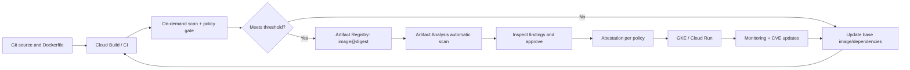
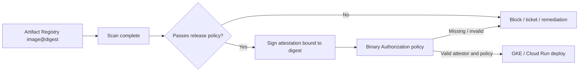

# Container Image Scanning and Vulnerability Remediation

An Orders application was packaged into a container and runs stably on Cloud Run. Days later, a vendor discloses a critical vulnerability in a library or base image the application uses. **The team's code may not have changed, yet the risk profile of the image has.** If the pipeline only checks unit tests and allows deploying any image, the application can keep running a vulnerable version without anyone knowing.

Google Cloud provides **Artifact Registry** to store images and **Artifact Analysis** to detect, store metadata for, and track vulnerabilities in container images. However, scanning images is only one part of software supply chain defense: the team must still **assess impact, remediate the issue, build a new image, verify the patch, and enforce policy gates before deployment**.

This lesson belongs to the **Containers and Artifact Registry** chapter in the `CLOUD_PROVIDERS_GCP` module. It connects projects and IAM, VPC, Compute Engine, GKE, Cloud Run, data services, CI/CD releases, reliability observability, and cost. The ultimate goal is turning scan outputs into a **traceable vulnerability remediation process**, not just a CVE counter.

> **Note:** All projects, images, and alert thresholds below are hypothetical examples. Commands to create repositories, enable APIs, build, push, or deploy can modify resources and incur charges; run them only in authorized environments. This lesson describes technical concepts and does not execute commands on Google Cloud.

## 1. Learning Outcomes

After this lesson, you will be able to:

1. Distinguish image tags, **digests**, OS packages, application dependencies, vulnerability notes, and occurrences.
2. Explain the roles of **Artifact Registry**, **Artifact Analysis**, **Container Scanning API**, **On-Demand Scanning API**, **Security Command Center**, and **Binary Authorization**.
3. Enable automatic scanning on appropriate Docker repositories and inspect per-repository scanning settings.
4. Use `gcloud` to read image vulnerability occurrences or trigger on-demand scans in a CI pipeline.
5. Evaluate CVEs by severity, fix availability, exploitability, exposure, and workload criticality.
6. Harden Dockerfiles, base images, and dependencies; release a **new digest** and re-verify.
7. Design release gates, time-bounded exceptions, attestations, continuous monitoring, rollbacks, permission governance, and scanning cost controls.

## 2. Container Image Risk Model

A container image typically consists of layers:

```text
Image orders-api@sha256:...
  ├─ Base image: operating system, libc, OpenSSL, CA certificates...
  ├─ Runtime: Java/Node.js/Python/Go if required by the app
  ├─ Application dependencies: JARs, npm/pip modules, native libraries...
  ├─ Application code and assets
  └─ Image metadata: entrypoint, user, environment, labels...
```

Not every vulnerability comes from code you wrote. A CVE can appear in the base image, a transitive dependency, the runtime, or the build tooling. A container starting cleanly also **does not prove** its packages are up to date.

| Scenario | Risk | Controls to combine |
| --- | --- | --- |
| Base image contains vulnerable packages | One old image impacts many services | Pin trusted sources, update base digest, rebuild, and scan |
| Application library has a CVE | Endpoints may execute vulnerable code | Update dependencies, run functional tests, assess exploitability |
| API key leaked in an image layer | Anyone with image pull permission can read the secret | Never bake secrets in, rotate/revoke keys, audit build history, scan secrets |
| `latest` tag repointed to a new image | Deployment name no longer reflects the verified artifact | Store and deploy by **immutable digest** |
| Clean image scan but misconfigured runtime | Privileged Pod/VM, overly broad network, excessive IAM | Combine policy, runtime security, workload identity, and network controls |
| CVE detected yet patch never rolled out | Workloads continue running old digests | Assign SLAs, owners, deployment pipelines, and monitor the running fleet |

**A tag is a mutable pointer**—for instance, `orders-api:prod` today and tomorrow can point to two different digests. **The `sha256:...` digest identifies image contents** and is suited for tracking scans, promotions, and deployments. Re-tagging creates no new image contents and does not trigger a fresh digest-based scan by itself.

## 3. Google Cloud Services and Their Place in the Supply Chain

| Component | Role | Does not do by itself |
| --- | --- | --- |
| **Artifact Registry** | Stores Docker images and other artifacts in repositories with IAM/locations | Does not automatically patch vulnerable packages |
| **Artifact Analysis** | Extracts packages, matches vulnerability data, manages per-image metadata | Does not prove all exploit paths or runtime configs are safe |
| **Container Scanning API** | Enables automatic vulnerability scanning on supported images/repositories | Does not block pushes or deploys by default just because CRITICALs appear |
| **On-Demand Scanning API** | Scans local or remote images on request for pre-push/pipeline checks | Does not continuously monitor results of a one-off scan |
| **Security Command Center** | Aggregates cloud risk findings, including vulnerability assessments when configured | Does not replace owners verifying and patching CVEs |
| **Binary Authorization** | Enforces deployment policies based on image source, attestations, and configured rules | Does not treat an image as "patched" just because scanning is on |
| **Cloud Build / CI** | Builds, tests, invokes scanners, evaluates release policies, emits artifacts | Does not define enterprise risk acceptance policies by itself |
| **Cloud Run / GKE / Compute Engine** | Runs images in production environments | Does not automatically upgrade running digests when Artifact Analysis finds a new CVE |

An end-to-end workflow might look like:



The diagram illustrates a controlled flow; **not every step is configured automatically by Google Cloud**. CI gates, attestations, Binary Authorization policies, approvers, and monitoring must be configured separately by the organization.

## 4. Automatic Scanning and Continuous Analysis

When the **Container Scanning API** is enabled, Artifact Analysis can automatically scan newly pushed images in supported **standard and remote Docker repositories** in Artifact Registry; individual repositories also have an option to enable/disable scanning. **Virtual repositories do not support scanning** per current documentation.

Main steps:

1. An image is pushed to a Docker repository.
2. Artifact Analysis analyzes OS packages and supported language packages.
3. Results are stored as metadata attached to the image **digest**.
4. As vulnerability feeds update, Artifact Analysis can create/update/remove findings for a scanned digest within the monitoring window.
5. Operators review findings, assess risk, and release a new digest when required.

### 4.1. Scanning Follows Digests, Not Tag Changes

If the same digest receives additional tags like `staging` or `prod`, it remains **one image**; changing tags does not re-scan the image. If you rebuild the Dockerfile or dependencies and the contents change, the image gets a **new digest**—and the pipeline must evaluate that exact digest.

### 4.2. Continuous Results Have an Update Window

Artifact Analysis documentation ties metadata monitoring of scanned images to **recent pull activity**. The default monitoring window is roughly **30 days**; when an image has not been pulled within this window, results can become *stale* and stop receiving updates. Metadata stale for more than **90 days** may be archived and require API queries to view; refresh behavior depends on image/package state and has latency.

This means **you must not use a year-old scan result as proof that current production is safe**. For long-lived or infrequently pulled images, organizations need mechanisms to keep monitoring active and re-evaluate per documentation; never assume an initial scan updates forever.

### 4.3. What Scanners See and What They Miss

Automatic scanning supports many Linux distributions and a defined set of language ecosystems per the official support matrix. Results depend on **package recognition and public security advisories**. Scanners may miss self-compiled libraries, custom binaries, unrecognized vendored dependencies, application logic flaws, or runtime misconfigurations.

Additional malware package scanning, dependency/license checks, and secret detection capabilities are offered by Google within supported scopes; **secret scanning includes Preview components** and does not replace secret scanning in Git/CI or credential-hygiene practices.

For multi-architecture manifest lists, the scanner picks one image manifest from the list per support rules; do not assume every architecture was scanned independently from a single summary result. Container scanning does not support Windows Server containers per current documentation.

## 5. Enabling and Managing Automatic Scanning

Prerequisites: project has appropriate Billing, Artifact Registry API, IAM to manage repositories/service usage, and an authenticated CLI. The commands below **modify infrastructure** if executed.

```bash
# MUTATING COMMANDS: run only in an approved sandbox project.
PROJECT_ID="orders-container-lab"
REGION="asia-southeast1"
REPOSITORY="orders-images"

# Enable Artifact Registry and Container Scanning API for the project.
gcloud services enable artifactregistry.googleapis.com \
  containerscanning.googleapis.com \
  --project="$PROJECT_ID"

# Create a new standard Docker repository for testing.
gcloud artifacts repositories create "$REPOSITORY" \
  --project="$PROJECT_ID" \
  --location="$REGION" \
  --repository-format=docker \
  --description="Sandbox container images for Orders"

# Allow vulnerability scanning on the repository.
gcloud artifacts repositories update "$REPOSITORY" \
  --project="$PROJECT_ID" \
  --location="$REGION" \
  --allow-vulnerability-scanning
```

Enabling the Container Scanning API also activates the metadata service **Container Analysis API**. For standard/remote Docker repositories, automatic scanning generally turns on once the API is enabled unless disabled at the repository level. For language package repositories like Maven/npm/Python, per-repository scanning may default to **disabled** and require explicit enablement; do not equate package scanning with container scanning.

**Read-only status commands that do not change infrastructure:**

```bash
gcloud services list --enabled \
  --project=orders-container-lab \
  --filter="name:containerscanning.googleapis.com"

gcloud artifacts repositories describe orders-images \
  --project=orders-container-lab \
  --location=asia-southeast1

gcloud artifacts repositories list \
  --project=orders-container-lab \
  --location=asia-southeast1
```

To reduce costs or finding noise, you can **disable scanning on a specific repository** rather than disabling the API project-wide:

```bash
# CONFIGURATION CHANGE: do not run in production without review.
gcloud artifacts repositories update orders-images \
  --project=orders-container-lab \
  --location=asia-southeast1 \
  --disable-vulnerability-scanning
```

Disabling scanning can hide newly disclosed CVEs for those images; document the owner, rationale, environment, alternative scanner, and review date. Never turn off scanning just to make a dashboard stop showing CRITICALs.

## 6. Pushing Images to Artifact Registry and Reading Results

An image name takes the form:

```text
asia-southeast1-docker.pkg.dev/orders-container-lab/orders-images/orders-api:v1.2.0
```

On a developer machine or Linux runner with Docker and appropriate IAM, for example:

```bash
# IMAGE BUILD/PUSH COMMANDS; may incur charges and modify the registry.
PROJECT_ID="orders-container-lab"
REGION="asia-southeast1"
IMAGE="$REGION-docker.pkg.dev/$PROJECT_ID/orders-images/orders-api"

gcloud auth configure-docker "$REGION-docker.pkg.dev"

# Build only an approved Dockerfile containing no secrets.
docker build --tag "$IMAGE:v1.2.0" .
docker push "$IMAGE:v1.2.0"
```

The pushing account needs appropriate repository permissions such as `roles/artifactregistry.writer`; runtime deploy/pull typically needs only `roles/artifactregistry.reader` on the repository. Do not reuse one overly broad account for building, scanning, deploying, and running workloads unnecessarily.

After pushing, query the image and vulnerability occurrences via CLI:

```bash
# READ-ONLY: list digests and metadata for an image name.
gcloud artifacts docker images list \
  asia-southeast1-docker.pkg.dev/orders-container-lab/orders-images/orders-api

# READ-ONLY: filter occurrences of kind VULNERABILITY.
# Positional argument is IMAGE NAME without :tag, per CLI reference.
gcloud artifacts docker images list \
  --show-occurrences \
  --occurrence-filter='kind="VULNERABILITY"' \
  --format=json \
  asia-southeast1-docker.pkg.dev/orders-container-lab/orders-images/orders-api
```

In the Console, navigate to Artifact Registry → repository → Docker image → digest → **Vulnerabilities** to inspect severity, package, version, fix availability, and CVE details. Scan results can arrive **after** the push completes; if the dashboard shows no findings right away, check **discovery/scan** status rather than concluding "zero CVEs."

For automated pipelines, always capture the full `@sha256:...` digest of the pushed image and evaluate/promote that exact digest. Never mark a `prod` tag approved and later allow pushing new contents to that same tag without re-running the gate.

## 7. On-Demand Scanning: Scanning Before or Outside Push Time

**On-Demand Scanning API** lets you scan container images locally or from a registry on request. This is a strong option when CI must evaluate an image before pushing it into a production repository.

| Characteristic | Automatic scanning | On-demand scanning |
| --- | --- | --- |
| Trigger | After pushing a new image to a supported repository | Explicitly invoked by user/CI |
| Image source | Images in supported Artifact Registry repos | Local images or remote images with valid URIs |
| Result storage | Metadata bound to digest, monitored/updated within supported window | Scan snapshot; results retained briefly |
| Retention lifetime | Per monitoring/stale/archive policy | **Up to 48 hours after scan completion** |
| Purpose | Track image inventory and detect newly disclosed CVEs | Pre-push checks, CI gating, and targeted audits |

The local on-demand scanning CLI supports **Linux and macOS**, not Windows per current documentation. Run it on a Linux CI runner or Cloud Build instead of forcing Windows developers to scan locally. The service is billed per pricing policy.

### 7.1. Scan a Local Image in Linux CI

```bash
# EXECUTES SCAN: sends package info to the service; may incur charges.
gcloud services enable ondemandscanning.googleapis.com \
  --project=orders-container-lab

gcloud artifacts docker images scan orders-api:v1.2.0 \
  --location=asia
```

The synchronous `scan` command returns an operation and, upon completion, a `response.scan` field containing the scan resource name such as:

```text
projects/orders-container-lab/locations/asia/scans/SCANNER_GENERATED_ID
```

Read the findings (substitute the exact scan name returned by the command):

```bash
# READ-ONLY: on-demand results from a completed scan resource.
gcloud artifacts docker images list-vulnerabilities \
  projects/orders-container-lab/locations/asia/scans/SCANNER_GENERATED_ID
```

If using `--async`, the command returns a **long-running operation**; call `gcloud artifacts docker images get-operation OPERATION_RESOURCE` and wait for `done: true`, then extract `response.scan`. Do not pass the operation name in place of the scan name.

### 7.2. Scan an Image in a Registry

```bash
# ON-DEMAND remote scan: reference the exact image digest when possible.
gcloud artifacts docker images scan \
  asia-southeast1-docker.pkg.dev/orders-container-lab/orders-images/orders-api@sha256:IMAGE_DIGEST \
  --remote \
  --location=asia
```

With Artifact Registry, the remote URI needs the full `LOCATION-docker.pkg.dev/PROJECT/REPOSITORY/IMAGE`; tags or digests work per CLI syntax, but **digests are appropriate for release evidence**. `--location=asia` is the **location executing the on-demand scan**, not the repository region and does not move where the image is stored.

**Important:** on-demand results are not continuously updated; when new CVEs are disclosed or a new digest is built, you must re-scan. Do not treat a 48-hour-old scan as sole proof for current production, and export results/decision records into a protected audit system per policy before they expire.

## 8. Reading Scan Results: CVE, Note, Occurrence, and Discovery

Artifact Analysis uses a metadata model:

- A **Note** describes a class of event or security finding, such as a vulnerability identified by a CVE.
- An **Occurrence** is an instance of a note applied to a specific artifact (image and digest).
- A **Discovery occurrence** holds information about the image's package discovery process/status.
- A **Vulnerability occurrence** identifies the vulnerability, affected package, version, severity fields, and fix availability depending on data feeds.

**Simplified illustrative data** example (not verbatim API output):

```yaml
image: asia-southeast1-docker.pkg.dev/orders-prod/orders-api/orders-api@sha256:EXAMPLE_DIGEST
scanStatus: FINISHED
findings:
  - id: CVE-EXAMPLE-0001
    package: libexample
    installedVersion: "1.2.0"
    fixedVersion: "1.2.3"
    effectiveSeverity: HIGH
    fixAvailable: true
  - id: CVE-EXAMPLE-0002
    package: liblegacy
    installedVersion: "0.8.4"
    fixedVersion: null
    effectiveSeverity: CRITICAL
    fixAvailable: false
```

Real API/Grafeas fields are nested and distinguish `severity`, `effectiveSeverity`, `packageIssue`, `fixedLocation`, `cvssScore`, and other fields. **Do not write gate-parsing scripts assuming real JSON matches this illustrative snippet.** Inspect the exact schema returned by your Artifact Analysis version before building a gate.

### 8.1. Practical Meaning of Each Field

| Field | Question it helps answer | Limits of inference |
| --- | --- | --- |
| CVE / advisory ID | Where is the vulnerability described by trusted sources? | Multiple advisories may refer to one issue, or no CVE may exist yet |
| Package + installed version | Which component in the image is affected? | A package name alone does not prove vulnerable code is invoked |
| Effective severity | How severe does the scanner rate it? | Not conclusive proof of real-world exploitability in your workload |
| CVSS score/vector | Severity and attack conditions at a model level | CVSS does not know your Internet exposure, secrets, or business assets |
| Fix available / fixed version | Is there an upgrade or patch path? | Distros may backport fixes even when upstream version strings look old |
| Discovery status | Did the scan complete and detect packages? | Zero findings while scan is incomplete does not mean safe |
| Image digest | Is this the exact deployed artifact? | If production runs another digest, these results do not apply |
| Update time | Were findings refreshed recently? | May be stale if the image fell outside the monitoring window |

### 8.2. Do Not Blindly Count CVEs

One CVE can appear across multiple packages/paths; one package can hold multiple CVEs; different feeds can rate severities differently. Comparing "image A has 27 findings, B has 24" is not enough to pick image B. Evaluate **which findings are exploitable in your real architecture**, whether fixes exist, and whether upgrading the base image introduces regressions or new issues.

For example, a vulnerable networking library in a public-facing container warrants higher priority than a CLI tool present only in a build stage (and absent from the final image), even if the total finding count is smaller. Still, a package not directly called by your app might be invoked indirectly or by another tool; verify non-reachability before lowering priority.

### 8.3. Use Digests to Reconcile Running Images

Image tags can be moved after scanning, whereas digests are exact identifiers. On GKE, inspect the actual running container's image ID/digest in Pods via workload status; on Cloud Run, check the image digest of the deployed revision using supported tooling.

```bash
# READ-ONLY: see which images Pods are running in an authorized namespace.
kubectl get pods -n orders \
  -o jsonpath='{range .items[*]}{.metadata.name}{" "}{range .status.containerStatuses[*]}{.imageID}{" "}{end}{"\n"}{end}'

# READ-ONLY: inspect Cloud Run service/revisions to reconcile artifacts.
gcloud run services describe orders-api \
  --project=orders-prod \
  --region=asia-southeast1 \
  --format=yaml
```

Example commands require appropriate GKE/Cloud Run read permissions. In Cloud Run, field structure varies by API/version; always reconcile revision/template/digest against the verified artifact before concluding a service runs the patched build.

## 9. Risk Assessment and Remediation Prioritization

A rule like "block every CRITICAL CVE" is easy to communicate and fits some systems, yet operations must handle **missing fixes**, false positives, unused packages, and priorities shaped by exposure. Clear policy and ownership are needed rather than leaving each developer to improvise.

An **illustrative** matrix, not a mandatory Google Cloud standard:

| Condition | Suggested priority | Action |
| --- | --- | --- |
| Actively exploited CVE, reachable attack path, sensitive data | Urgent | Block release, cut exposure immediately, patch/mitigate/roll back per runbook |
| CRITICAL/HIGH with fix in internet-facing service | High | Pin/fix dependency, rebuild, test, scan, expedite release |
| HIGH without fix, but workload is reachable | High, requires dedicated review | Temporary mitigations: network isolation, WAF, disable feature, time-boxed exception |
| MEDIUM with fix in internal tooling | Per team SLA | Add to backlog, resolve within sprint/release window |
| Vulnerability verified not to affect runtime | Temporary acceptance with evidence | VEX/risk acceptance, expiry, re-evaluate if context changes |
| Scan incomplete or image digest unknown | **Insufficient evidence** | Hold release or route through approved exception process |

### 9.1. Factors to Weigh Alongside Severity

1. **Exploit availability:** is there a public exploit or evidence of active exploitation? Check trusted sources like CISA KEV and vendor advisories.
2. **Attack surface:** does the container expose Internet endpoints, run privileged, mount secrets, or hold broad IAM permissions?
3. **Reachability:** is the vulnerable package/function invoked with untrusted user input? Verify via code paths, tests, or SBOM/VEX.
4. **Asset criticality:** impact on payments, personal data, availability, and compliance obligations.
5. **Fix maturity:** is a fix available on a supported distro, backported, or requiring a major runtime upgrade?
6. **Compensating controls:** do mTLS, authentication, egress policies, Cloud Armor, or runtime isolation genuinely reduce risk?
7. **Time factor:** how long has the image been deployed, is it still in the monitoring window, and what is the SLA deadline?

CVSS severity is a starting point, **not the sole decision**. Systems under strict compliance mandates may enforce hard release gates; security teams must publish clear thresholds and exception workflows.

### 9.2. CVE Remediation Record

```text
Finding ID / advisory: CVE-...
Image digest: sha256:...
Package, version, layer/dependency source:
Services running this digest:
Scan completed / updated_at / data feed:
Severity, CVSS vector, exploitation evidence:
Fix or distro backport available?:
Reachability and business impact:
Owner and due date:
Fix approach and pull request:
New artifact + scan evidence:
Rollout/canary results:
Exception (if any), reviewer, expiry, compensating controls:
```

Tickets must reference the **digest and runtime deployment**, not just tag `latest` or a package name. When multiple projects share an image, share triage findings while verifying deployment scope in each project.

## 10. Remediating Vulnerabilities: Change the Image, Don't "Fix with a Tag"

Remediation methods in order of preference:

1. **Update the base image:** move to a vendor-supported OS/runtime version, preferring a verified digest. Rebuild to produce a new digest.
2. **Update application packages:** bump Maven/npm/pip/Go dependencies, lockfiles, and transitive dependencies per advisory.
3. **Remove unnecessary packages:** use multi-stage builds so compilers and test tools never enter the runtime image.
4. **Reduce runtime privileges:** non-root user, read-only filesystem where feasible, non-privileged mode, least-privilege service account, restricted capabilities/secrets.
5. **Redesign or isolate:** when no fix exists, disable affected features or shrink network exposure; request a time-boxed exception with evidence.
6. **Re-scan the final image:** do not scan only a build stage or merge a commit and call it done; the final digest is the production artifact.

### 10.1. Multi-Stage Dockerfiles and Digest Pinning

**Illustrative skeleton** for a Java application:

```dockerfile
# Illustrative syntax; replace both digests with real verified values.
FROM eclipse-temurin:21-jdk@sha256:APPROVED_BUILD_DIGEST AS build
WORKDIR /workspace
COPY . .
RUN ./gradlew --no-daemon clean build -x test

FROM eclipse-temurin:21-jre@sha256:APPROVED_RUNTIME_DIGEST
WORKDIR /app
COPY --from=build /workspace/build/libs/app.jar /app/app.jar
USER 10001
EXPOSE 8080
ENTRYPOINT ["java", "-jar", "/app/app.jar"]
```

This example will not run until you substitute real digests, build paths, and the matching JAR; `-x test` is shown **solely to illustrate the image build step** and **never means skipping tests in CI**. Production pipelines must run tests in a dedicated stage, verify `app.jar` provenance, verify base image signatures/sources, and scan the resulting image.

Improvements demonstrated:

- Using a slimmer runtime image than the builder, keeping compilers and build-tool caches out of production.
- Pinning **digests** for build reproducibility, paired with automation that detects newer patched digests; pinning forever without updates also accumulates CVEs.
- Running as a non-root `USER` when app and filesystem allow, paying attention to write permissions for log/tmp directories if needed.
- Never passing `ARG PASSWORD`/`ENV TOKEN` into Dockerfiles or cache layers; use build-system secret mounts and workload identity/Secret Manager at runtime.
- Minimizing CI secret access and avoiding accidentally uploading SBOMs, scan artifacts, or build logs containing sensitive data.

### 10.2. Dependency Updates Do Not Always Have a Higher Upstream Version

With Debian/Ubuntu/RHEL and distro maintainers, a security patch may be **backported into the same major/minor version**. Naive string comparisons like `vulnerable_version < fixed_version` can misreport. Rely on distro advisories, package release metadata, and updated scanner results to verify.

Conversely, editing `pom.xml`/`package-lock.json` without rebuilding the final image does not change the running digest. The final sequence must always be **build → scan new digest → test → roll out → verify Pods/revisions run the new digest**.

### 10.3. When No Fix Exists

Never delete CVEs from a dashboard. Document the risk, exposure analysis, compensating controls, exception approver, and review date; consider swapping libraries, disabling endpoints, tightening ingress/egress, relocating workloads, or isolating permissions. A time-boxed exception does not mean the technical flaw is patched.

## 11. SBOM, VEX, and Limits of Vulnerability Scanning

A **Software Bill of Materials (SBOM)** lists software components and dependency relationships. It helps pinpoint affected artifacts whenever a new CVE drops. **Vulnerability Exploitability eXchange (VEX)** records impact assessments for a vulnerability against a specific product, aiding triage workflows when configured.

| Evidence | Question answered | What it does NOT prove |
| --- | --- | --- |
| Scan findings | Which packages/CVEs did the scanner identify? | Code has no logic bugs or runtime is guaranteed safe |
| SBOM | Which components are inside the image? | Every component was scanned or every dependency is safe |
| VEX statement | How did the vendor/owner assess impact, and why? | Vulnerability is fixed if marked `not_affected` without evidence |
| Build provenance | Which source/config/tool built the artifact? | Artifact contains zero CVEs |
| Attestation | Testing/scanning/approval steps were signed by an attestor | New CVEs cannot appear after attestation creation |

Therefore, combine scanning, SBOMs, code reviews, SAST/DAST where appropriate, secret scanning, IaC/runtime policies, and release evidence. A scan showing no CVEs may occur because an image was not analyzed yet, a package is outside supported scope, or vulnerability feeds have not updated.

When issuing VEX/exceptions, record the **image digest, CVE, rationale, reachability evidence, owner, and expiration**. An exception for `orders-api@sha256:A` does not automatically apply to digest B because components and execution paths may have changed.

## 12. Designing Release Gates in CI/CD

**Automatic scanning does not block deployments by default.** If an organization requires "never run unapproved images," you must add gates to build/promotion pipelines and optionally enforce Binary Authorization at deployment time.

**Hypothetical internal** policy example, not directly applicable configuration:

```yaml
releasePolicy:
  requireImmutableDigest: true
  requireScanStatus: FINISHED
  maxScanAgeHours: 24
  failOn:
    criticalFixAvailable: true
    highReachableAndFixAvailable: true
  exceptions:
    requireSecurityApproval: true
    maxLifetimeDays: 7
  requireTestsPassed: true
  requireSignedAttestation: true
```

These fields are **policy pseudocode** implemented by your organization. Do not pass this YAML to `gcloud` expecting Binary Authorization to parse it; Binary Authorization has its own policy schema and resources.

### 12.1. Recommended Control Flow

1. CI builds the image from a reviewed Dockerfile/version, runs tests, and scans for secrets.
2. Run an **on-demand scan** or push to a staging repository with automatic scanning, waiting for **scan FINISHED**.
3. Fetch results by digest or scan resource, parse the exact API schema, and evaluate policy (severity, fix, exploitability, exceptions).
4. If it fails: **fail closed**, do not tag/promote to production, and open a ticket with the owner.
5. If it passes: create a release record/attestation bound to the **digest**, promoting or authorizing the vetted artifact.
6. Deploy to GKE/Cloud Run by **digest**, never `:latest` alone.
7. Verify the runtime digest, errors, latency, and rollback readiness; keep monitoring for newly disclosed CVEs.

A pipeline **must not** promote to production merely because a scan CLI exited with code 0: that may only prove the scan request succeeded, not that findings were evaluated or security thresholds met.

### 12.2. Binary Authorization: Attestations Form the Deploy Gate

Binary Authorization enforces image deployment policies on supported platforms such as GKE and Cloud Run. Build teams create an **attestation** for a digest after scanning and review; the policy requires a valid attestation from a trusted attestor before permitting deployment.



An attestation signature certifies a **process or verification result at creation time**; it does not guarantee the image stays CVE-free forever. When vulnerability feeds publish new flaws, re-evaluation and redeployment workflows are required; Binary Authorization does not replace continuous monitoring.

Before enabling production-wide enforcement, test in **dry-run** mode where supported, verify bootstrap images, monitoring/agent systems, and rollback paths. Keep exceptions scoped and time-bounded with audits—never leave "allow all" enabled long-term just to turn pipelines green.

### 12.3. Statuses to Distinguish

| Status | Meaning | Appropriate action |
| --- | --- | --- |
| `SCAN_PENDING` | Image lacks complete results yet | Wait/investigate; do not treat as zero CVEs |
| `SCAN_FINISHED_WITH_FINDINGS` | Results ready for triage | Evaluate against policy, do not just count |
| `APPROVED` | Owner/security approved digest within thresholds | Record attestation and evidence |
| `EXCEPTION_APPROVED` | Time-bounded risk acceptance | Track SLA and expiration date |
| `DEPLOYED` | GKE/Cloud Run is running the digest | Monitor runtime, new CVEs, and config |
| `REMEDIATED` | New patched digest verified and deployed | Confirm old digest no longer runs in target scope |

These statuses represent an **enterprise release workflow model**, not mandatory enum values from Google Cloud APIs.

## 13. IAM, Supply-Chain Security, and Multi-Project Governance

A Platform team may own repositories in `platform-artifacts`, while Orders applications run in `orders-dev` and `orders-prod`. This separates **artifact producers** from **artifact consumers**, but requires accurate permissions across repositories and scanning services.

| Identity | Responsibility | Least-privilege permissions to consider |
| --- | --- | --- |
| CI builder | Build, push images to staging repository | `roles/artifactregistry.writer` on target repo, scoped build/runtime permissions |
| Security reviewer | View findings/metadata | Artifact Registry Reader and Container Analysis occurrence/note viewer per docs |
| CI scan job | Call On-Demand Scanning API, read results | On-Demand Scanning Admin or custom role for exact API actions; no project-wide Owner |
| Cloud Run/GKE pull identity | Pull approved images at deploy/runtime | `roles/artifactregistry.reader` on source repository where needed |
| Release controller | Approve/promote digests, create attestations | Metadata/attestation write permissions; does not need repo mutate or deploy rights |
| Deployment identity | Deploy approved revisions/Pods/VMs | Scoped GKE/Cloud Run permissions, appropriate service account `actAs` |
| Google-managed scanning service agent | Execute managed scanner tasks | Service agent role per docs; **never assign service agent roles to regular users** |

For Artifact Analysis, official examples mention `roles/containeranalysis.occurrences.viewer` and `roles/containeranalysis.notes.viewer`; viewing all metadata also depends on project scope and how repositories are organized. When granting cross-project access, distinguish the **scanner service agent**, **scan result readers**, and **runtime image pull identity**.

### 13.1. Security at Build Time

- Keep build contexts small and use `.dockerignore` to keep `.git`, `.env`, private keys, test data, and sensitive files out of image layers.
- Use Workload Identity Federation or Cloud Build/GitHub runner workload identities where supported, avoiding downloading JSON service account keys into CI.
- Pull base images only from approved sources; use digest pinning, attestations/provenance, and repository policies.
- Never place secrets in `ARG`/`ENV` or `RUN` commands that linger in image history; use build-time secret mounts where appropriate.
- Attach owner, source revision, build ID, release version, and SBOM metadata to the digest for traceability.
- Separate attestation signing permissions from Binary Authorization policy modification permissions so a compromised runner cannot authorize arbitrary images.

### 13.2. Security at Runtime

Even a scanned image still needs:

1. Running **non-root** where supported by the app; read-only root filesystem or restricted writable paths as required.
2. Least-privilege service account—never grant Cloud Storage or IAM Admin to an app just to read one bucket.
3. Controlled VPC egress/ingress; in GKE consider NetworkPolicy, Pod Security Standards, and workload identity.
4. Cloud Run ingress and authentication configured by design—never accidentally open public access just because an image has "zero CVEs."
5. Logging/metrics and timely patching/redeployment when CVEs emerge; never treat image vulnerability scanning as a replacement for runtime threat detection.

### 13.3. Supply-Chain Exceptions Are Not IAM Exceptions

An exception may allow deploying a digest with an unpatched CVE for a limited window, yet **never authorizes** a pipeline to skip scanning, skip attestations, or grant broad IAM. Exceptions must bind precisely to the digest/CVE/workload/owner and be re-evaluated whenever source advisories change.

## 14. Continuous Post-Deployment Monitoring

An image scanned cleanly today can acquire new findings tomorrow. Vulnerability management therefore requires a closed loop—**detect → triage → remediate → verify → deploy → monitor**—rather than ending when CI turns green.

### 14.1. Event Sources to Combine

| Source | Question | Example action |
| --- | --- | --- |
| Artifact Analysis occurrence changes | Is there a new CVE or new fix in a digest? | Create deduplicated tickets by CVE + digest + package |
| Registry inventory | Which images are stored, who owns them, when were they scanned? | Clean up unused images per retention policy |
| GKE/Cloud Run deployment inventory | Do findings affect **currently running** images? | Prioritize digests with production exposure |
| Security Command Center (if enabled) | Should container risks roll up into overall security posture? | Triage security findings and link vulnerability cases |
| CI/build logs & provenance | From which source, when, and by whom was the image built? | Trace dependency updates and roll back |
| Cloud Billing | Where are storage/scanning/egress costs rising? | Optimize repo scanning and retention without blind spots |

Artifact Analysis updates vulnerability occurrences automatically within its support scope; **it does not redeploy images** when new info arrives. Integrate notifications into the right team's ticketing system and distinguish newly disclosed findings from updated records.

### 14.2. Metrics for Dashboards

- Percentage of **production image digests with complete and fresh scans**;
- Open CRITICAL/HIGH CVEs split by **fix available vs. no fix** and exposed vs. non-exposed;
- **Mean time to acknowledge** and **mean time to remediate** by severity;
- Number of running digests receiving new findings after deployment;
- Active vs. expired exceptions; % of exceptions with verified compensating controls;
- Release block rate and block causes (CVEs, scan pending, missing attestation);
- Stale images, time since last pull, repositories with scanning disabled;
- Workloads migrated to the new digest after a remediation PR merges and rolls out.

A **"0 CVEs"** metric alone is an incomplete KPI: findings may be missing because scanning is still running or the image is unsupported. Pair it with scan coverage/freshness and runtime inventory reconciliation.

### 14.3. Keeping Metadata Fresh

Documentation specifies the **30-day pull rule** and archiving metadata stale beyond **90 days**, though recovery details when stale/archived vary by artifact type. For static images that rarely change (e.g., sidecars or proxies), the Platform team needs scheduled re-evaluation workflows instead of letting old artifacts enter production just because an old scan looked clean.

If an image has grown too old, the safe path is to **rebuild from approved base/dependencies and scan the new digest**, rather than re-tagging to try to refresh results on an old digest.

## 15. Scanning Costs and Operational Capacity

Artifact Registry incurs storage and data transfer charges; Artifact Analysis charges **vulnerability scanning fees** by service type and usage. On-demand scans, automatic scans, and add-on features have distinct pricing rules on the current rate card; do not extrapolate total pricing from a single build.

| Item | What increases cost | How to control |
| --- | --- | --- |
| Image storage | Many long-lived tags/digests, large images | Multi-stage/slim bases, cleanup policies, rollback-safe retention |
| Automatic scanning | Frequent new digests pushed, scanning unnecessary repos | Enable on repos that truly need it, monitor billing SKUs, avoid wasteful builds |
| On-demand scanning | CI scanning the same artifact repeatedly across branches | Scan per change/digest policy, rate limiting, time-bounded evidence caching |
| Data transfer | CI runners, GKE/Cloud Run in other regions, frequent pulls | Co-locate repositories near workloads where feasible, watch cross-region egress |
| Security metadata | Logs, findings exports, BigQuery or SCC integration | Manage retention, redaction, and budgets |
| Remediation workload | Constant rebuild/test/redeploy loops, long scan queues | Balance security requirements with SLA-driven release cadences |

**Never disable scanning on production repositories to "save money" without an approved alternative.** If a workload does not need automatic scanning, document its scope, accountable owner, alternate scan schedule, and alert metrics.

### 15.1. Watch Quotas and Service Latency

When many builds run concurrently:

- On-demand scanning has quotas/rate limits and may return long-running operations.
- Automatic scanning findings have latency after push; pipelines must not assume instant availability.
- CI service accounts may hit API call/IAM limits; never fix with Owner unnecessarily.
- Registry access may be blocked by networks, VPC Service Controls, Organization Policies, or pull/push permissions.

Design retries with backoff, limit concurrency, and clearly separate **API errors**, **scan pending**, and **vulnerability policy failures**. Scanner overload or errors must never degrade into "allow deploy."

## 16. Case Study: Deploying Orders from Artifact Registry to GKE and Cloud Run

Suppose a company operates an ordering platform:

| Component | Environment | Risks to control |
| --- | --- | --- |
| Orders public API | Cloud Run, connected to Cloud SQL | Internet-facing, depends on Java runtime and TLS libraries |
| Orders worker | GKE private cluster | Runs batch jobs, holds access to internal buckets |
| Registry | Artifact Registry repository in `asia-southeast1` | Multiple images/dev teams, requires IAM and retention |
| Build | Cloud Build / CI runner | Builds Java, runs tests, dependency scanners, pushes images |
| Security | Artifact Analysis + Binary Authorization when configured | CVE triage, release gates, attestations, and exceptions |

### 16.1. A New CVE in the Runtime Image

Image `orders-api:v2.4.0` was built, scanned, and released as digest A. Days later Artifact Analysis updates with a new finding in a crypto package inside image A. Response steps:

1. **Determine whether image A is running in production** via actual revision/digest, not tag alone.
2. Read the CVE, package, fixed version, distro advisory, and exploitability; weigh against public endpoints and runtime permissions.
3. If severity is high, apply temporary network/feature mitigations; open a ticket and set an SLA.
4. Bump the base image digest or package, run tests, and build a new image producing digest B.
5. Scan digest B, wait for completion; verify the CVE is resolved or covered by approved exception evidence.
6. Generate an attestation for B if required by policy; canary-deploy to Cloud Run/GKE.
7. Monitor errors, latency, DB connections, and memory; roll out gradually and roll back to an approved digest if needed.
8. Confirm revisions/Pods no longer run digest A in target scopes; update the ticket.

Editing the Dockerfile in Git is not enough. The team must verify the **running image** switched from A to B and that B's security results correspond to the released artifact.

### 16.2. A Dependency Without a Fix

Suppose the scanner flags a CRITICAL finding in a dependency with no fixed version yet. Security cannot simply demand "update immediately." Proper workflow:

- Verify whether the affected dependency is actually present in the final runtime image;
- Assess whether the exploit path is reachable from user requests or untrusted inputs;
- If reachable, disable the feature, isolate networking, tighten authentication, restrict workload privileges, or swap libraries;
- If operation must continue, issue a specific **exception** binding digest/CVE, owner, expiry, approver, and evidence;
- Track advisories and rebuild once a fix ships.

Never delete occurrences or rename tags to make dashboards look clean. Never equate `fixAvailable=false` with "ignorable risk."

### 16.3. Release Decision Template

| Pre-deploy question | Acceptance criteria |
| --- | --- |
| Does the image match the verified digest? | CI, Artifact Registry, attestation, and manifest reference the same digest |
| Did the scan finish? | Completed status evidence or valid exception, not merely zero findings |
| Any CRITICAL/HIGH with available fix? | Within threshold, or mitigated and approved by reviewer |
| Did the image pass tests? | Unit/integration/smoke and required checks |
| Are runtime privileges appropriate? | Non-root, least-privilege IAM/networking per service |
| Is rollback workable? | Safe prior artifact retained, old deployment config available, data compatibility checked |
| Is there an owner monitoring post-deploy? | Alerts configured for new findings and SLA tracking |

## 17. Troubleshooting Common Issues

| Symptom | Likely cause | How to check |
| --- | --- | --- |
| Push succeeds yet no vulnerabilities appear | Container Scanning API off, repo scanning disabled, scan still running/pending | Inspect API status, repository settings, and discovery occurrence |
| Toggled repo scanning and re-tagged image, no fresh scan | Scanning tracks digests; re-tagging creates no new image | Check digest and triggers; do not treat tags as scan events |
| CLI reports permission denied reading findings | Missing Artifact Registry Reader or occurrence/note viewer | Verify principal, project scope, and roles |
| On-demand local scan fails on Windows | Local scan CLI currently lacks Windows support | Use Linux/macOS runner or remote scan per supported workflow |
| Local scan reports missing component | Missing `gcloud local-extract` / compatible Docker runtime/config | Check CLI components and platform prerequisites in docs |
| On-demand scan returns an operation with no findings yet | Asynchronous LRO still running | Poll `get-operation` until `done: true`, read `response.scan` |
| `list-vulnerabilities` cannot find older results | On-demand result older than 48 hours or wrong scan resource | Re-scan and export evidence to an audit store |
| Scanner flags CVE team insists is patched | Distro backport, stale results, package still in a layer, or old digest | Compare installed version, distro advisory, scan update time, runtime digest |
| New build pushed yet production still has CVE | VM/Pod/Cloud Run revision still runs old digest | Reconcile runtime image ID and rollout pipeline |
| CI passes scanner yet Binary Authorization blocks | Missing attestation, wrong digest/attestor, policy mismatch | Inspect deployment policy, audit logs, and actual attestations |
| CI gate fails even with zero CVEs | Scan incomplete, unsupported metadata/error, wrong JSON parser | Distinguish unknown/pending from clean scan and connectivity errors |
| Flood of scan findings from base image | Outdated base image or unnecessary packages | Pick actively supported base, multi-stage build, trim dependencies, rebuild |
| GKE/Cloud Run cannot pull image | Wrong repo IAM, service agent, image URI, location, or VPC-SC | Check registry Reader, error logs, project, and digest |
| Scanning costs spike | Many digests/repos/branches, repeated on-demand scans | Analyze Cloud Billing by scanning SKU; review build and retention strategies |

**Suggested investigation order:** (1) right artifact/digest? → (2) repo/API supported and scanning enabled? → (3) scan complete? → (4) permission to read results? → (5) findings and policy gate? → (6) runtime actually running the approved digest? Never fix `403` by granting Owner to all CI runners.

## 18. Practice Exercises

### Exercise A — Finding Digests and Reading Findings

In a sandbox with a Docker image pushed to Artifact Registry, use `gcloud artifacts docker images list` to identify its digest, pass `--show-occurrences --occurrence-filter` to pull vulnerability metadata, and build a table of package, CVE, severity, fixed version, and scan time. If no findings appear yet, describe how to verify discovery/scan status before drawing conclusions.

### Exercise B — Comparing Automatic and On-Demand

One team wants to scan images **before pushing**, while another needs to know if a new CVE emerges **two weeks after deployment**. Recommend the right scan type for each need, result retention limits, how to scan by digest, and cost factors. Why does changing a tag not trigger a re-scan?

### Exercise C — Prioritizing CVEs

Suppose the Orders image has three findings: (1) CRITICAL with fix in a library used by the public API; (2) HIGH without fix in a CLI package used only during the build stage; (3) MEDIUM with fix in an ORM library inside an internal worker. Choose the remediation order, justify based on reachability/exposure/fix, and list evidence required before requesting an exception.

### Exercise D — Rebuilding a Golden Base Image

A Java Dockerfile currently uses a very old base image and runs as root. Design a multi-stage build with a slim runtime image, pin an approved digest, run tests before release, update packages, switch to non-root, build a new digest, and re-scan. Why does merely updating the `latest` tag not count as remediation?

### Exercise E — Policy Gates and Binary Authorization

Describe a fail-closed workflow: image has a completed scan, no fixable CRITICALs, and a digest attestation, deployed to GKE. If scanner connectivity drops or results are pending, how should the pipeline respond? Specify short-lived exception rules and the purpose of dry-run testing before enabling enforcement.

### Exercise F — CVE Appears After Deployment

Cloud Run is serving approved digest A. Artifact Analysis publishes a new finding, and the pipeline produces digest B. Write a runbook covering exposure verification, ticketing, building/testing/scanning B, canary rollout, request latency checks, rollback, and confirming A has left production.

### Exercise G — IAM and Cost

A project has 30 repositories, pushes 500 image digests daily, and CI runs repeated on-demand scans per commit. List the IAM roles needed by each identity, which storage/scanning/egress costs to track, ways to eliminate redundant scans, and why production scanning must never be disabled just to lower finding counts.

### Self-Check Questions

1. How does container image scanning differ from runtime security?
2. Why is an image tag not an immutable release identifier?
3. How does automatic scanning detect new CVEs after push time?
4. How does on-demand scanning differ from automatic scanning in result lifetime and trigger timing?
5. Why can an incomplete scan never be treated as "0 CVEs"?
6. How do Notes and Occurrences differ in Artifact Analysis?
7. Does a CRITICAL CVSS score guarantee the application is exploitable?
8. When no fix is available, what should the engineering team do?
9. How does creating an attestation differ from Artifact Analysis holding findings?
10. Why must you scan the **final runtime image** and verify digests post-deploy?
11. Why can a digest that was clean last week receive new findings this week?
12. Why does VEX require evidence and expiry rather than acting as a way to erase CVEs?

**Workflow summary:** identify images **by digest** → enable/govern scanning → wait for completed results → triage CVEs by package/fix/exposure → patch in base image or dependencies → rebuild, test, and scan the new digest → gate and attest → deploy safely → monitor new findings, exceptions, and costs.

## 19. Official References

- [Artifact Registry and Artifact Analysis](https://cloud.google.com/artifact-registry/docs/analysis)
- [Container scanning overview](https://cloud.google.com/artifact-analysis/docs/container-scanning-overview)
- [Enable or disable automatic scanning](https://cloud.google.com/artifact-analysis/docs/enable-automatic-scanning)
- [Automatically scan container images](https://cloud.google.com/artifact-analysis/docs/scan-os-automatically)
- [Scan container images on demand](https://cloud.google.com/artifact-analysis/docs/scan-os-on-demand)
- [gcloud artifacts docker images scan](https://cloud.google.com/sdk/gcloud/reference/artifacts/docker/images/scan)
- [gcloud artifacts docker images list-vulnerabilities](https://cloud.google.com/sdk/gcloud/reference/artifacts/docker/images/list-vulnerabilities)
- [Artifact Analysis metadata overview](https://cloud.google.com/artifact-analysis/docs/metadata-storage)
- [Create and manage VEX statements](https://cloud.google.com/artifact-analysis/docs/create-vex)
- [Software Bill of Materials on Google Cloud](https://cloud.google.com/artifact-analysis/docs/sbom-overview)
- [Binary Authorization overview](https://cloud.google.com/binary-authorization/docs/overview)
- [Binary Authorization attestations](https://cloud.google.com/binary-authorization/docs/attestations)
- [Artifact Registry pricing](https://cloud.google.com/artifact-registry/pricing)
- [Artifact Analysis pricing](https://cloud.google.com/artifact-analysis/pricing)

Supported OS/language package lists, metadata retention windows, JSON fields, scan modes, pricing, and Preview features may change over time. Before applying in production, consult official documentation for your **exact project, repository type, image digest, package ecosystem, runner OS, deployment platform, and compliance requirements**; never treat this lesson or a single scan as proof an image is permanently safe.
