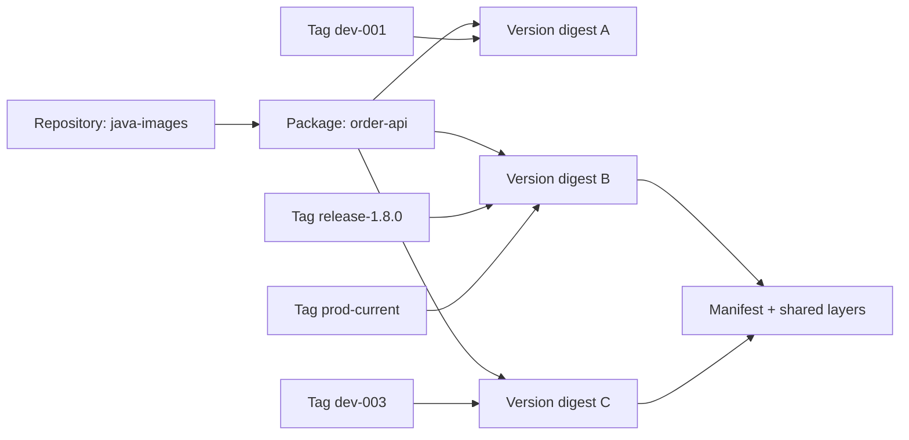
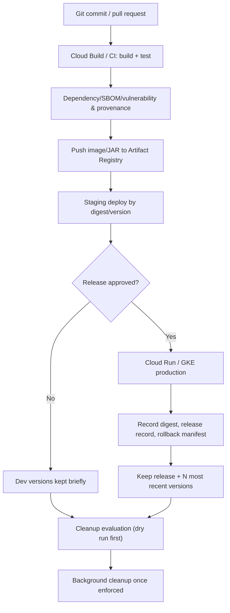
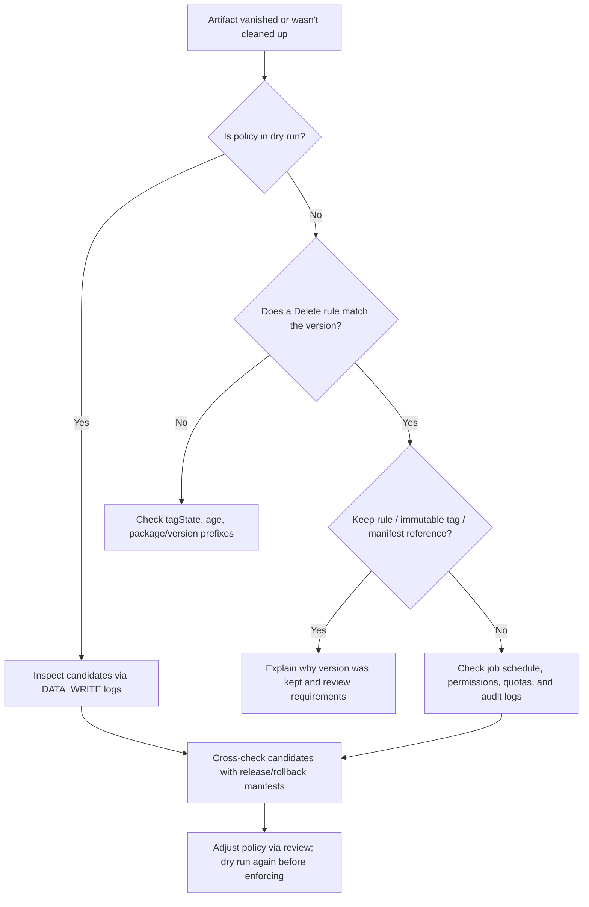

# Cleanup Policies and Artifact Lifecycle

## 1. The Problem: Keeping Needed Releases, Pruning Unused Builds

A **Spring Boot** development team runs a **Cloud Build → Artifact Registry → Cloud Run/GKE** pipeline. Every commit builds a new container image; each release may also receive tags like `release-1.8.0`, `prod-2026-11`, or `commit-a1b2c3`. Meanwhile, the team publishes internal Java libraries as **Maven packages** shared across multiple projects.

After several months, repositories hold thousands of artifact versions:

- Experimental and pull-request builds that are no longer deployed.
- Production releases that must be **retained to launch new replicas, recover, or roll back**.
- Select older releases still required for audits or incident investigation.
- Untagged versions still consuming storage space.
- Java packages with dependency graphs: deleting an old JAR can prevent a legacy application from building again.

Manually deleting versions one by one is tedious and error-prone. **Artifact Registry cleanup policies** evaluate **delete** and **keep** criteria across stored repository versions, cutting costs while protecting critical artifacts.

Within the **Containers and Artifact Registry** chapter of the **CLOUD_PROVIDERS_GCP** module, this lesson examines the **artifact lifecycle**: build → identify → verify → release → deploy → retain/rotate → clean up, integrating IAM, reliability, Java deployments, cost, and auditing. The focus is not merely a JSON file, but an **explainable, verifiable cleanup workflow before data is actually deleted**.

### Learning Objectives

After this lesson, you will be able to:

1. Distinguish **repository**, **package/image**, **version/digest**, **tag**, **manifest/layer**, and **repository attachment**.
2. Design separate artifact lifecycles for **dev**, **staging**, **production**, **rollback**, and **Maven releases/snapshots**.
3. Author cleanup policies with **Delete**, **Conditional Keep**, and **Keep most recent versions** actions.
4. Explain the **Keep wins over Delete** rule, matching conditions, and **immutable tags** caveats.
5. Use `gcloud artifacts repositories set-cleanup-policies --dry-run` and **Cloud Audit Logs** to inspect deletion candidates without deleting anything.
6. Apply approved policies via **Terraform/IaC**, IAM, auditing, and cost monitoring.
7. Diagnose why a version was **not deleted** or **deleted unexpectedly**, while safeguarding rollback capability for Java workloads.

> **Safety principle:** Once a cleanup policy leaves **dry run**, it can **irreversibly delete** matching versions. Never apply experimental policies to a production repository, never turn on live deletion "to see what happens," and never assume a `prod` tag protects a version without a matching **Keep policy**.

## 2. Data Model in Artifact Registry

### 2.1. Repository, Package, Version, Tag

**Artifact Registry** manages artifacts across formats such as Docker/OCI images, Maven, npm, Python, Go, Apt, Yum, and other supported formats. Each repository has its own **location**, **format**, **mode**, and access policies.

A container image typically takes the form:

```text
us-central1-docker.pkg.dev/PROJECT_ID/java-images/order-api:release-1.8.0
|--------- host ---------| | project | |  repo   | package |   tag     |

us-central1-docker.pkg.dev/PROJECT_ID/java-images/order-api@sha256:DIGEST
                                                             ^ digest/version
```

- **Repository** `java-images`: storage boundary for artifacts of one format and location.
- **Package/image** `order-api`: software/container image name inside the repository.
- **Version**: a specific artifact; for Docker images, usually identified by a `sha256:...` **digest**.
- **Tag**: friendly name pointing to a version, such as `dev-42`, `release-1.8.0`, or `prod-2026-11`.
- **Manifest**: describes image components; multi-platform images may use a **parent/index manifest** referencing platform manifests.
- **Layers/blobs**: stored content reused across images; deleting a version **does not mean** every layer immediately disappears.



**Core point:** cleanup deletes **artifact versions**, not merely tag text labels. One version can hold **multiple tags**. Deleting a tag does not necessarily delete the version or free storage. Conversely, deleting a version removes **every tag** still pointing to it.

### 2.2. Mutable and Immutable Tags

In a **mutable-tags** Docker repository (typically the default), tags like `latest` or `prod-current` can be moved to a new digest. When moved, the older digest loses that tag and can become **untagged**, even if it previously served production.

With **immutable tags** enabled, a tag bound to a digest cannot normally be moved to a different digest. Per current cleanup rules, **tagged Docker versions in a repository with immutable tags enabled are not deleted by cleanup policies**. Always verify this setting before projecting storage savings.

Immutable tags guard against unexpected release-identifier changes, but they are not **backups, legal retention locks, or build provenance verification**. For production deployments, **pin by digest** and keep independent build/provenance records rather than trusting `latest`.

### 2.3. Repository Modes and Policy Scope

| Mode | Function | What to remember when designing cleanup |
| --- | --- | --- |
| **Standard** | Teams push/publish artifacts directly and runtimes pull them | **Focus of the entire lab**; cleans up team-owned artifacts |
| **Remote** | Caches artifacts from upstreams like Docker Hub/Maven Central | Cache handling, age, and re-fetch behavior differ from standard; verify support per docs/version |
| **Virtual** | Single endpoint aggregating multiple upstream repositories | Does not store/clean up versions the way a standard repository does |

Overview documentation currently lists cleanup for **standard and remote repositories**, whereas some **set policies** guides describe **standard** scope. Since support can vary by mode/CLI and evolve across releases, **verify directly on your chosen repository/format**; never test delete policies on production remote repos just because standard examples work.

## 3. Artifact Lifecycle in Java Development Workflows

### 3.1. From Source Code to Production and Rollback



An operational policy might separate three groups:

| Environment | Example identifier | Illustrative retention strategy |
| --- | --- | --- |
| CI/pull request | `pr-1234`, `commit-abc123` | Delete after 7–30 days if no longer needed for reproducibility |
| Staging/QA | `rc-1.8.0`, `staging-202611` | Keep a bounded number of release candidates/versions |
| Production | `release-1.8.0` or released digests | Keep via release tags/process; always protect active and rollback digests |
| Audit releases | `retained-2026` or independent catalog | Align retention/evidence duration with compliance |
| Java Maven release | `com.example:payment-sdk:1.8.0` | Typically kept longer than snapshots; never use Docker tag prefixes as criteria |
| Maven snapshot | `1.9.0-SNAPSHOT`, build versions | Shorter retention once no consumers depend on them |

Timeframes like **7/30/90 days** are examples only; choose based on release cadence, recovery SLOs, legal obligations, real usage, and budget. Never dump long-lived artifacts into a shared repository governed by a blanket "delete all older than 30d" policy.

### 3.2. Build Once, Deploy by Digest

CI builds an image and records its **digest**, for example:

```text
us-central1-docker.pkg.dev/PROJECT_ID/java-images/order-api@sha256:0123...abcd
```

Promoting from staging to production should reference that exact tested digest instead of rebuilding the same commit and **assuming identical bytes**. Friendly tags aid lookup but can shift if the repository is mutable. Release records should capture:

- Git commit, CI build ID, source revision, and builder identity;
- image digest/version, repository name, and location;
- test, scan, SBOM/provenance, or signature results per policy;
- which Cloud Run revision or GKE workload deployment uses which digest;
- the minimum list of rollback digests and their protection window;
- release approver and earliest eligible cleanup time.

**A running digest is not automatically detected and protected by cleanup policies.** Pair Keep policies with a release inventory; never rely on "there is still a Cloud Run revision" to assume an artifact cannot be deleted.

## 4. Cleanup Policies: How Are Delete and Keep Combined?

### 4.1. Delete Policy

A **Delete policy** defines conditions under which a version is deleted—for example, **untagged and older than 30 days**, or all versions of `ci-`-prefixed packages older than 14 days. A Delete policy must have a **unique name, action Delete, and at least one condition**.

**Without a Delete policy, Keep policies delete nothing.** A common mistake is configuring "keep 10 versions" and expecting older versions to vanish automatically.

### 4.2. Conditional Keep

**Conditional Keep** identifies versions that must not be deleted by automatic cleanup even when they also match a Delete policy. Examples include protecting Docker images tagged with `release-` or `prod-`, or protecting a package family by prefix.

**Keep wins over Delete**: if a version matches both, Artifact Registry retains the version even if the Delete policy specifies a shorter retention age.

### 4.3. Keep Most Recent Versions

**Keep most recent versions** retains the **N newest versions per package** within scope, not N versions total across the repository. A Keep policy of this type uses `mostRecentVersions.keepCount`; **do not mix `condition` and `mostRecentVersions` in the same policy**.

Adding `packageNamePrefixes` limits protection **only to packages matching those prefixes**. Omit the prefix list to protect N versions for every package in the repository.

### 4.4. Policy Conflicts and Limits

| Case | Result |
| --- | --- |
| Version matches Delete only | Candidate for deletion, unless protected by another product limit/safeguard |
| Version matches Keep only | Kept, though Keep does not delete other versions on its own |
| Version matches both Delete and Keep | **Kept** |
| Version matches multiple Delete rules | The Delete rule with the **shorter retention** can take effect |
| Version matches no policy | **Kept** |
| Docker version referenced by a parent manifest | Not deleted individually by cleanup until conditions/parent allow |
| Tagged Docker version in an immutable-tags repo | Cleanup policies do not delete tagged versions |

Per current published limits, repositories support up to **10 cleanup policies/repository** and **600,000 deletions/repository/day**, subject also to project-level delete quotas. The system runs as a **periodic background job**; setting or editing a policy **does not trigger immediate deletion**. Changes generally take effect **within roughly one day**, not on a user-chosen top-of-the-hour cron schedule.

### 4.5. Do Not Predict Evaluation by JSON Array Order

Do not design policies assuming "rules listed higher always beat rules below." What matters is that **Keep protects against overlapping Delete rules** and how each policy's conditions match. Inspect active policies and candidates recorded in dry-run logs.

## 5. Key Matching Conditions

| JSON field | Example | Meaning / Pitfall |
| --- | --- | --- |
| `tagState` | `tagged`, `untagged`, `any` | Selects tag state; formats without tag support are generally treated as untagged |
| `tagPrefixes` | `["dev-", "pr-"]` | Valid only with `tagState: "tagged"`; not a regex pattern |
| `versionNamePrefixes` | `["v1", "v2"]` | Matches **version name** prefix, not Docker tags |
| `packageNamePrefixes` | `["order-api"]` | Matches packages starting with that string; verify actual names |
| `olderThan` | `"30d"` | Matches artifacts **older than** duration from create/version time |
| `newerThan` | `"7d"` | Matches artifacts **newer than** duration; combinable to form a range |
| `mostRecentVersions.keepCount` | `5` | Keeps the 5 newest versions of **each package** in scope |

Per documentation, durations use `s`, `m`, `h`, or `d` units. **Do not infer artifact age from tag names** like `release-2023`; the engine evaluates repository artifact timestamps.

### 5.1. Why Be Careful with Tags?

A digest may carry **two tags**: `dev-old` and `prod-1.8`. If a Delete policy matches `dev-` while Keep protects `prod-`, **Keep wins** and the version stays. If you later move `prod-1.8` to another digest in a mutable repository, the old digest **loses its protective tag** and becomes eligible for deletion once conditions match.

In an immutable-tags repository, tags cannot be moved arbitrarily and tagged versions are exempt from cleanup deletion, though a **dedicated governance process** is still needed for unwanted tags.

### 5.2. Maven and Tagless Formats

Maven JARs are identified by **groupId:artifactId:version**; snapshot/release cleanup does not use Docker tag syntax. For formats without tags under Artifact Registry's cleanup model, artifacts are typically treated as **untagged**. Use **packageNamePrefixes**, **versionNamePrefixes**, age, and **Keep most recent**, after checking real package/version names in the repository.

For Java, separate **Maven snapshots** and **Maven releases** into distinct repositories with appropriate retention windows. Deleting a published JAR version can prevent **Gradle/Maven builds** or recovery environments from resolving dependencies. Remote repos only cache upstreams whereas standard repos hold your published artifacts; cleanup in the two modes has different consequences.

## 6. Example JSON Policy for a Java API Container

Suppose a **standard Docker** repository named `java-images` holds package `order-api`. We want to:

1. Delete `order-api` versions **older than 30 days** unless protected.
2. Always keep versions still carrying a tag starting with `release-` or `prod-`.
3. Also keep the **5 newest versions** of each package starting with `order-api` for recent rollbacks.

File `cleanup-policy.json`:

```json
[
  {
    "name": "delete-old-order-api",
    "action": { "type": "Delete" },
    "condition": {
      "tagState": "any",
      "packageNamePrefixes": ["order-api"],
      "olderThan": "30d"
    }
  },
  {
    "name": "keep-released-order-api",
    "action": { "type": "Keep" },
    "condition": {
      "tagState": "tagged",
      "tagPrefixes": ["release-", "prod-"],
      "packageNamePrefixes": ["order-api"]
    }
  },
  {
    "name": "keep-last-five-order-api",
    "action": { "type": "Keep" },
    "mostRecentVersions": {
      "packageNamePrefixes": ["order-api"],
      "keepCount": 5
    }
  }
]
```

**This is an illustrative policy**, not a default compliance configuration. It can delete `staging` or `dev` versions after 30 days even if tagged with prefixes outside the Keep list. If an active production image **lacks a protective tag** and falls outside the 5 newest versions, it still risks deletion.

### 6.1. Analyzing Hypothetical Versions

Assume the ages/labels below belong to the same package, the repo uses **mutable tags**, and the engine runs after setting the policy:

| Version | Age | Tags | Eligible for deletion? | Why |
| --- | --- | --- | --- | --- |
| A | 50 days | `dev-21` | **Yes**, if outside top 5 | Matches Delete, does not match conditional Keep |
| B | 70 days | `release-1.6.0` | **No** | Conditional Keep protects release |
| C | 40 days | Untagged | **Yes**, if outside top 5 | Matches Delete by age |
| D | 31 days | `prod-2026`, `dev-99` | **No** | Prod Keep overrides Delete |
| E | 3 days | `dev-101` | **No** | Has not passed 30-day threshold |
| F | 100 days | Untagged | **No** if inside top 5 | Keep most recent overrides Delete |

The top-5 calculation runs across **all actual version records**, so an illustrative table showing a subset cannot determine exact ranking by itself. During audits, export the full version inventory and compare timestamps.

### 6.2. If You Only Want to Clean Up Untagged Images

Replace the Delete condition with:

```json
{
  "name": "delete-untagged-old",
  "action": { "type": "Delete" },
  "condition": {
    "tagState": "untagged",
    "olderThan": "30d"
  }
}
```

This approach **does not delete tagged versions**, even very old dev tags. For repositories with immutable tags, cleaning only untagged items is lower-risk, though it may reclaim less space. To protect releases, maintain an independent **release inventory** and never delete manually by guesswork.

## 7. Safe Lab: Create a Docker Repo and Test Dry Run

**Prerequisites:** a test Google Cloud project with Billing enabled, Artifact Registry permissions, and a machine with `gcloud`/Docker or Cloud Shell supporting Docker. Use only a **new** lab repo, never a production repository name. Substitute `PROJECT_ID`, `LOCATION=us-central1`, and `REPOSITORY=java-images-lab` for your environment.

### Step 1 — Enable API, Create a Standard Docker Repository

```bash
gcloud config set project PROJECT_ID
gcloud services enable artifactregistry.googleapis.com

gcloud artifacts repositories create java-images-lab \
  --project=PROJECT_ID \
  --repository-format=docker \
  --location=us-central1 \
  --description="Disposable Java image cleanup lab"

gcloud artifacts repositories describe java-images-lab \
  --project=PROJECT_ID \
  --location=us-central1
```

Verify `format=DOCKER`, `mode=STANDARD_REPOSITORY`, location, and `dockerConfig.immutableTags`. Even a new repository can **incur storage charges** once images are pushed, even before cleanup is active. If a repository with the same name already exists, **do not overwrite or reuse it** without confirming ownership.

### Step 2 — Create a Small Java App to Produce a Dedicated Image

In a lab working directory, create `HealthMain.java`:

```java
import com.sun.net.httpserver.HttpExchange;
import com.sun.net.httpserver.HttpServer;
import java.io.IOException;
import java.io.OutputStream;
import java.net.InetSocketAddress;
import java.nio.charset.StandardCharsets;

public class HealthMain {
    private static void respond(HttpExchange exchange, String body)
            throws IOException {
        byte[] bytes = body.getBytes(StandardCharsets.UTF_8);
        exchange.getResponseHeaders().add(
            "Content-Type", "text/plain; charset=utf-8");
        exchange.sendResponseHeaders(200, bytes.length);
        try (OutputStream out = exchange.getResponseBody()) {
            out.write(bytes);
        }
    }

    public static void main(String[] args) throws IOException {
        HttpServer server = HttpServer.create(
            new InetSocketAddress("0.0.0.0", 8080), 0);
        server.createContext("/healthz", exchange ->
            respond(exchange, "ok\n"));
        server.createContext("/", exchange ->
            respond(exchange, "Java Artifact Registry lab\n"));
        server.start();
    }
}
```

Multi-stage `Dockerfile` using Java 21:

```dockerfile
FROM eclipse-temurin:21-jdk AS build
WORKDIR /src
COPY HealthMain.java .
RUN javac --add-modules jdk.httpserver HealthMain.java

FROM eclipse-temurin:21-jre
WORKDIR /app
ARG BUILD_ID=lab
LABEL org.opencontainers.image.revision=$BUILD_ID
COPY --from=build /src/HealthMain.class .
EXPOSE 8080
USER 10001
ENTRYPOINT ["java", "--add-modules", "jdk.httpserver", "HealthMain"]
```

In production, pin the **base image by digest**, run vulnerability scanning, and generate provenance/SBOMs before releasing. `BUILD_ID` is used solely to vary label contents across versions; it is **not a security measure or build reproducibility guarantee**.

### Step 3 — Push a Few Image Tags

```bash
gcloud auth configure-docker us-central1-docker.pkg.dev

# Build/push two images with different labels, producing two digests:
docker build --build-arg BUILD_ID=dev-001 \
  -t us-central1-docker.pkg.dev/PROJECT_ID/java-images-lab/order-api:dev-001 .
docker push us-central1-docker.pkg.dev/PROJECT_ID/java-images-lab/order-api:dev-001

docker build --build-arg BUILD_ID=dev-002 \
  -t us-central1-docker.pkg.dev/PROJECT_ID/java-images-lab/order-api:dev-002 .
docker push us-central1-docker.pkg.dev/PROJECT_ID/java-images-lab/order-api:dev-002

gcloud artifacts docker images list \
  us-central1-docker.pkg.dev/PROJECT_ID/java-images-lab/order-api \
  --include-tags
```

Record the digests and creation timestamps. **Do not pretend a day has passed** just because you pushed two images; with Delete `olderThan=30d`, newly created versions are **not** yet eligible for deletion. To test 30–90 day scenarios, use the **simulation table** in Section 6 or an authorized lab repo with older data—**never lower thresholds to a few seconds and switch to enforce**.

### Step 4 — Create the JSON File and Attach the Policy in Dry Run

Save the Section 6 JSON as `cleanup-policy.json` on your **lab machine**. Because Section 6 uses `packageNamePrefixes=["order-api"]`, it matches the image just pushed.

```bash
# SAFE COMMAND: configures the policy WITHOUT deleting artifacts.
gcloud artifacts repositories set-cleanup-policies java-images-lab \
  --project=PROJECT_ID \
  --location=us-central1 \
  --policy=cleanup-policy.json \
  --dry-run

gcloud artifacts repositories list-cleanup-policies java-images-lab \
  --project=PROJECT_ID \
  --location=us-central1

gcloud artifacts repositories describe java-images-lab \
  --project=PROJECT_ID \
  --location=us-central1
```

**`--dry-run` is a repository mode**, not an "instant synchronous simulation command." The background job evaluates versions on the service's schedule. `set-cleanup-policies` completing only proves the **configuration was saved**, not that the policy has run or will delete your expected list.

### Step 5 — Enable Data Access `DATA_WRITE` Logs and Read Results

To inspect dry-run deletion candidates, enable **`DATA_WRITE` Data Access audit logs for Artifact Registry** under IAM & Admin → Audit Logs per permissions and organizational policy. **Data Access logs can incur Cloud Logging charges**; review retention and project scope.

Per current Artifact Registry documentation, Cloud Logging records `BatchDeleteVersions` with `protoPayload.request.validateOnly=true` during dry-run evaluation. After **at least one day** (because the job runs periodically), query:

```bash
gcloud logging read \
  'protoPayload.serviceName="artifactregistry.googleapis.com" AND protoPayload.methodName="google.devtools.artifactregistry.v1.ArtifactRegistry.BatchDeleteVersions" AND protoPayload.request.validateOnly=true' \
  --project=PROJECT_ID \
  --freshness=7d \
  --limit=100
```

When a project holds multiple repositories, add a **parent repository filter** so candidates from other repos are not mixed in:

```text
protoPayload.request.parent="projects/PROJECT_ID/locations/us-central1/repositories/java-images-lab/packages/-"
```

Inspect the **version list** inside `protoPayload.request.names`, the `validateOnly` flag, timestamps, and active digests. **Seeing no dry-run log entries** may mean the cycle has not run yet, logging is not enabled, no version matched, or permissions/limits apply; never immediately conclude "zero deletion risk."

### Step 6 — Enable Live Deletion: Only After Approval

The command below is **shown for awareness**, **not a required lab step**:

```text
# DO NOT RUN WITHOUT APPROVAL FOR LIVE DELETION:
gcloud artifacts repositories set-cleanup-policies java-images-lab \
  --project=PROJECT_ID \
  --location=us-central1 \
  --policy=cleanup-policy.json \
  --no-dry-run
```

`--no-dry-run` enables real deletion for matching versions on the next background job run. **There is no rollback to restore deleted versions**; switching back to `--dry-run` afterward only stops future deletions and cannot recover lost data.

### Step 7 — Clean Up Lab Resources After Verification

Because the lab ran only **dry run**, you can clean up the dedicated lab repository following a reviewed process. The command below **deletes all artifacts inside the repository**: run it only after confirming the repository holds no one else's resources.

```text
# Execute ONLY after confirming this is an isolated LAB repository:
gcloud artifacts repositories delete java-images-lab \
  --project=PROJECT_ID \
  --location=us-central1
```

Never delete a production repository to "quickly clear" storage; apply proper policies, audit versions, and review dependencies, rollbacks, and repository structure. If you created dedicated Cloud Build triggers, Cloud Run revisions, or IAM bindings for the lab, verify and clean them up too.

## 8. Applying Cleanup to Java Maven Repositories

Docker images are typically deployed by digest; **Maven packages** are typically referenced by `groupId:artifactId:version` coordinates in `pom.xml` or `build.gradle`. A Java pipeline may both publish:

```xml
<dependency>
  <groupId>com.example.platform</groupId>
  <artifactId>payment-client</artifactId>
  <version>1.8.0</version>
</dependency>
```

and build a Spring Boot image consuming that JAR. If cleanup deletes JAR `1.8.0` while build reproducibility or a legacy service still depends on it, future builds or recoveries can fail even if currently running instances are fine.

### 8.1. Separating Snapshots and Releases

| Java repository | Characteristics | Illustrative policy |
| --- | --- | --- |
| `java-maven-snapshots` | Experimental builds, many versions, frequent updates | Delete old versions by age; keep 10 newest versions/package |
| `java-maven-releases` | Released libraries referenced by many apps | Retain per release/dependency policy; consider **no delete policy** without an inventory |
| `java-maven-external-cache` | Upstream dependencies (if remote) | Verify remote cache behavior; never delete sole copies needed for offline builds |

Artifact Registry has **Maven version policy** settings at repository creation (`RELEASE`, `SNAPSHOT`, or unrestricted per option). Version policies govern **accepting uploads**, whereas cleanup policies govern **deleting stored versions**.

### 8.2. Example Dedicated Snapshot Policy

Illustrative only for a **standard Maven snapshot repository**; check exact names via `gcloud artifacts packages list` before choosing prefixes. Because Maven has no Docker tags, do not use `tagPrefixes:["prod-"]`:

```json
[
  {
    "name": "delete-snapshots-older-45d",
    "action": {"type": "Delete"},
    "condition": {
      "tagState": "untagged",
      "olderThan": "45d"
    }
  },
  {
    "name": "keep-ten-snapshot-versions",
    "action": {"type": "Keep"},
    "mostRecentVersions": {
      "keepCount": 10
    }
  }
]
```

Keeping `10` applies **per package** and does not guarantee a version referenced by another library stays forever. For critical dependencies, complement cleanup with a **software bill of materials (SBOM), dependency lockfiles, or release manifests** to know which exact versions must remain.

## 9. Terraform and Infrastructure as Code

Do not let the Console, `gcloud`, and Terraform take turns modifying the same repository **without updating state or governance workflows**. Across multi-project teams, store cleanup policies as **reviewed code**, test on **dev/staging first**, and only then promote to prod.

### 9.1. Reference Terraform Resource

Example creating a **new standard Docker repository** with a **dry-run** policy using the Google provider's `google_artifact_registry_repository`:

```hcl
variable "project_id" {
  type = string
}

provider "google" {
  project = var.project_id
}

resource "google_artifact_registry_repository" "java_images" {
  project       = var.project_id
  location      = "us-central1"
  repository_id = "java-images-lab"
  format        = "DOCKER"
  mode          = "STANDARD_REPOSITORY"
  description   = "Lab: cleanup policies kept in dry run"

  # Safe: simulates and logs only; deletes no artifacts.
  cleanup_policy_dry_run = true

  cleanup_policies {
    id     = "delete-old-order-api"
    action = "DELETE"
    condition {
      tag_state             = "any"
      package_name_prefixes = ["order-api"]
      older_than            = "30d"
    }
  }

  cleanup_policies {
    id     = "keep-released-order-api"
    action = "KEEP"
    condition {
      tag_state             = "tagged"
      tag_prefixes          = ["release-", "prod-"]
      package_name_prefixes = ["order-api"]
    }
  }

  cleanup_policies {
    id     = "keep-last-five-order-api"
    action = "KEEP"
    most_recent_versions {
      package_name_prefixes = ["order-api"]
      keep_count            = 5
    }
  }
}
```

This example is **independent** of the repo created in the `gcloud` lab: **never manage the same repository simultaneously with both tools without importing state first**. Check the schema/version of your Terraform provider and review every plan—especially `cleanup_policy_dry_run`, since flipping `true → false` is a **potentially data-deleting change** on the next cleanup cycle.

### 9.2. Safe Change Workflow

1. Export an inventory of packages/versions/tags/digests and build a release/rollback allowlist.
2. Review JSON/Terraform in a pull request with the **data owner** and production deployment owner.
3. Apply **dry run** on a test repository or clone with representative data.
4. Read audit logs and cross-check every candidate against release manifests and dependency inventories.
5. Only after approval, switch to enforce during a **change window**; keep the old policy to roll back configuration.
6. Monitor real deletions and pull/build errors over subsequent cycles; rolling back a **policy** never restores deleted artifacts.

In automation, never automatically enable `--no-dry-run` merely because a pull request merged; require an explicit approval gate for destructive changes.

## 10. IAM, Security, and Supply Chain Controls

### 10.1. Who Can Do What?

| Identity | Suggested IAM role | Boundary |
| --- | --- | --- |
| Cloud Build/CI publisher | `roles/artifactregistry.writer` | Pushes images/packages; no repo administration rights |
| Cloud Run/GKE/Compute Engine runtime | `roles/artifactregistry.reader` | Pulls artifacts from the right repo (may need cross-project grants) |
| Release administrator | `roles/artifactregistry.repoAdmin` or equivalent scoped role | Manages versions/tags per approved duties |
| Cleanup policy operator | `roles/artifactregistry.admin` or **custom role** with `artifactregistry.repositories.update` | Edits policies; must require review due to bulk deletion risk |
| Artifact Registry Service Agent | Artifact Registry service-managed identity | Needs `artifactregistry.versions.delete` so cleanup can delete |
| Auditor/FinOps | Appropriate read / Cloud Logging / Billing roles | Inspects candidates, rules, and costs; no delete permissions needed |

Scope permissions at the **repository** level where appropriate rather than granting Project Owner to pipelines. The **Artifact Registry Service Agent** holds the required permissions for cleanup by default; if an organization customizes service agent roles, ensure version deletion permission remains intact when enforcing cleanup.

### 10.2. Cleanup Is Not Vulnerability Scanning

**Artifact Analysis/container scanning** detects vulnerabilities when enabled; **Binary Authorization** enforces deployment conditions on images; attestations, SBOMs, and provenance verify build origins. **Cleanup policies only decide what to retain or delete**, not whether artifacts are safe.

What happens if cleanup deletes an image that recently scanned "clean" and you later need to investigate it? Associated scan metadata/attachments can lose their linkage. Per current documentation, **repository attachments do not have separate cleanup policies** and may be deleted alongside the base image. For audit compliance, store independent evidence/provenance and set retention longer than investigation windows.

### 10.3. Protecting Deployability and Rollback

Before enabling Delete, locate **every deployment referencing digests/versions**:

- Active Cloud Run revisions or rollback candidates.
- GKE Deployments, StatefulSets, Jobs/CronJobs, and Helm releases.
- Compute Engine instance templates/MIGs using container images.
- CI pipelines or DR environments that must pull images to launch replicas.
- Java build files depending on Maven artifacts.

A running workload may **continue running** after its registry artifact is deleted because bytes were already downloaded, yet **scale-outs, rollouts, restarts, or rollbacks requiring a fresh pull** will fail. Never treat a healthy running instance as proof that its artifact can still be redeployed.

## 11. Observability: Reading Dry-Run/Audit Logs and Inventory

### 11.1. Key Logs

Per Google Cloud documentation:

- Cleanup policy updates are recorded as **`UpdateRepository`** in audit logs.
- Version cleanup runs **`BatchDeleteVersions`** in Artifact Registry **Data Access logs** (requires enabling `DATA_WRITE`).
- In **dry run**, `validateOnly=true` indicates versions **scheduled** for deletion without actually deleting them.
- When enforcing, inspect job/log statuses and verify actual inventory changes.

Example Logs Explorer filter:

```text
protoPayload.serviceName="artifactregistry.googleapis.com"
protoPayload.methodName="google.devtools.artifactregistry.v1.ArtifactRegistry.BatchDeleteVersions"
protoPayload.request.validateOnly=true
```

Add project/location/repository filters, restrict log viewing permissions, and exclude sensitive payloads. Save a **snapshot of the candidate versions list** for review/approval rather than attaching only a "dry run OK" screenshot.

### 11.2. Why Haven't Versions Disappeared Yet?

Possible reasons include:

1. The repository is still in **dry run**; no data is deleted.
2. The background job **has not run its cycle yet** (changes typically take roughly one day to take effect).
3. No artifact **matches Delete** due to age, `tagState`, or package prefix.
4. A **Keep policy** matched, or the version sits in the top N most recent.
5. The Docker repo enables **immutable tags**, so tagged versions are not deleted.
6. The version has parent/child manifest relationships not yet eligible in order.
7. Service agent/permissions or delete quotas failed; check logs and errors.

### 11.3. Why Did a Version Disappear Unexpectedly?

- Delete rule too broad: `tagState:any` + `olderThan:7d` without keeping releases.
- `packageNamePrefixes` matched more packages than intended.
- Prod tag **moved** on a mutable repo, stripping the old digest of its protective label.
- Keep-most-recent limit N was smaller than the number of versions needed for rollback.
- CI changed naming conventions so release tags no longer matched `tagPrefixes`.
- Someone **manually deleted** the version outside cleanup policies; inspect `methodName` and audit principal.
- Terraform/Console switched `cleanup_policy_dry_run=false` or `--no-dry-run`.

Do not tweak policies by guesswork. Trace root cause: **who changed config, when, which versions matched, whether parent manifests existed, and whether another rollback copy remains**.

## 12. Deleting Tags, Deleting Versions, Deleting Repositories: Three Different Actions

### 12.1. Deleting a Tag

```bash
# Use only if this is an unneeded LAB tag:
gcloud artifacts docker tags delete \
  us-central1-docker.pkg.dev/PROJECT_ID/java-images-lab/order-api:dev-001
```

The tag is detached from the version; **the version itself may still exist**, becoming untagged and eligible for the next cleanup run. Do not rely on tag deletion to reliably free storage.

### 12.2. Deleting a Version by Digest

```text
# Destructive operation; never run without verifying the digest and rollback needs:
gcloud artifacts docker images delete \
  us-central1-docker.pkg.dev/PROJECT_ID/java-images-lab/order-api@sha256:YOUR_DIGEST
```

If the version holds tags, digest deletion may be rejected; adding `--delete-tags` **deletes both the version and attached tags**. This is far riskier than deleting a tag. Image deletion **cannot be undone** in Artifact Registry; unreferenced layers are garbage-collected asynchronously by internal jobs, so storage bills may not drop instantaneously.

### 12.3. Deleting a Repository

Deleting a repository destroys **all packages/versions/tags** inside it, not merely old ones. Use this only for isolated lab repositories after confirming no consumers or systems depend on them. To reduce costs in production repositories, prefer **reviewed policies with dry-run**, never deleting the whole repository.

## 13. Costs, Limits, and Estimation Model

Artifact lifecycles involve:

- **Storage** in GB-months or GiB-months per regional pricing and underlying storage mechanics.
- **Network egress/data transfer** when pulling across regions, to the Internet, or over billable network paths.
- **Cloud Build** build minutes, **Cloud Run/GKE** runtime, Cloud Logging, and monitoring.
- **Artifact Analysis vulnerability scanning**, which may bill separately when enabled.
- **Repository storage growth** and blobs/layers shared across images.

**Never** sum all displayed Docker image sizes and assume that equals billed storage bytes: multiple images can share the **same layers**, and deleting one version does not immediately delete shared blobs. For Maven/JARs, the model is usually simpler, though metadata/dependencies still need review.

### 13.1. Capacity Estimation Example

Suppose a pipeline creates **20 versions/day**, each adding **80 MiB of unique new data** after shared layers, retained for 30 days:

```text
20 versions/day × 80 MiB/version × 30 days
= 48,000 MiB ≈ 46.9 GiB steady-state storage from recent builds.
```

This is an **illustrative model**, excluding indefinitely kept releases, base layers, multi-platform manifests, metadata, or other packages. With `keepCount=5`, certain versions remain past 30 days if matched by Keep, raising actual storage above the baseline.

### 13.2. Metrics to Monitor

| Metric | Operational question |
| --- | --- |
| Total stored bytes by repository/location | Which repo is driving cost growth? |
| Counts of packages/versions/tags and ages | How many versions are stale? |
| Tagged vs. untagged ratio | Can an untagged policy safely reclaim space? |
| Dry-run candidate count | How many versions will the policy affect? |
| Protected release/rollback digests | Are redeployable artifacts still intact? |
| Build/pull failures | Was a package deleted while consumers still needed it? |
| Delete quota/permission errors | Are cleanup jobs throttled or failing? |
| Data Access logging cost | Is audit log retention controlled? |

Storage pricing, networking, quotas, and discounts may change. Check [Artifact Registry pricing](https://cloud.google.com/artifact-registry/pricing), **Cloud Billing Reports**, and real usage; **budget alerts do not automatically stop cleanup or billing**.

## 14. Symptom-Based Troubleshooting

| Symptom | Common cause | How to verify |
| --- | --- | --- |
| `PERMISSION_DENIED` setting policy | Missing `artifactregistry.repositories.update` | Repo/project IAM; operator role |
| Policy saved, no dry-run logs | `DATA_WRITE` off, job hasn't run, or zero matches | Repo dry-run status, Audit Logs, wait one cycle |
| `validateOnly=true` mistaken for real deletion | Dry-run mode only | Compare before/after image inventory |
| Old images still present after `--no-dry-run` | Periodic job schedule, Keep rules, immutable tags, manifest refs | Wait for cycle, check policies and logs |
| `prod`-labeled version deleted | Tag moved or did not match Keep prefix | Inspect release manifest, tag history, audit logs |
| Keep 5 versions yet too many images remain | Keep deletes nothing without a Delete policy | Verify both Keep and Delete exist |
| Maven package misses `tagPrefixes` | Maven does not use Docker tags this way | Use version/package prefixes and age |
| Docker image not deleted | Parent manifest references platform child | Inspect manifest tree and cleanup order |
| Policy not applying | Repo mode/format lacks expected support | Describe repository and check CLI version |
| CI/Cloud Run/GKE pull fails after cleanup | Image digest/version deleted or missing Reader IAM | Audit delete logs, deploy manifests, pull errors |
| Bill hasn't dropped after deletions | Shared layers still referenced, async blob GC, logging/storage | Track bytes and Billing after processing delay |
| Terraform plan tries to enable enforce | `cleanup_policy_dry_run` flipped `true → false` | Block plan, require destructive change review |

### Diagnostic Runbook



## 15. Exercises and Evaluation Criteria

### Exercise A — Analyzing Policy Outcomes

Repository `java-images` holds 10 versions of `order-api`: two tagged `release-`, one tagged `prod-`, and seven dev/untagged. Write three rules—**Delete old**, **Keep prod/release**, and **Keep latest N**—and tabulate kept vs. deleted versions by creation age. Explain why a version carrying both `dev-` and `prod-` is still retained.

### Exercise B — Hands-on Dry Run

In a dedicated Docker lab repository, build several images with distinct `BUILD_ID` values, save the Section 6 JSON policy, and run `set-cleanup-policies --dry-run`. Verify the repository configuration, enable Artifact Registry `DATA_WRITE` logs if permitted, and **read the results once the background job runs**. Reporting "no candidates yet because versions are under 30 days old" is a valid finding.

### Exercise C — Designing Release Retention for Spring Boot

A Cloud Run production revision runs digest D1, staging runs D2, and D0 is the approved rollback candidate. Define how to **protect D0, D1, and D2**, where to store the release manifest, criteria for retiring a digest from protection, and audit checks before enabling Delete.

### Exercise D — Maven Snapshots vs. Releases

The Java team publishes `payment-client:1.8.0` (release) and many `1.9.0-SNAPSHOT` builds. Design separate policies for snapshots and releases; describe how to avoid deleting a dependency needed by a legacy application during an incident rebuild. Explain why Docker `tagPrefixes` is the wrong signal for Maven.

### Exercise E — Cost & FinOps

With 20 builds/day and 80 MiB of new data per build, calculate 30-day steady-state capacity; then assume 10 releases kept indefinitely and shared base layers. Explain why summing uncompressed image sizes does not equal the storage bill, and list which metrics to track before and after cleanup.

### Checklist Before Enabling Live Deletion

- [ ] Verified **repository, location, format, mode, and owner**.
- [ ] Distinguished Docker **digests/versions** from **tags**; understand mutable/immutable tags.
- [ ] Inventoried **production, staging, rollback digests, and Maven dependencies** to preserve.
- [ ] Understand Delete, Conditional Keep, and Keep most recent—especially **Keep wins over Delete**.
- [ ] Checked `tagState`, `tagPrefixes`, `packageNamePrefixes`, `versionNamePrefixes`, and durations.
- [ ] Did not mistake `keepCount=5` for keeping 5 versions total across all packages.
- [ ] Enabled and ran **dry run**, understanding results appear per periodic job schedule.
- [ ] Inspected **`DATA_WRITE` logs**, `validateOnly=true`, and candidate version lists.
- [ ] Scoped IAM, verified Artifact Registry Service Agent, and obtained change approvals.
- [ ] Used Terraform/IaC with `cleanup_policy_dry_run=true` on initial rollout.
- [ ] Evaluated multi-platform manifests, immutable tags, Maven dependencies, and attachments.
- [ ] Estimated storage/egress/logging/scanning costs, set budget alerts, and planned monitoring.
- [ ] Prepared a **policy rollback** and artifact re-publish/backup plan; understand deleted versions **do not auto-restore**.

**Conclusion:** Cleanup policies balance **storage governance** with **software redeployability**, yet you cannot simply set `olderThan=30d` and forget it. A durable workflow requires a **digest-based release inventory, explicit Keep rules, audited dry-run evidence, approval before enabling live deletion, and ongoing tracking of impacts on Java CI/CD, Cloud Run/GKE, rollbacks, and costs**.

## 16. Official Google Cloud References

- [Artifact Registry — Cleanup policy overview](https://cloud.google.com/artifact-registry/docs/repositories/cleanup-policy-overview)
- [Configure cleanup policies — JSON, gcloud, dry run, and audit logs](https://cloud.google.com/artifact-registry/docs/repositories/cleanup-policy)
- [Create standard Artifact Registry repositories](https://cloud.google.com/artifact-registry/docs/repositories/create-repos)
- [Manage Docker images, tags, digests, and deletion](https://cloud.google.com/artifact-registry/docs/docker/manage-images)
- [Artifact Registry IAM roles and permissions](https://cloud.google.com/artifact-registry/docs/access-control)
- [Manage Maven packages](https://cloud.google.com/artifact-registry/docs/java)
- [Artifact Registry audit logging](https://cloud.google.com/artifact-registry/docs/audit-logging)
- [Artifact Registry cleanup policy CLI reference](https://cloud.google.com/sdk/gcloud/reference/artifacts/repositories/set-cleanup-policies)
- [Artifact Registry repository Terraform resource](https://registry.terraform.io/providers/hashicorp/google/latest/docs/resources/artifact_registry_repository)
- [Artifact Registry pricing](https://cloud.google.com/artifact-registry/pricing)
- [Artifact Analysis overview](https://cloud.google.com/artifact-analysis/docs)
