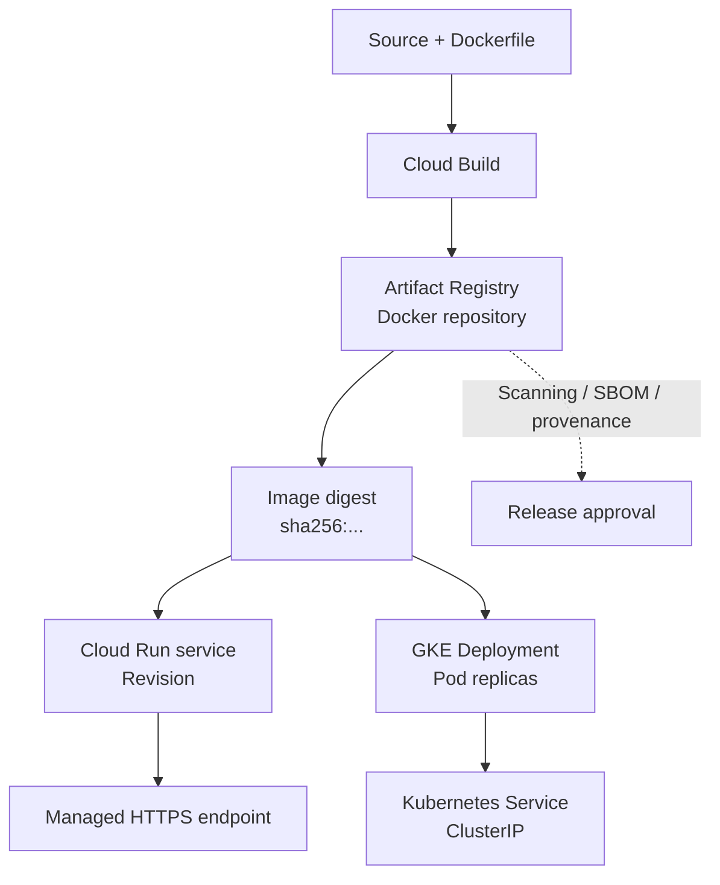
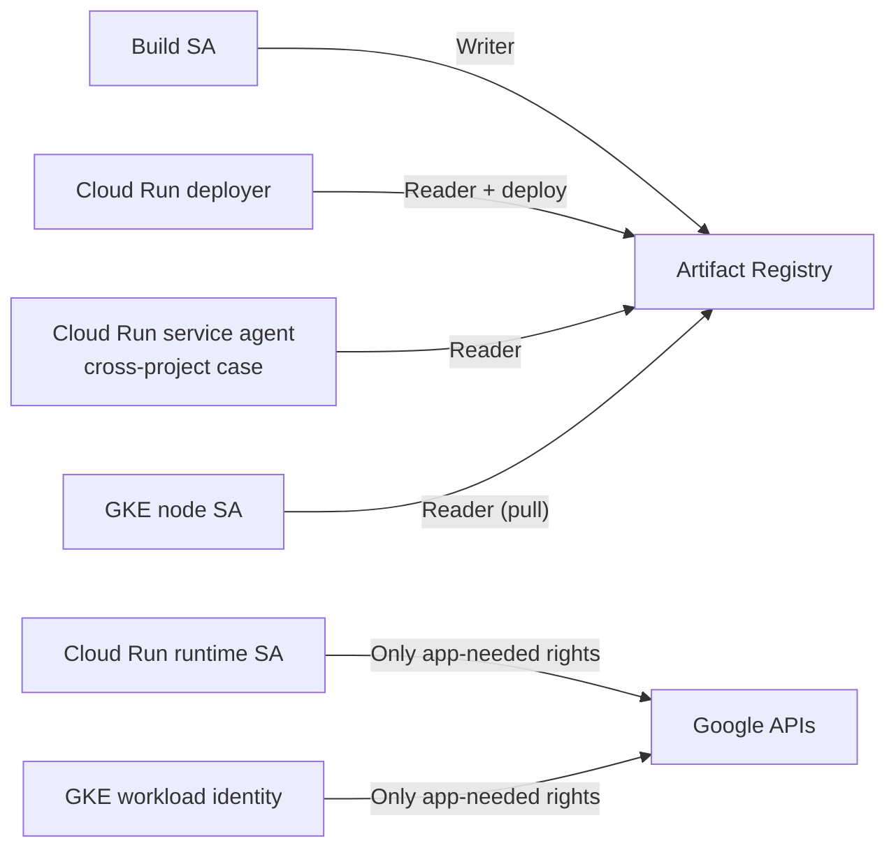
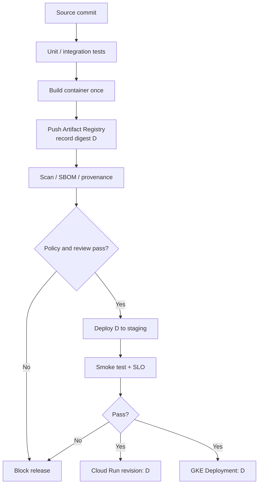
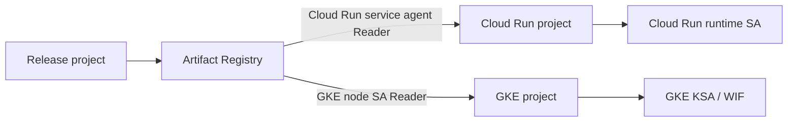

# Hands-On: Releasing a Shared Image for GKE and Cloud Run

A backend team wants to run the same HTTP application on both **Google Kubernetes Engine (GKE)** and **Cloud Run**. If each environment builds a separate container from source, the two deployments can end up with different dependencies, base images, or code snapshots. When an issue occurs, the team struggles to answer: *are both places actually running the exact same tested artifact?*

The solution in this hands-on lesson is **build once, store in Artifact Registry, capture the immutable digest, and deploy that exact digest to Cloud Run and GKE**. Both environments have different operational models, yet the container image itself remains controlled and traceable.

This lesson belongs to the **Containers and Artifact Registry** chapter in the `CLOUD_PROVIDERS_GCP` module, part of the Google Cloud learning path spanning projects, IAM, and VPCs through Compute Engine, GKE, Cloud Run, storage, databases, release automation, and reliability and cost monitoring. All hands-on examples are scoped to an authorized lab project.

## 1. Learning Objectives

Upon completing this lesson, you will be able to:

1. Distinguish **source code**, **container image**, **Docker repository**, **tag**, **digest**, and **OCI image manifest**.
2. Use **Artifact Registry** as a release store, configuring build, push, and pull permissions for the right principals.
3. Build/push images using **Cloud Build** or Docker with appropriate authentication settings.
4. Capture an **image digest `sha256:...`** and bind that exact digest to a Cloud Run revision and a Kubernetes Deployment.
5. Design applications portable across both platforms: `0.0.0.0`, `PORT`, health endpoints, and no reliance on local disks or root privileges.
6. Separate GKE node **image pull** permissions from workload Google Cloud API permissions via Kubernetes ServiceAccounts / Workload Identity Federation.
7. Verify Cloud Run revisions, GKE Pods/Services, responses, and running versions; practice rollouts and rollbacks.
8. Know how to layer in image scanning, SBOMs, provenance, Binary Authorization, IAM, and retention.
9. Evaluate costs and clean up lab resources without deleting artifacts used by other systems.

**Safety scope:** mutating commands apply only to an **authorized lab project** and an **existing test GKE cluster**. This lesson does not create a new GKE cluster and never runs commands on production. Values like `YOUR_LAB_PROJECT_ID` and `YOUR_LAB_CLUSTER` must be replaced with real authorized resources.

## 2. Architecture: One Artifact, Two Runtimes



Cloud Run and GKE do not share a **single running process**—they share the **image artifact**.

| Layer | Cloud Run | GKE |
| --- | --- | --- |
| Deployment unit | Service/revision | Deployment/ReplicaSet/Pod |
| HTTP ingress | Managed URL, HTTPS, and service authentication | Service, Ingress/Gateway, load balancer per design |
| Scaling | Cloud Run autoscaling | Replica count, HPA, node autoscaler |
| Runtime identity | Cloud Run service identity | KSA / Workload Identity Federation for GKE |
| Pulling image from registry | Image imported by Cloud Run at deploy time | GKE node/container runtime pulls as needed |
| Health | Revision startup/readiness and request observability | Startup/readiness/liveness probes |
| Rollback | Route traffic back to prior revision | Rollout undo or set prior image digest |
| Environment configuration | Revision env vars, memory, CPU, secrets | Pod spec, ConfigMap, Secret, resources |

**Important:** sharing the same image does not mean environment variables, API permissions, ingress, firewalls, or databases are automatically identical. The image is a **release input**; runtime configuration is managed independently.

## 3. Tags and Digests: Why Using Only `latest` Is Wrong

Artifact Registry stores Docker/OCI images in the form:

```text
LOCATION-docker.pkg.dev/PROJECT_ID/REPOSITORY/IMAGE:TAG
LOCATION-docker.pkg.dev/PROJECT_ID/REPOSITORY/IMAGE@sha256:FULL_DIGEST
```

| Concept | Meaning | Example |
| --- | --- | --- |
| **Tag** | Human-readable alias; reassignable unless tag immutability is enabled on the repo | `web-demo:lab-v1` |
| **Digest** | Hash of an image manifest or manifest index, pointing immutably to the artifact | `web-demo@sha256:...` |
| **OCI manifest** | Points to layers/config of a single image | `linux/amd64` variant |
| **OCI index** | Can reference multiple images across CPU architectures | `linux/amd64` and `linux/arm64` |

A pipeline building image A and image B both tagged `latest` at different times **does not guarantee the same artifact**. When GKE schedules a new Pod a day later, the tag may point to a different digest. Therefore, **pin the digest after building/scanning** and record that value in your release record.

**Cloud Run** imports the container image when creating a revision and keeps that imported copy while the revision serves; changing a registry tag **does not silently update** existing revisions. **GKE** uses Pod templates and pull policies; pinning `@sha256` ensures Pods always request the exact same artifact, provided the registry still retains it and nodes have read access.

If an image is a **multi-platform index**, the same index digest can hold distinct binaries for x86-64 and Arm64; verify runtime architectures. Cloud Run requires the **Linux x86_64 ABI**, so multi-arch indexes must include `linux/amd64`. This lab assumes GKE x86 nodes or `linux/amd64`-compatible node pools.

## 4. Prerequisites and Required Permissions

You need a Google Cloud project with billing enabled, appropriate Artifact Registry/Cloud Build/Cloud Run APIs, an authenticated CLI, and an **existing test GKE cluster**. Your workstation needs `gcloud`, `kubectl`, and authorized connectivity to the GKE control plane.

| Principal | Action | Reference role / permission |
| --- | --- | --- |
| Registry creator | Create Docker repository | Artifact Registry Admin or minimal repo-create permission |
| **Build service account** | Push image | `roles/artifactregistry.writer` on the repo |
| **Cloud Run deployer** | Deploy image and attach runtime identity | Cloud Run Developer, Artifact Registry Reader, `iam.serviceAccounts.actAs` |
| **Cloud Run service agent** | Pull/import image from another project | Artifact Registry Reader on source repo if cross-project |
| **GKE node service account** | Pull image to start Pods | Artifact Registry Reader on the repo |
| **Kubernetes deployer** | Create Deployment, Service, Namespace | Cluster access + Kubernetes RBAC |
| **Cloud Run runtime SA** | Call Google Cloud APIs while app runs | Only required application permissions |
| **GKE Pod KSA/WIF** | Call Google Cloud APIs from the app | Distinct from node image-pull identity |

**Never grant project-wide Owner/Editor just to fix push/pull errors.** Specifically, a Pod's Workload Identity Federation permissions do **not** replace the **node service account's** image-pull permission. Cloud Build's default service account can also vary across projects; identify the actual principal in build logs before granting Writer.

### 4.1. Bash Environment Variables

```bash
PROJECT_ID="YOUR_LAB_PROJECT_ID"
REGION="asia-southeast1"
REPO="shared-image-lab"
IMAGE_NAME="web-demo"
TAG="lab-v1"

RUN_SERVICE="shared-image-cloudrun"
RUN_SA_NAME="shared-image-run"
GKE_CLUSTER="YOUR_LAB_CLUSTER"
GKE_LOCATION="YOUR_CLUSTER_ZONE_OR_REGION"
NAMESPACE="shared-image-lab"

IMAGE_BASE="$REGION-docker.pkg.dev/$PROJECT_ID/$REPO/$IMAGE_NAME"
IMAGE_TAGGED="$IMAGE_BASE:$TAG"

gcloud --version
kubectl version --client
gcloud auth list
gcloud projects describe "$PROJECT_ID" \
  --format="yaml(projectId,projectNumber,lifecycleState)"
```

Bash and PowerShell differ in variable syntax; examples in this lesson use **Bash**. Do not run verbatim while `PROJECT_ID` or `GKE_CLUSTER` remain placeholders.

### 4.2. Read Resources Before Writing

```bash
gcloud artifacts repositories list \
  --project="$PROJECT_ID" --location="$REGION"

gcloud run services list \
  --project="$PROJECT_ID" --region="$REGION"

gcloud container clusters list \
  --project="$PROJECT_ID" \
  --format="table(name,location,status)"
```

If a repo or service already exists and belongs to another team, **do not overwrite or delete it**. Pick a different name and update all corresponding variables. If the cluster resides in another project, dedicated permissions are required; the cross-project model is explained later.

## 5. Preparing the Shared HTTP Application

Create a separate source directory **on your lab machine**. This lesson does not add source files to the curriculum repository.

### 5.1. `app.py`

```python
import json
import os
from http.server import BaseHTTPRequestHandler, ThreadingHTTPServer

RELEASE = "v1"
APP_NAME = "shared-image-demo"


class Handler(BaseHTTPRequestHandler):
    def do_GET(self):
        path = self.path.split("?", 1)[0]
        if path in ("/", "/version"):
            status = 200
            payload = {"app": APP_NAME, "release": RELEASE}
        elif path == "/healthz":
            status = 200
            payload = {"status": "ok"}
        else:
            status = 404
            payload = {"error": "not_found"}

        body = json.dumps(payload).encode("utf-8")
        self.send_response(status)
        self.send_header("Content-Type", "application/json; charset=utf-8")
        self.send_header("Cache-Control", "no-store")
        self.send_header("Content-Length", str(len(body)))
        self.end_headers()
        self.wfile.write(body)


if __name__ == "__main__":
    port = int(os.environ.get("PORT", "8080"))
    ThreadingHTTPServer(("0.0.0.0", port), Handler).serve_forever()
```

The app provides a database-free health endpoint and returns a fixed version string, making it easy to compare responses across both runtimes. In production, `/healthz` must match startup/readiness/liveness semantics and avoid fragile dependencies on external services.

### 5.2. `Dockerfile`

```dockerfile
FROM python:3.12-slim

ENV PYTHONDONTWRITEBYTECODE=1 \
    PYTHONUNBUFFERED=1

WORKDIR /app
COPY app.py /app/app.py

USER 65532:65532
EXPOSE 8080
CMD ["python", "/app/app.py"]
```

The image runs as a non-root user, contains no secrets, needs no writable disk mounts, and listens on `0.0.0.0:$PORT`. In production, pin the base image by digest, apply security patches, scan dependencies, and use multi-stage builds when compiling native code.

### 5.3. Local Test with Docker (Optional)

```bash
docker build --platform linux/amd64 \
  -t shared-image-demo:local .

docker run --rm -p 8080:8080 shared-image-demo:local
```

From another terminal:

```bash
curl -fsS http://127.0.0.1:8080/healthz
curl -fsS http://127.0.0.1:8080/version
```

Expect `"status":"ok"` and `"release":"v1"`. If local port 8080 is occupied, change the **host** mapping to `-p 18080:8080` rather than changing the port inside the container.

## 6. Preparing the Artifact Registry Docker Repository

A **standard Docker repository** in the same region as your build and Cloud Run simplifies authentication and image locality. Creating a new repo mutates project configuration and may incur storage costs once images are stored.

```bash
# Run only in an authorized lab project; confirm the repo name does not already exist.
gcloud artifacts repositories create "$REPO" \
  --project="$PROJECT_ID" \
  --repository-format=docker \
  --location="$REGION" \
  --description="One image for GKE and Cloud Run lab"

gcloud artifacts repositories describe "$REPO" \
  --project="$PROJECT_ID" \
  --location="$REGION"
```

Verify `format: DOCKER`, region, and repo ownership. Do not create remote/virtual repos when the goal is pushing self-built images. If the Artifact Registry API is not enabled, an administrator can enable `artifactregistry.googleapis.com` in the lab project once authorized.

**Repository security:** CI needs only Writer, GKE nodes need Reader, and the app's runtime SA needs no registry permissions when simply serving JSON. In production, consider **immutable tags** and cleanup policies after confirming rollback retention windows.

## 7. Build Once and Push the Image with Cloud Build

### 7.1. Prepare Cloud Build

The Cloud Build API must be enabled and the build service account must hold `artifactregistry.writer` on the repository. If your organization uses custom worker pools or a dedicated build SA, pass the corresponding flags per your platform team's guidelines. This lab assumes default configuration with proper permissions.

```bash
# Inside the source directory containing only app.py and Dockerfile.
IMAGE_BASE="$REGION-docker.pkg.dev/$PROJECT_ID/$REPO/$IMAGE_NAME"
IMAGE_TAGGED="$IMAGE_BASE:$TAG"

gcloud builds submit . \
  --project="$PROJECT_ID" \
  --region="$REGION" \
  --tag="$IMAGE_TAGGED"
```

**Mutating command:** source is uploaded to build, the builder creates the image, and pushes it to Artifact Registry. Save the **Cloud Build ID** from the output. If the build fails, inspect build SA/repository permissions, the Dockerfile, quotas, and build logs; never grant project-wide Editor as a workaround.

If using the Docker CLI locally instead of Cloud Build:

```bash
gcloud auth configure-docker "$REGION-docker.pkg.dev"
docker build --platform linux/amd64 -t "$IMAGE_TAGGED" .
docker push "$IMAGE_TAGGED"
```

`configure-docker` only sets up the local credential helper; **it does not grant IAM**. Do not run both methods to push to the same tag during a single exercise: two builders can produce different digests.

### 7.2. Registry Readback

```bash
gcloud artifacts docker images list "$IMAGE_BASE" \
  --project="$PROJECT_ID" \
  --include-tags

gcloud artifacts docker images describe "$IMAGE_TAGGED" \
  --project="$PROJECT_ID"
```

Expect tag `lab-v1` attached to a **real digest**. Record the source commit/build ID, image URI, tag, and digest in your release record. Never copy a truncated digest from table output to use as a deployment reference.

## 8. Pinning One Exact Image Digest for Both Runtimes

Grab the **full** digest from `gcloud artifacts docker images list ... --include-tags`, then:

```bash
# Replace placeholder with the actual 64 hex characters returned by Artifact Registry.
DIGEST="sha256:REPLACE_WITH_FULL_DIGEST"
IMAGE_PINNED="$IMAGE_BASE@$DIGEST"

printf 'TAG=%s\n' "$IMAGE_TAGGED"
printf 'PINNED=%s\n' "$IMAGE_PINNED"

# Mandatory check that the URI exists before using in deployments.
gcloud artifacts docker images describe "$IMAGE_PINNED" \
  --project="$PROJECT_ID"
```

**Do not deploy** while `DIGEST` is still a placeholder or `describe` fails to find the image. If Docker Buildx is available, run `docker buildx imagetools inspect "$IMAGE_PINNED"` to inspect platform manifests; for Cloud Run, the image must support `linux/amd64`.

A shared image has two verification levels: the **image/index digest we deploy** and the **actual platform-specific runtime image**. If GKE runs Arm64 nodes, a `linux/arm64` manifest is required; the demo image builds for x86 by default, so pick a compatible node pool.

## 9. Separating Build, Deploy, Image Pull, and Runtime Identities



`app.py` makes no Google Cloud API calls, so **neither the Cloud Run runtime SA nor the GKE workload identity needs application API roles**. A GKE admin can confirm that the node service account is authorized to pull images from Artifact Registry.

For cross-project registries, the source repo admin must grant Reader to the target Cloud Run project's **Cloud Run service agent** and to the GKE project's **GKE node service account**. The Cloud Run deployer also needs its own Reader/deploy permissions. Never default to static JSON service account keys.

### 9.1. Create the Cloud Run Runtime Service Account

```bash
# Mutating: create only in the lab project when no SA with that name exists.
gcloud iam service-accounts create "$RUN_SA_NAME" \
  --project="$PROJECT_ID" \
  --display-name="Lab runtime identity"

RUN_SA_EMAIL="$RUN_SA_NAME@$PROJECT_ID.iam.gserviceaccount.com"

gcloud iam service-accounts describe "$RUN_SA_EMAIL" \
  --project="$PROJECT_ID"
```

Never grant `roles/editor` or `roles/artifactregistry.writer` to this SA. The deployer needs `iam.serviceAccounts.actAs` on the runtime SA; only an authorized admin should grant that permission.

## 10. Deploying the Digest to Cloud Run

**Mutating command creating a service/revision**, run only in an authorized lab project:

```bash
gcloud run deploy "$RUN_SERVICE" \
  --project="$PROJECT_ID" \
  --region="$REGION" \
  --image="$IMAGE_PINNED" \
  --service-account="$RUN_SA_EMAIL" \
  --port=8080 \
  --cpu=1 \
  --memory=256Mi \
  --min-instances=0 \
  --max-instances=2 \
  --no-allow-unauthenticated
```

Key points:

- Image uses **`@sha256:...`**, not `:latest`.
- The service is **private**; requests require a valid Cloud Run Invoker identity.
- The container listens on `0.0.0.0` and `PORT`.
- Instance limits cap only one dimension of capacity, not a hard billing ceiling.
- If an organization policy enforces Binary Authorization, resolve missing attestations per policy—**never disable the policy as a shortcut**.

Readback:

```bash
gcloud run services describe "$RUN_SERVICE" \
  --project="$PROJECT_ID" \
  --region="$REGION" \
  --format="yaml(metadata.name,status.url,status.latestReadyRevisionName,spec.template.spec.containers)"

gcloud run revisions list \
  --project="$PROJECT_ID" \
  --region="$REGION" \
  --service="$RUN_SERVICE"
```

### 10.1. Testing the Private Cloud Run Endpoint

The caller must hold `roles/run.invoker` and a valid identity token.

```bash
RUN_URL="$(gcloud run services describe "$RUN_SERVICE" \
  --project="$PROJECT_ID" \
  --region="$REGION" \
  --format='value(status.url)')"

curl -fsS \
  -H "Authorization: Bearer $(gcloud auth print-identity-token)" \
  "$RUN_URL/version"

curl -fsS \
  -H "Authorization: Bearer $(gcloud auth print-identity-token)" \
  "$RUN_URL/healthz"
```

If you get `403`, check the Cloud Run Invoker role, active account, token audience, and ingress settings—**do not** immediately blame the image. If the service is not Ready, check Cloud Run revision logs and port configuration first.

## 11. Getting GKE Credentials and Verifying Cluster/Nodes

The GKE cluster **must already exist** with nodes compatible with the image. Do not create a cluster in this lab.

```bash
gcloud container clusters describe "$GKE_CLUSTER" \
  --project="$PROJECT_ID" \
  --location="$GKE_LOCATION"

gcloud container clusters get-credentials "$GKE_CLUSTER" \
  --project="$PROJECT_ID" \
  --location="$GKE_LOCATION"

kubectl config current-context
kubectl get nodes -L kubernetes.io/arch
```

`get-credentials` updates kubeconfig on your machine. **Confirm the right context** before every `kubectl apply/delete`, because Kubernetes commands act on the active context rather than gcloud's `PROJECT_ID`.

If the cluster has only Arm64 nodes while the image is `linux/amd64`, select an x86 node pool or build multi-arch—**do not** deploy and expect the runtime to translate binaries automatically.

Check the namespace:

```bash
kubectl get namespace "$NAMESPACE"

# Only if the namespace does not exist and you are authorized to create it:
kubectl create namespace "$NAMESPACE"
```

Never delete an existing namespace belonging to someone else. A `NotFound` result before creation is normal.

## 12. Creating a Deployment and Service on GKE Using the Exact Digest

Use a **Kubernetes Deployment** with two replicas, probes, and modest resource requests. Use **ClusterIP** rather than a public LoadBalancer (avoiding public IPs and unnecessary charges).

### 12.1. Manifest File `k8s.yaml` in the Lab Directory

The Bash heredoc below **creates a file only on the learner's machine**, adding no files to the module repository:

```bash
cat > k8s.yaml <<EOF
apiVersion: apps/v1
kind: Deployment
metadata:
  name: web-demo
  labels:
    app: web-demo
spec:
  replicas: 2
  strategy:
    type: RollingUpdate
    rollingUpdate:
      maxSurge: 1
      maxUnavailable: 0
  selector:
    matchLabels:
      app: web-demo
  template:
    metadata:
      labels:
        app: web-demo
    spec:
      containers:
        - name: web-demo
          image: $IMAGE_PINNED
          imagePullPolicy: IfNotPresent
          ports:
            - name: http
              containerPort: 8080
          securityContext:
            allowPrivilegeEscalation: false
            readOnlyRootFilesystem: true
            runAsNonRoot: true
            runAsUser: 65532
            capabilities:
              drop: ["ALL"]
          resources:
            requests:
              cpu: "100m"
              memory: "128Mi"
            limits:
              cpu: "500m"
              memory: "256Mi"
          startupProbe:
            httpGet:
              path: /healthz
              port: http
            periodSeconds: 5
            failureThreshold: 12
          readinessProbe:
            httpGet:
              path: /healthz
              port: http
            periodSeconds: 5
          livenessProbe:
            httpGet:
              path: /healthz
              port: http
            periodSeconds: 10
---
apiVersion: v1
kind: Service
metadata:
  name: web-demo
spec:
  type: ClusterIP
  selector:
    app: web-demo
  ports:
    - name: http
      port: 8080
      targetPort: http
EOF
```

Verify that `image:` inside the file holds a real `...@sha256:...` URI; if `IMAGE_PINNED` is empty, **do not apply**. `readOnlyRootFilesystem` fits the demo app; apps needing scratch writes must mount a dedicated volume. GKE Autopilot may adjust requests/limits to satisfy platform constraints.

### 12.2. Apply and Read Back

```bash
grep -n 'image:' k8s.yaml

kubectl apply \
  --namespace="$NAMESPACE" \
  -f k8s.yaml

kubectl rollout status \
  --namespace="$NAMESPACE" \
  deployment/web-demo \
  --timeout=180s

kubectl get deployments,replicasets,pods,services \
  --namespace="$NAMESPACE" -o wide

kubectl get deployment web-demo \
  --namespace="$NAMESPACE" \
  -o jsonpath='{.spec.template.spec.containers[0].image}'
```

**Expected evidence:** Deployment references `IMAGE_PINNED`, Pods are `Ready`, and the ClusterIP Service has endpoints. If Pods are not Ready, inspect `kubectl describe pod`, `kubectl get events`, and logs. `ImagePullBackOff` usually points to node SA/repo IAM/path/network; `CrashLoopBackOff` points to code/runtime; `Pending` may indicate resource quotas or scheduling issues.

## 13. Testing the GKE App with `port-forward`

To avoid provisioning a public LoadBalancer for the lab, use `kubectl port-forward` from a machine authorized to reach the Kubernetes API server.

First terminal:

```bash
kubectl port-forward \
  --namespace="$NAMESPACE" \
  service/web-demo \
  18080:8080
```

Second terminal:

```bash
curl -fsS http://127.0.0.1:18080/healthz
curl -fsS http://127.0.0.1:18080/version
```

Expect responses with `"status": "ok"` and `"release": "v1"`, matching the Cloud Run app. Port-forward is a **temporary administrative tunnel** through a selected Pod; it does not validate fault tolerance or public ingress.

If port 18080 is in use, change the **local port** to `18081:8080`. Do not alter the service port. Stop port-forward with Ctrl+C once done testing.

If no response arrives:

```bash
kubectl get pods \
  --namespace="$NAMESPACE" \
  -l app=web-demo -o wide

kubectl get events \
  --namespace="$NAMESPACE" \
  --sort-by=.metadata.creationTimestamp

kubectl logs deployment/web-demo \
  --namespace="$NAMESPACE" \
  --tail=100
```

If `Deployment` is Ready yet the Service does not respond, check selector `app: web-demo`, `port`/`targetPort`, app listener, readiness, and network policies. Never expose public node IPs just to troubleshoot port-forward.

## 14. Verifying Both Runtimes Use the Exact Same Image

**This is the most critical step of the lesson:** identical JSON `"release": "v1"` proves only identical string output, **not the same artifact**. To prove "one image," capture digest evidence.

| Source | Check | Expectation |
| --- | --- | --- |
| Artifact Registry | `docker images describe IMAGE@DIGEST` | Digest D exists with matching metadata |
| Cloud Run | Service/revision readback | Latest revision deployed from URI containing D |
| GKE Deployment | Container image in Pod template | `IMAGE_PINNED` URI with D |
| GKE Pods | Image ID, Ready/Running, logs | Pulled and started cleanly |
| Cloud Run endpoint | Identity-token test | Returns `v1` and health `ok` |
| GKE Service | Port-forward test | Returns `v1` and health `ok` |

### 14.1. CLI Verification

```bash
printf 'Approved image: %s\n' "$IMAGE_PINNED"

gcloud artifacts docker images describe "$IMAGE_PINNED" \
  --project="$PROJECT_ID"

gcloud run services describe "$RUN_SERVICE" \
  --project="$PROJECT_ID" \
  --region="$REGION"

kubectl get deployment web-demo \
  --namespace="$NAMESPACE" \
  -o jsonpath='{.spec.template.spec.containers[0].image}'

kubectl get pods \
  --namespace="$NAMESPACE" \
  -l app=web-demo -o wide
```

Compare the exact registry URI and digest in your build/release record against both runtime configurations. Display fields may normalize differently across APIs—especially with multi-arch OCI indexes—but the **deployed artifact must reference the exact same digest D**.

### 14.2. "Same Image" Is Not "Same App Configuration"

Cloud Run has revision settings, runtime SA, and managed HTTPS. GKE has resource requests/limits, Kubernetes ServiceAccounts, replicas, and network policies. The two environments can connect to different databases, secrets, or configs while sharing the same image.

This aids troubleshooting:

- If both runtimes fail identically on the same input, investigate the app/image.
- If only GKE fails to pull, check node SA / registry permissions.
- If only Cloud Run fails startup, check the container contract, `PORT`, and service settings.
- If latencies differ, inspect scaling, node types, database network paths, and load tests—do not automatically blame image CPU overhead.

## 15. Separating Images, Configuration, and Secrets

An image should contain **code and dependencies**—never passwords, private keys, or hardcoded production endpoints that belong in runtime configuration.

| Information type | Where to place it | Notes |
| --- | --- | --- |
| Code and libraries | Built and scanned image | Pin digest per release |
| Port and resource limits | Cloud Run service or Pod spec | Must satisfy runtime contract |
| Non-sensitive config | Env vars / ConfigMap / config store | May vary per environment |
| Secrets | Secret Manager, Kubernetes Secrets, and approved access controls | Never copy secrets into Dockerfiles/images |
| Google Cloud API access | Cloud Run runtime SA or WIF for GKE | Avoid static JSON keys as default |
| Storage/data | Cloud Storage, databases, supported persistent volumes | Container writable layer is not durable storage |

Changing an environment variable can trigger a new Cloud Run revision or Kubernetes Pod template rollout **without rebuilding the image**. Release records should therefore track both **image digest** and **configuration version**. Same digest with different config can behave differently; auditing by image alone is insufficient.

### 15.1. Workload Identity Federation for GKE

When a Pod needs to call Cloud Storage or Secret Manager:

1. Create a dedicated Kubernetes ServiceAccount for the workload.
2. Configure Workload Identity Federation per GKE and IAM documentation.
3. Grant permissions on the exact bucket/secret to the appropriate principal.
4. Bind the KSA in the Pod spec and test against the real API.

Never store a JSON private key inside a Kubernetes Secret just to obtain Google Cloud credentials. **GKE node image-pull permissions remain separate** and do not flow through the KSA's application roles.

## 16. Releasing Version v2 from the Same Pipeline

Suppose after verifying v1, you update the source:

```python
RELEASE = "v2"
```

Build a **new image**, new tag, and new digest; never overwrite existing images or reuse tag `lab-v1`.

### 16.1. Build and Record D2

```bash
TAG="lab-v2"
IMAGE_TAGGED="$IMAGE_BASE:$TAG"

gcloud builds submit . \
  --project="$PROJECT_ID" \
  --region="$REGION" \
  --tag="$IMAGE_TAGGED"

gcloud artifacts docker images list "$IMAGE_BASE" \
  --project="$PROJECT_ID" \
  --include-tags
```

From the output, extract the real digest D2:

```bash
IMAGE_V2_PINNED="$IMAGE_BASE@sha256:REPLACE_WITH_V2_DIGEST"

gcloud artifacts docker images describe "$IMAGE_V2_PINNED" \
  --project="$PROJECT_ID"
```

Deploy only after testing and security approvals complete. **Keep D1 intact** in the registry throughout the rollback window.

### 16.2. Cloud Run: New Revision Deployed Without Traffic Shift

```bash
# MUTATING: creates a revision from D2 without shifting traffic yet.
gcloud run deploy "$RUN_SERVICE" \
  --project="$PROJECT_ID" \
  --region="$REGION" \
  --image="$IMAGE_V2_PINNED" \
  --service-account="$RUN_SA_EMAIL" \
  --no-traffic \
  --no-allow-unauthenticated

gcloud run revisions list \
  --project="$PROJECT_ID" \
  --region="$REGION" \
  --service="$RUN_SERVICE"
```

`--no-traffic` helps validate a new revision before rollout. To test that revision in isolation, an admin can assign a **traffic tag** and invoke the tagged revision URL with authentication. After canary validation, shift traffic using the **actual revision name**—never guess revision names from image tags.

To roll back, route traffic back to the verified D1 revision or redeploy the exact D1 URI. **Never rebuild old source hoping the new digest matches D1.**

### 16.3. GKE: Rolling Update and Rollback

```bash
kubectl set image \
  --namespace="$NAMESPACE" \
  deployment/web-demo \
  "web-demo=$IMAGE_V2_PINNED"

kubectl rollout status \
  --namespace="$NAMESPACE" \
  deployment/web-demo \
  --timeout=180s

kubectl rollout history \
  --namespace="$NAMESPACE" \
  deployment/web-demo
```

With `maxSurge=1` and `maxUnavailable=0`, Kubernetes replaces Pods gracefully; rollouts can still stall due to quotas/CPU, image pull errors, or failing readiness probes.

Rollback:

```bash
kubectl rollout undo \
  --namespace="$NAMESPACE" \
  deployment/web-demo

kubectl rollout status \
  --namespace="$NAMESPACE" \
  deployment/web-demo
```

`rollout undo` relies on retained revision history/ReplicaSets. To guarantee exact D1, explicitly set the image back to the D1 URI from the release record. Post-rollback, verify the image reference, Pod readiness, and application responses.

**Rolling back containers does not roll back databases.** If v2 altered schemas or state, plan data migration/compatibility separately.

## 17. Production CI/CD: Build Once, Promote by Digest

The lab uses manual commands for clarity. Production projects should run a gated pipeline:



### 17.1. Release Record

```yaml
release:
  source_commit: GIT_COMMIT_SHA
  build_id: CLOUD_BUILD_ID
  image: asia-southeast1-docker.pkg.dev/PROJECT/REPO/web-demo
  tag: lab-v1
  digest: sha256:REPLACE_WITH_REAL_DIGEST
  scan_status: approved
targets:
  cloud_run: shared-image-cloudrun
  gke_namespace: shared-image-lab
  gke_deployment: web-demo
```

This is a **logging/record template**, not YAML you apply directly to GKE or Cloud Run. Digest and build ID values must come from the actual build system with auditability and approver attribution.

### 17.2. Why Not Build Separately for Each Runtime?

Two builds from the same source commit can diverge when base image tags shift, dependencies resolve newer versions, or toolchains/timestamps differ. Pinning one digest post-scan prevents drift and makes rollbacks deterministic.

**Exception:** if two runtimes require incompatible architectures or native dependencies, use a **multi-platform index** or explicitly managed image variants. Name architectures clearly, test each variant, and never claim "identical binaries" just from a shared tag.

### 17.3. Promotion Tooling

Cloud Deploy or other CI/CD systems can orchestrate approvals, canaries, and releases across supported targets. Review current product docs and IAM requirements before integrating. Regardless of tooling, the rule stays the same: **promote the verified digest** rather than re-running `docker build` per stage.

## 18. Artifact Registry Governance and Supply Chain Security

An immutable digest proves **artifact identity**, not **absence of vulnerabilities**.

| Layer | Controls to consider |
| --- | --- |
| **Source** | Code review, dependency locks, SAST/secrets scanning |
| **Base image** | Trusted publishers, version/digest pinning, CVE updates |
| **Build** | Dedicated SA, reproducibility, provenance, build logs |
| **Registry** | Repository IAM, immutable tags, cleanup policies |
| **Image analysis** | Artifact Analysis scanning, SBOMs, license and risk triage |
| **Release** | Digest selection post-approval, verification policies, auditing |
| **Deployment** | Binary Authorization on GKE/Cloud Run where required |
| **Runtime** | Non-root, least privilege, network policies, no hardcoded secrets |
| **Operations** | New CVEs, rebuild/redeploy, retain artifacts for rollback |

**Artifact Analysis** detects package vulnerabilities and stores metadata, yet new findings **do not auto-replace** running images. A v1 image at digest D1 remains D1; picking up a patched base requires building D2, scanning/testing, and rolling out safely.

**Binary Authorization** has distinct setup models for GKE and Cloud Run. If a policy requires attestations, release artifacts for both runtimes must satisfy the matching rules. Never turn on `deny-all` in production without allowlists, attestors, and dry-run testing.

**Cleanup policies** cut retention costs, but must never delete digests referenced by GKE or needed for rollback. Cloud Run imports images at deploy time; GKE still relies on the registry whenever new Pods pull images later.

## 19. Cross-Project Release: Shared Registry, Separate Runtime Projects

In larger organizations, the registry may live in `release-artifacts` while Cloud Run and GKE run in separate application projects.



To deploy:

1. The Cloud Run deployer has image read permission and Cloud Run deploy permission in the Cloud Run project.
2. The target project's Cloud Run service agent needs **Artifact Registry Reader** on the source repo for cross-project images.
3. The GKE node service account needs **Artifact Registry Reader** on the source repo.
4. GKE users/deployers need appropriate IAM and Kubernetes RBAC.
5. VPC Service Controls, organization policies, OAuth scopes, network access, and Binary Authorization must permit access.

**Never** grant `roles/artifactregistry.writer` to GKE nodes just to pull, and never default to static JSON SA keys inside Kubernetes Secrets. On `ImagePullBackOff`, inspect node identity, image path, repository permissions, and node networking.

## 20. Monitoring and Operations

### 20.1. Cloud Run

Monitor revision readiness, traffic splits, request counts, p95/p99 latency, 4xx/5xx rates, instance counts, startup time, CPU/memory, and logs.

```bash
gcloud run services describe "$RUN_SERVICE" \
  --project="$PROJECT_ID" \
  --region="$REGION"

gcloud run revisions list \
  --project="$PROJECT_ID" \
  --region="$REGION" \
  --service="$RUN_SERVICE"
```

### 20.2. GKE

Monitor desired/ready replicas, rollout history, container restarts, node architecture, resource quotas, CPU/memory, and Kubernetes events.

```bash
kubectl get deployment web-demo \
  --namespace="$NAMESPACE" -o wide

kubectl get pods \
  --namespace="$NAMESPACE" \
  -l app=web-demo -o wide

kubectl get events \
  --namespace="$NAMESPACE" \
  --sort-by=.metadata.creationTimestamp
```

An image may run cleanly on Cloud Run yet **clash with GKE memory limits, startup probes, or node capacity**. If error rates differ, check runtime config, network/data paths, and load before blaming application code.

### 20.3. Operational Goals

Every release needs:

- **Provenance evidence:** source commit / build ID / digest.
- **Runtime evidence:** Cloud Run revision Ready and GKE Pods Ready.
- **Functional evidence:** passing smoke tests, not just deploy command exit code 0.
- **Security evidence:** no unintended public exposure; passing scans/policies.
- **Cost evidence:** resource quotas/budgets and baseline alerts.
- **Rollback path:** D1 and prior revisions/manifests retained sufficiently long.

## 21. Troubleshooting: Which Step Failed?

| Symptom | Common cause | How to verify |
| --- | --- | --- |
| Build cannot push | Build SA lacks Writer or repo missing | Build logs, repo IAM, image path |
| Docker reports unauthorized | Credential helper unconfigured or missing IAM | `gcloud auth configure-docker`, registry roles |
| Tag exists, wrong digest | Tag overwritten or wrong version selected | `docker images list --include-tags`, build ID |
| Cloud Run cannot pull image | Deployer/service agent lacks Reader, wrong URI | Repo describe, IAM, and deploy logs |
| Cloud Run revision not Ready | Port/`0.0.0.0`, startup crash, memory | Cloud Run logs, container contract |
| Cloud Run returns 403 | Private service or wrong ID token/Invoker | Cloud Run IAM, audience, ingress |
| GKE `ImagePullBackOff` | GKE node SA cannot read registry; path/network | Pod events, node SA, repo IAM |
| GKE `CrashLoopBackOff` | Wrong ISA binary, missing dependency, or code crash | `kubectl logs`, image manifest, node arch |
| GKE `Pending` | Insufficient CPU/RAM/quota/taint mismatch | `kubectl describe pod`, node scheduling |
| Port-forward unreachable | Service selector/port mismatch, Pod not Ready | `kubectl describe service`, endpoints, probes |
| Same tag, different responses | Mutable tag, separate builds, different runtime config | Compare digests and env/config records |
| Cloud Run still serves v1 after pushing v2 tag | Revision imported earlier image | Deploy revision with new digest |
| GKE rollback fails after deleting image | D1 missing from registry for node pull | Retain digest D1; review cleanup policy |
| New CVE reported, image unchanged | Scanning does not auto-patch artifacts | Rebuild D2 from patched base, test/redeploy |
| Cross-project deployment fails | Missing service agent/node Reader on source repo | IAM scope/source project, VPC SC |
| Costs rise post-lab | Registry images, GKE nodes/Pods, Cloud Run, logs | Billing by SKU and cleanup checklist |

**Standard sequence:** verify URI/digest in Artifact Registry → build/push/pull permissions → platform/architecture → service readiness → logs/events → auth/network → application behavior. Never fix issues by granting `allUsers` registry pull or project-wide Editor.

## 22. Costs and Resource Limits

| Service | Cost drivers | How to control |
| --- | --- | --- |
| Artifact Registry | Image/layer storage, network operations/egress | Cleanup policies past rollback window |
| Cloud Build | Build compute, worker pools, log/source staging | Build when needed, sensible caching, budgets |
| Cloud Run | CPU/memory/requests/egress per pricing model | `max-instances`, runtime metrics |
| GKE | Cluster, node VMs, Persistent Disks, networking | Use existing lab cluster, small Pod requests |
| Security scanning | Artifact Analysis per enabled features/pricing | Align scope with requirements and budget |
| Logging/Monitoring | Ingestion/retention, alerts | Never log secrets; tune sampling/retention |
| Cross-region | Network egress/cross-region transfer | Co-locate registry and runtimes sensibly |

**Budget alerts do not automatically stop spending.** `max-instances` on Cloud Run or 2 replicas on GKE cap only part of resource usage, not your entire bill. This lab avoids creating a public LoadBalancer on GKE to limit unnecessary resources and fees.

## 23. Design Scenario: An API Using Both GKE and Cloud Run

An enterprise wants GKE to run internal APIs needing Kubernetes networking, while Cloud Run serves a secondary endpoint for experimentation.

| Question | Cloud Run | GKE |
| --- | --- | --- |
| Approved image | `web-demo@sha256:D1` | `web-demo@sha256:D1` |
| Runtime identity | Cloud Run SA | KSA + WIF as needed |
| Who pulls the image? | Deployer/service agent per image project model | GKE node SA |
| Deployment unit | Revision | Deployment/Pods |
| Health | Revision readiness and HTTP tests | Probes + Pods Ready |
| Scale | Managed per request | Replicas/HPA/nodes |
| Network | Managed HTTPS, ingress/IAM | Service ClusterIP / Ingress / Gateway |
| Rollback | Route traffic to D1 revision | `rollout undo` or set D1 image |
| Logs | Cloud Run Logging | GKE container/cluster logs |

The release team still must plan **database schema compatibility**, configuration drift, and secret management. Sharing a source commit/image does not guarantee identical state, latency, or SLOs across both environments.

## 24. Self-Practice Exercises

### Exercise 1 — Mutable Tags

CI build A pushes `:latest` to Cloud Run; CI build B overwrites `:latest` before GKE deploys.

*Guiding answer:* Both runtimes can receive different digests. Build once, capture the full digest from Artifact Registry, approve it, and pin `@sha256` on both.

### Exercise 2 — Cloud Run Works, GKE Pull Fails

Cloud Run deploys an Artifact Registry image cleanly, while a GKE cluster in another project reports `ImagePullBackOff`.

*Guiding answer:* Verify whether the **GKE node service account** holds Artifact Registry Reader on the source repository, plus scopes/egress and image path. Application-level KSA/WIF roles do not grant image pull rights.

### Exercise 3 — Cloud Run Receives No Requests

The image runs on GKE, yet the server only binds `127.0.0.1:8080`.

*Guiding answer:* Update the app to bind `0.0.0.0` and read `PORT`. Then build a **new digest**, test, and deploy; an already-published digest cannot be mutated.

### Exercise 4 — Same Digest, Different Behavior

Cloud Run returns HTTP 200 while GKE returns 500 because the `DB_HOST` environment variable differs.

*Guiding answer:* A shared image removes drift only at the artifact layer. Inspect deployment configs, secrets, networking, and databases; do not rebuild the image when the bug is configuration.

### Exercise 5 — Why Doesn't Rollback Rebuild?

After v2 fails, the team plans to rebuild v1 from Git.

*Guiding answer:* Rebuilding may pull newer base images/dependencies and fail to reproduce D1. Keep approved digest D1; revert Cloud Run to the D1 revision and GKE to image D1.

### Exercise 6 — One Index, Two Platforms

GKE runs Arm64 nodes while Cloud Run runs x86. An OCI index contains `linux/amd64` and `linux/arm64`.

*Guiding answer:* Both can reference the same index digest, yet runtimes execute **two platform-specific binaries**. Test and scan both variants, and note Cloud Run requires amd64.

### Exercise 7 — Does the Runtime SA Need Writer?

The app only returns JSON, and the team plans to grant Artifact Registry Writer to the Cloud Run runtime SA.

*Guiding answer:* No. Writer belongs to build/push identities. Cloud Run deployers/service agents and GKE node SAs need read access where applicable. Runtime SAs need only permissions for Google APIs the app calls.

### Exercise 8 — Pods Ready, Service Fails

The Deployment has two Ready Pods, yet `kubectl port-forward service/web-demo` returns connection refused.

*Guiding answer:* Check Service selector/endpoints/`targetPort`, app listening address, container port, and probes. Never expose a public LB to mask internal config bugs.

### Exercise 9 — Scanner Reports a New CVE

Image D1 is deployed when the scanner flags a new base-image vulnerability.

*Guiding answer:* Digest D1 will not auto-patch. Assess risk, update the base image, build D2, scan/test, and roll out with a rollback path. Binary Authorization/security gates enforce deploy policy rather than patching images.

### Exercise 10 — Cleanup Affecting Production

The lab Artifact Registry repository shares the same repo as production, and D1 is actively used by production GKE.

*Guiding answer:* **Never delete D1 or the repository.** Clean up only the lab Cloud Run service and lab namespace, then coordinate with the repo owner to verify which artifacts truly have no dependents.

## 25. Deployment and Release Checklist

- [ ] Project, repo, region, cluster, and namespace confirmed as **lab** and authorized.
- [ ] App exposes `/healthz`, `/version`, and binds `0.0.0.0:$PORT`.
- [ ] Image supports `linux/amd64` for Cloud Run and matches GKE node architecture.
- [ ] Dockerfile contains no secrets, runs non-root, and uses a managed base image.
- [ ] Cloud Build builds once with a unique build ID and release tag.
- [ ] Artifact Registry stores full digest D, confirmed via `describe`.
- [ ] Build Writer, Cloud Run deployer/service agent, GKE node Reader, and runtime identities are separated.
- [ ] Cloud Run deploys `IMAGE_PINNED` with proper authentication; revision Ready.
- [ ] GKE Deployment sets `image: IMAGE_PINNED`, Pods Ready, and ClusterIP Service working.
- [ ] Both endpoints return the right version; digests compared directly, not just JSON.
- [ ] Release record captures commit, build ID, digest, security gate, and approver.
- [ ] Upgrade path to v2, canary, rollout, and rollback to D1 verified.
- [ ] Logs/metrics track errors, readiness, cached images, quotas, and costs.
- [ ] Digests needed for GKE scale-out or rollback are preserved.
- [ ] Neither GKE Service nor Cloud Run is exposed publicly by accident.

## 26. Cleaning Up the Lab Without Disrupting Other Workloads

**Delete only resources created by this lab** after confirming no systems depend on the digest or namespace. The following commands are **destructive**.

### 26.1. Preflight Cleanup (Read-Only)

```bash
kubectl config current-context

kubectl get all --namespace="$NAMESPACE"

gcloud run services describe "$RUN_SERVICE" \
  --project="$PROJECT_ID" --region="$REGION"

gcloud artifacts repositories describe "$REPO" \
  --project="$PROJECT_ID" --location="$REGION"

gcloud artifacts docker images list "$IMAGE_BASE" \
  --project="$PROJECT_ID" --include-tags
```

If the namespace holds someone else's workloads or the repo holds shared images, do not delete the namespace or repository. If `GKE_CLUSTER` is a production cluster, **do not run any deletion commands**.

### 26.2. Delete the Lab Cloud Run Service and Namespace

```bash
# MUTATING: only if these resources belong strictly to the lab.
gcloud run services delete "$RUN_SERVICE" \
  --project="$PROJECT_ID" --region="$REGION"

kubectl delete namespace "$NAMESPACE"
```

Deleting a Cloud Run service does not delete images in the registry. Deleting a Kubernetes namespace does not delete the GKE cluster, nodes, cached image layers, or Cloud Logging data.

### 26.3. Delete the Repository Only If Dedicated Exclusively to the Lab

If the repo was created **solely for this lesson**, holds no other artifacts, and has no deployments pulling from it:

```bash
# DESTROYS THE ENTIRE repo: run ONLY for an EXCLUSIVE LAB repository.
gcloud artifacts repositories delete "$REPO" \
  --project="$PROJECT_ID" --location="$REGION"
```

**Do not run** on a shared repository. To delete a single image, verify its tag/digest, release history, cleanup policy, and owner; never delete D1 while GKE might still launch Pods from D1. Cloud Build, source staging, and logging costs may remain and should be inventoried separately.

### 26.4. Runtime Service Account

If `RUN_SA_EMAIL` was created strictly for the lab, has no other workloads using it, and IAM bindings have been reviewed:

```bash
gcloud iam service-accounts delete "$RUN_SA_EMAIL" \
  --project="$PROJECT_ID"
```

Deleting an account can break configurations referencing that email; check before deleting. Billing data lags behind real time; keep monitoring after cleanup to verify costs.

## 27. Official Google Cloud References

- [Artifact Registry — Docker repositories](https://cloud.google.com/artifact-registry/docs/docker/store-docker-container-images): creating and configuring repositories.
- [Push and pull container images](https://cloud.google.com/artifact-registry/docs/docker/pushing-and-pulling): image URIs, tags, digests, and Docker authentication.
- [Artifact Registry authentication](https://cloud.google.com/artifact-registry/docs/docker/authentication): `gcloud auth configure-docker` and access permissions.
- [Build and push Docker images with Cloud Build](https://cloud.google.com/build/docs/build-push-docker-image): `gcloud builds submit --tag`.
- [Deploy container images to Cloud Run](https://cloud.google.com/run/docs/deploying): deploying by URI and required permissions.
- [Cloud Run container runtime contract](https://cloud.google.com/run/docs/container-contract): `PORT`, `0.0.0.0`, and image architecture.
- [Artifact Registry integration with GKE](https://cloud.google.com/artifact-registry/docs/integrate-gke): GKE node service accounts and cross-project pulls.
- [Artifact Registry integration with Cloud Run](https://cloud.google.com/artifact-registry/docs/integrate-cloud-run): deployers and service agents.
- [Deploy apps to GKE](https://cloud.google.com/kubernetes-engine/docs/how-to/deploying-a-container): Kubernetes Deployments and Services.
- [List container images and digests](https://cloud.google.com/sdk/gcloud/reference/artifacts/docker/images/list): inspecting tags and digests.
- [Describe Artifact Registry images](https://cloud.google.com/sdk/gcloud/reference/artifacts/docker/images/describe): querying images by tag/digest.
- [Artifact Analysis scanning](https://cloud.google.com/artifact-analysis/docs/container-scanning-overview): vulnerability detection and metadata.
- [Binary Authorization for GKE](https://cloud.google.com/binary-authorization/docs/setting-up): policy verification before deployment.
- [Binary Authorization for Cloud Run](https://cloud.google.com/binary-authorization/docs/run/enabling-binauthz-cloud-run): enforcement on Cloud Run.
- [Manage container images and cleanup](https://cloud.google.com/artifact-registry/docs/docker/manage-images): retention and cleanup.
- [Artifact Registry pricing](https://cloud.google.com/artifact-registry/pricing), [Cloud Build pricing](https://cloud.google.com/build/pricing), [Cloud Run pricing](https://cloud.google.com/run/pricing), and [GKE pricing](https://cloud.google.com/kubernetes-engine/pricing).

**Conclusion:** releasing a shared image across GKE and Cloud Run is more than pointing both to the same tag. A sound workflow produces **one artifact with an immutable digest**, records release metadata and approvals, binds **that exact digest** to both the Cloud Run revision and the GKE Deployment, separates build/pull/runtime permissions, verifies readiness and HTTP responses, and prepares rollbacks. Once you can clearly answer "which source, which digest, who approved it, where it is running, and what to revert to," releases become genuinely traceable and controllable.
