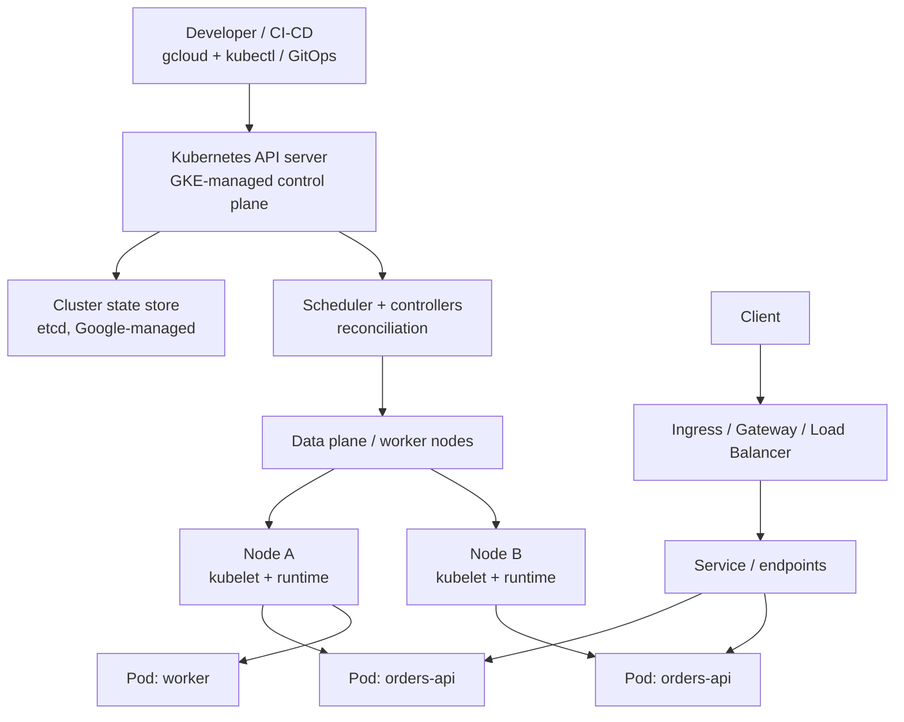
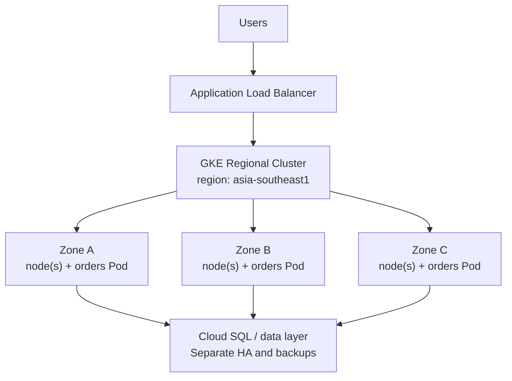
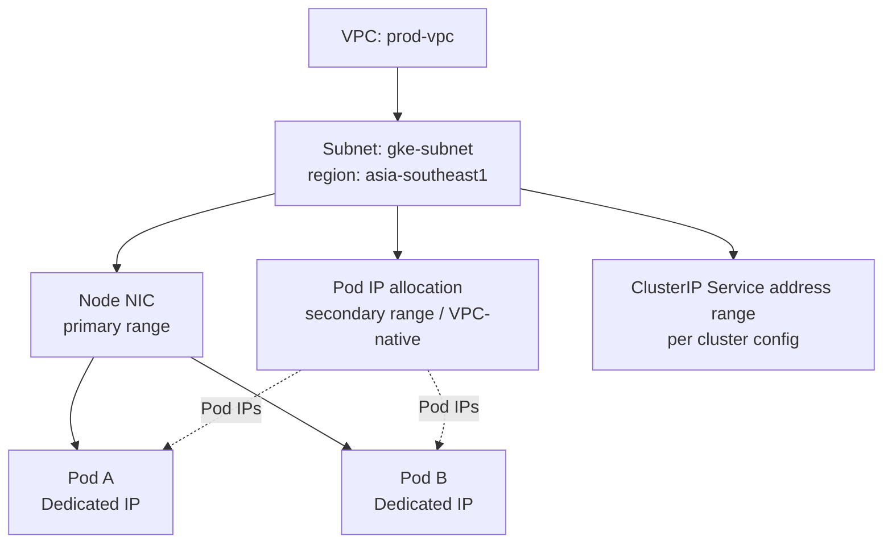
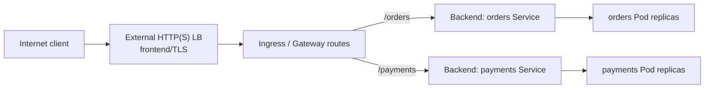
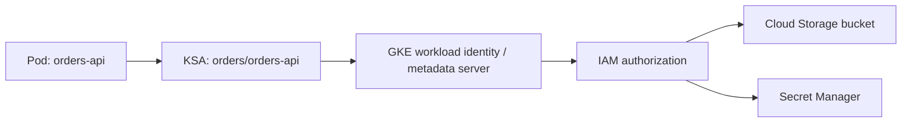
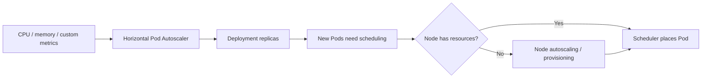
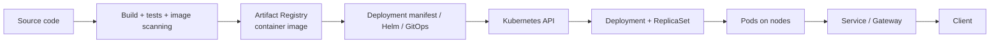

# Google Kubernetes Engine (GKE) Architecture

An order-processing application can start with a single Compute Engine VM and one web process. As the system grows, the engineering team needs to run multiple replicas, self-heal when a process fails, roll out new versions with zero downtime, distribute traffic across multiple machines, protect secrets, and scale capacity according to load. **Kubernetes** provides the objects and controllers to describe the *desired state* of containerized workloads; **Google Kubernetes Engine (GKE)** is a managed Kubernetes service from Google Cloud that helps operate those clusters on Google Cloud infrastructure.

This lesson belongs to the **GKE Fundamentals** chapter of the `CLOUD_PROVIDERS_GCP` module. GKE brings together concepts from project organization, IAM, VPC, Compute Engine, load balancing, Cloud Storage, databases, and CI/CD. To make sound choices with GKE, learners need to understand the architecture of the **control plane, data plane, nodes, Pods, Services, networking, identity, storage, and automated control loops**, as well as which responsibilities belong to Google Cloud and which remain with the operations team.

> The project names, cluster names, regions, and images in the examples are illustrative. Commands that modify resources are clearly marked. Kubernetes versions, GKE Standard/Autopilot options, networking modes, and additional features may change; consult the official documentation when deploying to production.

## 1. Learning Objectives

After this lesson, you will be able to:

1. Explain **cluster, control plane, node, node pool, Pod, Deployment, ReplicaSet, Service, Ingress, and Gateway** in GKE.
2. Distinguish between **Google-managed control plane** responsibilities and user responsibilities for configuring workloads and nodes.
3. Compare **GKE Standard** and **GKE Autopilot** in terms of control, provisioning, security, operations, and cost models.
4. Understand **zonal/regional** boundaries, multi-zone design, scalability, and high availability.
5. Describe the path of a request from **Load Balancer → Service/backend → Pod**, along with VPC-native Pod networking, DNS, and NetworkPolicy.
6. Distinguish between **Google Cloud IAM, Kubernetes RBAC, Kubernetes ServiceAccount, node service account, and Workload Identity Federation for GKE**.
7. Choose storage approaches using **PersistentVolumeClaim/CSI drivers**, distinguishing ephemeral Pod data from persistent storage.
8. Inspect cluster configuration and deploy a sample application using `gcloud` and `kubectl`; identify common reasons why a Pod is not ready.
9. Evaluate risks, operability, observability, quotas, and costs before using GKE for production applications.

## 2. The Big Picture of GKE

A **Kubernetes cluster** consists of a **control plane** and **worker nodes** (or Pod execution infrastructure managed by GKE depending on the mode). Applications typically run inside **Pods**, while the control plane watches Kubernetes resources and works to reconcile the actual state toward the desired state.



This is a **conceptual diagram**, not an exact protocol diagram for every GKE version: actual dataplane mechanisms, controllers, endpoints, and load balancers depend on the cluster mode and enabled features. The key idea is that **operators submit declarations to the API**, and then controllers coordinate to schedule and maintain workloads, rather than SSHing into individual VMs to run containers manually.

### 2.1. Concepts to Distinguish

| Component | What Is It? | Primary Responsibility |
| --- | --- | --- |
| **GKE cluster** | Managed Kubernetes environment and its associated resources. | Provides the Kubernetes API and infrastructure for running workloads. |
| **Control plane** | Group of Kubernetes orchestration components operated by GKE. | Manages cluster state, scheduling, reconciliation, and the API. |
| **Node** | Machine that executes Pods; in Standard, typically a Compute Engine VM managed by GKE via a node pool. | Runs the container runtime, kubelet, networking, and system components. |
| **Node pool** | Group of nodes sharing a common configuration in Standard. | Machine type, image, disk, zone, autoscaling, and upgrades. |
| **Pod** | Smallest deployable unit; contains one or more containers sharing networking/local storage as configured. | Runs an instance of a workload. |
| **Deployment** | Kubernetes controller managing a set of stateless Pods via a ReplicaSet. | Maintains replicas and performs version rollouts. |
| **Service** | Stable access endpoint for a set of Pods/endpoints. | Discovery and internal traffic distribution based on Service type. |
| **Ingress / Gateway** | APIs for managing HTTP(S)/L4 traffic according to their respective controllers and features. | Declares routes and creates/configures load balancing when a controller is present. |
| **ConfigMap / Secret** | Objects providing configuration and sensitive data to Pods. | Decouples configuration from images; Secrets still require access control and encryption. |
| **PersistentVolume / PVC** | Abstraction for persistent storage requested by a workload. | Connects to a supported storage type/CSI driver. |

## 3. Control Plane: The GKE-Managed Orchestration Brain

### 3.1. Kubernetes API Server

The **API server** is the entry point to Kubernetes. Operations such as `kubectl apply`, `kubectl get`, or actions from controllers/CI all interact with the API server. It performs authentication, authorization, and admission according to configuration; Kubernetes objects are then persisted in the cluster state store.

For example, when declaring:

```yaml
apiVersion: apps/v1
kind: Deployment
metadata:
  name: orders-api
spec:
  replicas: 3
  selector:
    matchLabels:
      app: orders-api
  template:
    metadata:
      labels:
        app: orders-api
    spec:
      containers:
        - name: orders-api
          image: REGION-docker.pkg.dev/PROJECT_ID/apps/orders-api:VERSION
```

Kubernetes receives the request stating "3 Pods are desired," and the controllers work to create and maintain 3 replicas subject to constraints. The manifest above is only to illustrate the **meaning of a Deployment**, not a complete production file: the image is a placeholder, and readiness probes, resource requests/limits, service account, security context, and traffic exposure mechanisms are not yet declared.

### 3.2. etcd and Cluster State

**etcd** is the distributed key-value store that holds Kubernetes state such as Deployments, Services, ConfigMaps, and other Kubernetes objects. In GKE, Google manages the control plane infrastructure and related maintenance tasks according to the cluster mode.

Do not confuse the control plane state store with a business data store. **etcd does not replace Cloud SQL or an application database**; do not store transactional data or large files in Kubernetes ConfigMaps or Secrets.

### 3.3. Scheduler and Controllers

- **Scheduler** decides which node a new Pod can be placed on based on **resource requests, selectors, affinity, taints/tolerations, topology, node capabilities**, and other constraints.
- **Deployment/ReplicaSet controller** ensures the desired number of Pods are created, updated, or replaced.
- **Node controller** and other controllers monitor cluster and resource health.
- **GKE/cloud controllers and add-ons** coordinate with Google Cloud to provide load balancing, storage, networking, or corresponding capabilities.

**Reconciliation** is a continuous loop comparing actual state against desired state, not a one-off script. For example, if a Pod belonging to a Deployment is deleted, the controller can create a replacement Pod if resource conditions permit.

### 3.4. A Managed Control Plane Does Not Mean Everything Is Automatic

Google Cloud operates the control plane, including critical Kubernetes infrastructure provided by the service. However, customers still need to:

- Choose the cluster mode, location, networking, version/release channel, and supported policies.
- Configure IAM/RBAC, namespaces, workload identity, secrets, and admission controls.
- Define Deployments, Services, network access, Pod resources, and health probes.
- Ensure applications have backups, rollout/rollback procedures, logging/monitoring, and persistent data management.
- Test compatibility during Kubernetes upgrades, API deprecations, and add-on updates.

That is the difference between **managed Kubernetes** and a **managed application**: GKE manages the Kubernetes infrastructure layer, but it does not automatically guarantee correct application code or sufficient database capacity.

## 4. Data Plane: Nodes, kubelet, Container Runtime, and Pods

### 4.1. Nodes and Node Pools

In **GKE Standard**, users typically create clusters with **node pools**. A node pool groups VMs with largely uniform configuration: machine series/type, image, boot disk, deployment zones, service account, labels, taints, and security/scaling options.

Each node runs the components required to execute workloads, including:

- **kubelet**: agent that communicates with the control plane and manages the lifecycle of Pods/containers on the node.
- **Container runtime**: pulls container images and starts containers per the Kubernetes specification; do not assume a single specific runtime across all GKE versions.
- **Networking/data plane components**: handle Pod addressing, routing, and Service traffic according to the cluster configuration.
- **System Pods/daemons**: logging, metrics, DNS, or system tasks provisioned depending on the cluster.

**A node pool is not a Deployment.** A node pool adjusts the machines available to run Pods; a Deployment adjusts the number of application Pods. A cluster with 20 Pods can still have only a few nodes if each node has enough CPU/memory and the scheduler can place them.

### 4.2. A Pod Is a Deployment Unit, Not a Separate VM

A Pod contains one or more containers sharing:

- **Network namespace**: containers in the same Pod share an IP address and can call each other over `localhost` on the appropriate ports.
- **Volumes** declared and mounted into the containers within the Pod.
- **Lifecycle**: if a Pod is replaced, the new Pod may receive a **different IP** and run on a different node.

**Do not hardcode Pod IPs into application configuration.** Use Kubernetes Services, DNS, or an appropriate service discovery mechanism for communication. Data written to the ephemeral filesystem inside a container/Pod can be lost when the Pod is replaced.

### 4.3. Resource Requests and Limits

The scheduler primarily relies on **resource requests** when evaluating whether a node has enough capacity to place a Pod. **Resource limits** govern runtime resource usage depending on the resource type and enforcement mechanism.

Example:

```yaml
resources:
  requests:
    cpu: "250m"
    memory: "256Mi"
  limits:
    cpu: "1"
    memory: "512Mi"
```

Meaning:

- A `250m` CPU request is 0.25 vCPU in Kubernetes notation.
- A 256 MiB memory request is used for scheduling/accounting.
- If a container exceeds its memory limit, it may be terminated by the system with **OOMKilled**.
- A CPU limit can cause throttling when the container needs to burst above the limit; setting CPU limits should be based on application testing and governance requirements.

There is no single right requests/limits value for every app. Setting requests too high leaves Pods **Pending** even when nodes are below 100% actual utilization; setting them too low can cause resource contention under real load.

## 5. GKE Standard and GKE Autopilot

GKE offers two primary operational modes: **Standard** and **Autopilot**. Both use the Kubernetes API and a GKE-managed control plane, but they differ in node infrastructure management, configurable surface area, and resource optimization models.

| Criterion | **GKE Standard** | **GKE Autopilot** |
| --- | --- | --- |
| Node management | Operators configure node pools, machine types, capacity, and many node policies. | GKE automatically provisions/manages node infrastructure based on Pod demand and product capabilities. |
| VM/node control level | Higher; suited for supported machine/image/node customization requirements. | More constrained; focuses on describing Pods/workloads and choosing supported compute classes/options. |
| Provisioning and scaling | Supports cluster autoscaler, node auto-provisioning, and node pool configuration; requires design. | Platform automatically provisions capacity for valid Pods; still subject to quotas, capacity, and scheduling constraints. |
| Default security | Operators are responsible for configuring more node/policy options. | Ships with many security defaults and infrastructure restrictions that reduce risk, though application/RBAC/secrets still require governance. |
| Billing | Typically billed for Compute Engine node resources and related components, plus service management fees under the current pricing model. | Has pricing models based on Pod/resource requests or compute class/hardware configurations depending on the case; check the pricing page. |
| Suitable workloads | Need control over machines, OS, GPUs/special hardware, complex DaemonSets/node tuning within supported limits. | Want to reduce node operations overhead, with containerized workloads compatible with Autopilot policies. |

### 5.1. When to Choose Standard?

Standard is worth considering when:

- You need direct control over **node pools, machine types, boot disks**, and capacity strategies.
- You have requirements for node-level system software, GPUs, accelerators, networking, or specialized infrastructure configurations within supported boundaries.
- You want to directly optimize Pod/node density or manage resources against reserved VM capacity.
- The platform team has Kubernetes operational expertise and accepts node management responsibility.

However, Standard does not mean you manage the control plane yourself; the Kubernetes API and control plane are still managed by GKE.

### 5.2. When to Choose Autopilot?

Autopilot is worth considering when:

- Application teams want to focus on **Deployments, Services, requests, security, and SLOs** rather than sizing node pools.
- Workloads fit the runtime and security constraints supported by Autopilot.
- You want to minimize node provisioning, repair, and infrastructure optimization toil.
- The team can manage **requests/limits** deliberately, as they directly affect scheduling and billing.

Do not assume Autopilot "has no nodes" or "never has capacity issues." Nodes still exist at the infrastructure layer, managed by GKE for the mode; Pods can still become Pending due to resources, images, policies, quotas, node availability, or product limits.

### 5.3. Decision Question

If an application is simply a stateless HTTP API with minimal special configuration, **Cloud Run** may also be a better fit than standing up a Kubernetes cluster. Choose GKE when the benefits of the **Kubernetes ecosystem, multiple coordinated workloads, customizable scheduling/networking/storage, or centralized management tooling** outweigh the cost and complexity.

## 6. Zonal, Regional, and High Availability

### 6.1. Cluster Location and Node Distribution

In GKE:

- A **Zonal cluster** places the control plane and cluster infrastructure under a zonal model, carrying higher single-zone dependency risk.
- A **Regional cluster** is designed with a control plane having higher availability across multiple zones within a region per the service architecture, reducing single-zone dependency.
- **Node pools and Pod replicas** must be distributed across appropriate zones if the goal is to continue serving traffic during a zone outage.

**A regional control plane does not automatically guarantee workload HA.** If only a single replica of `orders-api` runs on one node in one zone, a Pod, node, or zone failure can still cause application downtime even though the cluster API server remains available.

### 6.2. A Multi-Zone Architecture



Production design requires all of the following together:

1. **Multiple replicas** of the Deployment and a readiness probe that genuinely reflects readiness to serve requests.
2. **Topology spread constraints or pod (anti-)affinity** when needed to avoid packing all replicas into the same zone or node.
3. **Node capacity and autoscaling** sufficient to schedule replicas when a node or zone becomes unavailable.
4. **PodDisruptionBudget (PDB)** for voluntary disruptions, such as node drains during maintenance; a PDB does not protect against sudden unexpected failures.
5. **Database/storage** with independent HA, backup, and failover models; three Pods cannot fix a single point of failure in the database.
6. **Load balancing and networking** with health checks and valid routing paths to surviving backends.

Multi-zone high availability is different from **multi-region disaster recovery**. Surviving an entire region failure requires data, traffic, and cluster architecture in a second region along with failover drills aligned to RTO/RPO.

## 7. Networking in GKE: VPC-Native, Pod IPs, and Services

### 7.1. VPC-Native Clusters and Alias IPs

In GKE's standard **VPC-native** architecture, a cluster uses:

- The project's **VPC network** or a Shared VPC where appropriate.
- A **subnet primary IP range** for nodes and network interface addresses as configured.
- **Secondary IP ranges or corresponding Pod/Service ranges** for Pod IPs and Service IPs depending on the cluster type and service capabilities.



Illustrative CIDR example:

```text
Node subnet primary range : 10.10.0.0/20
Pod secondary range       : 10.20.0.0/16
Service range             : 10.30.0.0/20
```

These addresses only illustrate layering and are **not an IPAM recommendation**. You must avoid CIDR overlaps with other VPCs, peering, on-premises networks, VPNs, and other clusters. Pod and Service IP ranges must be sized for node scaling plans, maximum Pods per node, and GKE configuration.

**Warning:** A Kubernetes `Service ClusterIP` is a virtual address serving in-cluster traffic via the dataplane, not a VM with a NIC at that address.

### 7.2. Pod-to-Pod and Pod-to-Service

In Kubernetes, each Pod has an IP and can communicate with other Pods according to network and policy configuration. A **Service** provides a relatively stable DNS name and address so clients do not need to track changing Pod IPs.

Example:

```text
orders-api Pod A: 10.20.1.10
orders-api Pod B: 10.20.2.25
Service ClusterIP: orders-api = 10.30.0.80
DNS: orders-api.orders.svc.cluster.local
```

Another Pod in the `orders` namespace can call `http://orders-api:8080` if the Service is properly defined and traffic is not blocked by network policy. Services can rely on **EndpointSlices** to track the list of ready endpoints; controllers and the dataplane distribute traffic to those Pods.

**Do not assume all Pods are allowed to call each other** simply because a route exists. If Kubernetes NetworkPolicy, Dataplane V2, or other firewall/mesh layers are enabled, traffic may be restricted. Enforcement behavior depends on the cluster.

### 7.3. Kubernetes DNS

Internal DNS resolves Service names by namespace. In a typical cluster:

- Within the same namespace, Pods can use the short name `orders-api`.
- Across namespaces, use `orders-api.orders` or the FQDN `orders-api.orders.svc.cluster.local` matching the cluster domain.
- External domains depend on DNS forwarding/resolution and actual network connectivity.

DNS failures can cause applications to report timeouts even when Pods are healthy. Diagnostics must distinguish between **failed name resolution**, **missing route**, **NetworkPolicy deny**, and **the application not listening on the right port**.

### 7.4. NetworkPolicy, Dataplane V2, and VPC Firewalls

| Mechanism | Primary Scope | Example |
| --- | --- | --- |
| **Kubernetes NetworkPolicy** | Controls ingress/egress between Pods and certain destinations by selector/IP/supported CNI mechanisms. | Only Pods labeled `role=api` can call Pods labeled `role=database-proxy`. |
| **GKE Dataplane V2 / policy enforcement** | Networking and policy enforcement components in the dataplane depending on cluster configuration. | Pod traffic enforcement and supported observability features. |
| **VPC firewall / Cloud NGFW** | Traffic governed by firewalls on the VPC network, nodes, and corresponding flows. | Restricting sources reaching nodes/backends or outbound traffic. |
| **IAM / application auth** | Identity and permissions to use Google APIs or HTTP/database endpoints. | A KSA is allowed to read Cloud Storage; a user is allowed to call an API. |

NetworkPolicy **does not replace** IAM and is not automatically enforced on every cluster. For policies to take effect, appropriate network policy enforcement must be active; test both **allowed** and **denied** flows. On GKE Autopilot, dataplane/policy configuration options and defaults may differ from Standard.

## 8. Service, Ingress, Gateway, and Load Balancing

### 8.1. Service Types

| Service Type | Meaning | When to Use |
| --- | --- | --- |
| **ClusterIP** | Provides a service IP/name primarily accessible within the cluster. | Internal microservices. |
| **NodePort** | Opens a port on nodes using the Kubernetes mechanism. | Integration/testing or as a building block for supported exposure patterns; not public by default. |
| **LoadBalancer** | Requests the controller/infrastructure to provision a corresponding load balancer per configuration. | Public or private L4 entry point depending on controller type, annotations, and parameters. |
| **ExternalName** | Maps a Service DNS name to an external name using the Kubernetes mechanism. | Discovery to an external hostname; does not create a load balancer or proxy traffic by default. |

Do not confuse **Kubernetes Service type LoadBalancer** with every Cloud Load Balancing product. The exact load balancer created is determined by the controller and GKE configuration.

### 8.2. Ingress and Gateway API

**Ingress** defines HTTP(S) routes by host/path. The GKE Ingress controller can create/configure supported Google Cloud Load Balancing resources.

**Gateway API** separates responsibilities across GatewayClass, Gateway, and HTTPRoute (along with other supported route types), making it well suited for platform/app role separation and more complex routing.



**Important notes:**

- GKE controllers may create Compute Engine load balancing resources from Kubernetes objects. Do not manually edit controller-managed resources if changes may be overwritten by the controller.
- Determine whether the load balancer should be **internal/external**, global/regional, and which protocols and backend modes are supported.
- **TLS certificates**, Cloud Armor, health checks, backend policies, and DNS records are not automatically complete just by creating an Ingress.
- Private GKE Pods can still serve public traffic through a properly designed frontend without assigning external IPs to every Pod or node.
- Use readiness probes to avoid routing to unready Pods; also check LB health checks where applicable.

### 8.3. How Does an HTTP Request Travel?

A typical flow:

```text
User → DNS → Application Load Balancer frontend
     → HTTP route / backend service
     → Kubernetes Service endpoint(s) or NEG
     → Pod IP : containerPort
     → application → Cloud SQL / Cloud Storage (if needed)
```

GKE supports **Network Endpoint Group (NEG)** options for container-native load balancing. Backends can point directly to Pod endpoints rather than always traversing NodePort in every architecture. Therefore, do not assume every Ingress flow always goes through NodePort or that every Pod is exposed directly behind an LB.

## 9. Authentication, Authorization, and Security Boundaries

### 9.1. Google Cloud IAM and Kubernetes RBAC Are Different

There are at least two permission planes:

1. **Google Cloud IAM:** who can create/view/modify GKE clusters, use projects/VPCs/subnets, manage IAM, or read Artifact Registry or Cloud Storage.
2. **Kubernetes RBAC:** once a client is authenticated to the Kubernetes API, which Kubernetes resources they can `get/list/create/update/delete` within a namespace or cluster.

An account with permission to view cluster metadata in Google Cloud is **not automatically allowed** to delete Deployments in Kubernetes. Likewise, a Kubernetes RoleBinding allowing Pod reads does not automatically grant the application access to Cloud Storage.

### 9.2. Kubernetes ServiceAccount, Node Service Account, and Workload Identity

Three easily confused identities:

| Identity | Where Is It Used? | Purpose |
| --- | --- | --- |
| **Node service account (IAM)** | Node/VM resources and granted infrastructure tasks. | Allows nodes to interact with Google Cloud services as required by configuration. |
| **Kubernetes ServiceAccount (KSA)** | Referenced by a Pod via `serviceAccountName` in a namespace. | Kubernetes workload identity, RBAC, and foundation for federation. |
| **Google Cloud workload principal / IAM service account** | When a Pod uses Workload Identity Federation for GKE. | Grants Google Cloud API permissions to the specific workload without sharing broad node permissions. |

**Workload Identity Federation for GKE** lets workloads use their Kubernetes identity to access Google Cloud APIs through supported mechanisms, either by granting permissions directly to the workload's principal or by configuring IAM service account impersonation where appropriate.



You do not need to download a **service account JSON key** into a container when using the proper federation mechanism. When granting permissions, scope them narrowly to specific buckets/secrets/resources and avoid having every Pod share a principal with project-wide access.

### 9.3. Private Clusters, Control-Plane Access, and Node Security

Secure network design requires specifying:

- Whether nodes have **external IPs**, and how Pods reach Google APIs or the Internet for egress.
- Whether the **control plane endpoint** is accessed privately, via a controlled public endpoint, or via DNS-based endpoints depending on supported GKE options.
- Whether administrative clients outside the VPC require VPN, Interconnect, a bastion, or another secure access path.
- Which layers enforce authorized networks, firewalls, IAM/RBAC, authentication, and auditing.
- Where Shielded nodes, Workload Identity, Binary Authorization, image scanning, and Pod security policies/admission/namespace isolation are applied.

A **private cluster** does not automatically mean the cluster cannot make outbound calls or has absolute isolation. You must verify the control-plane endpoint, node IPs, routes/NAT, Pod traffic, firewalls, and policies case by case.

### 9.4. Secrets, ConfigMaps, and Application Security

A Kubernetes **Secret** is an API object for storing sensitive data, but **base64 in a manifest is not encryption**. Never place passwords or tokens directly into source code or manifests committed to a public repository.

Potential measures include:

- Secret Manager + CSI integration or supported synchronization mechanisms.
- Encryption at rest / secret protection for cluster data using GKE features.
- RBAC restricting Secret reads; separate service accounts per workload.
- NetworkPolicies, image provenance, and security contexts to reduce container privileges.
- Credential rotation and avoiding logging secrets to stdout or traces.

Do not grant full `cluster-admin` permissions to a pipeline just to deploy a Deployment in a namespace. Apply **least privilege** to both IAM and Kubernetes RBAC.

## 10. Storage in GKE: Ephemeral and Persistent

### 10.1. Pod Filesystems Are Not Permanent Data Stores

Containers have a writable layer and can mount `emptyDir` or other volumes. Data stored solely in the container filesystem or `emptyDir` is not guaranteed to survive Pod replacement or node loss as an application might require.

For data that must persist:

- **PersistentVolumeClaim (PVC)** requests storage by StorageClass, capacity, and access mode.
- **PersistentVolume (PV)** represents the storage resource fulfilling the claim.
- **CSI driver** manages provisioning, attaching, and mounting to the supported storage system.

### 10.2. Common Options

| Need | Options to Evaluate | Notes |
| --- | --- | --- |
| Disk for stateful applications on supported nodes | **Persistent Disk/Hyperdisk via CSI** | Access mode, topology/zone, filesystem, and attach constraints. |
| NFS shared across multiple Pods/VMs | **Filestore** or NetApp Volumes via supported integration. | File semantics, performance, ACLs, and networking. |
| Datasets/objects accessed via file paths | **Cloud Storage FUSE CSI driver** | Object semantics; caching and locking/rename differ from POSIX. |
| Relational database needing HA/backups | **Cloud SQL** or an appropriate managed database. | Connected via application/connector; Cloud SQL is not mounted as a PV disk by default. |
| Temporary container data | **emptyDir/ephemeral storage** | Capacity limits and tied to Pod/node lifecycle. |

**StatefulSet** provides stable network/storage identity and per-Pod PVC management in appropriate cases, but **it does not automatically create an HA database**. Backups, replication, failover, consistency, and data recovery still require dedicated design.

### 10.3. Storage Topology and Multi-Zone

A Pod in one zone may be unable to attach a zonal disk located in a different zone depending on storage/driver constraints. The scheduler can consider PV/PVC topology when placing Pods, but if capacity or storage binding cannot be satisfied, the Pod remains **Pending**.

Therefore:

- Choose the appropriate StorageClass and volume binding mode.
- Check whether the storage type is zonal, regional, or replicated under the supported model.
- Drill restarts, node drains, failovers, and restores.
- Never store the sole copy of data on a disk that is automatically deleted when a node or Pod is replaced without volume retention or backups.

## 11. Autoscaling: Pods, Nodes, and Underlying Resources

### 11.1. Two Distinct Scaling Loops

An application has two capacity layers:

1. **Pod scaling:** increasing or decreasing Deployment Pod replicas, for example with Horizontal Pod Autoscaler (**HPA**).
2. **Node scaling:** ensuring sufficient node capacity exists to place Pods, for example with **Cluster Autoscaler** in GKE Standard or GKE-managed node provisioning in Autopilot.



**HPA does not automatically add Compute Engine VMs.** Conversely, the node autoscaler cannot infer how many application Pods should exist if a Deployment stays fixed at `replicas: 1` without an HPA.

### 11.2. HPA and Metrics

HPA can use CPU/memory utilization or other metrics via supported metrics APIs. Example:

```yaml
apiVersion: autoscaling/v2
kind: HorizontalPodAutoscaler
metadata:
  name: orders-api
spec:
  scaleTargetRef:
    apiVersion: apps/v1
    kind: Deployment
    name: orders-api
  minReplicas: 2
  maxReplicas: 10
  metrics:
    - type: Resource
      resource:
        name: cpu
        target:
          type: Utilization
          averageUtilization: 65
```

HPA CPU utilization is calculated relative to **CPU requests** by the metrics controller. If requests are misconfigured or the metrics pipeline lacks data, HPA may not scale as expected.

### 11.3. Limits That Autoscaling Cannot Fix Automatically

- Insufficient node quota/capacity, or subnet running out of Pod IPs.
- Pods requiring GPUs/architectures/taints/tolerations with no matching nodes.
- Container images failing to pull due to registry, network, or authentication issues.
- Slow VM/node startup or slow application readiness.
- Cloud SQL, Redis, external APIs, or queue brokers being the actual bottleneck.
- Workloads relying on local session state or not supporting multiple writers.
- Scaling in without connection draining and job checkpointing, causing dropped requests or lost jobs.

Autoscaling **does not replace benchmarking and SLO design**. Scaling from 2 to 20 Pods when the database is capped at 100 connections can make the system slower rather than faster.

## 12. Application Deployment Lifecycle on GKE

### 12.1. From Source Code to Pod

An illustrative pipeline:



For safe automation:

1. Run tests and security checks before building/publishing images.
2. Use **Artifact Registry** with narrowly scoped push/pull permissions.
3. Prefer **immutable image digests** in production to ensure reproducible deployments.
4. Separate CI/CD deployer credentials from **runtime workload identity**.
5. Review YAML/Helm/GitOps changes, especially IAM/RBAC, hostPath, privileged containers, Service type LoadBalancer, and secrets.
6. Roll out via rolling update/canary/blue-green where supported, watching error rates and latency before completing the rollout.

### 12.2. Readiness, Liveness, and Startup Probes

| Probe | Purpose | Common Design Mistake |
| --- | --- | --- |
| **Readiness** | Determines when a Pod is ready to receive traffic from a Service. | Returning "ready" too early before the application opens its port or finishes initializing. |
| **Liveness** | Helps the system detect when a hung container needs a restart. | Overly sensitive probe causing a restart loop when a dependency is temporarily slow. |
| **Startup** | Gives slow-starting apps an initialization window before other probes take over. | Not configuring it for slow startups, causing liveness to repeatedly kill the container. |

A probe should only check conditions meaningful to its purpose; if liveness calls an external database and the DB slows down, restarting every Pod can turn a slowdown into a full outage. Readiness may account for dependencies where appropriate, but cascading failure effects must be avoided.

### 12.3. Rolling Updates and Rollbacks

Deployments manage ReplicaSet/Pod updates. Parameters such as `maxSurge` and `maxUnavailable` control how many extra Pods can be created or how many can be unavailable during a rollout. Coordinate:

- Readiness and request draining.
- PodDisruptionBudgets where appropriate.
- Resource headroom/node autoscaling so new Pods have room to schedule.
- Forward- and backward-compatible database migrations.
- Monitoring 5xx rates, latency, CPU/memory, and business metrics after deployment.

Rolling back code **does not automatically roll back schema or data** already written. Stateful applications require dedicated migration procedures and data recovery plans.

## 13. Hands-On: Inspecting an Existing Cluster Architecture

This section prioritizes **read-only commands** before deploying anything. Assume the organization has created a test GKE cluster in a project you are authorized to access.

### 13.1. Inspecting a Cluster with gcloud

```bash
PROJECT_ID="orders-dev"
CLUSTER_NAME="orders-gke-dev"
LOCATION="asia-southeast1"

# List clusters in the project
gcloud container clusters list \
  --project="$PROJECT_ID"

# Inspect cluster configuration, mode, networking, and location
gcloud container clusters describe "$CLUSTER_NAME" \
  --project="$PROJECT_ID" \
  --location="$LOCATION" \
  --format=yaml
```

If the cluster is **zonal**, set `LOCATION` to the exact zone instead of the region. If you do not know the location, read it from the `list` output. These commands require IAM permission to view clusters and do not create or modify clusters.

When reading the output, look for these field groups:

- **Location and topology:** regional/zonal, node locations.
- **Autopilot/Standard:** mode declared in the config.
- **Networking:** network/subnetwork, IP allocation policy, control plane endpoint, and private cluster mechanisms.
- **Node pools (Standard):** machine type, disk, autoscaling, and node locations.
- **Security:** Workload Identity configuration, Shielded GKE Nodes, enabled security/admission features.
- **Release:** Kubernetes version, release channel, maintenance settings as supported.
- **Observability:** logging/monitoring configuration and add-ons.

**Do not paste raw describe output** into public tickets if it contains internal network details, accounts, endpoints, or sensitive configuration.

### 13.2. Getting kubeconfig to Query the Kubernetes API

```bash
# Update LOCAL kubeconfig to access an authorized cluster.
gcloud container clusters get-credentials "$CLUSTER_NAME" \
  --project="$PROJECT_ID" \
  --location="$LOCATION"

# Check the current context before taking actions
kubectl config current-context
kubectl cluster-info

# Explore nodes, namespaces, Pods, and Services
kubectl get nodes -o wide
kubectl get namespaces
kubectl get pods -A -o wide
kubectl get deployments -A
kubectl get services -A
kubectl get events -A --sort-by=.lastTimestamp
```

The `get-credentials` command **modifies the local machine's kubeconfig** (it does not create a cluster) and may switch the current context. Always verify `kubectl config current-context` to avoid accidentally modifying production later. Successful access still requires proper **authentication and Kubernetes RBAC**.

### 13.3. Inspecting a Deployment

```bash
NAMESPACE="orders"
DEPLOYMENT="orders-api"

kubectl get deployment "$DEPLOYMENT" -n "$NAMESPACE" -o yaml
kubectl describe deployment "$DEPLOYMENT" -n "$NAMESPACE"
kubectl get pods -n "$NAMESPACE" -l app=orders-api -o wide
kubectl get services -n "$NAMESPACE"
```

This example namespace/Deployment may **not exist yet**. If not found, pick an actual name from `kubectl get deployments -A`. Pay attention to `replicas`, `availableReplicas`, `selector`, container image, resource requests/limits, service account, and rollout conditions.

## 14. Mini Lab: Deployment and ClusterIP Service

**Only run this in an authorized lab cluster.** The following commands create Pods and Kubernetes resources, which may incur node/Autopilot costs; do not execute in production without a change-management process.

### 14.1. Create a Test Namespace

```bash
kubectl create namespace gke-lab
```

Before creating it, verify your cluster context. If the namespace already exists and is used by someone else, **do not delete or overwrite it**; choose another lab namespace with clear ownership.

### 14.2. Sample Deployment and Service

Save the example below as `gke-demo.yaml` on the **learner's lab machine**. This illustrative manifest file is **not another artifact that a worker needs to create in the repository**.

```yaml
apiVersion: apps/v1
kind: Deployment
metadata:
  name: gke-demo
  namespace: gke-lab
spec:
  replicas: 2
  selector:
    matchLabels:
      app: gke-demo
  template:
    metadata:
      labels:
        app: gke-demo
    spec:
      containers:
        - name: web
          image: nginx:stable
          ports:
            - name: http
              containerPort: 80
          resources:
            requests:
              cpu: "100m"
              memory: "128Mi"
            limits:
              memory: "256Mi"
          readinessProbe:
            httpGet:
              path: /
              port: 80
            initialDelaySeconds: 2
            periodSeconds: 5
---
apiVersion: v1
kind: Service
metadata:
  name: gke-demo
  namespace: gke-lab
spec:
  type: ClusterIP
  selector:
    app: gke-demo
  ports:
    - name: http
      port: 80
      targetPort: http
```

The `nginx:stable` image is convenient for demonstration, but it is a **mutable tag**. For production use, replace it with a verified image and **pin the digest** in a managed registry.

### 14.3. Apply and Observe

```bash
# Create/update resources in the lab namespace
kubectl apply -f gke-demo.yaml

# Check rollout status
kubectl rollout status deployment/gke-demo -n gke-lab
kubectl get pods -n gke-lab -o wide
kubectl get deployment -n gke-lab
kubectl get service gke-demo -n gke-lab -o wide

# Test the Service from the machine running kubectl via port-forward
kubectl port-forward -n gke-lab service/gke-demo 8080:80
```

`kubectl port-forward` blocks the terminal until stopped. Open a **second terminal** and run:

```bash
curl -i http://127.0.0.1:8080/
```

Receiving the default NGINX HTML is partial evidence that the Deployment, Service, and port-forward work; it **does not prove** an external Load Balancer or Ingress has been configured. The Service here is only **ClusterIP** and does not automatically create a public IP.

### 14.4. Observing Deployment Self-Healing

After confirming the Pods belong to a lab namespace you own:

```bash
kubectl get pods -n gke-lab -l app=gke-demo

# Pick a POD_NAME from the list and delete one lab Pod.
# The Kubernetes Deployment/ReplicaSet will attempt to create a replacement Pod.
kubectl delete pod POD_NAME -n gke-lab

kubectl get pods -n gke-lab -w
```

`-w` watches continuously; press Ctrl+C to exit. The new Pod may receive a **different name and IP**. If the replacement Pod fails to schedule, check `kubectl describe pod` and Events instead of assuming the controller is down.

### 14.5. Clean Up Lab Resources

```bash
# Run only if the manifest and namespace are genuinely your lab resources.
kubectl delete -f gke-demo.yaml
kubectl delete namespace gke-lab
```

Do not delete the namespace if other applications or users are using it. Deleting the Deployment/Service does not automatically delete the cluster or any storage/Load Balancer resources that may remain from other examples; review inventory and billing separately.

## 15. Three Architectural Scenarios for Choosing GKE

### 15.1. Scenario A — Multi-Microservice E-Commerce API

An `orders-api`, `payments-api`, and `inventory-api` system deployed together on one platform, each service running multiple replicas and independent versions, communicating internally via Service DNS and serving public HTTP through an Application Load Balancer.

**Design direction:**

- A Regional cluster matching availability needs; distribute Pods across multiple zones as required.
- Each microservice gets a **Deployment + ClusterIP Service**, with Ingress/Gateway routing paths/hosts via a supported LB type.
- HPA on APIs to scale on appropriate metrics; node capacity managed via Standard/Autopilot.
- Each workload has its own **KSA/workload identity**, accessing only required buckets/secrets/databases.
- Cloud SQL with dedicated HA, backups, and connection management; never run the DB on ephemeral Pod storage.
- Cloud Monitoring, Logging, and Cloud Trace/managed observability according to actual service integrations.

**Mistake to avoid:** 10 application Pods will not solve a bottlenecked Cloud SQL instance. Identify bottlenecks and connection pool limits before scaling aggressively.

### 15.2. Scenario B — Queue-Driven Batch Workers

Workers receive image-processing jobs via Pub/Sub or another queue system. The work can be CPU-intensive, needs retries if a Pod is replaced, and uses Cloud Storage for input/output data.

**Design direction:**

- Use **Job/CronJob** or Deployment workers depending on timing and job semantics.
- Design idempotent processing and **ack/retry/checkpoint** logic matching the queue system.
- Size requests/limits and node capacity for throughput, not just Pod count.
- Consider custom/external metrics to scale workers as backlog grows using supported autoscaling mechanisms.
- Use Workload Identity Federation for GKE with narrowly scoped bucket IAM; do not store service account keys in containers.

**Mistake to avoid:** the autoscaler scaling down a Pod mid-job when the application lacks graceful shutdown and retry handling, causing lost or duplicate processing.

### 15.3. Scenario C — Applications with Special Node-Level Requirements

A workload requires accelerators, system daemons, or specialized OS/network configurations. The platform team wants direct control over machine types and dedicated node pools.

**Design direction:** evaluate **GKE Standard** with dedicated node pools, labels, taints/tolerations, and appropriate capacity; verify accelerator/kernel/driver/node image compatibility against the GKE version. If Autopilot supports part of the requirement through compute classes or allowed configurations, benchmark both.

**Mistake to avoid:** running privileged workloads or modifying the host OS just to work around a missing app feature; check whether a managed product meets the need with less risk.

## 16. Monitoring and Troubleshooting by Architecture Layer

### 16.1. Observability Sources

| Layer | Signals | Common Tools |
| --- | --- | --- |
| **Control plane/API** | Kubernetes API errors, unauthorized/forbidden, object operations, and audits. | GKE cluster events, Audit Logs, Kubernetes API diagnostics. |
| **Node** | CPU/memory/disk pressure, node readiness, kubelet/runtime issues. | `kubectl describe node`, GKE/Cloud Monitoring, node logs. |
| **Pod/container** | Status, restart count, `OOMKilled`, probe failures, image errors. | `kubectl get/describe pods`, `kubectl logs`. |
| **Scheduling** | Pending due to requests, affinity, taints/tolerations, volume/topology. | Kubernetes Events and scheduler messages. |
| **Network** | DNS, connection timeouts, NetworkPolicy, ingress/backend health. | Connectivity Tests, Cloud Logging, GKE network diagnostics. |
| **Application** | p95/p99 latency, error rate, throughput, traces. | Cloud Monitoring/Logging/Trace and application instrumentation. |
| **Storage** | PVC/PV binding, attach errors, quotas, disk full. | `kubectl get pvc/pv`, CSI logs, and storage metrics. |
| **Capacity/cost** | Pod requests, node utilization, autoscaler decisions, project billing. | GKE/Cloud Monitoring, Billing, and quotas. |

### 16.2. Read-Only Diagnostic Commands

```bash
# Pods and reasons for not being ready
kubectl get pods -n gke-lab -o wide
kubectl describe pod POD_NAME -n gke-lab
kubectl logs POD_NAME -n gke-lab --all-containers=true --tail=100

# Nodes and resources
kubectl get nodes -o wide
kubectl describe node NODE_NAME

# Services, Endpoints, and volume claims
kubectl get svc,endpointslices -n gke-lab
kubectl get pvc -n gke-lab

# Recent events
kubectl get events -n gke-lab --sort-by=.lastTimestamp
```

Replace `POD_NAME`, `NODE_NAME`, and the namespace with actual values; objects may already be deleted after completing the lab. Do not post logs publicly if they contain tokens, customer emails, or sensitive data.

### 16.3. Common Troubleshooting Reference

| Symptom | Common Causes | Investigation Path |
| --- | --- | --- |
| `kubectl` reports `Unauthorized` or `Forbidden` | Wrong kubeconfig/context, IAM authentication, or insufficient Kubernetes RBAC. | Verify context, identity, and RoleBinding/ClusterRoleBinding. |
| Pod `Pending` | Insufficient CPU/memory, node selector/taints, unbound PVC, Pod IP capacity. | `describe pod`, Events, node pools/autoscaler. |
| `ImagePullBackOff` | Wrong image, Artifact Registry auth, network/DNS, or registry rate issues. | Image URL/digest, node pull identity, logs, and network. |
| `CrashLoopBackOff` | Process repeatedly exiting due to config, secret, dependency, or probe. | `kubectl logs --previous`, events, startup/liveness probes. |
| `OOMKilled` | Memory limit lower than peak usage. | Memory metrics, limits/requests, profiler, and load tests. |
| Pod `Running` but Service receives no traffic | Readiness false, mismatched selector/labels, missing endpoints, or NetworkPolicy. | `get endpointslices`, `describe service`, probes. |
| Ingress/Gateway returns `502/503` | Unhealthy backend, wrong route/policy, firewall/proxy path. | Load Balancer health, service endpoints, Pod logs. |
| Pod cannot call Cloud Storage (`403`) | Wrong workload principal/bucket IAM, WIF not configured. | KSA, identity federation, IAM policy, API error. |
| Pod cannot reach Cloud SQL | VPC connectivity, Auth Proxy/connector, IAM/DB credentials, connection pool. | Network route, Cloud SQL logs, application errors. |
| PVC `Pending` | StorageClass/CSI/quota/topology/zone cannot be satisfied. | `kubectl describe pvc`, CSI events, and storage quotas. |
| HPA does not scale | Missing requests/metrics, wrong target, max reached, or broken metric pipeline. | `kubectl describe hpa`, metrics, workload CPU. |
| Node autoscaler does not scale up | Quota/capacity/IPs exhausted, Pod incompatible with node pool or policy. | GKE autoscaler events, node pools, subnet ranges. |

**Do not fix every error by broadening permissions** or adding nodes. A `403` is an authorization failure; a `Pending` state may be CPU or storage; a `503` may be readiness, a Service selector, LB health, or the application itself.

## 17. Reliability, Upgrades, and Lifecycle Governance

### 17.1. Release Channels and Upgrades

GKE offers version management/release channel choices and upgrade mechanisms per service policy. When selecting them:

- Check Kubernetes version compatibility with manifests, Ingress/Gateway, CSI drivers, CNI, and controllers.
- Maintain a staging/canary environment to validate new versions.
- Use maintenance windows/exclusions within policy and product limits; do not assume every upgrade can be postponed indefinitely.
- With Standard, review **node auto-upgrade/auto-repair**, surge/unavailable settings, and capacity during node replacement.
- Ensure Pods handle rolling disruptions: multiple replicas, readiness probes, terminationGracePeriod, and PDBs where appropriate.

Do not run deprecated APIs/manifests in production without an upgrade plan. If an external controller is incompatible with a new version, workloads can break even when the control plane remains healthy.

### 17.2. SLO, RPO, and RTO

**SLOs** measure service quality such as HTTP availability, latency, or throughput. **RPO/RTO** govern data loss and recovery time. Choosing regional GKE and creating 3 replicas **does not automatically guarantee** all targets.

To establish reliability:

1. Define SLOs and error budgets for APIs and workers.
2. Design multi-zone placement, health/readiness, and tolerance for node disruptions.
3. Decouple critical state from ephemeral Pod filesystems.
4. Design HA/backup/restore for databases and storage, and test against zone/region loss.
5. Monitor deployments, node failures, request error rates, queue lag, and costs.
6. Conduct scoped game days/DR drills in approved environments.

## 18. GKE Cost: Don't Just Count Pods

Actual cost depends on **Standard/Autopilot mode, location, compute configuration, cluster management fees, storage, networking, load balancing, and related services** under current pricing.

| Cost Item | Impact | How to Control |
| --- | --- | --- |
| **Cluster management / GKE fees** | Cluster management fees may apply depending on tier/mode and pricing policy. | Check the exact billing SKU and cluster options. |
| **Node Compute Engine (Standard)** | VM node cost, including unutilized capacity. | Rightsize node pools, autoscale, and monitor bin packing. |
| **Pod resource allocations (Autopilot)** | Billing model based on requested resources/workload configuration supported. | Set appropriate requests and review workload/resource classes. |
| **Persistent storage** | Disks/PVs, Filestore, or other storage still incur charges. | Choose appropriate StorageClasses, sizes, and lifecycle rules. |
| **Load balancing / networking** | Forwarding rules, egress, cross-zone/region traffic, Cloud NAT, CDN, and related services. | Estimate topology and traffic patterns. |
| **Artifact Registry / image transfer** | Image storage and related operations per pricing. | Retention policies and image lifecycle management. |
| **Monitoring/Logging/Trace** | Telemetry volume and retention can generate charges. | Select useful sampling, metrics, and retention periods. |
| **Supporting databases and APIs** | Cloud SQL, Pub/Sub, Cloud Storage, Secret Manager… | Evaluate total architecture cost, not just GKE. |

**Min replicas = 2** preserves minimum capacity but also maintains minimum resource consumption during low traffic. HPA and cluster autoscaler must be tuned properly to reduce waste; quotas and budget alerts are not hard spending caps.

### 18.1. A Simple Cost Model

Assume a Standard cluster has 3 VM nodes, each costing a hypothetical `C` currency units per hour, running for all 24 hours:

\[
\text{Estimated daily node cost} = 3 \times C \times 24
\]

This excludes GKE management fees, disks, load balancing, egress, logs, and other items. **Do not use this formula to compare directly against Autopilot** without accounting for its distinct billing model and required Pod request levels.

## 19. Comparing GKE with Compute Engine and Cloud Run

| Criterion | **Compute Engine VM** | **GKE** | **Cloud Run** |
| --- | --- | --- | --- |
| Deployment unit | VMs/instance groups, containers, or processes managed by operators. | Kubernetes Pods and controllers. | Serverless container services/jobs. |
| Orchestration management | Self-designed via MIGs, scripts, and appropriate tools. | Kubernetes API/controllers. | Platform manages scaling and service/job lifecycle per feature set. |
| OS/node control | High. | Standard higher than Autopilot, within GKE boundaries. | More limited; application-focused. |
| Networking | NICs/VPC/firewalls and LBs configured by operators. | Pod networking + Kubernetes Services/Gateway + VPC/LB. | Ingress/egress and connectivity per Cloud Run model. |
| Scheduling/multi-workload | Self-coordinated or external tooling. | Pods, namespaces, deployments, batch jobs, scheduling policies. | Optimized for supported service/job workload types. |
| Operational burden | Managing VMs, OS, and apps. | Managing Kubernetes objects, workloads, and some infrastructure depending on mode. | Lowest infrastructure ops for suitable use cases. |
| Typical use case | Software needing specialized OS/VM control. | Kubernetes ecosystem, multiple workloads, complex policies/networking/storage. | Stateless HTTP, event-driven jobs, and simple container services. |

**Practical rule:** choose the simplest tool that meets the requirements. A team with a single containerized API does not automatically need Kubernetes. Conversely, an organization already invested in a Kubernetes platform with many services and shared policies can leverage GKE effectively.

## 20. Applied Exercises

### Exercise 1 — Distinguishing Control Plane and Nodes

In a GKE Standard cluster, the operations team creates a Deployment with 5 replicas. One Compute Engine node fails, and two Pods on that node disappear.

**Question:** Which component detects that the actual state differs from the desired state? What creates the new Pods, and what provides node capacity?

**Suggested Answer:** Kubernetes controllers detect that the Deployment/ReplicaSet is short on replicas and create new Pods; the scheduler tries to place them on remaining nodes with sufficient capacity. The node pool / GKE node autoscaling or infrastructure operations add nodes if needed and properly configured with quota. GKE manages the control plane; that does not mean every Pod immediately runs if node capacity is missing.

### Exercise 2 — Does a Regional Cluster Automatically Give Application HA?

Team A creates a regional GKE cluster and deploys a single Pod running `orders-api`. They claim losing one zone will not affect the application.

**Answer:** Unfounded. A regional control plane has higher HA architecture, but a single-replica workload still has a single point of failure. Multiple replicas, Pod/node distribution across zones, LB/health checks, spare capacity, and data-tier HA are all required.

### Exercise 3 — Cloud Storage Permission Error

Pod `orders-api` is running, but calls to Cloud Storage return `403`. The developer has `roles/storage.admin` on their personal account.

**Answer:** Personal permissions are not automatically granted to a Pod. Identify the actual **Kubernetes ServiceAccount and workload principal**, configure Workload Identity Federation, and inspect bucket IAM and missing API permissions. Grant a narrow role to the specific workload rather than attaching JSON keys or project-wide Owner.

### Exercise 4 — HPA Scales Replicas, Yet Pods Are Pending

HPA scales from 2 to 8 replicas due to high CPU, but only 4 Pods are running; the remaining 4 are Pending due to insufficient node resources.

**Answer:** HPA scales **Pod demand**, not guaranteed node capacity. Check node pools, cluster autoscaler/Autopilot provisioning, quotas, resource requests, IP ranges, affinity/taints, and zonal capacity—do not just raise HPA max.

### Exercise 5 — Service Has No Endpoints

The Deployment has label `app=orders`, while the Service selector specifies `app=order`. Pods are running and ready, yet connections to the Service fail.

**Answer:** The selector does not match, so the Service has no matching endpoints. Inspect `kubectl get endpointslices`, the Service selector, and Pod labels; fix the manifest rather than opening firewalls arbitrarily.

### Exercise 6 — Database on Container Filesystem

A team runs PostgreSQL in a Pod and stores data in the container's writable layer without a PVC or backups. The Pod is replaced and the data disappears.

**Answer:** A container filesystem is not persistent storage across Pod replacements. Use storage/databases designed for stateful workloads, PVC/CSI with backups/restore, or migrate to an appropriate Cloud SQL setup; StatefulSet alone does not provide sufficient HA/DR.

### Exercise 7 — Choosing Standard vs. Autopilot

Team B runs several HTTP services, does not need OS customization, and wants less operational overhead. Team C needs custom node-level configurations and machine type control.

**Answer:** Team B should evaluate **Autopilot** (while also comparing Cloud Run if they only have simple services); Team C may fit **Standard** or specialized Autopilot features if supported. Both must benchmark cost, compliance, availability, and compatibility.

### Exercise 8 — ImagePullBackOff

A Deployment references a private image in Artifact Registry, and Pods fail with `ImagePullBackOff`.

**Answer:** Check the image URL/tag/digest, **image pull permissions of the identity used by the node/pod mechanism**, registry location, network/DNS connectivity, and Pod event messages. Do not jump to blaming application code or blindly editing Kubernetes RBAC.

### Exercise 9 — All Microservices Exposed as LoadBalancer

A team creates 12 Kubernetes Services of type `LoadBalancer` for 12 microservices that only need internal communication. Costs and network exposure increase.

**Answer:** Use **ClusterIP** for services that only need internal access; expose truly public endpoints through an approved Ingress/Gateway/Load Balancer architecture, IAM/application auth, and network policies. Each LoadBalancer Service may provision separate load balancing resources via the controller.

### Exercise 10 — Zero-Downtime Rollout

A Deployment has 1 replica, no readiness probe, and takes 2 minutes to start up on an image update. The team wants to deploy new versions without downtime.

**Answer:** Add multiple replicas and capacity, readiness/startup probes, a rollingUpdate strategy, resource headroom, and graceful termination, while testing DB migrations and rollbacks. Simply setting `maxSurge: 1` is insufficient if the new Pod is treated as ready before it can serve traffic.

## 21. Architecture Checklist Before Production Deployment

- [ ] Chosen between **GKE and Compute Engine/Cloud Run** based on actual requirements.
- [ ] Compared **Standard/Autopilot** across control, workload compatibility, and cost.
- [ ] Selected **zonal/regional** topology and replica/node distribution aligned to SLOs.
- [ ] Documented diagrams of **control plane, node pools/nodes, namespaces, Pods, and dependencies**.
- [ ] Sized VPC/subnet/Pod-Service ranges with sufficient capacity and no network overlaps.
- [ ] Reviewed private cluster/control-plane access, IAM, RBAC, and auditing.
- [ ] Enabled Workload Identity Federation for Pods with narrow service accounts and no long-lived JSON keys.
- [ ] Designed Kubernetes NetworkPolicy/Dataplane enforcement and VPC firewalls, tested for both allow and deny.
- [ ] Configured appropriate Service discovery, DNS, Ingress/Gateway/Load Balancers, and health checks.
- [ ] Enforced container image provenance/scanning, production digest pinning, and restricted Artifact Registry access.
- [ ] Configured resource requests/limits, readiness/liveness/startup probes, and graceful shutdown.
- [ ] Provisioned quota headroom for HPA and node capacity/autoscaling; avoid blind scaling when the DB is saturated.
- [ ] Designed persistent storage/PVC/CSI and backup/restore/HA aligned to RPO/RTO.
- [ ] Managed configuration, Secrets, networking, and security policies via IaC/GitOps/review.
- [ ] Established a release channel/maintenance plan, upgrade testing, and deprecated API tracking.
- [ ] Built dashboards and alerts for Pod/node health, 4xx/5xx, latency, saturation, storage, security, and cost.
- [ ] Planned drills for Pod/node/zone loss, rollbacks, and DR where needed.
- [ ] Estimated costs for GKE mode, node/Pod compute, disks, LB, egress, NAT, logs, and databases.

## 22. Summary

**GKE is a Google Cloud-managed container orchestration platform, not just a fleet of VMs running Docker.** Understanding each layer helps design scalable systems while maintaining control over reliability and cost:

1. The **control plane** accepts declarations via the Kubernetes API and uses the scheduler/controllers to maintain desired state.
2. The **data plane** consists of nodes and Pods running applications; Standard gives deeper node pool control, while Autopilot manages most node infrastructure.
3. **Networking** combines VPC-native Pod IPs, Services, DNS, Ingress/Gateway, and Load Balancing; a ClusterIP Service is not a public endpoint.
4. **Security** separates Google Cloud IAM, Kubernetes RBAC, Kubernetes ServiceAccounts, Workload Identity Federation, and network policies.
5. **Data** must be managed with appropriate storage/database choices; an ephemeral Pod filesystem is not a place for durable business state.
6. **Autoscaling and self-healing** involve multiple distinct control loops; they always require capacity, readiness, quotas, and supportive application behavior.
7. **Production readiness** demands CI/CD, logging/monitoring, backups, upgrades, failure testing, and a cost model—beyond simply seeing Pods enter the `Running` state.

When starting a GKE project, proceed from **workload requirements → mode/location → networking/identity/storage → Deployment/Service → observability/autoscaling → resilience and cost testing**, rather than creating a cluster first and figuring out operations afterward.

### Google Cloud and Kubernetes Reference Documentation

- [Google Kubernetes Engine overview](https://cloud.google.com/kubernetes-engine/docs/concepts/kubernetes-engine-overview)
- [GKE Standard and Autopilot](https://cloud.google.com/kubernetes-engine/docs/concepts/autopilot-overview)
- [GKE cluster architecture](https://cloud.google.com/kubernetes-engine/docs/concepts/cluster-architecture)
- [GKE regional clusters](https://cloud.google.com/kubernetes-engine/docs/concepts/regional-clusters)
- [VPC-native clusters](https://cloud.google.com/kubernetes-engine/docs/concepts/alias-ips)
- [GKE Workload Identity Federation](https://cloud.google.com/kubernetes-engine/docs/concepts/workload-identity)
- [GKE networking overview](https://cloud.google.com/kubernetes-engine/docs/concepts/network-overview)
- [GKE Ingress](https://cloud.google.com/kubernetes-engine/docs/concepts/ingress)
- [GKE Gateway API](https://cloud.google.com/kubernetes-engine/docs/concepts/gateway-api)
- [GKE storage overview](https://cloud.google.com/kubernetes-engine/docs/concepts/storage-overview)
- [GKE cluster autoscaler](https://cloud.google.com/kubernetes-engine/docs/concepts/cluster-autoscaler)
- [Kubernetes components](https://kubernetes.io/docs/concepts/overview/components/)
- [Kubernetes workloads](https://kubernetes.io/docs/concepts/workloads/)
- [Kubernetes Services and networking](https://kubernetes.io/docs/concepts/services-networking/)
