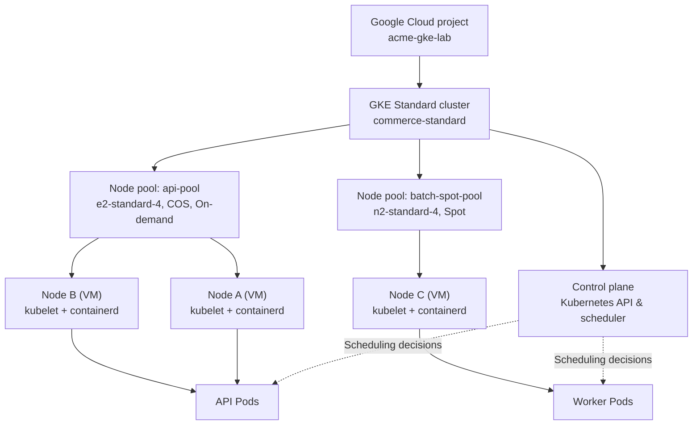
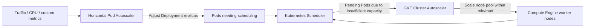

# Node Pools, Machine Types, and Node Configuration

## 1. Why Does GKE Need Node Pools?

Imagine an e-commerce platform running on **Google Kubernetes Engine (GKE)**. The system includes an order-processing API, report-processing workers, a memory-heavy service, and a machine learning job that may need GPUs. All of these run as **Pods**, yet their resource and availability requirements differ. If every Pod runs on the same VM type, the organization easily ends up **over-provisioned on CPU while short on RAM**, paying for expensive GPU machines on routine tasks, or seeing critical services disrupted when Spot VMs are preempted.

A **node pool** is a group of **Kubernetes worker nodes** within a GKE cluster that share a **common node configuration**. In **GKE Standard** mode, each node typically corresponds to a **Compute Engine** VM managed by GKE; a node pool shares settings such as machine type, node image, boot disk, service account, labels, taints, networking, autoscaling behavior, and upgrade strategy. GKE creates and manages Compute Engine Managed Instance Groups (MIGs) underneath a node pool.

A node pool sets **infrastructure configuration boundaries** for workloads, but it does not decide on its own where an individual Pod lands. The **Kubernetes scheduler** distributes Pods onto eligible nodes based on resource requests, node selectors, affinity, taints/tolerations, topology, and other policies.

Within the **CLOUD_PROVIDERS_GCP** module, this lesson connects **Projects, IAM, VPC/subnets, Compute Engine, GKE, Cloud Storage, and data services**, helping you select services, protect resources, automate rollouts, monitor reliability, and control costs when operating applications.

After this lesson, you will be able to:

1. Distinguish **cluster, node pool, node, and Pod**, and know where each resource is configured.
2. Compare **Standard** and **Autopilot**, including GKE's ability to automatically create node pools for supported workloads.
3. Choose a **machine family/type** based on CPU, RAM, architecture, GPUs, storage, networking, and cost.
4. Configure **node images, boot disks, node service accounts, labels, taints, max Pods per node**, and security options.
5. Inspect and create node pools with `gcloud container node-pools`, and control Pod placement using Kubernetes YAML.
6. Understand **node pool autoscaling**, how it differs from HPA, node auto-provisioning, ComputeClasses, and IP/quota limits.
7. Plan node pool upgrades/migrations without unplanned downtime, and troubleshoot `Pending` Pods, `NotReady` nodes, and cost surprises.

> **Scope:** Examples use illustrative names `acme-gke-lab`, `commerce-standard`, and zone `asia-southeast1-a`. Creating a node pool can provision VMs, boot disks, IP addresses, and GKE fees. Run resource-modifying commands only when authorized and after assessing impact.

## 2. Relationship Between Cluster, Node Pool, Node, and Pod



### Components with Distinct Responsibilities

| Component | Function | What Do Administrators Typically Do? |
| --- | --- | --- |
| **GKE cluster** | Boundary for the control plane/Kubernetes API, network config, and operational mode | Choose Standard/Autopilot, release channel, location, networking |
| **Node pool** | Group of worker nodes sharing configuration | Choose VM type, image, disk, labels/taints, autoscaling, and upgrades |
| **Node** | Worker machine running Pods, hosting `kubelet` and container runtime | Monitor capacity, allocatable, conditions, and node pressure |
| **Pod** | Unit running containers with shared network/storage context | Declare requests/limits, probes, placement, security context |
| **Deployment/StatefulSet/Job** | Controls Pod lifecycle according to workload semantics | Replicas, rollouts, stateful identity, retries, and availability |
| **Service / Ingress / Gateway** | Provides access and load balancing to Pods | Design internal/external traffic, health checks, TLS |

**A node pool is not a Kubernetes Namespace.** A namespace is an administrative boundary for Kubernetes objects and policies; a node pool is an **infrastructure configuration boundary** for machines running workloads. One namespace can span multiple node pools, and one node pool can run Pods from multiple namespaces unless restricted by scheduler rules or policies.

### A Node Pool Shares a Common Configuration

A node pool in Standard uses a shared `NodeConfig` across all nodes in the pool. Do not modify an underlying VM directly in the Compute Engine Console expecting the change to persist; GKE may **recreate or upgrade nodes**, reverting configuration to GKE-managed state. To change machine types or node images, use **GKE node pool APIs/CLI** or create a new pool and migrate workloads.

## 3. Standard vs. Autopilot: Who Manages Nodes?

| Characteristic | **GKE Standard** | **GKE Autopilot** |
| --- | --- | --- |
| Creating node pools | You can create, configure, and manage Standard node pools yourself | GKE **manages nodes automatically**; no need to create Standard node pools manually |
| Choosing node machine type | Yes, across supported Compute Engine types | Typically declare Pod/ComputeClass requirements; GKE provisions matching infrastructure |
| Node OS image | Choose supported images such as `COS_CONTAINERD`, `UBUNTU_CONTAINERD`, or Windows where eligible | GKE manages node OS, primarily COS/containerd |
| Boot disk/kubelet/system settings | Permission to configure many node pool options | Restricted per API/product characteristics |
| Autoscaling | Can enable **cluster autoscaler** on node pools | GKE automatically adjusts infrastructure capacity for workloads |
| Workload placement | Node labels, taints, node affinity, ComputeClasses | Pod resource requests, selectors, ComputeClasses, and supported mechanisms |
| Operational responsibility | Deeper control; must plan capacity and node maintenance | Reduced node administration; still must manage apps, policies, and costs |

**An important update:** GKE Standard now also supports **Autopilot-managed node pools** via supported **Autopilot ComputeClasses**. Do not assume every node pool in Standard is manually created. Documentation also covers **node pool auto-creation** via cluster/ComputeClass settings where GKE automatically creates Standard node pools to satisfy pending Pods.

**Autopilot does not mean Kubernetes fixes application bugs for you.** You remain responsible for container images, resource requests, proper HPA config, health probes, NetworkPolicy, RBAC, IAM, secrets, PersistentVolumes, and SLO targets.

## 4. What Does a Node Pool Configuration Include?

In GKE Standard, common options include:

| Attribute | Example | Primary Impact |
| --- | --- | --- |
| **Machine type** | `e2-standard-4`, `n2-standard-4` | vCPUs, RAM, CPU architecture/capabilities, and price |
| **Node image** | `COS_CONTAINERD`, `UBUNTU_CONTAINERD` | OS, container runtime, package/driver support |
| **Boot disk** | `pd-balanced`, `100 GB` | Capacity for OS, images, writable container layers |
| **Node service account** | `gke-nodes@...` | Node identity when calling Google Cloud APIs |
| **Node labels** | `workload=api`, `tier=standard` | Scheduler node selection by label |
| **Node taints** | `workload=api:NoSchedule` | Blocks Pods lacking matching tolerations |
| **Spot / on-demand** | `--spot` or default | Cost and preemption risk |
| **Max Pods per node** | `32` | Pod density and Pod IPv4 address demand |
| **Autoscaling limits** | `min=1, max=3` | Number of nodes cluster autoscaler can add/remove |
| **Node locations** | One or multiple zones | Capacity, resilience, disk/zone constraints |
| **Upgrade strategy** | Surge or blue-green | Rollout duration and temporary extra nodes |
| **Security** | Shielded nodes, private nodes, metadata mode | OS-layer risk, permissions, and network exposure |
| **Accelerators** | GPUs/TPUs per supported variants | AI/ML workload support and quotas |

**Not all parameters can be modified in place without disruption.** Some changes trigger node recreation or rolling replacement; changes to CPU architecture (x86 to Arm), GPUs, OS, or networking may require a new pool. Check the API docs and test in a small environment before updating.

## 5. Choosing a Machine Type by Workload

Machine type determines **vCPUs, memory**, CPU architecture, compatible disk/network performance tiers, and most of the node cost. Do not choose a family merely because its series name is newer.

| Machine Family | Common Examples | When to Evaluate | Warnings |
| --- | --- | --- | --- |
| **Cost-optimized / general** | E2 | Small web/APIs, lab environments, balanced workloads | Not suited for every high-CPU performance need or specialized hardware feature |
| **Balanced general purpose** | N2, N2D, N4 as supported | Production services balancing CPU and RAM | Verify zone availability, CPU platform, CUDs/reservations |
| **Compute-optimized** | C3, C4 or equivalent series | CPU-bound services, high-throughput processing | Price/vCPU and disk/network requirements must be benchmarked |
| **Memory-optimized** | M-series as supported | Large caches, in-memory analytics, memory-heavy JVMs | Very large VMs can reduce scheduling flexibility and raise blast radius |
| **Accelerator-optimized** | A/G-series, specific GPU models | Training/inference, parallel GPU compute | GPU quotas, drivers, node images, scheduling, and high cost |
| **Arm-based** | T2A, C4A as supported | Apps with multi-arch/`arm64` container images | Container images and native libraries must support `arm64` |

**Do not infer from the table that every machine series is available in all GKE regions/zones or cluster modes.** Always check Compute Engine availability, GKE version, images, accelerators, and actual quotas before selecting.

### 5.1. Estimating from Requests, Not Just Limits

Suppose an API Pod declares:

```yaml
resources:
  requests:
    cpu: "250m"
    memory: "512Mi"
  limits:
    cpu: "500m"
    memory: "1Gi"
```

`250m` CPU means a **0.25 vCPU request**. The scheduler plans placement using **requests**; limits are part of runtime enforcement, not direct placement capacity estimates.

For 12 replicas:

```text
Application CPU requests    = 12 × 0.25 = 3 vCPU
Application memory requests = 12 × 512 Mi = 6144 Mi = 6 GiB
```

This **does not** mean a 4 vCPU / 16 GiB VM is guaranteed to fit all 12 Pods. Each node reserves resources for **the OS, kubelet, system DaemonSets, and eviction thresholds**, plus networking and max Pods per node limits apply. Always check actual **Allocatable** via `kubectl describe node`, measure real CPU/memory usage, and leave headroom for rollouts.

### 5.2. Many Smaller Nodes vs. Fewer Larger Nodes

- **Many smaller nodes:** improves fault isolation, rolling updates, and spread; increases system overhead and IP/disk consumption.
- **Fewer larger nodes:** reduces per-node overhead and suits large Pods; risks poor bin-packing when requests don't align and increases the blast radius of a single node failure.
- **GPUs/large memory:** sometimes forces specialized machine types that cannot be replaced by simply adding more standard nodes.

Measure **p95 latency, CPU throttling, memory OOMs, network throughput, disk I/O, and cost per unit of work**, rather than sizing by vCPU count alone.

## 6. CPU Architecture and Container Image Compatibility

Most traditional workloads run on **x86_64/amd64**. When selecting Arm-based nodes, container images and libraries with native code must support **linux/arm64**.

Kubernetes node labels example:

```text
kubernetes.io/arch=amd64
kubernetes.io/os=linux
```

or:

```text
kubernetes.io/arch=arm64
kubernetes.io/os=linux
```

Before migrating:

1. Verify the container registry has **multi-architecture manifests**.
2. Audit libraries, Java/JNI bindings, native plugins, security agents, and monitoring DaemonSets.
3. Create a new Arm node pool and run a canary workload first.
4. Verify image pulls, test suites, performance/cost, and health checks.
5. Migrate production only after all dependencies are verified.

Per GKE documentation on **migrating nodes**, when switching between **x86 and Arm** in Standard, **create a new node pool and migrate workloads** rather than treating it as an in-place machine type update on an active pool.

## 7. Node OS Images and Container Runtime

| Image Type | Characteristics | When to Choose |
| --- | --- | --- |
| `COS_CONTAINERD` | **Container-Optimized OS** hardened for containers, using containerd; general recommended default | Most Linux workloads |
| `UBUNTU_CONTAINERD` | Ubuntu with containerd; more flexible for certain libraries/filesystems/package workflows | When OS requirements do not fit COS |
| `WINDOWS_LTSC_CONTAINERD` | Windows Server LTSC with containerd | Windows/.NET Framework workloads requiring Windows nodes |

**Autopilot Linux nodes use COS with containerd**, and GKE manages image selection and updates under the managed mode. In Standard, node images are selected at node pool creation or changed via supported update/upgrade workflows.

Do not write automation depending on a **Docker daemon on the node**; GKE uses **containerd**. If applications need to build container images, evaluate Cloud Build, BuildKit, or a dedicated build solution rather than installing Docker daemons on nodes.

### COS or Ubuntu?

- **COS:** minimal OS footprint optimized by GKE; unsuitable if you try to install arbitrary Debian packages on the host.
- **Ubuntu:** suited when supported OS/library/driver capabilities are required, such as XFS, CephFS, or specialized tooling.
- **Windows:** separate node pools with scheduling/network/security constraints; standard Linux container images cannot run on Windows nodes.

Never SSH into a node manually to install packages and expect those changes to survive a rolling upgrade. Use **DaemonSets, container images, node bootstrap configuration, and GKE-supported mechanisms**.

## 8. Boot Disks, Ephemeral Storage, and PersistentVolumes

A node pool has a **boot disk** holding the OS, container images, writable layers, logs, and temporary Pod data as configured. Common flags include:

- `--disk-type=pd-balanced` or another supported disk type.
- `--disk-size=100`, boot disk capacity in GB.
- **Local SSD / ephemeral storage** options for high-speed temporary I/O when compatible.

**Increasing boot disk size does not turn a node into durable application storage.** When a node is recreated, upgraded, or replaced, data on ephemeral node storage can be lost.

| Data Need | Common Approach | Notes |
| --- | --- | --- |
| Container image cache and temp files | Node boot disk / ephemeral storage | May be wiped on node replacement |
| High-speed rebuildable cache | Local SSD where supported | Never use as the sole copy of data |
| Database state surviving Pod recreation | PersistentVolume/PersistentVolumeClaim | StorageClass, zone, attach/mount, backups, and restore |
| Object files, exported logs, or data lake | Cloud Storage | Not a direct POSIX filesystem |
| Shared filesystem across multiple Pods | Filestore/NFS or supported CSI solution | Verify concurrency, permissions, and latency |

### Ephemeral-Storage Requests/Limits

Pods can declare:

```yaml
resources:
  requests:
    ephemeral-storage: "1Gi"
  limits:
    ephemeral-storage: "4Gi"
```

Alongside CPU/memory requests, the scheduler checks available local storage; **disk pressure** or eviction can occur if a node runs out of local space. Do not treat increasing max Pods per node as a long-term fix when the root cause is full local disks.

### Storage and Geography

Persistent Disks backing PersistentVolumes often have **zone/region and attach constraints**. When a node pool spans multiple zones, the Kubernetes scheduler must respect **volume topology**. A StatefulSet Pod with a zonal Persistent Disk cannot automatically run in another zone where that disk is unavailable. Maintain dedicated replication, backups, and DR for critical data.

## 9. Networking, Pod IP Ranges, and Max Pods per Node

GKE VPC-native clusters assign Pod IPs from subnet **secondary ranges**. Nodes receive primary addresses while Pods receive alias IP ranges via GKE. This tightly couples **node count**, **max Pods per node**, and the **Pod CIDR range**.

Example:

```text
VPC: corp-prod
Subnet node primary range: 10.20.10.0/24
Pod secondary range: 10.60.0.0/16
Service secondary range: 10.70.0.0/20
Max Pods per node: 32 (example)
```

Raising `--max-pods-per-node` causes GKE to allocate a **larger alias IP block per node**, meaning fewer total nodes can fit in the initial Pod CIDR. Do not treat `max-pods-per-node=110` as universally optimal: small workloads, system Pods, kubelet constraints, and scaling headroom must all be evaluated.

### Items to Verify

- The node pool is in the intended **region/zone** and VPC/subnet.
- The Pod secondary range has enough addresses when the autoscaler hits max nodes.
- With **Shared VPC**, the host project manages subnets, firewalls, and IPs; service projects and GKE service agents need the right IAM bindings.
- **Private nodes** may lack external IPs; image pulls and external API access require planned egress (Cloud NAT/Private Google Access or supported paths).
- **NetworkPolicy, firewalls, and IAM** are independent of node machine type selection.

## 10. Node Service Accounts and Node Security

### 10.1. Node Identity and Workload Identity Are Different

A **node service account** is the Google Cloud service account attached to the node's Compute Engine VM. It supports node-level tasks performed by GKE, kubelet, and node agents, such as reading cluster config or shipping logs and metrics as permitted.

**Workload Identity Federation for GKE** allows application workloads in Pods to access Google Cloud APIs via **Kubernetes ServiceAccount → IAM principal** using supported federation. You do not need to grant application-level permissions to the **node service account**.

| Identity | Who Uses It? | What to Avoid |
| --- | --- | --- |
| **Node service account** | Node VMs and node-level components | Granting Editor/Owner just to get nodes running |
| **Kubernetes ServiceAccount (KSA)** | Pods and Kubernetes workloads | Sharing one broad KSA across all namespaces |
| **IAM principal / Google service account** | Accessing Google Cloud APIs | Baking long-lived JSON keys into container images |
| **User IAM + Kubernetes RBAC** | GKE/Kubernetes API operators | Granting `cluster-admin` to every developer |

A node pool can specify `--service-account=NODE_SA_EMAIL`. Before creating the pool, ensure the node SA holds the minimum roles required by GKE; Logging/Monitoring or Artifact Registry permissions may depend on cluster configuration.

### 10.2. Shielded Nodes and Hardened Configurations

Options can include:

- **Shielded GKE Nodes**: vTPM/Integrity Monitoring, and Secure Boot where compatible.
- **GKE Sandbox / gVisor** for workloads needing stronger kernel isolation where supported.
- **Private nodes** and restricted management/metadata paths.
- **Workload Identity Federation**, Kubernetes RBAC, NetworkPolicy, and Pod Security Standards.
- **Confidential GKE Nodes** on supported machine types/technologies.

Do not enable Secure Boot or Confidential Nodes in production without testing drivers, kernel modules, and compatibility. Also, never treat these options as replacements for image patching, runtime policies, secret management, vulnerability scanning, and auditing.

### 10.3. Labels Differ from Resource Manager Tags

**Node labels** like `workload=api` serve Kubernetes scheduling; **GCE network tags** and **Resource Manager tags** serve different firewall and policy engines. They are neither a single setting nor synchronized by default.

**Do not rely on a user-editable label as a sole security boundary.** Taints and labels are great for workload placement, while security isolation requires IAM, RBAC, NetworkPolicy, PSA, and sound architecture.

## 11. Node Labels, Taints, Tolerations, and Affinity

The Kubernetes scheduler needs a way to know **which Pods belong on which node pool**.

### 11.1. Node Labels and nodeSelector

GKE automatically attaches the label:

```text
cloud.google.com/gke-nodepool=<NODE_POOL_NAME>
```

You can also attach custom labels when creating a pool:

```text
workload=api
tier=standard
environment=lab
```

A Deployment can require them:

```yaml
spec:
  template:
    spec:
      nodeSelector:
        workload: api
```

**`nodeSelector` is a hard requirement.** If no node carries the label, Pods remain `Pending`. `nodeAffinity` allows expressing either required or preferred rules more flexibly.

### 11.2. Taints and Tolerations

If a node pool is reserved for API workloads, add a taint:

```text
workload=api:NoSchedule
```

Pods permitted to run on that pool must carry a matching toleration:

```yaml
tolerations:
  - key: workload
    operator: Equal
    value: api
    effect: NoSchedule
```

**A toleration only permits a Pod to run on a tainted node; it does not force the Pod onto that node.** To pin Pods to a specific pool, combine `nodeSelector` or `requiredDuringSchedulingIgnoredDuringExecution` with the toleration.

### 11.3. Three Taint Effects

| Taint Effect | Meaning |
| --- | --- |
| `NoSchedule` | New Pods without a matching toleration are not scheduled onto the node |
| `PreferNoSchedule` | Scheduler tries to avoid the node, but may place Pods there if needed |
| `NoExecute` | Can evict already-running Pods lacking a matching toleration (or after `tolerationSeconds`) |

In production, never taint every node pool so strictly that **CoreDNS and system DaemonSets have nowhere to run**. Especially when using Spot or GPU pools, maintain an appropriate on-demand pool for system workloads.

## 12. Example: Creating a Standard Node Pool with gcloud

Assume an **existing Standard cluster**:

```text
Project:          acme-gke-lab
Cluster:          commerce-standard
Control plane location: asia-southeast1-a (zonal)
New node pool:    api-pool
Machine type:     e2-standard-4
Boot disk:        pd-balanced, 100 GB
Node image:       COS_CONTAINERD
Autoscaling:      1 to 3 nodes (per zone in this zonal example)
Node label:       workload=api
Node taint:       workload=api:NoSchedule
Node SA:          gke-nodes@acme-gke-lab.iam.gserviceaccount.com
```

### 12.1. Read-Only Preflight

```bash
gcloud auth list
gcloud container clusters describe commerce-standard \
  --project=acme-gke-lab \
  --location=asia-southeast1-a \
  --format="yaml(name,status,location,network,subnetwork,currentMasterVersion,releaseChannel)"

gcloud container node-pools list \
  --cluster=commerce-standard \
  --location=asia-southeast1-a \
  --project=acme-gke-lab
```

Verify the cluster is **Standard**, the network/subnet has sufficient Pod IP ranges, VM/vCPU/PD quotas are available, billing is active, the zone supports the machine type, and the node service account exists with required node permissions. If the cluster is Autopilot, **do not manually create a node pool as in this example**.

### 12.2. Create the Node Pool

```bash
# MODIFIES RESOURCES / INCURS COST: run only in an approved lab
gcloud container node-pools create api-pool \
  --cluster=commerce-standard \
  --location=asia-southeast1-a \
  --project=acme-gke-lab \
  --machine-type=e2-standard-4 \
  --num-nodes=1 \
  --disk-type=pd-balanced \
  --disk-size=100 \
  --image-type=COS_CONTAINERD \
  --node-labels=workload=api,environment=lab \
  --node-taints=workload=api:NoSchedule \
  --service-account=gke-nodes@acme-gke-lab.iam.gserviceaccount.com \
  --max-pods-per-node=32 \
  --enable-autorepair \
  --enable-autoupgrade \
  --enable-autoscaling \
  --min-nodes=1 \
  --max-nodes=3
```

Explanation:

- `--num-nodes=1` is the initial node count **per selected zone**, not a global total across every regional/multi-zonal configuration.
- `--min-nodes=1` and `--max-nodes=3` in this example are **per-zone** autoscaler bounds.
- For a **regional pool**, if you want to cap the **total node count across all zones**, use `--total-min-nodes` / `--total-max-nodes`. Do not mix the total and per-zone pairs in the same operation.
- `--node-taints` prevents Pods without a toleration from scheduling onto the pool.
- `--max-pods-per-node` affects Pod IPv4 allocation.
- `--enable-autorepair` and `--enable-autoupgrade` do not mean GKE automatically fixes application bugs or broken Kubernetes Pods.

### 12.3. Inspect After Creation

```bash
gcloud container node-pools describe api-pool \
  --cluster=commerce-standard \
  --location=asia-southeast1-a \
  --project=acme-gke-lab \
  --format="yaml(name,status,config,autoscaling,management,upgradeSettings,locations)"
```

In the output, verify `machineType`, `imageType`, `diskType`, `diskSizeGb`, `serviceAccount`, `labels`, `taints`, and autoscaling limits. A successful create command **does not prove Pods are healthy or that nodes have enough room**.

### 12.4. Observe with kubectl

To use `kubectl`, your account needs permission to fetch cluster credentials and appropriate Kubernetes API permissions:

```bash
# Updates local kubeconfig; does not create nodes in the cluster
gcloud container clusters get-credentials commerce-standard \
  --project=acme-gke-lab \
  --location=asia-southeast1-a

# READ-ONLY KUBERNETES
kubectl get nodes -L cloud.google.com/gke-nodepool,workload
kubectl get nodes -o wide
kubectl describe node ACTUAL_NODE_NAME
kubectl get pods -A -o wide
```

Inspect `Capacity` and `Allocatable`, labels, taints, Conditions (`Ready`), system Pods, and events. Node pool `api-pool` will not necessarily remain at one node at all times because the autoscaler can scale it.

## 13. Example Deployment Targeting api-pool

Assume the application container `us-docker.pkg.dev/PROJECT_ID/REPO/api:VERSION` has been built and image-pull permissions are in place. This YAML runs 3 replicas using the labels and taint from the previous section:

```yaml
apiVersion: apps/v1
kind: Deployment
metadata:
  name: api-demo
  namespace: default
spec:
  replicas: 3
  selector:
    matchLabels:
      app: api-demo
  template:
    metadata:
      labels:
        app: api-demo
    spec:
      nodeSelector:
        workload: api
      tolerations:
        - key: workload
          operator: Equal
          value: api
          effect: NoSchedule
      containers:
        - name: api
          image: us-docker.pkg.dev/PROJECT_ID/REPO/api:VERSION
          ports:
            - containerPort: 8080
          resources:
            requests:
              cpu: "250m"
              memory: "256Mi"
            limits:
              cpu: "500m"
              memory: "512Mi"
          readinessProbe:
            httpGet:
              path: /ready
              port: 8080
            initialDelaySeconds: 5
            periodSeconds: 10
```

**Note:** the image URI and `/ready` path are placeholders; deployment cannot succeed unless a real image and route exist and the workload has IAM pull access. Provide a compatible container image when using this.

### Why Are Both nodeSelector and Toleration Needed?

- **`nodeSelector`** requires nodes labeled `workload=api`.
- **`toleration`** lets the Pod pass the `workload=api:NoSchedule` taint barrier.
- Without the selector, a Pod with the toleration might still land on another pool.
- Without the toleration, a Pod targeting `api-pool` remains `Pending` because the taint blocks it.

### Verify Where Pods Were Scheduled

```bash
kubectl get pods -l app=api-demo -o wide
kubectl describe pod ACTUAL_POD_NAME
kubectl get nodes -L workload,cloud.google.com/gke-nodepool
```

In `kubectl describe pod`, check **Events** and reasons such as `Insufficient cpu`, `Insufficient memory`, `untolerated taint`, `node(s) didn't match Pod's node affinity/selector`, or missing PersistentVolume/zone constraints.

## 14. Autoscaling: HPA and Cluster Autoscaler Are Not the Same



### 14.1. Horizontal Pod Autoscaler (HPA)

**HPA** adjusts **Pod replica counts** based on supported metrics such as CPU utilization or custom metrics. HPA does not directly create VMs. If HPA raises replicas to 20 while the node pool lacks CPU/RAM, excess Pods stay `Pending`.

### 14.2. GKE Cluster Autoscaler

**Cluster Autoscaler** scales the **node count** of Standard node pools within your configured bounds. Scale-up decisions are driven by **resource requests of unschedulable Pending Pods** alongside scheduling constraints—not simply "high CPU means add a VM."

For example, if workloads are using 95% actual CPU while their Pod requests still fit on existing nodes, **cluster autoscaler may not scale up** based on that 95% usage alone. Conversely, a new Pod stuck `Pending` because its CPU request won't fit or no matching node exists can trigger a scale-up evaluation if an eligible pool has quota and IPs.

### 14.3. Per-Zone vs. Total Autoscaling Limits

| Flag Pair | Meaning | Common Use |
| --- | --- | --- |
| `--min-nodes` / `--max-nodes` | Bounds **per zone** in the node pool | Single-zone pools or balancing per zone |
| `--total-min-nodes` / `--total-max-nodes` | Bounds **total nodes in the pool** across zones | Regional/multi-zonal pools needing a total cap |

For example, a pool across **3 zones** with `--min-nodes=1`, `--max-nodes=3` can have **3 to 9 nodes total**, depending on the autoscaler and actual state. Using `--total-min-nodes=1`, `--total-max-nodes=3` sets a total min/max of 1–3 across all zones, not 1–3 per zone.

### 14.4. Location Policy

For multi-zonal node pools, GKE provides `location_policy`:

- `BALANCED`: attempts to distribute capacity across zones while considering Pod requirements and resource availability.
- `ANY`: prioritizes zones with available capacity or unused reservations; may concentrate nodes in fewer zones.

Typically, `BALANCED` is the default for on-demand/reservations, while `ANY` is often the default for Spot/flex-start per documentation; **do not assume every node pool shares the same default**.

### 14.5. When Autoscaler Does Not Scale

Common causes:

1. `max-nodes`/`total-max-nodes` cap reached.
2. Insufficient Compute Engine vCPU/GPU quota or zonal capacity.
3. Pod selectors/affinity/taints match no scalable pool.
4. Exhausted Pod secondary IP range or node primary subnet.
5. Pod request exceeds the **allocatable** capacity of any permitted node type.
6. PersistentVolume/zone or topology constraints cannot be satisfied.
7. Node auto-provisioning/ComputeClass is disabled or misconfigured.

**Scale-down** can also be blocked by PodDisruptionBudgets, `kube-system` Pods, local storage, or safety conditions. Never delete a PDB solely to save money without evaluating disruption impact.

## 15. Node Auto-Provisioning and ComputeClasses

Node pool autoscaling only changes node counts within **existing pools**. When a workload needs a **different machine type** with no matching pool, GKE Standard can use **node pool auto-creation** via:

- **Cluster-level node auto-provisioning (NAP):** automatically creates new node pools based on pending Pods and cluster-wide resource limits.
- **Workload-level ComputeClass:** declares compute property preferences; in supported GKE versions, this can auto-create matching Standard node pools without enabling cluster-level NAP.

Per GKE documentation, **workload-level node pool auto-creation independent of cluster-level NAP** requires GKE version **1.33.3-gke.1136000** or newer at the time of writing. Older versions or specialized features have their own prerequisites; verify cluster version and release channel.

### A Design Thought Experiment

Suppose an analytics app needs 8 vCPU / 32 GiB RAM, while existing pools only have small E2 VMs. Three options exist:

1. **Manually create a Standard node pool** with N2/N2D or an appropriate machine family.
2. **Enable node auto-provisioning** with cluster resource limits and node config defaults.
3. **Use a ComputeClass** to define workload compute preferences and supported auto-creation.

ComputeClasses reduce manual pool setup for certain workloads, yet do not replace **right-sizing requests**, checking IAM, quotas, costs, and Pod scheduling rules.

**Caution:** enabling auto-provisioning on a cluster with existing pending Pods can cause GKE to **create new node pools and incur charges immediately**. Audit existing `nodeSelectors`, ComputeClasses, and resource bounds beforehand.

## 16. Spot Node Pools and Fault-Tolerant Workloads

**Spot VMs** cost less than on-demand VMs but can be preempted by Google Cloud when capacity is needed elsewhere. Spot fits:

- Batch jobs with checkpointing and retries.
- Image/video processing tasks that can be re-run.
- Stateless workers and compute jobs holding no sole copy of data.
- Certain AI training jobs that checkpoint state regularly.

Spot is unsuitable as the **only** home for critical orchestration systems or databases that cannot tolerate preemption.

### 16.1. Sample Spot Node Pool Creation

```bash
# May incur cost and carries node preemption risk
gcloud container node-pools create batch-spot-pool \
  --cluster=commerce-standard \
  --location=asia-southeast1-a \
  --project=acme-gke-lab \
  --machine-type=e2-standard-4 \
  --spot \
  --node-labels=workload=batch \
  --node-taints=workload=batch:NoSchedule \
  --enable-autoscaling \
  --min-nodes=0 \
  --max-nodes=5
```

This is a **single-zone example**. If system workloads have nowhere to run when the pool scales to 0 or is preempted, the cluster will break; always maintain an appropriate **on-demand non-GPU pool**.

### 16.2. Graceful Termination Window

By default, GKE gives Pods roughly **30 seconds of graceful termination** after a preemption notice; that window does not guarantee an app finishes in-flight work. Newer versions and advanced configurations may adjust within limits. You should:

- Handle `SIGTERM` and write checkpoints promptly.
- Use queues with at-least-once semantics and idempotent processing where appropriate.
- Set realistic `terminationGracePeriodSeconds` and shutdown logic.
- Design for sudden node loss; never rely on local SSDs as the sole data store.

Spot nodes carry the `cloud.google.com/gke-spot=true` label on supported versions. Selectors or affinity can target Spot, though **taints and tolerations** are recommended so system Pods do not accidentally land on Spot nodes.

## 17. Upgrading Node Pools and Avoiding Downtime

Node pools run a **Kubernetes node version** managed via GKE release channels and auto-upgrade policies. GKE can upgrade node OS/images, kubelet, or replace nodes to apply new configurations. Upgrades **can evict and recreate Pods**.

### 17.1. Surge Upgrades and Blue-Green Upgrades

| Strategy | High-Level Behavior | Trade-Off |
| --- | --- | --- |
| **Surge** | Creates temporary extra nodes beyond target size, draining/replacing old nodes in waves | Temporarily increases quota/IP/cost, but rolls out faster |
| **Blue-green** | Creates a new set of nodes, migrates workloads in a controlled way, and includes a configurable soak period | Lower rollout risk for sensitive workloads; requires larger temporary capacity |
| **Autoscaled blue-green** | Variant incorporating autoscaling within the rollout workflow per release tier | Check Preview/GA status before deploying |

Do not apply the exact same strategy to every workload. Clusters with scarce GPUs, stateful Pods, zonal PersistentVolumes, or strict PodDisruptionBudgets have different upgrade speeds and capacity requirements.

### 17.2. Readiness, Replicas, and PDBs

A Deployment with **1 replica** will experience downtime when its node drains, regardless of how well the load balancer or node pool upgrade is configured. To improve resilience:

1. Run multiple replicas across different nodes/zones when HA is required.
2. Configure proper **readinessProbe** and **startupProbe/livenessProbe**.
3. Use a **PodDisruptionBudget** to limit simultaneous disruptions during voluntary evictions.
4. Configure **topology spread constraints** or pod anti-affinity so replicas don't stack on one node/zone.
5. Verify upgrade headroom, max surge/unavailable settings, and shutdown timing.

A PDB coordinates voluntary disruptions; **it does not prevent hardware failures, preemptions, OOMs, or every administrative action**.

### 17.3. Maintenance Windows and Exclusions

GKE provides maintenance windows and exclusions for automatic upgrades under supported conditions. However, they **cannot block mandatory upgrades indefinitely**, such as versions reaching end-of-support. Manual upgrades may **bypass** maintenance windows/exclusions. On Standard release channels, certain versions support **node-pool-specific maintenance exclusions**.

SRE teams need change schedules, notifications, and canary testing; never design applications assuming GKE will never replace a node during business hours.

### 17.4. Changing Machine Types

Current GKE documentation supports **modifying machine attributes of certain existing node pools** through supported update flows, using the pool's upgrade strategy to migrate workloads; not every change requires creating a new pool. Nevertheless, **creating a new node pool and migrating** remains useful when switching CPU architectures, needing fast rollback, or testing without touching a stable pool.

Never edit individual Compute Engine VMs beneath a node pool; changes may be overwritten by GKE or cause cluster state drift.

## 18. Migrating Workloads to a New Node Pool

Scenario: pool `api-old` uses a small machine type and suffers frequent OOMs and node pressure. The platform team wants to migrate to a new `api-pool` with more RAM.

### Recommended Procedure

1. **Measure baseline**: Pod requests/limits, `OOMKilled`, container restarts, node allocatable, CPU throttling, and traffic.
2. **Select machine type/OS/disk** with adequate resources; check quotas, zones, and networking.
3. **Create the new pool** and verify nodes are Ready with system agents healthy.
4. **Update labels/taints and workload manifests** via a controlled rollout.
5. **Canary** a small subset of Pods; inspect logs/metrics, networking, and PersistentVolumes.
6. **Cordon/drain** old nodes as appropriate, respecting PDBs and data handling rules.
7. **Observe and roll back** if needed; delete the old pool only after confirming all Pods, volumes, and DaemonSets have moved.

Administrative Kubernetes commands that can affect service:

```bash
# READ-ONLY: identify old nodes and Pods still running
kubectl get nodes -L cloud.google.com/gke-nodepool
kubectl get pods -A -o wide

# MODIFIES cluster: run only after approval and checking PodDisruptionBudgets
kubectl cordon ACTUAL_OLD_NODE_NAME
kubectl drain ACTUAL_OLD_NODE_NAME \
  --ignore-daemonsets \
  --delete-emptydir-data
```

`--delete-emptydir-data` permits deleting **ephemeral `emptyDir` data** on drained Pods. **Do not run this if `emptyDir` holds critical data** without recovery mechanisms. For StatefulSets and PVCs, check volume attachment topology before draining.

### Rollback

To enable rollback, keep the old pool available during a soak period, switch selectors/affinity back to the old pool, and monitor. If the old pool was already deleted, recreating it takes time and can hit quota/capacity limits. Never assume rollback is instantaneous.

## 19. Node Pool Costs and Budget Control

GKE costs depend on both **cluster mode** and **actual resources**. In Standard, cost components typically include:

- **Compute Engine VMs** by machine type, zone, and uptime.
- **Boot disks**, Local SSDs/Hyperdisks, and PersistentVolumes per configuration.
- **GKE cluster management fees** or tier/mode-based fees under current pricing, less applicable credits.
- **Network egress**, cross-zone/cross-region traffic, load balancing, Cloud NAT.
- **Cloud Logging/Monitoring**, Artifact Registry, GPU licenses, or related services.
- **Temporary autoscaling surge/blue-green nodes** active during upgrades.

### Estimation Formula

```text
Estimated node pool cost
 = sum(node-hours per machine type × respective unit price)
 + sum(boot-disk GB-months by disk type/location)
 + GPU/Local SSD surcharges if applicable
 + load balancing, egress, logging, and dependent services
 + appropriately allocated share of cluster management fees
```

Hypothetical example: a pool keeps **2 nodes** running for **10 hours**, totaling **20 node-hours** for that machine type. If the autoscaler scales up to 4 nodes for 2 hours and then scales back to 2 nodes, calculate node-hours along the **actual usage curve**, not 4 nodes × 10 hours.

### Optimization Levers

1. **Right-size** CPU/memory requests based on real usage and latency.
2. Pick appropriate machine families instead of one large machine type for all Pods.
3. Combine **HPA + cluster autoscaler** for workloads with elastic replica counts.
4. Separate a **Spot pool** for retryable batch jobs while keeping on-demand for critical systems.
5. Trim wasted disk/ephemeral storage; monitor soft-deleted Cloud Storage objects or snapshots separately.
6. Evaluate reserved capacity, CUDs, and actual billing account rates.
7. Track cluster efficiency and chargeback by **namespace/labels** using **GKE cost allocation** when configured.

**Cost optimization does not mean minimizing node count blindly.** An undersized pool causes latency spikes, lacks rolling update headroom, and triggers Pod downtime—costing more operationally than the compute savings.

## 20. Monitoring and Troubleshooting Node Pools

### 20.1. Signals to Watch

| Signal | Source | Question |
| --- | --- | --- |
| `NodeReady`, node conditions | Kubernetes API / Cloud Monitoring | Are nodes ready to accept Pods? |
| CPU/memory **allocatable** and utilization | `kubectl describe node`, Metrics Server/Monitoring | How much real headroom remains? |
| Pending Pods | `kubectl describe pod`, Events | Why hasn't the scheduler placed the Pod? |
| `OOMKilled`/restarts | Pod status/logs | Are requests/limits sized right, or is there a memory leak? |
| `DiskPressure`/`MemoryPressure` | Node conditions | Are nodes facing eviction pressure? |
| Cluster autoscaler decisions | GKE autoscaler visibility logs | Are quotas or constraints blocking scale-up/down? |
| Node pool operations | GKE operations / Cloud Audit Logs | Are upgrades, repairs, resizes, or recreations occurring? |
| VM/disk/GKE charges | Cloud Billing / GKE cost allocation | Which pool or namespace drives spend? |

### 20.2. Common Errors

| Symptom | Likely Causes | Investigation Path |
| --- | --- | --- |
| Pod `Pending` with `Insufficient cpu` | Requests exceed eligible node allocatable | Requests, node allocatable, max nodes, quotas |
| Pod `Pending` with `untolerated taint` | Pod missing toleration | Node taints, Pod tolerations |
| Pod `Pending` due to selector | No pool matches labels/architecture | `kubectl get nodes --show-labels`, affinity/selector |
| Autoscaler not scaling up | Max reached, quota, capacity, or no matching pool | GKE autoscaler logs, Pod events, pool limits |
| Pool fails to create nodes | vCPU/GPU quota, out of IPs, or machine type unavailable in zone | Quotas, subnet ranges, regional availability |
| Node `NotReady` | Kubelet, CNI, disk/network/OS, node upgrade | Node conditions, operations, logs, policy-approved SSH |
| `ImagePullBackOff` | Wrong image/tag, registry permission, or egress | KSA/node SA, Artifact Registry IAM, DNS/NAT |
| `OOMKilled` | Container exceeded memory limit, memory pressure, or leak | Pod status, usage, requests/limits, heap |
| Pod won't move during upgrade | Overly strict PDB, stateful PVC/zone, or Pod cannot drain | PDB, Events, volume topology, upgrade strategy |
| Cost spike during upgrade | Surge/blue-green temporary nodes, extra disks/GPUs | GKE operation window, Billing SKUs, current node counts |
| Pod on Spot gets interrupted | Spot preempted by design | Taints/tolerations, checkpoints, on-demand fallback |
| Image fails on Arm | Image lacks `arm64` support | Registry manifest, architecture labels, node selectors |

### 20.3. Troubleshooting Pending Pods

```bash
kubectl get pods -A --field-selector=status.phase=Pending
kubectl describe pod ACTUAL_POD_NAME -n NAMESPACE
kubectl get nodes -L cloud.google.com/gke-nodepool,workload
kubectl describe node ACTUAL_NODE_NAME
```

1. Read Pod **Events** instead of guessing from `Pending` alone.
2. Compare resource requests against **Node Allocatable**, not raw capacity.
3. Check `nodeSelector`/affinity and **taints/tolerations**.
4. Check `max-nodes`, quotas, IP ranges, reservations/capacity, and autoscaler decisions.
5. If the Pod uses a PVC, inspect PV topology/zone and CSI errors.
6. Only adjust resource requests, node pools, or scheduling rules once you understand the workload; avoid granting broad IAM roles or opening unrelated firewalls.

### 20.4. Troubleshooting NotReady Nodes

Inspect `kubectl describe node`, checking `Ready`, `DiskPressure`, `MemoryPressure`, `PIDPressure`, and heartbeat timestamps. Review GKE node pool operations, kubelet/network plugin logs, Cloud Logging, VM status, and recent changes. Distinguish:

- **Dead VM**: GKE autorepair may recreate the node.
- **Node running, missing network/IP**: inspect CNI, subnet ranges, and firewalls.
- **Application Pod crash**: not necessarily a node fault; do not drain the whole pool prematurely.

## 21. Design Scenario 1: Separating APIs and Batch Workers

An organization runs an order-processing API needing high availability, alongside nightly report batch workers that can retry on failure.

**Proposed design:**

| Component | Node Pool | Resources & Configuration | Rationale |
| --- | --- | --- | --- |
| API service | `api-pool` | On-demand E2/N2 as appropriate, autoscaling, multiple nodes/zones if needed | Avoid Spot preemption and preserve latency headroom |
| Batch workers | `batch-spot-pool` | Spot VMs, node taint, autoscaling min 0 if cluster/system pools support it | Cost savings for retryable work |
| System workloads | `system-pool` or on-demand pool with capacity | Non-Spot when reliability is required | CoreDNS/agents need stable placement |

**Scheduler policy:** API Pods use `nodeSelector` and toleration matching `api-pool`; batch Pods target `batch-spot-pool` and implement checkpointing. HPA scales API replicas; cluster autoscaler adds nodes when pending Pods don't fit. The batch queue processes idempotently and stores outputs in Cloud Storage rather than keeping sole copies on node-local disks.

### What to Verify

- API runs at least two replicas on distinct nodes when HA is required.
- Readiness/rolling upgrades/PDBs do not drop all endpoints simultaneously.
- Spot preemption does not erase completed results.
- Node SA and Workload Identities for both groups follow least privilege.
- Billing separates batch and API spend via labels/namespaces.

## 22. Design Scenario 2: AI Inference with GPUs

An inference service needs GPUs for several hours a day, while the API gateway uses CPU only. The platform team considers:

1. **Do not place every Pod on GPU nodes.** Use a dedicated GPU pool and a CPU pool for the gateway and system workloads.
2. Select **machine family, accelerator model/count, GPU drivers, and zones** matching model requirements.
3. Use **node taints**, GPU requests/limits, and selectors/ComputeClass per GKE version so only inference Pods schedule onto GPU nodes.
4. Verify GPU quotas, reservations, startup/image pull times, and autoscaling behavior.
5. Benchmark throughput/latency, batch size, VRAM, and unit cost for the workload.
6. Consider Spot GPUs **only if interruption is tolerable**; production online inference often needs an on-demand fallback.

**Security note:** service accounts reading models from Cloud Storage/Artifact Registry need least-privilege permissions; GPU nodes/drivers have specific kernel/node image requirements. Never deploy custom GPU operators or host drivers to production without checking GKE compatibility.

## 23. Exercises and Check Questions

### Exercise 1: Distinguishing Four Levels

Given cluster `commerce-standard`, node pool `api-pool`, node `gke-api-123`, and Pod `api-demo-77bb`.

Identify where each setting is configured:

1. Machine type and boot disk for all nodes in the pool.
2. Application CPU/memory requests.
3. Node taints/labels applied to the pool.
4. Number of Pod replicas.
5. Release channel / control plane location.

**Hint:** (1) Node pool; (2) Pod/Deployment template; (3) Node pool; (4) Deployment/HPA; (5) Cluster.

### Exercise 2: Calculating Requests and Allocatable

There are 20 API Pods, each requesting `300m CPU` and `400Mi memory`.

```text
CPU requests    = 20 × 0.3 vCPU = 6 vCPU
Memory requests = 20 × 400 Mi = 8000 Mi (~7.81 GiB)
```

Why can't you assume an 8 vCPU / 8 GiB node will fit all 20 Pods? Give at least four reasons.

**Hint:** OS/kubelet/system reservations, DaemonSets, eviction headroom, disk/network limits, max pods per node, rollout headroom, and workload memory overhead.

### Exercise 3: Explaining a Pending Pod

Pool `api-pool` has label `workload=api` and taint `workload=api:NoSchedule`. A Pod has `nodeSelector: workload=api` but no toleration. Will the Pod schedule onto the pool? Add the required YAML.

**Answer:** No, because the `NoSchedule` taint still blocks it; a toleration matching key, value, and effect is required. `nodeSelector` does not replace a toleration.

### Exercise 4: Autoscaler and HPA

Suppose a Deployment has 3 replicas, and HPA scales it to 12 replicas under high CPU. The cluster currently fits only 5 Pods, and the node pool autoscaler is capped at 4 nodes max.

Describe the **sequence of events** and possible reasons the remaining 7 Pods stay `Pending`. **Hint:** HPA increases replicas; the scheduler places Pods that fit; cluster autoscaler evaluates pending Pods by requests/constraints and adds nodes if max, quotas, IPs, and locations allow.

### Exercise 5: Regional Pool Min/Max Calculation

A regional node pool spans 3 zones and uses `--min-nodes=2`, `--max-nodes=5`. Calculate the total node bounds under per-zone semantics.

**Answer:** Total min **6 nodes**, total max **15 nodes** across three zones. If you want 2 min total and 5 max total, use the total min/max flags (where supported).

### Exercise 6: Migration Design

An app runs on an x86 Standard node pool and wants to move to Arm to reduce costs. Outline:

- What must be checked in container images and dependencies.
- Why a new node pool is required.
- How to use node labels/affinity and canaries.
- Health, rollback, PVC data, and quota checks.

### Exercise 7: Hands-On Configuration Inspection (No Resource Creation)

```bash
gcloud container node-pools list \
  --cluster=CLUSTER_NAME \
  --location=LOCATION \
  --project=PROJECT_ID

gcloud container node-pools describe NODE_POOL_NAME \
  --cluster=CLUSTER_NAME \
  --location=LOCATION \
  --project=PROJECT_ID
```

Record the machine type, node image, disk, service account, autoscaling limits, node locations, upgrade settings, labels, and taints of a pool you are authorized to view. Analyze whether a Pod requesting 4 vCPUs can run on that node pool, using actual **Allocatable** from the Kubernetes API if permitted.

## 24. Checklist Before Deploying Node Pools to Production

- [ ] Determined **Standard vs. Autopilot** and who manages nodes.
- [ ] Selected appropriate machine family/type by CPU/RAM/architecture and zone/region availability.
- [ ] Measured Pod requests/limits, actual allocatable, DaemonSets, and rollout headroom.
- [ ] Verified node OS image, containerd, and x86/arm64/Windows compatibility.
- [ ] Separated boot disks, ephemeral storage, Local SSDs, and PVCs.
- [ ] Sized VPC/subnets, Pod secondary CIDRs, max pods per node, and network egress.
- [ ] Scoped node service accounts and Workload Identity Federation to least privilege.
- [ ] Verified node labels/taints/tolerations and affinity do not starve system Pods.
- [ ] Chosen per-zone vs. total autoscaling; distinguished HPA from Cluster Autoscaler.
- [ ] Implemented detection for quota/capacity/IP exhaustion and pending Pods.
- [ ] Restricted Spot node pools to interruption-tolerant workloads with checkpointing/fallback.
- [ ] Selected release channel, node auto-upgrades, maintenance windows, and upgrade strategy.
- [ ] Provisioned surge/blue-green capacity, PodDisruptionBudgets, replicas, readiness, and rollback plans.
- [ ] Avoided manual edits to Compute Engine VMs beneath GKE node pools.
- [ ] Configured Cloud Monitoring/Logging, autoscaler visibility, GKE operations, and audit trails.
- [ ] Tested node loss, rolling updates, image pull failures, max scale, and zone-loss scenarios.
- [ ] Estimated total cost across VMs, disks, GPUs, GKE fees, surge capacity, egress, and logs.
- [ ] Assigned owners, runbooks, pool selection documentation, and IaC/CI/CD review processes.

## 25. Official Google Cloud Documentation

Node pool capabilities, machine types, versions, zones, and flags may evolve. Check the official pages at the time of operation:

1. [About node pools](https://cloud.google.com/kubernetes-engine/docs/concepts/node-pools)
2. [Adding and managing node pools](https://cloud.google.com/kubernetes-engine/docs/how-to/node-pools)
3. [gcloud container node-pools create](https://cloud.google.com/sdk/gcloud/reference/container/node-pools/create)
4. [Choose a machine type for nodes](https://cloud.google.com/kubernetes-engine/docs/how-to/machine-types)
5. [Migrate nodes to a different machine type](https://cloud.google.com/kubernetes-engine/docs/how-to/migrate-nodes)
6. [GKE node images](https://cloud.google.com/kubernetes-engine/docs/concepts/node-images)
7. [About GKE Autopilot](https://cloud.google.com/kubernetes-engine/docs/concepts/autopilot-overview)
8. [Cluster autoscaler concepts](https://cloud.google.com/kubernetes-engine/docs/concepts/cluster-autoscaler)
9. [Configuring GKE cluster autoscaler](https://cloud.google.com/kubernetes-engine/docs/how-to/cluster-autoscaler)
10. [Configure node pool auto-creation](https://cloud.google.com/kubernetes-engine/docs/how-to/node-auto-provisioning)
11. [Spot VMs in GKE](https://cloud.google.com/kubernetes-engine/docs/concepts/spot-vms)
12. [Standard cluster upgrades](https://cloud.google.com/kubernetes-engine/docs/concepts/cluster-upgrades)
13. [Maintenance windows and exclusions](https://cloud.google.com/kubernetes-engine/docs/concepts/maintenance-windows-and-exclusions)
14. [Workload Identity Federation for GKE](https://cloud.google.com/kubernetes-engine/docs/concepts/workload-identity)
15. [GKE pricing](https://cloud.google.com/kubernetes-engine/pricing)
16. [Compute Engine machine families](https://cloud.google.com/compute/docs/machine-resource)

**Remember:** A **node pool** is the shared infrastructure configuration boundary for worker nodes in GKE, while **Pods** define resource demand and are placed onto matching nodes by the Kubernetes scheduler. In **Standard**, you select machine types, images, disks, IAM, labels/taints, and autoscaling; in **Autopilot**, GKE manages most of the node infrastructure. Good design combines **requests/limits, VPC/IP capacity, HA, upgrade strategy, security, interruption tolerance, and total cost**, rather than simply picking the VM with the most CPUs.
