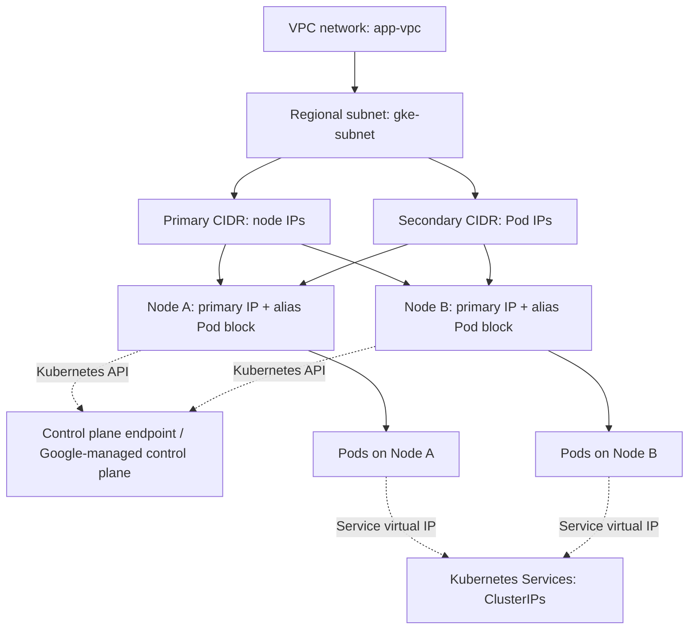

# VPC-Native Clusters and Pod IP Planning

> **Chapter:** GKE Fundamentals  
> **Module:** CLOUD_PROVIDERS_GCP  
> **Module scope:** Exploring Google Cloud from project organization, IAM, and VPCs to Compute Engine, GKE, Cloud Run, storage services, and databases. Through practical deployment scenarios, learners learn how to choose services, secure resources, automate releases, and monitor reliability and cost.

When deploying applications on **Google Kubernetes Engine (GKE)**, learners often focus on Deployments, Services, Pods, and autoscaling. However, a cluster can fail to add nodes or Pods even when CPU capacity and VM quotas remain available: the root cause may be **exhausted IP addresses for nodes or Pods**. This issue appears even sooner when operating multiple node pools, dev/staging/prod environments, hybrid links to corporate networks, or VPCs shared across projects.

**VPC-native cluster** is the default networking mode for new GKE clusters. It uses **alias IP addresses** in a Google Cloud VPC: nodes receive IPs from the subnet's **primary IPv4 range**, while Pods are assigned addresses from **one or more secondary IPv4 ranges** dedicated to Pods. For `ClusterIP` Kubernetes Services, GKE uses a separate Service IP range: either a user-supplied secondary range or a **GKE-managed Service range**, depending on version and configuration.

This lesson shows how to read the architecture, calculate IP capacity from node counts and Pods per node, build a CIDR plan, deploy **a GKE Standard cluster in a sandbox project**, and detect Pod IP exhaustion early without experimenting on production clusters.

## Learning Objectives

After this lesson, you will be able to:

1. Distinguish **legacy route-based clusters** from **VPC-native clusters using alias IPs**, and explain the role of VPC routing.
2. Identify the scope of the **primary range for nodes**, **secondary range for Pods**, **Service range**, and control plane addresses/endpoints.
3. Calculate how many IPs GKE reserves **per node** based on `maxPodsPerNode`, without confusing it with currently running Pods.
4. Build a CIDR table that avoids overlapping subnets, VPC peering, VPN/Interconnect, PSC, Google services, and other clusters.
5. Distinguish **user-managed** vs. **GKE-managed** Service IPs, GKE Standard/Autopilot, and Shared VPC setups.
6. Use the Console and `gcloud` to inspect network configuration, create a lab cluster with predefined secondary ranges, and verify node/Pod/Service addresses.
7. Diagnose IP exhaustion and understand remediation options via **additional Pod ranges / discontiguous multi-Pod CIDRs** or architectural changes.
8. Evaluate security, scalability, cost, networking impact, and proper ownership-aware cleanup of GKE resources.

## 1. What Is a GKE VPC-Native Cluster?

Kubernetes has a foundational networking model:

- Every **Pod** receives its own IP inside the cluster.
- Pods can communicate with one another under Kubernetes' flat networking model when policies and networks allow.
- A **Kubernetes Service** typically provides a stable address to distribute traffic across a set of endpoints/Pods.
- Nodes are VMs running kubelet, the container runtime, and Pods.

In GKE, **VPC-native networking** integrates Pod addressing directly with the VPC via **alias IP ranges** assigned to each node's network interface. Google Cloud VPC can route these ranges without requiring a separate custom route per node as in the legacy routes-based mode.



The diagram illustrates the common **IPv4** model. GKE also supports IPv6/dual-stack options under specific conditions; do not apply this lesson's IPv4 math directly to IPv6 designs.

### 1.1. Comparing VPC-Native and Routes-Based

| Criterion | VPC-Native (Alias IP) | Routes-Based (Legacy) |
|---|---|---|
| Source of Pod IPs | Subnet secondary IPv4 ranges assigned via alias IPs | Pod CIDR allocated and routed via cluster route model |
| VPC routing | No need for a separate custom route per node just to advertise Pod CIDRs | GKE-managed routes created for Pod ranges under legacy rules |
| Modern networking integration | Default mode for new clusters; foundation for many GKE features | Consider only if explicit legacy requirements demand it |
| Planning | Must plan primary node range, Pod range(s), and Service range/managed Service range | Plan separate CIDRs/routes and review corresponding limits |
| Recommendation | **Default preference** for new deployments | Do not choose for new designs without a verified technical reason |

**VPC-native does not mean "Pods have external IPs."** Pod IPs are generally private VPC addresses. Whether Pods reach the Internet, communicate over VPN, or accept Internet traffic still depends on routes, NAT, firewalls, load balancers, and network policies.

### 1.2. VPC Is Network-Scoped; Subnets Are Regional Resources

A **VPC** is a global network resource within a project, whereas a **subnet has regional scope**. A zonal cluster lives in one zone of a region; a regional cluster can run nodes across multiple zones of the same region. Those nodes draw from the subnet's primary and secondary ranges in that region as configured.

You cannot create a subnet in `us-central1` and assign it to a cluster in `asia-southeast1`. In Shared VPC, the subnet may live in a **host project** while the GKE cluster lives in a **service project**; permissions and IP allocations must be coordinated with the networking team.

## 2. Three Address Types to Distinguish

| Component | IPv4 Source in a VPC-Native Cluster | Capacity Problem |
|---|---|---|
| **Node** | Subnet **primary IPv4 range** | Must fit node VMs, other VMs sharing the subnet, some frontend addresses, and headroom |
| **Pod** | **One or more secondary ranges** dedicated to Pods on the subnet | Each node **reserves an entire alias CIDR block** based on max Pods/node |
| **Kubernetes Service (ClusterIP)** | User/GKE-configured Service secondary IP range, or **GKE-managed** range | Must fit total Services needing a ClusterIP; not one Service IP per Pod |
| **Control plane** | Endpoints and IPs/paths managed by GKE per cluster mode | Plan control plane access, PSC/private endpoints, and avoid CIDR overlap |
| **LoadBalancer Service frontend** | Load balancer frontend address per external/internal config | **Not automatically taken from the Pod secondary range** |

### 2.1. Primary Subnet Range — Node IPs

For example, a `10.20.0.0/24` subnet has **256 IPv4 addresses** in total. For a VPC subnet's primary range, Google Cloud reserves several addresses for infrastructure, typically leaving **252 usable addresses**. Those remaining addresses are shared among nodes and any other resources using the primary range.

**Never calculate node capacity solely from the Pod secondary range.** A cluster cannot scale past capacity if the primary range runs out of node IPs, even when the Pod secondary range still has plenty of addresses left.

### 2.2. Pod Secondary Range — Alias IPs per Node

Each node is allocated a **block** from the Pod secondary range. Kubelet/CNI assigns IPs from that block to Pods running on the node. The block size depends on the **Pods-per-node limit**, not just how many Pods happen to be running at measurement time.

Example:

```text
Pod secondary range: 10.24.0.0/20
  ├── Node A: one /26 block (64 addresses)
  │     ├── Pod 1: IP in Node A's block
  │     └── Pod 2: IP in Node A's block
  ├── Node B: one /26 block (64 addresses)
  │     └── Pod 3: IP in Node B's block
  └── Remaining blocks reserved for future nodes
```

Each Pod receives an IP per supported mechanisms; additional containers **inside the same Pod** typically share the Pod's network namespace and IP. Do not budget one Pod IP **per container**.

### 2.3. Service IP — Not a Pod IP

A Kubernetes `ClusterIP` `Service` has a relatively stable virtual IP. The node dataplane (such as iptables/eBPF depending on the GKE dataplane) routes requests from the Service IP to Pod endpoints.

```text
Client Pod: 10.24.x.x
      │
      ▼
Service ClusterIP: 10.25.0.10 (example in user-managed range)
      │
      ├── Pod A: 10.24.x.y
      └── Pod B: 10.24.z.w
```

**Important note on modern versions:** starting with **GKE Autopilot 1.27** and **GKE Standard 1.29**, GKE can by default allocate Service IPs from the **GKE-managed `34.118.224.0/20` range** instead of requiring a dedicated subnet secondary range for Services. This saves secondary-range quota and removes the need for networking teams to carve out a custom Service CIDR unless required. Older existing clusters may still use user-managed ranges.

That GKE-managed range **does not make Services public Internet endpoints**. ClusterIP retains **in-cluster internal** access semantics, and traffic to Service IPs is handled by the Kubernetes/GKE dataplane, not a public forwarding rule.

## 3. Why Can Pod IPs Run Out Even with Few Pods?

GKE pre-allocates a **Pod IP block per node**. Allocation does not scale 1:1 with currently running Pods.

Given a maximum limit `Q = maxPodsPerNode`, the minimum block size in addresses is:

\[
\text{Pod IPs reserved per node}
= 2^{\lceil \log_2(2Q)\rceil}
\]

Rule of thumb: take **twice the Pods-per-node limit**, then round up to the nearest **power of 2**.

| Pods-per-node limit (Q) | Minimum addresses needed (2Q) | Block allocated per node | IPs/block | Theoretical max nodes in a /20 Pod range |
|---:|---:|---|---:|---:|
| 110 (typical GKE Standard default) | 220 | `/24` | 256 | 16 |
| 64 | 128 | `/25` | 128 | 32 |
| 32 (Autopilot default; Standard custom example) | 64 | `/26` | 64 | 64 |
| 16 | 32 | `/27` | 32 | 128 |
| 8 | 16 | `/28` | 16 | 256 |

**This is a limit calculated strictly from the Pod CIDR**, not a guaranteed node count. GKE/Compute Engine quotas, primary subnet range, cluster/node pool limits, IP fragmentation, zone capacity, and other resources may impose tighter limits. Some modes also enforce specific limits on `maxPodsPerNode`.

### 3.1. Example: A /20 Holds Only 16 Nodes at 110 Pods/Node

Suppose the Pod secondary CIDR is `10.24.0.0/20`:

- Total addresses: `2^(32-20) = 4,096`.
- Standard default `Q=110` → each node gets a `/24` block = 256 IPs.
- Maximum nodes allowed by the Pod range: `4,096 / 256 = 16` nodes.
- Even if each node runs only **5 Pods**, allocation still consumes a full `/24` block.

If the autoscaler needs a **17th node** to relieve CPU pressure, node creation may fail because **no free Pod IP block remains**, even though only ~80 Pods are running and thousands of addresses inside already-assigned blocks are idle.

### 3.2. Same /20 with Q=32

If the cluster/node pool uses `Q=32`:

- GKE allocates `/26` = 64 IPs per node.
- `4,096 / 64 = 64` max nodes by Pod IP.
- In practice, **not every Pod slot is usable by application workloads**, due to system Pods/DaemonSets, kube-reserved resources, policies, and node capacity.

You face a trade-off: IP space is used more efficiently if nodes run fewer Pods, yet **the per-node Pod cap is lower**, sometimes requiring more nodes for the same Pod count. That affects VM costs, DaemonSets, CPU/memory, and autoscaling.

### 3.3. Standard and Autopilot Differ

- **GKE Standard:** typically defaults to **110 Pods/node** and `/24`/node unless customized; `maxPodsPerNode` can be configured within supported cluster/node pool options.
- **GKE Autopilot:** governed by Autopilot's node management model—**32 Pods/node** in current documentation and not directly customizable in the Standard manner. This corresponds to `/26`/node in the standard IPv4 model.

Do not create an Autopilot cluster and expect to pass `--max-pods-per-node=110` simply because you saw that value in a Standard example.

## 4. IP Planning: From Business Requirements to CIDRs

An IP plan should start from **maximum future scale**, not the Pod count on day one.

### 4.1. Gathering Requirements

| Question | Why Does It Affect CIDRs? |
|---|---|
| Target **maximum node count** over 12–24 months? | Determines Pod IP block count and Node IP count |
| Which node pools need 8/32/64/110 Pods/node? | Each value consumes Pod CIDR differently |
| Autoscaler min/max, HPA/VPA, and upgrade surge? | Needs extra addresses for temporary new nodes/Pods |
| Multiple node pools, zonal or regional? | Total nodes and zonal distribution alter headroom |
| Multiple clusters sharing a subnet/range? | Must sum capacities or enforce quota/assignment governance |
| VPN/Interconnect, peering, or Shared VPC? | CIDRs must not conflict with hybrid routing paths |
| Many Services, internal LoadBalancers, PSC, or other subnets? | Each resource type needs adequate address space |
| GKE-managed or user-managed Service range? | Determines if a dedicated secondary subnet range is needed |
| Any IPv6/dual-stack plans? | Requires separate routing/addressing design beyond IPv4 examples |

### 4.2. CIDR Allocation Table for a Lab System

Suppose an application will grow to at most **40 Standard nodes** in one region, with each node needing at most **32 Pods**. The networking team chooses:

| Component | Illustrative CIDR | Role | Capacity |
|---|---|---|---|
| VPC | `gke-lab-vpc` | Custom-mode VPC | No single VPC-wide CIDR |
| Subnet primary | `10.20.0.0/24` | Node IPs and other subnet resources | 256 IPs total, typically 252 usable |
| Secondary `pods-gke` | `10.24.0.0/20` | Pod alias IP blocks | 4,096 IPs, up to 64 `/26` blocks |
| Secondary `services-gke` | `10.25.0.0/22` | Kubernetes Service ClusterIPs (user-managed) | 1,024 addresses per CIDR size |
| Control plane | Managed/configured by GKE per mode | Kubernetes API access | Plan routing/PSC and avoid overlap |
| Additional Pod CIDRs | Not yet created; reserved range in IP plan | Expand if initial Pod range nears exhaustion | Per size and node pool |

All CIDRs above are illustrative. In real systems, cross-check against **every subnet in the VPC, peered networks, dynamic routes, on-premises networks, and service IP ranges**. For instance, if an office VPN already uses `10.24.0.0/16`, never assign `10.24.0.0/20` to Pods even if it is absent from current subnets.

### 4.3. Calculating Capacity and Headroom

With a `/20` Pod CIDR and `Q=32`:

```text
Pod range: /20             = 4,096 addresses
Allocation per node: /26  =    64 addresses
Capacity by Pod IPs       =    64 nodes
Expected max nodes        =    40 nodes
Remaining capacity        =    24 node blocks (if unshared/unfragmented)
```

**Warning:** 64 here is a limit **based solely on the Pod range**; it is not a Google Cloud-guaranteed autoscaling target. Compare against primary IPs, GKE cluster quotas, node pool limits, and other workloads. Even beyond 40 projected nodes, leave headroom for **upgrade surge**, zone-outage scale-out, and future growth—never run right up to all 64 blocks.

### 4.4. Why Choose CIDRs Deliberately?

With GKE-managed secondary Pod ranges, Google Cloud can automatically pick a CIDR within valid ranges, yet it **cannot foresee** reserved blocks or dynamic routes that hybrid or peered networks may introduce later. Enterprise environments should therefore rely on **IPAM** (IP Address Management), reserve blocks upfront, and record clear owners for every secondary range.

**Do not pick arbitrary common RFC 1918 blocks** hoping Cloud Router/VPN will sort out conflicts later. Overlapping CIDRs cause route ambiguity, break Pod → on-prem connectivity, or hinder VPC sharing.

## 5. Pod and Service Range Management Models

### 5.1. User-Managed Secondary Ranges

The networking team creates the subnet and secondary ranges first, then specifies the range **names** when creating the GKE cluster:

```text
Subnet: gke-lab-subnet
  primary: 10.20.0.0/24
  secondary:
    pods-gke:      10.24.0.0/20
    services-gke:  10.25.0.0/22

GKE Standard cluster:
  cluster-secondary-range-name  = pods-gke
  services-secondary-range-name = services-gke
```

Pros: CIDRs are pre-approved, easy to govern in **Shared VPC**, and compliant with network IP plans. Trade-off: requires network admins and matching IAM permissions; modifying the secondary Service range after cluster creation is **very restricted**.

### 5.2. GKE-Managed Ranges

If range names are not specified, GKE can create/manage Pod and Service ranges using version-appropriate defaults/options. Modern GKE-managed Service ranges default to `34.118.224.0/20` under the conditions noted earlier, reducing the need to carve out a dedicated Service subnet range.

If your environment requires a custom Service CIDR, select a user-managed range via supported flags at **cluster creation**. **Do not assume "we can change the Service CIDR later,"** because Service ranges cannot be arbitrarily altered or expanded during a cluster's lifecycle.

### 5.3. Sharing Secondary Ranges Across Multiple Clusters

Multiple clusters can use the same subnet, and certain secondary range types can be **shared** under product rules. This conserves IP space and range quotas, yet introduces **capacity contention**:

- Two clusters sharing a Pod range draw from the same pool of alias blocks; one large cluster can starve a smaller one.
- The primary node range can also be exhausted by other VMs or clusters.
- Not all GKE-managed or additional Pod ranges support sharing.
- Service ranges carry specific constraints, particularly with Cloud DNS and allocation methods.

**Do not assume "same VPC" = "any cluster can reuse the exact same IP range without limits."** Check the support matrix and document resource owners, quotas, and allocation rules.

## 6. How Pod Traffic Moves Inside and Outside the VPC

### 6.1. Pod → Pod

In a VPC-native cluster, Pod IPs are routable within the VPC per configuration without requiring overlay NAT between nodes.

```text
Pod A (Node A)
   10.24.0.x
        │
        ▼
VPC routing + GKE dataplane
        │
        ▼
Pod B (Node B)
   10.24.0.y
```

Actual connectivity may still be restricted by **NetworkPolicy**, firewalls, routes, GKE Dataplane V2, and supported security mechanisms. Having a VPC-routable Pod IP does not mean the whole network can freely reach every Pod.

### 6.2. Pod → Service

A ClusterIP Service is a **Kubernetes virtual IP (VIP)**. The node dataplane resolves Service → Pod endpoints. Even with the GKE-managed Service range `34.118.224.0/20`, this VIP **is not a public load balancer frontend** and cannot be reached from an Internet laptop like a public address.

### 6.3. Pod → Internet or Google APIs

Connectivity depends on:

- Whether **nodes have external IPs**.
- Internet routes and **Cloud NAT** for private workloads/nodes needing outbound Internet egress.
- **Private Google Access**, paths to Google API endpoints, and chosen network isolation settings.
- Cluster IP masquerade / SNAT configuration when Pod IPs leave the node.
- Egress firewalls, network policies, DNS, proxies, or organizational policies.

**A VPC-routable Pod IP does not mean it is exposed to the Internet.** When traffic exits through Cloud NAT or node masquerade, the destination sees the **translated source IP**, not necessarily the original Pod IP.

### 6.4. Pod/Service IPs vs. LoadBalancer Frontends

| Component | Address Clients Connect To | Notes |
|---|---|---|
| Pod | Pod IP from Pod secondary range | Normally not used directly by Internet clients |
| ClusterIP Service | Service IP from Service/managed range | Internal Kubernetes logical endpoint |
| Internal LoadBalancer | Private frontend IP per subnet/LB architecture | Access governed by VPC and policies |
| External LoadBalancer / Ingress | Public frontend IP/DNS when configured | Requires firewalls, TLS, IAM/app auth, and protection policies |

Running `kubectl expose deployment --type=LoadBalancer` can provision **billable** load balancing resources and unintended network exposure. Never use it in an IP planning lab just to inspect Pod IPs.

## 7. How Do Standard, Autopilot, and Shared VPC Affect IP Planning?

### 7.1. Standard: More Direct Node Pool Control

In GKE Standard, administrators can tune **node pools**, Pods-per-node limits, and networking options where supported. Lowering `maxPodsPerNode` shrinks the alias block per node, though it may require more nodes when Pod density is high.

A node pool with `maxPodsPerNode=32` gets a `/26` per node instead of the default `/24` (`110`) in IPv4. However, changing this on an active cluster often requires **creating a new node pool and migrating workloads**—do not treat it as an instant in-place edit on every pool.

### 7.2. Autopilot: Less Node-Level Control

GKE Autopilot manages many node decisions. IP planning must account for the **32 Pods/node** limit and Autopilot policies, yet application/platform teams remain responsible for:

- Selecting the VPC/subnet and network prerequisites at cluster creation.
- Avoiding overlaps with VPN, Interconnect, and VPC peering.
- Ensuring secondary Pod capacity covers future Pod/workload growth.
- Managing Workload Identity Federation, RBAC, NetworkPolicies, data security, and costs.

Autopilot does not mean Google Cloud automatically knows your enterprise hybrid network's IP strategy.

### 7.3. Shared VPC: Host Project and Service Project

In Shared VPC:

```text
Host project (network-team)
  VPC: shared-prod
  Subnet: gke-prod-subnet (primary + secondary ranges)
             │
             │ subnet usage permission / coordinated IAM
             ▼
Service project (app-team)
  GKE cluster
  Node pools
  Deployments/Services
```

The network team manages subnets/IPAM in the **host project**; the app team creates clusters in the **service project**. Depending on architecture, GKE service agents, node identities, and cluster creators need appropriate permissions on the subnet/VPC/host project. Never grant project-wide Owner on the host project just to create a cluster.

When expanding Pod IPs with additional ranges in Shared VPC, procedures differ from single-project clusters. **User-managed node-pool custom Pod ranges** backed by a subnet secondary range in the host project are typically the supported approach per docs; the network owner creates the secondary range and the GKE admin configures the node pool.

## 8. Hands-On A — Inspecting an Existing VPC-Native Cluster

**Do this section first**—it can be executed **read-only** on an organization cluster you are authorized to view without provisioning a new cluster. You need appropriate Compute/GKE viewer permissions to inspect VPCs/subnets/clusters, plus Kubernetes API access if running `kubectl`.

### 8.1. Set Variables and Inspect the Project

Bash example in Cloud Shell:

```bash
PROJECT_ID="my-gke-ip-lab"
REGION="asia-southeast1"
ZONE="asia-southeast1-a"
NETWORK="gke-lab-vpc"
SUBNET="gke-lab-subnet"
CLUSTER="gke-ip-lab"

gcloud auth list --filter="status:ACTIVE"
gcloud projects describe "$PROJECT_ID" \
  --format="table(projectId,name,lifecycleState)"

# Read-only: list VPCs, subnets, and clusters
gcloud compute networks list --project="$PROJECT_ID"
gcloud compute networks subnets list --project="$PROJECT_ID"
gcloud container clusters list --project="$PROJECT_ID"
```

### 8.2. Inspect Subnet Secondary Ranges

```bash
gcloud compute networks subnets describe "$SUBNET" \
  --project="$PROJECT_ID" \
  --region="$REGION" \
  --format="yaml(name,network,region,ipCidrRange,secondaryIpRanges,privateIpGoogleAccess)"
```

In the output, locate:

- `ipCidrRange`: the **primary range** for node IPs.
- `secondaryIpRanges[].rangeName`: names of secondary ranges.
- `secondaryIpRanges[].ipCidrRange`: Pod CIDR, Service CIDR (if user-configured), or other ranges on the same subnet.

**Never guess "the first secondary range is always Pods."** Always match range names in the cluster configuration.

### 8.3. Inspect Cluster IP Allocation Policy

Example for a **zonal cluster**; for a regional cluster replace `--zone` with `--region`:

```bash
gcloud container clusters describe "$CLUSTER" \
  --project="$PROJECT_ID" \
  --zone="$ZONE" \
  --format="yaml(name,location,network,subnetwork,ipAllocationPolicy,networkConfig,defaultMaxPodsConstraint,nodePools)"
```

Understand these fields:

| Field | Meaning |
|---|---|
| `ipAllocationPolicy.useIpAliases` | Cluster uses alias IPs / VPC-native mode |
| `ipAllocationPolicy.clusterSecondaryRangeName` | Primary secondary range for Pod IPs if configured by name |
| `ipAllocationPolicy.clusterIpv4CidrBlock` | Primary Pod CIDR used by the cluster |
| `ipAllocationPolicy.servicesSecondaryRangeName` | Services secondary range if present |
| `ipAllocationPolicy.servicesIpv4CidrBlock` | Configured/assigned Service IP range |
| `defaultMaxPodsConstraint.maxPodsPerNode` | Cluster-level default Pods/node limit |
| `nodePools[].maxPodsConstraint` | Per-pool Pods/node limit if set |
| `nodePools[].config` | Portion of node pool configuration |

Some fields may be empty or differ across cluster modes/versions; **do not treat an empty `servicesSecondaryRangeName` as an error** when GKE uses a GKE-managed Service range.

### 8.4. Inspect Node/Pod/Service IPs via Kubernetes

Run only when authorized to access the Kubernetes API:

```bash
# Writes/updates LOCAL kubeconfig; does not modify cluster resources
gcloud container clusters get-credentials "$CLUSTER" \
  --project="$PROJECT_ID" \
  --zone="$ZONE"

# Read-only Kubernetes queries
kubectl get nodes -o wide
kubectl get pods --all-namespaces -o wide
kubectl get services --all-namespaces -o wide

# Inspect the Pod CIDR block assigned to each node
kubectl get nodes \
  -o jsonpath='{range .items[*]}{.metadata.name}{"\t"}{.spec.podCIDR}{"\n"}{end}'
```

**Note:** `get-credentials` only edits kubeconfig on the current machine, though it can switch the **current context**. If your machine holds multiple clusters, check context before running any write commands. `kubectl get` will be denied without Kubernetes RBAC even if you have `gcloud` viewer access for GKE resources.

**What you should see:** Node `InternalIP` inside the primary CIDR; Pod IPs inside the Pod range; ClusterIP Services holding IPs from the corresponding Service range. Do not expect every Pod on a node to share the same IP or every Kubernetes Service to create an external frontend.

## 9. Hands-On B — Creating a Subnet with Primary and Secondary Ranges

This section **creates real resources that can incur GKE/node/disk/log charges**; run it only in an **authorized sandbox project**. Never create resources on a production VPC. If a VPC/subnet already exists in the lab, verify ownership and skip duplicate creation.

### 9.1. Pre-Write Checks

1. **`PROJECT_ID`** is the right sandbox project, Billing is enabled, and budgets/alerts are set.
2. CIDRs `10.20.0.0/24`, `10.24.0.0/20`, and `10.25.0.0/22` are approved and do not overlap any related subnets, routes, VPNs, peerings, or PSC links.
3. GKE API, Compute Engine API, and Service Networking/required APIs are enabled per policy; enable only if authorized.
4. Zone/region, VM/CPU/SSD/IP quotas, and node machine type are suitable.
5. Control plane access via `gcloud`/`kubectl`, Kubernetes RBAC, and IAM are planned.
6. No other VMs, clusters, or services already use `gke-lab-vpc` / `gke-lab-subnet`.

### 9.2. Enable APIs When Authorized

```bash
# Run only in sandbox when APIs are not yet enabled and you have permission
gcloud services enable \
  container.googleapis.com \
  compute.googleapis.com \
  --project="$PROJECT_ID"
```

### 9.3. Create a Custom VPC

```bash
# Create a dedicated custom-mode VPC for the lab instead of relying on the default network
gcloud compute networks create "$NETWORK" \
  --project="$PROJECT_ID" \
  --subnet-mode=custom

# Confirm network creation
gcloud compute networks describe "$NETWORK" \
  --project="$PROJECT_ID"
```

### 9.4. Create the Regional Subnet and Secondary Ranges

```bash
# Create only after IPAM/owner confirms all three CIDRs have no conflicts
POD_RANGE_NAME="pods-gke"
SERVICE_RANGE_NAME="services-gke"

gcloud compute networks subnets create "$SUBNET" \
  --project="$PROJECT_ID" \
  --network="$NETWORK" \
  --region="$REGION" \
  --range="10.20.0.0/24" \
  --secondary-range="$POD_RANGE_NAME=10.24.0.0/20,$SERVICE_RANGE_NAME=10.25.0.0/22"

# Verify the created subnet primary and secondary ranges
gcloud compute networks subnets describe "$SUBNET" \
  --project="$PROJECT_ID" \
  --region="$REGION" \
  --format="yaml(name,ipCidrRange,secondaryIpRanges)"
```

**This is a user-managed Service range example.** With modern GKE Standard versions, you can opt for the GKE-managed Service IP range instead of creating `services-gke` in real designs. This lab creates a separate range so you can clearly see the distinction between **node / Pod / Service CIDRs** on the subnet.

## 10. Hands-On C — Creating a GKE Standard VPC-Native Cluster

**Warning:** cluster creation provisions real GKE/Compute Engine resources, charges continue while running even if idle, and default settings may create nodes with network exposure. Never run this on a production cluster or unauthorized project.

### 10.1. Zonal Cluster Example

```bash
gcloud container clusters create "$CLUSTER" \
  --project="$PROJECT_ID" \
  --zone="$ZONE" \
  --network="$NETWORK" \
  --subnetwork="$SUBNET" \
  --enable-ip-alias \
  --cluster-secondary-range-name="$POD_RANGE_NAME" \
  --services-secondary-range-name="$SERVICE_RANGE_NAME" \
  --max-pods-per-node=32 \
  --num-nodes=1 \
  --machine-type=e2-standard-2 \
  --release-channel=regular
```

Parameter breakdown:

| Parameter | Role |
|---|---|
| `--network`/`--subnetwork` | Selects VPC/subnet in the matching region |
| `--enable-ip-alias` | Enables VPC-native alias IP networking |
| `--cluster-secondary-range-name` | Specifies secondary range `pods-gke` |
| `--services-secondary-range-name` | Specifies secondary range `services-gke` |
| `--max-pods-per-node=32` | Allocates a `/26` block per node in this model |
| `--num-nodes=1` | Starts the zonal cluster with one sample node |
| `--machine-type=e2-standard-2` | Sample node VM type with its own cost/quota |
| `--release-channel=regular` | Tracks the Regular release channel per organizational upgrade policy |

**Note:** this command primarily illustrates **IP layout**, not a production baseline. Production networks must also design control plane access, **private nodes**, network isolation, Workload Identity Federation, firewalls, release/maintenance windows, encryption, logging, and monitoring. Never assume a cluster created with these defaults meets organizational security requirements.

### 10.2. Re-Inspect the Cluster

```bash
gcloud container clusters describe "$CLUSTER" \
  --project="$PROJECT_ID" \
  --zone="$ZONE" \
  --format="yaml(name,status,location,ipAllocationPolicy,defaultMaxPodsConstraint,nodePools)"

# Re-read the subnet; all three CIDRs remain intact
gcloud compute networks subnets describe "$SUBNET" \
  --project="$PROJECT_ID" \
  --region="$REGION" \
  --format="yaml(ipCidrRange,secondaryIpRanges)"
```

**Expected:** `useIpAliases: true`, Pod range `pods-gke` / `10.24.0.0/20`, Service range `services-gke` / `10.25.0.0/22`, maxPods/node 32. For a single node, the node's `spec.podCIDR` should be a `/26` block within `10.24.0.0/20`; **GKE chooses the exact block**, so do not hardcode assumptions that it will always be the very first block.

### 10.3. Observe Addresses Inside the Cluster

```bash
gcloud container clusters get-credentials "$CLUSTER" \
  --project="$PROJECT_ID" \
  --zone="$ZONE"

kubectl get nodes -o wide
kubectl get pods -A -o wide
kubectl get services -A -o wide
kubectl describe node "$(kubectl get nodes -o jsonpath='{.items[0].metadata.name}')"
```

Inspect node `InternalIP`, `POD-CIDR`/`PodCIDR`, and existing Pod IPs. System Pods consume part of the node's Pod/CPU capacity; there is no need to create an external load balancer just to inspect IP ranges.

## 11. Planning for Autoscaling and Cluster Upgrades

When Cluster Autoscaler adds nodes or GKE spins up temporary nodes during an upgrade, you need enough **Node IPs and Pod IPs for those temporary nodes too**.

### 11.1. Capacity Example Before and After Scaling

Suppose:

- Pod range: `/20`, totaling 4,096 addresses.
- Max Pods/node: 32, `/26` block per node = 64 addresses.
- Cluster expects at most 40 nodes.
- Node primary range `/24` with enough addresses for VMs if unshared.

```text
Pod IP capacity by node: 64 node blocks
Allocated for 40 nodes:  40 × 64 = 2,560 addresses
Theoretical remaining:   24 × 64 = 1,536 addresses
If upgrade/surge adds 5: 45 nodes => 19 node blocks left
```

This math **does not include other clusters/node pools sharing the range**, fragmentation, quotas, or practical limits. If another node pool uses a different `maxPodsPerNode`, calculate per pool and sum the reserved alias IPs.

### 11.2. Common Misconception

**"The cluster only runs 100 Pods, and a `/20` has 4,096 addresses, so we have 3,996 IPs left to scale" — False.**

Space is allocated to nodes in **alias CIDR blocks**, not handed out one IP per Pod from a global pool:

- 10 default Standard nodes (`Q=110`) reserve **10 × 256 = 2,560 IPs** even when running only 100 Pods.
- When the 17th node needs another `/24`, a `/20` Pod range has zero blocks left once the first 16 nodes claim them all.
- Packing more Pods onto existing nodes is also constrained by CPU/memory and `maxPodsPerNode`, not just unused IPs inside a node's block.

### 11.3. Autohealing and Upgrade Surge

During node repair, node pool upgrades, or node replacement, GKE may create replacement nodes before removing old ones. Check:

- Node pool upgrade settings, **max surge / max unavailable**, or equivalent mechanisms.
- Cluster Autoscaler min/max nodes.
- PodDisruptionBudgets, readiness probes, and drain duration.
- Remaining IP space in both primary and Pod ranges.
- Compute Engine quotas, zone capacity, and disks.

**Do not set surge to 0 or allow heavy disruption just to dodge IP shortages** without evaluating SLOs and headroom. You may need larger ranges or additional Pod ranges.

## 12. Pod IP Exhaustion: Symptoms, Causes, and Remediation

### 12.1. Common Symptoms

- GKE autoscaler tries to add a node, but node creation fails because the subnet or Pod IP range is full.
- Cluster logs errors such as **IP space of subnet is exhausted**, **insufficient free IP space for Pods**, or related allocation errors.
- A node pool stops scaling out despite available CPU/VM quotas.
- Pod count is low, yet **node count has consumed all alias blocks**.
- In Shared VPC, one cluster sharing a range consumes blocks needed by another cluster.

Do not diagnose every `Pod Pending` as Pod IP exhaustion. Pods can be Pending due to CPU/memory, taints/tolerations, node selectors, persistent volumes, quotas, or admission policies; read **events and autoscaler status** first.

### 12.2. Read-Only Diagnostic Steps

```bash
# Inspect subnet and secondary CIDRs
gcloud compute networks subnets describe "$SUBNET" \
  --project="$PROJECT_ID" --region="$REGION" \
  --format="yaml(ipCidrRange,secondaryIpRanges)"

# Inspect IP allocation policy, node pools, and cluster status
gcloud container clusters describe "$CLUSTER" \
  --project="$PROJECT_ID" --zone="$ZONE" \
  --format="yaml(status,ipAllocationPolicy,defaultMaxPodsConstraint,nodePools)"

# If you have Kubernetes API access
kubectl get nodes -o wide
kubectl get pods -A -o wide
kubectl get pods -A --field-selector=status.phase=Pending
kubectl get events -A --sort-by=.lastTimestamp
```

**Note:** `kubectl` commands must target the **right cluster context**. `kubectl get events` can reveal sensitive application details; share outputs only through organization-approved channels.

### 12.3. Remediation by Root Cause

| Root Cause | Remediation Path | What Not to Do |
|---|---|---|
| Node primary range full | Evaluate expanding primary subnet CIDR, migrating workloads, or tuning node sizing | Arbitrarily changing primary CIDR with active peering/VPNs |
| Pod secondary range full | Evaluate **additional Pod ranges / discontiguous multi-Pod CIDR** or a new node pool with a custom range | Manually editing a node's Pod IPs |
| Node `maxPodsPerNode` too high for actual Pod density | Consider a new node pool with a lower Q and migrate workloads in a controlled way | Lowering Q on active nodes without accounting for disruption |
| Multiple clusters sharing one range | Partition resources/IP plans and monitor per-cluster capacity | Deleting a shared secondary range |
| CIDR overlap with hybrid network | Re-plan CIDRs and routes with network administrators | Adding ad-hoc routes or unplanned NAT |
| `Pending` due to CPU/memory, not IPs | Increase quota/capacity or adjust requests/limits/placement | Adding IP ranges without fixing the real bottleneck |

### 12.4. Additional Pod Ranges / Discontiguous Multi-Pod CIDR

GKE supports using **multiple Pod IPv4 ranges**, enabling cluster expansion without forcing every node onto the initial range.

Distinguish two models:

1. **Cluster-level additional Pod ranges** managed by GKE when the cluster and VPC support it within the same project under product rules.
2. **Custom Pod range per node pool** referencing an existing secondary range on the subnet, especially suited for **Shared VPC** where the VPC resides in a host project.

```text
VPC subnet
  primary: 10.20.0.0/24             -> Node IPs
  secondary pods-gke: 10.24.0.0/20 -> Node pool A (alias IP blocks)
  secondary pods-extra: 10.26.0.0/20 -> Node pool B (alias IP blocks)

Cluster
  Node pool A: continues using the original Pod range
  Node pool B: draws Pod blocks from the separate secondary range
```

This example illustrates the design only; names and CIDRs must be **confirmed by IPAM/owners**. There is no single generic cluster edit command that automatically "moves" all running Pods into the new range; typically you create a new pool, schedule workload migration, and verify connectivity.

**Important:** the Service range differs from the Pod range. GKE supporting additional Pod ranges **does not** mean you can arbitrarily expand or change the Service CIDR of an existing cluster.

## 13. Control Plane, Private Clusters, and Overlap Issues

GKE has a Google-managed **control plane**. Access can use IP/DNS endpoints and **Private Service Connect (PSC)** models depending on cluster type, network isolation settings, and version.

When creating an IP plan:

1. Document the **node/Pod/Service ranges** allocated in the VPC.
2. Review the **Kubernetes API endpoint** configuration and control plane access permissions.
3. If using a private control plane/CIDR, avoid overlaps with subnets, peerings, and routes.
4. Do not assume every new cluster requires a legacy `--master-ipv4-cidr` block: depending on PSC/network isolation mode, settings may differ.
5. Ensure `kubectl` users have both network reachability and proper IAM/Kubernetes RBAC; a clean IP plan alone does not guarantee control plane access.

### Private Node IPs and Pod Networking Are Two Separate Dimensions

**VPC-native** describes how GKE allocates and routes Pod IPs; it does not mean the cluster is **private** in every sense. A VPC-native cluster can have nodes with external IPs or private nodes depending on configuration. Achieving private-only connectivity requires independently designing network isolation, NAT, control plane access, firewalls, and DNS policies.

## 14. Network Security and Pod Identity

### 14.1. IP Routing Is Not Authorization

Just because Pod IPs are routable within the VPC does not mean every workload should be allowed to call every other Pod. Defense layers include:

| Layer | Typical Controls |
|---|---|
| **VPC firewall** | Ingress/egress flows for node VMs, GKE-created rules, and custom rules |
| **GKE NetworkPolicy / Dataplane V2 policy** | Pod-to-Pod/workload connectivity by selector, namespace, and supported capabilities |
| **Kubernetes RBAC** | Who can read/modify API objects inside the cluster |
| **Workload Identity Federation for GKE** | Pods/workloads calling Google Cloud APIs with minimal identity |
| **Service IAM / app auth** | Access to databases, Pub/Sub, Cloud Storage, and HTTP APIs |
| **Ingress/Gateway/Load Balancer** | Traffic entry surface, TLS, Cloud Armor, and policies where supported |

**Never use a Pod IP allowlist as the sole authentication mechanism**, since Pod IPs change whenever Pods reschedule. For GKE workloads, use Kubernetes labels/selectors, service identities, and identity-aware mechanisms. Pod CIDR ranges are useful for network planning, firewalls, and troubleshooting, not for identifying an individual Pod permanently.

### 14.2. VPC-Native and SNAT/Masquerade

Some Pod → external destination traffic outside non-masquerade ranges may **translate the source IP** to the node IP before leaving the node per `ip-masq-agent`/dataplane configuration. With Cloud NAT, external destinations see the NAT IP. When reading firewall logs:

- Check **where traffic is observed** before assuming the source IP must be the Pod IP.
- Correlate node/Pod metadata, request IDs, logging, and network policies.
- Never open `0.0.0.0/0` to everything just because "Pod IPs keep changing."

### 14.3. DNS and Service Discovery

CoreDNS and Cloud DNS for GKE (if configured) resolve Kubernetes Service names. Example service name:

```text
api.default.svc.cluster.local
```

This resolves to a Service IP or address set depending on Service type. If DNS fails, Pods cannot find endpoints even when CIDRs and routing are healthy. **DNS failures and IP exhaustion are distinct problem classes**; check `kube-dns`/DNS policies separately from IP allocation.

## 15. Production IP Governance: IPAM, Multi-Region, and DR

A minimal IPAM record should track:

- **VPC/subnet/region** names, primary CIDR, Pod CIDR(s), Service CIDR, and whether GKE-managed or user-managed.
- **Cluster/node pool** names, owners, and service/host project.
- **Max Pods/node**, projected max nodes, autoscaler bounds, and temporary upgrade surge nodes.
- **VPC peerings, dynamic routes, hybrid VPN/Interconnect, PSC, and Google-managed service** ranges at risk of overlap.
- **Remaining capacity in alias blocks** and the threshold to request additional CIDRs.
- Approved changes and rollback records when adding node pools or secondary ranges.

### 15.1. Multi-Region and IP Planning

If an architecture runs a cluster in Singapore and another in Tokyo, each cluster requires a subnet **in its own region**, and the IP plan must avoid overlaps across any interconnecting paths. Because VPC subnets are regional, you cannot move a subnet across regions.

Both clusters can use distinct CIDRs connected over VPC/peering/hybrid links or application-level routing. Creating two clusters with identical Kubernetes Service names does not automatically provide multi-region routing or failover.

### 15.2. Disaster Recovery

Recovering a cluster in another region requires:

1. Pre-allocated or IPAM-ready primary/secondary subnet ranges.
2. Re-deployable images/artifacts, Kubernetes manifests, and configs/secrets.
3. Matching IAM/Workload Identity Federation, DNS, routes, firewalls, and control plane access.
4. Independent persistent data backup/restore and database replication.
5. Testing actual **RTO**, data loss **RPO**, and load balancer behavior.

**Reusing the same Pod CIDR does not carry Pod data or identities to a standby region.** DR must restore every application component and its dependencies.

## 16. Monitoring GKE IP Capacity and Cost

### 16.1. Signals to Track

| Metric / Event | Indicator | Action |
|---|---|---|
| Primary subnet IP usage | Few addresses left for nodes/ILB resources | Evaluate CIDR expansion and coordinate with IPAM |
| Pod secondary usage | Alias blocks nearly exhausted despite few running Pods | Re-evaluate `maxPods/node` and consider additional ranges |
| Node count per node pool | Autoscaler near maximum or spiking | Check Pod CIDR capacity and quotas before scaling |
| `Pod Pending` and Events | IP exhaustion or scheduling failure | Read root cause instead of blindly adding IPs |
| GKE operations | Node creation/upgrade failures | Inspect error messages, regional capacity, and ranges |
| Pod/service connectivity | DNS, routes, firewalls, NetworkPolicy | Diagnose at the appropriate layer |
| Cross-region/hybrid egress | Rising traffic or NAT volume | Review Cloud Billing and network design |

Set alerts **before** the secondary range runs out of blocks for new nodes. Once a cluster is completely full, even a minor upgrade or node repair can stall for lack of an address for the replacement node.

### 16.2. Cost

CIDR space itself is not billed "per Pod IP per month" in a naive model; GKE cost depends on **cluster management, Compute Engine nodes or Autopilot Pod resources, disks, networking, load balancing, Cloud NAT, egress, and logging/monitoring** depending on mode.

Do not optimize IP usage by cramming too many Pods onto small VMs, causing CPU/memory contention and SLO degradation. The goal is to **balance IP capacity, performance, security, and cost**.

## 17. Cleaning Up Lab Resources in the Right Order

**Delete only resources created specifically for this lab**; never delete existing clusters belonging to others. Deleting a cluster destroys its node pools/VMs and can affect workloads and data; verify ownership, snapshots/volumes, permissions, and dependencies first.

### 17.1. Verify Resources Before Deleting

```bash
printf 'Project=%s Region=%s Zone=%s Cluster=%s Network=%s Subnet=%s\n' \
  "$PROJECT_ID" "$REGION" "$ZONE" "$CLUSTER" "$NETWORK" "$SUBNET"

gcloud container clusters describe "$CLUSTER" \
  --project="$PROJECT_ID" --zone="$ZONE" \
  --format="yaml(name,location,status,network,subnetwork,ipAllocationPolicy)"

gcloud compute networks subnets describe "$SUBNET" \
  --project="$PROJECT_ID" --region="$REGION" \
  --format="yaml(name,network,ipCidrRange,secondaryIpRanges)"
```

If a cluster runs real applications or has PVCs/Persistent Disks, static IPs, LoadBalancer Services, DNS records, or active users, plan **backup/migration** and clean up individual resources only after approval.

### 17.2. Delete Only the Lab Cluster

```bash
# ONLY if this exact cluster was created by the lab and holds no data/workloads to keep
gcloud container clusters delete "$CLUSTER" \
  --project="$PROJECT_ID" \
  --zone="$ZONE"
```

Wait for cluster deletion to complete; verify **no node pools, load balancers, disks, or IPs** from the lab remain before deleting the subnet or VPC.

### 17.3. Delete Subnet/VPC Only If Lab-Owned

```bash
# After confirming the subnet has no VMs, nodes, LBs, or shared ranges left
gcloud compute networks subnets delete "$SUBNET" \
  --project="$PROJECT_ID" \
  --region="$REGION"

# Delete the lab VPC only if no subnets, rules, peerings, or dependent resources remain
gcloud compute networks delete "$NETWORK" \
  --project="$PROJECT_ID"
```

**Never run these commands on a Shared VPC host project or production network.** In Shared VPC, subnets and IP ranges are shared resources; network owners must assess and execute any changes.

### 17.4. Verify After Cleanup

```bash
gcloud container clusters list --project="$PROJECT_ID"
gcloud compute networks subnets list --project="$PROJECT_ID"
gcloud compute networks list --project="$PROJECT_ID"
```

Check **Cloud Billing Reports**; metrics may update with a delay. Especially with GKE Standard, management/node/disk or load balancer fees may have accrued during the lab even after cluster deletion. Budgets send alerts only; **they do not automatically cap spend**.

## 18. Troubleshooting: Common Errors

| Symptom | Possible Causes | How to Resolve |
|---|---|---|
| Cluster creation fails due to CIDR overlap | Primary/secondary ranges collide with subnets, routes, connected networks, or scope rules | Audit IPAM, VPC routes, and peerings; pick an approved non-overlapping CIDR |
| Cluster creation reports secondary range not found | Wrong `rangeName`, subnet, region, or project | Match `subnets describe` output against `--cluster-secondary-range-name` |
| `useIpAliases` is not true | Legacy cluster or unexpected range mode | Check cluster mode and plan migration; never hand-edit Pod CIDRs |
| New nodes fail to create due to IP exhaustion | Primary range or Pod range has no addresses/blocks left | Calculate capacity for both ranges and evaluate expansion |
| Free Pod IPs exist, yet nodes cannot scale | IPs are reserved in per-node blocks; no free blocks remain | Check `Q`, per-node prefix, and max node count |
| Extended `Pod Pending` | Could be CPU/memory shortage, taints, storage, or IPs | Read `kubectl describe pod`, events, and autoscaler status |
| Cluster shows Service IPs outside the secondary range | Using GKE-managed `34.118.224.0/20` | Check `ipAllocationPolicy`; do not treat as public exposure |
| `kubectl` timeout | Control plane endpoint, IAM/RBAC, firewall, or routing | Verify context, endpoint access, and private connectivity |
| Pod cannot call Google APIs | Egress networking / Private Google Access / NAT / DNS / IAM | Separate network path checks from workload IAM checks |
| Pods in cluster A cannot reach Pods in cluster B over hybrid | CIDR overlap, routes, firewalls, or NAT | Audit Pod ranges, VPN/Interconnect, and policies |
| Shared VPC cluster creation fails with permission error | Creator or GKE service agent lacks subnet/host project roles | Identify host/service projects and grant exact required roles |
| Old Pods keep old IPs after expanding Pod range | Additional ranges serve new nodes/node pools without moving existing Pods immediately | Plan controlled migration/rollout and check node pool placement |
| Charges remain after deleting cluster | Remaining disks/IPs/load balancers or delayed billing sync | Inventory resources and check Billing Reports |

### Layered Diagnostic Procedure

1. **Identity and scope:** right project, host/service project, VPC, subnet, and region/zone?
2. **CIDRs:** node primary, Pod secondary, and Service ranges accurate and non-overlapping?
3. **Capacity:** node count, `Q=maxPods/node`, alias block size, quotas, and autoscaler max?
4. **Nodes/Pods:** node creation errors, Pod scheduling events, node pool constraints?
5. **Networking:** VPC routes, firewalls, NAT/masquerade, DNS, and NetworkPolicy?
6. **Control plane:** API endpoint, kubeconfig, IAM, and Kubernetes RBAC?
7. **Operations:** upgrade/surge headroom, shared ranges, IPAM, logging, and Billing?

## 19. Applied Scenarios

### Scenario A — Cluster Has Few Pods Yet Cannot Add Nodes

A GKE Standard cluster uses a `/20` Pod range with the default 110 Pods/node. At 16 nodes, each node runs only ~5–10 Pods, yet the autoscaler fails to create the 17th node. The cause is that **each node received a `/24`**, so the `/20` has exhausted all 16 blocks.

**Resolution:** review subnet/cluster policies, consider adding an additional Pod range/node pool, or design a new pool with a lower Q if suitable for the workload; never assume "thousands of unused individual Pod IPs" guarantees node scaling capacity.

### Scenario B — Company Connects On-Premises via Cloud VPN

Applications in the cluster must call an on-premises ERP system using `10.24.0.0/16`. The team accidentally chose `10.24.0.0/20` as the Pod range. Pod source addresses fall inside the on-prem range, causing routing ambiguity and source identification problems.

**Resolution:** update IPAM, pick a non-overlapping Pod CIDR, and coordinate routing/security with network admins. Never insert arbitrary routes to "prefer" one subnet while breaking other Pods.

### Scenario C — Multiple Clusters Using Shared VPC

One service project runs a dev cluster and another runs staging on the same VPC. If both share a single Pod range without capacity monitoring, an aggressive dev scale-out can consume alias blocks needed by staging.

**Resolution:** define clear ownership/quotas/ranges, monitor per node pool, and consider separate secondary ranges per environment when capacity isolation is needed; coordinate host/service project permissions.

### Scenario D — Misunderstanding GKE-Managed Service IPs

A learner inspects a modern Standard cluster and notices Service ClusterIPs in `34.118.224.0/20`, even though the subnet only defines a Pod secondary range. They assume the IPs are public because they lie outside RFC 1918.

**Resolution:** verify the GKE-managed Service CIDR in `ipAllocationPolicy` and ClusterIP behavior. A Service IP is not an Internet frontend; do not add public routes or firewalls simply because an internal VIP is outside RFC 1918.

### Scenario E — Upgrading a Node Pool Near IP Exhaustion

A production node pool has nearly filled its Pod secondary range; GKE needs temporary surge nodes to upgrade, but cannot allocate new alias blocks. The upgrade stalls or requires greater disruption than planned.

**Resolution:** configure proactive alerts, budget capacity for upgrade surge and autoscaling, and evaluate additional ranges or controlled pool migration before entering the maintenance window.

## 20. Planning and Deployment Checklist

| Review Item | Evidence / Criterion |
|---|---|
| **Mode** | Cluster is VPC-native, `useIpAliases=true` |
| **Location** | VPC/subnet in matching region; appropriate zonal/regional cluster |
| **Primary range** | Sufficient Node IPs and shared resources, plus scale/upgrade headroom |
| **Pod range** | One or more secondary ranges sized by per-node alias blocks |
| **Pods/node** | Justified Q in Standard; Autopilot aligned to platform limits |
| **Service range** | GKE-managed vs. user-managed explicitly documented; no vague assumptions |
| **IPAM** | Zero overlap with VPCs, subnets, peerings, hybrid links, and related ranges |
| **Shared VPC** | Host/service projects and subnet allocation permissions coordinated |
| **Cluster access** | Control plane endpoint, IAM/RBAC, DNS, and routes verified |
| **Pod security** | Workload Identity Federation, NetworkPolicy, and VPC firewalls configured |
| **Egress** | Cloud NAT / Private Google Access and SNAT configured as needed |
| **Autoscaling** | Accounted for upgrade surge, repair, and node pool headroom |
| **Observability** | Monitoring IP utilization, node creation errors, and Pending Pod events |
| **Cost** | Budgeted for GKE/nodes/disks/NAT/LB/logs with Billing alerts |
| **Cleanup** | Delete lab clusters/subnets/VPCs only after checking owners and dependencies |

## 21. Self-Check Questions

**1. Which range does a VPC-native cluster use to assign node IPs?**  
**Answer:** The primary IPv4 range of the subnet attached to the cluster.

**2. Where are Pod IPs allocated from?**  
**Answer:** One or more secondary IPv4 ranges dedicated to Pods on the subnet, assigned as alias blocks per node.

**3. Why does 110 Pods/node require a `/24` block instead of a `/25`?**  
**Answer:** GKE allocates at least double 110 = 220 addresses and rounds up to the nearest power of two, 256 addresses, which is a `/24`.

**4. How many nodes does a `/20` Pod secondary CIDR with Q=110 support at most by Pod IP?**  
**Answer:** 4,096 / 256 = **16 nodes** assuming no sharing/fragmentation and ignoring other limits.

**5. What about the same `/20` with Q=32?**  
**Answer:** Each node takes a `/26` = 64 addresses; the theoretical limit by Pod IP is 4,096 / 64 = **64 nodes**.

**6. Does a Pod with three containers require three Pod IPs?**  
**Answer:** Normally no. Containers within the same Pod share the Pod's network namespace and IP.

**7. Does GKE Standard 1.29+ strictly require creating a custom secondary Service range?**  
**Answer:** No. In supported configurations, the GKE-managed Service IP range can default to `34.118.224.0/20`; if you want a user-managed custom Service range, plan it at cluster creation.

**8. Why is a `34.118.224.x` Service IP not a public IP reachable from the Internet?**  
**Answer:** Because it is a GKE-managed Kubernetes ClusterIP virtual address handled by the in-cluster dataplane, not a public forwarding rule.

**9. When running out of Pod IPs, should you raise `maxPodsPerNode` to fit more nodes?**  
**Answer:** Not like that. Raising Q makes each node's alias block **larger**, which reduces the number of nodes the Pod CIDR can support. Review actual Pod density, add Pod ranges, or adjust node pool design instead.

**10. Can a secondary Service range be freely changed at any time after cluster creation?**  
**Answer:** No. Choose carefully, as modifying or expanding the Service range is restricted during a cluster's lifecycle.

**11. If Pod IPs are routable in the VPC, can every Pod freely connect to every other Pod?**  
**Answer:** No. Firewalls, NetworkPolicies, Dataplane V2, routes, and application policies can still restrict traffic.

**12. Is `Pending` in `kubectl get pods -A` sufficient proof of IP exhaustion?**  
**Answer:** No. Inspect scheduling events, autoscaler status, primary/secondary ranges, and quotas.

**13. Does GKE Autopilot let you customize 110 Pods/node like Standard?**  
**Answer:** Not in the current Autopilot model. Autopilot enforces its platform maximum density (32 Pods/node in the referenced documentation).

**14. Why can't a new cluster use a subnet located in a different region?**  
**Answer:** VPC subnets are regional resources and must match the region hosting the cluster/nodes.

## Key Takeaways

- **VPC-native is the default networking mode for modern GKE**, using VPC alias IP ranges rather than legacy per-node route tables.
- **Node IPs** come from the **primary subnet range**; **Pod IPs** come from **secondary Pod range(s)**; **Service ClusterIPs** come from either a user-managed or GKE-managed range.
- **Pod IP capacity must be calculated by per-node blocks**, typically twice `maxPodsPerNode` rounded up to a power of two: 110 → /24, 64 → /25, 32 → /26.
- **Budget for node autoscaling, upgrade surge, and multiple node pools**; a huge Pod CIDR cannot scale if primary Node IPs or quotas run out.
- **Modern GKE-managed Service ranges** can default to `34.118.224.0/20`; do not mistake this for public exposure or assume a subnet Service range is always mandatory.
- **Avoid CIDR overlaps**, especially with Shared VPC, VPN, Interconnect, and peering; when IPs run low, evaluate additional Pod ranges instead of manual Pod IP hacks.
- **Routing, IAM, NetworkPolicy, and egress are separate layers**; routable Pod IPs alone do not equal security.
- **Verify with `gcloud` and `kubectl` before making changes**, clean up only lab-owned clusters/subnets/VPCs, and monitor costs.

## Official Reference Documentation

- [Google Cloud — VPC-native clusters and alias IPs](https://cloud.google.com/kubernetes-engine/docs/concepts/alias-ips)
- [Google Cloud — GKE networking architecture](https://cloud.google.com/kubernetes-engine/docs/learn/learn-gke-net-architecture)
- [Google Cloud — Understand IP addressing in GKE](https://cloud.google.com/kubernetes-engine/docs/concepts/about-ip-addressing)
- [Google Cloud — Create a VPC-native cluster](https://cloud.google.com/kubernetes-engine/docs/how-to/alias-ips)
- [Google Cloud — Configure maximum Pods per node](https://cloud.google.com/kubernetes-engine/docs/how-to/flexible-pod-cidr)
- [Google Cloud — Troubleshoot IP address management in VPC clusters](https://cloud.google.com/kubernetes-engine/docs/troubleshooting/vpc-clusters)
- [Google Cloud — Add Pod IPv4 address ranges](https://cloud.google.com/kubernetes-engine/docs/how-to/multi-pod-cidr)
- [Google Cloud — Best practices for GKE networking](https://cloud.google.com/kubernetes-engine/docs/best-practices/networking)
- [Google Cloud — GKE IP address management strategies](https://cloud.google.com/kubernetes-engine/docs/concepts/gke-ip-address-mgmt-strategies)
- [Google Cloud — Customize network isolation](https://cloud.google.com/kubernetes-engine/docs/how-to/latest/network-isolation)
