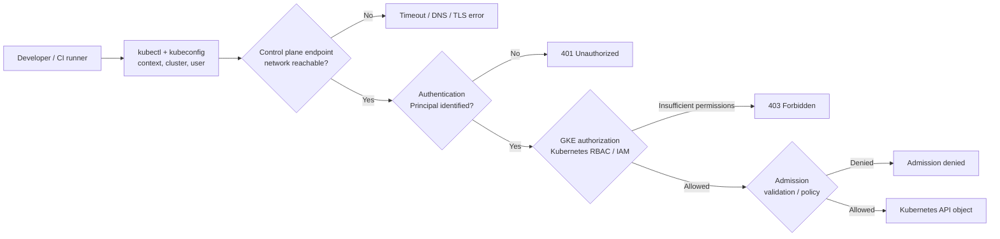
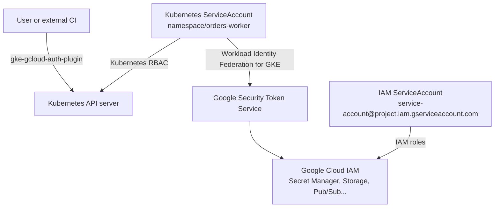
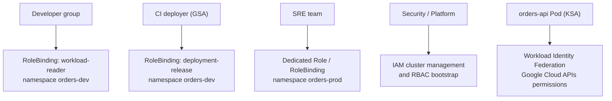

# Configuring kubectl, IAM, and Kubernetes RBAC

A development team operates a Java application on Google Kubernetes Engine (GKE). Developers need to **view Pods and logs** in the `orders-dev` namespace to investigate errors, the release team needs to update Deployments, and the security team manages cluster administrative permissions. If everyone uses an account with `cluster-admin`, a single mistaken command can edit a Secret, delete a production workload, or unintentionally escalate privileges. Conversely, if only Google Cloud IAM roles are granted without understanding Kubernetes RBAC, a user can run `gcloud container clusters get-credentials` successfully yet still hit `Forbidden` when calling the API.

This lesson belongs to the **GKE Fundamentals** chapter of the **CLOUD_PROVIDERS_GCP** module. Along the Google Cloud learning path—from projects/IAM/VPC, Compute Engine, GKE, and Cloud Run to data, automation, and operations—understanding **`kubectl`, kubeconfig, authentication, authorization, IAM, and RBAC** is foundational for secure deployments, separating platform and application responsibilities, and auditing incidents.

> All project names, clusters, namespaces, emails, and YAML manifests below are **learning examples**. Operations that create RoleBindings/ClusterRoleBindings or alter IAM can grant real permissions; execute them only on authorized clusters and after verifying `kubectl config current-context`. Never paste access tokens, full kubeconfigs, or service account keys into public documents.

## Learning Objectives

After this lesson, you will be able to:

1. Explain the path of a `kubectl` command to the **Kubernetes API server** and the differences between **network reachability, authentication, authorization, and admission**.
2. Install `kubectl` and `gke-gcloud-auth-plugin`, create/scope `kubeconfig` via `gcloud container clusters get-credentials`, and manage contexts safely.
3. Distinguish **Google Cloud IAM** permissions at the project/cluster level from **Kubernetes RBAC** on cluster/namespace resources, including how GKE combines them.
4. Create **Roles**, **ClusterRoles**, **RoleBindings**, and **ClusterRoleBindings** with proper scope, distinguishing `User`, `Group`, and `ServiceAccount` subjects.
5. Design read-only Pod/log permissions and scoped Deployment release permissions while avoiding unnecessary `secrets`, `pods/exec`, and `cluster-admin` grants.
6. Use `kubectl auth can-i`, `kubectl auth whoami`, `gcloud`, and audit logs to diagnose `401`/`403`/timeouts without fixing errors by handing out Owner roles.
7. Distinguish **Kubernetes ServiceAccounts**, **IAM service accounts**, and **Workload Identity Federation for GKE**, and know how to protect workload identities.
8. Write onboarding/offboarding runbooks, negative tests, and monitor production permission changes.

## 1. What Layers Must a kubectl Command Pass Through?

`kubectl` is a **CLI client for the Kubernetes API**, not an SSH tool directly into nodes. A command such as `kubectl get pods -n orders-dev` must reach the cluster's API server and pass permission checks.



**Four layers to separate:**

| Layer | Question | Example Errors |
| --- | --- | --- |
| Network/TLS | Can the client connect to the API server endpoint? | `i/o timeout`, DNS lookup failure, x509 TLS error |
| Authentication (**AuthN**) | Which account sent the request? Is the token valid? | `You must be logged in to the server`, 401 |
| Authorization (**AuthZ**) | Can this principal `list pods` in this namespace? | `Forbidden` listing user/resource/verb |
| Admission | Is the object allowed to be created/modified per policies and validators? | Pod Security Admission or validating webhook rejection |

A valid credential **does not automatically grant permissions**. And a valid RoleBinding **cannot fix an unreachable endpoint**. Always classify the right layer when troubleshooting before altering IAM or RBAC.

### Two Administrative "Planes"

- **Google Cloud control plane**: GKE cluster resources, node pools, networking, IAM policies, projects, billing, and API enablement. Typical tools: `gcloud container clusters ...`, Google Cloud Console, Terraform.
- **Kubernetes API plane**: namespaces, Pods, Deployments, Services, Secrets, Roles, and RoleBindings inside the cluster. Typical tools: `kubectl ...` or Kubernetes client libraries.

There is overlap in practice: GKE integrates IAM and RBAC when **authorizing** Kubernetes API operations, but that does not merge project IAM and namespace RBAC into one concept.

## 2. Three Components Needed to Use kubectl with GKE

### 2.1 kubectl

`kubectl` calls the Kubernetes API over HTTPS. The client version should be compatible with the cluster's Kubernetes version under the official **version skew policy**; install updates from trusted sources and check:

```bash
kubectl version --client
kubectl config get-contexts
```

Do not run `kubectl get all --all-namespaces` and conclude you have seen every resource: `all` omits many Kubernetes resource types, and the command requires permissions across every namespace.

### 2.2 gke-gcloud-auth-plugin

GKE uses **`gke-gcloud-auth-plugin`** via the **Kubernetes exec credential plugin** mechanism to provide Google identity tokens to the client. It is a separate binary referenced by kubeconfig; `kubectl` must find it in `PATH`.

```bash
# Read-only version check; does not modify GKE resources.
gcloud version
gke-gcloud-auth-plugin --version
kubectl version --client
```

If it is not installed and you use a Google Cloud CLI distribution supporting component management:

```bash
# Install component on systems supporting the Google Cloud CLI component manager.
gcloud components install gke-gcloud-auth-plugin
```

On Linux where `gcloud` is installed via `apt`/`yum`, the component manager may be disabled; install the package such as `google-cloud-cli-gke-gcloud-auth-plugin` from the Google Cloud repository. In Cloud Shell, the tool is typically preinstalled. **Never download plugin binaries from untrusted sites** or add arbitrary exec plugins into kubeconfig.

### 2.3 kubeconfig

Kubeconfig typically lives at `~/.kube/config` and contains:

| Field | Contents | Meaning |
| --- | --- | --- |
| `clusters` | API server URL and TLS verification info | Which endpoint the client contacts |
| `users` | Authentication/exec plugin config | Which identity the client uses to authenticate |
| `contexts` | Triad of cluster + user + default namespace | Target of `kubectl` commands |
| `current-context` | Currently selected context | Used when `--context` is omitted |

Kubeconfig **is not a Kubernetes RoleBinding**, nor does it **prove** you have permissions inside the cluster. It can contain or reference sensitive details, so share only redacted versions; avoid `kubectl config view --raw` in CI logs, issues, or chat.

## 3. Configuring gcloud and Fetching Cluster kubeconfig

Example:

```text
PROJECT_ID=retail-dev-01
CLUSTER_NAME=retail-gke-dev
CONTROL_PLANE_LOCATION=asia-southeast1
NAMESPACE=orders-dev
```

`CONTROL_PLANE_LOCATION` is a **region** for regional clusters or a **zone** for zonal clusters. Do not assume a regional cluster has a single fixed zone.

### 3.1 Check the Active Google Cloud Principal First

```bash
# Read-only check of local state and viewable cluster info.
gcloud auth list
gcloud config get-value account
gcloud config get-value project

gcloud container clusters list \
  --project="retail-dev-01"

gcloud container clusters describe retail-gke-dev \
  --project="retail-dev-01" \
  --location="asia-southeast1"
```

`describe` may display endpoints and access control settings; redact details the recipient does not need before sharing output.

### 3.2 Fetch Credentials

```bash
# WRITES LOCAL kubeconfig: does not create/modify the cluster in Google Cloud.
gcloud container clusters get-credentials retail-gke-dev \
  --project="retail-dev-01" \
  --location="asia-southeast1"
```

Per GKE documentation, generating a kubeconfig entry requires at least the **`container.clusters.get`** IAM permission, included in `roles/container.clusterViewer`. That permission lets you identify/connect to the cluster; **it does not automatically grant rights to list Pods or edit Deployments**. GKE still enforces authentication, networking, and RBAC/IAM authorization on subsequent commands.

**Important side effect:** `get-credentials` adds/updates a context and **switches `current-context`** to the newly fetched cluster. On a workstation managing multiple projects, this can cause a later `kubectl delete` to hit the wrong cluster. Always check context and namespace right after running it.

### 3.3 Inspect and Select Context Safely

```bash
# Read-only.
kubectl config get-contexts
kubectl config current-context
kubectl config view --minify

# Switch LOCAL current context (does not modify the cluster).
kubectl config use-context "gke_retail-dev-01_asia-southeast1_retail-gke-dev"

# Set default namespace for the LOCAL context.
kubectl config set-context --current --namespace=orders-dev

# Re-verify to ensure you are not targeting prod by mistake.
kubectl config current-context
```

Context names like `gke_PROJECT_LOCATION_CLUSTER` are standard from `get-credentials`, though they may be renamed or differ in specific environments. Copy the **actual** name from `kubectl config get-contexts` before running `use-context`. For sensitive commands, pass both `--context` and `-n NAMESPACE`, and use pinned targets in pipelines.

### 3.4 Isolate Lab kubeconfig from Production Config

```bash
# Linux/Cloud Shell example: use an isolated kubeconfig file for labs.
mkdir -p "$HOME/.kube"
export KUBECONFIG="$HOME/.kube/gke-retail-lab"

# This writes into the dedicated KUBECONFIG file.
gcloud container clusters get-credentials retail-gke-dev \
  --project="retail-dev-01" \
  --location="asia-southeast1"

kubectl config get-contexts
```

When `KUBECONFIG` is a colon-separated list of paths, `kubectl` merges multiple files; understand the precedence and never commit kubeconfigs with real credentials to Git. CI should use **ephemeral kubeconfigs with restricted file permissions and short-lived identities**, cleaned up after each job, rather than relying on personal laptop configs.

## 4. Selecting the Control Plane Endpoint: External IP, Internal IP, DNS

GKE offers **control plane endpoint** options depending on cluster settings:

| Endpoint | Characteristics | Prerequisites |
| --- | --- | --- |
| External IP-based endpoint | External IP endpoint when enabled and permitted by policies | Network path, authorized networks if configured, IAM/RBAC |
| Internal IP-based endpoint | Uses the control plane's internal IP | Client must have a valid network path into the VPC/control plane |
| DNS-based endpoint | GKE-provided DNS endpoint with corresponding access/control mechanisms | DNS resolution, network path, IAM/network policies per docs |

Per current documentation, `get-credentials` chooses the canonical endpoint by default based on cluster config; explicit flags include:

```bash
# Use the internal IP-based endpoint when the client has internal network access.
gcloud container clusters get-credentials retail-gke-dev \
  --project="retail-dev-01" \
  --location="asia-southeast1" \
  --internal-ip

# Or choose the DNS-based endpoint when supported by cluster configuration.
gcloud container clusters get-credentials retail-gke-dev \
  --project="retail-dev-01" \
  --location="asia-southeast1" \
  --dns-endpoint
```

**Do not run both commands back-to-back in production just to test:** the second call may overwrite the kubeconfig entry/context. Choose the endpoint per runbook and environment.

If a private endpoint is only reachable via VPC/VPN/Interconnect/bastion, granting `cluster-admin` will not fix a TCP timeout. Conversely, a reachable DNS endpoint **does not bypass RBAC**.

### Connection Errors Differ from Permission Errors

```text
kubectl get pods -n orders-dev

Unable to connect to the server: dial tcp ... i/o timeout
    -> points toward network / endpoint.

Error from server (Forbidden): pods is forbidden ...
    -> reached the API server; analyze authorization.
```

Never disable TLS verification via `insecure-skip-tls-verify` as a "quick fix" for a mismatched endpoint/CA config. Re-fetch kubeconfig for the right endpoint and verify DNS, the certificate chain, and network policies.

## 5. How Does GKE Use IAM and Kubernetes RBAC Together?

### 5.1 IAM: Who Administers Google Cloud Resources?

IAM governs permissions on Google Cloud projects, GKE clusters, and a set of Kubernetes operations that GKE maps to IAM permissions.

| IAM Role/Permission | Purpose | What It Does Not Guarantee Alone |
| --- | --- | --- |
| `roles/container.clusterViewer` | Allows viewing cluster metadata; includes `container.clusters.get` | Reading Deployments or Pods in every namespace |
| `roles/container.viewer` | Allows viewing GKE/Kubernetes objects per the IAM role | Not a fine-grained ACL for a single `Pod` or specific namespace |
| `roles/container.developer` | Grants rights to develop/manage certain Kubernetes API objects via IAM | Does not replace namespace RBAC boundaries when least privilege is required |
| `roles/container.admin` | Administers GKE and many Kubernetes API operations | Should not be granted to ordinary developers |
| `container.clusters.get` | Required for GKE credential/authentication flows per docs | Does not grant `get pods` inside Kubernetes |

These roles can be granted at the project level or other supported Google Cloud IAM scopes. When you need to restrict access to **a single namespace or specific resource name**, **RBAC** usually expresses the boundary much more cleanly than IAM.

### 5.2 RBAC: Who Can Do What to Kubernetes API Objects?

RBAC describes a four-part rule:

```text
SUBJECT + VERB + RESOURCE + SCOPE

Example:
User dev.reader@example.com
  get, list, watch
  pods
  namespace orders-dev
```

RBAC objects are stored inside the cluster as Kubernetes API objects, not as IAM bindings on the Google Cloud project.

### 5.3 GKE Combines Both Authorization Mechanisms

Once authenticated, GKE evaluates **Kubernetes RBAC first**; if RBAC does not permit the action, GKE may evaluate corresponding **IAM permissions**. An action is allowed if either eligible mechanism grants it under GKE's authorization rules. This is not a "must have Pod edit rights in both IAM *and* RBAC" model, though the identity must still meet minimum requirements to authenticate and connect to the cluster. Do not rely on broad IAM roles when trying to enforce per-namespace least privilege.

**Security implication:** revoking a RoleBinding **does not necessarily revoke access** if the user still holds an IAM role such as `roles/container.developer` or `roles/container.admin` granting the same action. True revocation requires auditing **effective permissions across both planes**.

RBAC **is strictly additive**; it has no "deny rule" to override a broad IAM role already granted. Avoid pairing "a broad project IAM role + a narrow namespace RBAC role" and assuming the narrow role restricts the user.

## 6. Role, ClusterRole, RoleBinding, ClusterRoleBinding

Each RBAC object has a distinct meaning:

| Object | Definition Scope | Can Be Bound By | What to Remember |
| --- | --- | --- | --- |
| **Role** | One namespace | `RoleBinding` in that namespace | Permissions for namespaced resources |
| **ClusterRole** | Cluster-scoped rule definition | `ClusterRoleBinding` or `RoleBinding` | Used for cluster-wide resources or reusing rules across namespaces |
| **RoleBinding** | One namespace | `Role` or `ClusterRole` | Confines granted permissions to the binding's namespace |
| **ClusterRoleBinding** | Entire cluster | Only `ClusterRole` | Can grant access across all namespaces and cluster-scoped resources |

### Reading Examples

```text
Role workload-reader in orders-dev
  + RoleBinding developers-reader in orders-dev
     -> User/Group can read workloads in orders-dev.

ClusterRole workload-reader-global
  + RoleBinding one-namespace-reader in orders-dev
     -> ClusterRole applies ONLY within orders-dev for namespaced resources.

ClusterRole workload-reader-global
  + ClusterRoleBinding everywhere-reader
     -> Can read granted resources ACROSS THE ENTIRE CLUSTER.
```

**Common pitfall:** binding a `ClusterRole` with a `RoleBinding` grants **namespaced** permissions only inside the binding's namespace; it does not turn `nodes` (a cluster-scoped resource) into a namespaced resource.

### What Is Inside an RBAC Rule?

```yaml
rules:
  - apiGroups: [""]            # "" = Kubernetes core API group
    resources: ["pods"]        # Pod objects
    verbs: ["get","list","watch"]
```

Common verbs: `get`, `list`, `watch`, `create`, `update`, `patch`, `delete`. Certain **subresources** use dedicated rules, such as:

- `pods/log`: reads logs; distinct from `get pods`.
- `pods/exec`: runs interactive commands inside a container; much higher risk than viewing logs.
- `deployments/scale`: updates replica counts via the scale subresource.
- `secrets`: holds sensitive data, access tokens, and credentials.
- `serviceaccounts/token`: can mint tokens for a Kubernetes ServiceAccount; must be tightly controlled.

Never grant `resources: ["*"]`, `verbs: ["*"]` by default. Granting `list/watch` on `secrets` can expose every Secret in the namespace, even if a UI claims to show only a "list."

## 7. Subjects: User, Group, ServiceAccount

RBAC binds rules to a **subject**:

| Subject | `kind` | Typical `name` | Context |
| --- | --- | --- | --- |
| Google identity user | `User` | `dev.reader@example.com` | Human user calling `kubectl` |
| Google Workspace/Cloud Identity group (with Google Groups for RBAC enabled) | `Group` | `gke-dev-readers@example.com` | Managing multiple users via groups |
| Kubernetes ServiceAccount (KSA) | `ServiceAccount` | `report-worker` + `namespace: orders-dev` | Pod calling the Kubernetes API |
| IAM service account (GSA) used as a Google identity | `User` | `ci-deployer@retail-dev-01.iam.gserviceaccount.com` | CI calling the GKE API with Google credentials |

**GSA ≠ KSA.** An IAM service account is a Google Cloud resource; a Kubernetes ServiceAccount is an object inside a namespace. To bind a GSA as a Google API caller in GKE, use `kind: User` with the GSA email. To bind a **KSA**, use `kind: ServiceAccount` with its `namespace`. Never assume one `ServiceAccount` entry covers both identities.

### Google Groups for RBAC

GKE provides **Google Groups for RBAC** to link Kubernetes RBAC with groups managed in Google Workspace or Cloud Identity. Key prerequisites:

1. The organization uses a compatible Google Workspace or Cloud Identity setup.
2. Administrators create the mandatory root group named `gke-security-groups` on the configured domain.
3. Subgroups such as `gke-dev-readers@example.com` are nested inside `gke-security-groups@example.com`; membership is managed in the group directory.
4. The cluster has **Google Groups for RBAC** enabled pointing to that security group.
5. RoleBindings/ClusterRoleBindings use `kind: Group` and the **exact (case-sensitive) email** of the supported group.

Group membership changes can take time for cached tokens/membership data to refresh; **never rely on instant group propagation** for emergency access revocation. In production, establish multi-layered offboarding and revocation procedures.

## 8. Lab: Read-Only Access to Pods, Services, Deployments, and Logs

### Context

Assumptions:

```text
Project: retail-dev-01
Cluster: retail-gke-dev
Location: asia-southeast1
Namespace: orders-dev
User: dev.reader@example.com

Goal: allow reading Pods, Services, Deployments, and logs
      inside orders-dev.
Not allowed: editing/deleting Deployments, viewing Secrets, execing into Pods,
             reading Pods/logs in other namespaces.
```

**Prerequisites:** An authorized admin is operating on the right cluster context with permissions to create namespaces, Roles, and RoleBindings. The recipient user must have a valid Google identity, `container.clusters.get` IAM permission, and network reachability to the API server.

### 8.1 Create the Namespace (Admin — Modifies Cluster)

```bash
# Run only on a lab cluster after verifying current-context.
kubectl config current-context
kubectl create namespace orders-dev
```

If the namespace already exists, skip creating it. In production, manage Namespaces, ResourceQuotas, LimitRanges, NetworkPolicies, and Pod Security Admission via IaC/GitOps instead of ad-hoc commands.

### 8.2 Namespace Read-Only Role

Manifest `role-workload-reader.yaml`:

```yaml
apiVersion: rbac.authorization.k8s.io/v1
kind: Role
metadata:
  name: workload-reader
  namespace: orders-dev
rules:
  - apiGroups: [""]
    resources: ["pods", "services", "events"]
    verbs: ["get", "list", "watch"]
  - apiGroups: [""]
    resources: ["pods/log"]
    verbs: ["get"]
  - apiGroups: ["apps"]
    resources: ["deployments", "replicasets"]
    verbs: ["get", "list", "watch"]
```

**Explanation:**

- `apiGroups: [""]` is the core API group for Pods, Services, and Events.
- `apps` is the API group for Deployments and ReplicaSets.
- `get/list/watch` suffices to inspect objects; `pods/log` must be declared explicitly to view logs.
- No permissions are granted on `secrets`, `pods/exec`, `pods/portforward`, `pods/attach`, or `delete/update`.
- The Role applies **only to the `orders-dev` namespace**; another user without a binding gains no permissions merely because the Role exists.

### 8.3 RoleBinding for a User

Manifest `rolebinding-reader.yaml`:

```yaml
apiVersion: rbac.authorization.k8s.io/v1
kind: RoleBinding
metadata:
  name: workload-reader-dev
  namespace: orders-dev
subjects:
  - kind: User
    name: dev.reader@example.com
    apiGroup: rbac.authorization.k8s.io
roleRef:
  kind: Role
  name: workload-reader
  apiGroup: rbac.authorization.k8s.io
```

Here `kind: User` refers to an authenticated Google identity email; **it is not** a Kubernetes `User` resource created via `kubectl create user`. Kubernetes has no `User` API object for registering users like a Deployment.

### 8.4 Apply and Verify (Admin)

```bash
# These apply commands MODIFY RBAC; only for authorized admins.
kubectl apply -f role-workload-reader.yaml
kubectl apply -f rolebinding-reader.yaml

# Verify scope and references:
kubectl get role workload-reader -n orders-dev -o yaml
kubectl get rolebinding workload-reader-dev -n orders-dev -o yaml
```

**Never grant `cluster-admin` just to get past a `kubectl apply` error.** Callers creating/editing Roles or Bindings are also subject to **RBAC privilege-escalation checks**: they must already hold all permissions they are granting, or hold explicit `escalate`/`bind` rights per Kubernetes rules. A generic IAM permission may therefore be insufficient to create a Role granting new permissions.

### 8.5 Self-Verify Using the Granted Account

Sign in as `dev.reader@example.com` via the approved GKE path, fetch credentials, and run:

```bash
gcloud container clusters get-credentials retail-gke-dev \
  --project="retail-dev-01" \
  --location="asia-southeast1"

# Inspect the authenticated principal when supported by API/permissions.
kubectl auth whoami

# Test each permission with an explicit namespace.
kubectl auth can-i get pods -n orders-dev
kubectl auth can-i list deployments.apps -n orders-dev
kubectl auth can-i get pods --subresource=log -n orders-dev

# Negative checks; expected output is 'no'.
kubectl auth can-i delete deployments.apps -n orders-dev
kubectl auth can-i get secrets -n orders-dev
kubectl auth can-i create pods --subresource=exec -n orders-dev
kubectl auth can-i get pods -n payments-prod
```

With the same account, you can run `kubectl get pods -n orders-dev` and `kubectl logs POD_NAME -n orders-dev` if allowed. **Do not assume the policy is broken simply because `kubectl get namespaces` (cluster-scoped) returns Forbidden:** the lab role only covers objects inside one namespace.

**Note:** `kubectl auth can-i` checks authorization for a specific request. The `--subresource` flag depends on `kubectl` version; on older clients, use `kubectl auth can-i get pods/log -n orders-dev` or test reading logs safely per docs. For `--as`/impersonation checks, the caller also needs **`impersonate` permission**; running `--as` without it can fail for a completely different reason.

### 8.6 Group-Based RoleBinding Option

If GKE has Google Groups for RBAC enabled, replace the subject with:

```yaml
subjects:
  - kind: Group
    name: gke-dev-readers@example.com
    apiGroup: rbac.authorization.k8s.io
```

This is **only the `subjects` snippet**, which must be placed inside a complete RoleBinding; do not apply it standalone. For teams with frequent membership changes, managing members in Google Workspace / Cloud Identity avoids editing individual bindings during onboarding and offboarding.

## 9. Granting Deployment Update Rights Without Cluster-Wide Admin

A CI/CD team needs to update a Deployment's image in `orders-dev`. These rights differ significantly from a viewer:

```yaml
apiVersion: rbac.authorization.k8s.io/v1
kind: Role
metadata:
  name: deployment-release
  namespace: orders-dev
rules:
  - apiGroups: ["apps"]
    resources: ["deployments"]
    verbs: ["get", "list", "watch", "update", "patch"]
  - apiGroups: ["apps"]
    resources: ["deployments/scale"]
    verbs: ["get", "update", "patch"]
```

Example RoleBinding for an **IAM service account** acting as the CI principal:

```yaml
apiVersion: rbac.authorization.k8s.io/v1
kind: RoleBinding
metadata:
  name: release-ci-binding
  namespace: orders-dev
subjects:
  - kind: User
    name: ci-gke-deployer@retail-dev-01.iam.gserviceaccount.com
    apiGroup: rbac.authorization.k8s.io
roleRef:
  kind: Role
  name: deployment-release
  apiGroup: rbac.authorization.k8s.io
```

**Scope limitation of this example:** the CI identity must genuinely authenticate to the Kubernetes API server using that **exact GSA email**; a Kubernetes ServiceAccount named `ci-gke-deployer` will not match this subject. Moreover, `update/patch` on `deployments` allows changing the image, command, or **Kubernetes ServiceAccount**, mounting volumes/Secrets, or altering application security. Therefore, grant this role only alongside proper **Pod Security Admission, policy/admission controls, image approval, workload identity, and trust boundaries**.

A Role that only reads/patches Deployments **is not sufficient** for a full `kubectl apply` if the manifest also creates ConfigMaps, Services, Secrets, HPAs, or brand-new Deployments; grant permissions matching the objects actually managed and test before enabling the pipeline. Avoid granting `create secret` or `pods/exec` by default.

### Restricting to a Specific Object Name

RBAC `resourceNames` allows scoping certain operations:

```yaml
rules:
  - apiGroups: ["apps"]
    resources: ["deployments"]
    resourceNames: ["orders-api"]
    verbs: ["get", "update", "patch"]
```

This is a **`rules` snippet** inside a Role. Do not combine `list/watch` with `resourceNames` without understanding field selector requirements; `create` generally cannot be effectively restricted by name this way because the object name is not guaranteed at authorization time.

## 10. When Are ClusterRole and ClusterRoleBinding Needed?

Some legitimate tasks are **cluster-scoped**: inspecting `nodes`, administering `namespaces`, `PersistentVolumes`, or `CustomResourceDefinitions` (CRDs). Those are the cases for evaluating a `ClusterRole`.

### Node-Viewer ClusterRole

```yaml
apiVersion: rbac.authorization.k8s.io/v1
kind: ClusterRole
metadata:
  name: node-observer
rules:
  - apiGroups: [""]
    resources: ["nodes"]
    verbs: ["get", "list", "watch"]
```

Granting this **cluster-wide** requires an approved `ClusterRoleBinding`:

```yaml
apiVersion: rbac.authorization.k8s.io/v1
kind: ClusterRoleBinding
metadata:
  name: node-observers
subjects:
  - kind: Group
    name: gke-platform-readers@example.com
    apiGroup: rbac.authorization.k8s.io
roleRef:
  kind: ClusterRole
  name: node-observer
  apiGroup: rbac.authorization.k8s.io
```

**Use a `Group` binding only when Google Groups for RBAC is properly configured.** For an individual user, use `User` with their Google email. Avoid binding `cluster-admin` to `system:authenticated` or all developers via a ClusterRoleBinding; that hands broad control to virtually any authenticated principal.

### Using a ClusterRole Inside a Single Namespace

A `ClusterRole` can define Pod/Deployment read rules and be reused across many namespaces via separate `RoleBindings`. When bound with a `RoleBinding` in `orders-dev`, permissions on namespaced resources apply **only inside `orders-dev`**, not cluster-wide.

This pattern is very useful when 10 teams need the same permission set but each team may read only its own namespace: **define one `ClusterRole` and create separate `RoleBindings`**, rather than creating a cluster-wide `ClusterRoleBinding`.

## 11. Service Accounts: KSA, GSA, and Workload Identity Federation

Three easily confused identity tracks:



| Identity | Where Does It Live? | Used For |
| --- | --- | --- |
| Google user/CI identity | Google Cloud identity/IAM | `gcloud`, `kubectl` from developers/runners |
| Kubernetes ServiceAccount (KSA) | A namespace inside the Kubernetes cluster | Workloads calling the Kubernetes API |
| IAM service account (GSA) | Google Cloud project | Workloads calling Google APIs via IAM roles |
| Workload Identity Federation for GKE | Links Kubernetes workload principals to IAM | GKE workloads accessing Google APIs without static service-account keys |

### 11.1 Example KSA for a Pod Reading a ConfigMap

```yaml
apiVersion: v1
kind: ServiceAccount
metadata:
  name: config-reader
  namespace: orders-dev
---
apiVersion: rbac.authorization.k8s.io/v1
kind: Role
metadata:
  name: config-reader
  namespace: orders-dev
rules:
  - apiGroups: [""]
    resources: ["configmaps"]
    verbs: ["get"]
---
apiVersion: rbac.authorization.k8s.io/v1
kind: RoleBinding
metadata:
  name: config-reader-binding
  namespace: orders-dev
subjects:
  - kind: ServiceAccount
    name: config-reader
    namespace: orders-dev
roleRef:
  kind: Role
  name: config-reader
  apiGroup: rbac.authorization.k8s.io
```

The application Pod must specify:

```yaml
spec:
  serviceAccountName: config-reader
```

This is a **Pod `spec` snippet**; in a Deployment it goes under `spec.template.spec`. Creating a KSA and RoleBinding alone does not make existing Pods use that KSA. Every namespace has a `default` KSA, yet production workloads should use **dedicated, least-privilege KSAs**.

### 11.2 GKE Workload Reading Cloud Storage or Secret Manager

Never use a Kubernetes RoleBinding to grant `storage.objects.get` — that is a **Google Cloud IAM permission**. Configure **Workload Identity Federation for GKE**, then grant IAM roles on the Storage/Secret Manager resource directly to the KSA workload principal (or use IAM service account impersonation per design). Direct workload principal bindings work **without requiring** the KSA to impersonate a GSA.

Example:

```text
KSA: orders-dev/orders-worker
    |
    +-- Kubernetes RBAC: read required ConfigMap in orders-dev
    |
    +-- Workload Identity Federation:
        granted storage.objects.get on bucket app-artifacts

DO NOT infer:
  having Kubernetes cluster-admin -> having Storage Admin
  having Storage Admin -> being able to kubectl delete Pod
```

**Identity sameness warning:** clusters within the same Google Cloud project can share the same workload identity pool. If an IAM principal selector matches only namespace/KSA name without restricting the cluster, identically named KSAs in two clusters of the same project may be treated equivalently under certain policies. Evaluate project/trust-boundary separation or cluster-scoped conditions per official guidance.

## 12. Verifying Permissions with kubectl auth and Read-Only Queries

### Safe Pre-Change Workflow

```bash
# Step 1: current target.
kubectl config current-context
kubectl config get-contexts

# Step 2: current identity.
gcloud auth list
kubectl auth whoami

# Step 3: actual permissions in the namespace.
kubectl auth can-i get pods -n orders-dev
kubectl auth can-i list deployments.apps -n orders-dev
kubectl auth can-i delete deployments.apps -n orders-dev
kubectl auth can-i --list -n orders-dev

# Step 4: inspect RBAC objects provided by admins.
kubectl get rolebindings -n orders-dev
```

`--list` returns the rule summary reported by the API server via `SelfSubjectRulesReview`; with certain authorizers or integrations, it may **not reflect all IAM-derived permissions**. Therefore, run explicit `can-i` checks and, when authorized, actual read-only/negative tests.

### Checking Another Subject (With Caveats)

Kubernetes supports `--as`/`--as-group` for impersonation checks, for example:

```bash
# ONLY for admins granted impersonate permissions, not ordinary users.
kubectl auth can-i get pods \
  --as=dev.reader@example.com \
  --namespace=orders-dev
```

If the caller lacks `impersonate` permission, the API server returns `Forbidden` on the impersonation step itself; that **does not prove** the target user lacks Pod read access. For routine verification, have each user, group member, or CI job test using **its own credentials** rather than granting broad `impersonate` permissions to a test tool.

## 13. Understanding 401, 403, and Privilege Escalation

### 13.1 401 / Authentication Errors

Example:

```text
error: You must be logged in to the server (Unauthorized)
```

Check:

1. `gke-gcloud-auth-plugin --version` and whether the binary is in `PATH`.
2. `gcloud auth list`: is the right account active? Is the token still valid?
3. `kubectl config current-context`: does the kubeconfig user/exec stanza point to the right GKE plugin?
4. Minimum IAM such as `container.clusters.get` for the connecting account.
5. If running from CI/VM, are token/scopes/impersonation configured properly? Avoid long-lived JSON keys.

**Never modify RoleBindings before confirming the client actually authenticated.**

### 13.2 403 / Missing RBAC or IAM

Example:

```text
Error from server (Forbidden): pods is forbidden:
User "dev.reader@example.com" cannot list resource "pods"
in API group "" in the namespace "orders-dev"
```

Read the message across four fields: `User`, `verb=list`, `resource=pods`, `namespace=orders-dev`. Cross-check `kubectl auth can-i list pods -n orders-dev`, Roles/RoleBindings, and IAM roles that might grant or omit that action. Never slap on `roles/container.admin` just to make a 403 disappear.

### 13.3 403 When Creating Roles/RoleBindings

Kubernetes enforces **privilege escalation prevention**:

- When creating/editing a `Role`/`ClusterRole`, the caller must **already hold every permission being granted**, or hold the special `escalate` verb.
- When binding a role, the caller must **already hold every permission in that role** within the matching scope, or hold the `bind` verb on that role.

Sometimes IAM allows modifying an API object, yet RBAC escalation checks still block creating a role that grants rights the caller does not possess. This is a safety feature, not a YAML syntax bug. Have an appropriately privileged platform principal **bootstrap RBAC**, rather than handing out `escalate`/`bind` indiscriminately.

### 13.4 IAM Deny, Organization Policies, and GKE Controls

When roles and bindings look correct yet an action still fails, check for:

- IAM Deny / Principal Access Boundary or organization policies restricting Google Cloud resources.
- VPC Service Controls / network policies affecting Google Cloud APIs.
- Cluster endpoint policies, authorized networks, firewalls, proxies, and TLS certificates.
- Admission policies: Pod Security Admission, Gatekeeper/Policy Controller, validating/mutating webhooks.
- Missing namespace, misspelled resource name, or wrong API group.

**Authorization success does not guarantee admission success**: if a Pod is rejected due to an image policy, do not grant Kubernetes `cluster-admin` expecting the rejection to vanish.

## 14. Audit Logs and Investigating Permission Changes

In GKE, Audit Logs and Kubernetes API server logs help investigate **who changed a RoleBinding or accessed a resource**. Depending on service configuration:

- **Google Cloud Audit Logs** record cluster/IAM management events on the Google Cloud plane.
- **Kubernetes API audit** records API server requests per enabled logging config; GKE can emit permission denials such as `RBAC DENY` into Admin Activity audit logs.
- **GKE control plane logs** and Cloud Logging help trace request context, status, and incident timelines.

Illustrative filter in Logs Explorer:

```text
"RBAC DENY"
```

Or query IAM changes by service name/method for `container.googleapis.com` or `cloudresourcemanager.googleapis.com`. Exact log schemas vary by operation type, GKE version, and Data Access log settings; **do not assume every Pod read is logged in detail by default**.

### Incident Investigation Sequence

1. Record **project, cluster, namespace, timestamp, principal**, and the failing command.
2. Distinguish `401`/`403`/`timeout`/`admission denied`.
3. For `403`, inspect permissions from **both RBAC and IAM**, including group memberships.
4. Search recent changes to Roles, ClusterRoles, RoleBindings, ClusterRoleBindings, IAM allow bindings, and group memberships.
5. Verify no old service account or KSA retains unintended access on a user's behalf.
6. Fix at the exact right scope, test both **allowed and denied** actions, and record the ticket/approval.

## 15. Case Study: GKE Authorization by Environment for a Java App

An enterprise runs the `orders-api` (Java) service on GKE across environments:

| Component | Lab/Dev | Production |
| --- | --- | --- |
| Project | `retail-dev-01` | `retail-prod-01` |
| Cluster | `retail-gke-dev` | `retail-gke-prod` |
| Namespace | `orders-dev` | `orders-prod` |
| Developer | Read Pods/logs, no deletes | Read-only Pods/logs only when needed and approved |
| CI pipeline | Patch dev Deployment | Deploy prod via separate identity with approval |
| SRE | Observe health and incidents | Operational roles scoped per team/role |
| Security | Administer roles/groups/identities | Review and audit cluster permissions |
| Java Pod | Dedicated KSA, Workload Identity Federation | Least-privilege KSA/IAM for Cloud SQL/Storage/Secret Manager |

### Permission Design



In production, read-only viewers must not have `pods/exec` or Pod creation rights. A developer or runner with `patch Deployment` can change the container image, command, env vars, and Pod service account—so **that remains a significant privilege** requiring admission policies, artifact provenance, and CI change approvals.

### A Security Finding

Engineer `dev.reader@example.com` is no longer in the SRE group, yet still runs:

```bash
kubectl delete deployment orders-api -n orders-prod
```

If that succeeds despite deleting their RoleBinding, check:

- Does the user still hold `roles/container.admin` or `roles/container.developer` in **IAM**?
- Are they still in another Google Group bound via a `ClusterRoleBinding`?
- Is `kubectl` currently using a different Google identity or impersonation?
- Is there a broad `cluster-admin` ClusterRoleBinding or legacy binding still present?
- Is this truly the production cluster, or is context pointing to another cluster?

**Never look only at a single namespace RoleBinding.** Audit every permission source and active context together.

### Recommended Pre-Production Deployment Gates

1. CI authenticates with **short-lived workload identity/impersonation**, with zero JSON keys stored in repos.
2. Kubeconfig is generated per job for the exact project/cluster and never printed to logs.
3. `kubectl auth can-i` verifies required CI rights alongside negative tests for sensitive rights.
4. Deployment manifests pass checks for Pod Security, image source/digest, and service accounts.
5. Changes require peer review, diff preview, and a rollout/rollback plan.
6. Post-deploy checks verify health, logs, SLOs, audit trails, and remaining permissions.

## 16. Quick Troubleshooting Reference

| Symptom | Layer | Resolution |
| --- | --- | --- |
| `kubectl: command not found` | Client | Install compatible `kubectl` and verify `PATH` |
| `gke-gcloud-auth-plugin: executable file not found` | Auth plugin | Install the plugin, verify `--version` and `PATH` |
| `current-context is not set` | Kubeconfig | Run `get-credentials` for the right cluster and check context |
| `You must be logged in to the server` | Authentication | Check Google account, token, plugin, and kubeconfig |
| `dial tcp ... i/o timeout` | Network | Check endpoint, VPC/VPN, DNS, firewalls, proxies, and control plane access |
| `x509: certificate signed by unknown authority` | TLS | Fix CA/endpoint config; never disable TLS verification |
| `Forbidden: cannot list pods` | Authorization | Check IAM/RBAC verb/resource/namespace and group membership |
| `cannot list namespaces` even though `get pods -n orders-dev` works | Scope | Namespace is cluster-scoped; a namespaced Role does not grant it |
| `get pods` works, `kubectl logs` is Forbidden | Subresource | Requires `get` on `pods/log` |
| `kubectl exec` is Forbidden | Subresource | Do not casually open `pods/exec`; grant only if needed and reviewed |
| `User attempting to grant RBAC permissions not held` | RBAC escalation checks | Bootstrap via an authorized admin; avoid broad `bind/escalate` |
| Added to group, yet permissions haven't appeared | Group cache | Verify `gke-security-groups`, cluster enablement, and propagation delay |
| CI has IAM SA role, yet GKE sees another subject | Identity | Check actual active credentials, KSA vs. GSA, and impersonation |
| Pod cannot read Cloud Storage despite valid RBAC | Google APIs | Check Workload Identity Federation for GKE and bucket IAM, not RoleBindings |
| Pod rejected by admission webhook | Admission | Fix the manifest/policy mismatch rather than changing IAM/RBAC alone |
| Offboarded user still retains access | Effective access | Check broad IAM roles, other bindings, groups, and cached tokens |

## 17. Security Rules for GKE Authorization

### Least Privilege Principles

- **Reserve IAM cluster management** for the platform team and principals genuinely needing to modify clusters or node pools.
- **Use namespace-scoped RBAC** for developers and application operators.
- **Never grant `cluster-admin` to all members** or `system:authenticated`.
- **Separate deployment rights from Secret reads**; remember `update Deployment` is still a privileged capability requiring controls.
- **Separate CI permissions by environment**: a dev identity must never deploy to prod.
- **Assign dedicated KSAs per workload** with minimal Kubernetes API and Google Cloud API permissions; avoid running everything under `default`.
- **Manage Group memberships centrally** and verify effective access after offboarding.
- **Never edit or delete `system:*` RBAC roles/bindings**; altering them can destabilize the cluster.
- **Never commit kubeconfigs, bearer tokens, or private keys to Git** or broad tickets/logs.
- **Combine RBAC with admission policies, NetworkPolicies, and auditing**; RBAC does not isolate the network.

### Permissions Requiring Extra Review

| Permission | Why It Is Sensitive |
| --- | --- |
| `secrets get/list/watch` | Can expose credentials and secrets across the namespace |
| `pods/exec create` or equivalent exec rights | Executes arbitrary commands inside containers, accessing filesystems and apps |
| `pods/create` | Can launch workloads using arbitrary images, service accounts, volumes, or host settings if permitted |
| `deployments patch/update` | Can swap images/env/SA and indirectly execute code under stronger identities |
| `serviceaccounts/token create` | Mints tokens impersonating a KSA in the namespace |
| `roles escalate`/`clusterroles escalate` | Allows granting permissions the caller does not own |
| `roles bind`/`clusterroles bind` | Allows binding broad roles to subjects |
| `cluster-admin` | Virtually unrestricted Kubernetes API control across the cluster |

**RBAC is not a sandbox:** mitigating workload creation/execution risks also requires Pod Security Admission, policy validation, restricting node/host access, Workload Identity Federation, image provenance, and traffic controls.

## 18. Practice Scenarios

### Scenario A — Viewer in the Right Namespace

1. Create namespace `orders-dev` and the Role/RoleBinding from Section 8 using an authorized admin account.
2. Have `dev.reader@example.com` fetch credentials for the dev cluster.
3. Verify `kubectl auth can-i get pods -n orders-dev` returns `yes`.
4. Verify `kubectl auth can-i get secrets -n orders-dev` and `delete deployments.apps` return `no`.
5. Test `kubectl get pods -n orders-dev` and `kubectl logs POD_NAME -n orders-dev`.
6. Audit IAM: confirm the account holds no broad project role accidentally granting extra cluster rights.

### Scenario B — Reusing a ClusterRole Across Two Namespaces

Create one read-only ClusterRole for Pods/Deployments and two RoleBindings in `orders-dev` and `payments-dev` for two separate teams. Discuss: why **not** use a single shared ClusterRoleBinding if each team should access only its own namespace?

### Scenario C — Distinguishing 403 Caused by IAM vs. RBAC

When `get-credentials` succeeds yet `kubectl get pods -n orders-dev` returns Forbidden, inspect the exact `User`, `verb`, `resource`, and `namespace`. If RBAC does not grant it, check whether IAM grants an equivalent right. Propose a **narrow RoleBinding** instead of `roles/container.admin` on the project.

### Scenario D — Pod Permissions vs. Google Cloud Storage Permissions

A Pod has a Kubernetes `Role` to `get configmaps`, yet Cloud Storage calls return 403. Identify **Workload Identity Federation for GKE** and bucket IAM roles as the layers to inspect—not adding `cluster-admin`.

## 19. Exercises and Solutions

### Exercise 1 — Distinguishing AuthN and AuthZ

`kubectl get pods` returns `You must be logged in to the server`. Should you immediately create a new RoleBinding, or check something else first?

<details>
<summary>Suggested Answer</summary>

This points to an **authentication** failure. Check kubeconfig context, `gke-gcloud-auth-plugin`, `gcloud auth list`, tokens, and minimum cluster connection permissions. Inspect RoleBindings only after the identity successfully authenticates.
</details>

### Exercise 2 — `get-credentials` Permissions

An engineer holds `roles/container.clusterViewer` and runs `get-credentials` successfully. Why can `kubectl delete deployment` still be denied?

<details>
<summary>Answer</summary>

`container.clusters.get` permits fetching cluster metadata/credentials to connect; it does not grant Deployment deletion rights. Proper authorization via RBAC or IAM is required. Under least privilege, do not grant delete rights if the role only requires observation.
</details>

### Exercise 3 — RoleBinding with a ClusterRole

A ClusterRole defines `get/list/watch pods`. If bound via a RoleBinding in `orders-dev`, can the user view Pods in `payments-dev`?

<details>
<summary>Answer</summary>

**Not from that RoleBinding.** Namespaced permissions from a ClusterRole bound by a RoleBinding apply only within the RoleBinding's namespace. However, the user could still hold rights from IAM or other bindings; always verify effective permissions.
</details>

### Exercise 4 — Why Are Logs Forbidden?

`kubectl auth can-i get pods -n orders-dev` returns `yes`, yet `kubectl logs POD_NAME -n orders-dev` returns `Forbidden`. What rule must be added?

<details>
<summary>Suggested Answer</summary>

Grant `get` on the `pods/log` subresource in that namespace. Do not grant `pods/exec` or `secrets` just to read logs.
</details>

### Exercise 5 — User vs. ServiceAccount

CI uses the Google IAM service account `ci-gke-deployer@retail-dev-01.iam.gserviceaccount.com`. Should the subject in the Kubernetes RoleBinding use `kind: ServiceAccount` with namespace `default`, or `kind: User` with the email?

<details>
<summary>Answer</summary>

When the GSA actually authenticates as the Google identity calling the Kubernetes API, use **`kind: User` with the exact GSA email**. `kind: ServiceAccount` is for a **Kubernetes ServiceAccount** with a name and namespace inside the cluster. Always verify the actual authenticated principal.
</details>

### Exercise 6 — Broad IAM Role + Narrow RBAC

A user holds `roles/container.admin` on the project, yet only has a Pod read RoleBinding in `orders-dev`. Can they be considered strictly restricted to that namespace?

<details>
<summary>Answer</summary>

No. GKE can authorize requests via IAM even when RBAC is narrow, so the broad IAM role grants actions across namespaces. Reduce the IAM role and inspect all RBAC bindings to achieve least privilege.
</details>

### Exercise 7 — Authentication Plugin

`kubectl` reports that `gke-gcloud-auth-plugin` cannot be found. Should you open port 443 on the firewall or add `cluster-admin`?

<details>
<summary>Suggested Answer</summary>

No. This is a **client-side authentication plugin** error: install the plugin from a Google Cloud source, check version and `PATH`, re-run `get-credentials`, and verify context. Firewalls and RBAC cannot supply a missing local binary.
</details>

### Exercise 8 — Authorizing a Google Group

A RoleBinding has subject `kind: Group, name: gke-dev-readers@example.com`, yet a member of that group still cannot access the cluster. Name at least three things to verify.

<details>
<summary>Suggested Answer</summary>

Verify whether the cluster has Google Groups for RBAC enabled, whether `gke-security-groups@example.com` exists as the root group, whether the subgroup is properly nested, whether email casing matches, token/membership propagation delay, `container.clusters.get` IAM, and network endpoint reachability.
</details>

### Exercise 9 — Granting Pod Creation

Why isn't `create pods` a "harmless resource creation" permission in production?

<details>
<summary>Suggested Answer</summary>

Anyone permitted to create Pods can run arbitrary images/commands with any Kubernetes ServiceAccount in that namespace, mount volumes, or use other host/infrastructure settings if policies permit. You need Pod Security Admission/policies, workload identity controls, image controls, and scoped Pod creation rights.
</details>

### Exercise 10 — Cannot Bind Unheld Permissions

A namespace admin can create RoleBindings, yet gets denied when trying to bind a very powerful ClusterRole. What error is this and how should it be resolved?

<details>
<summary>Suggested Answer</summary>

This is likely **RBAC privilege escalation prevention**: the caller does not already hold all permissions in the target role or lacks the special `bind` permission. Have an authorized platform principal bootstrap the binding per procedure; **do not** hand out broad `bind`/`escalate` permissions.
</details>

### Exercise 11 — Network Path to the API Server

`get-credentials --internal-ip` succeeds, yet a laptop outside the VPC running `kubectl get pods` gets `i/o timeout`. Why won't upgrading the IAM role help?

<details>
<summary>Suggested Answer</summary>

Kubeconfig was written locally, but the laptop **has no network path** to the internal API server endpoint. Use VPN, Interconnect, a bastion, VPC access, or an appropriate endpoint policy; IAM/RBAC cannot build a network route.
</details>

### Exercise 12 — Workload Identity Federation

A Pod has a Kubernetes Role to read ConfigMaps, yet cannot read Cloud Storage. Does it need `cluster-admin` or a service account JSON key?

<details>
<summary>Answer</summary>

No. Configure **Workload Identity Federation for GKE** and grant a least-privilege IAM role on the bucket to the Kubernetes workload principal or via supported impersonation. Neither `cluster-admin` nor a stored JSON private key is needed.
</details>

## 20. GKE kubectl/IAM/RBAC Operations Checklist

- [ ] Verified target project/cluster/location, `kubectl` version, and `gke-gcloud-auth-plugin`.
- [ ] Confirmed `current-context`, namespace, and endpoint reachability before running modifying commands.
- [ ] Granted minimal IAM such as `container.clusters.get` to generate kubeconfig, without broad GKE Admin grants.
- [ ] Separated network/TLS, AuthN, AuthZ, and admission when diagnosing failures.
- [ ] Used Role/RoleBinding for team namespaced access; reserved ClusterRoleBinding for true cluster-wide needs.
- [ ] Avoided casual grants of `cluster-admin`, wildcard verbs/resources, `secrets`, and `pods/exec`.
- [ ] Verified GSA `User` email subjects separately from KSA `ServiceAccount` subjects.
- [ ] When using Google Groups for RBAC, verified the root security group and propagation behavior.
- [ ] Tested effective permissions via `kubectl auth can-i`, including permissions that **must be denied**.
- [ ] Ensured narrow RBAC bindings are never relied upon to override broad IAM roles.
- [ ] Used dedicated KSAs, Workload Identity Federation for GKE, and least-privilege IAM roles when Pods call Google APIs.
- [ ] Enforced approvals, IaC/GitOps, audit logs, and rollbacks for all IAM/RBAC changes.
- [ ] Maintained onboarding/offboarding processes and audited effective permissions after group/account changes.
- [ ] Protected kubeconfigs/credentials and avoided printing tokens/`--raw` into logs.
- [ ] Prepared runbooks for missing plugins, wrong kubeconfig, 401, 403, network timeouts, and admission failures.
- [ ] Documented namespace owners, team contacts, CI identities, and separate break-glass procedures.

## Official Reference Documentation

- [Install kubectl and configure cluster access](https://cloud.google.com/kubernetes-engine/docs/how-to/cluster-access-for-kubectl): plugins, `get-credentials`, kubeconfig, and endpoints.
- [GKE access control](https://cloud.google.com/kubernetes-engine/docs/concepts/access-control): IAM, Kubernetes RBAC, and administrative objects.
- [Authorize actions using Kubernetes RBAC](https://cloud.google.com/kubernetes-engine/docs/how-to/role-based-access-control): Roles/Bindings, IAM/RBAC evaluation order, escalation, and testing.
- [Create IAM allow policies for GKE](https://cloud.google.com/kubernetes-engine/docs/how-to/iam): IAM roles and permissions.
- [Configure Google Groups for RBAC](https://cloud.google.com/kubernetes-engine/docs/how-to/google-groups-rbac): `gke-security-groups` requirements, nesting, and membership consistency.
- [GKE RBAC best practices](https://cloud.google.com/kubernetes-engine/docs/best-practices/rbac): least privilege, privilege escalation, and system roles.
- [Troubleshoot kubectl](https://cloud.google.com/kubernetes-engine/docs/troubleshooting/kubectl): plugins, kubeconfig, and connectivity errors.
- [Troubleshoot GKE authentication](https://cloud.google.com/kubernetes-engine/docs/troubleshooting/authentication): 401/403, IAM/RBAC, and workload identity.
- [About ServiceAccounts in GKE](https://cloud.google.com/kubernetes-engine/docs/how-to/service-accounts): KSAs, IAM service accounts, and node service accounts.
- [Workload Identity Federation for GKE](https://cloud.google.com/kubernetes-engine/docs/concepts/workload-identity): workload identity and accessing Google Cloud APIs.
- [Kubernetes: Using RBAC Authorization](https://kubernetes.io/docs/reference/access-authn-authz/rbac/): API groups, resources, verbs, subjects, namespaces, and privilege escalation checks.
- [Kubernetes: kubectl config](https://kubernetes.io/docs/reference/kubectl/generated/kubectl_config/): contexts, clusters, users, and namespaces.
- [Kubernetes: kubectl auth can-i](https://kubernetes.io/docs/reference/kubectl/generated/kubectl_auth/kubectl_auth_can-i/): SelfSubjectAccessReview and impersonation checks.
