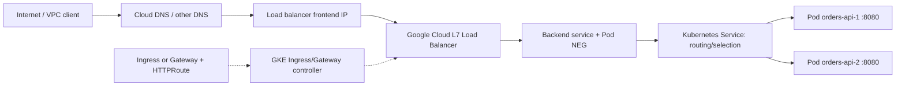
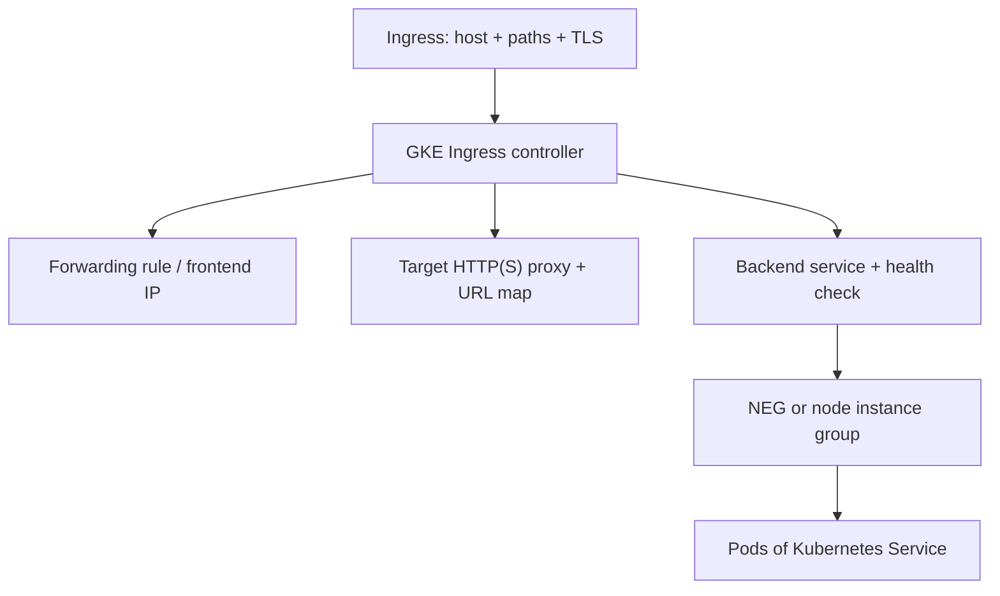
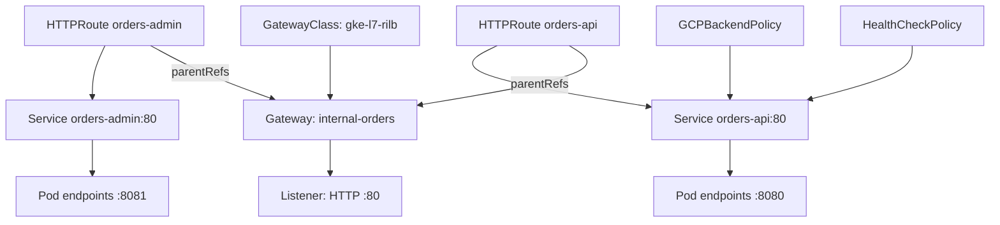
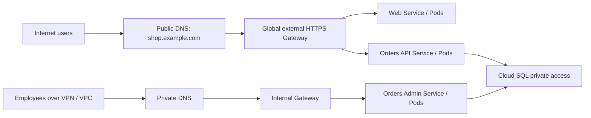

# Ingress, Gateway API, and GKE Service Exposure

An ordering application consists of a web frontend, APIs, and internal processing services running on Google Kubernetes Engine (GKE). Pods run fine inside the cluster, yet external Internet customers cannot reach the app, and administrators want internal APIs reachable only from the corporate VPC. Exposing every service with a public address or choosing the wrong load balancer wastes money and risks exposing sensitive data.

On GKE, **service exposure** spans multiple layers: a Kubernetes `Service` selects Pods; `Service` type `LoadBalancer` handles transport-layer load balancing for many cases; **Ingress** and **Gateway API** define HTTP(S) ingestion and application-layer routing. GKE provides Google-managed controllers that translate eligible Kubernetes resources into Google Cloud Load Balancing infrastructure.

This lesson belongs to the **GKE Fundamentals** chapter of the `CLOUD_PROVIDERS_GCP` module. It connects project/IAM organization, VPCs, Compute Engine and GKE, Artifact Registry, Cloud Run, load balancer selection, service protection, release automation, reliability monitoring, and cost. The focus is on **distinguishing traffic paths, configuring the right APIs/controllers, and keeping public–private boundaries crisp**.

> **Principle:** A Kubernetes Service having endpoints does not mean the workload is safely exposed. You must define **who can access it, from which network, over which protocol, to which Service/Pod it routes, and what happens when backends turn unhealthy**.

## 1. Learning Objectives

After this lesson, you will be able to:

1. Distinguish `ClusterIP`, `NodePort`, `LoadBalancer`, Ingress, and Gateway API by network layer and purpose.
2. Explain which Google Cloud Load Balancing resources the GKE Ingress controller and Gateway controller create.
3. Implement host/path routing with **Ingress** using the `gce` or `gce-internal` annotation, Services, and backend Pods.
4. Implement **GatewayClass → Gateway → HTTPRoute → Service → Pod** and separate responsibilities between infrastructure and app teams.
5. Select the right GatewayClass for global external, regional external, or regional internal Application Load Balancers.
6. Design health checks, NEGs, TLS certificates, DNS, static IPs, Cloud Armor, NetworkPolicies, and firewall rules matching the model.
7. Troubleshoot `404`, `502`, `503`, unhealthy backends, unaccepted routes, and missing permissions in Shared VPC.
8. Plan rollouts, Ingress-to-Gateway migrations, resilience, and cost controls.

## 2. Network Model from Client to Pod



The diagram depicts **configuration relationships**; with **container-native load balancing**, the load balancer sends traffic directly to **`Pod IP:port` inside a Network Endpoint Group (NEG)** without necessarily traversing kube-proxy/ClusterIP in the dataplane. The Kubernetes Service still identifies Pod backends and ports for the controller to aggregate endpoints.

### 2.1. Two Planes to Distinguish

- **Control plane:** you create/modify Services, Ingresses, Gateways, and HTTPRoutes; controllers reconcile those objects into forwarding rules, target proxies, URL maps, backend services, NEGs, health checks, and related Google Cloud resources.
- **Data plane:** clients send live packets to the frontend IP, and the load balancer evaluates rules and forwards requests to healthy endpoints. **Controllers do not handle individual HTTP requests**, so a controller outage does not immediately take down the data plane, though configuration updates will stall.

Cloud resource reconciliation is asynchronous: `kubectl apply` succeeding only proves the Kubernetes API accepted the manifest—**it does not prove** the load balancer received an IP, certificates are active, or backends are healthy.

### 2.2. L4 and L7 Differ

| Layer | Routing Criteria | Example GKE Resource | Use Case |
| --- | --- | --- | --- |
| Layer 4 | IP, port, TCP/UDP, and connection properties | `Service` `type: LoadBalancer` | Custom TCP databases/protocols, UDP, single service needing a dedicated frontend |
| Layer 7 | HTTP Host header, path, headers, and request rules | `Ingress` or `Gateway` + `HTTPRoute` | `shop.example.com` to web, `/api` to API, TLS termination |

Do not expect an HTTP Ingress to route arbitrary custom TCP/UDP protocols. With Gateway API, other Route types like `TCPRoute`/`TLSRoute` have distinct support per GatewayClass; this lesson focuses on **HTTPRoute and Application Load Balancers**.

## 3. Kubernetes Service Types

A `Service` provides a stable endpoint for a set of Pods matching a label selector. Endpoints update automatically as Pods are created, terminated, or replaced. Services do not ensure backends are healthy: Pod readiness and endpoint health still matter.

| Service Type | Primary Scope | Typical Use | Common Risk |
| --- | --- | --- | --- |
| `ClusterIP` (default) | Internal Kubernetes service endpoint | API ↔ DB/cache, or backend behind Ingress/Gateway | No public IP; cannot be called directly from outside without an appropriate path |
| `NodePort` | Port opened on node IPs | Specialized LB paths or self-managed controllers | Must manage firewall/node exposure; no host/path routing |
| `LoadBalancer` | GKE provisions a cloud load balancer per type/annotations | TCP/UDP services needing a dedicated IP (internal/external L4) | Omitting internal annotations/classes can expose services publicly by mistake |
| `ExternalName` | DNS alias pointing to an external domain | Pointing an in-cluster name to an external hostname | Creates no proxy or access-controlled endpoint |
| Headless (`clusterIP: None`) | Returns Pod endpoint IPs directly via DNS | StatefulSets or custom service discovery | Provides no L7 load balancing |

### 3.1. Sample Internal Service

Suppose `orders-api` Pods carry label `app: orders-api` and listen on port 8080:

```yaml
apiVersion: v1
kind: Service
metadata:
  name: orders-api
  namespace: orders
spec:
  type: ClusterIP
  selector:
    app: orders-api
  ports:
  - name: http
    port: 80
    targetPort: 8080
    protocol: TCP
```

`port: 80` is the port clients and Kubernetes routes reference on the **Service**, while `targetPort: 8080` is the application port **inside the Pod**. When configuring an Ingress or HTTPRoute, `backendRef.port` must match the **Service port 80**, not assume `targetPort` 8080.

### 3.2. When Choosing Service Type LoadBalancer

For TCP services that do not need host/path routing, `Service` `type: LoadBalancer` provisions a network load balancer. An **internal** example using a GKE-supported annotation:

```yaml
apiVersion: v1
kind: Service
metadata:
  name: tcp-internal
  namespace: orders
  annotations:
    networking.gke.io/load-balancer-type: "Internal"
spec:
  type: LoadBalancer
  selector:
    app: tcp-worker
  ports:
  - name: tcp
    protocol: TCP
    port: 9000
    targetPort: 9000
```

This manifest is illustrative; it requires an `app: tcp-worker` workload listening on 9000 and an eligible VPC/client. An internal Service **is not** reachable from the Internet. Public LoadBalancers should only be deployed after deliberately designing exposure, IPs, firewalls, and authentication.

## 4. GKE Ingress: The Traditional API for HTTP(S)

**Kubernetes Ingress** defines HTTP(S) routing rules to Kubernetes Services. With the GKE-managed Ingress controller, the platform creates an **external or internal Application Load Balancer**, depending on class, and connects backends to Services/Pod endpoints.



In a GKE cluster running the default controller, **the `kubernetes.io/ingress.class` annotation is still used by GKE** to select the class, even though that annotation is deprecated in upstream Kubernetes.

| Annotation Value | GKE Ingress Behavior |
| --- | --- |
| `gce` | Provisions an external Application Load Balancer |
| `gce-internal` | Provisions an internal Application Load Balancer |
| No annotation and no `spec.ingressClassName` | GKE may claim it as a default external Ingress |
| Another class annotation | Ignored by the GKE Ingress controller; a third-party controller may handle it |

**Critical trap:** setting only `spec.ingressClassName: gce-internal` **is not how you select GKE internal Ingress**. Per GKE docs, use `kubernetes.io/ingress.class: "gce-internal"`. An unannotated manifest can accidentally create a public load balancer, so enforce org/cluster policies governing external load balancer creation.

### 4.1. Supporting Ingress Resources and Features

- **`BackendConfig`:** custom health checks, timeouts, Cloud Armor policies, session affinity, CDN, and supported backend features; linked to a Service via annotation.
- **`FrontendConfig`:** supported frontend properties such as SSL policies or HTTP→HTTPS redirects on compatible GKE Ingresses.
- **Static IPs:** external Ingress typically uses `kubernetes.io/ingress.global-static-ip-name`; internal Ingress uses `kubernetes.io/ingress.regional-static-ip-name` in the same region.
- **TLS:** supports Kubernetes TLS Secrets, pre-shared Google Cloud certificates, or managed certificates appropriate for the Ingress type.
- **Container-native load balancing:** uses **zonal NEGs** so the load balancer health-checks and routes directly to Pod endpoints when configured/supported.

Never attach `BackendConfig`/`FrontendConfig` to a **Gateway** expecting it to take effect: Gateway API uses its own **Policy** CRDs. Also avoid manually editing GKE-managed URL maps/backend services if you need settings preserved, as controller reconciliation may overwrite manual edits.

## 5. Complete Example: Path-Based External Ingress

Assume namespace `orders` already has Pods serving HTTP on port 8080 and returning `HTTP 200` on `GET /healthz`, running in a sandbox VPC-native GKE cluster permitted to create load balancers. These manifests can be saved into separate files for sandbox testing, though **avoid exposing the exact same app simultaneously via both Ingress and Gateway demos unless you intend to pay for two load balancers**.

### 5.1. Service with NEG and Explicit Health Check

```yaml
apiVersion: v1
kind: Service
metadata:
  name: orders-api
  namespace: orders
  annotations:
    cloud.google.com/neg: '{"ingress": true}'
    cloud.google.com/backend-config: '{"default": "orders-backend"}'
spec:
  type: ClusterIP
  selector:
    app: orders-api
  ports:
  - name: http
    port: 80
    targetPort: 8080
    protocol: TCP
---
apiVersion: cloud.google.com/v1
kind: BackendConfig
metadata:
  name: orders-backend
  namespace: orders
spec:
  healthCheck:
    type: HTTP
    requestPath: /healthz
    port: 8080
    checkIntervalSec: 15
```

A `BackendConfig` health check is **separate** from Pod `readinessProbe`/`livenessProbe`: Google Cloud load balancers probe the configured endpoint directly, so with NEGs `port: 8080` must match the port the Pod actually listens on. If the app returns `401` on `/healthz`, the load balancer marks backends unhealthy even though Pods are `Ready`. Expose a dedicated unauthenticated health endpoint that reveals minimal status.

### 5.2. Ingress Routing `/api`

```yaml
apiVersion: networking.k8s.io/v1
kind: Ingress
metadata:
  name: orders-public
  namespace: orders
  annotations:
    kubernetes.io/ingress.class: "gce"
spec:
  rules:
  - host: shop.example.com
    http:
      paths:
      - path: /api
        pathType: Prefix
        backend:
          service:
            name: orders-api
            port:
              number: 80
```

This Ingress defines **HTTP routing only**. It lacks TLS, real certificates, DNS records, and a static IP; **never expose production APIs over unencrypted HTTP**. For real operations, configure HTTPS, certificates/redirects, DNS, WAF, and authentication before sending live traffic. With `pathType: Prefix`, the backend typically **receives the full original path `/api/...`**; it does not strip prefixes like a reverse-proxy rewrite unless configured explicitly.

Deployment commands **modify cloud resources and incur charges**:

```bash
# Run only in a sandbox with existing namespace, Pods, and granted permissions.
kubectl apply -f orders-ingress-service.yaml
kubectl apply -f orders-ingress.yaml

# READ-ONLY status and reconciliation events.
kubectl -n orders get service orders-api
kubectl -n orders get ingress orders-public
kubectl -n orders describe ingress orders-public
kubectl -n orders get endpointslices \
  -l kubernetes.io/service-name=orders-api
```

If Ingress lacks an `ADDRESS`, check events, controller logs if authorized, provisioning status, and IAM/quotas. Once an IP appears, verify LB backend health and Host/path routing—never stop at `kubectl get ingress` and declare success.

## 6. Gateway API: Separating Infrastructure and Application Responsibilities

**Gateway API** is a role-oriented set of Kubernetes resources offering greater routing flexibility than Ingress. On GKE, a Google-managed `GatewayClass` provisions the corresponding Google Cloud Application Load Balancer.

| Resource | Typical Owner | Meaning |
| --- | --- | --- |
| `GatewayClass` | Infrastructure provider / platform operator | Defines the implementation/controller and load balancer type |
| `Gateway` | Platform/network team | Frontend, listeners, ports, protocol, TLS, and route attachment policy |
| `HTTPRoute` | Application team | Host/path/header rules, weighted backends, and references to Kubernetes Services |
| `Service` | Application team | Service port and selector targeting Pods |
| `HealthCheckPolicy` | App/platform team per RBAC | Health checks for the backend Service |
| `GCPBackendPolicy` | App/platform team per RBAC | Cloud Armor/timeouts/logging/affinity and backend configs |
| `GCPGatewayPolicy` | Platform team per RBAC | Google Cloud frontend/gateway attributes as supported |



Unlike Ingress, a single Gateway can accept Routes from multiple namespaces/teams **when `allowedRoutes` and RBAC allow it**. App teams do not need permissions to modify the Gateway frontend or TLS just to add a new route; the platform team retains control over public exposure.

### 6.1. Common GatewayClasses in GKE

| GatewayClass | Google Cloud LB Type | Scope | When to Choose |
| --- | --- | --- | --- |
| `gke-l7-global-external-managed` | Global external Application Load Balancer | Public global frontend | Global websites/APIs, external HTTPS, and L7 routing |
| `gke-l7-regional-external-managed` | Regional external Application Load Balancer | Public regional frontend | Regional public LB requirements, regional features/pricing |
| `gke-l7-rilb` | Internal Application Load Balancer | Private regional frontend | Internal VPC APIs, on-prem over hybrid/private routing |
| `gke-l7-gxlb` | Classic Application Load Balancer | Public global frontend | Cases needing legacy/classic features per capability matrix |
| `-mc` suffix variants | Multi-cluster load balancing | Multi-cluster | Multi-region DR; requires Fleet and dedicated setup |

Select only classes **present in your cluster and compatible with your cluster mode, IP stack, and GKE version**, checking `kubectl get gatewayclass` and the official capability matrix. Never assume one class supports every TLS mode, URL rewrite, Cloud Armor feature, SSL policy, or TCP/TLSRoute identically to another.

### 6.2. Enabling Gateway API on an Authorized Cluster

GKE Autopilot enables Gateway API by default on supported versions; on Standard and some existing clusters, administrators may need to enable the **Standard Channel**:

```bash
# MODIFIES CLUSTER CONFIG; requires owner approval.
gcloud container clusters update CLUSTER_NAME \
  --project=PROJECT_ID \
  --location=CLUSTER_LOCATION \
  --gateway-api=standard

# READ-ONLY: after GKE reconciles CRDs/controller.
kubectl get gatewayclass
kubectl get crds | grep 'gateway.networking.k8s.io'
gcloud container clusters describe CLUSTER_NAME \
  --project=PROJECT_ID \
  --location=CLUSTER_LOCATION \
  --format="yaml(networkConfig.gatewayApiConfig)"
```

The Gateway controller installs **GatewayClasses/CRDs** asynchronously; allow time after updating the cluster for them to appear. For GKE Gateway, do not arbitrarily install **Experimental channel** CRDs on Autopilot. Check version support in [GKE Gateway API](https://cloud.google.com/kubernetes-engine/docs/concepts/gateway-api) and [GatewayClass capabilities](https://cloud.google.com/kubernetes-engine/docs/how-to/gatewayclass-capabilities) before use.

## 7. Gateway API Example: Exposing an Internal API in One Namespace

This example uses an **internal Application Load Balancer** with `GatewayClass` `gke-l7-rilb` to avoid accidentally exposing the service to the Internet. Assume the cluster has Gateway API Standard enabled, namespace `orders`, and `orders-api` Pods listening for HTTP on port 8080 returning `HTTP 200` on `GET /healthz`. The VPC and subnets must satisfy GKE Gateway prerequisites—specifically a **VPC-native cluster**, the `HttpLoadBalancing` add-on, and a **proxy-only subnet** for regional Gateways.

### 7.1. Gateway Receiving HTTP from the VPC

```yaml
apiVersion: gateway.networking.k8s.io/v1
kind: Gateway
metadata:
  name: orders-internal
  namespace: orders
spec:
  gatewayClassName: gke-l7-rilb
  listeners:
  - name: http
    protocol: HTTP
    port: 80
    allowedRoutes:
      namespaces:
        from: Same
```

`allowedRoutes.namespaces.from: Same` permits Routes only from the Gateway's own namespace. The listener **supports only HTTP on port 80** in this example; do not assume traffic is encrypted or workloads are authenticated. For sensitive data, add HTTPS and check end-to-end encryption support for the `GatewayClass`.

### 7.2. HTTPRoute Attaching a Service to the Gateway

```yaml
apiVersion: gateway.networking.k8s.io/v1
kind: HTTPRoute
metadata:
  name: orders-route
  namespace: orders
spec:
  parentRefs:
  - name: orders-internal
    sectionName: http
  hostnames:
  - orders.internal.example.com
  rules:
  - matches:
    - path:
        type: PathPrefix
        value: /api
    backendRefs:
    - name: orders-api
      port: 80
```

`parentRefs` targets the Gateway/listener, `hostnames` matches the HTTP Host header, and `backendRefs.port: 80` is the Kubernetes Service port. The Service maps to Pod port 8080; `HTTPRoute` creates no new Deployment or Pod. Path `/api/...` is forwarded to the backend **intact** unless a URL rewrite is configured and supported by the class.

### 7.3. HealthCheckPolicy for a Backend Using `/healthz`

Unlike some GKE Ingress behaviors, GKE Gateway **does not infer health check paths from `readinessProbe`/`livenessProbe`**. If an app does not return 200 on `GET /`, the default LB health check fails. Create a policy in the same namespace as the Service:

```yaml
apiVersion: networking.gke.io/v1
kind: HealthCheckPolicy
metadata:
  name: orders-healthcheck
  namespace: orders
spec:
  default:
    config:
      type: HTTP
      httpHealthCheck:
        requestPath: /healthz
        port: 8080
  targetRef:
    group: ""
    kind: Service
    name: orders-api
```

`HealthCheckPolicy` attaches to a **Service**, not directly to an `HTTPRoute`. Endpoint `/healthz` must return **HTTP 200** quickly, with no `301/302` redirects and no `Authorization` header required. Health check endpoints can be restricted to Google health checker source ranges by firewalls, and should never expose sensitive operational details.

### 7.4. Apply and Verify

The `kubectl apply` commands below **modify Kubernetes and may provision billable Google Cloud resources**:

```bash
# Run only in a sandbox with existing namespace, Service, and Pods.
kubectl apply -f orders-internal-gateway.yaml
kubectl apply -f orders-route.yaml
kubectl apply -f orders-healthcheck.yaml

# READ-ONLY: controller status and endpoints.
kubectl -n orders get gateway orders-internal
kubectl -n orders describe gateway orders-internal
kubectl -n orders get httproute orders-route -o yaml
kubectl -n orders get healthcheckpolicy orders-healthcheck
kubectl -n orders get service orders-api
kubectl -n orders get endpointslices \
  -l kubernetes.io/service-name=orders-api
```

Once the Gateway receives a private IP, test from a VM in the VPC with authorized network access:

```bash
# Test only against the INTERNAL_GATEWAY_IP provisioned in the sandbox.
curl --show-error \
  --header 'Host: orders.internal.example.com' \
  'http://INTERNAL_GATEWAY_IP/api/healthz'
```

This assumes the app serves `/api/healthz`. If the app only serves `/healthz`, client calls to `/api/healthz` will return `404` **even while the LB `/healthz` health check passes**. The two checks serve different purposes: Pod health vs. application route.

### 7.5. Status Conditions Are More Reliable Than Object Existence

`kubectl apply` succeeding does not mean the load balancer is programmed. For Gateways and HTTPRoutes, inspect `Accepted`, `ResolvedRefs`, `Programmed`/`Reconciled`, and parent statuses/reasons in `status.conditions`. If `Accepted=False`, check listeners, `allowedRoutes`, or `parentRefs`; if `ResolvedRefs=False`, check Service name, port, or cross-namespace permissions.

## 8. Cross-Namespace Routes and Canaries

Gateway API separates the **Platform team** managing frontends from **Application teams** managing routes, allowing Gateways and Routes in separate namespaces where permitted.

### 8.1. `allowedRoutes` by Namespace Label

Suppose a Gateway sits in namespace `platform` and accepts Routes only from namespaces labeled `shared-gateway-access: "true"`:

```yaml
apiVersion: gateway.networking.k8s.io/v1
kind: Gateway
metadata:
  name: shared-internal
  namespace: platform
spec:
  gatewayClassName: gke-l7-rilb
  listeners:
  - name: http
    protocol: HTTP
    port: 80
    allowedRoutes:
      namespaces:
        from: Selector
        selector:
          matchLabels:
            shared-gateway-access: "true"
```

An `HTTPRoute` in namespace `orders` can attach via:

```yaml
apiVersion: gateway.networking.k8s.io/v1
kind: HTTPRoute
metadata:
  name: orders-shared-route
  namespace: orders
spec:
  parentRefs:
  - name: shared-internal
    namespace: platform
  hostnames:
  - orders.internal.example.com
  rules:
  - matches:
    - path:
        type: PathPrefix
        value: /
    backendRefs:
    - name: orders-api
      port: 80
```

Cluster admins must restrict **who can edit namespace labels**; if any team can label its own namespace, labels alone are not a strong security boundary. `allowedRoutes` permits **attaching a Route to a Gateway**, not referencing a **Service in another namespace**. Cross-namespace `backendRefs` require a `ReferenceGrant` in the backend's namespace where supported by the GatewayClass.

### 8.2. Weighted `backendRefs` for Canary Releases

Suppose two Kubernetes Services `orders-api-v1` and `orders-api-v2` select their respective Pod versions:

```yaml
apiVersion: gateway.networking.k8s.io/v1
kind: HTTPRoute
metadata:
  name: orders-canary
  namespace: orders
spec:
  parentRefs:
  - name: orders-internal
  hostnames:
  - orders.internal.example.com
  rules:
  - matches:
    - path:
        type: PathPrefix
        value: /api
    backendRefs:
    - name: orders-api-v1
      port: 80
      weight: 90
    - name: orders-api-v2
      port: 80
      weight: 10
```

These are **target ratios**, not a guarantee of exactly 90 requests out of any small batch of 100; connection reuse, backend health, retries, and load balancing behavior all affect exact splits. During a canary, **replace or exclude overlapping host/path rules** from `orders-route` rather than leaving two competing HTTPRoutes active and assuming precedence.

### 8.3. Advanced Capabilities Require Checking the Capability Matrix

Gateway API defines header/method matching, redirects, URL rewrites, request mirroring, weighted traffic, and regex matching depending on implementation. **Not every GKE GatewayClass supports every CRD field**, especially experimental fields, multi-cluster features, TCP/TLSRoutes, and regional/internal classes. Check [GatewayClass capabilities](https://cloud.google.com/kubernetes-engine/docs/how-to/gatewayclass-capabilities) before using a feature in production.

## 9. TLS, DNS, Static IPs, and Public Exposure

Plain HTTP examples are useful in sandboxes, yet **public APIs require HTTPS, valid certificates, DNS, access controls, and abuse protection**. Moving from an internal LB to an external LB is more than flipping one annotation: frontend IP, routing, proxies, quotas, firewalls, certificates, and access policies all change.

### 9.1. From Frontend IP to Hostname

Typical workflow:

1. Decide **internal vs. external** based on consumers, geography, and data residency.
2. Pick a GatewayClass/Ingress class matching **global or regional scope**.
3. Reserve a compatible **static IP** if DNS must stay stable across changes.
4. Configure HTTPS listeners and certificates covering all hostnames/SANs; verify certificate activation.
5. Point DNS A/AAAA records to the frontend address matching IPv4/IPv6 support.
6. Validate Host/path routing, backend health, WAF/auth, and LB logging before shifting live traffic.

With **external GKE Ingress**, `kubernetes.io/ingress.global-static-ip-name` references a reserved **global static external IP**. With **internal Ingress**, use `kubernetes.io/ingress.regional-static-ip-name` with a **regional private IP** in the matching VPC. Never mix address scopes.

With **GKE Gateway**, `spec.addresses` can reference a reserved IP via `type: NamedAddress`:

```yaml
apiVersion: gateway.networking.k8s.io/v1
kind: Gateway
metadata:
  name: orders-public-demo
  namespace: orders
spec:
  gatewayClassName: gke-l7-global-external-managed
  addresses:
  - type: NamedAddress
    value: ORDERS_GLOBAL_STATIC_IP_NAME
  listeners:
  - name: http
    protocol: HTTP
    port: 80
```

This manifest illustrates **static IP syntax only**; without TLS it is **not for production**. The IP must already exist and match the GatewayClass scope. An internal Gateway needs a **regional** IP in a compatible subnet; a regional external Gateway needs a regional external address/network tier. For IPv6 or dual-stack, verify supported address tables in the docs.

### 9.2. HTTPS: Ingress and Gateway Use Different Mechanisms

| Case | Certificate Mechanism | What to Verify |
| --- | --- | --- |
| GKE external Ingress | Kubernetes TLS Secret, pre-shared certificate, or `ManagedCertificate` per case | Ingress class, certificate status, hostname, `FrontendConfig` if needed |
| GKE global external Gateway | Certificate Manager certificate map via `networking.gke.io/certmap` annotation or supported options | Certificate map exists, cert active, listener hostname matches |
| GKE regional external Gateway | Regional self-managed SSL certificate or Kubernetes TLS Secret per support | **Do not assume** Google-managed certs/certificate maps work identically to global Gateway |
| GKE internal Gateway | TLS termination using certificate mechanism supported by the GatewayClass | Internal DNS, trust chain, backend encryption if required |

Example **global external HTTPS Gateway** using an existing Certificate Manager certificate map:

```yaml
apiVersion: gateway.networking.k8s.io/v1
kind: Gateway
metadata:
  name: orders-https
  namespace: orders
  annotations:
    networking.gke.io/certmap: orders-example-com-map
spec:
  gatewayClassName: gke-l7-global-external-managed
  listeners:
  - name: https
    protocol: HTTPS
    port: 443
    hostname: shop.example.com
```

Never commit TLS private keys to repositories. When using TLS Secrets, lock down namespace RBAC and rotation. **TLS termination at the Google frontend does not automatically encrypt the LB→Pod hop**; if backend encryption/verification is required, evaluate backend TLS and check `GatewayClass` support. Never apply an Ingress `ManagedCertificate` to a Gateway expecting HTTPS to work.

### 9.3. DNS and Safe Traffic Cutover

Public Gateways should use public DNS; internal Gateways typically use private Cloud DNS zones or hybrid DNS. Verify A/AAAA records, TTLs, certificate SANs, and client reachability. Before cutover, account for DNS propagation, preserve a rollback path, and watch load balancer frontend metrics.

To test HTTPS before switching DNS, use `curl --resolve shop.example.com:443:IP_ADDRESS https://shop.example.com/api/...` **in an authorized environment**. Avoid `curl -k` to bypass TLS validation and falsely declare certificates ready.

## 10. Health Checks, Readiness, and Container-Native Load Balancing

Google Cloud Load Balancers create **separate health checks** for backend services, independent of kubelet's Pod probes. Keep three perspectives distinct:

| Layer | Who Performs It | Meaning |
| --- | --- | --- |
| Kubernetes `readinessProbe` | Kubelet | Whether the Pod is ready to receive traffic via Kubernetes |
| Pod endpoints / **NEG** | GKE controller/NEG integration | Which `Pod IP:port` targets become backend endpoints |
| Google Cloud **LB health check** | Load balancer health checkers | Whether the backend returns the expected response on the LB-probed port/path/protocol |

With **container-native load balancing**, the controller manages **Network Endpoint Groups (NEGs)** holding `Pod IP:port` endpoints. The LB sends requests straight to Pod endpoints without traversing NodePort/kube-proxy in the data plane. Still, NEGs do not replace Pod readiness, network routes, or LB health checks.

### 10.1. Health Check Differences Between Ingress and Gateway

- **GKE Ingress:** customize health checks with `BackendConfig` targeting the Kubernetes Service; GKE may infer certain parameters from `readinessProbe` under specific conditions.
- **GKE Gateway:** use `HealthCheckPolicy` targeting the Service; **it does not infer path or port from readiness/liveness probes** the way Ingress can.

Load balancer HTTP health checks require **HTTP 200 OK**, rejecting `301`/`302` redirects or `401`/`403` auth challenges as unhealthy. A fast `/healthz` endpoint leaking minimal status and requiring no auth headers is standard; restrict access to health checker source ranges via firewalls/policies.

### 10.2. Firewalls and Proxy-Only Subnets

For GKE Gateway's **regional internal/external Application Load Balancers**, you must configure a **proxy-only subnet**; traffic from proxy-only subnet IPs and health checker ranges must reach backends through VPC firewalls. In Shared VPC, firewall resources live in the host project and GKE controllers often do not auto-create all rules; platform/network teams must grant permissions and create rules explicitly where needed.

Never copy one health checker CIDR blindly across every LB class, IP family, and region. Verify:

1. Exact backend protocol and port the Pod listens on;
2. Exact **health checker source ranges** and **proxy-only subnet ranges** for the LB type;
3. VPC firewall rules for node/Pod endpoints using matching network tags or service accounts;
4. Shared VPC roles, routes, and Organization Policies restricting automated firewall edits.

Never open `0.0.0.0/0` to all nodes just because backends look unhealthy.

### 10.3. Graceful Shutdown During Rolling Updates

When a Pod terminates, NEGs and load balancers need time to stop sending new requests while the app drains in-flight requests. Coordinate `terminationGracePeriodSeconds`, `preStop` hooks, PodDisruptionBudgets, readiness probes, and **connection draining** in `BackendConfig`/`GCPBackendPolicy` per controller. Draining windows that are too short cause `502`s during rolling updates; windows that are too long slow down Pod replacement.

## 11. Security: Public IP Does Not Mean Anonymous Access

Ingress and Gateway route traffic; they do not authenticate end users by themselves. A public frontend needs defense in depth:

| Layer | Function | Recommendation |
| --- | --- | --- |
| **DNS/TLS** | Authentic hostname and client→frontend encryption | HTTPS, certificate rotation, HSTS where appropriate |
| **GKE Gateway/Ingress** | Host/path routing and load balancing | Explicitly choose external vs. internal; never expose admin backends publicly |
| **Cloud Armor** | WAF / rate limiting / anti-abuse per supported LB class | Attach security policy to the right backend; test rules for false blocks |
| **Identity-Aware Proxy** | Access authentication for supported LBs/controllers | Check compatibility matrix before relying on it |
| **Kubernetes RBAC** | Who can edit Gateways/Ingresses/Routes/Policies | Platform controls public frontends; app teams edit only scoped Routes |
| **NetworkPolicy** | Pod ingress/egress controls where dataplane supports it | Does not replace VPC firewalls or app authentication |
| **IAM/Workload Identity** | Pod/VM permissions calling Google APIs | Least-privilege service accounts; no JSON keys in Pods |
| **VPC firewall** | Allow/deny traffic from proxies, health checkers, and other sources | Exact sources, ports, and targets; avoid wide-open rules |

### 11.1. Backend and Frontend Policies in Gateway

In GKE Gateway, `GCPBackendPolicy` attaches Cloud Armor and backend settings like timeouts and logging; `GCPGatewayPolicy` sets frontend options like SSL policies or global access per class capabilities. Both must reside in the same namespace as their **target resource**.

Example referencing an **existing platform-created and reviewed Cloud Armor security policy**:

```yaml
apiVersion: networking.gke.io/v1
kind: GCPBackendPolicy
metadata:
  name: orders-security
  namespace: orders
spec:
  default:
    securityPolicy: orders-waf-policy
  targetRef:
    group: ""
    kind: Service
    name: orders-api
```

Attaching a policy takes effect immediately on live traffic, so test/monitor WAF rules and verify `GatewayClass` support. For single-cluster Gateways, `GCPBackendPolicy`/`HealthCheckPolicy` target **`Service`**; for multi-cluster Gateways they typically target **`ServiceImport`** per multi-cluster docs. Never use Ingress's `FrontendConfig` or `BackendConfig` to configure a Gateway.

### 11.2. Bypass Paths and Blast Radius

An app sitting behind a Cloud Armor-protected Gateway while also exposed via another public `Service` `type: LoadBalancer` targeting the same Pods creates a **WAF bypass**. Inventory all Ingresses, Gateways, LoadBalancer Services, NodePorts, and external IPs, and eliminate any unapproved exposure paths.

An internal Gateway using a private IP does not make data automatically safe. Clients inside the same VPC, Shared VPC, or on-premises over Cloud VPN/Interconnect must still be authenticated and authorized by the application, particularly for multi-tenant or admin functions.

## 12. Layered Observability and Troubleshooting

Start from Kubernetes and trace the request into Google Cloud Load Balancing. A YAML manifest may be accepted while cloud resources are still unready or backends are failing.

### 12.1. Read-Only Inspection Commands

```bash
kubectl config current-context
kubectl get nodes

# Service, endpoints, and Pods.
kubectl -n orders get service orders-api -o yaml
kubectl -n orders get endpointslices \
  -l kubernetes.io/service-name=orders-api
kubectl -n orders get pods -l app=orders-api -o wide

# Ingress path when using Ingress.
kubectl -n orders describe ingress orders-public

# Gateway path when using Gateway.
kubectl get gatewayclass
kubectl -n orders describe gateway orders-internal
kubectl -n orders get httproute orders-route -o yaml
kubectl -n orders describe healthcheckpolicy orders-healthcheck

kubectl -n orders get events --sort-by=.lastTimestamp
```

Never stop at `kubectl get gateway`. In Cloud Console / Compute APIs, check backend service and NEG health, forwarding rules, target proxies/URL maps, certificate status, and VPC firewalls. In Shared VPC, some resources and permissions live in the **host project** rather than the cluster's service project.

### 12.2. Root Cause Matrix

| Symptom | Likely Causes | How to Verify |
| --- | --- | --- |
| Gateway has no IP | API not enabled, GatewayClass unready, quota/IAM, subnet/controller reconcile | `kubectl get gatewayclass`, Gateway conditions, events, cluster API config |
| Ingress unexpectedly public | Missing `gce-internal` annotation | Inspect annotations and inventory public load balancers |
| Ingress ignored | Used `ingressClassName` instead of annotation, or controller add-on disabled | `describe ingress`, GKE class table |
| HTTPRoute `Accepted=False` | Mismatched `parentRefs`, `allowedRoutes`, listener, or namespace | Status parents/conditions and namespace labels |
| HTTPRoute `ResolvedRefs=False` | Missing Service, wrong port, or unpermitted cross-namespace backend | `backendRefs`, Service port, `ReferenceGrant` where supported |
| `404` | Host/path mismatch, or app path/URL rewrite discrepancy | Send exact Host header; inspect route rules and app logs |
| `502/503` or "No healthy upstream" | No healthy endpoints, wrong health check path/port, firewall/NEG issue | Endpoints, readiness, HTTP 200 health check, backend service health |
| TLS failure | Certificate inactive, hostname/SAN mismatch, missing frontend listener | Certificate Manager/Secret, TLS handshake, DNS |
| Internal Gateway unreachable from laptop | Private IP lacks route/VPN, DNS/firewall issue | Test from VPC VM/hybrid client, routes, and proxy-only subnet |
| Cloud Armor not blocking | Policy attached to wrong backend, unsupported GatewayClass, or bypass path | `GCPBackendPolicy` status, LB backends, other public LoadBalancer Services |
| Backends healthy yet rollout drops requests | Fast Pod shutdown, incomplete NEG draining, or stateful app | Termination grace, readiness, connection draining, and metrics |
| Cost spike | Many LB frontends/forwarding rules, egress/logging/Cloud Armor | Cloud Billing SKUs, LB inventory, and retention policies |

### 12.3. Separating Frontend, Routing, Backend, and Application Errors

Watch Cloud Monitoring/Logging: HTTP 4xx/5xx per frontend/backend, p95/p99 latency, request counts, bytes processed, health check state, endpoint counts, Pod restarts/CPU/memory, and network errors. Distinguish:

1. **DNS/certificate/frontend:** requests never reach the intended listener.
2. **L7 routing:** hostname or path fails to match → `404` or default backend.
3. **LB health:** zero healthy endpoints → `502`/`503`.
4. **Application:** LB reaches a Pod, yet the backend returns 4xx/5xx/timeout.
5. **Infrastructure/permissions:** controller fails to create/update the LB due to quotas/IAM/firewalls.

Do not blame every `404` on `HTTPRoute`; the backend application itself can return `404` after routing matches. Use request IDs/traces and layered logs to prove where it failed.

## 13. Choosing Ingress, Gateway API, or Service LoadBalancer?

No single option fits every app. Base the choice on **protocol, traffic scope, load balancer type, governance boundaries, routing complexity, and existing systems**.

| Question | Service LoadBalancer | GKE Ingress | GKE Gateway API |
| --- | --- | --- | --- |
| Need non-HTTP TCP/UDP? | Usually fits with L4 LB per supported protocol | Not for custom TCP/UDP | Evaluate specific Route/GatewayClass only if supported |
| Need HTTP Host and path routing? | Not an L4 capability | Yes | Yes via `HTTPRoute` |
| Need a shared HTTP frontend across teams? | Each Service usually gets its own frontend | Can share routes in team-managed Ingresses | **Cleanly separates platform-owned Gateway and team-owned Routes** |
| Internal VPC access? | Internal LB Service supported | `gce-internal` | `gke-l7-rilb` and equivalent classes |
| External global HTTPS? | L4 does not replace HTTP routing | `gce` (LB type per supported config) | `gke-l7-global-external-managed` |
| Custom health checks | Per LB Service type/annotations | `BackendConfig` | `HealthCheckPolicy` |
| Cloud Armor / backend settings | Per supported LB type | `BackendConfig` | `GCPBackendPolicy` |
| Weighted traffic splitting across Services | No HTTP rules | Limited in standard Ingress/GKE controller | `HTTPRoute.backendRefs.weight` when supported by class |
| Operational complexity | Low for one L4 service | Fits existing setups and simple cases | Strong for multi-team, policy-rich, boundary-governed environments |

**Situational recommendations:**

- An internal TCP service needing its own IP without URL paths → consider internal `Service` `type: LoadBalancer`.
- An HTTP app already running stably on GKE Ingress → no rush to migrate without clear benefit, though keep docs and policies clean.
- Microservices across many namespaces/teams needing platform-owned frontends and app-owned routes → favor **Gateway API**.
- Workloads needing multi-cluster/multi-region failover → evaluate **multi-cluster GatewayClasses**, Fleet/`ServiceExport`/`ServiceImport`, support status, cost, and real RTO; never assume a single-cluster Gateway gives multi-region DR.
- Simple apps on Cloud Run → use Cloud Run URLs or integrate an external Application Load Balancer directly without spinning up GKE solely for HTTP routing.

### 13.1. GKE Gateway Prerequisites to Check First

GKE Gateway supports classes and fields per its **capability matrix**; not every upstream Gateway API option works everywhere. Key prerequisites typically include a VPC-native cluster, the HTTP load balancing add-on, and a proxy-only subnet for regional classes. In Shared VPC, Google-managed service accounts and IAM/network rules in the host project are required.

You cannot attach Ingress's `FrontendConfig` or `BackendConfig` to a Gateway. Across multiple Gateways of **incompatible GatewayClasses** (global/regional, internal/external, classic/managed), avoid sharing the same backend Service if policies differ; create separate Services to prevent conflicts per GKE docs.

## 14. Migrating from GKE Ingress to Gateway API

Migration **is not just changing `kind: Ingress` to `kind: Gateway`**. Resource models, classes, frontend TLS, health checks, policies, route statuses, and RBAC models all differ. Moreover, migration temporarily provisions a second load balancer, adding IP, certificate, and LB costs until cutover completes.

### 14.1. Conceptual Mapping Table

| Ingress Component | Gateway Equivalent | What to Verify |
| --- | --- | --- |
| `gce` / `gce-internal` annotation | Matching external/internal `GatewayClass` | Not automatically identical LB type, IP tier, or behavior |
| Ingress host/path rules | `HTTPRoute.hostnames`, `matches`, `backendRefs` | `PathPrefix`, `Exact`, rewrites, and precedence rules |
| Ingress TLS certificate | Gateway HTTPS listener, TLS Secret / cert map per class | Cert management and rotation differ |
| `BackendConfig` health check | `HealthCheckPolicy` on Service | Gateway does not infer `readinessProbe` parameters |
| `BackendConfig` backend policy | `GCPBackendPolicy` on Service | Only class-supported fields; may require splitting Services |
| `FrontendConfig` | `GCPGatewayPolicy` or Gateway/listener settings | Not a 1:1 mapping for every feature |
| Ingress IP annotation | Gateway `addresses` or matching address policy | Allocate static IPs in the exact global/regional scope |
| Single Ingress admin | Platform owns Gateway; app team owns `HTTPRoute` | Namespace RBAC and `allowedRoutes`/`ReferenceGrant` |

### 14.2. Rollback-Safe Migration Process

1. **Inventory legacy Ingress:** hostnames, paths, TLS certs, static IPs, `BackendConfig`, `FrontendConfig`, Cloud Armor, health checks, timeouts, CDN, WAF, and all backend Services.
2. **Select `GatewayClass`:** match global/regional, internal/external, version, multi-cluster, and capacity requirements. Check the capability matrix so active features aren't lost.
3. **Separate routes and backend policies:** define Gateway, HTTPRoutes, `HealthCheckPolicy`, and `GCPBackendPolicy`/`GCPGatewayPolicy`; verify Service ports.
4. **Run parallel deployment safely:** provision a temporary frontend using test hostnames/Host headers; never disturb the live production IP before a rollback path exists.
5. **Test end-to-end:** DNS, TLS, path rewrites, backend health, Cloud Armor, logging, Pod draining, latency, and load tests within approved bounds.
6. **Shift traffic in waves:** execute DNS/IP/cutover workflows with clear observation windows and metrics.
7. **Roll back if needed:** revert DNS/traffic back to the preserved old frontend; verify RTO and LB state, and avoid deleting the old Ingress prematurely.
8. **Clean up verified leftovers:** once stable and approved, delete redundant LBs, forwarding rules, and certs while retaining static IPs per retention needs to prevent stray charges.

Never point both an Ingress and a Gateway at the same Service assuming they share one load balancer: each controller can provision **separate LB infrastructure**. In Shared VPC or when the console shows controller-managed resources, verify ownership before making manual edits.

## 15. Real-World Scenario: Public Orders API and Private Admin API

An e-commerce business runs:

- `shop.example.com`: Internet-facing website and Orders API requiring HTTPS, CDN for static assets, Cloud Armor, and canary releases.
- `orders-admin.internal.example.com`: admin API accessible only to employees via VPC/Cloud VPN with strict access controls.
- Pods running on a regional GKE cluster with multi-zone node pools, pulling digest-pinned images from Artifact Registry.
- Cloud SQL storing transactions, with workload identity and VPC egress governing API/DB access.

### 15.1. Choosing Two Access Paths



These are two load balancers with **distinct scopes and policies**. Never attach the admin `HTTPRoute` to the external Gateway simply because route names look similar. Use namespaces, RBAC, and `allowedRoutes` to enforce boundaries.

### 15.2. Responsibility Matrix

| Decision | Platform/Network Team | Application Team |
| --- | --- | --- |
| Public vs. private GatewayClass | Selects global external and regional internal classes, IPs/subnets, firewalls | Cannot create external Gateways without approval |
| TLS and DNS | Certificate maps, HTTPS listeners, private DNS, rotation | Uses exact hostnames; never logs credentials |
| Routing | Configures listeners/`allowedRoutes` and hostname policies | Creates `HTTPRoute` for `/api`, tests canaries/rollbacks |
| Health | Permits health checker/proxy traffic and policy CRDs | Exposes HTTP 200 `/healthz`, readiness/liveness probes, graceful shutdown |
| WAF/IAM | Cloud Armor policies, Org Policies, RBAC, workload identities | Application-level authn/authz and least privilege |
| Observability | LB logs/metrics/billing alerts and networking | Traces, SLOs, application errors, DB latency |

### 15.3. Simulated Outage Scenario

After a rollout, users see `503` on `/api/orders`, yet `kubectl get pods` shows all Pods `Ready`. Investigation:

1. Check Gateway/HTTPRoute conditions and Service EndpointSlices; confirm `backendRef` port 80 maps to Pod port 8080.
2. Check Google Cloud backend health: the default health check hits `GET /`, yet the app returns a `302` redirect or `401`; the LB therefore marks every backend unhealthy.
3. Add a `HealthCheckPolicy` probing `/healthz` for HTTP 200 on port 8080; verify health checker firewall rules.
4. Wait for controller reconciliation, confirm backends turn healthy, and test a real request with the right Host/path.
5. Update the CI/CD pipeline to verify external LB health before promoting releases.

This diagnosis highlights the difference between **Kubernetes readiness** and **load balancer health checks**—never diagnose a production outage from Pod Ready status alone.

### 15.4. Canaries and Data Boundaries

When deploying v2, create two Services (`v1` and `v2`) and use a 95/5 or 90/10 weighted `HTTPRoute` where supported. Monitor p95 latency, HTTP errors, connection reuse, DB migrations, and retries. If the data schema is incompatible, sending even 5% of traffic is unsafe—design backward-compatible migrations and app-level data rollback first.

## 16. Reliability, Quotas, and Cost

### 16.1. Do Not Confuse Gateway HA with Workload HA

- A global external Gateway provides global-scope frontend/load balancing, **without turning a single-region cluster into a multi-region system**.
- A regional GKE cluster with multi-zone nodes improves zone-failure tolerance, yet still requires Pod spread/topology constraints, PDBs, spare capacity, and healthy backends.
- An internal Gateway provides a private VPC/regional frontend; on-prem clients still depend on Cloud VPN/Interconnect, DNS, and firewalls.
- A multi-cluster Gateway can span clusters/regions, yet requires Fleet, `ServiceExport`s, traffic distribution policies, spare capacity, data replication, and dedicated DR drills.
- Never equate LB availability with Cloud SQL, application, or end-to-end business availability.

A public load balancer can remain completely up while having zero healthy backends. SLOs must measure **successful client requests**, not just Gateway status or Running Pods.

### 16.2. Costs to Budget For

| Resource Group | Potential Cost Drivers | Management Lever |
| --- | --- | --- |
| Google Cloud Load Balancing | Forwarding rules and proxy/load balancing data processing per SKU | Inventory Ingresses/Gateways; avoid duplicate LBs for the same need |
| Network egress/ingress | Outbound traffic, cross-region transfer, data transfer by path | Choose global/regional intentionally; cache static content |
| Public IPs/certificates | Reservations, idle IPs, Certificate Manager / managed certs per service | Clean up unused IPs and certificates post-migration |
| Cloud Armor | WAF/rule evaluations, security policies, and tier features | Enable where needed; monitor false positives and Billing |
| GKE nodes/Pods | CPU/memory requests and autoscaling capacity | Horizontal/cluster autoscaling, graceful draining, resource quotas |
| Logging/Monitoring | LB logs, metrics, traces, and ingestion/retention | Sample per SLA and scrub sensitive data from logs |
| Multi-cluster | Multi-cluster infrastructure, load balancing, and replication | Justify RTO/RPO benefits against cost |

**Cost-saving practice:** a well-governed shared Gateway can serve multiple HTTPRoutes instead of creating one LB per app, balanced against blast radius, listener edit permissions, and security policies. One misconfiguration on a shared frontend affects multiple teams, so cost consolidation must pair with strict RBAC and monitoring.

### 16.3. Do Not Delete Live Resources During Cleanup

`kubectl delete ingress` or `kubectl delete gateway` causes controllers to tear down provisioned Google Cloud LB components. Before deleting, verify DNS, certificates, static IP reuse, live traffic, rollback windows, policies, and dependent Routes/Services. Never manually delete controller-managed GCP resources in Console without confirming ownership.

## 17. Applied Exercises

### Exercise A — Choosing the Right Exposure Method

A system has a TCP database in the VPC, a public HTTP(S) Orders API, a private HTTP(S) Admin API, and an internal gRPC service. Choose `ClusterIP`, internal `LoadBalancer` Service, Ingress, or `GatewayClass` for each; explain protocol/network layer, IP scope, certificates, and access control.

### Exercise B — Fixing an Ingress Config That Could Expose Data

An admin API Ingress sets only `spec.ingressClassName: gce-internal` with no class annotation. How does GKE handle it? Fix the manifest using the supported approach, list conditions that cause unintended public LBs, and propose RBAC/policy guardrails.

### Exercise C — Building an Internal Gateway Lab

In an authorized sandbox, use a Pod/Deployment exposing `/healthz`, Service port 80 → `targetPort` 8080, `GatewayClass` `gke-l7-rilb`, and `HTTPRoute` with host `orders.internal.example.com` and path `/api`. Write a checklist verifying:

- Cluster Gateway API, `GatewayClass`, and proxy-only subnet are ready;
- Gateway/`HTTPRoute` status conditions pass;
- `EndpointSlice` contains the expected `Pod IP:port`;
- `HealthCheckPolicy` probes the right path/port and gets 200;
- A VM in the same VPC / hybrid client sends the right Host header and gets a response;
- Internet sources cannot reach the private frontend directly.

### Exercise D — Cross-Namespace Authorization

A Gateway lives in `platform`, while Routes live in `orders` and `payments`. Only `orders` may attach Routes to the public listener. Design `allowedRoutes` with namespace selectors, define who may edit namespace labels, and state when `ReferenceGrant` is required. Why can't you rely on Kubernetes labels alone without RBAC?

### Exercise E — 90/10 Canary and Rollback

An `HTTPRoute` splits traffic between `orders-api-v1` and `orders-api-v2` with weights 90/10. Build a rollout plan covering error rate/latency monitoring, LB health checks, rollback, and preventing two overlapping HTTPRoutes from competing. Explain why 90/10 is not strictly guaranteed over small request samples.

### Exercise F — Migrating Ingress to Gateway

A GKE Ingress currently uses `BackendConfig`, `FrontendConfig`, a TLS Secret, public DNS, and Cloud Armor. Map each element to `GatewayClass`, `Gateway`, `HTTPRoute`, `HealthCheckPolicy`, `GCPBackendPolicy`, and `GCPGatewayPolicy`, flagging items to check in the capability matrix. Outline parallel testing and rollback-safe cutover.

### Exercise G — Investigating a `503`

All Pods are `Ready=True` and EndpointSlices contain endpoints, yet the external Gateway returns `503`. Order the checks across: Route conditions, Service port, NEG, LB backend health, health check URL/HTTP status, proxy-only subnet/firewall, container listener, and app logs. Prove two distinct hypotheses rather than blindly restarting Pods.

### Exercise H — Controlling Cost and Bypass Paths

A project has 12 Ingresses, 9 Gateways, and 4 public LoadBalancer Services pointing to overlapping workloads. The team wants to cut costs and enforce WAF. Build an inventory of frontend IPs, hostnames, routes, backends, Cloud Armor policies, DNS, owners, and traffic; pinpoint bypass paths and recommend where to consolidate or keep frontends separate for security.

### Self-Check Questions

1. At which traffic layer do `ClusterIP`, `LoadBalancer` Service, and Ingress differ?
2. Why shouldn't you use `spec.ingressClassName: gce-internal` to request a GKE internal Ingress?
3. In Gateway API, how do `GatewayClass`, `Gateway`, and `HTTPRoute` divide responsibilities?
4. Is `backendRefs.port` the Service port or the Pod `targetPort`?
5. Ingress uses `BackendConfig`; which resource does Gateway use to customize health checks?
6. Why can Pods be `Ready=True` while the load balancer still sees zero healthy backends?
7. When you need a private HTTP frontend, which `GatewayClass` and VPC prerequisites apply?
8. Why doesn't a global Gateway HTTPS cert map automatically work for every regional Gateway?
9. Does `allowedRoutes` automatically grant a Route permission to reference a Service in another namespace?
10. Why can a separate public `LoadBalancer` Service bypass Cloud Armor configured on a Gateway?
11. Why are image digests, Pod readiness, and connection draining critical during rollouts?
12. Which cost categories should be reviewed before consolidating multiple Gateways?

**Workflow to remember:** identify **clients, protocols, and public/private scope** → pick Service LB, Ingress, or Gateway → align Service/Pod ports and host/path routes → choose LB class and IP scope → configure DNS/TLS/WAF/IAM/firewalls → verify health checks and NEGs → roll out with canary/rollback → monitor SLOs, costs, and unintended access paths.

## 18. Official Documentation

- [Expose applications on GKE](https://cloud.google.com/kubernetes-engine/docs/concepts/service-load-balancer)
- [GKE Ingress for Application Load Balancers](https://cloud.google.com/kubernetes-engine/docs/concepts/ingress)
- [GKE Ingress routing and security](https://cloud.google.com/kubernetes-engine/docs/concepts/ingress-routing-security)
- [Configure Ingress for external Application Load Balancers](https://cloud.google.com/kubernetes-engine/docs/how-to/load-balance-ingress)
- [Configure Ingress for internal Application Load Balancers](https://cloud.google.com/kubernetes-engine/docs/how-to/internal-load-balance-ingress)
- [GKE Ingress configuration / BackendConfig](https://cloud.google.com/kubernetes-engine/docs/how-to/ingress-configuration)
- [About GKE Gateway API](https://cloud.google.com/kubernetes-engine/docs/concepts/gateway-api)
- [Deploying Gateways on GKE](https://cloud.google.com/kubernetes-engine/docs/how-to/deploying-gateways)
- [Configure Gateway resources with Policies](https://cloud.google.com/kubernetes-engine/docs/how-to/configure-gateway-resources)
- [GatewayClass capabilities](https://cloud.google.com/kubernetes-engine/docs/how-to/gatewayclass-capabilities)
- [Troubleshoot GKE Ingress](https://cloud.google.com/kubernetes-engine/docs/troubleshooting/ingress)
- [Cloud Load Balancing overview](https://cloud.google.com/load-balancing/docs/load-balancing-overview)
- [Cloud Armor overview](https://cloud.google.com/armor/docs/cloud-armor-overview)
- [Google Cloud Load Balancing pricing](https://cloud.google.com/vpc/network-pricing)

GatewayClass capabilities, GKE versions, policy CRDs, certificate mechanisms, firewall ranges, and pricing can change. In production, verify documentation for your **exact GKE cluster/version, Autopilot vs. Standard mode, IP family, GatewayClass, VPC/Shared VPC, and backend type**; treat the exercises as sandbox guidance and declare production safe only after testing public/private paths, TLS, health checks, routing, IAM, and rollbacks.
