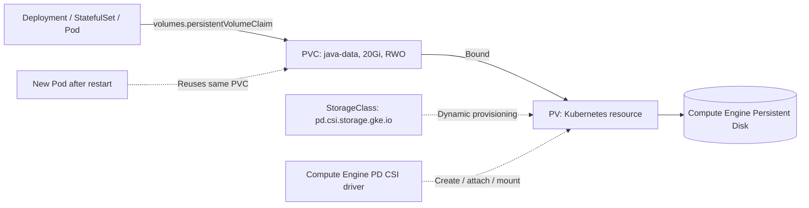
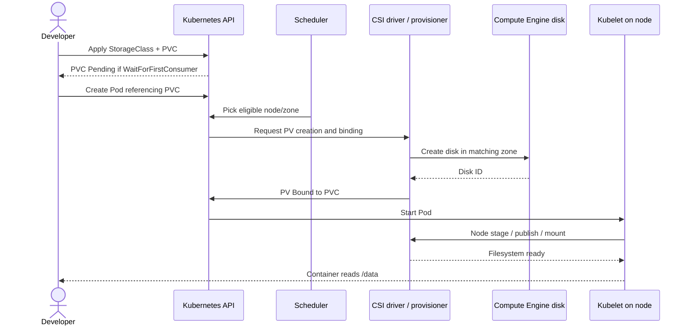
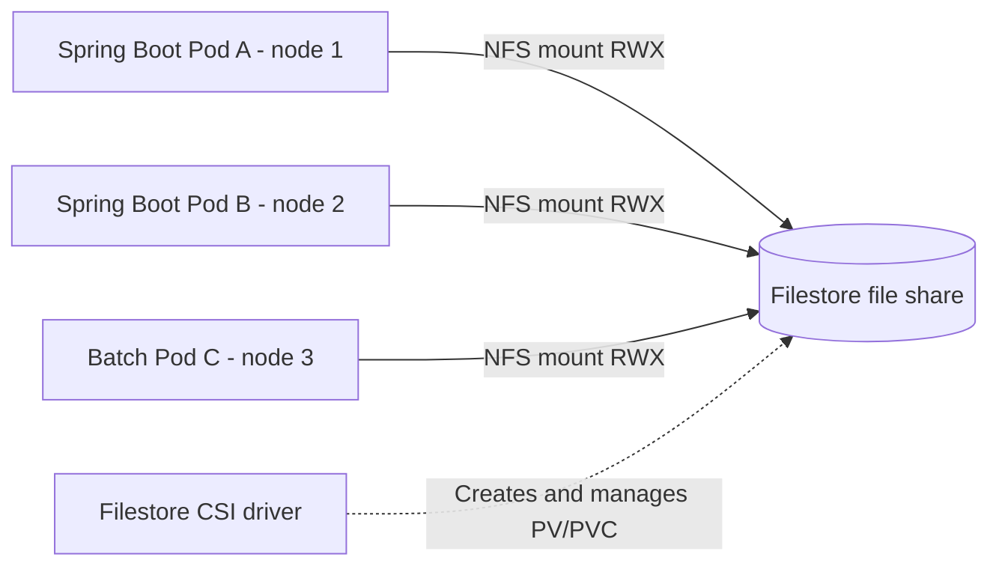
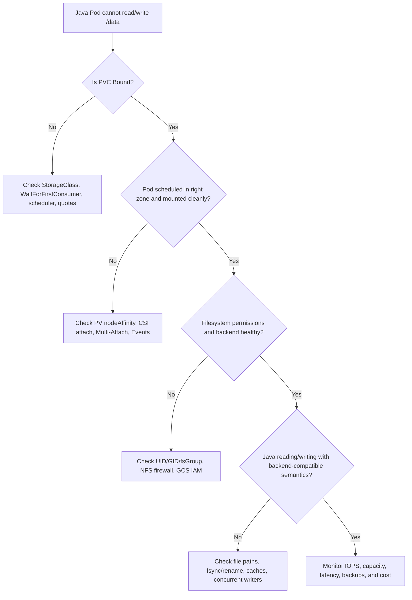

# PersistentVolumes, CSI Drivers, and Storage for Pods

## 1. Problem: Java Pods Get Replaced, Yet Data Must Survive

A team deploys a **Spring Boot** application on **Google Kubernetes Engine (GKE)**. The order API stores primary transactional data in **Cloud SQL**, yet several components still need file storage: a document processor writes large temporary files, a worker saves checkpoints to resume after crashes, a legacy app writes mutable configuration files at runtime, or multiple Pods share a data directory.

In Kubernetes, **a Pod is not a persistent storage unit**. It can be deleted, recreated on another node, evicted during node upgrades, or scaled down. Writing files to the container's writable layer causes data to vanish whenever the container or Pod is replaced. You must select a storage solution aligned with durability, concurrent access, performance, and cost requirements.

Core concepts:

- **PersistentVolume (PV):** a Kubernetes resource representing storage with a lifecycle independent of Pods.
- **PersistentVolumeClaim (PVC):** a request for storage with a specific capacity, access mode, and StorageClass.
- **StorageClass:** defines how the system provisions a PV—for example, Persistent Disk type, reclaim policy, and binding timing.
- **Container Storage Interface (CSI) driver:** the integration component connecting Kubernetes to actual storage backends such as **Compute Engine Persistent Disk**, **Filestore**, or **Cloud Storage FUSE**.

Within the **GKE Fundamentals** chapter of **CLOUD_PROVIDERS_GCP**, this lesson helps Java developers choose the right Pod storage, protect data across deploys and scaling, use GKE Autopilot or Standard deliberately, and manage IAM, backups, monitoring, and costs in real deployment scenarios.

### Learning Objectives

After this lesson, you will be able to:

1. Distinguish container filesystems, `emptyDir`, PVs, PVCs, StorageClasses, and CSI volumes.
2. Explain the lifecycle **PVC Pending → Bound → Pod mount → Released/deleted** and the impact of `reclaimPolicy`.
3. Distinguish `ReadWriteOnce` (RWO), `ReadOnlyMany` (ROX), `ReadWriteMany` (RWX), and `ReadWriteOncePod` (RWOP).
4. Choose **Persistent Disk/Hyperdisk**, **Filestore**, or **Cloud Storage FUSE** for Java workload needs.
5. Create a StorageClass/PVC/Pod with YAML on GKE to verify data survives deleting and recreating the Pod.
6. Design **StatefulSets**, volume expansion, snapshots/backups, and recovery across node/zone failures.
7. Diagnose `Pending`, `FailedMount`, `Multi-Attach`, missing IAM, or lingering disk charges after deleting workloads.

> **Lab scope:** manifests and commands are examples to run on an **authorized test cluster with an approved budget**. They do not auto-execute when reading this lesson. Dynamic PVCs provision **billable Compute Engine disks** even before containers write data; Filestore can provision far costlier resources. Never run cleanup commands against production PVCs or disks.

## 2. From Pod to Data: Three Distinct Storage Layers

### 2.1. Container Writable Layer and `emptyDir`

Every container has a filesystem built from its image plus a temporary writable layer. When a container is recreated, that writable layer is not durable business storage. An `emptyDir` volume persists for the **Pod's lifetime**, is shared among containers in the same Pod, and fits caches or scratch files.

```yaml
apiVersion: v1
kind: Pod
metadata:
  name: java-temp-example
spec:
  containers:
    - name: worker
      image: busybox:1.36
      command: ["sh", "-c", "echo temp > /scratch/work.txt; sleep 3600"]
      volumeMounts:
        - name: scratch
          mountPath: /scratch
  volumes:
    - name: scratch
      emptyDir: {}
```

If a **container restarts while the Pod remains**, `emptyDir` typically survives. If the **Pod is deleted or recreated on another node**, `emptyDir` data **is lost**. It fits rebuildable scratch data, **never the sole copy of business records**.

### 2.2. PersistentVolume: Lifecycle Independent of Pods

When an application declares a PVC and mounts it in a Pod, Kubernetes links the Pod to a PV resource and a storage backend. If the Pod is replaced while the **PVC and backend remain**, the new Pod can re-mount that data under compatible access and topology rules.



**PVs and PVCs sit at different levels:** a PVC is a request inside a **namespace**; a PV is a **cluster-scoped** resource; the Google Cloud disk is infrastructure outside Kubernetes objects. A `Bound` PV does not automatically prove **files in the filesystem are safe**, and deleting a PVC can trigger disk deletion depending on the reclaim policy.

### 2.3. Not Every File Needs a PV

| Requirement | Typical Best Fit | Why |
| --- | --- | --- |
| Rebuildable computation caches, temporary archives | `emptyDir` or ephemeral storage | Does not need to survive Pod loss |
| Stateless Java APIs and system-wide shared file uploads | **Cloud Storage API/SDK** | Durable object storage for many consumers; no filesystem mount needed |
| A Java worker needing durable filesystems with one primary writer Pod | **Persistent Disk CSI + PVC** | Block volume, filesystem, and re-attach support |
| Multiple Pods on multiple nodes writing to a shared directory | **Filestore CSI / NFS** | Shared filesystem supporting RWX |
| AI/ML or batch reading many Cloud Storage objects via file paths | **Cloud Storage FUSE CSI** | Mounts a bucket; suits certain file/object access patterns |
| Transactional database for production Spring Boot | **Cloud SQL** or an appropriate managed DB | Backups, HA, and DB operations; avoid DIY DB HA on raw PVCs |

A REST API storing user sessions in local files to scale across replicas will break even if every replica has its own PV: **data does not auto-sync between PVs**. Separate application state into an appropriate data system.

## 3. How Are PV, PVC, and StorageClass Connected?

### 3.1. Static and Dynamic Provisioning

**Static provisioning:** an admin prepares a disk or Filestore share beforehand and creates a **PV** pointing to that backend; a matching PVC binds to that PV. Used when importing existing data, pinning exact disk IDs, or restoring from retained resources.

**Dynamic provisioning:** an admin creates a **StorageClass**, an app creates a PVC, and the CSI provisioner automatically creates the PV and underlying cloud storage. This is the standard path in GKE.



This is a conceptual sequence: real CSI architecture includes **controller components**, **CSI external provisioner/attacher/resizer**, and **node plugins**, with scheduler, attach controller, and kubelet coordinating asynchronously.

### 3.2. Key Fields in a PVC

```yaml
apiVersion: v1
kind: PersistentVolumeClaim
metadata:
  name: java-data
  namespace: storage-lab
spec:
  accessModes:
    - ReadWriteOnce
  storageClassName: java-pd-lab
  resources:
    requests:
      storage: 20Gi
```

- `accessModes`: how the volume may be mounted—**not Kubernetes RBAC**.
- `storageClassName`: points to a StorageClass; if omitted, the cluster's default class **may** be assigned automatically.
- `resources.requests.storage`: requested capacity—does not mean "billed only after writing 20Gi."
- `volumeMode`: defaults to `Filesystem`; `Block` requires Pods to use `volumeDevices` rather than a mounted filesystem path.
- `selector`, `volumeName`: used when binding to a pre-created static PV.

**Watch out for `storageClassName: ""`:** an explicit empty string means **do not use the default dynamic StorageClass**, unlike omitting the field so the cluster can assign the default class.

### 3.3. Lifecycle and States

| Object | State / Behavior | Explanation |
| --- | --- | --- |
| PVC `Pending` | Not yet bound to a PV | Normal when using `WaitForFirstConsumer` with no consuming Pod yet |
| PVC/PV `Bound` | Claim and volume are paired | Does not guarantee app mounting succeeds if node/zone/permissions fail |
| PV `Released` | PVC deleted; PV no longer claimed | With `Retain`, backend disk survives and requires admin reclamation before reuse |
| PV `Failed` | Error in PV lifecycle | Inspect Events, CSI controller, and cloud resource |
| Pod `Pending` / `ContainerCreating` | Possible scheduling, attach, or mount error | Inspect `kubectl describe pod` and Events |

Never solve a `Pending` PVC by **immediately deleting the PVC** on a real system: it may belong to a StatefulSet holding unbacked-up disk data.

## 4. Access Modes, Topology, and Sharing Constraints

### 4.1. Four Access Modes

| Mode | Kubernetes Meaning | Example Use |
| --- | --- | --- |
| `ReadWriteOnce` (**RWO**) | Read/write on **a single node** at a time | Persistent Disk with one writer node |
| `ReadOnlyMany` (**ROX**) | Multiple nodes can mount **read-only** if driver supports it | Read-only datasets |
| `ReadWriteMany` (**RWX**) | Multiple nodes can mount **read-write** if driver supports it | Filestore/NFS shared across Pods |
| `ReadWriteOncePod` (**RWOP**) | Only **one Pod** in the cluster can mount read-write | Prevent two Pods from mounting the same CSI PVC when supported by driver/version |

**Critical trap:** RWO is **per node**, not per Pod. Two Pods on the **same node** can mount an RWO volume simultaneously, whereas a Pod on another node hits a **Multi-Attach error**. If you must enforce single-Pod exclusive mounting, evaluate **RWOP** per CSI driver and Kubernetes version support, or enforce transactional locking in the app.

Access modes govern **scheduling and mount constraints**—they do not enforce Linux file permissions, replace IAM/ACLs, or provide application-level write locks. RWX allowing concurrent mounts **does not mean concurrent file edits are safe from races**.

### 4.2. `WaitForFirstConsumer` and Zones

Standard Compute Engine Persistent Disks are **zonal** resources. A disk created in `asia-southeast1-a` cannot arbitrarily attach to a node in `asia-southeast1-b`. If a StorageClass uses `Immediate`, the system may provision the disk before knowing which zone the Pod can run in, leaving the Pod `Pending` due to topology mismatch.

`WaitForFirstConsumer` delays PV provisioning/binding until a consuming Pod exists and the scheduler has evaluated nodes, taints/tolerations, affinity, and zones. Always prefer this for **topology-constrained** storage.

```yaml
apiVersion: storage.k8s.io/v1
kind: StorageClass
metadata:
  name: java-pd-lab
provisioner: pd.csi.storage.gke.io
parameters:
  type: pd-balanced
volumeBindingMode: WaitForFirstConsumer
allowVolumeExpansion: true
reclaimPolicy: Delete
```

**Never hand-set `nodeName`** on a Pod when the StorageClass uses `WaitForFirstConsumer`: bypassing the scheduler can leave the PVC stuck `Pending` forever. To constrain nodes/zones, use supported scheduler **`nodeSelector`/affinity** rules.

### 4.3. Reclaim Policy: Does Deleting a Claim Delete the Disk?

| `reclaimPolicy` | When PVC Is Deleted | Best Fit |
| --- | --- | --- |
| `Delete` | Dynamically provisioned PV and cloud backend disk are typically **deleted** by controller | Labs, scratch persistent data, easily recreated workloads |
| `Retain` | PV becomes `Released`; disk/data are **preserved** for manual handling | Critical data needing audit, recovery, or explicit approval before deletion |

**Always inspect the actual PV's reclaim policy**, not just the StorageClass YAML in Git. Editing a StorageClass after provisioning does not retroactively change existing PVs. For StatefulSet PVCs, also check **`persistentVolumeClaimRetentionPolicy`** (where supported), since StatefulSet PVCs are normally retained by default on deletion/scale-down.

A `Retain` disk continues **accruing monthly charges** even after its Pod and namespace are deleted. With `Delete`, accidentally deleting a claim causes permanent data loss if no backup or snapshot exists.

## 5. What Is Container Storage Interface (CSI)?

Kubernetes should not hardcode vendor logic for every block disk, NFS share, or object store in core code. **CSI** is the standard plugin interface enabling vendors to build **drivers**. A driver coordinates with Kubernetes and storage backends through operations such as:

1. **`CreateVolume`/`DeleteVolume`:** provision or delete backend volumes.
2. **`ControllerPublishVolume`:** attach disks to nodes if required by the backend.
3. **`NodeStageVolume`/`NodePublishVolume`:** format/mount volumes on nodes and bind-mount into containers.
4. **`ControllerExpandVolume`/`NodeExpandVolume`:** expand capacity when supported.
5. **`CreateSnapshot`/`DeleteSnapshot`:** create and manage CSI snapshots when supported by controller/driver.

In GKE, drivers are deployed and updated **alongside supported GKE versions and add-ons**; avoid manually editing GKE-managed driver controllers unless documentation explicitly permits it.

### 5.1. Three CSI Drivers to Know

| Storage Backend | Driver / Provisioner | Typical Access Modes | Appropriate Use |
| --- | --- | --- | --- |
| **Compute Engine Persistent Disk** | `pd.csi.storage.gke.io` | RWO, plus ROX/RWOP depending on capabilities and attach mode | Single-writer file state, checkpointed workers |
| **Hyperdisk** | Via Compute Engine PD CSI driver with matching disk type parameters | Depends on Hyperdisk type and machine series | Workloads needing custom IOPS/throughput |
| **Filestore** | `filestore.csi.storage.gke.io` | RWX NFS | Multiple Pods/VMs sharing a filesystem |
| **Cloud Storage FUSE** | `gcsfuse.csi.storage.gke.io` | Static PV or CSI ephemeral; Kubernetes access modes per config | Reading/writing Cloud Storage objects via file APIs when semantics fit |

They differ across **latency, IOPS, durability, region/zone scope, mount mechanics, quotas, consistency, backups, and pricing**. Never equate "driver supports RWX" with "behaves like a local POSIX filesystem with atomic locks and renames."

### 5.2. Why Avoid `hostPath` in Production?

`hostPath` mounts a **node's local directory** into a Pod; data stays tied to that node rather than re-attaching like a PV on other nodes. It also widens the attack surface by exposing the host filesystem to containers. Reserve `hostPath` for tightly controlled privileged system workloads where strictly required—**never use it as general persistent storage for Spring Boot**.

## 6. GKE Autopilot vs. Standard: What Is Managed?

### 6.1. Compute Engine Persistent Disk CSI Driver

Per GKE documentation:

- **Autopilot:** Compute Engine Persistent Disk CSI driver is **enabled by default** and cannot be disabled.
- **Standard:** you may need to **enable the CSI driver add-on** if not already active; never assume older clusters have it enabled, as defaults evolved across versions.
- Once enabled, GKE provides StorageClasses such as `standard-rwo` (balanced PD) and `premium-rwo` (SSD PD). **Autopilot commonly sets `standard-rwo` as default**; on Standard, the default class may differ, so always check `kubectl get storageclass`.

Example for an **existing Standard cluster** only if the driver is not yet enabled:

```bash
gcloud container clusters update CLUSTER_NAME \
  --location=CLUSTER_LOCATION \
  --update-addons=GcePersistentDiskCsiDriver=ENABLED

kubectl get csidrivers
kubectl get storageclass
```

Never toggle GKE CSI add-ons in production just to run a lab; add-on updates can disrupt active PVCs using that driver.

### 6.2. Filestore CSI Driver

Filestore provides managed NFS shared filesystems. Available StorageClasses may include `zonal-rwx`, `enterprise-rwx`, `enterprise-multishare-rwx`, `standard-rwx`, and `premium-rwx` depending on **GKE version and service tier**. On **GKE 1.36.3+**, Filestore CSI is enabled by default on **new clusters**; older Standard clusters may need the add-on enabled:

```bash
gcloud container clusters update CLUSTER_NAME \
  --location=CLUSTER_LOCATION \
  --update-addons=GcpFilestoreCsiDriver=ENABLED
```

Some newer tiers have high version requirements and **large minimum instance sizes** (often starting at 1 TiB for listed tiers). Never create a Filestore PVC in a lab without budgeting for it. Auto-installed StorageClasses may default to the `default` network; if GKE uses another VPC or Shared VPC, create a **StorageClass specifying the right network** and configure firewall rules.

### 6.3. Cloud Storage FUSE CSI Driver

GKE manages the Cloud Storage FUSE CSI driver on supported clusters. To mount a bucket via this driver, workloads typically need **Workload Identity Federation for GKE**, a Kubernetes ServiceAccount with matching Cloud Storage IAM, the `gke-gcsfuse/volumes: "true"` annotation, and a `gcsfuse.csi.storage.gke.io` volume spec.

In environments using GKE Sandbox, this driver **is not supported**. Never assume a volume mount tested in a privileged Pod works under every `RuntimeClass`.

## 7. Safe Lab: Persistent Disk CSI + PVC + Pod

This lab uses an **existing** GKE cluster. Do not spin up a new cluster solely for cost/admin reasons, and do not create Filestore by default. You need `kubectl` access to the right cluster, the Compute Engine PD CSI driver enabled, and quota for a **20 GiB balanced persistent disk**. Commands below use **Bash**; PowerShell quoting/piping may differ.

**Do not run in production namespaces or against production PVs.** Before proceeding, verify `kubectl config current-context` points to a test cluster, billing is valid, and you have permissions to create namespaces, StorageClasses, PVCs, and Pods.

### Step 1 — Verify Cluster and Driver

```bash
gcloud config set project PROJECT_ID
gcloud container clusters get-credentials CLUSTER_NAME \
  --location=CLUSTER_LOCATION \
  --project=PROJECT_ID

kubectl config current-context
kubectl get nodes -o wide
kubectl get csidrivers
kubectl get storageclass
kubectl create namespace storage-lab
```

If `pd.csi.storage.gke.io` is missing, pause the lab and check cluster mode/add-ons per Section 6. Never install an upstream driver from the Internet over a GKE-managed add-on.

### Step 2 — Create a Dedicated Lab StorageClass

Save as `java-pd-sc.yaml` on your admin machine:

```yaml
apiVersion: storage.k8s.io/v1
kind: StorageClass
metadata:
  name: java-pd-lab
provisioner: pd.csi.storage.gke.io
parameters:
  type: pd-balanced
volumeBindingMode: WaitForFirstConsumer
allowVolumeExpansion: true
reclaimPolicy: Delete
```

```bash
kubectl apply -f java-pd-sc.yaml
kubectl get storageclass java-pd-lab -o yaml
```

**StorageClass is a cluster-scoped resource**, not namespaced. `reclaimPolicy: Delete` lets the lab clean up the disk when the PVC is deleted; **production workloads holding critical data** should evaluate `Retain` and backups rather than copying this default blindly.

### Step 3 — Create a 20 GiB PVC

Save `java-pvc.yaml`:

```yaml
apiVersion: v1
kind: PersistentVolumeClaim
metadata:
  name: java-pd-data
  namespace: storage-lab
spec:
  accessModes:
    - ReadWriteOnce
  storageClassName: java-pd-lab
  resources:
    requests:
      storage: 20Gi
```

```bash
kubectl apply -f java-pvc.yaml
kubectl get pvc java-pd-data -n storage-lab
kubectl describe pvc java-pd-data -n storage-lab
```

At this point, the PVC stays **`Pending` normally** because the StorageClass uses `WaitForFirstConsumer`. **Do not treat `Pending` as an error** before any Pod consumes the PVC.

### Step 4 — Create a Pod Writing Data to the Volume

Save `storage-writer.yaml`:

```yaml
apiVersion: v1
kind: Pod
metadata:
  name: storage-writer
  namespace: storage-lab
  labels:
    app: storage-lab
spec:
  terminationGracePeriodSeconds: 30
  containers:
    - name: writer
      image: busybox:1.36
      command: ["/bin/sh", "-c"]
      args:
        - |
          if [ ! -f /data/first-start.txt ]; then
            date -u > /data/first-start.txt
          fi
          echo "Pod runs on $(hostname)"
          cat /data/first-start.txt
          sleep 3600
      volumeMounts:
        - name: data
          mountPath: /data
  volumes:
    - name: data
      persistentVolumeClaim:
        claimName: java-pd-data
```

```bash
kubectl apply -f storage-writer.yaml

kubectl get pod,pvc -n storage-lab -o wide
kubectl get pv
kubectl describe pod storage-writer -n storage-lab
kubectl logs storage-writer -n storage-lab
kubectl exec -n storage-lab storage-writer -- \
  cat /data/first-start.txt
```

Once the scheduler picks an eligible node and zone, the CSI driver creates the disk/PV, attaches it to the node, and mounts it at `/data`. The PVC transitions to `Bound` and the Pod becomes `Running`. If the Pod remains `Pending`, read **Events** in `kubectl describe` before editing classes or deleting claims.

### Step 5 — Delete the Pod and Reuse the **Exact Same PVC**

```bash
kubectl delete pod storage-writer -n storage-lab
kubectl apply -f storage-writer.yaml

kubectl get pod,pvc -n storage-lab -o wide
kubectl exec -n storage-lab storage-writer -- \
  cat /data/first-start.txt
```

Provided the PVC/disk survived and the new Pod scheduled and mounted cleanly, the original `first-start.txt` timestamp **is still there**. This proves **data lives outside the Pod**, rather than Kubernetes keeping the old container around.

**Do not try creating two Pods on different nodes mounting the same RWO disk to "test RWX"**: attach will be blocked and leave lingering errors. For multi-node shared filesystems, see Filestore in Section 10.

### Step 6 — Inspect the PV and Cloud Disk

```bash
kubectl get pvc java-pd-data -n storage-lab \
  -o jsonpath='{.spec.volumeName}'

kubectl get pv -o wide
kubectl describe pvc java-pd-data -n storage-lab
kubectl describe pod storage-writer -n storage-lab
```

From `kubectl get pv -o yaml` (for your lab PV), inspect `spec.csi.driver`, `spec.csi.volumeHandle`, `spec.nodeAffinity`, `persistentVolumeReclaimPolicy`, and zone info. In Google Cloud Console, you can view Compute Engine Disks to verify the backing resource, yet **never delete the disk directly** while still managed by a PVC/CSI.

### Step 7 — Clean Up in Order

The lab uses `reclaimPolicy: Delete`. Delete only **lab-named** resources after backing up anything you want to keep:

```bash
kubectl delete pod storage-writer -n storage-lab
kubectl delete pvc java-pd-data -n storage-lab

# Wait for the PV/disk to be reclaimed, verifying real resources:
kubectl get pv

kubectl delete storageclass java-pd-lab
kubectl delete namespace storage-lab
```

**Never run `kubectl delete namespace` or `kubectl delete pvc --all` in a production namespace.** If a PVC/PV hangs in `Terminating`, do not strip finalizers or force-delete disks manually; inspect CSI events and volume attachments first. After cleanup, verify **Compute Engine Disks**, snapshots, and Cloud Billing to ensure no billable lab resources remain.

## 8. Java on PVs: Which State Belongs in Files?

A Java app can write **checkpoints** to a PVC-mounted filesystem such as `/var/lib/java-worker` to resume work after Pod recreation. First verify whether the file is the **primary source of truth** or merely temporary state recoverable from Pub/Sub or Cloud SQL.

### 8.1. Spring Boot Example Reading and Writing a Checkpoint

The Java snippet below assumes the Pod mounted a PVC at `/var/lib/java-worker` with write permissions:

```java
package dev.example.gke;

import java.io.IOException;
import java.nio.charset.StandardCharsets;
import java.nio.file.Files;
import java.nio.file.Path;
import java.nio.file.StandardCopyOption;
import org.springframework.boot.ApplicationArguments;
import org.springframework.boot.ApplicationRunner;
import org.springframework.stereotype.Component;

@Component
public class StartupCheckpoint implements ApplicationRunner {
    private static final Path DIR = Path.of("/var/lib/java-worker");
    private static final Path STATE = DIR.resolve("checkpoint.txt");

    @Override
    public void run(ApplicationArguments args) throws IOException {
        Files.createDirectories(DIR);

        if (Files.exists(STATE)) {
            String previous = Files.readString(STATE, StandardCharsets.UTF_8);
            System.out.println("Recovered checkpoint: " + previous);
        } else {
            Path tmp = DIR.resolve("checkpoint.tmp");
            Files.writeString(tmp, "offset=0\n", StandardCharsets.UTF_8);
            Files.move(tmp, STATE,
                    StandardCopyOption.REPLACE_EXISTING,
                    StandardCopyOption.ATOMIC_MOVE);
            System.out.println("Initialized checkpoint");
        }
    }
}
```

This uses `ATOMIC_MOVE` for filesystems that support it; **storage backends have different semantics**—notably Cloud Storage FUSE does not guarantee atomic renames identically. In production, handle `AtomicMoveNotSupportedException`, `fsync` durably when needed, implement idempotent retries, and reconcile against upstream systems. **Never treat this checkpoint file as a transactional database or multi-writer lock.**

### 8.2. Filesystem Permissions When Running Non-Root

Containers should generally run as a non-root user. If a PD is formatted/mounted owned by `root`, a process running as UID 10001 can hit `Permission denied`. Configure `securityContext` with `runAsUser`, `runAsGroup`, and `fsGroup` where supported by the driver/backend:

```yaml
spec:
  securityContext:
    runAsUser: 10001
    runAsGroup: 10001
    fsGroup: 10001
  containers:
    - name: java-worker
      image: REGION-docker.pkg.dev/PROJECT_ID/REPO/java-worker:TAG
      volumeMounts:
        - name: checkpoint
          mountPath: /var/lib/java-worker
  volumes:
    - name: checkpoint
      persistentVolumeClaim:
        claimName: java-pd-data
```

This is a **Pod `spec` snippet, not a full manifest**. For Filestore/NFS, UID/GID and export settings must match. For Cloud Storage FUSE, POSIX semantics and ACLs differ from `ext4`. Avoid `chmod -R 777` as a blanket fix for permission errors.

### 8.3. Scaling Does Not Automatically Sync Data

If a Deployment has 3 replicas all referencing one RWO PVC, the cluster may **fail to schedule** Pods across multiple nodes; if all land on the same node, replicas may **overwrite each other's checkpoints**. Three options exist:

1. Single writer with RWO/RWOP and an appropriate controller.
2. One PVC per replica via **StatefulSet `volumeClaimTemplates`**.
3. If shared files are truly needed, use **Filestore RWX** paired with application-level locking/transactions.

For order processing, multiple replicas **should share Cloud SQL or a queue/broker**, not a mutable file pretending to be a coordination service.

## 9. StatefulSet: Giving Each Java Replica Its Own Stable PVC

A **StatefulSet** maintains ordered Pod identities such as `ledger-0` and `ledger-1`. Combined with `volumeClaimTemplates`, each Pod receives its own PVC, such as `data-ledger-0` and `data-ledger-1`. When a Pod is replaced, the same ordinal reattaches to **its matching PVC**.

Architectural example for a Java app with a dedicated image; before applying, replace `IMAGE_URI` with a valid digest from Artifact Registry, configure image pull IAM, and verify cluster/node resources:

```yaml
apiVersion: v1
kind: Service
metadata:
  name: ledger-headless
  namespace: storage-lab
spec:
  clusterIP: None
  selector:
    app: ledger
  ports:
    - name: http
      port: 8080
      targetPort: 8080
---
apiVersion: apps/v1
kind: StatefulSet
metadata:
  name: ledger
  namespace: storage-lab
spec:
  serviceName: ledger-headless
  replicas: 2
  selector:
    matchLabels:
      app: ledger
  template:
    metadata:
      labels:
        app: ledger
    spec:
      containers:
        - name: java
          image: IMAGE_URI
          ports:
            - containerPort: 8080
          volumeMounts:
            - name: data
              mountPath: /var/lib/ledger
  volumeClaimTemplates:
    - metadata:
        name: data
      spec:
        accessModes:
          - ReadWriteOnce
        storageClassName: java-pd-lab
        resources:
          requests:
            storage: 20Gi
```

When scaling from 2 down to 1 replica, `ledger-1`'s PVC **is retained by default**, not deleted immediately. Scaling back up to 2 lets the new `ledger-1` reuse its old claim. Depending on Kubernetes/GKE version, **`persistentVolumeClaimRetentionPolicy`** controls whether PVCs are deleted when a StatefulSet is deleted or scaled down. **Inspect StatefulSet and PV policies before deleting.**

**StatefulSet does not automatically replicate data** between `ledger-0` and `ledger-1`. If both replicas serve the same database, the software itself must manage replication and quorum. For stateless Spring Boot APIs, a **Deployment** is simpler and cheaper to operate.

## 10. Filestore CSI: RWX Directories for Multiple Pods

### 10.1. Why Does Filestore Differ from Persistent Disk?

**Filestore** is a managed NFS service providing a **shared filesystem** mountable from many authorized Pods and nodes. It fits Java apps that must share a directory tree with NFS file-locking/metadata semantics—such as a legacy app storing generated PDFs in a shared folder.



Because multiple Pods can write concurrently, applications must handle **concurrent modification** and locking rules. A "shared folder" does not solve transactions, ordering, or distributed consensus.

### 10.2. Sample PVC Using a Pre-Installed RWX StorageClass

Use only after confirming cluster/version and service tier:

```yaml
apiVersion: v1
kind: PersistentVolumeClaim
metadata:
  name: shared-files
  namespace: storage-lab
spec:
  accessModes:
    - ReadWriteMany
  storageClassName: enterprise-rwx
  resources:
    requests:
      storage: 1Ti
```

**Do not run this manifest casually in a small lab**: it can provision a **minimum 1 TiB Filestore instance**, incurring significant storage and capacity charges. Classes like `enterprise-rwx`, `zonal-rwx`, `standard-rwx`, or `regional-rwx` depend on GKE version/tier, networking, and quotas; check `kubectl get storageclass`, minimum sizes, and NFSv3/NFSv4.1 support before applying.

### 10.3. Things to Verify

- **Network/VPC:** GKE nodes must reach Filestore IPs with proper NFS firewalls, routes, and Shared VPC configuration.
- **Capacity and pricing:** Filestore enforces tier-based minimum sizes; it does not bill like a tiny few-GiB PD PVC.
- **Access control:** POSIX/NFS filesystem permissions, `fsGroup`, and IP/source limits; Kubernetes RBAC does not replace NFS permissions.
- **Topology:** tier and location govern durability and availability; RWX does not automatically protect against region outages.
- **Data protection:** Filestore backups and CSI snapshots vary by tier; backups are separate resources/data, not equivalent to Pod restarts.
- **Scaling:** many Pods mounting one share does not give infinite throughput; monitor NFS latency, IOPS, and real throughput.

## 11. Cloud Storage FUSE CSI: A Bucket Is an Object Store, Not a Disk

**Cloud Storage FUSE CSI** lets apps read and write Cloud Storage objects through a filesystem mount inside a Pod. Two modes exist:

1. **CSI ephemeral volume:** declared directly in Pod `spec.volumes[].csi` **without a PV/PVC**; **data lives in the Cloud Storage bucket** and survives the Pod lifecycle even though Kubernetes calls the volume type ephemeral.
2. **Static PV + PVC:** creates a PV pointing to an existing bucket so Pods mount it via a PVC when you want PV/PVC API management.

The term "ephemeral volume" here describes **how the volume attaches to the Pod**, not that deleting the Pod deletes bucket objects.

### 11.1. Pod Reading a Bucket Safely

Illustrative manifest for **read-only** access to an existing bucket after configuring Kubernetes ServiceAccount `storage-reader` and **Workload Identity Federation for GKE / IAM**:

```yaml
apiVersion: v1
kind: Pod
metadata:
  name: gcs-reader
  namespace: storage-lab
  annotations:
    gke-gcsfuse/volumes: "true"
spec:
  serviceAccountName: storage-reader
  terminationGracePeriodSeconds: 60
  containers:
    - name: reader
      image: busybox:1.36
      command: ["sleep", "3600"]
      volumeMounts:
        - name: bucket-files
          mountPath: /data
          readOnly: true
  volumes:
    - name: bucket-files
      csi:
        driver: gcsfuse.csi.storage.gke.io
        readOnly: true
        volumeAttributes:
          bucketName: BUCKET_NAME
          mountOptions: "implicit-dirs"
```

GKE may inject a **sidecar** container to run FUSE operations. Seeing two containers in the Pod (app + sidecar) is architectural, not a container leak. Before applying, verify **cluster version/Linux**, Workload Identity, `storage.objects.get/list` IAM permissions on the service account, network connectivity to Cloud Storage, and bucket existence.

### 11.2. Critical Differences from POSIX for Java

Cloud Storage is an **object store**. FUSE presents a file interface, yet differs in:

- **Atomic renames, file appends, and concurrent writes:** never assume `ext4`/NFS semantics everywhere.
- **Latency:** listing, opening, and reading many small files incurs high API latency and operation charges.
- **Caching/consistency:** file and metadata caches use TTLs/policies; one Pod updating an object does not guarantee other Pods see it instantaneously like a local filesystem.
- **IAM:** governed by the runtime identity's Cloud Storage IAM, not just Unix mode bits.
- **Feature limitations:** Cloud Storage FUSE CSI **does not support CSI volume snapshots, cloning, or volume expansion** per current documentation.

**Guidance for Java:** if Spring Boot simply uploads/downloads documents, the **Google Cloud Storage Java client library** is usually cleaner than FUSE because object operations are atomic. FUSE fits software strictly requiring filesystem paths or ML pipelines reading datasets as files; benchmark under realistic I/O patterns before production.

## 12. Volume Expansion, Snapshots, and Backups

### 12.1. Expanding PVC Capacity

If the StorageClass sets `allowVolumeExpansion: true` and the CSI driver/backend supports it, you can increase `spec.resources.requests.storage` on the PVC:

```bash
# When lab data needs expansion from 20Gi to 30Gi:
kubectl patch pvc java-pd-data -n storage-lab \
  --type=merge \
  -p '{"spec":{"resources":{"requests":{"storage":"30Gi"}}}}'

kubectl get pvc java-pd-data -n storage-lab
kubectl describe pvc java-pd-data -n storage-lab
```

**Never shrink a PVC by changing 30Gi back to 20Gi**: volume shrinking is not supported in the standard model. Expansion may require backend resizing, filesystem resizing, and occasionally a Pod remount/restart depending on driver/filesystem; verify `status.capacity`, Events, and the filesystem inside the Pod. Larger capacity increases **disk charges**.

### 12.2. What Is a `VolumeSnapshot`?

**CSI VolumeSnapshot** is a Kubernetes API for point-in-time volume snapshots. It uses:

- `VolumeSnapshotClass` with CSI driver name and deletion policy.
- `VolumeSnapshot` referencing the source PVC.
- `VolumeSnapshotContent` representing the provisioned/bound backend snapshot.

Example only for clusters with **VolumeSnapshot CRDs/controller** and snapshot-capable Compute Engine PD CSI:

```yaml
apiVersion: snapshot.storage.k8s.io/v1
kind: VolumeSnapshotClass
metadata:
  name: java-pd-snapshots
driver: pd.csi.storage.gke.io
deletionPolicy: Retain
---
apiVersion: snapshot.storage.k8s.io/v1
kind: VolumeSnapshot
metadata:
  name: java-pd-snapshot-1
  namespace: storage-lab
spec:
  volumeSnapshotClassName: java-pd-snapshots
  source:
    persistentVolumeClaimName: java-pd-data
```

```bash
kubectl api-resources | grep -i volumesnapshot
kubectl get volumesnapshotclass
# Apply manifests only after confirming driver/controller support and cost.
kubectl get volumesnapshot -n storage-lab
```

`deletionPolicy: Retain` means deleting the Kubernetes object **does not automatically delete the cloud snapshot**; maintain a separate inventory and cleanup procedure. Snapshots incur storage fees. Never assume snapshots are **application-consistent**: for active databases or writing Java processes, **quiesce/flush**, use DB-aware backups, and test restores.

### 12.3. Backups Differ from Snapshots

| Mechanism | Protects Against | Does Not Solve Alone |
| --- | --- | --- |
| Pod restart + PVC | Pod replacement, process crashes | Deleted disks, data corruption, zone disasters |
| Zonal Persistent Disk | Node failure if re-attachable in the same zone | Zone loss, disk deletion, app-level corruption |
| Regional Persistent Disk | Certain zone outages via two-zone synchronous replication | Not a multi-writer DB; does not replace backups/restores |
| Disk snapshot / CSI `VolumeSnapshot` | Disk data loss after snapshot time, while backup survives | Transaction consistency unless the app prepares for it |
| Filestore backup | Restoring share copies per service features | Not always in-place restore; plan restore time |
| Database-aware backup | Logical/business-consistent recovery | Does not replace network/IAM planning, RPO/RTO, or restore drills |

Design around your workload's **RPO (maximum acceptable data loss)** and **RTO (target recovery time)**. For transactional data, **Cloud SQL HA + backups/PITR** generally beats running a database on a raw GKE PVC without full HA and backup automation.

## 13. Scheduling and Resilience Across Node or Zone Failures

### 13.1. Pods and Disks Can Have Zone Mismatches

A zonal `pd-balanced` disk provisioned in zone A will be rejected by the scheduler if the Pod is constrained to run only in zone B. With `WaitForFirstConsumer`, the disk is initially created in the first consumer's zone, yet **once bound, disk topology does not move automatically** if you later add a new Pod affinity rule.

When node A fails, the controller recreates the Pod on **another node in the same zone** if capacity exists and the disk detaches/re-attaches cleanly. During transition you may briefly see `Multi-Attach` while the disk detaches from the failed node—this is not always a permission error.

### 13.2. Regional Persistent Disk Is Not Shared RWX

**Regional Persistent Disk** synchronously replicates data across two zones in the same region in supported configurations. It improves architectural resilience, yet typically follows a **single-writer attach** model with explicit failover handling; **it does not turn into an RWX filesystem for concurrent Pod writes**.

Before choosing it, check disk types, machine series, CSI driver support, zone requirements, replication cost, write latency, and zone-loss recovery steps. Never advertise "regional PD = PostgreSQL HA": databases have their own transaction and recovery logic.

### 13.3. StatefulSets and Multi-Replica Failures

If a StatefulSet has two separate PVCs and one Pod fails, the recreated Pod reattaches to its ordinal PVC. Yet **the two PVCs do not replicate to each other**. If replica A's data must survive on replica B after a zone outage, implement application-layer replication or backup/restore.

**PodDisruptionBudgets**, anti-affinity, topology spread constraints, and node auto-upgrades govern Pod placement and availability—they do not duplicate data on disk.

## 14. IAM, Encryption, Filesystem Permissions, and Security Limits

### 14.1. Distinguish Three Permission Domains

| Domain | Enforced By | Example |
| --- | --- | --- |
| Kubernetes API | RBAC, namespaces, admission policies | Who can create PVCs, Pods, StorageClasses, snapshots |
| Google Cloud resources | IAM of nodes / service accounts / CSI controller per cluster mode | Who can create/attach disks or access Filestore/Cloud Storage |
| Filesystem / application | UID, GID, `fsGroup`, NFS exports, bucket IAM | Which files a Java process can read or write |

**A user permitted to create a PVC does not automatically gain access to files in another Cloud Storage bucket.** A Kubernetes ServiceAccount with Workload Identity Federation only solves **identity toward Google Cloud APIs**, while PV/PVC access modes do not replace OS-level filesystem or database security.

### 14.2. Encryption and Secrets

Compute Engine disks are encrypted by default per service design; for organizational key control, use **CMEK via Cloud KMS** where supported by the StorageClass/driver and disk type, with proper IAM for the service agent. For Filestore and Cloud Storage, review each product's encryption options.

Never store database passwords or tokens in images, PVC manifests, annotations, or unprotected local disk files. Use **Secret Manager** or properly secured Kubernetes Secrets with tight RBAC; default Kubernetes Secrets alone are **not a complete secret management system** without encryption and access controls.

### 14.3. Personal Data and Deletion Policies

`reclaimPolicy: Retain` keeps the backend disk for admin handling—**it is not a WORM compliance legal hold**. Conversely, `reclaimPolicy: Delete` deletes the disk when the PVC is deleted even if regulations require retaining data. For long-term retention records, design backups, retention policies, and permissions in **Cloud Storage / Cloud SQL** rather than treating a PVC as a compliant archive.

## 15. Observing and Diagnosing CSI and PV/PVC Errors

### 15.1. Read-Only Investigation Commands

```bash
kubectl config current-context
kubectl get storageclass
kubectl get csidrivers
kubectl get pvc -A
kubectl get pv -o wide
kubectl get pod -A -o wide

kubectl describe pvc java-pd-data -n storage-lab
kubectl describe pod storage-writer -n storage-lab
kubectl get events -n storage-lab --sort-by=.lastTimestamp

# List volume attachments only when authorized:
kubectl get volumeattachments
```

When investigating production, never read or write across PVCs in another team's namespace; volume data may contain sensitive information.

### 15.2. Layered Troubleshooting Table

| Symptom | Common Causes | Checks and Resolution |
| --- | --- | --- |
| PVC `Pending` with no Pod yet | `WaitForFirstConsumer` waiting for scheduling | Create a consuming Pod or check controller; often normal |
| PVC `Pending` after Pod exists | Wrong class/driver, missing quota, no eligible node/zone | `describe pvc/pod`, Events, StorageClass, node selectors |
| `no persistent volumes available` | Static PV does not match size, access mode, or class | Compare PV/PVC `storageClassName` and `volumeName` |
| `provisioning failed` | CSI add-on disabled, quota/permission issue, unsupported disk type | CSI driver, project IAM/quotas, machine series |
| `volume node affinity conflict` | Pod constrained to a different zone than the disk | PV `nodeAffinity`, Pod affinity, and node zones |
| `Multi-Attach error` | RWO disk still attached to another node | Inspect Pods/`VolumeAttachment`; wait for clean detach rather than force-detaching blindly |
| `FailedMount` or `MountVolume.SetUp failed` | Filesystem, node plugin, OS permissions, or NFS/FUSE networking | Pod Events, CSI driver logs, `fsGroup`, firewalls, backend health |
| `Permission denied` when Java writes files | Wrong UID/GID/`fsGroup`, NFS export, or GCS IAM | Pod `securityContext`, file owner/mode, IAM |
| PVC resize doesn't take effect | Class lacks `allowVolumeExpansion`, driver/size limit, or FS not resized | PVC Conditions/Events and backend disk size |
| Disk lingers after deleting StatefulSet | Default PVC retention keeps claims, or PV uses `Retain` | StatefulSet policy, PVC/PV inventory, and Billing |
| GCS FUSE mounts yet I/O is slow | Excessive API operations, poor caching, many small objects | FUSE metrics, Cloud Storage request charges, benchmark |
| Deleting PVC wiped the disk | PV used `reclaimPolicy: Delete` | Restore from backup/snapshot and revise governance |
| Disk exists yet new Pod fails to mount | Zone/topology mismatch, access mode, driver, or finalizer | `describe pod/pvc/pv`, `VolumeAttachment`, Compute Engine disk |

### 15.3. Step-by-Step Debugging Flowchart



Never conclude from `Pod Running` alone that the PVC works properly. Test **reads/writes**, Pod restarts, and (when permitted) snapshot/backup restores to validate the full recovery chain.

## 16. Cost and Selecting Options by Workload

### 16.1. Billable Components

- **Persistent Disk/Hyperdisk:** provisioned capacity (GB-month), disk tier, provisioned IOPS/throughput where applicable, snapshots, and data transfer if any.
- **Filestore:** tier-based minimum capacity/throughput, performance scaling, backups, and networking.
- **Cloud Storage FUSE:** Cloud Storage **GB-month, operations, retrieval/network egress**, plus any node memory/cache overhead.
- **GKE:** Autopilot/Standard cluster fees, node CPU/RAM, CSI sidecar/system containers, logging/monitoring.
- **Orphaned disks/PVs:** volumes left behind after Pod/namespace deletion keep accruing charges, especially under `Retain` or retained snapshot policies.

### 16.2. Capacity Estimation Example

Suppose a StatefulSet has **3 replicas**, each provisioning a **100 GiB PVC** on balanced Persistent Disk, while each VM currently writes only **15 GiB**.

```text
Provisioned disk capacity = 3 × 100 GiB = 300 GiB.
Written application data  = 3 × 15 GiB  = 45 GiB.
PD charges typically track the 300 GiB provisioned capacity,
not just the 45 GiB of files currently stored.
```

If old replica PVCs are retained after scale-down, those retained disks keep incurring charges. In real workloads, monitor **both requested/provisioned capacity and filesystem utilization**, pick the right class/region, and enforce approved resource cleanup policies.

### 16.3. Quick Decision Matrix

| Java Workload Requirement | Initial Recommendation | What to Verify |
| --- | --- | --- |
| Single worker writing durable files across Pod restarts | PD CSI + RWO/RWOP PVC | Zone, single-writer, snapshots/backups |
| 3 replicas sharing a writable document directory | Filestore RWX | NFS semantics, file locking, min size, cost |
| Spring Boot API uploading/downloading documents | Cloud Storage Java SDK | Object consistency, permissions, retention, API costs |
| Batch job needing a Cloud Storage dataset mounted as files | Cloud Storage FUSE CSI | Caching, read/write semantics, Workload Identity, latency |
| Container stdout/stderr logs | Stdout/stderr + Cloud Logging | Never use PVCs to hold routine logs |
| Transactional DB with multi-zone HA | Cloud SQL or appropriate DB platform | RPO/RTO, backups, transactions, failover |

Choose storage based on **application requirements**, not because every backend looks like `/data` inside a container.

## 17. Practice Exercises, Questions, and Checklist

### Exercise A — Distinguishing Volume Types

A Java Pod needs to: (1) unpack temporary files, (2) persist checkpoints across restarts, (3) serve PDFs across multiple replicas, and (4) record SQL transactions. Map each need to `emptyDir`, PD PVC, Filestore/Cloud Storage, or Cloud SQL; explain why one storage type alone cannot fit all four.

### Exercise B — PVC and `WaitForFirstConsumer`

In a test cluster, create StorageClass `java-pd-lab` and PVC `java-pd-data`. Record PVC status **before any Pod exists** and **after the Pod schedules**. Inspect the PV's `nodeAffinity` and which zone holds the created disk; explain why `WaitForFirstConsumer` prevents wrong topology choices.

### Exercise C — Does Restarting a Pod Lose Data?

Write `first-start.txt`, delete the Pod, recreate it with the same PVC, and verify the contents. Contrast with `emptyDir`. Then predict what happens if you delete the **PVC** when `reclaimPolicy: Delete`; **do not test with real data**.

### Exercise D — StatefulSet and Per-Replica Data

Design a StatefulSet with 3 Java replicas, each with its own PVC. If `ledger-1` is deleted and recreated, does it reattach to its old PVC? If scaled down to 1 and back to 3, do the PVCs persist? Check the actual `persistentVolumeClaimRetentionPolicy` and explain why PVCs **do not auto-replicate**.

### Exercise E — Comparing PD, Filestore, and Cloud Storage FUSE

A legacy Java system needs 10 different Pods writing to one NFS directory; another team needs to read millions of JSON objects from a bucket; a third needs high-IOPS block storage for one worker. Choose the storage backend, CSI driver, access mode, IAM, cost profile, and I/O semantic challenges for each.

### Exercise F — Incident Runbook and Cost

A Pod fails to mount due to `Multi-Attach error`. List the **read-only** commands to identify which Pod/node holds the attachment, how to wait safely for detach, and post-recovery verification. Calculate provisioned capacity costs for a StatefulSet with 3 × 100 GiB PVCs versus 45 GiB of actual data.

### Self-Assessment Checklist

- [ ] I can distinguish **container writable layers**, `emptyDir`, PVs, PVCs, and StorageClasses.
- [ ] I understand **static vs. dynamic provisioning** and the roles of CSI controller/node plugins.
- [ ] I know RWO is **per node**, RWOP is **per Pod**, and RWX is **multi-node** when supported.
- [ ] I know why `WaitForFirstConsumer` matters for **zonal Persistent Disks**.
- [ ] I inspect actual default StorageClasses rather than guessing by name or cluster mode.
- [ ] I can create and inspect PVCs/PVs and verify data survives **Pod recreation**.
- [ ] I understand the difference between `Delete` and `Retain`, including after StatefulSet/namespace deletion.
- [ ] I can choose **PD/Hyperdisk, Filestore, or Cloud Storage FUSE** appropriately for Java apps.
- [ ] I understand StatefulSet `volumeClaimTemplates` do not replicate data automatically.
- [ ] I know resizing does not mean shrinking, and snapshots do not guarantee application consistency.
- [ ] I distinguish Google Cloud IAM, Kubernetes RBAC, Linux UID/GID, and NFS/FUSE permissions.
- [ ] I can inspect Events, `VolumeAttachment`, topology, CSI failures, and orphaned disks.
- [ ] I estimate costs from **provisioned capacity**, snapshots, tiers, and lingering post-cleanup volumes.

**Conclusion:** PVs/PVCs decouple GKE application data lifecycles from Pods, and CSI connects Kubernetes to concrete storage backends. However, **a PV does not automatically provide HA, backups, replication, data security, or multi-writer coordination**. Sound storage design for Java on Google Cloud requires matching access modes and StorageClasses to real I/O patterns, respecting zone constraints, setting intentional reclaim policies, testing restores, and tracking the cost of volumes that outlive Pods.

## 18. Google Cloud and Kubernetes Reference Documentation

- [GKE: Storage options overview](https://cloud.google.com/kubernetes-engine/docs/concepts/storage-overview)
- [GKE: PersistentVolumes and provisioning](https://cloud.google.com/kubernetes-engine/docs/concepts/persistent-volumes)
- [GKE: Compute Engine persistent disk CSI driver](https://cloud.google.com/kubernetes-engine/docs/how-to/persistent-volumes/gce-pd-csi-driver)
- [GKE: Filestore CSI driver](https://cloud.google.com/kubernetes-engine/docs/how-to/persistent-volumes/filestore-csi-driver)
- [GKE: Cloud Storage FUSE CSI driver overview](https://cloud.google.com/kubernetes-engine/docs/concepts/cloud-storage-fuse-csi-driver)
- [GKE: Mount Cloud Storage buckets as CSI ephemeral volumes](https://cloud.google.com/kubernetes-engine/docs/how-to/cloud-storage-fuse-csi-driver-ephemeral)
- [Kubernetes: Persistent Volumes](https://kubernetes.io/docs/concepts/storage/persistent-volumes/)
- [Kubernetes: Storage Classes, binding mode, and reclaim](https://kubernetes.io/docs/concepts/storage/storage-classes/)
- [Kubernetes: StatefulSet](https://kubernetes.io/docs/concepts/workloads/controllers/statefulset/)
- [Kubernetes: Volume Snapshots](https://kubernetes.io/docs/concepts/storage/volume-snapshots/)
- [Kubernetes: CSI and volume expansion](https://kubernetes.io/docs/concepts/storage/volume-pvc-datasource/)
- [Google Cloud: Persistent Disk pricing](https://cloud.google.com/compute/disks-image-pricing)
- [Google Cloud: Filestore pricing](https://cloud.google.com/filestore/pricing)
- [Google Cloud: Cloud Storage pricing](https://cloud.google.com/storage/pricing)
