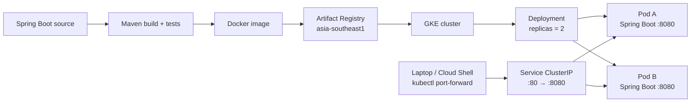
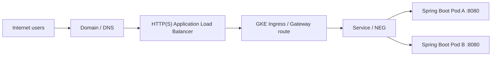
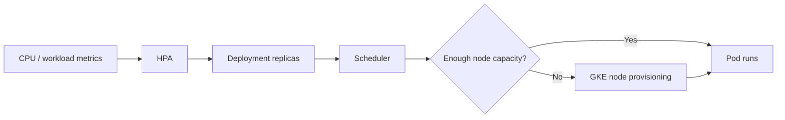

# Hands-On: Deploying Spring Boot on Google Kubernetes Engine (GKE)

A **Spring Boot** REST API can run on a developer workstation via `java -jar`, yet serving users on Google Cloud also requires packaging a container image, pushing it to a registry, deploying Pods, exposing access points, configuring health probes, rolling out new versions, and troubleshooting errors. This lesson walks through the full chain: **Spring Boot → Maven → Docker → Artifact Registry → GKE → Deployment/Service → testing → rollout/rollback**.

This lesson belongs to the **GKE Fundamentals** chapter of the `CLOUD_PROVIDERS_GCP` module. Learners apply concepts from project organization, IAM, VPC, Compute Engine, and load balancing to deploy a containerized application while understanding resource protection, release automation, reliability monitoring, and cost control. The core lab uses a **`ClusterIP` Service and `port-forward`** for testing without opening an HTTP endpoint to the Internet; an optional section explains exposing the API externally via GKE Ingress.

> **Hands-on warning:** Project, cluster, registry, and service account names in these examples are illustrative. Commands that create clusters, repositories, IAM bindings, push images, create Ingresses, or delete resources can **modify real infrastructure and incur charges**. Run only in an authorized lab environment, verifying your project and `kubectl` context before every step. Shell commands below target Bash/Linux/macOS/Cloud Shell; adjust syntax if using PowerShell.

## 1. Objectives and Target Outcomes

After this lesson, you will be able to:

1. Create a **Spring Boot REST API** exposing `/api/hello` and Actuator health endpoints.
2. Build a JAR using **Maven Wrapper**, write a Java 21 Dockerfile, and test the container locally.
3. Push the image to an **Artifact Registry Docker repository**, distinguishing push permissions from image-pull permissions.
4. Choose a **Standard or Autopilot** GKE cluster and access the Kubernetes API with `gcloud`/`kubectl`.
5. Define a **Namespace, Kubernetes ServiceAccount, Deployment, and Service** with image, resource requests/limits, and probes.
6. Inspect the Pod/Deployment/Service and call the app via **`kubectl port-forward`**.
7. Understand how to use **Ingress/Load Balancer**, HTTPS, and access policies if the API must be public.
8. Practice updating the image, observing a **rolling update**, and rolling back.
9. Identify **`ImagePullBackOff`, `Pending`, `CrashLoopBackOff`, `OOMKilled`, and readiness/HTTP `503`** failures along with IAM and networking root causes.
10. Build a production mindset around **Workload Identity Federation, secrets, autoscaling, observability, quotas, costs, and cleanup**.

**Completion criteria:** namespace `orders-lab` contains a Deployment maintaining 2 Ready Spring Boot Pods; internal Service `orders-api` port 80 forwards to container port 8080; calling `http://127.0.0.1:8080/api/hello` via `port-forward` returns JSON; you can verify the running image version and read logs.

## 2. Lab Architecture

The sample app is named `orders-api` and does not require a database in the core lab. Connecting Cloud SQL, Cloud Storage, and exposing to the Internet are separated so infrastructure issues don't mask application issues.



| Component | Role | Key Point to Remember |
| --- | --- | --- |
| **Maven** | Compiles, runs tests, and builds an executable JAR. | JAR must match the image's JRE version. |
| **Docker image** | Packages the JAR and runtime for consistent distribution. | Image tags are mutable; production should pin digests. |
| **Artifact Registry** | Stores images and governs push/pull access. | The builder's IAM does not carry over automatically to nodes or Pods. |
| **GKE cluster** | Kubernetes API and Pod execution infrastructure. | Standard and Autopilot manage nodes differently. |
| **Deployment** | Maintains replicas and manages rollouts. | Pods can get new names and IPs when replaced. |
| **ClusterIP Service** | Internal name/IP forwarding to matching Pod endpoints. | Does not provision an external IP or HTTPS. |
| **Kubernetes ServiceAccount** | Kubernetes identity attached to Pods. | Calling Google Cloud APIs requires separate identity/IAM setup. |
| **Ingress/Gateway** | Optional external traffic exposure/routing. | Can provision a Load Balancer and incur charges. |

A `Running` Pod does not mean the app is `Ready`. A Deployment with 2 replicas does not automatically place Pods across two zones or create a public entry point.

## 3. Preparing the Project, Tools, and Permissions

### 3.1. Prerequisites

| Item | Requirement |
| --- | --- |
| Google Cloud | Lab project with billing, quotas, and required APIs. |
| Java | JDK 21 and Maven Wrapper from Spring Initializr. |
| Container build | Docker CLI/Engine or authorized Cloud Build. |
| CLI | Compatible `gcloud`, `kubectl`, and `gke-gcloud-auth-plugin`. |
| Artifact Registry | Docker repository in an approved region. |
| GKE | Existing Standard/Autopilot cluster or permission to create a lab cluster. |
| IAM/RBAC | Permissions to create/view cluster resources and push images to the repository. |
| Networking | Build host to registry, cluster pulling images, admin reaching Kubernetes API. |

This lesson assumes the VPC/subnet is already planned. If using Shared VPC, coordinate **host project and subnet permissions**. Never open firewall rules to the entire Internet to work around undiagnosed errors.

### 3.2. Set Variables in Bash

```bash
PROJECT_ID="orders-dev"
REGION="asia-southeast1"
CLUSTER_NAME="orders-gke-lab"
NAMESPACE="orders-lab"
REPO="spring-apps"
APP="orders-api"
IMAGE_URI="$REGION-docker.pkg.dev/$PROJECT_ID/$REPO/$APP:v1"

printf 'Project=%s\nCluster=%s\nImage=%s\n' \
  "$PROJECT_ID" "$CLUSTER_NAME" "$IMAGE_URI"
```

These variables apply only to the current shell session. If you open a new terminal, re-export them. Never leave the sample `orders-dev` untouched if your real project ID differs.

### 3.3. Inspect Before Making Changes

```bash
# Read-only commands
gcloud auth list
gcloud config get-value project
gcloud services list --enabled --project="$PROJECT_ID"
gcloud container clusters list --project="$PROJECT_ID"
gcloud artifacts repositories list \
  --project="$PROJECT_ID" --location="$REGION"
```

Minimum required services typically include **Kubernetes Engine API** and **Artifact Registry API**. If not yet enabled, an authorized user can enable them in the lab project:

```bash
# MODIFIES PROJECT CONFIG: run only when authorized.
gcloud services enable \
  container.googleapis.com \
  artifactregistry.googleapis.com \
  --project="$PROJECT_ID"
```

Verify CPU, Pod IP, and regional GKE quotas along with your budget. **Creating a new cluster can incur charges even before the app receives requests**, depending on mode and provisioned resources.

## 4. Creating the Spring Boot REST API Application

### 4.1. Initialize the Project

Open [Spring Initializr](https://start.spring.io/) and select:

- **Project:** Maven; **Language:** Java.
- **Spring Boot:** a supported stable release compatible with Java 21.
- **Group:** `com.example`; **Artifact:** `orders-api`; **Package:** `com.example.orders`.
- **Packaging:** Jar; **Java:** 21.
- **Dependencies:** **Spring Web**, **Spring Boot Actuator**.

Extract the project. Spring Initializr generates `pom.xml`, `mvnw`, `mvnw.cmd`, and the source layout. The two main dependencies in `pom.xml` look like:

```xml
<dependency>
    <groupId>org.springframework.boot</groupId>
    <artifactId>spring-boot-starter-web</artifactId>
</dependency>
<dependency>
    <groupId>org.springframework.boot</groupId>
    <artifactId>spring-boot-starter-actuator</artifactId>
</dependency>
```

This is only the **dependency snippet**, not a complete `pom.xml`. Keep the Spring Boot parent, plugins, and test dependencies generated by Initializr rather than mixing incompatible versions manually.

### 4.2. Write the Java Controller

Put the following in `src/main/java/com/example/orders/OrdersApplication.java`:

```java
package com.example.orders;

import java.util.Map;
import org.springframework.boot.SpringApplication;
import org.springframework.boot.autoconfigure.SpringBootApplication;
import org.springframework.web.bind.annotation.GetMapping;
import org.springframework.web.bind.annotation.RestController;

@SpringBootApplication
public class OrdersApplication {
    public static void main(String[] args) {
        SpringApplication.run(OrdersApplication.class, args);
    }
}

@RestController
class HelloController {
    @GetMapping("/api/hello")
    public Map<String, String> hello() {
        return Map.of(
            "service", "orders-api",
            "message", "Spring Boot running on GKE"
        );
    }
}
```

This simple endpoint intentionally calls no database or external API, helping separate **container/deployment/network** issues from downstream dependency issues.

### 4.3. Actuator and Health Probes

In `src/main/resources/application.yml`:

```yaml
server:
  port: 8080
  shutdown: graceful

spring:
  application:
    name: orders-api
  lifecycle:
    timeout-per-shutdown-phase: 20s

management:
  endpoint:
    health:
      probes:
        enabled: true
  endpoints:
    web:
      exposure:
        include: health,info
```

Endpoints used by the Kubernetes manifest:

| Endpoint | Purpose |
| --- | --- |
| `GET /api/hello` | Basic HTTP functional check. |
| `GET /actuator/health/liveness` | Liveness: is the app process still healthy per probe checks? |
| `GET /actuator/health/readiness` | Readiness: is the app ready to receive requests? |

**Readiness ≠ liveness.** While starting up, readiness failing is normal; if liveness kills the container prematurely, it enters `CrashLoopBackOff`. Never include a shared database's status in liveness if it could trigger mass Pod restarts every time the database slows down.

### 4.4. Run Unit Tests, Build, and Test Locally

From the project directory on your workstation:

```bash
./mvnw test
./mvnw package
java -jar target/*.jar
```

In a second terminal:

```bash
curl -i http://127.0.0.1:8080/api/hello
curl -i http://127.0.0.1:8080/actuator/health/liveness
curl -i http://127.0.0.1:8080/actuator/health/readiness
```

Expected: `/api/hello` returns HTTP 200 with JSON containing `"service":"orders-api"`. If port 8080 is already bound, check which local process holds it before changing configs across multiple layers.

**Never skip tests in production** just to push images faster. Beyond unit tests, enforce integration tests, dependency vulnerability scans, and image scanning per team standards.

## 5. Containerizing Spring Boot

### 5.1. Dockerfile

Create `Dockerfile` in the project root:

```dockerfile
FROM eclipse-temurin:21-jre

WORKDIR /app
COPY --chown=10001:10001 target/*.jar /app/app.jar

USER 10001:10001
EXPOSE 8080

ENTRYPOINT ["java", "-XX:MaxRAMPercentage=70.0", "-jar", "/app/app.jar"]
```

- Base image uses the **Java 21 runtime** rather than a full JDK build image.
- `COPY target/*.jar` assumes `target/` holds a single executable JAR matching the pattern. If Maven produces extra JARs, copy the exact filename instead of an ambiguous wildcard.
- `USER 10001:10001` avoids running the container as root.
- `EXPOSE` documents the container port; **it does not open a public port**.
- `MaxRAMPercentage` caps heap size relative to the cgroup memory limit seen by the JVM, leaving room for non-heap memory, thread stacks, direct memory, and caches.

The tagged base image here keeps learning simple. In production, verify and **pin base images by digest**, generate SBOMs/scans, and apply patches systematically.

### 5.2. Build and Test the Container Locally

After `./mvnw package` succeeds:

```bash
docker build -t orders-api:local .

# Bind only to loopback so the test API is not exposed on the LAN.
docker run --rm -p 127.0.0.1:8080:8080 orders-api:local
```

From another terminal:

```bash
curl -i http://127.0.0.1:8080/api/hello
curl -i http://127.0.0.1:8080/actuator/health/readiness
```

If the container fails to start, inspect `docker run` output or `docker logs`; check the JAR path, Java version, filesystem permissions, and HTTP port. Running Docker locally **does not prove** image pulls, IAM, or Pod scheduling on GKE will succeed.

### 5.3. Keep Image Versions Explicit

`v1` and `latest` are **mutable tags that can be overwritten to point at a new digest**. In CI/CD:

1. Use a unique tag per commit/build.
2. Record the pushed artifact's **OCI image digest**.
3. Deploy `image: ...@sha256:...` in production to pin exact bytes.
4. Never grant registry-wide push rights to every account.
5. Enforce image scanning and controlled base-image patching.

In this lab, we use `v1` for simplicity.

## 6. Pushing the Image to Artifact Registry

A full image reference follows:

```text
LOCATION-docker.pkg.dev/PROJECT_ID/REPOSITORY/IMAGE:TAG

asia-southeast1-docker.pkg.dev/orders-dev/spring-apps/orders-api:v1
```

### 6.1. Create the Repository If It Does Not Exist

```bash
# Read-only
gcloud artifacts repositories list \
  --project="$PROJECT_ID" \
  --location="$REGION"

# MODIFIES RESOURCES: run only if spring-apps does not exist yet
# and you have permission to create repositories in the lab project.
gcloud artifacts repositories create "$REPO" \
  --project="$PROJECT_ID" \
  --location="$REGION" \
  --repository-format=docker \
  --description="Spring Boot GKE lab images"
```

If the repository is a shared resource, do not alter its policies or delete it after the lab.

### 6.2. Authenticate Docker, Tag, and Push

```bash
# Configure Docker to use gcloud's credential helper for Artifact Registry.
gcloud auth configure-docker "$REGION-docker.pkg.dev"

docker tag orders-api:local "$IMAGE_URI"
docker push "$IMAGE_URI"

# Verify the image exists in the registry
gcloud artifacts docker images list \
  "$REGION-docker.pkg.dev/$PROJECT_ID/$REPO" \
  --project="$PROJECT_ID"
```

The build/push account needs appropriate permissions such as Artifact Registry Writer on the repository. The **node image-pull identity** must also hold read access. In many single-project setups this is already configured; for cross-project repos or custom node service accounts, verify `roles/artifactregistry.reader` at the required scope.

**Do not confuse three identities:**

| Principal | Action | Required Permission |
| --- | --- | --- |
| Developer / CI builder | Build/push images | Artifact Registry Writer or equivalent on the repo. |
| Node image-pull identity | Pull images to start containers | Artifact Registry Reader on the repo. |
| Pod runtime workload identity | Spring Boot calling Cloud Storage / Secret Manager / Cloud SQL | App IAM roles, distinct from image pull rights. |

### 6.3. Cloud Build (Optional)

Don't want to install Docker locally? Use Cloud Build if the project has the API enabled and the build identity has permissions:

```bash
# MODIFIES RESOURCES: uploads source to build and push the image.
gcloud builds submit --project="$PROJECT_ID" --tag="$IMAGE_URI" .
```

**Important prerequisite:** the Dockerfile above only copies `target/*.jar`, so the JAR must already be present in the **build context** sent to Cloud Build. If uploads exclude `target/` or CI builds from clean source, add a **Maven build step** first or switch to a **multi-stage Dockerfile**. Never assume Cloud Build runs `./mvnw package` automatically if the Dockerfile has no build stage.

## 7. Preparing and Accessing the GKE Cluster

### 7.1. Standard or Autopilot?

| Choice | Characteristics | When to Use for the Lab |
| --- | --- | --- |
| **GKE Standard** | Manually choose/manage node pools, machine types, and node settings. | Good when a Standard cluster already exists or practicing node management. |
| **GKE Autopilot** | GKE manages node infrastructure provisioning from Pod specs and supported features. | Good when focusing on Kubernetes manifests/apps without sizing node pools. |

Having a Spring Boot app does not automatically require creating a GKE cluster. For a stateless HTTP API with minimal Kubernetes needs, **Cloud Run** is also worth evaluating to eliminate cluster operations.

### 7.2. Prefer Using an Existing Cluster

```bash
gcloud container clusters list \
  --project="$PROJECT_ID"
```

Confirm the exact name, location (region or zone), mode, permissions, network, and owner of the lab cluster. Avoid creating a new cluster when your organization already provides a test environment.

If you are **authorized to create a dedicated Autopilot cluster** and the VPC/subnet and IP ranges are ready:

```bash
NETWORK="orders-vpc"
SUBNET="gke-subnet"

# CREATES A REAL CLUSTER: may incur charges.
gcloud container clusters create-auto "$CLUSTER_NAME" \
  --project="$PROJECT_ID" \
  --region="$REGION" \
  --network="$NETWORK" \
  --subnetwork="$SUBNET"
```

This command is a **lab template**. Organization Policies may mandate private nodes, a private control-plane endpoint, a specific release channel, or additional security controls. Run it only once the VPC/subnet, Shared VPC permissions, and regional capacity are ready. If a cluster already exists, skip creation.

### 7.3. Fetch kubeconfig and Check Status

```bash
# Modifies kubeconfig on the local machine; does not create a cluster.
gcloud container clusters get-credentials "$CLUSTER_NAME" \
  --project="$PROJECT_ID" \
  --location="$REGION"

kubectl config current-context
kubectl cluster-info
kubectl get nodes -o wide
kubectl get namespaces
```

If the cluster is **zonal**, pass the exact zone to `--location`, such as `asia-southeast1-b`. `get-credentials` can switch your current Kubernetes context: **always check context before every `apply`/`delete`**. If `kubectl` returns unauthorized/forbidden, inspect the auth plugin, IAM, and Kubernetes RBAC—never hand out `cluster-admin` hastily.

## 8. Kubernetes Manifest: Deployment and Service for Spring Boot

Create `k8s/orders-gke.yaml` inside the learner's Spring Boot project. It defines **four resources**: Namespace, Kubernetes ServiceAccount, Deployment, and Service. This is an example for the learner to copy during hands-on practice, **not an extra file for this worker to create inside the curriculum repository**.

```yaml
apiVersion: v1
kind: Namespace
metadata:
  name: orders-lab
  labels:
    app.kubernetes.io/part-of: orders-lab
---
apiVersion: v1
kind: ServiceAccount
metadata:
  name: orders-api
  namespace: orders-lab
---
apiVersion: apps/v1
kind: Deployment
metadata:
  name: orders-api
  namespace: orders-lab
spec:
  replicas: 2
  revisionHistoryLimit: 5
  strategy:
    type: RollingUpdate
    rollingUpdate:
      maxSurge: 1
      maxUnavailable: 0
  selector:
    matchLabels:
      app: orders-api
  template:
    metadata:
      labels:
        app: orders-api
    spec:
      serviceAccountName: orders-api
      terminationGracePeriodSeconds: 30
      securityContext:
        runAsNonRoot: true
        runAsUser: 10001
        runAsGroup: 10001
        seccompProfile:
          type: RuntimeDefault
      containers:
        - name: orders-api
          image: IMAGE_URI_REPLACE_ME
          imagePullPolicy: IfNotPresent
          ports:
            - name: http
              containerPort: 8080
          resources:
            requests:
              cpu: "250m"
              memory: "512Mi"
            limits:
              cpu: "1"
              memory: "1Gi"
          securityContext:
            allowPrivilegeEscalation: false
            readOnlyRootFilesystem: true
            capabilities:
              drop: ["ALL"]
          volumeMounts:
            - name: temp
              mountPath: /tmp
          startupProbe:
            httpGet:
              path: /actuator/health/liveness
              port: http
            periodSeconds: 5
            failureThreshold: 24
          readinessProbe:
            httpGet:
              path: /actuator/health/readiness
              port: http
            periodSeconds: 5
            failureThreshold: 3
          livenessProbe:
            httpGet:
              path: /actuator/health/liveness
              port: http
            periodSeconds: 10
            failureThreshold: 3
      volumes:
        - name: temp
          emptyDir:
            sizeLimit: 256Mi
---
apiVersion: v1
kind: Service
metadata:
  name: orders-api
  namespace: orders-lab
spec:
  type: ClusterIP
  selector:
    app: orders-api
  ports:
    - name: http
      port: 80
      targetPort: http
      protocol: TCP
```

### 8.1. Explaining Each Section

| Field | Effect | Common Mistake |
| --- | --- | --- |
| `metadata.namespace` | Isolates lab resources inside the lab namespace. | Applying into production namespace due to wrong context/manifest. |
| `ServiceAccount` | Pod's Kubernetes identity. | Assuming a KSA automatically grants Google Cloud IAM roles. |
| `replicas: 2` | Maintains two app replicas. | Lacking node capacity to schedule both. |
| `IMAGE_URI_REPLACE_ME` | Placeholder for the real image. | Forgetting to substitute it, causing image pull errors. |
| `requests/limits` | Allocates CPU/memory for scheduling and caps runtime usage. | JVM OOM or `Pending` Pods if mis-sized. |
| `startupProbe` | Gives Spring Boot time to boot before other probes kick in. | Too short a startup window causing restart loops. |
| `readinessProbe` | Admits Ready Pods into Service endpoints. | Wrong path/port leaving Running Pods receiving zero traffic. |
| `livenessProbe` | Detects hung containers for restart. | Probing a shared DB and triggering a restart storm. |
| `readOnlyRootFilesystem` | Restricts writes inside the container. | App needs temp writes without a writable volume mount. |
| `Service port 80 → targetPort http` | Forwards to container port 8080. | Mismatched Service selector or port name. |

`emptyDir` at `/tmp` supports temporary writes while the root filesystem is read-only. **It is not durable business storage.** When a Pod is replaced, temporary files inside it are lost.

### 8.2. Why Startup, Readiness, and Liveness Probes?

Suppose Spring Boot takes over a minute to initialize dependencies:

```text
Container start
  → JVM starts
  → Spring context / embedded server initialized
  → startup probe passes
  → readiness transitions to ready
  → Service adds Pod to backend endpoints
```

- **Startup** prevents slow initialization from being mistaken for a dead process.
- **Readiness** determines whether new traffic should be routed to the Pod.
- **Liveness** determines when an unresponsive container must be restarted.

Calibrate probe thresholds against the real application. If readiness fails to reflect required startup initialization, Kubernetes may send traffic before the Pod can serve; if liveness is too aggressive, the app enters restart loops.

### 8.3. Requests/Limits and Java Memory

`memory: 1Gi` here is the container limit, meaning the JVM does not get a full 1 GiB solely for heap. Non-heap regions, metaspace, native memory, threads, and buffers all consume RAM. `MaxRAMPercentage=70.0` in the Dockerfile is a starting point—**measure actual memory footprint** before production.

GKE Autopilot may enforce minimum resource requests and admission rules depending on workload/compute class; if rejected, read the admission message and align with policy rather than trying to circumvent limits.

## 9. Deploying to GKE and Verifying the Service

### 9.1. Safety Checks Before Applying

Verify Kubernetes context, namespace, and image:

```bash
kubectl config current-context
printf 'Image to deploy: %s\n' "$IMAGE_URI"

# Read-only: if namespace already exists, verify ownership before proceeding.
kubectl get namespace "$NAMESPACE" --show-labels
```

If `orders-lab` belongs to someone else, **do not apply into or delete that namespace**. Pick a different namespace name and update `metadata.namespace` in the manifest, `kubectl` commands, and any related IAM workload principals.

### 9.2. Substitute the Image Placeholder and Apply

In Bash, substitute `IMAGE_URI_REPLACE_ME` as you pipe to `kubectl apply` without modifying the source YAML file:

```bash
# MUTATES KUBERNETES RESOURCES in the active context.
sed "s|IMAGE_URI_REPLACE_ME|$IMAGE_URI|g" k8s/orders-gke.yaml \
  | kubectl apply -f -
```

This `sed` pipeline assumes a compatible shell; in real projects using Helm/Kustomize/GitOps, use your official rendering/versioning mechanism. Inspect the rendered manifest and image URI before production applies. Never apply while `current-context` points to the wrong project or cluster.

**Why use a Deployment?** A Kubernetes Deployment and ReplicaSet reconcile Pods toward desired state. If a Pod crashes or is deleted, controllers can create a replacement—subject to node/CPU/memory/IP quotas and container startup health.

### 9.3. Verify Rollout, Pods, and Service

```bash
kubectl rollout status deployment/orders-api \
  --namespace="$NAMESPACE" \
  --timeout=300s

kubectl get deployment orders-api -n "$NAMESPACE"
kubectl get pods -n "$NAMESPACE" -l app=orders-api -o wide
kubectl get service orders-api -n "$NAMESPACE" -o wide
kubectl get events -n "$NAMESPACE" --sort-by=.lastTimestamp
```

On success, expect output resembling:

```text
Deployment: orders-api
  Desired replicas: 2
  Available:        2

Service: orders-api
  Type: ClusterIP
  Service port: 80
  Pod targetPort: 8080

Pods:
  orders-api-...  Running  Ready 1/1
  orders-api-...  Running  Ready 1/1
```

This is **illustrative output**, not output from a live cluster. If Pods are `Running` with `READY=0/1`, inspect readiness endpoints, startup timing, and app errors; if Pods stay `Pending`, read scheduling events and quotas.

### 9.4. Call the REST API via `port-forward`

In terminal A:

```bash
# Create a temporary tunnel for testing without exposing an external IP.
kubectl port-forward \
  -n "$NAMESPACE" \
  service/orders-api 8080:80
```

In terminal B:

```bash
curl -i http://127.0.0.1:8080/api/hello
curl -i http://127.0.0.1:8080/actuator/health/liveness
curl -i http://127.0.0.1:8080/actuator/health/readiness
```

Expected `/api/hello` response:

```json
{
  "service": "orders-api",
  "message": "Spring Boot running on GKE"
}
```

`port-forward` runs in the foreground; stop it with Ctrl+C. If local port 8080 is busy, use `18080:80` and call `http://127.0.0.1:18080`.

**`port-forward` is for testing and diagnostics**, not a replacement for HTTPS frontends, DNS, authentication, and HA in production. Closing `kubectl` terminates the tunnel.

### 9.5. Testing the Service from Inside the Cluster (Optional)

Kubernetes DNS provides `orders-api.orders-lab.svc.cluster.local` matching the cluster domain. To test Service DNS from another Pod, use an organization-approved `curl` image:

```bash
# CREATES A TEMPORARY POD: only inside the lab namespace.
kubectl run curl-check \
  -n "$NAMESPACE" \
  --restart=Never \
  --image=curlimages/curl:8.10.1 \
  --command -- curl -i http://orders-api:80/api/hello

kubectl logs curl-check -n "$NAMESPACE"

# Delete the test Pod when done.
kubectl delete pod curl-check -n "$NAMESPACE"
```

If policy blocks public registries, use an approved internal image rather than opening unrestricted egress just to test. If the namespace enforces a default-deny NetworkPolicy, allow traffic for the test Pod.

## 10. Exposing the API Externally with Ingress (Optional)

The `ClusterIP` Service above is reachable only inside the cluster or via approved tunnels. When Internet clients need to reach the Spring Boot API, use **GKE Ingress/Gateway** and a Google Cloud **Application Load Balancer** paired with DNS, TLS, and security policies.



**Enabling public Ingress creates a real Internet frontend and incurs Load Balancing charges.** Skip this step if you only need to verify code via `port-forward`.

### 10.1. Prepare a Compatible Backend Service

The GKE Ingress controller can use **Network Endpoint Groups (NEGs)** to route directly to Pod endpoints via container-native load balancing. On supported Services/Ingresses after verifying cluster config, annotate the Service:

```bash
# MODIFIES SERVICE: run only on clusters/controllers supporting this mode.
kubectl annotate service orders-api \
  -n "$NAMESPACE" \
  'cloud.google.com/neg={"ingress":true}' \
  --overwrite
```

In GitOps projects, put the annotation in the source manifest instead of patching live objects. Not every Gateway/Ingress/Service mode uses the exact same NEG annotation; consult your controller's documentation.

### 10.2. Sample HTTP Ingress for an Approved Lab

`k8s/orders-ingress-lab.yaml` illustrates unencrypted HTTP only; **it is insufficient for production**:

```yaml
apiVersion: networking.k8s.io/v1
kind: Ingress
metadata:
  name: orders-api
  namespace: orders-lab
  annotations:
    kubernetes.io/ingress.class: "gce"
spec:
  rules:
    - http:
        paths:
          - path: /
            pathType: Prefix
            backend:
              service:
                name: orders-api
                port:
                  number: 80
```

If the platform team permits a **temporary public HTTP endpoint in the lab**:

```bash
# MODIFIES INFRASTRUCTURE: can provision an external HTTP Load Balancer and IP.
kubectl apply -f k8s/orders-ingress-lab.yaml

kubectl get ingress orders-api -n "$NAMESPACE"
kubectl describe ingress orders-api -n "$NAMESPACE"
```

Once the Ingress shows a frontend IP and healthy backends, test `http://EXTERNAL_IP/api/hello`. Provisioning takes several minutes across multiple steps; the Ingress object existing does not prove the Load Balancer is ready or endpoints are healthy.

### 10.3. Minimum Requirements for Production Exposure

- Choose an **external or internal Load Balancer** matching allowed consumers.
- Enforce **HTTPS/TLS**, valid domains, certificate rotation, and stable DNS.
- Verify backend NEG/health checks, firewall paths, and GKE-supported Ingress/Gateway types.
- Enable API **authentication/authorization**; never rely on obscure URLs as access control.
- Evaluate **Cloud Armor, IAP, rate limiting, and WAF** per supported LB type and use case.
- Verify private Pods/nodes, backend bypass paths, network policies, and service identities.
- Plan static IPs, logging/metrics, runbooks, quotas, and cost estimates.

For internal APIs, evaluate an **Internal Application Load Balancer or internal Gateway** in a supported architecture rather than creating a public HTTP LB and hiding it behind private DNS.

## 11. Configuration Management and Application Permissions

### 11.1. Three Distinct Identity Tracks

A GKE system typically separates:

| Identity | Action | How to Authorize |
| --- | --- | --- |
| **CI/build principal** | Test, build, and push images. | Artifact Registry Writer on the target repository. |
| **Deploy principal** | Modify Deployments, Services, HPAs/Ingresses in a namespace. | Scoped IAM + Kubernetes RBAC; never default to `cluster-admin`. |
| **Node image-pull identity** | Pull images from Artifact Registry. | Artifact Registry Reader per supported node/GKE mechanism. |
| **Runtime Pod workload principal** | Spring Boot calling Cloud Storage, Secret Manager, Pub/Sub, or Cloud SQL APIs. | Workload Identity Federation and minimal IAM roles on specific resources. |

The user who created the cluster having Storage Admin **does not grant Pods inside the cluster Cloud Storage access**. A Kubernetes ServiceAccount (KSA) is also distinct from an **IAM service account**.

### 11.2. Workload Identity Federation for GKE

If the app expands to read `gs://orders-catalog-dev`, use **Workload Identity Federation for GKE** instead of storing a service account JSON key inside the image. In a properly configured cluster, KSA `orders-lab/orders-api` acts as a workload principal when authorized by Google IAM.

Example granting read-only access on a bucket via direct principal (run only after verifying WIF config and bucket existence):

```bash
PROJECT_NUMBER="$(gcloud projects describe "$PROJECT_ID" \
  --format='value(projectNumber)')"

KSA_PRINCIPAL="principal://iam.googleapis.com/projects/$PROJECT_NUMBER/locations/global/workloadIdentityPools/$PROJECT_ID.svc.id.goog/subject/ns/orders-lab/sa/orders-api"

# REAL IAM GRANT: needed only if the API actually reads this bucket.
gcloud storage buckets add-iam-policy-binding \
  gs://orders-catalog-dev \
  --member="$KSA_PRINCIPAL" \
  --role="roles/storage.objectViewer"
```

Notes:

1. Project number/pool, namespace, and KSA in the member string must **match reality**.
2. The cluster must support and enable WIF in its configuration.
3. Bucket and IAM scope must be exact; read access grants no delete rights.
4. Spring Boot can use Google Cloud client libraries with **Application Default Credentials** provided by workload identity.
5. Some integrations require **impersonating an IAM service account** instead of direct principal bindings; never mix both configurations haphazardly.

Our current `/api/hello` REST API **needs no Cloud Storage access**, so you do not need to run this IAM grant to complete the main lab.

### 11.3. Secrets and Environment Configuration

Never embed passwords or tokens into:

- Plaintext `application.yml` committed to Git.
- Dockerfiles, Docker image layers, or build logs.
- A Kubernetes ConfigMap holding confidential data.
- Long-lived shell variables/history or public tickets.

Use **Secret Manager** with GKE integrations, or carefully scoped Kubernetes Secrets with RBAC and encryption. Base64 in a Kubernetes Secret **is not encryption protecting source data**.

If extending the app to call Cloud SQL, design **private connectivity / Cloud SQL connectors or Auth Proxy, IAM, database credentials, TLS, and connection pooling**. Scaling from 2 to 20 Pods multiplies DB connections; Kubernetes will not automatically relieve database saturation.

## 12. Building a New Version, Rollout, and Rollback

### 12.1. Build Image v2

Suppose you update the response message in `HelloController` and add tests. In the app directory:

```bash
./mvnw test
./mvnw package

IMAGE_URI_V2="$REGION-docker.pkg.dev/$PROJECT_ID/$REPO/$APP:v2"

docker build -t "$IMAGE_URI_V2" .
docker push "$IMAGE_URI_V2"
```

**Never overwrite tag `v1`** just to swap bytes of an already-released version. In production, use immutable image digests for full auditability.

### 12.2. Update the Deployment

```bash
# MUTATES WORKLOAD: use the exact container name from the manifest.
kubectl set image deployment/orders-api \
  orders-api="$IMAGE_URI_V2" \
  -n "$NAMESPACE"

kubectl rollout status deployment/orders-api \
  -n "$NAMESPACE" \
  --timeout=300s

kubectl rollout history deployment/orders-api -n "$NAMESPACE"
kubectl get pods -n "$NAMESPACE" -l app=orders-api -o wide
```

The Deployment replaces Pods using its RollingUpdate strategy (`maxSurge: 1`, `maxUnavailable: 0` in the sample manifest). However, **these two fields alone do not guarantee zero downtime**: you still need spare capacity, accurate probes, graceful shutdown, healthy backends, and stable dependencies.

When an organization uses **GitOps/Helm/Kustomize**, `kubectl set image` is only a learning aid and causes configuration drift. In production, update Git/source manifests and run the approved pipeline.

### 12.3. Roll Back If the New Version Fails

```bash
# MUTATES WORKLOAD: reverts to the previous retained revision in history.
kubectl rollout undo deployment/orders-api -n "$NAMESPACE"
kubectl rollout status deployment/orders-api \
  -n "$NAMESPACE" \
  --timeout=300s
```

Rollback only reverts the **Pod template/image**; **it does not automatically undo database schemas or written data**. Systems with databases require backward-compatible migrations and dedicated backups.

### 12.4. Validating a Real Rollout

Beyond `rollout status`, compare before and after:

- Pod readiness, restarts, CPU/memory.
- HTTP p95/p99 latency and 5xx rates.
- Request throughput and business error rates.
- Cloud SQL/Redis/external API dependency health if applicable.
- Application exception logs and health probe failures.

If v2 fails immediately at startup, inspect `kubectl logs --previous` and Events before rolling back. On severe errors, reverting to the last verified release is safer than blindly raising resource limits.

## 13. HPA, Reliability, and Scaling Strategy

### 13.1. Pod Scaling Differs from Node Scaling

**Horizontal Pod Autoscaler (HPA)** adjusts `Deployment.spec.replicas` based on metrics. In Standard, **cluster autoscaler / node auto-provisioning** adds node capacity when Pods cannot schedule; in Autopilot, GKE manages node provisioning within supported capabilities.



HPA **does not create nodes on its own**, and a new node alone does not guarantee the app is ready. CPU quotas, node availability, IP ranges, Artifact Registry, app startup time, and Cloud SQL can all limit scaling speed.

### 13.2. Sample CPU HPA (Optional)

When a metrics pipeline is active:

```bash
# MUTATES WORKLOAD: attach an HPA to the lab Deployment.
kubectl autoscale deployment orders-api \
  -n "$NAMESPACE" \
  --cpu-percent=65 \
  --min=2 \
  --max=6

kubectl get hpa -n "$NAMESPACE"
kubectl describe hpa orders-api -n "$NAMESPACE"
```

HPA CPU utilization uses **CPU requests** as its denominator. Mis-sized requests or I/O/DB-bound workloads keeping CPU low can prevent HPA from scaling as business traffic demands. In production, manage HPAs via YAML/GitOps and avoid having other tools overwrite `replicas` unpredictably.

### 13.3. Two Pods Alone Do Not Guarantee High Availability

A regional GKE cluster gives a high-availability control plane design, yet workloads still need:

1. Multiple replicas with readiness probes reflecting real serving capacity.
2. Pod spread across nodes/zones via topology spread/anti-affinity where appropriate.
3. Node/IP/quota headroom for rollouts and losing a node or zone.
4. `PodDisruptionBudget` for controlled voluntary disruptions.
5. Database/storage with independent HA, backups, and DR.
6. Testing Pod/node/zone loss, graceful termination, and rollouts under load.

Three Pods hitting one overloaded Cloud SQL instance will still fail requests. **Scaling only works when capacity increases at the actual bottleneck.**

## 14. Monitoring and Troubleshooting Deployments

### 14.1. Read-Only Diagnostic Commands

```bash
kubectl get deployments,pods,services -n "$NAMESPACE" -o wide
kubectl get events -n "$NAMESPACE" --sort-by=.lastTimestamp
kubectl describe deployment orders-api -n "$NAMESPACE"

# Pick an actual POD_NAME from the list before running:
kubectl describe pod POD_NAME -n "$NAMESPACE"
kubectl logs POD_NAME -n "$NAMESPACE" --tail=100
kubectl logs POD_NAME -n "$NAMESPACE" --previous --tail=100

kubectl get service orders-api -n "$NAMESPACE" -o yaml
kubectl get endpointslices -n "$NAMESPACE" \
  -l kubernetes.io/service-name=orders-api
```

Logs may contain tokens, internal details, or user data; never post raw logs in public channels.

### 14.2. Common Errors Reference

| Symptom | Possible Causes | How to Investigate |
| --- | --- | --- |
| `kubectl` `Unauthorized`/`Forbidden` | Wrong context, IAM authentication, or Kubernetes RBAC. | `kubectl config current-context`, principal, Role/RoleBinding. |
| Pod `Pending` | Insufficient CPU/memory/IPs, quotas, taints/affinity, or policies. | `describe pod`, Events, nodes/autoscaling/quotas. |
| `ImagePullBackOff` | Wrong image URI/tag, missing Reader permission on registry, or network error. | Pod Events, Artifact Registry image, node pull identity. |
| `CrashLoopBackOff` | JAR/JVM error, missing env/secret, app exit, or probe restart. | `kubectl logs --previous` and Pod Events. |
| `OOMKilled` | Heap + non-heap exceeded memory limit. | Memory metrics, JVM settings, requests/limits sizing. |
| Pod `Running` yet `Ready 0/1` | App hasn't bound port, or probe path/status failed. | Spring Actuator endpoints, logs, readiness. |
| Service has no endpoints | `selector` mismatches labels or Pods aren't ready. | `get endpointslices`, labels, and Service config. |
| `port-forward` refuses connection | Pod not ready, container not listening on 8080, or local port busy. | Service `targetPort`, app logs, try another local port. |
| External Ingress HTTP `502/503` | Backend/NEG unhealthy, route/health check mismatch, or LB still provisioning. | `describe ingress`, backend health, Events, network policies. |
| API calls to Cloud Storage return `403` | Misconfigured WIF/KSA/bucket IAM. | Workload principal, bucket permissions, Cloud Audit Logs. |
| Image updated yet old response served | Mutable tag overwritten, rollout didn't recreate Pods, or image cache. | Image digest / Pod `imageID`, rollout history, tag version. |
| Traffic rises yet latency stays high | DB bottleneck, CPU throttling, insufficient upstream connections. | p95 traces, CPU/memory, connection pool, DB metrics. |

### 14.3. HTTP `503` Investigation Sequence

1. **Pods:** are they Running, what is the restart count, and what does `kubectl describe pod` report?
2. **Readiness:** does `/actuator/health/readiness` return 200?
3. **Service:** do the selector and EndpointSlices list ready endpoints?
4. **Ports:** does Service 80 → named container port 8080 align?
5. **Ingress/Load Balancer:** are backend health, NEGs, firewalls/proxies, and routing healthy?
6. **Dependencies:** are Cloud SQL, secrets, or external APIs failing or timing out?
7. **Capacity:** are requests/limits/quotas/nodes sufficient without CPU throttling or OOMs?

Never "fix" every error by opening firewall `0.0.0.0/0` or granting `roles/owner`. A readiness failure can sit entirely inside the Java app or health endpoint with nothing to do with project IAM.

## 15. Logging, SLOs, and Secure CI/CD

### 15.1. Logs and Metrics Across Layers

Containerized apps should write structured logs to **stdout/stderr** so GKE collects them per Logging configuration—avoid writing continuously inside a read-only root filesystem.

| Layer | Signals to Monitor | Tools |
| --- | --- | --- |
| Deployment | Desired/available replicas, rollout revisions. | `kubectl`, GKE dashboards. |
| Pod/container | Restarts, OOMs, readiness, CPU/memory. | `kubectl`, Cloud Monitoring. |
| HTTP | Request rate, p95/p99 latency, 4xx/5xx. | Spring Actuator/Micrometer + approved exporter/collector. |
| Image/pipeline | Build failures, vulnerability reports, deployment status. | Artifact Registry, CI/CD logs. |
| Security | IAM/RBAC denials, mutations, secret accesses. | Audit Logs, RBAC/config audits. |
| Data | Cloud SQL connections/errors, Cloud Storage API failures. | Corresponding managed service telemetry. |
| Cost | Cluster/Pod compute, LB, networking, storage, logs. | Cloud Billing and cost labels. |

Spring Boot Actuator exposes app-level health/metrics, **which does not mean all metrics automatically appear in Cloud Monitoring**. Exporting them requires an approved exporter/collector or supported integration.

### 15.2. Deployment Pipeline

```mermaid
flowchart LR
    PR["PR + code review"] --> TEST["Tests + dependency scan"]
    TEST --> BUILD["Maven + Docker build"]
    BUILD --> SCAN["Image scan/provenance"]
    SCAN --> PUSH["Artifact Registry"]
    PUSH --> APPROVE["Environment approval"]
    APPROVE --> GITOPS["Kustomize/Helm/GitOps apply digest"]
    GITOPS --> CHECK["Rollout + SLO verification"]
    CHECK --> RB["Rollback if needed"]
```



Separate the **build principal**, **deploy principal**, and **runtime workload identity** rather than using one Owner credential everywhere. Releases should validate diffs, Kubernetes API versions, signed/scanned images, readiness, and rollback paths.

### 15.3. Operational Runbook

When a 5xx alert fires:

1. Verify the deployed image version and timestamp of the latest rollout.
2. Check Pod ready counts, retries, restarts, and error logs.
3. Inspect dependencies and Cloud SQL/Storage connectivity.
4. Compare p95 latency and error rates against pre-release baselines.
5. If clearly caused by the release and rollback is safe, execute via pipeline/GitOps or `rollout undo` per approved runbook.
6. Confirm recovery and write a post-incident review rather than stopping at "restarted Pods."

## 16. Cost, Quotas, and Comparing with Cloud Run

| Item | Potential Cost Drivers | How to Control |
| --- | --- | --- |
| **Cluster/GKE management** | Fees per cluster mode and current pricing policy. | Reuse existing lab clusters. |
| **Standard nodes** | Compute Engine VMs/disks billed even with few Pods. | Right-size node pools and configure autoscaling. |
| **Autopilot workloads** | Pod resource / compute class charges and related items per pricing. | Benchmark requests/limits; justify min replicas. |
| **Artifact Registry** | Image storage, repository operations, and transfer. | Retention policies and controlled cleanup of old images. |
| **Ingress/LB** | Forwarding rules, traffic, edge security, IPs. | Create public endpoints only when genuinely needed. |
| **Networking** | Egress, cross-region transfer, NAT/supporting traffic. | Co-locate compute and data by design. |
| **Logging/Monitoring** | Ingested volume, retention, traces. | Tune metrics/logs and sampling to SLO needs. |
| **Managed dependencies** | Cloud SQL, Storage, Pub/Sub, Secret Manager. | Budget the full system, not just Pods. |

Scaling from 2 to 10 replicas multiplies DB connections, log volume, and workload spend. **Budget alerts do not automatically stop clusters**; quotas are not hard spending caps either.

When deploying only a stateless Spring Boot HTTP API, compare **Cloud Run**: it eliminates Kubernetes cluster, node, and Service/Ingress management. Choose GKE when you need namespaces/RBAC, multiple coordinated workloads, scheduling/network/storage policies, or an existing Kubernetes platform.

## 17. Safely Cleaning Up Lab Resources

### 17.1. Inventory Before Deleting

```bash
kubectl config current-context
kubectl get all -n "$NAMESPACE"
kubectl get ingress -n "$NAMESPACE"
kubectl get hpa -n "$NAMESPACE"
```

If the namespace does not belong strictly to your lab, **never delete the namespace**. Check for any PVCs, Secrets, ConfigMaps, or apps sharing the namespace before cleaning up.

### 17.2. Delete Optional Resources

```bash
# MUTATING: delete only resources created by this lab.
kubectl delete ingress orders-api \
  -n "$NAMESPACE" --ignore-not-found

kubectl delete hpa orders-api \
  -n "$NAMESPACE" --ignore-not-found
```

After deleting the Ingress, verify associated Load Balancer resources and IPs have been reclaimed by the controller. Never assume **all charges stop instantly** the moment a Kubernetes object disappears.

### 17.3. Delete Namespace Only If Lab-Owned

```bash
# PERMANENTLY DELETES all namespaced resources: run only on a self-owned lab namespace.
kubectl delete namespace "$NAMESPACE"
```

In production namespaces holding PVCs, deleting a namespace can destroy data depending on StorageClass/PV reclaim policies. This lab created no PVCs.

### 17.4. Delete Cluster/Repository Only If Created Specifically for the Lab

```bash
# DELETES A REAL CLUSTER: run only if you created this cluster yourself
# and no users or data remain to preserve.
gcloud container clusters delete "$CLUSTER_NAME" \
  --project="$PROJECT_ID" \
  --region="$REGION"
```

If the cluster is **zonal**, pass the exact zone instead of region. If the `spring-apps` repository is shared, **leave it intact**. Verify images, registry storage, load balancers, IPs, disks, Cloud NAT, logs, and billing before concluding all lab charges are stopped.

## 18. Applied Exercises with Answers

### Exercise 1 — `ImagePullBackOff`

A developer pushed an image using their personal account, yet Pods fail with `ImagePullBackOff`. Why?

**Answer:** GKE pulls images using the node/cluster image-pull identity, not the developer's personal credentials. Check the image URI/tag, repository IAM Reader role, registry/DNS/network connectivity, and Pod Events.

### Exercise 2 — Deployment Has Zero Ready Pods

Spring Boot logs show the app started, yet `kubectl get pods` displays `Running 0/1`. What should you check?

**Answer:** Check startup/readiness probe paths, ports, and HTTP status codes, startup duration, whether Service `targetPort` matches the container, logs, and `kubectl describe pod`. `Running` does not prove `Ready`.

### Exercise 3 — HTTP `503` from Service

A Deployment has 2 Pods, yet the Service's EndpointSlices contain zero ready endpoints.

**Answer:** Compare `Service.spec.selector` against `Pod.metadata.labels` and verify whether Pods are Ready. Never modify firewalls or Ingresses before internal Service routing works.

### Exercise 4 — `OOMKilled`

The app runs fine locally, yet repeatedly hits `OOMKilled` at a `256 MiB` memory limit.

**Answer:** The JVM uses both heap and non-heap memory; measure peak footprint and review `MaxRAMPercentage`, GC, and requests/limits. Raise limits based on data or trim memory consumption rather than loosening the liveness probe.

### Exercise 5 — Unintended Public Endpoint

An engineer switches a Service to `LoadBalancer` for a quick test, provisioning a public IP.

**Answer:** To test from an admin workstation, use `kubectl port-forward`. `LoadBalancer` can create public resources and charges; production public endpoints require HTTPS, auth, firewall/edge policies, and the right LB type.

### Exercise 6 — Rollout Without Changing the Image

A team re-pushes tag `v1`, re-applies unchanged YAML, and still gets the old response.

**Answer:** A mutable tag paired with an unchanged Deployment template skips creating a new rollout or hits cached node images. Use immutable tags/digests, inspect Pod `imageID`, and verify rollout history.

### Exercise 7 — Pod Cloud Storage Permissions

The deployer holds Storage Admin, yet the app gets `403` calling Cloud Storage.

**Answer:** Runtime workload identity differs from the deployer's identity. Check the KSA, Workload Identity Federation, principal binding, and bucket IAM; grant a narrow role to the workload instead of personal keys.

### Exercise 8 — HPA Overloads the Database

HPA scales from 2 to 8 Pods, pushing Cloud SQL past its connection limit.

**Answer:** Pod scaling multiplies connection pools. Cap max connections and per-Pod pool sizes, tune retries/timeouts, size Cloud SQL capacity, align scaling metrics, and enforce downstream rate limits.

### Exercise 9 — Rollback Doesn't Fix Schema

After deploying v2 with an incompatible DB migration, rolling back to v1 still leaves the API broken.

**Answer:** `rollout undo` reverts only the Pod template/image, not schema or data changes. Use forward/backward-compatible migrations and a separate backup/restore plan.

### Exercise 10 — Single Pod on a Regional Cluster

A team runs one replica on regional GKE and claims the app is zone-fault-tolerant.

**Answer:** A regional control plane does not give HA to a single-replica workload. Add multiple replicas with topology spread, spare node capacity, readiness probes, LB health checks, and database HA/backups.

## 19. Pre-Production Spring Boot on GKE Checklist

- [ ] Chosen GKE for valid Kubernetes requirements after comparing Cloud Run and Compute Engine.
- [ ] Approved project, billing, cluster location/mode, VPC/subnet/IP ranges, and quotas.
- [ ] Spring Boot/JDK on supported versions; unit/integration tests, dependency checks, and image scans active.
- [ ] Non-root Dockerfile with cgroup/memory tuning and digest-pinned base image.
- [ ] Artifact Registry IAM separates build push from node pull.
- [ ] Least-privilege Namespace/KSA/RBAC and runtime IAM with zero long-lived JSON keys.
- [ ] Deploying immutable image digests via reviewed manifests/GitOps with verified context.
- [ ] Requests/limits benchmarked; read-only root filesystem, temp mounts, and `securityContext` applied.
- [ ] Meaningful startup/readiness/liveness probes and graceful shutdown configured.
- [ ] Service selectors/ports and EndpointSlices verified before adding public Ingress.
- [ ] Ingress/Gateway configured with HTTPS, DNS, auth, health checks, and edge policies.
- [ ] NetworkPolicy and VPC firewalls tested for both allowed and denied flows.
- [ ] Pod and node autoscaling backed by quota headroom without saturating the DB.
- [ ] Cloud SQL/Storage/Secret Manager IAM, networking, backups, and DR configured.
- [ ] Logs, metrics, traces, and SLO dashboards/alerts active.
- [ ] CI/CD enforces reviews, approvals, verification, and working rollbacks.
- [ ] Tested load, rollouts, Pod loss, Pending Pods, image pull failures, and 5xx scenarios.
- [ ] Budgeted for GKE compute, Artifact Registry, LBs, networking, Logging, and dependencies.
- [ ] Assigned owners, runbooks, and cleanup procedures for unused environments.

## 20. Summary

Bringing Spring Boot to GKE does not stop at `kubectl apply`. A sound deployment workflow requires:

1. **Spring Boot with REST endpoints and health probes** so Kubernetes knows when Pods can serve traffic.
2. **Maven build + Docker image** with hardened runtime settings pushed to Artifact Registry under narrow permissions.
3. **Right GKE cluster and `kubectl` context**, with nodes able to pull images and sufficient CPU/memory/IP headroom.
4. **Well-structured Deployment and Service** specifying replicas, probes, resources, `securityContext`, and `ClusterIP`.
5. **Initial testing via `port-forward`**, exposing public Ingress/Gateway only after designing HTTPS, DNS, and authentication.
6. **Controlled rollouts and rollbacks**, backed by separate plans for database data and schemas.
7. **Observability, scaling, and safe cleanup** to meet SLOs without unexpected costs.

This lab verifies the path from **Java code to an HTTP response inside a Pod**. In production, reliability further depends on identity security, backend/database resilience, resource bounds, rollout discipline, and ongoing operations.

### References

- [GKE documentation](https://cloud.google.com/kubernetes-engine/docs)
- [GKE Autopilot overview](https://cloud.google.com/kubernetes-engine/docs/concepts/autopilot-overview)
- [Create Autopilot clusters](https://cloud.google.com/kubernetes-engine/docs/how-to/creating-an-autopilot-cluster)
- [Artifact Registry Docker authentication](https://cloud.google.com/artifact-registry/docs/docker/authentication)
- [Artifact Registry access control](https://cloud.google.com/artifact-registry/docs/access-control)
- [GKE Ingress](https://cloud.google.com/kubernetes-engine/docs/concepts/ingress)
- [GKE Gateway API](https://cloud.google.com/kubernetes-engine/docs/concepts/gateway-api)
- [Workload Identity Federation for GKE](https://cloud.google.com/kubernetes-engine/docs/concepts/workload-identity)
- [Kubernetes Deployments](https://kubernetes.io/docs/concepts/workloads/controllers/deployment/)
- [Kubernetes Services](https://kubernetes.io/docs/concepts/services-networking/service/)
- [Kubernetes probes](https://kubernetes.io/docs/concepts/configuration/liveness-readiness-startup-probes/)
- [Spring Boot Actuator endpoints](https://docs.spring.io/spring-boot/reference/actuator/endpoints.html)
- [Spring Boot Kubernetes probes](https://docs.spring.io/spring-boot/reference/actuator/endpoints.html#actuator.endpoints.kubernetes-probes)
