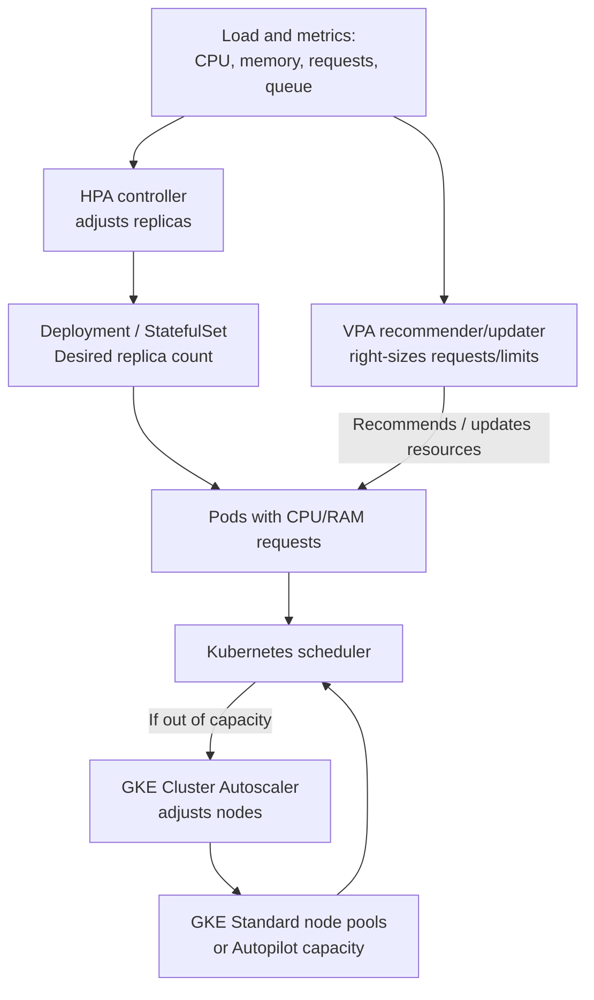
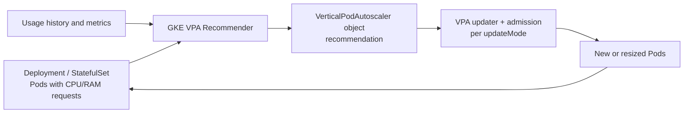
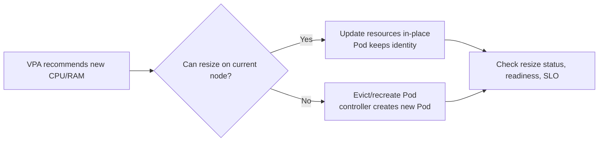
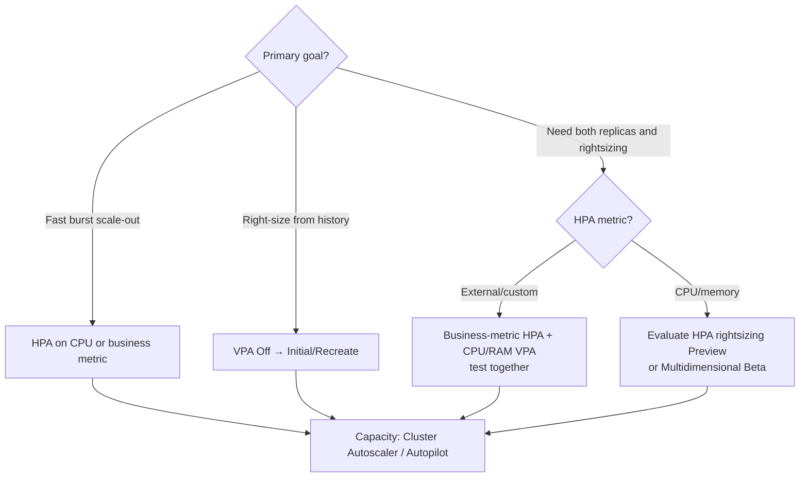

# Horizontal Pod Autoscaling and Vertical Pod Autoscaling on GKE

## 1. The Problem: When Load Changes, Should You Add Pods or Resize Each Pod?

An e-commerce platform running on **Google Kubernetes Engine (GKE)** has three types of workloads:

- **Orders API:** request volume spikes during peak hours, and each replica can serve traffic independently.
- **Queue-processing worker:** message counts fluctuate with campaigns; work can be distributed across multiple replicas.
- **Analytics or JVM service:** few replicas, where required memory varies with dataset size and garbage collection behavior.

If Pod counts and CPU/RAM levels stay fixed, applications risk throttling under load spikes while wasting resources during quiet periods. Kubernetes and GKE provide **autoscaling** mechanisms that adjust along two different dimensions:

1. **Horizontal Pod Autoscaling (HPA):** changes the **number of Pod replicas** for a workload.
2. **Vertical Pod Autoscaling (VPA):** recommends or updates **container CPU/memory requests and limits** so each Pod is sized more appropriately.

A third mechanism commonly seen in GKE architectures is **Cluster Autoscaler**: adjusting the **number of worker nodes** when Pods run out of room to schedule or when nodes can be consolidated. The three mechanisms are related, but **they do not replace one another**.

In the **CLOUD_PROVIDERS_GCP** module, this lesson belongs to the **Advanced GKE and Operations** chapter, connecting to Projects/IAM, VPC, Compute Engine, node pools, Cloud Run, storage, and databases. The goal is to choose the right scaling mechanism, protect resources, automate releases, and monitor **reliability alongside total cost**.

After this lesson, you will be able to:

1. Distinguish **HPA, VPA, and Cluster Autoscaler** by the specific resource each controller modifies.
2. Explain **requests, limits, CPU utilization, and the metrics API**, and how those values drive scaling.
3. Create a **HorizontalPodAutoscaler** using `autoscaling/v2` with replica bounds and scale-up/scale-down behavior.
4. Create a **VerticalPodAutoscaler** in GKE, read its `recommendation`, and choose among `Off`, `Initial`, `Auto/Recreate`, or `InPlaceOrRecreate`.
5. Avoid **HPA/VPA conflicts** when both target the same CPU/memory metric, and recognize specialized GKE options.
6. Understand why node capacity, quotas, Pod IP ranges, scheduling, and PDBs can prevent scaling from reaching its target.
7. Read Events/Conditions, design SLOs, run load tests, and govern autoscaling costs.

> **Practice scope warning:** Cluster names, namespaces, and image names below are **placeholders**. Commands like `kubectl apply` or `gcloud container clusters update` modify real resources; run them only in an authorized test cluster. Preview/Beta features have support limitations and may change across GKE versions.

## 2. Background: Requests, Limits, and Available Resources

The scheduler does not look only at active CPU/RAM usage. To decide where to place a Pod, Kubernetes relies primarily on **resource requests**, scheduling constraints, and a node's remaining **Allocatable** capacity.

Example API container:

```yaml
resources:
  requests:
    cpu: "250m"
    memory: "512Mi"
  limits:
    cpu: "1000m"
    memory: "1Gi"
```

### 2.1. Understanding the Units

| Field | Example | Meaning |
| --- | --- | --- |
| `requests.cpu` | `250m` | Requests 250 millicores = **0.25 vCPU** |
| `requests.memory` | `512Mi` | Requests approximately 512 mebibytes of memory |
| `limits.cpu` | `1000m` | CPU cap equivalent to 1 vCPU; the runtime may **throttle** CPU |
| `limits.memory` | `1Gi` | Memory cap; the container may be **OOMKilled** if exceeded |

**A request is not a hard, fixed CPU allocation consumed at all times.** A Pod can use less, or burst above its request up to its limit and available node capacity. Requests serve as inputs for scheduling, many autoscaling calculations, and several cost-allocation/governance mechanisms.

Example with 10 Pods, each requesting 250m CPU and 512Mi memory:

```text
Total CPU requests    = 10 × 0.25 vCPU = 2.5 vCPU
Total memory requests = 10 × 512 Mi    = 5120 Mi = 5 GiB
```

Never conclude that a 4 vCPU / 8 GiB node can definitely fit 10 Pods: nodes reserve capacity for the OS/kubelet, system DaemonSets, Pod IP limits, ephemeral storage, and topology constraints. Use `kubectl describe node` to inspect **Allocatable**.

### 2.2. HPA and VPA Both "Look" at Requests, in Two Different Ways

- For **HPA CPU utilization**, the CPU percentage is computed **relative to the CPU request**: 300m CPU usage against a 400m request equals **75% utilization**.
- For **VPA**, historical CPU/memory usage and actual demand generate recommendations for **requests/limits**. VPA does not decide how many replicas a Deployment should have.
- For **Cluster Autoscaler**, unschedulable Pods lacking capacity along with their resource requests and constraints are key signals to add nodes.

### 2.3. Choosing Appropriate Requests and Limits

- **CPU request too low:** the scheduler may pack too many Pods onto a node; CPU-based HPA sees higher utilization even when the app is healthy, triggering premature scale-out.
- **CPU request too high:** HPA sees artificially low utilization, and nodes fill up quickly on requests even while real CPU sits idle.
- **Memory request too low:** nodes can experience memory pressure, leading to Pod evictions or OOM conditions.
- **Memory limit too low:** containers get OOMKilled; simply adding more Pods will not fix an application that genuinely needs more RAM per replica.
- **Memory limit too high or misaligned:** one replica can impact other applications if controls are absent.

On **GKE Autopilot**, requests and CPU-to-memory ratios are also subject to **minimums and configuration constraints** defined by the corresponding compute class. Do not apply Standard rules verbatim to Autopilot.

## 3. Three Autoscaling Control Loops in GKE



| Controller | "Control knob" | When appropriate | What does it NOT do? |
| --- | --- | --- | --- |
| **HPA** | Workload `spec.replicas` | Multiple interchangeable replicas, fluctuating load | Does not create nodes or increase RAM for a single Pod |
| **VPA** | Container CPU/memory requests and limits | Long-term workload rightsizing, changing per-replica demand | Does not add replicas to handle traffic bursts |
| **Cluster Autoscaler** | Number of VM worker nodes in a Standard pool | Nodes needed to schedule Pods, or reclaiming idle nodes | Does not edit Deployment requests/limits or replica counts |
| **Node auto-provisioning / ComputeClasses** | Permitted node pool types or compute configurations | Workloads do not fit existing node pools | Does not fix image, IAM, data, or application bugs |

**Example path:** HPA scales from 4 to 10 replicas → scheduler places 6 new Pods → 3 Pods remain `Pending` due to insufficient CPU requests → Cluster Autoscaler checks whether nodes can be added within bounds and quotas. If IP addresses, quotas, and capacity exist, a new node is provisioned and Pods are scheduled. **Nothing is instantaneous**: provisioning, image pulls, and readiness checks all take time.

## 4. How Does Horizontal Pod Autoscaling Work?

A **HorizontalPodAutoscaler** is a Kubernetes API object, typically managing a Deployment, StatefulSet, or resource supporting the **scale subresource**. HPA runs a control loop, fetches metrics, computes the desired replica count, and updates the workload.

Metric sources:

1. **Resource metrics:** CPU and memory from the Kubernetes resource metrics API.
2. **Custom metrics:** metrics tied to Pods or Kubernetes objects, such as requests/second exported by the application.
3. **External metrics:** pending message counts in Pub/Sub or queue depth outside the cluster.
4. Certain **GKE-specific features**, such as Gateway load balancer traffic-based autoscaling, subject to version and GatewayClass prerequisites.

With custom/external metrics, you cannot simply name a metric in HPA and expect Kubernetes to understand it: a **metrics adapter/integration** must serve the metric via the Kubernetes API, along with Cloud Monitoring permissions if using that integration path.

### 4.1. CPU Utilization Is Relative to Requests

Suppose a container has:

```text
CPU request:      400m
CPU usage:        280m
CPU utilization:  280 / 400 = 70%
HPA target:       50%
```

This is **70% of the request**, not "70% of the VM's CPU." If an application uses 280m CPU with a request of only 100m, HPA sees **280%**, even if the container runs fine on a node with spare capacity.

When using a `Resource` metric with `type: Utilization`, **every container in the Pod must declare a request for that resource** for HPA to calculate accurately. A missing request can prevent the controller from computing utilization and trigger an error.

### 4.2. Desired Replica Formula

For a given metric:

\[
\text{desiredReplicas} =
\left\lceil
\text{currentReplicas}\times
\frac{\text{currentMetricValue}}{\text{desiredMetricValue}}
\right\rceil
\]

Suppose there are **4 replicas**, average CPU utilization is **80%**, and the target is **50%**:

```text
desiredReplicas = ceil(4 × 80/50)
                = ceil(6.4)
                = 7
```

This output is further constrained by **minReplicas/maxReplicas**, tolerance, readiness/missing metrics, stabilization, and scaling policies. A single metric reading does not guarantee HPA will jump immediately from 4 to 7 Pods.

### 4.3. Multiple Metrics

If an HPA specifies multiple metrics, the controller calculates a proposed replica count for each metric and selects the **largest proposal** to satisfy load. For example:

```text
CPU proposal:         6 replicas
Memory proposal:      8 replicas
Queue depth proposal: 12 replicas
→ HPA may choose 12 (subject to other limits/policies)
```

When some metrics fail to report, Kubernetes applies conservative rules: it may still **scale up** based on valid metrics while **refusing to scale down** while a metric is missing. Consequently, `<unknown>` in HPA status can delay scale-down.

## 5. HPA Stability: Tolerance, Stabilization, and Behavior

Good autoscaling is not just fast reaction; it must avoid **thrashing/flapping** (repeatedly scaling up and down).

### 5.1. Tolerance

In GKE's common default configuration, HPA uses a **roughly 10% tolerance** around the target to ignore minor fluctuations. For example, with a CPU target of **60%** and observed **64%**:

```text
ratio = 64/60 ≈ 1.067
Deviation ≈ 6.7% → typically will not scale for this change alone.
```

Do not treat 10% as a permanent hard rule across all versions or HPA configurations; newer features may allow configuring tolerance explicitly.

### 5.2. Stabilization Window

HPA typically **stabilizes scale-down** over a default window of about **300 seconds (5 minutes)** on GKE. It considers historical recommendations to avoid dropping replicas too fast when load dips briefly and then rebounds.

This explains why Pod counts do not drop immediately when a load test ends; inspect **`behavior` and Events** rather than assuming the autoscaler is broken.

### 5.3. Declaring Scale-Up / Scale-Down Policies

`autoscaling/v2` supports configuring `behavior`:

```yaml
behavior:
  scaleUp:
    stabilizationWindowSeconds: 0
    policies:
      - type: Pods
        value: 4
        periodSeconds: 60
      - type: Percent
        value: 100
        periodSeconds: 60
    selectPolicy: Max
  scaleDown:
    stabilizationWindowSeconds: 300
    policies:
      - type: Percent
        value: 25
        periodSeconds: 60
    selectPolicy: Min
```

Meaning: scale-up permits adding up to 4 Pods or 100% per policy period using `Max`; scale-down limits rapid shrinkage. This is a **sample configuration** that must be tested against SLOs, Pod Ready times, Cloud Load Balancing, quotas, cost, and node scaling times.

**Do not equate slow scale-down with a bug.** Intentional stabilization protects applications from oscillating traffic.

## 6. Preparing a Safe HPA Lab on GKE

Assume you have an existing **Standard or Autopilot** cluster and permission to manage a test namespace:

```text
Project:       acme-gke-lab
Cluster:       commerce-standard
Location:      asia-southeast1-a
Namespace:     autoscaling-lab
Deployment:    web-hpa-demo
HPA:           web-hpa-demo
Container:     web
```

### 6.1. Prerequisites Before Creating an HPA

- Workloads already declare appropriate CPU/memory requests.
- GKE has a working **resource metrics API**, verifiable with `kubectl top`.
- Replicas are distributed enough to tolerate disruption; node pools/Autopilot have capacity or node scaling enabled.
- Permissions to read/write Deployments and HPAs in the namespace; `cluster-admin` is unnecessary for a namespace-scoped lab.
- Sufficient quotas for Pods, CPU/RAM, IP ranges, node pools, and billing.
- Applications implement a proper `readinessProbe` so traffic is not routed to unready Pods.

### 6.2. Read-Only Preflight

```bash
gcloud container clusters describe commerce-standard \
  --project=acme-gke-lab \
  --location=asia-southeast1-a \
  --format="yaml(name,status,location,autopilot,releaseChannel)"

gcloud container clusters get-credentials commerce-standard \
  --project=acme-gke-lab \
  --location=asia-southeast1-a

kubectl cluster-info
kubectl get nodes
kubectl top nodes
```

`get-credentials` updates your **local kubeconfig** without creating cluster resources. If `kubectl top` returns no metrics, troubleshoot the metrics pipeline/permissions before relying on CPU-based HPA.

## 7. HPA Lab: Deployment and HorizontalPodAutoscaler

To avoid depending on custom images, the example uses a public NGINX image approved by your organization; in production, **pin image digests** and run vulnerability scans.

### 7.1. Kubernetes Manifest for the Deployment

```yaml
apiVersion: apps/v1
kind: Deployment
metadata:
  name: web-hpa-demo
  namespace: autoscaling-lab
spec:
  replicas: 2
  selector:
    matchLabels:
      app: web-hpa-demo
  template:
    metadata:
      labels:
        app: web-hpa-demo
    spec:
      containers:
        - name: web
          image: nginx:1.27
          ports:
            - containerPort: 80
          resources:
            requests:
              cpu: "200m"
              memory: "128Mi"
            limits:
              memory: "256Mi"
          readinessProbe:
            httpGet:
              path: /
              port: 80
            initialDelaySeconds: 3
            periodSeconds: 5
---
apiVersion: v1
kind: Service
metadata:
  name: web-hpa-demo
  namespace: autoscaling-lab
spec:
  selector:
    app: web-hpa-demo
  ports:
    - port: 80
      targetPort: 80
  type: ClusterIP
```

**Note:** **omitting a CPU limit** in this example allows the container to use spare CPU on the node (still bounded by node resources and GKE policies). A memory limit is set for illustration; in practice, measure OOM behavior and align memory requests/limits with SLOs and cost.

### 7.2. CPU-Based HPA with autoscaling/v2

```yaml
apiVersion: autoscaling/v2
kind: HorizontalPodAutoscaler
metadata:
  name: web-hpa-demo
  namespace: autoscaling-lab
spec:
  scaleTargetRef:
    apiVersion: apps/v1
    kind: Deployment
    name: web-hpa-demo
  minReplicas: 2
  maxReplicas: 8
  metrics:
    - type: Resource
      resource:
        name: cpu
        target:
          type: Utilization
          averageUtilization: 60
  behavior:
    scaleUp:
      stabilizationWindowSeconds: 0
      policies:
        - type: Pods
          value: 4
          periodSeconds: 60
        - type: Percent
          value: 100
          periodSeconds: 60
      selectPolicy: Max
    scaleDown:
      stabilizationWindowSeconds: 300
      policies:
        - type: Percent
          value: 25
          periodSeconds: 60
```

When average CPU exceeds the target by enough margin and valid metrics exist, HPA can scale replicas up to the cap of **8**. It **does not raise the 200m CPU request of each Pod**, nor does it directly create nodes.

### 7.3. Applying the Manifests

In the lab, save the two manifests as `web-deployment.yaml` and `web-hpa.yaml` using your editor, then run:

```bash
# Modifies the cluster; run only in a lab environment
kubectl create namespace autoscaling-lab
kubectl apply -f web-deployment.yaml
kubectl apply -f web-hpa.yaml

# Read-only checks after apply
kubectl -n autoscaling-lab get deployment,service,hpa
kubectl -n autoscaling-lab describe hpa web-hpa-demo
```

The `nginx:1.27` example is strictly for manifest illustration; **do not assume the image passes security scanning or meets organizational policies** at all times. If the Namespace already exists, `create namespace` returns `AlreadyExists`; do not delete the namespace just to rerun it.

## 8. Observing HPA Behavior Under Load Testing

### 8.1. Read-Only Commands

```bash
kubectl -n autoscaling-lab get hpa web-hpa-demo -w
kubectl -n autoscaling-lab describe hpa web-hpa-demo
kubectl -n autoscaling-lab get deploy web-hpa-demo
kubectl -n autoscaling-lab get pods -o wide
kubectl -n autoscaling-lab top pods
kubectl -n autoscaling-lab get events --sort-by=.lastTimestamp
```

Sample illustrative output from `kubectl get hpa`:

```text
NAME           REFERENCE                 TARGETS    MINPODS  MAXPODS  REPLICAS
web-hpa-demo   Deployment/web-hpa-demo   72%/60%    2        8        4
```

This is **illustrative output**, not metrics from a live cluster. `72%/60%` indicates observed CPU utilization of 72% against a 60% target; this is **percentage of CPU request**, not node CPU utilization.

### 8.2. Generating Load Properly

To observe HPA scaling out, the application must genuinely consume CPU or perform meaningful work. **Simply sending HTTP GET requests to a static NGINX page may not push CPU past the target.** You can use k6, hey, wrk, or a load generator inside the lab namespace, provided you:

- Never send load tests against production URLs or unauthorized IPs.
- Monitor CPU usage, response latency, error rates, and Pod Ready counts.
- Cap test duration, request rate, and total generated resources.
- Stop the load generator when finished; watch scale-down considering the stabilization delay.

### 8.3. Why Might Replicas Not Increase Immediately?

Common reasons:

1. Actual CPU has not exceeded the target beyond the tolerance threshold.
2. Resource metrics are not yet available, especially right after new Pods start.
3. A container is missing a CPU request or the metric is invalid.
4. HPA has already reached `maxReplicas`.
5. The controller is waiting on stabilization or scaling policies.
6. HPA increased desired replicas, but new Pods remain `Pending` due to missing nodes, quotas, or IP addresses.

**Distinguish "HPA did not raise desired replicas" from "HPA scaled up, but the cluster cannot schedule the Pods."** Those two issues require completely different runbooks.

## 9. HPA Using Memory, Custom, and External Metrics

### 9.1. Memory Utilization Does Not Cure Memory Leaks

HPA can scale on **memory utilization** or **AverageValue**:

```yaml
metrics:
  - type: Resource
    resource:
      name: memory
      target:
        type: AverageValue
        averageValue: 600Mi
```

This is an **abbreviated spec snippet**, not a complete HPA object. `AverageValue` uses average memory usage per Pod, **not a percentage of the request**.

For a memory cache that grows over time, scaling out with HPA may not reduce memory usage inside existing Pods. A **memory leak** requires fixing code, setting memory limits, and rightsizing—not adding replicas indefinitely.

### 9.2. HPA Based on Queue Backlog

A worker reading from **Pub/Sub** may need more replicas when pending messages grow. You should typically consider metrics such as **unacked messages or queue processing lag**, since CPU does not always reflect backlog.

Conceptual example of an HPA using an external metric:

```yaml
apiVersion: autoscaling/v2
kind: HorizontalPodAutoscaler
metadata:
  name: worker-hpa
  namespace: autoscaling-lab
spec:
  scaleTargetRef:
    apiVersion: apps/v1
    kind: Deployment
    name: worker
  minReplicas: 1
  maxReplicas: 20
  metrics:
    - type: External
      external:
        metric:
          name: pubsub_unacked_messages_per_worker
        target:
          type: AverageValue
          averageValue: "100"
```

**Illustrative sample only:** `pubsub_unacked_messages_per_worker` **is not a built-in metric name**. You must configure the GKE Cloud Monitoring/custom-external metrics adapter or a supported autoscaler solution to **actually expose a metric with the exact name and scope**. Without the adapter providing it, HPA reports `<unknown>` and stops scaling on it.

Queue-driven designs also require **idempotency, retries, deduplication, dead-letter queues, and downstream API/database limits**. HPA scaling to 20 workers can overwhelm a database if the backend is not sized for it.

### 9.3. Gateway Traffic-Based HPA

GKE offers **traffic-based autoscaling** integrated with supported Gateway workloads, using request rate or capacity utilization from the load balancer. This feature has specific GKE/GatewayClass, API, and metric requirements; **it does not apply by default to every Service of type LoadBalancer or every Ingress**.

For web services that should scale on HTTP request rate rather than CPU, this is worth evaluating—read the **Configure traffic-based autoscaling** documentation before adopting it in production.

### 9.4. HPA and Zero Replicas

With traditional HPA in earlier versions, `minReplicas` generally had to be **at least 1**, and manually scaling a workload to 0 could pause HPA until scaled back up. **GKE 1.37 and later** introduce **scale to/from zero** under specific conditions such as custom/external metrics via the **AutoscalingMetric resource**. **Do not simply set `minReplicas: 0` on an old CPU-based HPA and expect it to wake up automatically.**

When application-level scale-to-zero is required, also consider **Cloud Run** or an appropriate event-driven architecture, evaluating cold starts, latency, and cost.

## 10. How Does Vertical Pod Autoscaling Work?

**Vertical Pod Autoscaler (VPA)** analyzes **historical CPU/memory usage** and computes appropriate resource requests for **container-level resources** in controller-managed Pods.



In GKE, the VPA implementation is **Google-managed** and differs in several details from self-installing open-source VPA:

- GKE leverages **historical data**, including some metrics collected before the VPA object was created.
- VPA components are operated as part of the GKE-managed control plane, so you do not install a competing upstream VPA instance in the cluster.
- Recommendations can factor in **node capacity and resource quotas** under GKE's model.
- When applying updates requires recreation, VPA can coordinate with **Cluster Autoscaler** to ensure capacity.

**VPA is not a way to automatically "add RAM to all Pods whenever user traffic spikes."** Its primary purpose is to **right-size each replica** based on usage over time; workloads must live long enough and behave consistently enough for recommendations to be meaningful.

### 10.1. Which Workloads Work with VPA?

Workloads with controllers managing Pods, such as **Deployment, StatefulSet, ReplicaSet, and ReplicationController** per supported APIs. **Standalone Pods** are not suitable VPA targets because VPA needs a controller to recreate Pods when necessary.

VPA manages **container-level** `spec.containers[].resources`. VPA **does not support Pod-level resource specifications** (`spec.resources`) in current documentation.

### 10.2. When Is VPA a Good Fit?

| Workload | Suitable for VPA? | Notes |
| --- | --- | --- |
| Steady service where replicas use similar resources | **Can be a great fit** | Recommendations rely on history |
| Short-lived Jobs/Pods that exit quickly | **Poor fit** | Lacks stable historical data |
| Service with sudden multi-minute bursts | **Should not rely on VPA alone** | HPA responds faster to load |
| Memory-heavy JVM workload | **Use caution / automated VPA not recommended per GKE docs** | Heap/GC/working set make memory recommendations unreliable |
| Workload highly sensitive to evictions | Use `Off`/`Initial` or a manual process | `Recreate` can cause disruption |
| Replicas with widely differing usage | Split workload groups | One VPA for all easily over/under-provisions |

## 11. Enabling VPA on GKE Standard and Autopilot

### 11.1. Standard Clusters

On **GKE Standard**, you must **enable Vertical Pod Autoscaling on the cluster** before creating VPA objects:

```bash
# Read-only: inspect cluster and feature status
gcloud container clusters describe commerce-standard \
  --project=acme-gke-lab \
  --location=asia-southeast1-a \
  --format="yaml(name,verticalPodAutoscaling,autopilot,releaseChannel,currentMasterVersion)"

# MODIFIES CLUSTER: run only when approved
gcloud container clusters update commerce-standard \
  --project=acme-gke-lab \
  --location=asia-southeast1-a \
  --enable-vertical-pod-autoscaling
```

**Schedule the change carefully:** enabling or disabling VPA can trigger a **control plane** operation with documented caveats/disruptions. Never toggle it in production under strict SLOs without checking maintenance policies and impact.

### 11.2. Autopilot Clusters

On **GKE Autopilot**, VPA is **enabled by default**. GKE manages most node capacity and enforces **minimum requests and CPU-to-memory ratios** for ComputeClasses. VPA recommendations may be bounded or adjusted to satisfy Autopilot rules.

Do not install another VPA controller inside Autopilot to "override" GKE's managed mechanism; that causes unpredictable behavior and can violate cluster policies.

### 11.3. Checking CRDs / APIs

```bash
# Read-only after the feature is enabled
kubectl api-resources | grep -i verticalpodautoscaler
kubectl get verticalpodautoscalers -A
```

In PowerShell, use `Select-String` instead of `grep`. If the VPA resource is missing, verify **cluster credentials, RBAC permissions, and feature enablement** rather than installing an upstream autoscaler before checking what GKE manages.

## 12. VPA Update Modes: Off, Initial, Recreate, and InPlaceOrRecreate

| `updateMode` | Behavior | Trade-offs / when to choose |
| --- | --- | --- |
| **`Off`** | Generates recommendations only, **never changes requests** | Safe first step for analysis and CI/CD rightsizing |
| **`Initial`** | Sets requests when a Pod is **created**, leaves running Pods unchanged | Avoids VPA-triggered evictions of running Pods, though Pod sizes may vary during rollout |
| **`Auto`** | Default when `updateMode` is omitted; behaves like `Recreate` | Automatically applies recommendations when eligible, potentially recreating Pods |
| **`Recreate`** | When updates are needed, VPA **evicts/recreates** Pods with new requests | Can be disruptive; requires multiple replicas, PDBs, quotas, and node capacity |
| **`InPlaceOrRecreate`** | Attempts to update resource requests/limits **in place on running Pods**; falls back to recreate if impossible | **Preview**, GKE **1.34.0-gke.2201000+**; zero downtime is not guaranteed |

### 12.1. Do Not Equate Auto with In-Place

In current GKE, **`Auto` and `Recreate` have the same behavior**. Setting `Auto` **does not mean** VPA will perform in-place resizing by default. To attempt in-place resizing, you must set **`InPlaceOrRecreate`** and meet the version requirements.

### 12.2. Recreate and PodDisruptionBudget

VPA can use **eviction** to replace a Pod. Therefore:

- Ensure **≥2 replicas** or an appropriate replacement plan when zero disruption is required.
- A **PodDisruptionBudget (PDB)** controls concurrent disruptions, though an overly strict PDB can block VPA updates.
- A **ReadinessProbe** keeps unready Pods out of traffic.
- **Cluster Autoscaler** may need to provision nodes when new Pods have larger requests.
- For **StatefulSets** or workloads using zonal PersistentVolumes, verify volume attachment, zones, and recovery logic.

According to GKE documentation, the default minimum replicas for VPA eviction **varies by version**: for **GKE ≤1.35.1**, the default is **2**; from **1.35.2 onward**, the default is **1**. You can configure `spec.updatePolicy.minReplicas` where supported. **Do not rely on defaults** when SLOs require multiple replicas; define a PDB and test it.

### 12.3. When Does In-Place Fall Back to Recreate?

`InPlaceOrRecreate` can **fall back** to recreating a Pod when:

1. The current node lacks enough **Allocatable** capacity for the new request.
2. The resize changes the Pod's **QoS class**, such as from Burstable to Guaranteed.
3. The container's `resizePolicy` specifies `RestartContainer` for that resource.
4. The update stays stuck (`infeasible`/`deferred`) for too long.
5. Other GKE/Autopilot constraints disallow in-place resizing.

If `resizePolicy` is omitted, documentation notes a default of `NotRequired` for CPU and memory under this mechanism. **Even with `NotRequired`, Pods can still be recreated.** Treat this Preview feature accordingly and plan for disruption.

## 13. Safe VPA Lab: Gathering Recommendations Only in Off Mode

To **avoid conflicting** with the HPA from earlier, the VPA lab uses a **differently named Deployment**, `worker-vpa-demo`. Start in **Off mode** to inspect recommendations without altering the workload.

### 13.1. Sample Deployment

```yaml
apiVersion: apps/v1
kind: Deployment
metadata:
  name: worker-vpa-demo
  namespace: autoscaling-lab
spec:
  replicas: 3
  selector:
    matchLabels:
      app: worker-vpa-demo
  template:
    metadata:
      labels:
        app: worker-vpa-demo
    spec:
      containers:
        - name: worker
          image: nginx:1.27
          resources:
            requests:
              cpu: "100m"
              memory: "128Mi"
            limits:
              memory: "512Mi"
          readinessProbe:
            httpGet:
              path: /
              port: 80
            initialDelaySeconds: 3
            periodSeconds: 10
```

This sample image does not generate heavy CPU/memory load; **VPA requires real usage history** to produce useful recommendations. A workload running for only a few minutes may not yield reliable recommendations.

### 13.2. VerticalPodAutoscaler Resource

```yaml
apiVersion: autoscaling.k8s.io/v1
kind: VerticalPodAutoscaler
metadata:
  name: worker-vpa-demo
  namespace: autoscaling-lab
spec:
  targetRef:
    apiVersion: apps/v1
    kind: Deployment
    name: worker-vpa-demo
  updatePolicy:
    updateMode: "Off"
  resourcePolicy:
    containerPolicies:
      - containerName: worker
        minAllowed:
          cpu: "100m"
          memory: "128Mi"
        maxAllowed:
          cpu: "2"
          memory: "2Gi"
        controlledResources:
          - cpu
          - memory
        controlledValues: RequestsOnly
```

**Field explanation:**

- `targetRef` points to the target Deployment, not a Node or individual Pod name.
- `updateMode: Off` generates recommendations only.
- `minAllowed` and `maxAllowed` keep recommendations within bounds allowed by your organization.
- `controlledResources` selects CPU and memory.
- `controlledValues: RequestsOnly` instructs VPA to adjust requests only (when an auto mode is chosen) without changing limits; verify that requests and limits remain valid under Autopilot and other policies.

### 13.3. Applying and Reading Recommendations

```bash
# After enabling the VPA feature (Standard) and creating the lab namespace:
kubectl apply -f worker-vpa-deployment.yaml
kubectl apply -f worker-vpa.yaml

# READ-ONLY
kubectl -n autoscaling-lab get vpa worker-vpa-demo
kubectl -n autoscaling-lab describe vpa worker-vpa-demo
kubectl -n autoscaling-lab get vpa worker-vpa-demo -o yaml
kubectl -n autoscaling-lab get pods -l app=worker-vpa-demo -o wide
```

Inspect `status.recommendation.containerRecommendations`. For a new workload, **do not expect accurate VPA recommendations after just a few minutes**; GKE recommends optimizing from history, which is typically far more useful after a workload runs for at least **24 hours**.

### 13.4. Sample Status to Understand Recommendations

```yaml
status:
  recommendation:
    containerRecommendations:
      - containerName: worker
        lowerBound:
          cpu: 100m
          memory: 160Mi
        target:
          cpu: 280m
          memory: 400Mi
        upperBound:
          cpu: 600m
          memory: 900Mi
        uncappedTarget:
          cpu: 280m
          memory: 400Mi
```

**This is a synthetic sample status**, not measurements from a live cluster. `target` is the primary recommendation, `lowerBound`/`upperBound` show the reference range, and `uncappedTarget` is before `resourcePolicy` bounds are applied; values diverge when policies clamp the recommendation.

## 14. Switching VPA to Initial or Recreate After Verification

Once you have sufficient history and have checked SLOs, if you want GKE to apply recommendations:

### 14.1. Initial Mode

```yaml
updatePolicy:
  updateMode: "Initial"
```

Running Pods **do not have their CPU/memory requests changed automatically**; newly created Pods receive the recommendation. This avoids proactive VPA evictions of running Pods, though Pods of mixed sizes can coexist during a rollout.

### 14.2. Recreate Mode

```yaml
updatePolicy:
  updateMode: "Recreate"
  minReplicas: 2
```

In this mode, VPA can evict Pods so the controller recreates them. `minReplicas: 2` is a **sample guardrail** for workloads with enough replicas; it does not guarantee zero downtime by itself. Combine it with **PDBs, readiness probes, replica counts, node headroom, startup times**, and testing.

For critical workloads, you can start in `Off` mode and use recommendations to **update Deployment manifests via GitOps** during a scheduled rollout instead of enabling automatic recreation.

### 14.3. Note on Sidecar Containers

In a Pod containing an app container and a log-agent sidecar, not every container needs VPA adjustments. You can disable scaling for the sidecar:

```yaml
resourcePolicy:
  containerPolicies:
    - containerName: log-sidecar
      mode: "Off"
    - containerName: app
      controlledResources: ["cpu", "memory"]
```

`mode: Off` inside **ContainerResourcePolicy** is per-container configuration, distinct from `updatePolicy.updateMode: Off` for the entire VPA. Do not confuse the two fields that share the string `Off` at different scopes.

## 15. In-Place Resizing on GKE: Benefits and Limitations

Recent Kubernetes versions support **in-place Pod resource resizing** via the API, and GKE provides the `InPlaceOrRecreate` VPA mode (**Preview**) on supported versions.

### 15.1. When Does It Help?

Suppose a service with multiple replicas needs its CPU request raised from 300m to 500m without waiting for new Pods to pull images and restart. If the node has spare capacity and the update violates no policies, in-place resizing can reduce disruption.



### 15.2. Reference Spec Example

```yaml
apiVersion: autoscaling.k8s.io/v1
kind: VerticalPodAutoscaler
metadata:
  name: app-vpa-inplace
  namespace: autoscaling-lab
spec:
  targetRef:
    apiVersion: apps/v1
    kind: Deployment
    name: app-inplace
  updatePolicy:
    updateMode: "InPlaceOrRecreate"
  resourcePolicy:
    containerPolicies:
      - containerName: app
        controlledResources: ["cpu", "memory"]
```

**Do not apply this manifest if the cluster does not meet the Preview/GKE version requirements.** In the workload manifest, `resizePolicy` can specify `NotRequired` or `RestartContainer` per resource on supported Kubernetes versions.

### 15.3. How to Test in Practice

1. Verify **GKE version ≥1.34.0-gke.2201000** and that the Preview feature is enabled.
2. Pick a workload with multiple replicas, a PDB, and health probes.
3. Inspect `kubectl describe pod`, resource requests, `resize` conditions, and Events before and after.
4. Check container uptime/restarts and Pod names to distinguish in-place resizing from recreation.
5. Simulate node capacity exhaustion in a lab to observe fallback behavior—**never** force an incident in production.
6. Keep a rollback plan and monitor p95/p99 latency and error rates.

**Conclusion:** In-place resizing can reduce Pod recreations, but **it is not a zero-downtime guarantee** and does not replace capacity planning.

## 16. HPA and VPA Conflicts: Why Avoid Using Them Arbitrarily on the Same Metric?

This is a major design pitfall in advanced autoscaling. If **HPA targets CPU utilization** and **VPA also modifies CPU requests**, both controllers interact through the same ratio:

```text
HPA CPU utilization = CPU usage / CPU request

VPA changes CPU request
    ↓
HPA sees a different CPU utilization even if CPU usage did not change
    ↓
HPA changes replica count
    ↓
CPU usage per replica shifts as load redistributes
    ↓
VPA observes new history and may adjust requests again
```

### Numerical Example

Suppose you start with 4 Pods, each having:

```text
CPU request:     200m
CPU usage:       150m
HPA utilization: 150/200 = 75%
HPA target:      60%
```

HPA wants to add replicas because 75% exceeds 60%. If VPA raises each Pod's request to **300m** while usage temporarily remains 150m:

```text
New HPA utilization = 150/300 = 50%
```

Now HPA sees a reason to **reduce** replicas. Per-Pod load rises again after scaling down, triggering an unpredictable feedback loop. Changing memory requests creates the same feedback effect for memory utilization.

### 16.1. General Rule

**Do not combine standard HPA and VPA to control CPU/memory on the same workload** without using a supported GKE coordination mechanism. GKE documentation explicitly calls out this limitation. HPA and VPA can work together when:

- **HPA scales on a custom/external metric** (such as queue depth), while VPA optimizes CPU/memory requests.
- **HPA rightsizing with VPA (Preview)** is used for CPU-based HPA, leveraging a mechanism built to avoid conflict.
- **Multidimensional Pod autoscaling (Beta)** scales replicas on CPU and requests for memory in one integrated controller.

Never create two HPA objects targeting the same Deployment; Kubernetes cannot reconcile two arbitrary controllers updating `replicas` simultaneously.

### 16.2. HPA Rightsizing with VPA

GKE provides **HPA rightsizing with VPA (Preview)** to optimize CPU requests on workloads using CPU-based HPA without the classic feedback conflict. It carries version and configuration prerequisites and is not the default behavior of creating separate HPA and VPA resources.

**Test only in a lab once feature support is confirmed.** Read the official guide and review impacts on HPA targets, resource policies, minimum CPU/memory, and monitoring recommendations.

### 16.3. Multidimensional Pod Autoscaling

**MultidimPodAutoscaler (Beta)** combines **horizontal scaling on CPU** with **vertical scaling on memory** in a single mechanism. It is a specialized GKE option for workloads that scale out on CPU while needing memory rightsizing.

Key points:

- Use the **multidimensional Pod autoscaling** API/resource rather than stacking default HPA and VPA.
- Standard clusters require VPA enabled per feature prerequisites.
- Check limits on resource metrics, workload types, GKE versions, and behavior.
- Do not assume Beta features are production-ready where strict support SLAs apply.

### 16.4. Choosing a Coordination Pattern



## 17. How HPA/VPA Interact with Node Pools and Cluster Autoscaler

An HPA can correctly compute **desiredReplicas=20**, yet 12 Pods remain `Pending` if the node pool lacks resources. Likewise, VPA can recommend **3 GiB memory** per Pod when no node can fit the new request.

### Scenario 1: HPA Creates Many Pending Pods

```text
HPA: desiredReplicas = 16
Deployment: 16 Pods created
Running/Ready: 9
Pending: 7 due to Insufficient cpu
Cluster Autoscaler: checks if an eligible pool has room to scale
```

Checklist:

1. Run `kubectl describe pod` to read Events.
2. Inspect node `Allocatable` capacity and resource requests.
3. Check node pool min/max limits, quotas, zonal capacity, and Pod IP ranges.
4. Verify taints/tolerations, nodeSelector/affinity, topology spread, and PVC zones.
5. Check GKE Autoscaler visibility logs.

**Raising HPA `maxReplicas` will not fix node shortages**—it simply creates more Pending Pods.

### Scenario 2: VPA Recommends a Pod Larger Than the Machine Type

```text
Node allocatable memory:   6 GiB (example)
VPA recommended request:   8 GiB
Result: an 8 GiB Pod cannot fit on a 6 GiB node
```

Remediation: adjust VPA `maxAllowed`, choose a larger machine type, enable appropriate node auto-provisioning, or optimize the application. Never artificially clamp VPA below what the application genuinely needs just to squeeze onto small nodes.

### Scenario 3: Autopilot

GKE Autopilot provisions infrastructure based on workload resource requests, yet still enforces **minimums, CPU:memory ratios, compute classes, quotas, and provisioning delays**. An oversized or misconfigured Pod can still be adjusted, rejected, or fail to schedule.

### Approximate Capacity Formula

```text
Total workload CPU requests
  ≈ replica count × average CPU request per Pod

Total workload memory requests
  ≈ replica count × average memory request per Pod
```

If HPA **doubles** replicas and VPA increases memory requests per Pod by **1.5x**, total memory requests grow nearly **3x**. Capacity and VM/Autopilot bills can climb faster than expected if you examine each controller in isolation.

## 18. VPA with QoS, Memory/OOM, PDBs, and Pod Lifecycle

### 18.1. QoS Classes

Kubernetes assigns QoS classes—**Guaranteed**, **Burstable**, and **BestEffort**—based on requests/limits, affecting eviction order under node pressure. VPA modifying requests/limits can change a Pod's QoS class. With in-place resizing, a QoS class change can force GKE to **recreate** the Pod.

### 18.2. OOMs and VPA Recommendations

If a container is **OOMKilled**, VPA records the event and increases memory recommendations when the Pod is recreated. However:

- VPA does not fix **memory leaks** or garbage collection bugs.
- `maxAllowed` bounds may cap necessary increases.
- Raw memory usage does not accurately reflect **JVM heap/GC** dynamics; GKE documentation cautions that VPA may be unsuitable for some JVM workloads.
- For applications that size caches from available RAM, raising requests can expand the cache and drive memory recommendations upward continuously.

### 18.3. PDBs, Rolling Updates, and Ready Replicas

Before enabling VPA `Auto/Recreate`, verify:

- The Deployment has enough replicas and a **PDB** matching SLOs.
- Readiness/startup probes and graceful shutdown periods are properly tuned.
- Image pulls, volume reattachments, and application recovery work smoothly.
- Headroom exists for new nodes or larger Pod requests.
- Canary, rollback, and audit processes are ready.

Example PDB for a three-replica application:

```yaml
apiVersion: policy/v1
kind: PodDisruptionBudget
metadata:
  name: worker-vpa-pdb
  namespace: autoscaling-lab
spec:
  minAvailable: 2
  selector:
    matchLabels:
      app: worker-vpa-demo
```

An overly tight PDB such as `minAvailable: 3` with only 3 replicas can **block all voluntary evictions**, preventing VPA from updating Pods in `Recreate` mode. Remember that a PDB does not prevent **involuntary disruptions**, such as sudden VM loss.

## 19. Real-World Scenarios: High-Traffic APIs, Workers, and Stateful Services

### 19.1. Stateless API with Hourly Traffic Patterns

**Characteristics:** many interchangeable replicas, easy to add/remove Pods, CPU usage correlates reasonably with throughput.

**Approach:**

1. Set CPU/memory requests from load-test measurements.
2. Enable HPA on CPU or requests-per-second as appropriate.
3. Set `minReplicas` high enough to absorb latency/cold starts during off-peak hours.
4. Pair with Cluster Autoscaler / node pools that have sufficient quota, IPs, and surge headroom.
5. Run VPA in **`Off` mode to observe**, but do not let VPA automatically alter CPU requests while CPU-based HPA is active.
6. Monitor p95 latency, 5xx rates, CPU throttling, HPA scaling Events, and cost.

### 19.2. Worker Processing a Pub/Sub Backlog

**Characteristics:** each worker processes multiple messages; pending message count reflects load better than CPU during certain phases.

**Approach:**

1. Scale HPA on a properly integrated **external backlog metric**.
2. VPA can right-size CPU/memory from history if tested without causing excessive disruption.
3. Cap `maxReplicas` so downstream databases and APIs are not overwhelmed.
4. Keep processing **idempotent** with retries and dead-letter handling.
5. Configure PDBs and graceful shutdown to minimize lost work when Pods are replaced.

### 19.3. Stateful or JVM Services

**Characteristics:** sensitive memory working sets, JVM heaps, database connections, or persistent state.

**Approach:**

- Do not enable VPA `Auto` by default for JVMs per current guidance; prefer measuring heap/GC, manual rightsizing, or `Off` mode with review.
- If HPA scale-out multiplies database connections, account for connection pool limits and replica coordination.
- If Pods mount PersistentVolumes, check topology, access modes, backups, and reattachment delays.
- Plan rolling replacements, PDBs, and rollbacks before raising RAM/CPU via VPA.

### 19.4. Choosing HPA, VPA, or Both

| Workload | Primary need | Configuration to evaluate |
| --- | --- | --- |
| Stateless HTTP API, bursty traffic | Fast response via multiple replicas | **HPA** + autoscaled node pool |
| Queue-driven batch worker | Higher throughput as backlog grows | **HPA external metric** + capacity controls |
| Steady service, over-provisioned requests | Historical rightsizing | **VPA Off** → review → `Initial`/`Recreate` if suitable |
| JVM with unpredictable heap | Deep memory observability | Manual sizing and `VPA Off` for reference only |
| Needs CPU HPA and automated CPU rightsizing | Avoid feedback loops | Evaluate **HPA rightsizing with VPA (Preview)** |
| Needs CPU-driven replicas + auto memory | Two-dimensional control | **Multidimensional Pod autoscaling (Beta)** per prerequisites |
| Low replica count, disruption-sensitive | Avoid arbitrary VPA evictions | `Off`/`Initial` and controlled rollouts |

## 20. Monitoring, SLOs, and Autoscaling Cost

### 20.1. Signals to Track

| Metric | Why | Common source |
| --- | --- | --- |
| HPA desired/current replicas | Shows scaling intent and actual outcome | `kubectl get/describe hpa`, Cloud Monitoring |
| HPA current/target metrics | Confirms the right signal and target | HPA status/Conditions/Events |
| Pod Ready/Available | Confirms replicas are actually serving | Deployment status, Service endpoints |
| CPU usage and CPU throttling | Detects poorly tuned limits/requests | Metrics Server, Cloud Monitoring, container metrics |
| Memory working set, OOMKilled | Detects memory pressure and crashes | K8s status, Cloud Monitoring/Logging |
| VPA recommendation target/lower/upper | Tracks rightsizing recommendations | `kubectl describe vpa`, GKE Monitoring |
| VPA eviction/recreate events | Measures impact on availability | Pod Events and GKE audit logs |
| Pending Pods / scheduling failures | Detects node/quota/IP exhaustion | `kubectl describe pod`, Cluster Autoscaler visibility |
| Node count, quotas, and capacity | Assesses whether HPA/VPA have backing infra | Node pool/Compute Engine metrics |
| Application p95/p99 latency, 5xx | Measures end-user SLOs | Application/Load Balancing metrics |
| vCPU, memory, disk, GPU, egress costs | Controls budget | Cloud Billing / GKE cost allocation |

**An HPA meeting its CPU target does not prove SLOs are healthy.** Users can still suffer high latency from Cloud SQL, Cloud Storage, external APIs, slow Pod startups, or network bottlenecks.

### 20.2. Let SLOs Drive Scaling

Illustrative service SLOs:

```text
99.9% successful HTTP requests over 30 days
p95 latency < 300 ms during serving hours
≤ 1% of requests returning 5xx during rollouts/scaling
```

These thresholds are purely illustrative, not Google Cloud guarantees. Use real telemetry to tune:

- HPA CPU targets or business metrics.
- `minReplicas` to avoid cold starts and late scale-ups.
- `maxReplicas` to cap costs and downstream pressure.
- VPA min/max allowed bounds and update mode.
- Node pool autoscaling limits, surge headroom, and budgets.

### 20.3. Why "Lowering Requests" Doesn't Always Lower Bills

In **Standard** clusters, Compute Engine billing depends on **actual running VM nodes**. VPA lowering requests improves bin-packing, yet **saves node costs only if Cluster Autoscaler can actually remove nodes**; PDBs, affinities, or Pod topology constraints can block scale-down.

In **Autopilot**, charges can depend directly on resource requests, ComputeClass, billing mode, and workload configuration. Thus VPA lowering requests **can directly impact cost** depending on the pricing model, though you should never assume percentage savings without checking SKUs and pricing tables.

HPA adding replicas can also raise connection counts, Cloud Logging volume, and network egress. Evaluate **total cost per successful request/job**, not just per-Pod price.

## 21. Troubleshooting HPA: From Symptom to Root Cause

| Symptom | Possible cause | Investigation steps |
| --- | --- | --- |
| `TARGETS <unknown>/60%` | Missing metrics API/adapter, missing requests, or broken resource metrics | `kubectl describe hpa`, `kubectl top`, metrics API, every container's requests |
| HPA stays flat despite high node CPU | HPA computes CPU **relative to Pod requests**, not node CPU | Check Pod CPU utilization vs. HPA target |
| HPA stops at 8 replicas | `maxReplicas: 8` | Review HPA spec, SLOs, quotas, and downstream capacity before raising |
| HPA raises desired replicas, Pods Pending | Node/quota/IP/taint/affinity/PVC constraints | `describe pod`, node pools, Cluster Autoscaler logs |
| HPA won't scale down after load drops | Stabilization window, missing metrics, PDBs/unready Pods | HPA `behavior`/Events and metrics |
| HPA flaps up and down | Target too sensitive, bad requests, noisy metrics | Tolerance, stabilization, Pod startup, and traffic pattern |
| 4xx/5xx spikes after scale-out | Backend DB/API overloaded or broken readiness probe | Connection pools, rate limits, readiness, app logs |
| Memory-based HPA doesn't stop OOMs | Memory leak or per-Pod working set won't shrink | Inspect per-Pod memory, VPA/manual sizing, heap |
| HPA and VPA on CPU cause oscillation | Two controllers changing requests and replicas on the same metric | Separate metrics or use a specialized GKE coordination feature |
| HPA won't scale from 0 | Config/version lacks scale-to-zero support | Check GKE 1.37+, `AutoscalingMetric`/external metrics, and docs |
| Multiple-HPA conflict error | Two HPAs targeting the same workload | Keep a single HPA controlling replicas |

### Diagnostic Command Sequence

```bash
kubectl -n autoscaling-lab describe hpa web-hpa-demo
kubectl -n autoscaling-lab get hpa web-hpa-demo -o yaml
kubectl -n autoscaling-lab get deploy web-hpa-demo -o yaml
kubectl -n autoscaling-lab get pods -o wide
kubectl -n autoscaling-lab top pods
kubectl -n autoscaling-lab get events --sort-by=.lastTimestamp
```

Read **Conditions**:

- `AbleToScale`: can the controller read/control the scale target?
- `ScalingActive`: are metrics valid and scaling active?
- `ScalingLimited`: is scaling capped by min/max bounds or policies?

In Events, reasons such as `FailedGetResourceMetric`, `FailedComputeMetricsReplicas`, `SuccessfulRescale`, or target errors help pinpoint the failure.

## 22. Troubleshooting VPA: Recommendations Exist but Aren't Applied

| Symptom | Possible cause | Resolution |
| --- | --- | --- |
| Missing VPA CRD/resources | VPA not enabled on Standard, wrong cluster, or insufficient RBAC | Check cluster config, enable via change process, verify kubeconfig |
| VPA has no target recommendation | New workload, missing history/metrics, or unmatched target | Wait for history, inspect VPA Conditions, `targetRef`/namespace |
| `updateMode: Off` and Pods unchanged | **Working as designed** | Read recommendations and update manifests manually or switch modes |
| `Initial` leaves running Pods unchanged | **Working as designed** | Only newly created Pods receive VPA requests |
| `Recreate` hasn't evicted Pods | Insufficient history, delta too small, replica/PDB guardrails | Check VPA status, PDBs, Events, `minReplicas`, and capacity |
| New Pod requests too much and stays Pending | Node lacks resources/quota or VPA `maxAllowed` too high | Check scheduler, Cluster Autoscaler, machine types, `maxAllowed` |
| `InPlaceOrRecreate` still restarts Pods | QoS change, insufficient capacity, timeout, or `RestartContainer` | Inspect Pod resize status and fallback; Preview does not guarantee in-place |
| VPA destabilizes a JVM workload | Memory/heap behavior poorly reflected by working set | Switch to `Off`/`Initial`, manual memory sizing, GC metrics |
| VPA and HPA on CPU cause flapping | CPU request changes shift HPA utilization | Do not stack default HPA and VPA on the same metric |
| Pods still OOM despite VPA | Low limit, capped recommendation, app leak, or slow update | Check OOM events, limits/requests, policies, heap, and code |
| VPA alters a sidecar unexpectedly | Missing container policy | Set `containerPolicies[].mode: Off` for the sidecar |

### Commands for Reading VPA Status

```bash
kubectl -n autoscaling-lab describe vpa worker-vpa-demo
kubectl -n autoscaling-lab get vpa worker-vpa-demo -o yaml
kubectl -n autoscaling-lab get deployment worker-vpa-demo -o yaml
kubectl -n autoscaling-lab describe pod ACTUAL_POD_NAME
kubectl -n autoscaling-lab get pdb
kubectl -n autoscaling-lab get events --sort-by=.lastTimestamp
```

Check VPA `status.conditions`: `RecommendationProvided`, `LowConfidence`, `NoPodsMatched`, `FetchingHistory`. If `NoPodsMatched`, verify `targetRef` and labels; if `LowConfidence`, do not rush recommendations into production.

## 23. Security, Change Governance, and CI/CD Verification

Autoscalers can cause outages **even with zero IAM errors**: unbounded scale-out can exhaust quotas, overly aggressive scale-down can drop connections, and VPA `Recreate` can disrupt availability. Establish clear change controls:

1. **Least privilege:** only authorized teams may modify Deployments, HPAs, VPAs, PDBs, quotas, and node-pool autoscaling; scope Kubernetes RBAC by namespace where appropriate.
2. **GitOps/IaC:** manage HPA/VPA manifests in reviewed repositories. Avoid CI scripts running periodic `kubectl scale` commands that fight HPA over `replicas`.
3. **ResourceQuota and LimitRange:** cap total CPU/memory/Pod counts, while ensuring quotas do not inadvertently block legitimate scaling.
4. **Budgets and alerts:** set sensible `maxReplicas`; monitor node scale-outs, Pod requests, GPU costs, logging, and network egress.
5. **Pod Security:** autoscaling grants no OS or Google Cloud API privileges; you still need Workload Identity Federation, RBAC, NetworkPolicy, and container security.
6. **Readiness/PDBs:** control disruption, especially during VPA recreation and node pool upgrades.
7. **Audit:** record manifest/policy changes, actors, app versions, and scaling timestamps for post-incident analysis.
8. **Test before enabling auto modes:** use VPA `Off` for low-risk data gathering instead of enabling `Auto` broadly from day one.

### Safe Rollout Plan

| Phase | HPA | VPA | Gate to proceed |
| --- | --- | --- | --- |
| **Observe** | Measure CPU, memory, RPS, queues, SLOs | Create `Off` for individual workloads | Sufficient history and metric coverage |
| **Canary** | Single Deployment with tight min/max | `Initial` or `Recreate` with multiple replicas | Zero OOMs, Pending stalls, or outages |
| **Chaos / Load test** | Load tests, node shortage, backlog spikes | Simulate evictions/restarts | SLOs hold; PDBs and CA behave properly |
| **Production** | Targets/behavior aligned to SLOs | Approved mode after review | Dashboards, alerts, on-call, rollback ready |
| **Optimize** | Tune max/targets using real data | Review recommendations and cost | Real savings without rising errors |

**Do not measure only desired replicas and node counts.** Measure **successful request rates, p95/p99 latency, startup times, OOMs, queue age, and total cost** before and after.

## 24. Practice Exercises and Verification Questions

### Exercise 1: Classify the Right Controller

Choose the right mechanism:

1. An API scales from 4 to 12 Pods as traffic rises.
2. A worker requests 8 GiB of memory but steadily uses around 1 GiB, and you want recommendations to lower it.
3. HPA creates 20 Pods, yet several stay `Pending` because nodes lack CPU.
4. A Pod is OOMKilled because its container needs more RAM than its limit.

**Suggested answers:** (1) HPA; (2) VPA `Off` to observe and then adjust; (3) Cluster Autoscaler/capacity, not VPA; (4) fix memory sizing—check VPA/manual sizing and application cause.

### Exercise 2: Calculate HPA Output

A Deployment has **5 replicas**, average CPU utilization **90%**, target **60%**, min **2**, max **12**.

```text
desiredReplicas = ceil(5 × 90 / 60)
                = ceil(7.5)
                = 8
```

Why might replicas not jump to 8 immediately in practice? Name **at least four** mechanisms or limits to check: tolerance, stabilization/behavior, missing metrics, node quota/capacity, unready Pods, resource requests, or `maxReplicas`.

### Exercise 3: HPA and VPA Conflict

HPA targets 70% CPU. VPA raises each Pod's CPU request from 200m to 400m while actual usage stays flat. How does the CPU utilization observed by HPA change? Why might HPA unexpectedly scale down replicas?

**Hint:** observed utilization drops roughly **by half** if usage stays constant; HPA thinks excess capacity exists. Avoid stacking standard VPA and HPA on the same CPU metric, or use a supported GKE coordination feature.

### Exercise 4: Distinguish VPA Update Modes

For `Off`, `Initial`, `Recreate`, and `InPlaceOrRecreate`, answer:

- Does it automatically update requests on running Pods?
- Can it evict/recreate Pods?
- Which mode is Preview, and which GKE version does it require?

**Summary answers:** `Off` applies nothing; `Initial` applies only to new Pods; `Recreate`/`Auto` may evict; `InPlaceOrRecreate` attempts in-place resizing with recreate fallback and is Preview on **GKE 1.34.0-gke.2201000+**.

### Exercise 5: Diagnose an Unknown Metric

HPA targets 60% CPU, yet TARGETS shows `<unknown>/60%`. A sidecar container has no CPU request declared, and Metrics Server recently errored. Outline a verification sequence instead of just raising `maxReplicas`.

**Hint:** `kubectl describe hpa` and Events → inspect requests on **every container** → `kubectl top pods`/metrics API → adapter/metrics backend → re-verify after fixing; do not immediately blame GKE node count.

### Exercise 6: Design a Pub/Sub Worker

A queue's backlog swings from 0 to 100,000 messages. Each worker processes ~30 messages/s, but Cloud SQL only handles 50 concurrent connections.

- Should you use CPU HPA or an external queue metric?
- What determines `maxReplicas`?
- Where can VPA help?
- What must you monitor in Cloud SQL and application logs?

**Hint:** an external queue metric is often more accurate; cap `maxReplicas` by worker throughput and downstream limits; VPA can right-size resources if per-worker load is steady; add connection pooling, retries/idempotency, and a backlog-age SLO.

### Exercise 7: Inspect a Real Cluster with Read-Only Commands

```bash
kubectl get hpa -A
kubectl get vpa -A
kubectl get deployments -A
kubectl get pods -A -o wide
kubectl top pods -A
```

Pick one Deployment you are permitted to view. Record **current/desired replicas**, resource requests, HPA targets, VPA recommendations (if any), Ready status, node capacity, and relevant Events. **Do not modify production manifests** for this exercise.

## 25. GKE HPA/VPA Deployment Checklist

- [ ] Distinguished **HPA, VPA, and Cluster Autoscaler** and the resources each controller changes.
- [ ] CPU/memory requests declared and tuned from actual usage rather than arbitrary defaults.
- [ ] HPA metrics aligned with business load rather than picking CPU solely for convenience.
- [ ] Verified metric availability/API/adapters and fallback behavior when custom/external metrics are missing.
- [ ] `minReplicas` avoids cold starts/outages; `maxReplicas` protects quotas and downstream budgets.
- [ ] HPA `behavior`, tolerance, and stabilization match SLOs without flapping.
- [ ] VPA enabled on Standard clusters via change management; Autopilot has VPA enabled by default.
- [ ] VPA recommendations backed by sufficient history; `LowConfidence` values are never blindly applied.
- [ ] VPA `resourcePolicy` sets appropriate bounds and `controlledResources`.
- [ ] Started in `Off` mode to observe; `Initial`/`Recreate` enabled only after testing.
- [ ] Understood that `Auto` behaves like `Recreate`, and `InPlaceOrRecreate` is Preview with recreate fallback.
- [ ] Standard CPU/memory HPA and VPA are not stacked on the same metric without supported coordination.
- [ ] For specialized HPA+VPA modes, Preview/Beta conditions, versions, and rollbacks are verified.
- [ ] Pods configure readiness/startup probes, PDBs, and enough replicas for availability.
- [ ] Node pools/Autopilot have quotas, IP ranges, CPU/RAM, zonal capacity, and autoscaling headroom.
- [ ] PersistentVolume topology, StatefulSet recovery, and JVM workloads are evaluated separately.
- [ ] Dashboards cover HPA replicas, VPA targets, Pending/Ready Pods, OOMs, latency, and error rates.
- [ ] Load tests cover failovers, missing metrics, max scale, node shortages, and VPA evictions.
- [ ] IAM/RBAC, GitOps, and upgrade schedules prevent uncontrolled autoscaler changes.
- [ ] Estimated costs for VM/Autopilot requests, GKE fees, disks, GPUs, egress, Cloud Logging, and downstream services.

## 26. Official Google Cloud and Kubernetes Documentation

Versions and new features evolve over time. Before deploying, consult these pages:

1. [GKE Horizontal Pod autoscaling overview](https://cloud.google.com/kubernetes-engine/docs/concepts/horizontalpodautoscaler)
2. [Configure Horizontal Pod autoscaling](https://cloud.google.com/kubernetes-engine/docs/how-to/horizontal-pod-autoscaling)
3. [Troubleshoot Horizontal Pod autoscaling](https://cloud.google.com/kubernetes-engine/docs/troubleshooting/horizontal-pod-autoscaling)
4. [GKE Vertical Pod autoscaling overview](https://cloud.google.com/kubernetes-engine/docs/concepts/verticalpodautoscaler)
5. [Configure Vertical Pod autoscaling](https://cloud.google.com/kubernetes-engine/docs/how-to/vertical-pod-autoscaling)
6. [Troubleshoot Vertical Pod autoscaling](https://cloud.google.com/kubernetes-engine/docs/troubleshooting/vertical-pod-autoscaling)
7. [Rightsize HPA workloads with VPA (Preview)](https://cloud.google.com/kubernetes-engine/docs/how-to/rightsize-hpa-workloads-with-vpa)
8. [Configure multidimensional Pod autoscaling (Beta)](https://cloud.google.com/kubernetes-engine/docs/how-to/multidimensional-pod-autoscaling)
9. [GKE Cluster Autoscaler](https://cloud.google.com/kubernetes-engine/docs/concepts/cluster-autoscaler)
10. [Kubernetes Horizontal Pod Autoscaler](https://kubernetes.io/docs/tasks/run-application/horizontal-pod-autoscale/)
11. [Kubernetes resource requests and limits](https://kubernetes.io/docs/concepts/configuration/manage-resources-containers/)
12. [Kubernetes PodDisruptionBudget](https://kubernetes.io/docs/tasks/run-application/configure-pdb/)
13. [GKE Autopilot overview](https://cloud.google.com/kubernetes-engine/docs/concepts/autopilot-overview)
14. [GKE pricing](https://cloud.google.com/kubernetes-engine/pricing)

**Key takeaway:** **HPA scales the number of Pods**, **VPA adjusts each Pod's resource sizing**, and **Cluster Autoscaler adds or removes nodes** to run those Pods. Success is measured not by how often an autoscaler acts, but by **SLOs, disruption tolerance, application metrics, and real cost**. When combining HPA and VPA, always control **feedback loops through CPU/memory requests**, change permissions, supported GKE features, and rollback plans.
