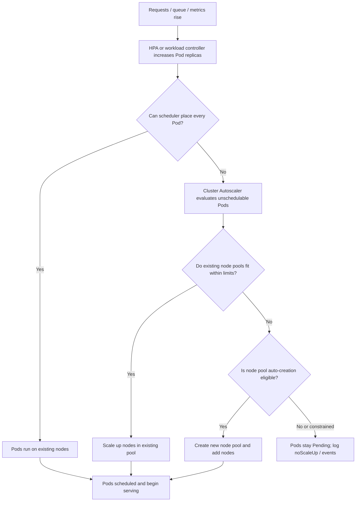
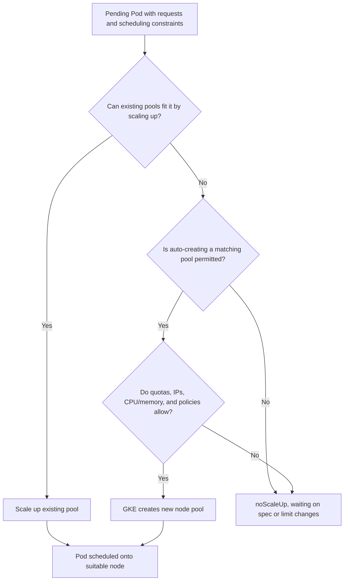

# Cluster Autoscaler and Node Auto-Provisioning

> **Chapter:** Advanced GKE and Operations  
> **Module:** CLOUD_PROVIDERS_GCP  
> **Module scope:** Exploring Google Cloud from project organization, IAM, and VPCs to Compute Engine, GKE, Cloud Run, storage services, and databases. Through deployment scenarios, learners select services, protect resources, automate releases, and monitor reliability and cost.

When request volume rises, a Deployment may need more Pods. Yet if existing nodes lack sufficient CPU, memory, GPUs, or other resources to place the new Pods, increasing `replicas` leaves Pods stuck in `Pending`. Conversely, when traffic drops, a cluster keeping too many idle nodes incurs unnecessary Compute Engine charges.

Google Kubernetes Engine's (GKE) **Cluster Autoscaler (CA)** adjusts the **number of nodes within node pools** based on Pod scheduling demand. **Node auto-provisioning (NAP)**, currently described in GKE documentation as **node pool auto-creation**, can also **create new node pools** when existing pools are unsuitable. On newer GKE versions, **ComputeClass** lets you define node requirements and enable pool creation at the **workload scope**; **cluster-wide** NAP configuration remains available when truly needed.

Autoscaling is not "flip a switch and forget it." CA/NAP behavior is shaped by **Pod resource requests**, node pool and cluster-wide resource limits, the Kubernetes scheduler, VM zone capacity, Pod IPs, quotas, PodDisruptionBudgets, node placement constraints, resource pricing, and operational policies. This lesson explains the mechanics, walks through inspection and scoped lab setup, and focuses on troubleshooting and safe operations.

## Learning Objectives

After this lesson, you will be able to:

1. Distinguish **HPA**, **VPA**, **Cluster Autoscaler**, and **node pool auto-creation/NAP**, and recognize how they interact.
2. Explain why CA relies on **unschedulable Pods** and `requests` rather than simply "actual CPU hitting 80%."
3. Configure `--min-nodes`/`--max-nodes` or `--total-min-nodes`/`--total-max-nodes` bounds for GKE Standard node pools.
4. Understand why CA may decline to scale up and why a `PodDisruptionBudget`, node affinity, or annotation can block scale-down.
5. Contrast **cluster-level NAP** with **ComputeClass workload-level node pool auto-creation**, including version prerequisites and resource limits.
6. Inspect GKE state via the Console, `gcloud`, `kubectl`, and Cloud Logging autoscaler visibility events.
7. Design Pod scale-up/scale-down experiments on a **sandbox cluster** and clean up workloads without affecting shared resources.
8. Evaluate impacts on SLOs, quotas, VM/GKE costs, IP addressing, security, and deployment speed.

## 1. Four Scaling Layers Often Confused

When reading an infrastructure diagram, know **which controller changes which object**:

| Component | Target adjusted | Primary signal | Automatically creates new node pools? |
|---|---|---|---|
| **Horizontal Pod Autoscaler (HPA)** | Number of **replicas** of a supported Deployment/StatefulSet | CPU/memory utilization or configured metrics | No |
| **Vertical Pod Autoscaler (VPA)** | Recommends/adjusts container **resource requests/limits** per mode | Observed resource consumption | No |
| **Cluster Autoscaler** | Number of **nodes** in existing node pools | Pods needing room to schedule; checks node consolidation on scale-down | Does not create pools in standard pool-autoscaling mode |
| **Node pool auto-creation / NAP** | **New node pools** along with matching nodes | Unschedulable Pods requiring a suitable node type | **Yes**, when the feature and constraints permit |

Certain ComputeClass cases also support node consolidation and optimization strategies, or running workloads in Autopilot mode inside Standard. Always check the **GKE version, cluster mode, ComputeClass, and feature limits** instead of assuming NAP behaves identically across every release.

### 1.1. Reaction Chain to Rising Traffic



This diagram is a **conceptual model**. In real deployments, decisions depend on multiple controllers and asynchronous events; provisioning a node takes far longer than scheduling a Pod onto an already-running node.

### 1.2. Simple Example

A Deployment has 2 Pods, each with `requests.cpu=500m`. When HPA scales to 8 Pods, total **requested** CPU is roughly `8 × 0.5 = 4 vCPU`, excluding system Pods and other workloads. If the two current nodes lack enough **allocatable CPU** for more Pods, the scheduler keeps some Pods `Pending`. CA can add nodes in an eligible pool as long as quotas, IPs, capacity, and node pool bounds permit.

**You cannot compute the exact node count simply by dividing `4 vCPU` by a machine's nominal vCPU count.** Kubelet, GKE/system Pods, DaemonSet requests, eviction reservations, memory, ephemeral storage, and affinities all determine whether a Pod fits on a node.

## 2. Cluster Autoscaler Operates on Requests and the Scheduler

### 2.1. Conditions That Typically Trigger Scale-Up

CA watches for **unschedulable Pods** that adding a node could unblock. It simulates placing those Pods onto a new node in existing node pools using scheduler rules, including:

- Container CPU/memory `requests` and Kubernetes-computed overhead.
- Maximum Pods per node and **allocatable resources**, including DaemonSet requests.
- Node selectors, node affinity, taints/tolerations, and placement/topology constraints.
- Storage/volume compatibility, GPUs/TPUs, or extended resources.
- `min/max nodes` bounds, node pool configuration, quotas, IPs, Compute Engine zones, and node creation policies.

If a Pod sets `requests.cpu=8` while the node pool only uses a machine type lacking enough allocatable CPU for **even one Pod**, merely adding **more nodes** of that same type still will not help. That is where node pool auto-creation or a pool with an appropriate machine type fits better.

### 2.2. Requests, Limits, and Actual CPU Usage

| Attribute | Meaning for scheduler / autoscaler |
|---|---|
| `resources.requests.cpu` | CPU reserved for scheduling; missing requests make the scheduler treat the workload as smaller than reality |
| `resources.requests.memory` | Minimum required memory; governs whether a Pod fits on a node |
| `resources.limits.cpu` | Runtime CPU cap that can cause throttling; does not replace requests for scheduling capacity |
| `resources.limits.memory` | Runtime memory cap; exceeding it can trigger OOM kill |
| Actual CPU/memory usage | Helps HPA/VPA/monitoring measure load, though CA does not scale purely on a VM utilization threshold |

When `requests` are missing or set too low for actual demand, the cluster appears to have room while causing contention or OOMs at runtime. Conversely, setting requests too high leaves Pods `Pending`, triggering unnecessary nodes and higher bills.

**Operational principle:** set evidence-based requests from metrics, application needs, and SLOs; set limits per policy; pair HPA and VPA so they do not adjust the same attribute in conflicting ways.

### 2.3. Scale-Up Is Not Instantaneous

The typical sequence is: CA decides to scale up → GKE asks Compute Engine to create a VM/node → guest OS/GKE agent boots → kubelet registers → DaemonSets and system Pods start → scheduler places the workload → image is pulled → readiness passes.

If an app must absorb a spike within seconds, **never expect cold node provisioning to behave like scheduling onto a warm node**. Depending on SLOs, keep a **minimum nodes / capacity buffer** or valid standby capacity to absorb startup delay.

## 3. Scale-Down: Saving Resources While Protecting Availability

When demand drops, CA looks for nodes it can remove after cleanly migrating or terminating Pods. **A node with low CPU utilization is not automatically eligible for deletion.**

### 3.1. Factors That Can Block Scale-Down

| Factor | Why it blocks? | What to do |
|---|---|---|
| **PodDisruptionBudget (PDB)** | Eviction would drop ready replicas below the allowed minimum | Evaluate the PDB alongside replica counts and SLOs |
| **Pod without a controller** | No guarantee the Pod will be recreated after the node is deleted | Move to a Deployment/Job where appropriate |
| **Node affinity / anti-affinity / topology** | No other eligible node exists to reschedule the Pod | Review placement, zones, and pool design |
| Annotation `cluster-autoscaler.kubernetes.io/safe-to-evict: "false"` | Signals CA not to evict the workload under supported rules | Use only when strictly necessary, with an owner and review date |
| **Storage / volume restrictions** | Volumes cannot attach in another node/zone, or local data cannot move | Design appropriate storage topology and backups |
| **System Pods** | Certain system Pod constraints keep CA from deleting the node | Check handling per GKE version; never manually modify system Pods |
| **Autoscaling minimum** | The node pool is already at its minimum size | Lower the minimum only with approval if the app tolerates it |

A properly configured PDB may **intentionally preserve spare capacity** to meet availability goals. Never treat remaining nodes as "waste" and drop a PDB to 0 without assessing the consequences.

### 3.2. Example PDB

```yaml
apiVersion: policy/v1
kind: PodDisruptionBudget
metadata:
  name: checkout-pdb
  namespace: production
spec:
  minAvailable: 2
  selector:
    matchLabels:
      app: checkout
```

For an application with 3 healthy replicas, this PDB generally permits **one** Pod disruption under policy. If only 2 replicas remain or one Pod is unready, eviction is blocked. A PDB does not protect against every outage and does not replace multi-zone replica distribution.

**This is a conceptual example; do not apply it to a production namespace during this lab.**

### 3.3. Scale-Down Grace and Impact on Requests

When deleting a node, Kubernetes drains it and sends `SIGTERM` to containers. Applications should handle graceful shutdown, close connections, checkpoint jobs, and finish in-flight requests within platform limits. GKE respects disruption/termination timeouts per version, yet **cannot guarantee zero dropped requests** if application code or load balancers are not designed for draining.

Long-running job Pods may need checkpointing and safe retries; avoid slapping `safe-to-evict=false` onto every workload, or nodes may never scale down.

## 4. Node Pool Autoscaling in GKE Standard

**Node pool autoscaling** keeps the node count of a managed pool aligned with demand within configured bounds. You remain responsible for **machine type**, disk, image, node locations, node SA, taints/labels, maintenance, and pool limits.

### 4.1. Per-Zone vs. Total-Pool Limits

| GKE CLI flags | Scope | Example and effect |
|---|---|---|
| `--min-nodes` and `--max-nodes` | Nodes **per zone** for the pool under this mode | A 3-zone regional pool with max=3 can reach up to 9 total nodes |
| `--total-min-nodes` and `--total-max-nodes` | Total nodes **across the entire node pool** (on supported versions) | A 3-zone regional pool with total-max=6 caps at 6 total nodes |

These two flag pairs are **mutually exclusive**. Never pass both `--min-nodes` and `--total-min-nodes` in the same command. GKE distributes nodes across zones according to location policy, capacity, and demand.

### 4.2. Example Configuring a Zonal Pool

```text
Cluster: checkout-lab, zone asia-southeast1-a
Node pool: app-pool
Autoscaling:
  min nodes = 1
  max nodes = 3

Current state:
  1 node, 2 application Pods + system Pods

When replicas increase:
  Pods go Pending because CPU/memory requests no longer fit
  → CA can scale up to 2 or 3 nodes

When traffic drops:
  If Pods can be rescheduled without violating PDBs/affinity
  → CA can scale down nodes, never below min=1
```

**No new nodes are added if all new Pods still fit on one node.** HPA increasing replicas does not mean CA always adds nodes; likewise, Pods stuck Pending for reasons a new node cannot fix will not trigger scale-up.

### 4.3. Regional Pools Must Account for All Zones

In a 3-zone regional cluster, `--min-nodes=1 --max-nodes=3` allows up to **9 nodes**, not 3 cluster-wide. Cost and quota planning must sum across all zones. To cap the whole pool, use `--total-min-nodes`/`--total-max-nodes` where supported by your configuration and GKE version.

Cluster-wide node auto-provisioning has **CPU/memory resource limits** that differ from a **pool's min/max node counts**. Do not confuse the two caps.

## 5. When Does Node Auto-Provisioning (NAP) Create New Node Pools?

If existing pools use `e2-standard-2` machines while a Pod needs a GPU, high-memory VM, or specialized configuration that no existing pool offers, scaling existing pools will not schedule the Pod. **Node pool auto-creation** lets GKE design and create a matching pool based on **Pod specifications, ComputeClasses, and supported limits**.



### 5.1. Not Every Pending Pod Creates a Pool

NAP acts only when:

- The cluster version and configuration mode support **node pool auto-creation**.
- The Pod/ComputeClass expresses requirements mappable to an allowed VM/node type.
- Compute Engine quotas, node/Pod IPs, GPU/TPU availability, regions/zones, and resource limits have headroom.
- Organization policies/IAM, Node SA settings, image pulls, node taints, and networking allow it.
- Creating the new pool stays within cluster limits and policies.

**NAP will not fix a broken image, mismatched PVC zone, missing Pod IAM, or nonsensical NodeSelector.** Always diagnose the true scheduler error before adding capacity.

### 5.2. NAP Does Not Mean One VM per Pod

GKE can bin-pack multiple Pods onto one VM based on requests and optimization strategies, and create multi-node pools. Creating a new pool does not guarantee a workload will permanently stay isolated on its own private pool; ComputeClasses, taints/labels, and the scheduler govern placement.

### 5.3. Interaction with Cluster Autoscaler

Once a pool is created, GKE still scales nodes up and down inside that pool based on demand. For pools managed by auto-creation, GKE can also delete the pool when it is empty and eligible. Exact behavior depends on the cluster lifecycle and feature configuration.

**Never manually modify or delete GKE-created pools without checking which workloads they serve.** For stateful Pods, pool/zone/volume placement and disruption policies require extra care.

## 6. Two Current Ways to Enable Auto-Creation

Google Cloud supports two forms of NAP, which can coexist:

| Approach | Scope | When to choose |
|---|---|---|
| **ComputeClass workload-level auto-creation** | Only workloads selecting the ComputeClass or matched by policy | **Preferred** on newer Standard clusters (`1.33.3-gke.1136000`+) when you want per-workload-group control |
| **Cluster-level node auto-provisioning** | Cluster-wide setting applicable to eligible Pending Pods | Needed for cluster-wide defaults, older versions, or default node configs not expressed via classes |

Current GKE guidance recommends **ComputeClasses** in most cases; on newer versions, a class with `spec.nodePoolAutoCreation.enabled=true` can auto-create pools **without enabling cluster-wide NAP**.

### 6.1. ComputeClass Describes Hardware at the Workload Level

ComputeClass is a **Kubernetes custom resource** provided by GKE:

```yaml
apiVersion: cloud.google.com/v1
kind: ComputeClass
metadata:
  name: lab-e2
spec:
  nodePoolAutoCreation:
    enabled: true
  priorities:
    - machineFamily: e2
  whenUnsatisfiable: DoNotScaleUp
```

Meaning:

- GKE can auto-create pools for workloads selecting `lab-e2` on supported clusters/versions.
- GKE prioritizes machine types in the **E2 family** subject to compatibility and availability.
- `whenUnsatisfiable: DoNotScaleUp` **will not** bypass the family constraint if capacity is unavailable. In a lab, diagnose capacity issues rather than hardcoding a single family and assuming CA is broken.

If availability matters more than sticking to one machine family, define **fallback priorities** and `ScaleUpAnyway` per documentation—understanding that this can result in **different node types and costs**. Never copy a GPU workload's ComputeClass policy blindly onto a regular web service.

### 6.2. Selecting the Class in a Workload

The application sets a GKE node selector:

```yaml
apiVersion: apps/v1
kind: Deployment
metadata:
  name: report-worker
  namespace: autoscale-lab
spec:
  replicas: 2
  selector:
    matchLabels:
      app: report-worker
  template:
    metadata:
      labels:
        app: report-worker
    spec:
      nodeSelector:
        cloud.google.com/compute-class: lab-e2
      containers:
        - name: web
          image: us-docker.pkg.dev/google-samples/containers/gke/hello-app:1.0
          resources:
            requests:
              cpu: "500m"
              memory: "256Mi"
            limits:
              memory: "512Mi"
          ports:
            - containerPort: 8080
```

Only when ComputeClass `lab-e2` exists, the cluster supports it, and all scheduler checks pass can Pod creation trigger GKE to create a new pool. **This is an illustrative manifest**; real workloads require production images, `securityContext`, readiness probes, service accounts, data/storage configuration, and monitoring.

### 6.3. Cluster-Level NAP Requires Total Resource Limits

With **cluster-level NAP**, you must specify **CPU and memory** bounds so GKE knows the maximum resources it may provision. This limit applies **across the entire cluster**, including manually created node pools—not just new auto-created pools.

Example for a GKE Standard sandbox:

```bash
# Configure on a lab cluster ONLY after reviewing Pod specifications,
# autoscaling limits, IAM, and costs. This is a cluster-wide change.
gcloud container clusters update "$CLUSTER" \
  --project="$PROJECT_ID" \
  --location="$LOCATION" \
  --enable-autoprovisioning \
  --min-cpu=0 \
  --min-memory=0 \
  --max-cpu=16 \
  --max-memory=64
```

**Units:** CPU limits are in cores/vCPUs; memory flags are in **GiB**. The 16 cores / 64 GiB values here are **sandbox ceiling examples** and must be chosen relative to existing nodes and allowed machine types.

If the cluster **already has more than 16 cores** across its node pools, `--max-cpu=16` is invalid and can block all growth. GPUs/TPUs require their own **corresponding resource limits** in this mode; do not assume CPU/memory limits cover accelerators.

**Safety note:** enabling cluster-wide NAP can immediately cause existing Pending Pods with matching selectors to trigger **new node pool creation** and incur VM/disk/IP charges. Audit Pending Pods **before** enabling it.

### 6.4. Cluster-Level NAP and ComputeClass Are Not Mutually Exclusive

When both exist, node attribute resolution typically considers:

1. Requirements specified in the **ComputeClass or Pod specification**.
2. Defaults from **cluster-level NAP** when an attribute is unset.
3. Cluster/Google Cloud defaults if nothing else is specified.

Do not assume cluster-level settings always override a platform-team ComputeClass. Attribute precedence and scale-up behavior should be verified on your target cluster version.

### 6.5. NAP vs. Autopilot

| Aspect | GKE Standard with NAP/ComputeClass | GKE Autopilot |
|---|---|---|
| Manual pool management | Can still maintain dedicated manual pools | GKE manages nodes/pools under the Autopilot model |
| Auto-creation | Enabled at cluster-level or workload-level where supported | Platform provisions/manages compute per workload |
| Node customization | Broader within Standard, ComputeClass, and policy limits | Constrained by the Autopilot compute model and policies |
| Billing | Typically cluster/node/disk/resource charges per tier and mode | Autopilot pricing model by workload class |
| Who optimizes requests? | Application and platform teams | Application teams still need accurate requests; GKE manages nodes |

You do not enable Standard-style NAP in an Autopilot cluster. Also note that **Autopilot mode workloads in Standard** have distinct mechanics with ComputeClasses; always confirm which class is active.

## 7. Quotas, IPs, and Limits That Stop Autoscaling

CA/NAP cannot bypass hard physical or account boundaries:

| Boundary | Symptom when hit | How to prevent |
|---|---|---|
| Pool **`max-nodes`/`total-max-nodes`** | Pods stay Pending; CA cannot grow the pool | Size limits for peak load and HA |
| **NAP cluster CPU/memory limits** | No new nodes/pools created despite demand | Sum resources across all node pools |
| **Compute Engine CPU/GPU quota** | Node VM creation fails with quota errors | Monitor quotas per region and machine family |
| **Zone capacity** | Machine type/GPU temporarily out of stock | Configure fallback zones/families and capacity plans |
| **Primary subnet IPv4 range** | No IPs left for node VMs | Plan node IP space and upgrade surge capacity |
| **Pod secondary CIDR** | No alias blocks left for new nodes | Size Pod CIDR from max Pods/node and additional ranges |
| **Max Pods/node** | Node runs out of Pod slots despite spare CPU | Tune Pod density on appropriate pools |
| **Node SA/IAM & org policies** | GKE/nodes fail to provision or pull images | Keep identities/permissions intact; never delete service agents |
| **PVC / topology constraints** | Pods cannot schedule in available zones/pools | Align storage topology and HA design |

### 7.1. Pod IP Exhaustion Example

A VPC-native cluster has a `/20` Pod secondary CIDR (4,096 addresses). If a Standard pool sets `maxPodsPerNode=110`, GKE may reserve a `/24` block (256 addresses) per node. **The theoretical ceiling by Pod IPs is 16 nodes** for that range, even if each node runs only a few Pods. Raising vCPU quota will not solve missing alias IP blocks.

When you see `scale.up.error.ip.space.exhausted`, inspect **both the primary node range and Pod secondary ranges**. Adding Pod CIDRs or new node pools involves IPAM, networking teams, and GKE constraints—never manually edit Pod/node IPs.

### 7.2. NAP Does Not Prevent CIDR Exhaustion

Even if NAP designs a new pool type, that pool must still attach to the VPC/subnet/Pod ranges. If the shared secondary range is full or conflicts with hybrid routes, creating the new pool fails. IP capacity monitoring must accompany autoscaling plans.

## 8. Designing an SLO-Driven Autoscaling Strategy

An operational strategy should answer:

1. What peak requests/second or queued jobs must the workload sustain?
2. Do HPA/VPA have reliable metrics and requests?
3. Which node types fit CPU/memory/ephemeral storage/GPU needs?
4. Is the workload stateless and safe to move across nodes and zones?
5. Do PDBs, anti-affinity, topology spread, or PVCs restrict Pod movement?
6. How much **buffer** is needed to absorb cold node startup times?
7. Are max cost, quotas, and IPs sized for both traffic spikes and upgrade surges?
8. When limits are hit, how does the system degrade, queue, or apply backpressure?
9. When load drops, should nodes shrink aggressively or avoid disruption?
10. Who can alter ComputeClass/NAP settings, and who is on-call for scaling incidents?

### 8.1. Webshop Scenario

An application has:

- Baseline 4 replicas, each Pod requesting `500m CPU` and `512Mi memory`.
- HPA capped at 12 replicas under high traffic.
- Primary node pool using `e2-standard-2` with CA min=2, max=6 **in a zonal lab**.
- A PDB keeping at least 2 replicas available (per SLO).

**Total CPU requests at 12 replicas** is around `6 vCPU`, excluding system components. However, the required node count **cannot be locked down by simple division**, because each VM's allocatable resources are lower than nominal vCPUs, plus Pod placement constraints and overhead.

If the workload adds a GPU job, create a **dedicated ComputeClass for GPUs** rather than modifying the regular CPU pool; GPU workloads need separate resource limits, quotas, and verified capacity.

### 8.2. Availability vs. Cost Trade-Offs

| Decision | Benefit | Trade-off |
|---|---|---|
| Node pool minimum > 0 | Warm headroom for spikes, avoids cold node startup | VMs cost money even at low load |
| Small max nodes | Caps pool expansion | Risk of Pending Pods during traffic spikes |
| ComputeClass selecting larger machines | Fits large Pods, reduces fragmentation | Higher unit cost, harder capacity in some zones |
| ComputeClass with fallbacks | Better provisioning odds if primary family sells out | Node types and pricing may differ from baseline |
| Conservative scale-down | Fewer evictions and churn, protects SLOs | Keeps idle nodes running longer |
| Spot nodes for fault-tolerant batch | Can lower compute costs | Spot VMs can be preempted; jobs need retries/checkpoints |

**Autoscaling is not a hard cost cap.** Budget alerts do not stop nodes, and NAP can create new pools whenever matching Pods sit Pending. Combine quotas, pool limits, NAP bounds, Cloud Billing alerts, and workload policies.

## 9. Lab A — Inventory an Existing Cluster (Read-Only)

**Run this section before any write operations.** You need permissions to view clusters/node pools, plus Kubernetes RBAC to inspect Pods and events. You do not need to enable NAP or scale Deployments just to learn how to read cluster state.

### 9.1. Confirm Project and Cluster

In Cloud Shell or a Bash terminal:

```bash
PROJECT_ID="my-gke-autoscaling-lab"
LOCATION="asia-southeast1-a"    # Zonal cluster; use region for a regional cluster
CLUSTER="autoscaling-lab"
POOL="app-pool"
NAMESPACE="autoscale-lab"

gcloud auth list --filter="status:ACTIVE"
gcloud projects describe "$PROJECT_ID" \
  --format="table(projectId,name,lifecycleState)"

gcloud container clusters list --project="$PROJECT_ID"
gcloud container node-pools list \
  --cluster="$CLUSTER" \
  --location="$LOCATION" \
  --project="$PROJECT_ID"
```

**If the cluster or pool does not exist**, do not create one in a production project. This lab assumes a **pre-provisioned, isolated GKE Standard cluster**; creating new clusters has separate cost and security implications.

### 9.2. Read Cluster Autoscaling and NAP Settings

```bash
gcloud container clusters describe "$CLUSTER" \
  --location="$LOCATION" \
  --project="$PROJECT_ID" \
  --format="yaml(name,location,status,currentMasterVersion,autoscaling,nodePools,ipAllocationPolicy)"

gcloud container node-pools describe "$POOL" \
  --cluster="$CLUSTER" \
  --location="$LOCATION" \
  --project="$PROJECT_ID" \
  --format="yaml(name,status,config.machineType,autoscaling,locations,management)"
```

Focus on these fields in the output:

- `nodePools[].autoscaling.enabled`: per-pool autoscaling status.
- `minNodeCount/maxNodeCount` or `totalMinNodeCount/totalMaxNodeCount` as configured.
- `cluster.autoscaling.enableNodeAutoprovisioning` and `resourceLimits` if cluster-level NAP is used.
- `nodePools[].config.machineType`, node locations, disk, and node SA.
- `ipAllocationPolicy` for VPC-native clusters to check remaining Pod alias blocks.

Verify the actual GKE version before using ComputeClass auto-creation; do not run newer-version examples on an older cluster.

### 9.3. Inspect History and Pod Status

```bash
# Updates LOCAL kubeconfig only; does not modify cluster resources.
gcloud container clusters get-credentials "$CLUSTER" \
  --location="$LOCATION" \
  --project="$PROJECT_ID"

# Read-only Kubernetes API checks
kubectl config current-context
kubectl get nodes -o wide
kubectl get pods -A -o wide
kubectl get pods -A --field-selector=status.phase=Pending
kubectl get pdb -A
kubectl get events -A --sort-by=.lastTimestamp
```

**Never run `kubectl apply/delete` unless `current-context` points to the right lab cluster.** `gcloud` IAM and Kubernetes RBAC are separate: having `gcloud` cluster read access does not guarantee permission to view all namespaces via `kubectl`.

### 9.4. Interpreting Sample Output

```text
Pool app-pool:
  autoscaling.enabled: true
  minNodeCount: 1
  maxNodeCount: 3
  current nodes: 2

Deployment checkout:
  desired replicas: 8
  running: 5
  Pending: 3

What to investigate:
  Do the Pending Pods truly lack allocatable CPU/memory?
  Are there affinity/taint/PVC/topology constraints?
  Does CA still have min/max bounds, quotas, IPs, and zone capacity?
  Are there noScaleUp events explaining why?
```

**Never conclude you need to raise max nodes** from a `Pending` row alone; read Kubernetes events and autoscaler logs first.

## 10. Lab B — Enable Autoscaling on a Standard Lab Node Pool

This section **modifies GCP resources** and can add or delete node VMs, affecting cost, IPs, and workloads. **Run only on an authorized sandbox pool** after confirming it shares no production workloads.

### 10.1. Console

1. Open **Kubernetes Engine → Clusters** in the correct project.
2. Select the lab cluster, then go to **Nodes → Node Pools → app-pool**.
3. Click **Edit**, find **Autoscaling**, and enable it.
4. Enter min=1 and max=3 **for the sample zonal pool**; for a regional pool, double-check per-zone vs. total semantics.
5. Review quotas, IPs, disk, machine type, and running workloads.
6. Save changes, re-read the pool configuration, and observe the nodes.

### 10.2. gcloud — Zonal Limits of 1–3 Nodes

```bash
# Run ONLY on a sandbox cluster/node pool with proper authorization.
gcloud container clusters update "$CLUSTER" \
  --project="$PROJECT_ID" \
  --location="$LOCATION" \
  --node-pool="$POOL" \
  --enable-autoscaling \
  --min-nodes=1 \
  --max-nodes=3

# Verify the updated configuration
gcloud container node-pools describe "$POOL" \
  --cluster="$CLUSTER" \
  --location="$LOCATION" \
  --project="$PROJECT_ID" \
  --format="yaml(name,autoscaling,status)"
```

For a **regional node pool**, if you want 3–6 total nodes instead of 3–6 per zone, verify version support and run:

```bash
# Separate example for a REGIONAL node pool; do not combine with the zonal example.
# LOCATION must be the cluster's actual region.
gcloud container clusters update "$CLUSTER" \
  --project="$PROJECT_ID" \
  --location="$LOCATION" \
  --node-pool="$POOL" \
  --enable-autoscaling \
  --total-min-nodes=3 \
  --total-max-nodes=6
```

These two options have different scopes—**never mix per-zone and total flags**. Substitute the exact `LOCATION` rather than copying a zonal location onto a regional cluster.

## 11. Lab C — Trigger Scale-Up Demand with an Isolated Workload

**Perform this only if both the cluster and node pool belong to a lab.** A lower-risk approach is inspecting existing workloads with read-only commands. To observe CA in action, use namespace `autoscale-lab` and a Deployment **without a public Service or LoadBalancer**, keeping replicas and resource requests strictly bounded.

### 11.1. Create a Namespace and Small Deployment

With `kubectl` pointing to the lab cluster:

```bash
kubectl create namespace autoscale-lab
```

Apply the following YAML in the **lab namespace** via an isolated manifest (do not write files into the course repository):

```yaml
apiVersion: apps/v1
kind: Deployment
metadata:
  name: cpu-request-lab
  namespace: autoscale-lab
spec:
  replicas: 2
  selector:
    matchLabels:
      app: cpu-request-lab
  template:
    metadata:
      labels:
        app: cpu-request-lab
    spec:
      containers:
        - name: web
          image: us-docker.pkg.dev/google-samples/containers/gke/hello-app:1.0
          ports:
            - containerPort: 8080
          resources:
            requests:
              cpu: "500m"
              memory: "256Mi"
            limits:
              memory: "512Mi"
```

In Cloud Shell, save this lab manifest to a temporary file **on your local lab machine**, e.g., `cpu-request-lab.yaml`, then run:

```bash
kubectl apply -f cpu-request-lab.yaml
kubectl -n autoscale-lab get deployment,pods -o wide
kubectl get nodes -o wide
```

**Note:** `requests.cpu=500m` does not force the container to burn 0.5 CPU; it **reserves scheduling capacity**. This test needs no HTTP flooding or synthetic load attacks.

### 11.2. Scale Replicas Within Bounds

After checking quotas and costs, and only in the lab cluster:

```bash
# Increase replicas to create scheduling demand; keep within lab bounds.
kubectl -n autoscale-lab scale deployment cpu-request-lab \
  --replicas=6

# Observe only; make no further changes
kubectl -n autoscale-lab get pods -o wide
kubectl -n autoscale-lab get deployment cpu-request-lab
kubectl get nodes -o wide
kubectl -n autoscale-lab get events --sort-by=.lastTimestamp
```

**You may not see a scale-up** if the new replicas still fit on existing nodes. That is **not a CA bug**. Conversely, if requests/limits, taints, or pool max bounds conflict, Pods may stay Pending even with autoscaling enabled.

Never keep bumping replicas into the hundreds "to force" CA; that can spin up excessive VMs, inflate bills, and exhaust quotas or IPs across the cluster.

### 11.3. Scale Down Replicas to Observe Scale-Down

```bash
kubectl -n autoscale-lab scale deployment cpu-request-lab \
  --replicas=2

kubectl -n autoscale-lab get pods -o wide
kubectl get nodes -o wide
```

CA may **not remove nodes immediately** after Pods terminate; it enforces stabilization delays and eviction/placement checks. Never manually delete underlying node VMs in GKE without understanding orchestrator state.

## 12. Lab D — ComputeClass Workload-Level Auto-Creation (Optional)

**This section is advanced and can create new node pools**, so run it only in a GKE Standard sandbox cluster on **`1.33.3-gke.1136000` or later** where supported. If you only want to study CA on existing pools, you can **skip this entire section**.

### 12.1. Check Prerequisites

```bash
# Read cluster version and status
gcloud container clusters describe "$CLUSTER" \
  --project="$PROJECT_ID" \
  --location="$LOCATION" \
  --format="yaml(currentMasterVersion,status,autoscaling)"

# List existing ComputeClasses in the cluster
kubectl get computeclasses

# Record current node pools for comparison after the lab
gcloud container node-pools list \
  --cluster="$CLUSTER" \
  --location="$LOCATION" \
  --project="$PROJECT_ID"
```

**If the ComputeClass CRD is missing or the version is unsupported**, do not apply the manifest; upgrading GKE is a major change outside this lab's scope.

### 12.2. Apply the Lab ComputeClass

Using the `ComputeClass` manifest from section 6.1, save it to a separate lab file `computeclass-lab-e2.yaml`, then run:

```bash
# Only in a sandbox cluster where you have permission to manage ComputeClasses.
kubectl apply -f computeclass-lab-e2.yaml
kubectl get computeclass lab-e2 -o yaml
```

ComputeClass is a **cluster-scoped resource**, not isolated to the lab namespace. Never collide with a production ComputeClass name or alter your organization's `default` class.

### 12.3. Create a Workload Selecting the ComputeClass

Using the `Deployment report-worker` manifest from section 6.2, verify namespace `autoscale-lab` exists and image/requests are valid. Apply the lab file:

```bash
kubectl apply -f report-worker-lab.yaml
kubectl -n autoscale-lab get pods -o wide
kubectl get nodes -L cloud.google.com/compute-class
gcloud container node-pools list \
  --cluster="$CLUSTER" --location="$LOCATION" --project="$PROJECT_ID"
```

**Possible outcomes:**

- If an existing node/pool already satisfies the class and scheduler, Pods schedule without creating a new pool.
- If no existing pool fits and auto-creation is permitted, GKE may provision a matching pool.
- If quotas, IPs, family availability, or `DoNotScaleUp` constraints block it, Pods stay Pending and log a `noScaleUp` event.

To avoid surprise charges, **do not repeatedly tweak selectors or bump replicas** without knowing why it blocked; inspect Logs and limits first.

### 12.4. Note on Enabling ComputeClass Without Cluster-Wide NAP

On supported versions, ComputeClass auto-creation works **without requiring cluster-level NAP `resourceLimits`**. That is a key distinction from enabling `--enable-autoprovisioning` cluster-wide.

If a project already uses **cluster-level NAP**, its CPU/memory `resourceLimits` can still cap growth across all node pools. Check both configuration sources before concluding GKE ignored the class requirement.

## 13. Lab E — Cluster-Level NAP (Reference Only When Needed)

This mode alters **cluster-wide** behavior, so it is not an automatic follow-up to the ComputeClass section. **You do not need to enable both** to complete this lesson.

### 13.1. What to Prepare

- A GKE Standard sandbox cluster with owner approval.
- Full inventory of all Pending Pods, ComputeClasses, and namespaces to ensure no stray workload triggers unexpected nodes.
- Current total CPU/memory and the highest acceptable ceiling.
- Valid node service account, scopes, image pull access, Workload Identity Federation, and IAM.
- Node/Pod IP capacity, GPU/TPU quotas (if needed), and allowed zones.
- Cloud Billing budgets and a clear rollback plan.

### 13.2. Console Steps

1. Open **Kubernetes Engine → Clusters** and select the Standard lab cluster.
2. Go to **Details → Automation → Node auto-provisioning** (UI labels may vary).
3. Enable node auto-provisioning.
4. Set **minimum/maximum CPU and memory**; add GPU/TPU resource limits if workloads require them.
5. Configure node locations, SA/scopes, and repair/upgrade defaults per policy if needed.
6. Review which Pods might trigger auto-creation and estimate costs.
7. Save and verify cluster status and the node pool list.

The corresponding CLI command was shown in section 6.3. Do not execute it repeatedly across steps unless you have a specific verification need.

### 13.3. Disabling Cluster-Level NAP vs. Deleting Pools

```bash
# Run ONLY if you enabled cluster-wide NAP specifically for this lab,
# confirmed the original state, and have permission to restore it.
gcloud container clusters update "$CLUSTER" \
  --project="$PROJECT_ID" \
  --location="$LOCATION" \
  --no-enable-autoprovisioning
```

**Do not assume disabling NAP deletes all auto-created pools**, nor that it stops all ComputeClass-based auto-creation on newer GKE releases. ComputeClass may continue creating pools per its own settings. Disabling NAP can also alter the autoscaling lifecycle of existing auto-created pools; review the documentation and document which pools will be retained, adopted, or cleaned up per runbook.

## 14. Monitoring Cluster Autoscaler with Cloud Logging

GKE emits **autoscaler visibility events** to Cloud Logging, explaining **why it scaled or refused to scale**. This is far more reliable than guessing from CPU charts.

### 14.1. Key Event Types

| Event | What it tells you |
|---|---|
| `status` | Recent state of autoscaled node pools and desired node counts |
| `scaleUp` | CA decided to scale up and targeted specific node groups |
| `scaleDown` | CA decided to scale down / evict nodes |
| `eventResult` | Success or failure outcome of a scaling operation |
| `noScaleUp` | Unschedulable Pods exist, but CA could not add nodes |
| `noScaleDown` | Nodes exist, but one or more constraints prevented removal |
| `nodePoolCreated` | NAP/auto-creation created a new node pool |
| `nodePoolDeleted` | Auto-creation deleted a node pool per lifecycle rules |

**`noScaleUp` is not guaranteed for every reason on every cycle**: events are best-effort. Likewise, a `scaleUp` entry **does not prove** Pods are Ready or 5xx errors stopped; always inspect `eventResult`, nodes, Pods, and SLOs.

### 14.2. Logs Explorer Query

In **Logging → Logs Explorer**, select the cluster's project and an appropriate time range:

```text
resource.type="k8s_cluster"
log_id("container.googleapis.com/cluster-autoscaler-visibility")
```

You can filter further by cluster resource labels or JSON fields per the live schema, for example:

```text
resource.type="k8s_cluster"
log_id("container.googleapis.com/cluster-autoscaler-visibility")
jsonPayload.noDecisionStatus.noScaleUp:*
```

Or inspect scale-up decisions:

```text
resource.type="k8s_cluster"
log_id("container.googleapis.com/cluster-autoscaler-visibility")
jsonPayload.decision.scaleUp:*
```

Log schemas have nested fields that vary by event type. If a filter returns nothing, **drop the extra JSON predicate** to inspect raw logs first rather than concluding the autoscaler is absent.

### 14.3. Meaning of Selected Message IDs

| Message ID | Probable cause |
|---|---|
| `scale.up.error.quota.exceeded` | Compute Engine quota exceeded |
| `scale.up.error.out.of.resources` | Zone temporarily out of stock for the chosen VM type |
| `scale.up.error.ip.space.exhausted` | Exhausted node IPs or Pod alias blocks |
| `scale.up.error.service.account.deleted` | Node service account was deleted or became invalid |
| `no.scale.up.mig.failing.predicate` | Workload fails placement predicates on that pool (e.g., NodeAffinity/taint) |
| `no.scale.up.nap.disabled` | Cluster-wide NAP disabled where needed (check specific mechanism) |
| `no.scale.down.node.pod.not.enough.pdb` | PDB is blocking eviction |
| `scale.down.error.failed.to.evict.pods` | Unable to cleanly evict Pods from the node |

**Message IDs** are clues, not a universal fix command. Before raising max nodes, quotas, or changing PDBs, inspect the **specific Pod, pool, zone, and constraints** inside the event.

### 14.4. Console Notifications and Log Retention

The GKE Console surfaces alerts like **Can't scale up**, **Can't scale up pods**, and **Can't scale up a node pool**. Recent notifications often include hints and deep links to Logs; for older issues, search Cloud Logging within your organization's retention window.

Cloud Monitoring also provides metrics on **node provisioning attempts, failures, and pending Pods**, some broken down by ComputeClass. Never subtract failures from attempts over a short window to infer exact successes, because provisioning is asynchronous.

## 15. Diagnosing Pending Pods Properly

### 15.1. Kubernetes Events First, Autoscaler Logs Second

```bash
# Confirm kubectl currently targets the right cluster
kubectl config current-context

# Read-only: list Pending Pods
kubectl get pods -A --field-selector=status.phase=Pending

# Replace namespace and POD_NAME with a real Pod before running
kubectl -n autoscale-lab describe pod POD_NAME

# Inspect scheduling events and node state
kubectl get events -A --sort-by=.lastTimestamp
kubectl get nodes -o wide
kubectl describe nodes
```

In `describe pod`, lines showing `FailedScheduling`, `Insufficient cpu`, `Insufficient memory`, `didn't match Pod's node affinity/selector`, or `untolerated taint` narrow down the cause.

If there are no scheduling events and the Pod is in `ContainerCreating` or `ImagePullBackOff`, adding nodes will **not solve** image, networking, or credential errors.

### 15.2. Six-Layer Verification Workflow

1. **Scheduler:** is the Pod genuinely unschedulable? Due to CPU/memory or selectors/taints/PVCs?
2. **Pool compatibility:** does any pool match the node type and location? What limits does CA allow on it?
3. **NAP/ComputeClass:** is auto-creation enabled on the right version and workload selector? Is `DoNotScaleUp` blocking fallback?
4. **Infrastructure:** quotas, node/Pod IPs, zone capacity, GPU/TPU availability, IAM/node SA.
5. **Action check:** what `noScaleUp`/`scaleUp`/`eventResult` entries appear in autoscaler visibility logs?
6. **Workload:** once a node joins, does the Pod reach Ready? How are container startup, downstream dependencies, and app SLOs behaving?

**Never treat `ImagePullBackOff` by turning on cluster-wide NAP.** Fix the image reference, registry permissions, or network egress if that is the root cause.

## 16. Diagnosing Nodes Not Scaling Down

If metrics show very low CPU yet nodes are not removed:

1. Verify the node pool has autoscaling enabled and **current size exceeds minimum**.
2. Inspect PDBs in relevant namespaces with `kubectl get pdb -A`.
3. Scan for Pods annotated with `safe-to-evict=false` and controllerless Pods.
4. Check node affinity/anti-affinity, topology spread, and PVC/zone bindings.
5. Inspect `noScaleDown`/`scaleDown` events in Cloud Logging.
6. If a node was recently provisioned, check cooldown periods and consolidation policies for your version/ComputeClass.
7. Confirm removing the node would not violate SLOs or HA guarantees.

### 16.1. When a PDB Is Working as Intended

Suppose a Deployment has 2 replicas and a PDB with `minAvailable: 2`. If both replicas are essential and cannot be lost, blocking scale-down is **intentional**. To allow node consolidation, you can:

- Increase replicas to create swap headroom and balance resource placement.
- Tune `maxUnavailable` or `minAvailable` to reflect actual fault tolerance.
- Optimize placement/requests and Pod distribution across zones.

**Never weaken a production PDB just to delete one VM** if doing so breaks availability commitments. Keeping a buffer node is justified when SLOs require it.

### 16.2. Why GKE Version Matters

Rules for relocating system Pods evolve across GKE versions. For example, starting in GKE `1.32.4-gke.1236000` and later, the autoscaler can consider relocating certain `kube-system` Pods once they have run long enough under qualifying conditions, whereas earlier versions held nodes longer. When troubleshooting, consult the **exact GKE version and its documentation**, not outdated blog advice.

## 17. Cost Governance, Quotas, and Risk Limits

### 17.1. Cost Components

- **Compute Engine nodes:** vCPUs, RAM, machine family, disks, local SSDs/GPUs if attached.
- **GKE cluster management:** per cluster tier/mode and current pricing.
- **New node pools from NAP:** VMs, boot disks, IPs, image pulls, logs, networking, and dependent services.
- **Cloud NAT / load balancing / egress:** as used by your network architecture.
- **Cloud Logging/Monitoring:** ingestion, retention, and data transfer per configuration/pricing.

CA reduces node bills when capacity is no longer needed, yet **it does not guarantee lower total spend** if requests are inflated, minimum nodes sit too high, DaemonSets/PDBs block scale-down, or workloads continuously require large nodes.

### 17.2. Budgets Do Not Halt Autoscaling

Cloud Billing budgets and alerts notify operators about spend, but they do not directly stop CA or NAP. Put real guardrails in place:

- Sensible node pool bounds and NAP resource limits.
- Controlled quotas—without making quotas so tight that services constantly stall in Pending.
- Owner/cost labels, isolated dev/prod environments, and least-privilege permissions to create/update node pools.
- Alerts on node count, VM quota usage, Pending Pods, node provisioning failures, and abnormal spend spikes.
- Release gates so a broken rollout creating many Pending Pods cannot trigger runaway compute growth.

### 17.3. Optimize Requests Before Optimizing Node Count

If 50 Pods each set `requests.cpu=2` while averaging only 200m, the scheduler reserves far more CPU than needed and triggers extra nodes unnecessarily. Use Cloud Monitoring load metrics, VPA recommendations, and testing to choose requests that satisfy p95/p99 latency, peak memory, and recovery.

Do not shrink requests down to tiny values just to cut node counts if it induces OOMs, CPU throttling, or request timeouts. Resource optimization is **balancing SLOs against cost**, not running the smallest possible cluster at any price.

### 17.4. Spot VMs and Batch Workloads

Pools using Spot VMs fit interruptible jobs such as batch processing, CI runners, or queue consumers with retries and checkpoints. However, **Spot VMs can be preempted**, and autoscaling does not guarantee infinite Spot capacity. When high availability is needed, combine fallbacks, PDBs, workload priorities, and on-demand pools for critical components.

## 18. Security and Access Control for Automatic Node Creation

Scaling nodes and creating new pools are **privileged infrastructure operations**. In GKE, service agents and node service accounts serve distinct roles; never hand a single project-Owner SA to every workload.

### 18.1. Identities to Distinguish

| Identity | Role in autoscaling |
|---|---|
| **Cluster/platform administrator** | Creates/updates clusters, node pools, NAP limits, and ComputeClasses |
| **GKE service agent / service identities** | Executes GKE-managed platform actions using service permissions |
| **Node service account** | Used by nodes/kubelet/agents to pull images and ship logs/metrics per config |
| **Workload identity (KSA + WIF for GKE)** | Used by Pods calling Google Cloud APIs with least-privilege permissions |
| **Deployer/operator Kubernetes RBAC** | Controls who can edit Deployments, ComputeClasses, and PDBs in the cluster |

**New node pools can run code from many workloads**, so default node SA/scopes, shielded nodes, node images, network security, and security policies must be validated before enabling NAP.

### 18.2. ComputeClass Edit Permissions Are Sensitive

ComputeClasses influence which machines get provisioned, node tags/taints, and spend. Never let every namespace developer modify cluster-scoped ComputeClasses or the organization's `default` class. Use Kubernetes RBAC and platform controls to enforce boundaries:

- Platform teams manage ComputeClasses and resource limits.
- Application teams reference approved classes in their manifests.
- Audit class/Pod/cluster changes and assess quota and cost impact.

Modifying a class can shift new Pods onto different node types or leave Pods Pending if `whenUnsatisfiable` is too strict.

### 18.3. Do Not Relax Network Security to "Fix" Scaling

If new nodes fail to pull images, inspect DNS, Artifact Registry permissions, Private Google Access/NAT, and egress firewall rules. Never open `0.0.0.0/0` ingress, disable NetworkPolicies, or grant `Editor` to a node SA when the real problem is missing network connectivity.

## 19. Operational Scenarios

### Scenario A — HPA Scales Replicas, CA Does Not Add Nodes

A checkout app has HPA 2–12 replicas. Traffic spikes, HPA creates new Pods, yet several stay Pending. Events report `Insufficient cpu`, while the Standard pool has already reached `max-nodes=3`.

**Resolution:** measure requests vs. allocatable capacity, inspect autoscaler visibility logs, quotas/IPs, and whether the pool ceiling can be raised. If raising max, account for cost and SLOs; if Pods are too big for the machine type, switch to a suitable pool/node type or ComputeClass instead of raising node counts indefinitely.

### Scenario B — Job Needs a GPU, Only CPU Pools Exist

An ML team submits a Job requesting a GPU. The cluster currently has only an E2 pool without GPUs. CA finds no pool that can fit it, and Pods stay Pending due to `nvidia.com/gpu`.

**Resolution:** evaluate a ComputeClass/auto-creation config with GPU priorities/limits where supported, GPU quotas, and zone availability. If GPUs are unavailable, the Job must queue or use a valid fallback—never "fix" it by raising min-nodes on the CPU pool.

### Scenario C — Idle Nodes Won't Scale Down Because of a PDB

A Deployment has 2 replicas and a PDB requiring `minAvailable=2`. CA cannot evict Pods to delete a node, so VM count stays high despite low CPU usage.

**Resolution:** confirm whether the PDB protects a real SLO; consider adjusting replica counts/HA layout or revising the policy via change review. Never drop the PDB to 0 solely to delete a node.

### Scenario D — Enabling Cluster-Wide NAP Spikes Costs

A platform team enables cluster-level NAP while stale Pending Pods from old experiments still exist. NAP creates extra pools matching those valid selectors, increasing VM and disk spend unexpectedly.

**Resolution:** audit Pending Pods before enabling, prefer workload-scoped ComputeClasses if version-supported, set tight NAP resource limits, and configure alerts. When turning NAP off, do not assume existing pools vanish automatically; inventory them and retire them per runbook.

### Scenario E — Pod IP Exhaustion Despite Plenty of vCPU Quota

A cluster's Pod secondary range is too small for its per-node alias blocks. Autoscaler logs show `scale.up.error.ip.space.exhausted`. Even with spare CPU quota, new nodes cannot receive Pod IP blocks.

**Resolution:** plan secondary ranges properly, evaluate additional Pod CIDRs or new node pools as supported by GKE, coordinate IPAM/Shared VPC, and factor in upgrade surges. Never alter production CIDRs without evaluating hybrid routing.

## 20. Cleaning Up Lab Resources and Restoring State

**Clean up only lab resources**—never delete shared clusters, VMs, node pools, or platform-managed ComputeClasses. Stopping or shrinking production node pools can break HA; never delete Node objects directly to save money.

### 20.1. Clean Up Lab Workloads First

```bash
# Only Deployments created by this lab.
kubectl -n autoscale-lab get deployments,pods

kubectl -n autoscale-lab delete deployment cpu-request-lab \
  --ignore-not-found

kubectl -n autoscale-lab delete deployment report-worker \
  --ignore-not-found

# Confirm no lab Pods/Jobs/Services/PVCs remain that need to be kept
kubectl -n autoscale-lab get all
kubectl -n autoscale-lab get pvc
```

If namespace `autoscale-lab` **was created exclusively for this lab** and holds no one else's resources, you can delete it:

```bash
# Delete the lab-only namespace only with owner agreement
kubectl delete namespace autoscale-lab
```

**Deleting a namespace deletes all namespaced resources inside it**, not just the example Deployments. Verify carefully before running.

### 20.2. Delete the Lab ComputeClass When No Workloads Use It

```bash
kubectl get computeclass lab-e2 -o yaml

# Delete ONLY the lab-e2 class created by this lab,
# after confirming no other namespaces or workloads depend on it.
kubectl delete computeclass lab-e2 --ignore-not-found
```

Deleting a ComputeClass does not automatically remove auto-created node pools, as they may still host Pods or follow a separate GKE lifecycle. Inventory pools explicitly with `gcloud container node-pools list`.

### 20.3. Restore Node Pool Autoscaling

If `app-pool` originally **did not have autoscaling enabled** and you turned it on strictly for the lab, once workloads are cleaned up and the environment owner confirms, you can restore it:

```bash
# Run ONLY if that was the ORIGINAL state recorded before the lab.
gcloud container clusters update "$CLUSTER" \
  --project="$PROJECT_ID" \
  --location="$LOCATION" \
  --node-pool="$POOL" \
  --no-enable-autoscaling
```

If autoscaling **was already enabled before the lab**, restore the **original min/max bounds** instead of disabling it. Never resize or delete VMs via the Compute Engine Console to "force node count back to 1"; always use GKE operations.

### 20.4. Disable NAP Only If Enabled for the Lab and Planned

The `--no-enable-autoprovisioning` flag was introduced in section 13.3. Before running it, verify the pre-lab config and the state of any auto-created pools. **On some GKE versions, disabling cluster-level NAP does not stop ComputeClass-based auto-creation**, and it does not automatically delete already-created pools.

### 20.5. Post-Cleanup and Billing Verification

```bash
gcloud container clusters describe "$CLUSTER" \
  --location="$LOCATION" --project="$PROJECT_ID" \
  --format="yaml(name,autoscaling,nodePools)"

gcloud container node-pools list \
  --cluster="$CLUSTER" --location="$LOCATION" --project="$PROJECT_ID"

kubectl get nodes -o wide
kubectl get computeclasses
```

Check Cloud Billing Reports, quotas, disks, load balancers, and remaining VMs/nodes. Billing metrics can lag; **budget alerts are not hard spending caps**.

**Never delete a sandbox cluster provided by someone else** just because you finished the lab. If a dedicated learning cluster was created, the owner must follow the separate runbook to tear down the cluster, PVs/disks, and dependencies.

## 21. Comprehensive Troubleshooting Reference

| Symptom | Possible cause | Resolution |
|---|---|---|
| Pods Pending, CA doesn't scale up | Scheduler constraints, pool max, quotas, or IPs | Inspect `describe pod`, `noScaleUp`, and node pool limits |
| High VM CPU, CA doesn't scale | No unschedulable Pods, tiny requests, or HPA hasn't added replicas | Check HPA, requests, and scheduling status |
| Node added, Pods still Pending | Node type lacks GPU/memory, taints, affinity, or PVC topology | Check machine type, labels, limits, and Pod events |
| Regional pool has more nodes than expected | `--max-nodes` is per zone, not total | Use `--total-max-nodes` where appropriate |
| NAP doesn't create a new pool | Wrong mode/version, ComputeClass not selected, or resource limit | Check ComputeClass, cluster NAP, quotas, and logs |
| ComputeClass creates unexpected pools | Class/default/pending Pods triggering auto-creation | Tighten RBAC, class scope, and inspect Pod selectors |
| `noScaleUp` reports failing predicate | Selector, taint/toleration, node affinity, topology | Fix Pod/pool config systematically rather than raising quotas blindly |
| `scale.up.error.out.of.resources` | Zone lacks stock for that machine type | Use zone/family fallbacks or wait |
| `scale.up.error.quota.exceeded` | CPU/GPU/node quota exhausted | Adjust quotas/capacity plan |
| `scale.up.error.ip.space.exhausted` | Primary node IPs or secondary Pod CIDR exhausted | IPAM, expand ranges per feature support |
| Low-load node isn't deleted | PDB, `safe-to-evict=false`, controllerless Pod, affinity, or pool min | Inspect `noScaleDown` and availability requirements |
| New Pods fail image pull | Artifact Registry IAM/egress/DNS | Check node pull identity and networking |
| New auto-created pool hits IAM errors | Node SA deleted or missing valid permissions | Verify GKE service identities/node SA per policy |
| VM cost rises despite lower traffic | Inflated requests, min nodes, PDBs, multiple pools, Spot/overprovisioning | Audit consolidation, requests, and billing |
| New pools still appear after disabling NAP | ComputeClass-based auto-creation may still be active on newer versions | Inspect ComputeClasses and cluster version |
| Pods run, yet 5xx stays high | App/dependency error, readiness, DB connections, or cold starts | Inspect SLOs, logs, and traces—not just node count |

### Quick Diagnostic Decision Tree

```text
Pod not running?
  ├── Not Pending → check image, startup, readiness, runtime errors
  └── Pending → inspect scheduler events
       ├── Out of CPU/memory; matching pool exists?
       │      ├── Yes → check min/max, quotas/IPs, autoscaler logs
       │      └── No → check ComputeClass/NAP and hardware availability
       └── Affinity/taint/PVC/permission?
              └── Fix constraints/lifecycle instead of just adding VMs

Nodes not scaling down?
  ├── Already at min nodes?
  ├── PDB / safe-to-evict / affinity / controllerless Pod?
  └── noScaleDown events and consolidation rules?
```

## 22. Production Autoscaling Readiness Checklist

| Category | What to verify |
|---|---|
| **HPA/VPA** | Workload requests are trustworthy; metrics and policies do not conflict |
| **CA** | Enabled on appropriate node pools; per-zone vs. total min/max clear |
| **NAP** | Needed? Deliberately choose ComputeClass workload-level or cluster-level |
| **ComputeClass** | Supported version, priorities/fallbacks, auto-creation, class RBAC |
| **SLO** | Node cold-start times, readiness, and min capacity buffer meet targets |
| **PodDisruptionBudget** | Tolerated disruption defined without blocking consolidation forever |
| **Scheduling** | Node affinity, taints/tolerations, topology, and PVC/zone rules verified |
| **Networking** | Primary node IPs, secondary Pod IPs, DNS, NAT, and image pulls working |
| **Quota/capacity** | CPU/memory/GPU/TPU quotas, machine types, and zone availability checked |
| **IAM** | Node SA, GKE service agent, workload identities, and least-privilege RBAC |
| **Security** | Node images, container runtime, shielded nodes, and network policies |
| **Monitoring** | `noScaleUp`, `noScaleDown`, Pending Pods, provisioning failures, and SLOs |
| **Cost** | GKE/VM/disk/network/log charges, budgets, labels, and VM pool caps |
| **Runbook** | Owners assigned, autoscaling rollback steps, cleanup, and incident response |

## 23. Self-Check Questions

**1. Why might a Deployment increase replicas while CA adds no nodes?**  
**Answer:** if all new Pods still fit on existing nodes, CA does not need to scale up; if Pods are Pending for reasons adding a node will not solve, CA also declines to scale up.

**2. Does Cluster Autoscaler automatically create a new GPU node pool in every Standard cluster?**  
**Answer:** no. Standard pool CA only changes the node count of existing pools; creating new pools requires node pool auto-creation via ComputeClass or configured/supported NAP.

**3. How does `resources.requests.cpu` differ from `limits.cpu` during autoscaling?**  
**Answer:** the scheduler uses requests to determine Pod placement; limits cap runtime usage and do not substitute for requests.

**4. When can `--max-nodes=3` result in 9 total nodes?**  
**Answer:** in a three-zone regional node pool, per-zone min/max flags allow up to 3 nodes per zone, totaling 9 nodes.

**5. Why doesn't `max CPU=16` with cluster-level NAP mean NAP can add 16 more vCPUs?**  
**Answer:** it is a **cluster-wide total limit**, covering both pre-existing manual pools and auto-created pools—not a separate budget exclusively for NAP.

**6. From which GKE version can ComputeClass auto-creation work without enabling cluster-wide NAP?**  
**Answer:** from **`1.33.3-gke.1136000`** onward per current GKE documentation, when the cluster/mode and class meet prerequisites.

**7. Does lowering `maxNodes` immediately shrink running nodes?**  
**Answer:** not necessarily; the autoscaler still honors minimums, PDBs, scheduling/eviction rules, and workload state.

**8. What impact can `safe-to-evict=false` have?**  
**Answer:** it can prevent CA from moving a Pod to remove a node, keeping the cluster from scaling down as expected.

**9. Does `noScaleUp` prove the cloud project is out of CPU quota?**  
**Answer:** no. Inspect the message IDs and details; causes can include affinity, taints, GPUs, IPs, NAP config, or quotas.

**10. Can NAP fix Pods stuck Pending due to image pull errors?**  
**Answer:** unlikely and usually the wrong direction; check registry IAM, DNS, egress, and the image reference.

**11. Can CA create a node if primary IPs are available but the Pod range is exhausted?**  
**Answer:** likely not. VPC-native nodes require both a node IP and an alias Pod IP block; `ip.space.exhausted` can stem from either address pool.

**12. Why shouldn't you disable a PDB just to delete idle nodes faster?**  
**Answer:** a PDB protects availability; removing it recklessly can drop serving Pods below required minimums and cause downtime.

**13. Does disabling cluster-level NAP guarantee no auto-created pools remain?**  
**Answer:** no. Existing pools follow their own lifecycle, and on newer GKE releases ComputeClass-based auto-creation can keep working.

**14. Can enabling NAP immediately incur new costs?**  
**Answer:** yes. Eligible Pending Pods can immediately trigger new node pools and VMs; audit beforehand, set limits, and monitor Billing.

**15. Why track SLOs in addition to node counts?**  
**Answer:** new nodes do not guarantee apps are ready, images pulled, databases have spare connections, or latency and 5xx rates meet targets.

## Key Takeaways

- **HPA scales Pods, CA scales nodes within pools, and NAP/ComputeClass can create new node pools.** They solve different capacity layers.
- **CA acts on scheduling feasibility and Pod resource requests**, not just VM CPU graphs or a fixed utilization threshold.
- **Per-zone and total-pool limits** differ; **cluster-level NAP limits** apply to total CPU/memory across the entire cluster.
- **ComputeClass workload-level auto-creation** is preferred on supported GKE Standard versions when scoping hardware shapes and permissions per workload.
- **Scale-down respects availability constraints** such as PDBs, affinities, data placement, `safe-to-evict`, and minimum policies.
- **Quotas, IPs, Compute Engine zones, and networking** can block scaling even with Pending Pods; investigate `noScaleUp`/`noScaleDown`/`eventResult`.
- **Keep SLOs and costs under control** with realistic requests, capacity buffers, logging, resource limits, and budget alerts—remembering budgets never stop spend by themselves.
- **Isolate labs and restore original configs**; never delete shared node pools/clusters or weaken production PDBs to force scale-down.

## Official References

- [Google Cloud — About GKE cluster autoscaling](https://cloud.google.com/kubernetes-engine/docs/concepts/cluster-autoscaler)
- [Google Cloud — Autoscaling a GKE cluster](https://cloud.google.com/kubernetes-engine/docs/how-to/cluster-autoscaler)
- [Google Cloud — About node pool auto-creation](https://cloud.google.com/kubernetes-engine/docs/concepts/node-auto-provisioning)
- [Google Cloud — Configure node pool auto-creation](https://cloud.google.com/kubernetes-engine/docs/how-to/node-auto-provisioning)
- [Google Cloud — About GKE ComputeClasses](https://cloud.google.com/kubernetes-engine/docs/concepts/about-compute-classes)
- [Google Cloud — Control autoscaled node attributes with custom ComputeClasses](https://cloud.google.com/kubernetes-engine/docs/how-to/node-attributes-compute-classes)
- [Google Cloud — View cluster autoscaler events and metrics](https://cloud.google.com/kubernetes-engine/docs/how-to/cluster-autoscaler-visibility)
- [Google Cloud — Troubleshoot cluster autoscaler not scaling up](https://cloud.google.com/kubernetes-engine/docs/troubleshooting/cluster-autoscaler-scale-up)
- [Google Cloud — Troubleshoot cluster autoscaler not scaling down](https://cloud.google.com/kubernetes-engine/docs/troubleshooting/cluster-autoscaler-scale-down)
- [Google Cloud — Troubleshoot IP address management in VPC clusters](https://cloud.google.com/kubernetes-engine/docs/troubleshooting/vpc-clusters)
- [Google Cloud — Optimize GKE costs](https://cloud.google.com/kubernetes-engine/docs/concepts/cluster-autoscaler#cost)
