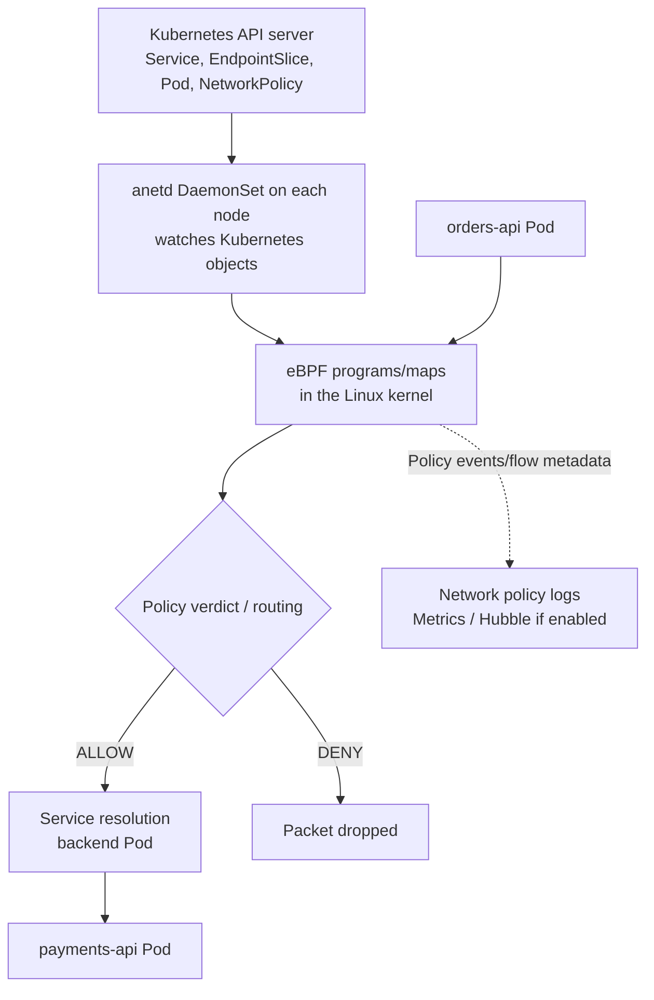
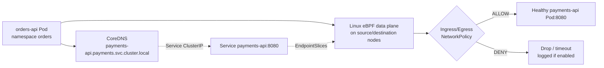

# GKE Dataplane V2 and Connection Observability

A Java service on Google Kubernetes Engine (GKE) suddenly fails to reach the payments API in another namespace. Pods remain `Running`, DNS still returns the right IP, the Service has endpoints, yet TCP requests time out right after the security team updates a `NetworkPolicy`. Looking at application logs alone makes it hard for operations teams to tell whether the fault lies in **Service routing**, **DNS**, **policy**, **VPC firewall**, **egress NAT**, or the destination application itself. **GKE Dataplane V2** provides an **eBPF**-based data plane and observability mechanisms to inspect Kubernetes connections closer to where packets are handled.

This lesson belongs to the **Advanced GKE and Operations** chapter of the **CLOUD_PROVIDERS_GCP** module. It connects project/IAM/VPC architecture, GKE, Cloud Run, storage, and databases to reliability operations: understanding Pod-to-Pod, Service, and Internet/on-premises flows; enforcing NetworkPolicies; enabling and reading network policy logging, metrics, and Hubble flow observability; troubleshooting; and controlling costs. Examples target GKE on Google Cloud—do not apply them mechanically to GKE on AWS/Azure or Google Distributed Cloud.

> Projects, clusters, namespaces, images, and workloads here are all **placeholders**. Commands creating clusters, enabling telemetry, launching Pods, or applying `NetworkPolicy` can change costs and drop connections. Run them only with proper authorization, after checking `kubectl config current-context`, and with a rollback plan. Never log payloads, tokens, or customer data into network observability logs.

## Learning Objectives

After this lesson, you will be able to:

1. Explain the GKE data plane, **eBPF**, **Cilium**, `anetd`, Service load balancing, and NetworkPolicy enforcement.
2. Contrast **GKE Dataplane V2** with `kube-proxy`/`iptables` data planes and recognize limits that must be tested.
3. Verify which data plane a cluster uses, select it when creating a **Standard cluster**, understand its default status on **Autopilot**, and evaluate migration paths for older clusters.
4. Author `NetworkPolicy` rules restricting Pod ingress/egress, understanding additive allow rules, default deny, selectors, and DNS/metadata-server requirements.
5. Use the **NetworkLogging CRD** and **Cloud Logging `policy-action`** to observe policy **allow/deny** verdicts, distinguishing enforcement from log presence.
6. Configure **Dataplane V2 metrics** with Managed Service for Prometheus, read flow metrics, and recognize cardinality and sampling limits.
7. Distinguish logging from optional **Hubble flow observability** to inspect flow metadata and Service dependencies.
8. Troubleshoot connectivity using a layered runbook while protecting SLOs and observability costs.

## 1. What Is the Data Plane in GKE?

The Kubernetes **control plane** stores desired state (Pods, Services, EndpointSlices, NetworkPolicies) and runs controllers and the scheduler. The **data plane** on each node performs the actual packet work: delivering packets to destination Pods, choosing Service backends, evaluating policies, and tracking connections.



This is a **logical diagram**; exact packet paths depend on same-node vs. cross-node routing, ingress vs. egress, Service type, GKE version, and network topology. Do not misread the `eBPF → Service` arrow as meaning packets pass through a user-space daemon: **eBPF runs in the kernel** for the data path, while `anetd` programs and manages the configuration.

### Key Terminology

| Term | Role | Often confused with |
| --- | --- | --- |
| **eBPF** | Technology running verified programs inside the Linux kernel to process packets/state | A new network protocol |
| **Cilium-based dataplane** | Underlying GKE-managed technology handling Services and NetworkPolicies | Arbitrary self-installed Cilium with full manual control |
| **`anetd`** | GKE Dataplane V2 agent/DaemonSet on nodes | `kube-proxy` |
| **eBPF maps** | Kernel data structures holding policies, Service backends, connection state, etc. | Kubernetes ConfigMaps |
| **NetworkPolicy** | Kubernetes API declaring **allowed** traffic into/out of Pods | VPC firewall rules or IAM roles |
| **NetworkLogging** | GKE CRD specifying which policy events are logged | A NetworkPolicy itself |
| **Hubble** | Tooling/pipeline to observe data plane network flows when enabled | Full HTTP body / TLS payload capture |
| **EndpointSlice** | List of a Service's endpoints, ports, and ready states | Control plane endpoint |

### Dataplane V2 Is Not a Java Library

Java applications still call `https://payments-api...` as usual. The difference happens on the node and in the kernel when handling Service lookups, routing, and policy enforcement. Thus JVM exceptions like `ConnectException`, `SocketTimeoutException`, or `UnknownHostException` are only **application-layer symptoms** that must be corroborated with network evidence before modifying code.

## 2. Dataplane V2 vs. the Traditional kube-proxy Model

In GKE clusters without Dataplane V2, Service routing typically relies on `kube-proxy` and `iptables` rules. Dataplane V2 uses **eBPF** for both Kubernetes Services and NetworkPolicy without relying on `kube-proxy` for Service routing.

| Aspect | kube-proxy/iptables (typical model) | GKE Dataplane V2 |
| --- | --- | --- |
| Service ClusterIP/backend routing | `kube-proxy` updates iptables rules | eBPF programs/maps managed by `anetd` |
| Kubernetes NetworkPolicy | Requires a separate provider such as Calico | **Built-in and always enforced** |
| Observing policy decisions | Depends on external plugins/tooling | Built-in **network policy logging** (must be configured) |
| Flow metadata/metrics | Uses separate agents/monitoring | Built-in **Dataplane V2 observability** when enabled |
| Operations | Inspect `kube-proxy` rules | Inspect `anetd`, EndpointSlices, policies, and telemetry |
| Limits | Bound by `kube-proxy` mode and rule counts | Bound by eBPF map capacities, kernel, labels, and version |

Never claim Dataplane V2 is **always X% faster**: real-world performance depends on workload, Service count, connection rates, Pod churn, machine type, and topology. Measure baseline CPU, latency, and packet drops before and after changes. Dataplane V2 relies on finite eBPF maps and should never be treated as infinitely scalable.

### Benefits and Responsibilities

- **Scalability:** reduces bottlenecks associated with large `kube-proxy`/`iptables` rule sets.
- **Security:** native NetworkPolicy enforcement without manually enabling Calico.
- **Operations:** Google-supported policy logging, data plane metrics, and flow observability.
- **Support boundaries:** never manually alter internal `anetd`/`cilium-config` settings or attach **custom eBPF programs** to GKE-managed network interfaces; doing so risks conflicts, outages, and unsupported states.

## 3. Checking Which Data Plane a Cluster Uses

Example project/cluster values:

```text
PROJECT_ID=retail-dev-01
CLUSTER=retail-gke-dev
LOCATION=asia-southeast1
NAMESPACE=dpv2-lab
```

**Step 1 — Check gcloud principal/context and cluster configuration:**

```bash
PROJECT_ID="retail-dev-01"
CLUSTER="retail-gke-dev"
LOCATION="asia-southeast1"

gcloud auth list
gcloud config get-value project

# Read-only cluster configuration check.
gcloud container clusters describe "$CLUSTER" \
  --project="$PROJECT_ID" \
  --location="$LOCATION" \
  --format="yaml(name,location,networkConfig.datapathProvider,currentMasterVersion)"
```

`networkConfig.datapathProvider: ADVANCED_DATAPATH` confirms Dataplane V2. Never guess from the cluster name alone, because Standard clusters may run a different data plane.

**Step 2 — Use kubectl with the right context:**

```bash
# Writes to local kubeconfig; does not create or alter the cluster.
gcloud container clusters get-credentials "$CLUSTER" \
  --project="$PROJECT_ID" --location="$LOCATION"

kubectl config current-context
kubectl get nodes -o wide

# Inspect Dataplane V2 anetd DaemonSet Pods.
kubectl -n kube-system get pods -l k8s-app=cilium -o wide
```

When Dataplane V2 is enabled, the `k8s-app=cilium` selector typically returns Pods prefixed with `anetd-`. Never treat missing RBAC permission to view `kube-system` as proof the data plane isn't running; rely on `gcloud describe` if you lack `kube-system` read access.

**Step 3 — Check `NetworkPolicy`:**

```bash
kubectl get networkpolicy --all-namespaces
kubectl get networklogging default -o yaml
```

The second command applies only to Dataplane V2 clusters containing the `NetworkLogging` CRD. Never invent a custom CRD or install another Cilium distribution if `networklogging` doesn't show up; verify the cluster mode, GKE version, and RBAC first.

## 4. Selecting Dataplane V2 at Cluster Creation and During Upgrades

### Standard and Autopilot

- **Autopilot:** Dataplane V2 is enabled by default on new Autopilot clusters.
- **Standard:** pass `--enable-dataplane-v2` at **cluster creation**.
- NetworkPolicy enforcement is built into Dataplane V2. Commands toggling the legacy Calico NetworkPolicy add-on may be **rejected**; never configure both in parallel.

Example creating a Standard **lab cluster** (incurs resource charges):

```bash
# MODIFIES INFRASTRUCTURE / INCURS CHARGES.
# Verify network/subnet, quotas, version, node pool, and security before running.
gcloud container clusters create retail-gke-dpv2-lab \
  --project="retail-dev-01" \
  --location="asia-southeast1" \
  --enable-ip-alias \
  --enable-dataplane-v2 \
  --num-nodes=1
```

In a **regional** cluster, `--num-nodes=1` can apply **per zone** depending on node locations, costing more than expected. This is illustrative syntax only—do not assume it provisions a single VM. Production clusters need private control plane/endpoints, Workload Identity Federation, proper node pools, autoscaling, logging, monitoring, image security, quotas, and dedicated IaC.

### Can an Existing Dataplane V1 Cluster Migrate to V2?

In the **stable/standard** workflow, the data plane is chosen at cluster creation—you cannot simply run `gcloud clusters update --enable-dataplane-v2` on an older cluster. **However**, current GKE documentation provides a ***Preview* migration path** for eligible **Standard VPC-native clusters**. This is not a GA feature applicable to all clusters.

At the time of writing, Preview migration documentation requires at minimum:

- A VPC-native cluster (not routes-based).
- GKE cluster version **1.35.3-gke.1155000** or later.
- Node pool version **1.35.1-gke.1516000** or later.
- If using Cloud Service Mesh/Istio: compatible version **1.23** or later per CNI requirements.
- No custom CNI replacing the GKE-managed CNI and no custom eBPF programs on GKE-managed interfaces.

**Migration cannot be rolled back to Dataplane V1** once completed; evaluate constraints, test in staging, protect SLOs, and plan for disruption. If a cluster is ineligible or policies disallow Preview features, the safe path is **creating a new V2 cluster and migrating workloads** via a cutover plan. Always check live documentation at deployment time rather than copying an old command snippet.

## 5. Pod-to-Pod, Pod-to-Service, and Egress Flows

### Pod A to Service B



This is a conceptual model, not a literal packet trace. **DNS lookup** resolves the ClusterIP first; the data plane handles Service traffic and picks an endpoint. If destination Pods are not **Ready** or the Service has no endpoints, the symptom can still be a timeout rather than a policy deny.

### Traffic Types to Distinguish

| Flow | Components to inspect | Hint |
| --- | --- | --- |
| **Pod → Pod (same node)** | Pod IPs, policies, listening process, data plane | Never leaves the node |
| **Pod → Pod (cross-node)** | Pod CIDR/routes, node health, policies, VPC | Identify source and destination nodes |
| **Pod → ClusterIP Service** | DNS, Service port/targetPort, EndpointSlice, eBPF routing | Does the Service have Ready backends? |
| **Pod → Internet** | DNS, egress policy, SNAT/Cloud NAT, firewall, upstream | Without external IPs, NAT is typically needed |
| **Pod → Cloud SQL / Google APIs** | Private/public endpoint, VPC routes, IAM, Workload Identity Federation | Network allow does not imply IAM allow |
| **Ingress from external LB/Gateway** | GKE Gateway/Ingress, health checks, Service, endpoints, policy | NetworkPolicy can affect inbound Pod traffic |
| **Hybrid on-premises** | VPC, Cloud VPN/Interconnect, routes, DNS, firewalls | eBPF does not replace routing outside the cluster |

### Service-to-Pod and Readiness

When a Service has no Ready endpoints, connecting to its ClusterIP on Dataplane V2 **can time out**. With traditional `kube-proxy`, errors sometimes returned faster as `connection refused`. Never conclude a policy denied traffic based solely on a timeout; inspect `EndpointSlice`, readiness probes, and application ports.

## 6. Kubernetes NetworkPolicy in Dataplane V2

In standard Kubernetes, NetworkPolicy is an **L3/L4 policy**: it selects Pods and allows traffic based on peers (`podSelector`, `namespaceSelector`, `ipBlock`), protocols, and ports. It **does not authorize HTTP URL paths** or user identities, and does not replace mTLS/service mesh or IAM.

### Key Principles

1. If no policy selects a Pod for ingress, inbound traffic to that Pod is **not isolated by NetworkPolicy** by default.
2. Once a policy selects a Pod for `Ingress`, only traffic matching **allow rules** across applicable policies is permitted; everything else is isolated.
3. The same applies to `Egress`.
4. **Rules are additive**: multiple NetworkPolicies targeting the same Pod form the **union of their allow rules**. A "deny" policy never overrides another policy's allow rule.
5. A connection generally must satisfy **both the source's egress policy and the destination's ingress policy** when both Pods are isolated.
6. Policies match **labels**, not static Pod names; changing a label selector alters the security boundary.

### Default Deny All Ingress in One Namespace

```yaml
apiVersion: networking.k8s.io/v1
kind: NetworkPolicy
metadata:
  name: deny-all-ingress
  namespace: dpv2-lab
spec:
  podSelector: {}
  policyTypes: ["Ingress"]
  ingress: []
```

Applying this in a live namespace blocks new inbound connections to Pods unless another policy **explicitly allows them**. **Never apply directly in production** without first cataloging dependencies, opening DNS/monitoring/ingress paths, and testing in staging.

### Default Deny Ingress + Egress

```yaml
apiVersion: networking.k8s.io/v1
kind: NetworkPolicy
metadata:
  name: deny-all-ingress-egress
  namespace: dpv2-lab
spec:
  podSelector: {}
  policyTypes:
    - Ingress
    - Egress
  ingress: []
  egress: []
```

Once Egress isolation is active, **DNS**, metadata server, outbound database/Google API calls, and telemetry can fail without explicit allow rules. Do not test only with `curl`: verify Cloud DNS resolution, ADC credentials, startup probes, and monitoring agents.

### NetworkPolicy Does Not Replace VPC Firewalls

VPC firewall policies operate on GCP network paths and resources; Kubernetes NetworkPolicies operate on Pods by identity/labels and namespace. Traffic can be blocked at **either layer** or by a destination service's own firewall. Opening a NetworkPolicy does not open a VPC firewall, and opening a VPC firewall does not bypass a NetworkPolicy.

## 7. Lab: Allowing Only One Client Pod to Call a Web Service

Lab goal: run an `nginx` web Pod and two client Pods in namespace `dpv2-lab`. A policy allows only the client labeled `access: allowed` to reach the web Service on port 80. The other client must be blocked; we inspect logs and metrics (if enabled) for evidence.

### Before Starting

```bash
gcloud auth list
kubectl config current-context
kubectl get nodes
kubectl get networkpolicy -A

# MODIFIES cluster; run only on an authorized lab cluster.
kubectl create namespace dpv2-lab
```

If the namespace already exists, do not recreate it. Operators should use scoped Kubernetes RBAC rather than broad `cluster-admin`.

### Test Deployment and Service

Save the manifest **on your lab workstation** as `web-lab.yaml`:

```yaml
apiVersion: apps/v1
kind: Deployment
metadata:
  name: web
  namespace: dpv2-lab
spec:
  replicas: 1
  selector:
    matchLabels:
      app: web
  template:
    metadata:
      labels:
        app: web
    spec:
      containers:
        - name: nginx
          image: nginx:1.27.5
          ports:
            - containerPort: 80
          readinessProbe:
            httpGet:
              path: /
              port: 80
            initialDelaySeconds: 2
            periodSeconds: 5
---
apiVersion: v1
kind: Service
metadata:
  name: web
  namespace: dpv2-lab
spec:
  selector:
    app: web
  ports:
    - name: http
      protocol: TCP
      port: 80
      targetPort: 80
```

Image tags here are for lab convenience; production workloads should pin verified **digests**, declare resource requests/limits, and apply Pod Security and full network policies.

### NetworkPolicy Allowing Only the Approved Client

Save as `web-allow.yaml`:

```yaml
apiVersion: networking.k8s.io/v1
kind: NetworkPolicy
metadata:
  name: allow-approved-clients-to-web
  namespace: dpv2-lab
spec:
  podSelector:
    matchLabels:
      app: web
  policyTypes:
    - Ingress
  ingress:
    - from:
        - podSelector:
            matchLabels:
              access: allowed
      ports:
        - protocol: TCP
          port: 80
```

This is a **same-namespace selector**, not a cross-namespace allow. It selects `app=web` to isolate web's ingress and allows **Pods labeled `access=allowed`** in the same namespace to reach TCP/80. It **does not isolate web's egress** and does not isolate the client Pods themselves.

### Apply and Generate Requests

```bash
# Modifies resources in the lab namespace.
kubectl apply -f web-lab.yaml
kubectl apply -f web-allow.yaml

kubectl -n dpv2-lab rollout status deployment/web
kubectl -n dpv2-lab get service web
kubectl -n dpv2-lab get endpointslice -l kubernetes.io/service-name=web
kubectl -n dpv2-lab describe networkpolicy allow-approved-clients-to-web

# Two lab-only client Pods.
kubectl -n dpv2-lab run allowed \
  --image=curlimages/curl:8.11.1 \
  --labels="access=allowed" \
  --restart=Never --command -- sleep 3600

kubectl -n dpv2-lab run blocked \
  --image=curlimages/curl:8.11.1 \
  --labels="access=blocked" \
  --restart=Never --command -- sleep 3600

kubectl -n dpv2-lab wait --for=condition=Ready pod/allowed --timeout=120s
kubectl -n dpv2-lab wait --for=condition=Ready pod/blocked --timeout=120s
```

**Permitted check:**

```bash
kubectl -n dpv2-lab exec allowed -- \
  curl -sS -m 5 -o /dev/null -w "HTTP %{http_code}\n" http://web
```

Expect HTTP `200`. **Denied check:**

```bash
kubectl -n dpv2-lab exec blocked -- \
  curl -v -m 5 http://web
```

Expect the connection to fail to establish before the timeout or get dropped per the data plane; exact behavior varies by kernel and GKE version. **A timeout alone does not prove policy enforcement**: cross-check `NetworkPolicy`, EndpointSlice, readiness, and policy logs if enabled. To rule out a broken web Pod, compare `allowed` and `blocked` clients back-to-back.

### Clean Up the Lab (Modifies Resources)

After confirming no other workloads use the lab namespace:

```bash
kubectl -n dpv2-lab delete pod allowed blocked --ignore-not-found
kubectl -n dpv2-lab delete networkpolicy allow-approved-clients-to-web \
  --ignore-not-found
kubectl -n dpv2-lab delete service web --ignore-not-found
kubectl -n dpv2-lab delete deployment web --ignore-not-found
```

Do not wildcard-delete whole namespaces without verifying owners and contents. If a standalone lab cluster was provisioned, tearing down the cluster follows a separate runbook checking data and budgets.

## 8. NetworkPolicy Edge Cases Requiring Extra Care

### 8.1 Selecting Namespaces and Pods Accurately

To let `orders-api` in namespace `orders` call `payments-api` in namespace `payments`, verify **labels on both the namespace and the Pod**. An ingress policy in `payments` can be written as:

```yaml
apiVersion: networking.k8s.io/v1
kind: NetworkPolicy
metadata:
  name: allow-orders-to-payments
  namespace: payments
spec:
  podSelector:
    matchLabels:
      app: payments-api
  policyTypes: ["Ingress"]
  ingress:
    - from:
        - namespaceSelector:
            matchLabels:
              kubernetes.io/metadata.name: orders
          podSelector:
            matchLabels:
              app: orders-api
      ports:
        - protocol: TCP
          port: 8080
```

Within **a single list item** of `from`, `namespaceSelector` **and** `podSelector` combine with **AND**: only `app=orders-api` Pods inside namespace `orders`. However, two separate list items:

```yaml
from:
  - namespaceSelector:
      matchLabels:
        kubernetes.io/metadata.name: orders
  - podSelector:
      matchLabels:
        app: orders-api
```

mean **OR**: allowing **every Pod in namespace `orders`** OR **Pods labeled `orders-api` in the policy's own namespace**. This YAML mistake commonly widens access unintentionally. Always verify indentation, namespace labels, and `kubectl get networkpolicy ... -o yaml` after applying.

### 8.2 Using ipBlock

In Dataplane V2, **do not put Pod IPs or Service ClusterIPs in `ipBlock.cidr`** in place of selectors; GKE has documented limitations with those addresses. Use `podSelector`/`namespaceSelector` for in-cluster workloads. `ipBlock` fits policies targeting specific external IP ranges where supported.

Pod IPs change whenever Pods are recreated. Label- and namespace-based selectors keep policies accurate across Pod restarts.

### 8.3 Port Ranges and `endPort`

`NetworkPolicy` supports `endPort` for port ranges. In **GKE Dataplane V2 versions prior to 1.32**, `endPort` **was not supported** and could be stripped by the API server. In GKE **1.32 and later**, it is supported per documentation.

After applying, **read back the stored object**:

```bash
kubectl get networkpolicy -n dpv2-lab \
  allow-approved-clients-to-web -o yaml
```

**The object stored by Kubernetes** is the source of truth—not your local pre-apply YAML file. On older clusters requiring strict enforcement, do not assume an unsupported port range is active.

### 8.4 DNS When Egress Isolation Is Active

An application can have TCP access to a destination IP yet fail to resolve `payments-api.payments.svc.cluster.local` if DNS is blocked. On GKE, DNS may go through **`kube-dns`** or **NodeLocal DNSCache** depending on cluster settings, so inspect the actual path.

Sample **egress allow DNS snippet** for an isolated Pod, valid only when `kube-dns` Pods carry those labels:

```yaml
egress:
  - to:
      - namespaceSelector:
          matchLabels:
            kubernetes.io/metadata.name: kube-system
        podSelector:
          matchLabels:
            k8s-app: kube-dns
    ports:
      - protocol: UDP
        port: 53
      - protocol: TCP
        port: 53
```

If the cluster runs NodeLocal DNSCache, DNS queries may not hit Pods with that label; inspect `kube-system`, nameservers in `/etc/resolv.conf`, and GKE DNS docs. The snippet above is only **a `spec.egress` fragment**, not a standalone complete NetworkPolicy.

### 8.5 Workload Identity Federation and Metadata

If a Pod using **Workload Identity Federation for GKE** has isolated egress, you must allow access to the **GKE metadata server**. For GKE Dataplane V2, documentation specifies allowing egress to **`169.254.169.254/32` on TCP ports 80 and 8080** when using this mechanism.

Example `spec.egress` snippet:

```yaml
egress:
  - to:
      - ipBlock:
          cidr: 169.254.169.254/32
    ports:
      - protocol: TCP
        port: 80
      - protocol: TCP
        port: 8080
```

**Do not broaden this rule to all of `169.254.0.0/16`** unnecessarily. GKE Dataplane V1 / legacy clusters can use a different metadata IP and port; never copy metadata egress rules blindly across data planes.

### 8.6 Health Probes from Nodes

In some newer GKE 1.35 versions, node-local health checks and NodeLocal DNSCache may originate from **`169.254.4.6`** rather than the usual node Pod CIDR gateway address. Standard Kubernetes NetworkPolicy allows certain node-local probes automatically, yet **an application's internal IP allowlist** might reject them. If readiness probes suddenly fail after an upgrade, check app ACLs and release notes before widening network ranges.

## 9. Network Policy Logging: Recording Allow/Deny Verdicts

**Network policy logging** is a companion feature in Dataplane V2, though logging must be **explicitly configured**. It records policy-related **connection events**—not full packet payloads—and does not guarantee every single packet is logged.

### The NetworkLogging CRD

GKE creates a **`NetworkLogging` object named `default`** in new Dataplane V2 clusters. There is **only one** such object per cluster and it cannot be renamed.

Inspect before modifying:

```bash
# Read-only; requires appropriate RBAC:
kubectl get networklogging default -o yaml
kubectl describe networklogging default
```

Example configuration **prioritizing deny logging** to avoid flooding production with allow logs:

```yaml
apiVersion: networking.gke.io/v1alpha1
kind: NetworkLogging
metadata:
  name: default
spec:
  cluster:
    allow:
      log: false
      delegate: false
    deny:
      log: true
      delegate: false
```

This is a **cluster-wide observability configuration change**. In an authorized lab, an admin can save it as `networklogging-deny.yaml` and apply:

```bash
# MODIFIES cluster-wide NetworkLogging.
kubectl apply -f networklogging-deny.yaml

# Re-read and check events if configuration fails validation.
kubectl get networklogging default -o yaml
kubectl describe networklogging default
```

Before applying, **save the previous configuration in your runbook or change ticket**. Never edit the CRD experimentally without authorization and a rollback plan.

### Logging Both Allow and Deny

In staging, you may want both directions visible for verification:

```yaml
apiVersion: networking.gke.io/v1alpha1
kind: NetworkLogging
metadata:
  name: default
spec:
  cluster:
    allow:
      log: true
      delegate: false
    deny:
      log: true
      delegate: false
```

**Warning:** Logging all allowed connections cluster-wide can generate massive event volumes, inflate stored log size, and bury real errors. Scope and time-box allow logging deliberately.

### `delegate` Mode

`delegate` enables targeted scoping of logging:

| Configuration | Meaning | Prerequisite |
| --- | --- | --- |
| `cluster.allow.log=true, delegate=false` | Logs allowed connections cluster-wide | Can rapidly increase log volume |
| `cluster.deny.log=true, delegate=false` | Logs denied connections | Suitable during active investigation |
| `cluster.allow.log=true, delegate=true` | Logs allows only for policies carrying the logging annotation | Annotation on **NetworkPolicy** |
| `cluster.deny.log=true, delegate=true` | Logs denies only for Pods in annotated namespaces | Annotation on **Namespace** |

For per-policy allow logging, add this annotation to the **NetworkPolicy**:

```yaml
metadata:
  annotations:
    policy.network.gke.io/enable-logging: "true"
```

For per-namespace deny logging, add this annotation to the **Namespace**:

```yaml
metadata:
  annotations:
    policy.network.gke.io/enable-deny-logging: "true"
```

Never set `delegate=true` with `log=false` for the same allow/deny branch: that configuration is **invalid**. Choose delegation settings after evaluating security sensitivity, log volume, namespace owners, and visibility needs.

### Network Policy Logs Do Not Capture Every Packet

- Logs reflect **connections** and policy verdicts per data plane mechanics, not full packet captures.
- Each node enforces a log rate limit; documentation notes a cap around **500 connections/s** before dropping log events, while **policies continue to be enforced**.
- Therefore, **"no log found" does not prove** no connection occurred or that NetworkPolicy failed to block it.
- You can inspect `policy_logging` metrics exported by `anetd` to check for dropped logs per documentation, provided access to node/Pod metrics endpoints is authorized; never expose internal metrics ports publicly.

## 10. Viewing Policy Logs in Cloud Logging

When Cloud Logging is enabled, network policy logs appear in log **`policy-action`** under resource type **`k8s_node`**.

### Logs Explorer Filters

```text
resource.type="k8s_node"
resource.labels.cluster_name="retail-gke-dev"
resource.labels.location="asia-southeast1"
logName="projects/retail-dev-01/logs/policy-action"
```

To show only denied connections, add:

```text
jsonPayload.disposition="deny"
```

To inspect a specific destination Pod, filter on:

```text
jsonPayload.dest.pod_namespace="dpv2-lab"
jsonPayload.dest.pod_name=~"web"
```

To filter by policy metadata:

```text
jsonPayload.policies.namespace="dpv2-lab"
jsonPayload.policies.name="allow-approved-clients-to-web"
```

**The snippets above are additive filter clauses** to combine with the base log filter according to live entry fields. A denied connection will not necessarily carry the name of an **allow policy** you expected to match, because no rule matched. Inspect a real log entry's payload before wiring field names into production alerts.

### Read-Only CLI

```bash
PROJECT_ID="retail-dev-01"
CLUSTER="retail-gke-dev"
LOCATION="asia-southeast1"

gcloud logging read \
  'resource.type="k8s_node" AND resource.labels.cluster_name="retail-gke-dev" AND jsonPayload.disposition="deny"' \
  --project="$PROJECT_ID" \
  --limit=25 \
  --format="table(timestamp,jsonPayload.disposition,jsonPayload.src.pod_name,jsonPayload.dest.pod_name)"
```

If the CLI returns nothing, check `roles/logging.viewer` (or narrower equivalent), time range, project ID, `NetworkLogging` config, and log exclusions. Do not grant broad Logs Viewer to every developer in production if logs expose sensitive network topology.

### Reading an Event Properly

Logical illustration of a policy event (not an exact JSON schema):

```text
Time:         2026-11-19T01:23:45Z
Source Pod:   dpv2-lab/blocked
Destination:  dpv2-lab/web-xxxxx:80
Disposition:  deny
Protocol:     TCP
Policy:       No matching ingress allow rule
```

Interpretation: at that moment, the data plane determined **a connection was unauthorized** under policy and did not forward packets. It does not claim the web process crashed, DNS broke, browser caching failed, or the Java code has a bug.

### When Logs Are Missing

| Possibility | How to verify |
| --- | --- |
| `NetworkLogging` lacks `deny.log` | `kubectl get networklogging default -o yaml` |
| `delegate=true` without required annotations | Inspect namespace / NetworkPolicy metadata |
| Logging disabled or excluded by sink | Inspect GKE / Cloud Logging config and exclusions |
| Log rate limit exceeded | Check dropped log counters if authorized |
| Request failed before policy evaluation | Inspect DNS, EndpointSlice, firewalls, or routes |
| Zero traffic during the filter window | Send a controlled test request and widen the time range |
| Insufficient IAM to view logs | Verify Logging Viewer scope/permissions |

## 11. Dataplane V2 Metrics and Managed Service for Prometheus

**Metrics** answer "how many?", "rising or falling?", and "which namespace generates the most egress?" rather than listing every individual flow. GKE Dataplane V2 observability is documented for **GKE 1.32 and later** under specific version and feature prerequisites.

### Two Distinct Observability Layers

| Tool | Data type | Best suited for |
| --- | --- | --- |
| Network policy logging | Allowed/denied connection events in Cloud Logging | Pinpointing blocking rules, investigating policy changes |
| Dataplane V2 metrics | Flow counters/rates/labels via Managed Prometheus / Cloud Monitoring | Dashboards, alerts, baselines, network statistics |
| Hubble flow observability | Live/historical flow metadata within buffer/storage limits | Inspecting service-to-service connections and policy verdicts |
| VPC Flow Logs | Traffic metadata at the VPC interface/subnet layer | VPC/hybrid/egress visibility; does not replace Pod policy context |
| Application traces/logs | HTTP spans, status codes, exceptions, correlation IDs | Tracing user requests, latency, and business errors |

Never turn everything on without evaluating **data volume, read permissions, sampling, and retention**.

### Enabling Metrics on an Existing Dataplane V2 Cluster

GKE documentation supports enabling **metrics independently** of Hubble tools on eligible Dataplane V2 clusters. The command below **changes cluster observability settings**:

```bash
# MODIFIES CLUSTER: only on eligible GKE Dataplane V2 clusters.
gcloud container clusters update retail-gke-dev \
  --project="retail-dev-01" \
  --location="asia-southeast1" \
  --enable-managed-prometheus \
  --enable-dataplane-v2-metrics
```

Before running, verify `networkConfig.datapathProvider`, version, quotas, and org policies. `--enable-dataplane-v2-metrics` **does not** upgrade a legacy Dataplane V1 cluster to Dataplane V2. On Standard clusters, this exposes metrics ports on nodes per the feature's architecture; protect access and comply with network policies.

### Creating a New Standard Cluster with Metrics

```bash
# CREATES INFRASTRUCTURE: incurs cluster/node/metrics charges.
gcloud container clusters create retail-gke-dpv2-lab \
  --project="retail-dev-01" \
  --location="asia-southeast1" \
  --enable-ip-alias \
  --enable-dataplane-v2 \
  --enable-managed-prometheus \
  --enable-dataplane-v2-metrics
```

This is an **alternative** to the cluster creation command in section 4—**do not run both with the same cluster name**. For Autopilot, use the Autopilot command and its supported flags rather than copying Standard flags verbatim.

### Reading Metrics

In **Cloud Monitoring → Metrics Explorer**, look for data plane metrics such as:

- `pod_flow_ingress_flows_count`: inbound Pod flows aggregated by labels.
- `pod_flow_egress_flows_count`: outbound Pod flows aggregated by labels.

Full metric names in Metrics Explorer may appear as **`prometheus/.../counter`** depending on display format and version; pick the actually ingested metric from the UI rather than guessing a name. Group by supported cluster, namespace, workload/source/destination, or policy labels.

### Questions Dashboards Should Answer

1. Did inbound/outbound connection or flow rates in namespace `orders` spike abnormally?
2. During a new `NetworkPolicy` rollout, did **deny events** and connection errors rise together?
3. Which external egress destinations exceed baseline?
4. Does any Pod or node show a drastically different flow rate from sibling Pods in the same Deployment?
5. Do spikes correlate with application `5xx`, `p95/p99 latency`, CPU/node saturation, or HPA scaling?

**Flow count is not HTTP request count**: one TCP connection can carry many HTTP requests (HTTP keep-alive, HTTP/2), and one request can open multiple connections. Never derive business transaction counts from network flow counters.

### Cardinality, Sampling, and Cost

High-label metrics (Pod name, destination, port, policy, direction, etc.) can cause high **time-series cardinality** and inflate billable samples and Monitoring costs. Enable only the labels, dimensions, and retention truly needed for SLOs; check Metrics Management and Billing after rollout.

Whenever a `Pod` is recreated, its name and identity change, creating new time series. For long-term trend dashboards, aggregate by **namespace/workload/service** where available instead of tracking individual Pod names indefinitely.

## 12. Hubble Flow Observability: Inspecting Connections Beyond Counters

GKE provides optional **Dataplane V2 flow observability** (built on Hubble). It is **not enabled automatically just because Dataplane V2 is running**. You can toggle it **independently** of Dataplane V2 metrics on supported clusters and versions.

### Enabling Hubble / Flow Observability

```bash
# MODIFIES CLUSTER: enables flow observability.
# Apply only when GKE version, mode, and permissions support it.
gcloud container clusters update retail-gke-dev \
  --project="retail-dev-01" \
  --location="asia-southeast1" \
  --enable-dataplane-v2-flow-observability
```

Check product guidance for **private endpoints**, IAM, networking, and reachability; never expose observability endpoints publicly to the Internet. If a GKE version or edition disallows it, never install privileged third-party agents to bypass platform limits.

### Reading Flow Metadata with the GKE-Deployed Hubble CLI

Per current documentation, when enabled, GKE deploys **`hubble-relay`** with container **`hubble-cli`** in namespace **`gke-managed-dpv2-observability`**:

```bash
# Read-only; requires RBAC to get Pods and exec in the system namespace.
kubectl get deployment -n gke-managed-dpv2-observability

# View a bounded sample of flow metadata.
kubectl exec deployment/hubble-relay \
  -c hubble-cli \
  -n gke-managed-dpv2-observability \
  -- hubble observe

# View flows related to namespace dpv2-lab.
kubectl exec deployment/hubble-relay \
  -c hubble-cli \
  -n gke-managed-dpv2-observability \
  -- hubble observe -n dpv2-lab
```

For live streaming, the CLI offers `hubble observe -f`; avoid leaving unbounded streams open in CI or automated logging scripts. Verify exact flags against the Hubble CLI version deployed on your cluster.

**RBAC warning:** `kubectl exec` into a system namespace is a sensitive privilege capable of running commands inside system Pods. Restrict it to authorized platform/SRE operators with change approval. Never grant broad `ClusterRoleBinding` permissions to developers just to run Hubble.

### Hubble UI and Service Dependencies

Hubble UI visualizes **source workload → destination workload** flows, protocols/ports, policy verdicts, and timestamps, helping uncover undocumented dependencies. Keep in mind:

- Visibility depends on feature enablement, permissions, and buffer/retention limits.
- Data can be dropped due to sampling, CPU/memory limits, or tool restarts; do not treat it as an infallible audit ledger.
- Do not expect decrypted TLS contents, request bodies, or secret tokens.
- Dedicated UI/relay endpoints must be secured per GKE guidance.

### Hubble Flows vs. Network Policy Logs

Hubble focuses on **connection paths and flow metadata**, making service-to-service traffic and drops easy to explore; `policy-action` focuses on **policy enforcement events** persisted in Cloud Logging. Both have distinct scopes, configurations, and limits; combine them with application logs to measure real user impact.

## 13. Layered Connectivity Troubleshooting Runbook

When a Java service throws `ConnectTimeoutException`, gather **least-invasive evidence** first to isolate the failing layer instead of blindly editing policies.

### Step 0 — Scope the Incident

Record:

```text
Project / Cluster / Location:
Source namespace and Pod:
Destination namespace / Service / Port:
UTC time window:
Request command and symptoms:
Application version / deployment timestamp:
Recent NetworkPolicy / VPC / firewall / ingress changes:
```

Confirm `current-context` and keep PII out of logs and tickets.

### Step 1 — Workload and DNS

```bash
kubectl config current-context
kubectl get pods -n orders -o wide
kubectl get pods -n payments -o wide
kubectl get service -n payments payments-api -o wide
kubectl get endpointslice -n payments \
  -l kubernetes.io/service-name=payments-api
```

If `EndpointSlice` has no Ready backends, check Deployment replicas, Pod readiness, container ports, and label selectors. Do not touch eBPF while Kubernetes lacks valid endpoints.

Inside an authorized debug Pod:

```bash
# Run in a container shell with nslookup/curl or an approved debug Pod.
nslookup payments-api.payments.svc.cluster.local
curl -v --connect-timeout 3 --max-time 8 \
  http://payments-api.payments.svc.cluster.local:8080/healthz
```

If DNS fails, check CoreDNS/NodeLocal DNSCache, `/etc/resolv.conf`, and UDP/TCP/53 egress. If DNS succeeds and TCP times out, investigate Services, NetworkPolicies, and routing.

### Step 2 — NetworkPolicy on Both Ends

```bash
kubectl get networkpolicy -n orders -o yaml
kubectl get networkpolicy -n payments -o yaml

kubectl get namespace orders payments --show-labels
kubectl get pod -n orders -l app=orders-api --show-labels
kubectl get pod -n payments -l app=payments-api --show-labels
```

Compare **Pod labels**, **namespace labels**, `policyTypes`, `egress.to`, and `ingress.from`. When source egress or destination ingress is isolated, both sides need matching allow rules. Never confuse `podSelector: {}` (all Pods) with a specific selector.

### Step 3 — Policy Logs and Hubble Flows

1. In Cloud Logging, filter `policy-action` by cluster, time window, and destination.
2. Search for `jsonPayload.disposition="deny"` and check source/destination labels.
3. If Hubble is enabled, inspect flows for source/destination namespaces and ports.
4. Compare a **known-good connection** against the failing one; confirm logs weren't dropped by rate limits.

If logs show **deny**, identify the exact policy/selector mismatch and apply the minimal fix. If no deny appears, inspect logging configuration and outer layers—**never assume traffic was allowed** merely because no deny event was logged.

### Step 4 — VPC, External Traffic, and Hybrid Paths

- Pod → external Internet: Cloud NAT, routes, public DNS, `ip-masq-agent`/SNAT, egress firewalls, upstream allowlists.
- Pod → Cloud SQL: private/public endpoint, VPC routes, NetworkPolicy, IAM/Workload Identity Federation, Cloud SQL Auth Proxy or connector.
- Pod → on-premises: Cloud VPN/Interconnect, BGP advertisements, DNS forwarders, firewalls on both sides, return paths.
- Ingress → Pod: Gateway/Ingress/backend health, NEG endpoints, health checks, Service `targetPort`, and policies.

**A NetworkPolicy allow does not replace external ACLs or authorization.** A Pod calling Cloud Storage can still get HTTP 403 from IAM even with perfect network connectivity.

### Step 5 — Node and Data Plane Health

```bash
kubectl get nodes -o wide
kubectl -n kube-system get pods -l k8s-app=cilium -o wide
kubectl get events -A --sort-by=.lastTimestamp
```

Only when evidence points to a node or data plane fault should authorized operators inspect `anetd` or kubelet logs. **Never manually restart the `anetd` DaemonSet, delete `cilium-config`, edit eBPF maps, or attach ad-hoc eBPF probes** in production; those actions can cause cluster-wide network outages.

### Step 6 — Prove the Fix and Prevent Recurrence

After applying a scoped policy fix:

1. Re-run both an **allowed** test request and a request that **must be denied**.
2. Verify healthy EndpointSlices, Logs Explorer, and flow metrics.
3. Confirm `5xx`, `p95 latency`, and Java service success rates return to normal.
4. Record the change ID, root cause, regression tests, and rollback plan.

## 14. Operational Technical Limitations to Know

Each GKE version can have known issues; before upgrading, read the **release notes for the exact minor/patch version** and test in staging.

| Situation | Operational meaning | What to do |
| --- | --- | --- |
| No `kube-proxy` present | Intended design of Dataplane V2, not a missing service | Inspect `anetd` and eBPF routing |
| `hostPort` + passthrough LB/NodePort range | Connection limitations exist on Dataplane V2 | Prefer standard `NodePort`/Gateway Services |
| `endPort` on GKE below 1.32 | Port range policy may be ignored | Read back the stored object; upgrade or redesign |
| Not-ready endpoints | Service connections may time out | Inspect readiness and EndpointSlices before blaming policy |
| Cilium identity churn | High-cardinality Pod labels inflate identities | Reduce high-cardinality labels and check release notes |
| Custom eBPF/CNI | Can conflict with GKE-installed eBPF | Never attach custom programs to GKE-managed interfaces |
| NodeLocal DNS/health source IP after GKE 1.35 | App ACLs may miss `169.254.4.6` | Check readiness, app allowlists, and version notes |
| Cloud Service Mesh / Istio upgrades | CNI compatibility with newer GKE versions | Verify CNI/Istio compatibility matrix before upgrading |
| Expecting policy logs for every packet | Log generation is bounded and configurable | Never treat "no log" as sole proof |
| Missing RBAC for observability | Cannot read `kube-system` or observability namespaces | Grant scoped read access rather than broad cluster-admin |

### Service Mesh and L7 Policies

**Standard NetworkPolicy** handles L3/L4; mTLS, HTTP routing, retries, circuit breaking, per-method authorization, and distributed tracing live in other layers such as Cloud Service Mesh, Gateway API, and application code. Permitting a TCP connection via eBPF does not guarantee the backend has IAM permission to read a database or accepts a user's JWT.

## 15. Monitoring SLOs and Observability Costs

Operating a data plane means looking beyond "deny logs exist." Combine signals on a single dashboard:

| Signal | Metric/log source | Meaning |
| --- | --- | --- |
| Application success rate | App logs/traces/SLOs | Real impact on users |
| TCP connect latency/errors | App telemetry, synthetic client checks | Are connections timing out or resetting? |
| Allowed/denied connection events | `policy-action` Cloud Logging | Did policy verdicts shift? |
| Ingress/egress flow counts | Dataplane V2 Prometheus metrics | Connection trends per namespace |
| Ready endpoint count | Kubernetes EndpointSlice / Deployment | Does the Service have healthy backends? |
| Node/`anetd` readiness | Kubernetes node / DaemonSet status | Are data plane agents healthy? |
| DNS latency/failures | CoreDNS/NodeLocal DNS metrics and app logs | Hostname resolution issues? |
| Egress NAT/network traffic | VPC / Cloud NAT / Flow Logs / Billing | Saturation or off-cluster egress fees? |
| Log ingestion & cardinality | Cloud Logging/Monitoring Billing | Is observability exceeding budget? |

### Illustrative Denial-Rate Example

Over 15 minutes, if the observability pipeline records 3,000 denied connection events and 97,000 allowed events:

```text
Observed deny share = 3,000 / (3,000 + 97,000) × 100 = 3%
```

This is the **share among recorded log events**, **not the true probability a packet was dropped**, due to log sampling, rate limits, and multiple packets per connection. Never treat this ratio as an SLA metric or proof of an attack without deeper validation.

### Pricing and Operating Telemetry Data

- **Network policy logging:** documentation notes no separate log-generation fee, though **Cloud Logging ingestion/storage/retention/routing** can incur charges.
- **Dataplane metrics:** Google Cloud Managed Service for Prometheus / Cloud Monitoring bills based on ingested samples and current pricing.
- **Hubble flow observability:** consumes CPU/memory/network for observability components and exported telemetry; verify feature terms and pricing at deployment time.
- **VPC Flow Logs:** carries its own sampling/aggregation settings and logging costs, distinct from `policy-action`.
- **Indirect impacts:** debug Pods/CLIs, LBs, NAT, cross-region egress, and long-term telemetry storage.

Set budgets/alerts, filter by project/cluster/namespace, and tune retention to security requirements. Never put sensitive data in Pod labels or store full URLs/query tokens in network telemetry.

## 16. Securing Access to Connection Metadata

Even without packet payloads, flow metadata reveals **namespace names, workloads, nodes, destination IPs, and service dependency graphs**. That architectural data can be sensitive.

### Role-Based Access Separation

| Team role | Needs to do | Appropriate access |
| --- | --- | --- |
| Developer | Read app logs and connectivity in own namespace | Scoped Kubernetes RBAC + filtered Cloud Logging scope |
| SRE | Observe multiple namespaces/clusters and triage incidents | Logs/metrics read access + scoped cluster-wide K8s read |
| Platform admin | Configure `NetworkLogging`, data plane flags, and GKE clusters | Controlled update permissions with change approval |
| Security | Audit deny events, policy changes, and compliance | Dedicated audit/log viewer access with retention controls |
| CI/CD | Apply NetworkPolicies to authorized namespaces | `networkpolicies` permissions in target namespaces, not `cluster-admin` |

`kubectl exec` into `anetd`/Hubble components grants command execution inside system Pods—**very different** from read-only access to Logs Explorer. Never grant `pods/exec` across `kube-system` to all developers.

### Preventive Practices

1. Manage NetworkPolicies via IaC/GitOps with reviews from both workload owners and security.
2. Test **both allow and deny cases** to catch YAML indentation mistakes that widen selectors.
3. Never manually modify managed `anetd` components, Cilium ConfigMaps, or eBPF programs.
4. Separate dev and prod identities; avoid using `container.admin` credentials just to debug policies.
5. Restrict access to flow logs/metadata, align retention with requirements, and keep secrets out of logs.
6. Maintain an audited **break-glass** procedure in case a bad policy blocks telemetry or critical traffic broadly.

## 17. Case Study: Java orders-api Cannot Reach payments-api

### Context

An enterprise runs:

```text
Project: retail-prod-01
Cluster: retail-gke-prod (Dataplane V2)
Source: orders/orders-api
Destination: payments/payments-api:8080
Symptoms: Java SocketTimeoutException after a NetworkPolicy rollout
Application SLO: payment success rate > 99.9%
```

Note that the SLO is a **hypothetical scenario target**, not a Google Cloud commitment.

### Evidence

- Both Deployments have `Running` Pods.
- `payments-api` Service has an `EndpointSlice` pointing to Ready Pods.
- DNS `payments-api.payments.svc.cluster.local` resolves to the ClusterIP.
- A new NetworkPolicy in `payments` combines `namespaceSelector` and `podSelector` **in one item (AND)**, but after a label refactor, the policy still looks for namespace label `team=orders-old` and Pod label `app=orders-api-v1`. Meanwhile, the source namespace and Pods carry `team=orders` and `app=orders-api`; hence **no allow rule matches**.
- Network policy logging records `deny` events toward the payments Pod on port 8080 during test requests.

### Resolution Steps

1. **Confirm context and deployment time:** record the change ID and baseline latency/error rate.
2. **Verify source:** `kubectl -n orders get pods --show-labels` and compare with the policy.
3. **Verify destination:** `kubectl -n payments get pods --show-labels`, Service, EndpointSlice, readiness.
4. **Inspect the live policy:** `kubectl get networkpolicy -n payments -o yaml` to check AND/OR selectors, TCP/8080 ingress, and namespace.
5. **Read `policy-action` logs:** confirm the deny event, source/destination Pods, and port instead of guessing from client timeouts.
6. **Apply the minimal fix:** update the label selectors to match the real source, keeping `namespaceSelector + podSelector` inside **a single item** to avoid OR widening; check source egress policies if isolated.
7. **Canary verification:** requests from `orders-api` succeed; requests from unrelated namespaces remain denied.
8. **Observe recovery:** payment success rate, p95 latency, allowed/denied logs, and error rates return to baseline.
9. **Follow-up:** add automated NetworkPolicy tests and policy-as-code checks to prevent recurrence.

### Root Cause and Lesson

The Java client wasn't "hung," nor were DNS or Cloud NAT broken. The mismatch came from **labels changing without updating the policy**, verified via targeted tests and policy logs. No project IAM edits, node restarts, or Dataplane V2 disabling were needed.

## 18. Operational Scenarios and Exercises

### Exercise 1 — Why Is kube-proxy Missing?

You run `kubectl -n kube-system get daemonsets` and see no `kube-proxy` in a Dataplane V2 cluster. Is the cluster broken?

<details>
<summary>Suggested answer</summary>

No. Dataplane V2 uses eBPF and the `anetd` agent for Service routing; it does not depend on `kube-proxy` like the legacy model. Verify `networkConfig.datapathProvider=ADVANCED_DATAPATH`, `anetd`, and connectivity against SLOs.
</details>

### Exercise 2 — Default Deny Breaks DNS

A Pod succeeds with `curl http://10.0.0.5:8080` yet fails hostname lookup on `curl http://api.internal` right after applying egress default deny. What should you check?

<details>
<summary>Suggested answer</summary>

Inspect the DNS resolver in `/etc/resolv.conf`, CoreDNS/NodeLocal DNSCache, UDP/TCP/53 egress, and all policies selecting the source Pod. Do not open all egress when you only need to allow the configured DNS address/service.
</details>

### Exercise 3 — Selector AND/OR

A NetworkPolicy in `payments` has two `from` list items: one with `namespaceSelector: orders`, and another with `podSelector: app=orders-api`. Does that mean "only `orders-api` in namespace `orders`"?

<details>
<summary>Answer</summary>

No. Two list items mean **OR**. For **AND**, place `namespaceSelector` and `podSelector` inside **the same `from` item**. Remember to verify actual labels and effective rules across other policies.
</details>

### Exercise 4 — No Entries in Policy Logs

A client times out, yet Logs Explorer shows no `jsonPayload.disposition="deny"`. Can you conclude NetworkPolicy did not block it?

<details>
<summary>Answer</summary>

No. Logging might be disabled or mis-delegated, excluded/rate-limited, or the failure happened before policy evaluation; also check namespace, time range, IAM, DNS, EndpointSlices, VPC networking, and Hubble flows if available.
</details>

### Exercise 5 — Source and Destination

In a cluster, both `orders-api` and `payments-api` have Egress/Ingress isolation. If you add only an Ingress allow on `payments-api`, is traffic from `orders` guaranteed to succeed?

<details>
<summary>Suggested answer</summary>

Not necessarily. You need a matching **Egress allow** on the source alongside the destination's Ingress allow, plus working DNS, routes, Service/EndpointSlices, and a process listening on the expected port.
</details>

### Exercise 6 — Wrong Failure Layer

`kubectl get endpointslice` shows zero Ready backends and ClusterIP requests time out. Should you disable NetworkPolicy immediately?

<details>
<summary>Suggested answer</summary>

No. Focus on Deployment replicas, Pod readiness, Service selector/`targetPort`, and application health. Dataplane V2 can time out when a Service has no Ready endpoints. Only adjust policies when evidence points to them.
</details>

### Exercise 7 — Metadata Server Denied

After applying egress default deny, a Java workload using Workload Identity Federation fails to call Cloud Storage with token-fetch errors. Which NetworkPolicy path must be checked?

<details>
<summary>Suggested answer</summary>

On Dataplane V2, check TCP egress to `169.254.169.254/32` on ports `80` and `8080` per metadata server requirements, then check IAM bucket permissions. Network allow alone does not grant `storage.objects.get`.
</details>

### Exercise 8 — Metrics vs. HTTP Requests

In Monitoring, `pod_flow_egress_flows_count` increases by 1,000 over one minute. Can you conclude the application sent exactly 1,000 HTTP requests?

<details>
<summary>Answer</summary>

No. Flows do not equal requests: HTTP keep-alive, HTTP/2 multiplexing, retries, connection pooling, and sampling/aggregation all decouple them. Measure business requests using app metrics/traces or gateway metrics.
</details>

### Exercise 9 — Observability Cost

An SRE turns on `allow.log=true, delegate=false` in production and Cloud Logging volume surges. How would you optimize cost while still investigating incidents?

<details>
<summary>Suggested answer</summary>

Switch to logging deny events, or use `allow.log=true, delegate=true` and annotate only the specific NetworkPolicies under investigation; limit duration, retention, filters, and viewer permissions. Watch log-drop counters and measure cost/SLOs before changing.
</details>

### Exercise 10 — Can an Old Cluster Just "Update to Dataplane V2"?

A DevOps team wants to run `update --enable-dataplane-v2` across all older Standard clusters. Is that valid?

<details>
<summary>Answer</summary>

No. Data plane selection is normally fixed at cluster creation. GKE offers a **Preview migration** for eligible newer VPC-native clusters and **cannot revert to V1**. Never enable it broadly via update; perform an eligibility assessment and follow a migration or new-cluster cutover plan.
</details>

### Exercise 11 — Never Edit `cilium-config`

Someone wants to modify `cilium-config` or attach a custom eBPF program to node `eth0` for extra logging. What are the risks?

<details>
<summary>Suggested answer</summary>

GKE Dataplane V2 is managed; custom eBPF/CNI changes or editing internal ConfigMaps can conflict with `anetd`, break Service routing and policy enforcement, and put the cluster into an unsupported state. Use official Logging, Monitoring, and Hubble features instead.
</details>

### Exercise 12 — RBAC for Hubble

A developer with only `get pods` in namespace `orders` asks for `kubectl exec` into `gke-managed-dpv2-observability`. Should you grant a broad ClusterRoleBinding?

<details>
<summary>Answer</summary>

No. `pods/exec` in the observability namespace is highly privileged. Prefer scoped Cloud Logging/Monitoring dashboards or a controlled SRE workflow. Never grant `cluster-admin` just to view flows.
</details>

## 19. Common Misconceptions

| Misconception | Accurate understanding |
| --- | --- |
| "Dataplane V2 is just an upgraded `kube-proxy`" | V2 uses an eBPF/Cilium-based data plane and does not rely on `kube-proxy` for Service routing |
| "NetworkPolicy on Dataplane V2 requires installing Calico" | Policy enforcement is built in |
| "Enabling Dataplane V2 automatically turns on all logs/metrics/Hubble" | Logging CRD, Prometheus metrics, and flow observability each have separate configuration |
| "No deny log means the packet was allowed" | Logging may be off, rate-limited/sampled, or the packet failed before policy evaluation |
| "A policy can just deny everything globally" | NetworkPolicy uses **additive allow** and never overrides another policy's allow rules |
| "Two selectors in two `from` entries mean AND" | That is OR; putting both in a single entry means AND |
| "`ipBlock` Pod/Service IPs work like selectors" | Dataplane V2 restricts `ipBlock` for Pod/Service IPs; use selectors for workloads |
| "One TCP flow = one HTTP request" | Connection pooling and HTTP/2 multiplexing make them differ |
| "Node-local health probes always come from Pod CIDR gateway `.1`" | Some GKE versions use `169.254.4.6` |
| "Cloud Storage failure means NetworkPolicy definitely denied it" | Could be IAM, metadata server, DNS/egress, or client credentials |
| "Disabling the network policy addon helps V2 issues" | Dataplane V2 enforcement is built in, not toggled like the Calico addon |
| "V1 → V2 migration rolls back easily" | Preview migration has strict prerequisites and cannot be reverted |
| "Hubble always captures full traffic and TLS payloads" | Hubble records flow metadata, not full packet capture |
| "Running a privileged container on a node to debug eBPF is harmless" | It can conflict with GKE-managed eBPF and trigger network outages |

## 20. Production Operations Checklist

- [ ] Verified Dataplane V2 via `ADVANCED_DATAPATH` and healthy `anetd` Pods.
- [ ] Checked GKE version and `hostPort`/`endPort`/Cloud Service Mesh limits before upgrades.
- [ ] Mapped service-to-service calls by namespace/port plus required ingress/egress flows.
- [ ] Managed NetworkPolicies via GitOps/IaC with reviews of labels, namespace selectors, and AND/OR nesting.
- [ ] Avoided Pod IPs / Service ClusterIPs in `ipBlock` where workload identity selectors belong.
- [ ] Allowed DNS, metadata server, ingress health checks, and real dependencies before applying egress default deny.
- [ ] Executed lab/canary tests covering both **allowed** and **denied** paths.
- [ ] Configured `NetworkLogging` `default` intentionally without logging all allow events indefinitely.
- [ ] Confirmed Cloud Logging `policy-action` works with alerts/filters, accounting for log-rate limits.
- [ ] Enabled Dataplane V2 metrics / Managed Prometheus where needed with dashboards and cardinality controls.
- [ ] Restricted flow observability / Hubble enablement and access via deliberate RBAC/IAM.
- [ ] Built dashboards combining policy logs, flow metrics, EndpointSlice/readiness, VPC/NAT, and application SLOs.
- [ ] Maintained a runbook separating DNS, Service, NetworkPolicy, VPC/firewall, IAM, and admission without blindly altering the data plane.
- [ ] Prohibited editing managed `anetd`/Cilium components or attaching custom eBPF to GKE interfaces.
- [ ] Planned quotas, Logs/Monitoring budgets, retention, and network metadata access controls.
- [ ] Enforced approvals, rollback plans, and post-deploy verification for cluster changes, migrations/upgrades, and policies.

## Official References

- [GKE Dataplane V2 overview](https://cloud.google.com/kubernetes-engine/docs/concepts/dataplane-v2): eBPF, `anetd`, Service routing, security, and limitations.
- [Using GKE Dataplane V2](https://cloud.google.com/kubernetes-engine/docs/how-to/dataplane-v2): creating clusters, checking `ADVANCED_DATAPATH`, and troubleshooting.
- [Network policy on GKE](https://cloud.google.com/kubernetes-engine/docs/how-to/network-policy): selectors, metadata server egress, and Dataplane V2 limits.
- [Kubernetes Network Policies](https://kubernetes.io/docs/concepts/services-networking/network-policies/): `policyTypes`, additive allow, ingress/egress, and selectors.
- [Use network policy logging](https://cloud.google.com/kubernetes-engine/docs/how-to/network-policy-logging): `NetworkLogging` CRD, `policy-action`, delegation, and log rate limits.
- [GKE Dataplane V2 observability overview](https://cloud.google.com/kubernetes-engine/docs/concepts/about-dpv2-observability): metrics and Hubble flow observability.
- [Configure GKE Dataplane V2 observability](https://cloud.google.com/kubernetes-engine/docs/how-to/configure-dpv2-observability): enabling metrics/flow observability and Managed Service for Prometheus.
- [Observe your traffic with GKE Dataplane V2](https://cloud.google.com/kubernetes-engine/docs/how-to/observe-your-traffic): Metrics Explorer, Service dependencies, and Hubble CLI.
- [About migrating to GKE Dataplane V2](https://cloud.google.com/kubernetes-engine/docs/concepts/about-migrating-dataplane-v2): Preview migration prerequisites, limits, and irreversibility.
- [Learn GKE networking architecture](https://cloud.google.com/kubernetes-engine/docs/learn/learn-gke-net-architecture): Pod IPs, Services, routes, and data plane layers.
- [Best practices for GKE networking](https://cloud.google.com/kubernetes-engine/docs/best-practices/networking): topology, security, and observability.
- [Cloud Logging pricing](https://cloud.google.com/stackdriver/pricing): managing logging and monitoring costs.
- [Google Cloud Pricing Calculator](https://cloud.google.com/products/calculator): estimating GKE clusters and supporting resources.

