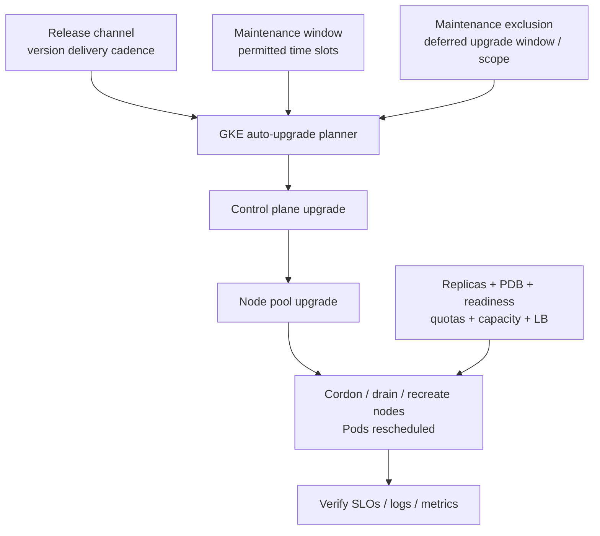

# Release Channels, Maintenance Windows, and Cluster Upgrades

On **Google Kubernetes Engine (GKE)**, upgrading Kubernetes is never as simple as picking a higher version number. An upgrade can affect the **control plane**, **node pools**, Pod scheduling, deprecated Kubernetes APIs, and application availability. Operations teams must know **when GKE is allowed to upgrade**, **which versions are eligible**, and **how to protect service continuity while nodes are replaced**.

This lesson belongs to the **Advanced GKE and Operations** chapter of the `CLOUD_PROVIDERS_GCP` module. Across the journey from projects, IAM, and VPCs to Compute Engine, GKE, Cloud Run, storage, databases, release automation, and reliability/cost optimization, this lesson builds a **controlled GKE upgrade runbook**. Examples use an existing lab cluster without creating new clusters or executing production changes.

## 1. Objectives and Scope

After this lesson, you will be able to:

1. Compare the four **release channels**: Rapid, Regular, Stable, and Extended.
2. Understand **minor/patch version** lifecycles, version support windows, and the deprecation of "No channel."
3. Configure **maintenance windows** using UTC, RRULE, and minimum duration rules; use **maintenance exclusions** appropriately.
4. Distinguish **control plane** upgrades from **node pool** upgrades on GKE Standard and Autopilot.
5. Choose between **surge** and **blue-green** node pool upgrades, preparing PDBs, replicas, readiness probes, and quotas.
6. Inventory versions, maintenance policies, node pools, and workloads before making changes.
7. Run pre/post checks, monitor operations, identify rollback conditions, and handle partial upgrades.
8. Apply checklists, exercises, and upgrade plans to services with explicit SLOs.

**Lab boundary:** read-only commands can be run on any cluster where you hold viewer access. `update`/`upgrade` commands shown here **modify real cluster state**; execute them only with approval, a change window, and a recovery plan. Cluster and project names are placeholders.

## 2. GKE Upgrade Model



**Do not conflate these mechanisms:**

| Mechanism | What it controls | What it does NOT guarantee |
| --- | --- | --- |
| **Release channel** | Pace of version adoption and auto-upgrade cadence | Does not "freeze" a cluster on one version forever |
| **Maintenance window** | When policy-respecting automatic maintenance may start/resume | Does not block manual upgrades or every emergency security fix |
| **Maintenance exclusion** | Temporarily defers specified automatic upgrade scopes | Does not bypass end-of-support dates or block mandatory security actions |
| **Node upgrade strategy** | How nodes in a pool are replaced | Does not create Pod replicas, fix apps, or migrate databases |
| **PodDisruptionBudget (PDB)** | Voluntary disruptions Kubernetes attempts to avoid | Not an absolute zero-disruption guarantee |
| **Application readiness/SLO** | Whether workloads serve traffic cleanly | Cannot be inferred from cluster version alone |

On **Standard**, platform teams control many node pool settings; **Autopilot** manages most node infrastructure automatically and does not expose all Standard node pool options.

## 3. Release Channels: Choosing Based on Change Tolerance

| Channel | Characteristics | When to consider |
| --- | --- | --- |
| **Rapid** | Receives new minor versions/features earliest; shorter GKE soak time | Test environments, teams needing new features with strong validation pipelines |
| **Regular** | Receives versions after Rapid; balances currency and maturity | Default fit for many production workloads |
| **Stable** | Receives versions later than Regular with extra soak time | Workloads prioritizing lower change velocity over early features |
| **Extended** | Available for eligible **Standard** configurations; extends minor version support with an **extended support fee** during that phase | Workloads unable to upgrade minors on standard schedules needing longer planning |

**There is no "zero-risk channel."** All channels require compatibility checks; critical security patches can still be pushed by GKE outside normal schedules. Minor/patch timelines vary by channel, region, and rollout waves. Always check the **GKE release schedule and release notes** when deciding, rather than hardcoding version numbers into long-lived runbooks.

### 3.1. Versioning and Support Policy

A Kubernetes version follows `MAJOR.MINOR.PATCH-gke.BUILD`. Strings like `1.34.x-gke.y` illustrate syntax only—**never use placeholder strings as real target versions**.

- **Patch:** security patches and bug fixes within the same minor release.
- **Minor:** API additions/removals and behavior changes; check deprecations and version skew.
- **Standard support:** normal support lifecycle for a minor version.
- **Extended support:** the Extended channel maintains a minor longer under specific conditions and additional fees.

Per current GKE versioning docs, a minor version typically receives **roughly 14 months of standard support**, followed by up to **24 months total** with Extended support; always verify exact schedules for your **actual minor version**, because channel entry dates and end-of-support dates vary.

**No channel** is deprecated: Google Cloud announced retirement on **2027-06-14**. Never pick it as an "upgrade-off" strategy: the control plane still receives automatic upgrades, and existing Standard clusters should plan migration to a supported release channel.

### 3.2. Channel Selection Workflow

1. Inventory APIs, add-ons, CRDs, and Kubernetes versions tested with your applications.
2. Document change tolerance: feature needs, stability requirements, and team release cadence.
3. Choose matching channels; separate **test/staging** from **production** so new versions soak early before prod.
4. Add release-note and deprecation reviews to sprint cadences.
5. Track end-of-support dates, especially if using Extended to buy planning time rather than deferring indefinitely.

Changing channels can **alter eligible versions and auto-upgrade schedules**; never switch production just to "jump onto Stable" casually. Inspect the running version, available versions in the target channel, and maintenance policies first.

## 4. Maintenance Windows: Permitting Maintenance in Clear Time Slots

A **maintenance window** is a recurring time window GKE uses for **policy-respecting** automatic maintenance tasks. A cluster holds **one** maintenance window configuration at a time; updating it replaces the previous window.

Constraints to remember:

- Must allow **at least 48 hours** of maintenance availability within a **rolling 92-day** period.
- Only contiguous slots of **at least 4 hours** count toward that total.
- `--maintenance-window-start` uses RFC 5545 format, `--maintenance-window-duration` specifies duration, and `--maintenance-window-recurrence` uses an RRULE.
- **Days in RRULE are evaluated in UTC.** Converting from Vietnam time (**UTC+7**) requires checking whether days shift across midnight.
- An upgrade can span beyond one window; GKE attempts to pause and resume in the next window. Node pools may temporarily run **mixed patch versions** during transitions.

**Practical schedule example:** maintenance from **23:00–07:00 Vietnam time** on Monday, Wednesday, and Friday nights. The corresponding UTC start is **16:00Z** on the same calendar day for 8 hours each. Three times per week easily satisfies the 48-hour/92-day minimum under steady recurrence.

Coordinate this window with peak traffic, on-call rotations, backups, batch jobs, release freezes, and partner team time zones. A maintenance window **does not guarantee zero downtime**; application readiness and capacity still govern user impact.

## 5. Maintenance Exclusions: Temporarily Deferring Specific Upgrade Scopes

During major sales campaigns, database migrations, or audit windows, operations teams can configure a **maintenance exclusion** for a bounded duration. Exclusions differ from windows: windows define *when maintenance is allowed*, whereas exclusions define *which automatic scopes are temporarily paused*.

| CLI scope | Control plane | Node pools | Purpose |
| --- | --- | --- | --- |
| `no_upgrades` | Defers automatic minor and patch upgrades | Defers automatic minor and patch upgrades | Short-term freeze during critical events |
| `no_minor_upgrades` | Allows patches, defers minor upgrades | Allows patches, defers minor upgrades | Keep security patches while holding off minor shifts |
| `no_minor_or_node_upgrades` | Allows control plane patches, defers minors | Defers both node patches and minors | When nodes need isolated testing/orchestration |

Granular scopes apply only to clusters **enrolled in a release channel**; clusters without a channel (deprecated) are restricted to their default compatible scope.

**Limits:** a `no_upgrades` exclusion generally cannot exceed **90 days**, at most **3** such exclusions may exist, and minimum maintenance availability must still be met; total cluster exclusions are also capped. Other exclusions cannot extend past end-of-support. When critical security fixes or end-of-support deadlines arise, GKE may still perform mandatory upgrades. Every exclusion must have an **owner, justification, expiration date, and catch-up plan**.

Never use exclusions as a substitute for fixing deprecated APIs or running unpatched nodes. When using `no_minor_or_node_upgrades`, actively manage node versions to avoid violating **version skew**.

## 6. Control Plane and Node Pool Upgrades

GKE upgrades two layers **separately**:

| Component | What upgrades | Disruption profile |
| --- | --- | --- |
| **Control plane** | Kubernetes API server and control components | **Zonal** clusters may briefly reject API changes while running workloads keep serving. **Regional** clusters upgrade replicas sequentially for higher API HA |
| **Node pool** | VM/node OS image, kubelet, `kube-proxy`, and Pod runtime | Nodes are cordoned, drained, and recreated; Pods must reschedule and restart on eligible nodes |

**Standard order:** control plane first, then node pools; they can temporarily run different versions **within GKE's supported version skew**. Never assume finishing a control plane upgrade means all nodes are upgraded too.

GKE **does not permit permanently disabling required control plane upgrades**. Maintenance policies govern automatic upgrade timing, whereas **manual upgrades bypass maintenance windows and exclusions**: if an operator runs a manual upgrade command at the wrong hour, policies will not block it.

### 6.1. Standard and Autopilot

- **Standard:** operators choose node pool strategies (surge/blue-green), tune sizing, and manually upgrade pools if needed. Keeping node auto-upgrade enabled is recommended.
- **Autopilot:** GKE manages nodes and infrastructure upgrade strategies more deeply; users focus on workload/Pod readiness, requested capacity, and maintenance policies. Never apply Standard node pool update flags blindly to Autopilot.

Regardless of mode, **never jump two minor versions in a single manual upgrade**; check supported upgrade paths and target versions from GKE server config.

## 7. Node Upgrade Strategies and Disruption Levels

### 7.1. Surge Upgrade

GKE provisions extra **surge nodes** to absorb Pods and replaces old nodes in waves.

- `maxSurge`: maximum extra nodes added during the upgrade.
- `maxUnavailable`: maximum nodes allowed to become unavailable during the upgrade per strategy.
- For example, `maxSurge=1`, `maxUnavailable=0` avoids losing nominal capacity, but requires **quotas and physical capacity** to create surge nodes.

### 7.2. Blue-Green Upgrade

GKE keeps the old pool (**blue**), creates a new pool (**green**), migrates workloads in batches, and provides a **soak time** for validation. Ideal for change-sensitive workloads needing a fast rollback path before the old pool is deleted.

| Criterion | Surge | Blue-green |
| --- | --- | --- |
| Extra resource consumption | Bounded by `maxSurge`; usually more economical | Can temporarily require **roughly double** the nodes |
| Rollout control | `maxSurge`/`maxUnavailable` | Batches, soak times, staged verification |
| Mid-upgrade recovery | Can cancel/roll back an incomplete upgrade per conditions | Keeps blue pool for rollback during the soak phase |
| When to pick | Workloads tolerating rolling replacement | Sensitive workloads needing soak verification and strong rollback |

Advanced options such as **autoscaled blue-green** or **concurrent node pool upgrades** may be in Preview—check support status and risks before adopting. Never assume every node pool or machine type supports every strategy.

### 7.3. PDBs Are Not Hard Locks

During node upgrades, GKE attempts to honor **PodDisruptionBudgets** and `terminationGracePeriodSeconds`, yet current behavior caps waiting at **roughly 1 hour**. If Pods still fail to drain within that bound, GKE can proceed with the upgrade to maintain node lifecycle hygiene. Thus a PDB with `maxUnavailable: 0` **does not** promise to freeze 100% of Pods forever.

Prepare all prerequisites **together**: ≥2 replicas for HA workloads; accurate `readinessProbe`; Pod topology spread / anti-affinity; PDBs; spare node headroom; graceful shutdown; and verified external dependencies and connection draining.

## 8. Preflight: Non-Mutating Cluster Inventory

Use Bash/Cloud Shell with GKE read permissions. Replace every variable with resources you are **authorized to manage**.

```bash
PROJECT_ID="YOUR_LAB_PROJECT_ID"
CLUSTER="YOUR_EXISTING_GKE_CLUSTER"
LOCATION="YOUR_CLUSTER_REGION_OR_ZONE"
POOL="YOUR_STANDARD_NODE_POOL"

gcloud --version
gcloud auth list

gcloud projects describe "$PROJECT_ID" \
  --format="yaml(projectId,lifecycleState)"

gcloud container clusters describe "$CLUSTER" \
  --project="$PROJECT_ID" \
  --location="$LOCATION" \
  --format="yaml(name,location,status,currentMasterVersion,currentNodeVersion,releaseChannel,maintenancePolicy)"

gcloud container node-pools list \
  --project="$PROJECT_ID" \
  --cluster="$CLUSTER" \
  --location="$LOCATION"

gcloud container get-server-config \
  --project="$PROJECT_ID" \
  --location="$LOCATION"
```

**Pre-write checklist:** the cluster exists, no upgrade operation is already running, you know whether it is Standard or Autopilot, its exact channel, end-of-support dates, and supported target versions. `get-server-config` returns valid versions for that location; never guess target versions from course examples.

For an authorized Standard node pool:

```bash
gcloud container node-pools describe "$POOL" \
  --project="$PROJECT_ID" \
  --cluster="$CLUSTER" \
  --location="$LOCATION" \
  --format="yaml(name,version,status,management,upgradeSettings)"
```

Node pools may use GPUs/TPUs or specialized hardware; if running non-checkpointable jobs, design a dedicated drain strategy instead of using default drain assumptions.

### 8.1. Inspecting Kubernetes Workloads

The first command **updates kubeconfig on your local machine** without changing the cluster; run only on authorized environments:

```bash
gcloud container clusters get-credentials "$CLUSTER" \
  --project="$PROJECT_ID" \
  --location="$LOCATION"

kubectl config current-context
kubectl get nodes -o wide
kubectl get deploy,statefulset -A
kubectl get pdb -A
kubectl get pods -A -o wide
```

Verify `current-context` points to the **right cluster** before running any `kubectl apply` or `delete`. If RBAC blocks reading all namespaces, request scoped permissions through normal process rather than asking for `cluster-admin` just to run a lab.

### 8.2. Baseline Record

| Item | What to record |
| --- | --- |
| Cluster | Project, region/zone, Standard/Autopilot, channel |
| Versions | Control plane, each node pool, supported targets, end-of-support dates |
| Maintenance | Window/UTC RRULE, exclusions, expiration dates, owners |
| Workloads | Ready replicas, PDBs, probes, namespace quotas |
| Infrastructure | Quotas/capacity for surge or green nodes, disks, reservations |
| SLOs | Request rate, 5xx, p95/p99 latency, DB latency, error budget |
| Rollback | Manifest/GitOps revision, data backup/restore, alerts, and runbook |

## 9. Lab A: Viewing and Selecting a Release Channel

**You do not need to change channels to complete this lesson.** First, read the current value:

```bash
gcloud container clusters describe "$CLUSTER" \
  --project="$PROJECT_ID" \
  --location="$LOCATION" \
  --format="value(releaseChannel.channel)"
```

If empty, the cluster may not be enrolled; verify cluster type and plan migration off **No channel** well before retirement. To view channel release schedules or eligible upgrade versions, check **GKE → Cluster details** in Cloud Console and `gcloud container get-server-config`, then review release notes.

**Example channel update (write operation, optional, authorized lab cluster only):**

```bash
# Do not run without a version/upgrade plan and approval.
gcloud container clusters update "$CLUSTER" \
  --project="$PROJECT_ID" \
  --location="$LOCATION" \
  --release-channel=regular
```

Switching channels can change auto-upgrade targets and schedules. With Extended, never assume you can switch straight back to Regular/Stable if the current minor is **past standard support**; you may need to upgrade minor versions first and adjust exclusions.

## 10. Lab B: Configuring a Maintenance Window in UTC

Example **policy change** on a lab cluster: maintenance three nights per week, **23:00 to 07:00 Vietnam time** (16:00–00:00 UTC next day).

```bash
# WRITE: run only after the cluster owner approves the schedule.
gcloud container clusters update "$CLUSTER" \
  --project="$PROJECT_ID" \
  --location="$LOCATION" \
  --maintenance-window-start="2026-11-23T16:00:00Z" \
  --maintenance-window-duration="8H" \
  --maintenance-window-recurrence="FREQ=WEEKLY;BYDAY=MO,WE,FR"
```

`2026-11-23` is a **Monday** used as an example start date. This UTC rule creates 8-hour windows starting at 16:00Z every Monday, Wednesday, and Friday, matching 23:00–07:00 Vietnam time. In later use, adjust the DTSTART date appropriately while keeping the UTC RRULE valid.

Readback:

```bash
gcloud container clusters describe "$CLUSTER" \
  --project="$PROJECT_ID" \
  --location="$LOCATION" \
  --format="yaml(maintenancePolicy)"
```

**Verify:** the policy reflects your intended start, duration, and recurrence; the schedule covers at least 48 hours per rolling 92 days in contiguous blocks ≥4 hours. A successful update does not prove every upgrade finishes within 8 hours: large node pools, PDBs, and quota limits can push completion into subsequent windows.

If you need to remove a **lab-only window** afterward, after confirming with the owner and backing up the old policy:

```bash
# WRITE: clears the maintenance window on the selected cluster.
gcloud container clusters update "$CLUSTER" \
  --project="$PROJECT_ID" \
  --location="$LOCATION" \
  --clear-maintenance-window
```

On shared clusters, **restore the original policy** rather than deleting a window another team relies on.

## 11. Lab C: Adding a Campaign Maintenance Exclusion

Suppose the team wants to hold the **minor version** steady during year-end peak while still allowing GKE **automatic patches**. On a channel-enrolled cluster, use scope `no_minor_upgrades`.

```bash
# WRITE: lab schedule example; adjust dates after review.
gcloud container clusters update "$CLUSTER" \
  --project="$PROJECT_ID" \
  --location="$LOCATION" \
  --add-maintenance-exclusion-name="year-end-lab" \
  --add-maintenance-exclusion-start="2026-12-20T00:00:00Z" \
  --add-maintenance-exclusion-end="2027-01-03T00:00:00Z" \
  --add-maintenance-exclusion-scope="no_minor_upgrades"
```

This illustrates a **14-day exclusion** and **does not** block all GKE actions. Never set `no_upgrades` to block security patches simply to avoid holiday operations. Review end-of-support dates, policy owners, and application release calendars.

Readback:

```bash
gcloud container clusters describe "$CLUSTER" \
  --project="$PROJECT_ID" \
  --location="$LOCATION" \
  --format="yaml(maintenancePolicy)"
```

Once the campaign ends or to clean up the lab exclusion:

```bash
# WRITE: remove only the specific exclusion owned by the lab.
gcloud container clusters update "$CLUSTER" \
  --project="$PROJECT_ID" \
  --location="$LOCATION" \
  --remove-maintenance-exclusion="year-end-lab"
```

**Key practice:** windows govern when automatic maintenance runs; exclusions govern which automatic upgrade scopes are deferred during a date range. Manual upgrades bypass both, making change-approval controls essential.

## 12. Preparing Pods Before a Node Upgrade

A node upgrade evicts and recreates Pods. Minimum prerequisites:

- Deployments run multiple replicas distributed across nodes and zones where HA is required.
- `readinessProbe` reports Ready only when the app can genuinely serve requests.
- `startupProbe`/`livenessProbe` avoid premature restarts during app warm-up.
- Graceful termination allows enough time to finish in-flight requests and flush state.
- PDBs allow **some realistic level of disruption** rather than blocking all voluntary evictions.
- Spare CPU/memory, IP addresses, and disk/volume capacity exist for replacement Pods.
- Stateful workloads have tested backups/restores, plus verified CSI, CRD, webhook, and operator compatibility.

### 12.1. Sample PDB

For a `checkout-api` Deployment with **at least 3 replicas** and label `app: checkout-api`, you might set:

```yaml
apiVersion: policy/v1
kind: PodDisruptionBudget
metadata:
  name: checkout-api-pdb
spec:
  minAvailable: 2
  selector:
    matchLabels:
      app: checkout-api
```

**This example targets a specific workload; do not apply it automatically to a cluster.** Verify namespace, selector, and replica count first. If only 2 ready replicas exist, `minAvailable: 2` stalls node draining. Remember GKE node upgrades **cap how long they honor PDBs**, after which disruption can proceed anyway.

To reduce the chance of two replicas co-locating on the same node or zone, consider `topologySpreadConstraints` or anti-affinity. Avoid overly rigid rules (`DoNotSchedule` when nodes are tight) that cause `Pending` Pods; check real topology before upgrading.

### 12.2. Readiness Matrix

| Scenario | Risk | Control |
| --- | --- | --- |
| Single Pod, zero backup replicas | Service outage during node reboot/recreate | Scale replicas and test multi-node placement |
| All replicas on one node | Total loss when that node rotates | Topology spread + verify scheduling |
| PDB `minAvailable` equals replica count | Drains stall | Pick an appropriate disruption budget |
| Readiness always returns 200 | LB sends traffic to unready app | Probe real serving readiness |
| Zero quota for extra nodes | Surge/blue-green fails to add new nodes | Plan quotas, capacity, or reservations |
| Stateful app with disk/local state | Data loss or mount failures | Backups, HA storage, restore drills |
| Deprecated Kubernetes APIs | Add-ons/CRDs/apps fail on minor upgrade | Inventory API usage, migrate, and smoke-test |

## 13. Lab D: Configuring a Standard Node Upgrade Strategy

Run only on a **lab Standard node pool**. With `maxSurge=1` and `maxUnavailable=0`, GKE provisions an extra node before moving Pods, subject to quotas and capacity.

```bash
# WRITE: choose a surge strategy validated for the target pool.
gcloud container node-pools update "$POOL" \
  --project="$PROJECT_ID" \
  --cluster="$CLUSTER" \
  --location="$LOCATION" \
  --enable-surge-upgrade \
  --max-surge-upgrade=1 \
  --max-unavailable-upgrade=0
```

Readback:

```bash
gcloud container node-pools describe "$POOL" \
  --project="$PROJECT_ID" \
  --cluster="$CLUSTER" \
  --location="$LOCATION" \
  --format="yaml(upgradeSettings,management,version)"
```

**Do not run on Autopilot-managed node pools** where upgrade strategies cannot be manually configured. If a workload needs a long soak window and rollback before retiring old nodes, evaluate **blue-green** on a test Standard node pool along with extra cost and capacity.

## 14. Manual Upgrade: Approval-Gated Runbook

Manual upgrades **bypass maintenance windows and exclusions**. Therefore this section separates **read-only commands you can run safely** from **write commands permitted only after change approval**.

### 14.1. Select the Target Version

```bash
# Read-only: valid versions for this location/channel.
gcloud container get-server-config \
  --project="$PROJECT_ID" \
  --location="$LOCATION"

# Read-only: current control plane and node pool state.
gcloud container clusters describe "$CLUSTER" \
  --project="$PROJECT_ID" \
  --location="$LOCATION" \
  --format="yaml(currentMasterVersion,currentNodeVersion,releaseChannel)"

gcloud container node-pools describe "$POOL" \
  --project="$PROJECT_ID" \
  --cluster="$CLUSTER" \
  --location="$LOCATION" \
  --format="yaml(version,upgradeSettings)"
```

Choose a version **explicitly listed as supported** by GKE for your cluster, channel, and location. Review **deprecation warnings**, CRDs, add-ons, security controls, and target node versions. When crossing minor versions, upgrade **one supported minor at a time** rather than skipping multiple minors.

### 14.2. Upgrade the Control Plane (Write, Approval Required)

```bash
# Populate version FROM SERVER CONFIG; never run with a literal placeholder.
TARGET_CP_VERSION="REPLACE_WITH_SUPPORTED_VERSION"

gcloud container clusters upgrade "$CLUSTER" \
  --project="$PROJECT_ID" \
  --location="$LOCATION" \
  --master \
  --cluster-version="$TARGET_CP_VERSION"
```

While the control plane upgrades, a zonal GKE cluster may briefly reject Kubernetes API mutations; regional control planes provide higher API availability. Workloads keep serving, yet **avoid deploying major application changes simultaneously** during this window.

### 14.3. Upgrade a Node Pool (Write, Approval Required)

Once the control plane is healthy, workload capacity is verified, and the pool is approved:

```bash
TARGET_NODE_VERSION="REPLACE_WITH_SUPPORTED_NODE_VERSION"

gcloud container clusters upgrade "$CLUSTER" \
  --project="$PROJECT_ID" \
  --location="$LOCATION" \
  --node-pool="$POOL" \
  --cluster-version="$TARGET_NODE_VERSION"
```

Do not upgrade all pools in parallel blindly. Upgrade a **canary node pool** or lower-risk pool first, then proceed in waves. On GKE Autopilot, follow Autopilot's managed upgrade mechanisms rather than applying Standard settings to Google-managed infrastructure.

### 14.4. Monitor Operations and Applications

```bash
gcloud container operations list \
  --project="$PROJECT_ID" \
  --location="$LOCATION"

gcloud container clusters describe "$CLUSTER" \
  --project="$PROJECT_ID" \
  --location="$LOCATION" \
  --format="yaml(status,currentMasterVersion,currentNodeVersion)"

gcloud container node-pools describe "$POOL" \
  --project="$PROJECT_ID" \
  --cluster="$CLUSTER" \
  --location="$LOCATION" \
  --format="yaml(status,version,upgradeSettings)"

kubectl get nodes -o wide
kubectl get pods -A -o wide
kubectl get pdb -A
```

Never declare victory solely because `gcloud` returned exit code 0: verify **operation status**, per-node version/Ready state, Pod readiness, request errors, and post-upgrade SLOs. A pool may temporarily sit in a **mixed-version** state if an upgrade is interrupted.

## 15. Analyzing Outcomes and Rolling Back Failed Upgrades

### 15.1. Signals to Halt the Rollout

- HTTP 5xx spikes, p95/p99 latency breaches SLO, or error budget burns rapidly.
- Pods fail to schedule due to CPU/memory, taints, topology, or quotas.
- `CrashLoopBackOff`, CNI/CSI errors, or admission webhook/operator failures.
- PDBs stall drains indefinitely; replacement Pods fail to become Ready.
- Control plane/API instability, or deployments rejected due to deprecated APIs.

**Response:** freeze application deployments, identify affected operations and node pools, protect data, and shed load if needed. Execute cancellations or rollbacks only after checking operation state and product constraints.

### 15.2. Do Not Confuse App Rollback with Cluster Rollback

- **App rollback:** `kubectl rollout undo deployment/...` reverts a Pod template. It **does not downgrade Kubernetes**.
- **Node pool rollback:** GKE provides a rollback command for **in-progress, failed, or canceled** upgrades under documented conditions. Once a pool upgrade completes, reverting requires a separate **downgrade** check if the older version is still supported—never assume rollback is automatic.
- **Control plane:** there is no "one-click rollback" across arbitrary minor versions. Build recovery plans with GKE support, manifest backups, and compatibility checks—prevent bad upgrades during preflight.

Example **only for an incomplete node pool upgrade approved for rollback**:

```bash
gcloud container node-pools rollback "$POOL" \
  --project="$PROJECT_ID" \
  --cluster="$CLUSTER" \
  --location="$LOCATION"
```

This is an **infrastructure-modifying command**, not a routine cleanup step. If the upgrade already finished, it may not apply, and you must consult downgrade docs, version availability, and data risks.

## 16. Monitoring SLOs, Costs, and Quotas

| Area | Signals | Meaning |
| --- | --- | --- |
| Cluster | Channel, current/target versions, operations, end-of-support | Tracks upgrade progress and schedule |
| Control plane | API errors/latency, admission and deployment failures | Detects control-plane disruption |
| Nodes | Ready/NotReady, versions, CPU/memory, surge/green node count | Spots capacity shortages and mixed versions |
| Workloads | Ready replicas, PDB `disruptionsAllowed`, restarts, Pending | Measures true serving health |
| Traffic | Request rate, 5xx, p95/p99, queue depth | Measures user-facing impact |
| Cost | Compute Engine nodes, disks, egress, logging, GKE and Extended support | Tracks costs during and after upgrades |
| Security | Deprecated APIs, CVEs, image scans, IAM/policies | Ensures compatibility and posture |

**Capacity planning during upgrades:** surge requires extra VMs; blue-green can **nearly double node counts** temporarily. Having cloud quota **does not guarantee physical stock** in a zone—check reservations, machine types, and budgets. Adding nodes when subnet or secondary Pod IP ranges are full also leaves Pods stuck unready.

Never treat "cluster reached new version" as the sole success metric. True success is **valid version + healthy control plane/node pools + workloads meeting SLOs + zero stray operations**.

## 17. Real-World Scenario: Preparing for a Major Sales Campaign

An e-commerce company runs a regional GKE Standard cluster with three node pools for APIs, workers, and batch jobs. A new Kubernetes minor version arrives on the Regular channel, but a major sales event begins in three weeks.

Sensible plan:

1. **T-21 days:** review release notes, deprecated APIs, add-ons, and CRDs; test the new minor on staging.
2. **T-14 days:** verify replacement node startup times, surge quotas, PDBs/readiness, and backups; load-test peak traffic on staging.
3. **T-7 days:** if more soak time is needed, set a `no_minor_upgrades` exclusion covering only the event window; **patches remain permitted**.
4. **During the event:** monitor 5xx, p99, and Pod capacity; prohibit manual upgrades outside incident response.
5. **Post-event:** remove the exclusion, execute controlled pool-by-pool upgrades, and log operation IDs and smoke-test results.

**Mistake to avoid:** creating open-ended `no_upgrades` exclusions to keep clusters "stable." That blocks security patches rather than managing long-term risk.

## 18. Quick Troubleshooting Reference

| Symptom | Common cause | What to check |
| --- | --- | --- |
| Auto-upgrade isn't running | Channel wave hasn't arrived, window/exclusion blocks it, or rollout paused | Cluster `maintenancePolicy`, release schedule |
| Exclusion creation rejected | Invalid scope/channel, past end-of-support, or exclusion limit hit | Channel, timestamps, GKE docs |
| Window fires on wrong day/time | RRULE uses UTC, shifting dates across time zones | UTC start, `BYDAY`, and local time |
| Upgrade drags across many cycles | Short window, many nodes, PDBs, or quota limits | Operations, node pool settings, Ready Pods |
| Surge pool can't add VMs | Quota/stock exhaustion, IP exhaustion, or machine type shortage | GKE operations, Compute quotas, subnet ranges |
| Pods Pending after upgrade | Node affinity/taints, CPU/memory, CSI | `kubectl describe pod`, node allocatable |
| PDB blocks drain | Too few healthy replicas, bad selector, low capacity | `kubectl get pdb -A`, ready replicas |
| 5xx spikes while nodes are Ready | Broken readiness, unhealthy backend, slow app startup | Service endpoints, probes, app logs |
| Kubernetes API rejects manifests | Deprecated API, incompatible CRD, or webhook failure | Release notes, API usage, admission logs |
| Mixed node versions persist | Pool upgrade incomplete or window ended mid-upgrade | Node list, operations, pool version |
| Need immediate cluster rollback | Control plane and nodes follow different downgrade rules | Upgrade type, version support, GKE docs |
| Costs spike after blue-green | Blue and green nodes coexist during soak period | Node count, VM hours, Billing |

## 19. Self-Practice Exercises

### Exercise 1 — Choosing a Release Channel

A team needs to validate new Kubernetes minors as soon as GKE releases them using staging and strong integration tests, while production prioritizes stability.

**Answer:** use **Rapid** for appropriate test environments; evaluate **Regular/Stable** for production based on change tolerance. Not all clusters need to sit on the same channel.

### Exercise 2 — Is the Window Long Enough?

A team sets a **2-hour maintenance window every Sunday**.

**Answer:** invalid; each contiguous block is under **4 hours**, and total availability falls short of 48 hours per 92 days. Design longer, more frequent blocks.

### Exercise 3 — Converting to Vietnam Time

A team wants a 23:00–07:00 Vietnam time window on Monday, Wednesday, and Friday nights.

**Answer:** start at 16:00Z UTC on `MO,WE,FR` with duration `8H`; verify the UTC RRULE and actual calendar mapping before applying.

### Exercise 4 — Deferring Minors While Keeping Patches

A payment service wants no minor upgrades during financial close, while still accepting patches.

**Answer:** on a channel-enrolled cluster, use a bounded `no_minor_upgrades` exclusion rather than `no_upgrades` unless special security/compliance constraints demand otherwise.

### Exercise 5 — Does a PDB Block Node Replacement Forever?

A two-replica Deployment has a PDB with `minAvailable: 2` while an upgrade drains a node.

**Answer:** no. Draining may pause temporarily, yet GKE node upgrades cap PDB enforcement at roughly one hour. Provision enough replicas/capacity and set PDBs permitting realistic disruptions.

### Exercise 6 — Choosing Surge vs. Blue-Green

A pool hosts a sensitive API needing live validation on new nodes before removing old ones, with sufficient quota and budget.

**Answer:** evaluate **blue-green** with soak time on a Standard pool; surge uses fewer resources but does not keep both full old and new pools side by side in the same way.

### Exercise 7 — Manual Upgrade During an Exclusion

A cluster has a `no_minor_upgrades` exclusion next week, and an engineer manually runs `gcloud container clusters upgrade --master`.

**Answer:** manual upgrades **bypass** maintenance policies. Enforce change approvals and IAM/CI guardrails around operators rather than treating exclusions as ACLs.

### Exercise 8 — Control Plane Upgraded, Nodes Still Old

The control plane moved to the new version, yet a node pool remains on the prior patch and Pods show Pending.

**Answer:** not automatically a version bug; inspect **version skew**, node upgrade operations, quotas, scheduling, PDBs, node pool health, and workloads. Never call an upgrade "successful" before application SLOs pass.

### Exercise 9 — Rolling Back After Completion

A node pool upgrade finished cleanly, and the team plans to run `node-pools rollback` to revert.

**Answer:** rollback targets incomplete, failed, or canceled upgrades; a completed pool requires checking **downgrade** support, target version availability, and data risks. Never treat rollback as risk-free.

## 20. Pre- and Post-Upgrade Checklist

**Before changes**

- [ ] Identified cluster type, channel, current versions, and end-of-support dates.
- [ ] Checked release schedule, supported targets, and deprecation/API compatibility.
- [ ] Maintenance window satisfies **48 hours / 92 days** with times verified in UTC.
- [ ] Exclusions have owners, scopes, and expirations, avoiding unintended patch blocks.
- [ ] Audited workloads, PDBs, replicas, readiness/liveness/startup probes, and topology.
- [ ] Confirmed quotas, zone capacity, IPs, and budgets for surge or green nodes.
- [ ] Prepared backups/stateful restores, canary checks, smoke tests, SLO monitors, and escalation contacts.
- [ ] Separately approved any manual upgrade commands; never assumed policies block manual runs.

**After changes**

- [ ] Control plane and every node pool run the approved version; operations succeeded.
- [ ] Zero unexpected `NotReady` nodes or `Pending` Pods remain.
- [ ] Readiness, PDBs, Service endpoints, 5xx rates, p95/p99 latency, and SLOs pass.
- [ ] Monitored across a full peak load cycle before deleting rollback artifacts/backups.
- [ ] Updated runbooks, release records, cost figures, and lessons learned.

## 21. Reverting Lab Changes and Cleanup Scope

This lesson **creates no new clusters**. It may **update release channels, maintenance windows, exclusions, or node upgrade settings** if you run the write steps.

- Remove **lab exclusions** using `--remove-maintenance-exclusion="year-end-lab"` after inspecting policy.
- **Restore the original maintenance window** if one existed; run `--clear-maintenance-window` only if the owner explicitly wants no window.
- **Do not reset the release channel** just for "lab cleanup" if the new channel reflects approved policy; treat channel changes as reviewed operational changes.
- **Never downgrade the control plane or node pools** as cleanup. Upgrades follow separate support rules; keep approved cluster state intact.
- Record post-cleanup policy with `gcloud container clusters describe ... --format="yaml(maintenancePolicy,releaseChannel)"`.

If you ran only the read-only steps, **no new resources need deletion**. GKE nodes, logs, monitoring, and add-on features still incur charges based on active cluster configuration—never assume zero cost just because no new resource was created.

## 22. Official Google Cloud Documentation

- [About GKE release channels](https://cloud.google.com/kubernetes-engine/docs/concepts/release-channels): Rapid/Regular/Stable/Extended semantics and No channel deprecation.
- [Use release channels](https://cloud.google.com/kubernetes-engine/docs/how-to/release-channels): viewing, enrolling, and switching channels via `gcloud`.
- [GKE versioning and support](https://cloud.google.com/kubernetes-engine/versioning): standard/extended support and end-of-support dates.
- [GKE release schedule](https://cloud.google.com/kubernetes-engine/docs/release-schedule): release and auto-upgrade timelines per channel.
- [Maintenance windows and exclusions](https://cloud.google.com/kubernetes-engine/docs/concepts/maintenance-windows-and-exclusions): policy semantics and exceptions.
- [Configure maintenance windows and exclusions](https://cloud.google.com/kubernetes-engine/docs/how-to/maintenance-windows-and-exclusions): RRULE window syntax, exclusion scopes, and limits.
- [Standard cluster upgrades](https://cloud.google.com/kubernetes-engine/docs/concepts/cluster-upgrades): control plane, node pool, and upgrade mechanics.
- [Manually upgrade a cluster](https://cloud.google.com/kubernetes-engine/docs/how-to/upgrading-a-cluster): checking targets, manual upgrades, and node pool rollbacks.
- [Node upgrade strategies](https://cloud.google.com/kubernetes-engine/docs/concepts/node-upgrade-strategies): surge and blue-green strategies.
- [Ensure resources for node upgrades](https://cloud.google.com/kubernetes-engine/docs/how-to/node-upgrades-quota): quotas and capacity required for upgrades.
- [PodDisruptionBudget — Kubernetes](https://kubernetes.io/docs/tasks/run-application/configure-pdb/): managing voluntary Pod disruptions.

**Conclusion:** reliable GKE upgrades come from a verifiable chain of decisions: **the right channel → time-boxed windows/exclusions → compatible versions → capacity-backed node upgrade strategies → workloads meeting SLOs afterward**. Reaching a higher Kubernetes version is only the technical step; true success means Pods, APIs, data, and users stay served within the risk limits your operations team accepted.
