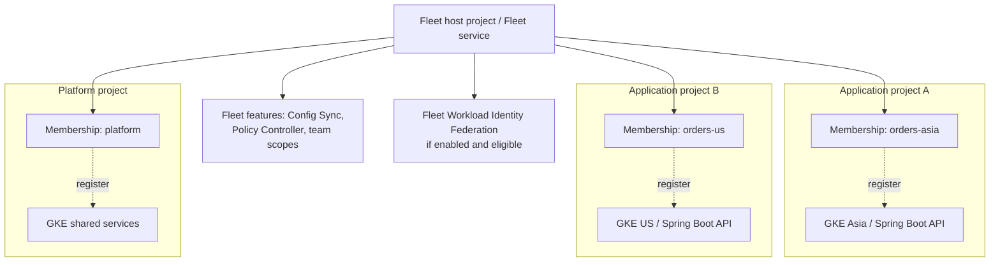
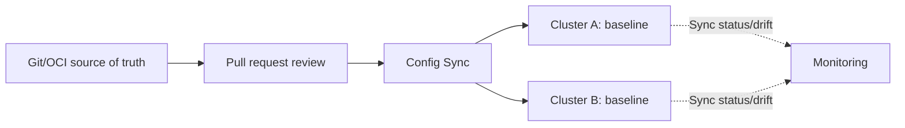
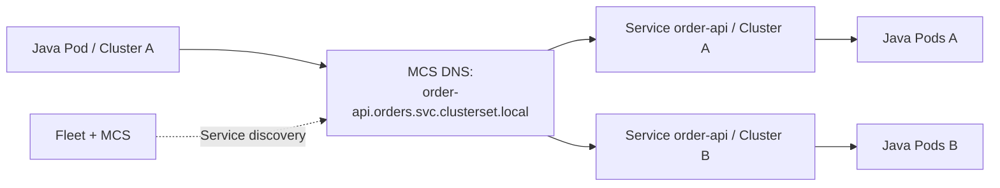
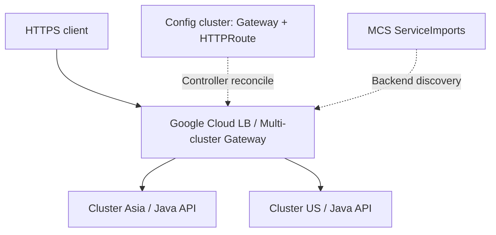
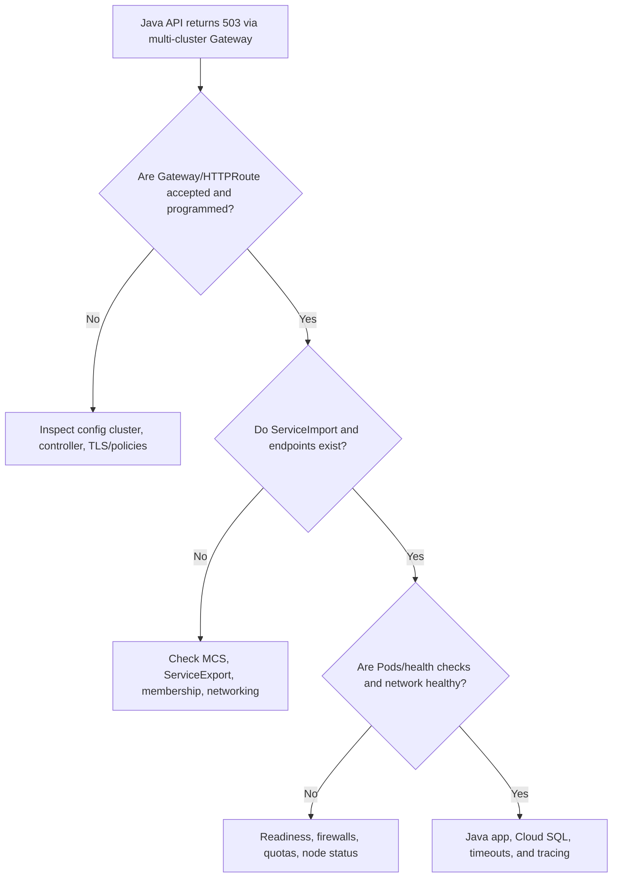

# GKE Fleets and Multi-Cluster Governance

## 1. When One GKE Cluster Is No Longer Enough

A **Java/Spring Boot** API runs across two GKE clusters in two regions. The platform team needs to enforce uniform security policies, manage access, and roll out upgrades in waves; application teams need backend health visibility and traffic routing across clusters. Managing each cluster separately with `kubectl` invites configuration drift and accidental commands against the wrong context.

A **GKE fleet** is a logical grouping of Kubernetes clusters registered to a **fleet host project** through the **Fleet service (Hub)**. A fleet serves as the foundation for centralized governance, policies, workload identity, and multi-cluster services; **it does not merge Kubernetes API servers, schedulers, networks, or storage into a single giant cluster**.

In the **Advanced GKE and Operations** chapter of the **CLOUD_PROVIDERS_GCP** module, this lesson connects project/IAM architecture, VPCs, GKE, Cloud Load Balancing, storage, CI/CD, and monitoring to design multi-cluster systems with sound operations, isolation, and recovery.

**Objectives:** after this lesson, you will know how to choose fleet boundaries; register and inspect memberships; distinguish Config Sync, Policy Controller, team scopes, and fleet Workload Identity Federation; understand Multi-cluster Services (MCS) and multi-cluster Gateways; and build upgrade, observability, rollback, and cost models.

> **Note:** Registering a cluster into a fleet can change its workload identity model and how fleet-level features affect the cluster. Configuration-modifying commands are strictly for **authorized lab clusters**; never migrate or unregister a production cluster for experimentation.

## 2. Fleet Host Project, Membership, and Scope



- The **fleet host project** manages the fleet, memberships, and fleet-level feature configurations. It does not have to be the project hosting every GKE cluster.
- A **membership** represents one registered cluster; membership names must be **unique within the fleet**, even when two projects have identically named clusters.
- **One project** has **at most one fleet** (or none). Each cluster belongs to at most one fleet; registered clusters within the same project must join the same fleet.
- Memberships for GKE clusters on Google Cloud registered via current `gcloud` typically take the **cluster's region** as their location. Older memberships or other cluster types may have location `global`. Always read the actual location from output.
- Fleets support GKE on Google Cloud as well as certain on-premises, multicloud, or **attached third-party Kubernetes** clusters; feature availability varies. The documented default quota is **250 clusters per fleet**, which can be raised by request.

| What a fleet helps with | What a fleet does NOT automatically guarantee |
| --- | --- |
| Cross-project cluster inventory and centralized governance | Network routing between clusters |
| Rolling out configs/policies via enabled features | Physically merging namespaces or Kubernetes APIs |
| Multi-cluster identity, team ownership, and service discovery | Cloud SQL or PersistentVolume data replication |
| Coordinated management and upgrade sequencing | SLOs, failover, or DR without application-level design |

## 3. Trust Boundaries and the Principle of Sameness

Several fleet features rely on **sameness**: a namespace, Service, or Kubernetes ServiceAccount sharing the **same name across member clusters** is treated as representing the **same logical entity**.

For example, namespace `orders`, Service `order-api`, and Kubernetes ServiceAccount `order-api` across two clusters running the same production Java app. That works well for shared configs, service discovery, and workload identity. Conversely, if Cluster A runs production `orders` while Cluster B lets an untrusted test team use `orders`, treating them as "the same identity" creates privilege-escalation risks.

| Design option | When to use | Governance needed |
| --- | --- | --- |
| Single fleet for production clusters sharing a trust boundary | Unified identity, configs, and multi-cluster services | Bad policy changes can affect all clusters together |
| Separate fleets for **production** vs. **development** | Different owners, access levels, and trust | Maintain two sets of fleet configs |
| Cross-project fleet within an organization | Isolated billing/teams with shared platform ops | Cross-project IAM and service agent bindings |
| Fleet with attached external Kubernetes clusters | Inventory and supported multi-cloud features | Feature support matrix, connectivity, and per-vCPU fees |

**A fleet is not a hard security isolation boundary.** If clusters have mutually untrusted admin groups, use **separate fleets**. Inside one fleet sharing a trust boundary, use team scopes and fleet namespaces to partition permissions.

Before grouping clusters, build a **project/region/owner** matrix, audit **colliding namespace and KSA names**, and align IAM, VPC/Shared VPC, GKE versions, and data RPO/RTO needs.

## 4. Registering a GKE Cluster to a Fleet with gcloud

### 4.1. Regular vs. Lightweight Membership

| Membership type | Purpose | Limitations |
| --- | --- | --- |
| **Regular** | Enables supported fleet features | Requires IAM, workload identity, and compatibility prep |
| **Lightweight** | Minimal registration for **fleet-based rollout sequencing** on upgrades | No fleet-level features, default fleet logs/metrics, or **fleet Workload Identity Federation** |

If you want Config Sync, Policy Controller, or MCS on a cluster, do not stay on lightweight membership. You can upgrade to regular after checking prerequisites.

### 4.2. Read-Only Inventory

```bash
gcloud container fleet memberships list --project=FLEET_HOST_PROJECT
gcloud container clusters list --project=APP_PROJECT_A
gcloud container clusters list --project=APP_PROJECT_B
```

Record **cluster name, project, zone/region, membership name/location**, and whether any cluster already belongs to a fleet. Never rely on cluster name alone, as two projects can share identical cluster names.

### 4.3. Registering an **Existing** Cluster in a Lab Environment

If the cluster and fleet share the **same project**:

```bash
gcloud container clusters update LAB_CLUSTER \
  --project=LAB_PROJECT \
  --location=CLUSTER_LOCATION \
  --enable-fleet
```

If the cluster resides in a different project from the **fleet host**:

```bash
gcloud container clusters update LAB_CLUSTER \
  --project=APP_PROJECT_A \
  --location=CLUSTER_LOCATION \
  --fleet-project=FLEET_HOST_PROJECT
```

These commands are **two mutually exclusive options**, not sequential steps. Add `--membership-type=LIGHTWEIGHT` if you want lightweight membership. Required APIs and permissions must exist in **both the cluster's project and the fleet host project**; for cross-project registration, the fleet host's GKE Hub service agent needs `roles/gkehub.serviceAgent` in the cluster's project per documentation. Never grant Project Owner merely to bypass permission errors.

If the cluster already enables **Workload Identity Federation for GKE**, regular registration via CLI can enable **fleet Workload Identity Federation**; audit namespaces, KSAs, and IAM bindings before running the update.

### 4.4. Verifying Registration

```bash
gcloud container fleet memberships list --project=FLEET_HOST_PROJECT

# Take MEMBERSHIP_LOCATION from list output; do not assume global.
gcloud container fleet memberships describe MEMBERSHIP_NAME \
  --project=FLEET_HOST_PROJECT \
  --location=MEMBERSHIP_LOCATION

gcloud container clusters describe LAB_CLUSTER \
  --project=APP_PROJECT_A \
  --location=CLUSTER_LOCATION
```

A listed membership confirms **registration**; it does not prove every feature is enabled or policies have synced.

**Never unregister casually:** for GKE clusters registered via `gcloud container clusters update/create`, `--clear-fleet-project` removes membership **without deleting the cluster**, yet altering fleet Workload Identity and feature dependencies can break workload permissions or service discovery. Google Cloud **recommends against moving clusters between fleets by unregistering and re-registering** when workloads rely on fleet identity.

## 5. Configuration Management with Config Sync

**Config Sync** synchronizes Kubernetes manifests from a **Git/OCI** source of truth to configured member clusters. It works well for Namespaces, RBAC, NetworkPolicies, ResourceQuotas, and platform baselines.



A simple manifest can be enforced uniformly:

```yaml
apiVersion: v1
kind: Namespace
metadata:
  name: orders
  labels:
    owner: commerce
    environment: production
```

**Fleet defaults** let eligible newly registered clusters inherit Config Sync settings automatically. **Previously registered clusters do not automatically receive all default changes** unless synced/configured via process. Before enabling sync, verify Git credentials, branch/revision, resource ownership, and Helm/CI integration.

Safe rollout workflow: **canary cluster → monitor Sync status, drift, and policy violations → roll out to next group → roll back source revision if needed**. Never let `kubectl apply`, Helm, and Config Sync compete for ownership of the same resource.

## 6. Policy Controller: Policy-as-Code Is Not GitOps

**Policy Controller** uses admission and audit webhooks to evaluate resources against constraints—for example, blocking privileged containers, requiring resource requests, or restricting image registries. It can be configured as a fleet-level feature on supported clusters.

| Tool | Responsibility | Risk if misconfigured |
| --- | --- | --- |
| **Config Sync** | Declares and syncs **desired state** | Pushes a bad manifest across multiple clusters |
| **Policy Controller** | Evaluates and can **reject** non-compliant resources | Blocks Deployments, controllers, or system workloads |
| **Kubernetes RBAC** | Controls who can call the Kubernetes API | Does not replace Google Cloud IAM |
| **Binary Authorization** | Enforces image deployment attestation policies | Does not replace full workload policies or scanning |

Start in **audit/dry-run** mode, inspect real violations, exempt required system namespaces, and only then expand **enforce** scope. Turning on fleet-wide enforcement all at once is never a minor change.

## 7. Team Scopes, Fleet Namespaces, and Access Control

A **team scope** groups the clusters assigned to a team; one cluster can belong to multiple scopes. **Fleet namespaces** manage logical namespaces across a team scope along with access permissions on selected member clusters.

| Scope | Clusters | Fleet namespace | Intended access |
| --- | --- | --- | --- |
| `commerce` | `orders-asia`, `orders-us` | `orders` | Java team manages workloads inside the namespace |
| `data-platform` | `platform` | `pipelines` | Data team operates separate workflows |

Permissions must combine **fleet IAM/scope permissions**, **Kubernetes RBAC**, and **Google Cloud runtime IAM**. Viewing a fleet dashboard **does not grant permission** to edit every Deployment. Scopes organize multi-team administration—**they do not replace separate fleets when trust boundaries differ**.

## 8. Fleet Workload Identity Federation: Convenience and Risk

**Workload Identity Federation** lets Pods call Google Cloud APIs using short-lived identities instead of static JSON service account keys. **Fleet Workload Identity Federation** extends this model across clusters in the same fleet, with the fleet host project providing the default workload identity pool.

Suppose two clusters share:

```text
Namespace: orders
Kubernetes ServiceAccount: order-api
Fleet host project: shared-fleet-host
```

Under **implicit identity sameness**, workloads with the same principal identifier can be treated by IAM as **one principal**, even across different projects. That is helpful when both run the same production Spring Boot API, yet dangerous if an untrusted team can create a matching KSA/Pod name.

**Mitigations:** standardize namespace/KSA ownership, restrict who creates workloads, audit IAM grants, and separate fleets along trust boundaries. Options for **explicit identity sameness** using self-managed pools at the team-scope level are in **Preview**—never treat them as universal defaults.

With Java Google Cloud client libraries using **Application Default Credentials (ADC)**, application code generally requires no fleet-specific changes. However, to call Cloud Storage, Pub/Sub, or Secret Manager, **you must grant IAM to the exact workload principal on target resources**; fleet registration never grants business permissions automatically.

## 9. Multi-Cluster Services: Discovering Services Across Clusters

**Multi-cluster Services (MCS)** lets you export a Kubernetes Service from source clusters; eligible member clusters receive a **`ServiceImport`** and cross-cluster DNS discovery at `SERVICE.NAMESPACE.svc.clusterset.local`.



MCS requires **the same fleet**, enabled features/APIs, existing Kubernetes Services, network reachability, and compatible DNS/firewalls. Under current constraints, **a multi-cluster Service can only be exported across clusters in the same project and same VPC network**, even though a fleet itself can span multiple projects/VPCs; MCS also has specific constraints around NetworkPolicies and add-ons.

### ServiceExport Manifest

When Service `order-api` already exists in namespace `orders` on both clusters:

```yaml
apiVersion: net.gke.io/v1
kind: ServiceExport
metadata:
  name: order-api
  namespace: orders
```

```bash
# Run ONLY against LAB cluster contexts with Services and MCS controller ready.
kubectl --context=GKE_A_CONTEXT apply -f service-export.yaml
kubectl --context=GKE_B_CONTEXT apply -f service-export.yaml

kubectl --context=GKE_A_CONTEXT get serviceexports -n orders
kubectl --context=GKE_A_CONTEXT get serviceimports -n orders
kubectl --context=GKE_B_CONTEXT get serviceimports -n orders
```

On the fleet host, once prerequisites are met:

```bash
gcloud container fleet multi-cluster-services enable \
  --project=FLEET_HOST_PROJECT
```

These are **illustrative configuration snippets**, not a full end-to-end lab: you still need Deployments/Services, networking and IAM setup, enabled APIs, and a healthy MCS controller. MCS **never deploys the Java image or replicates Cloud SQL** to another cluster automatically.

## 10. Multi-Cluster Gateway: Routing HTTP(S) Across Clusters

For a Spring Boot API exposed to the Internet under one hostname, **multi-cluster Gateway** designates a **config cluster** to host resources such as `Gateway` and `HTTPRoute`. The controller reads backends via MCS and programs Google Cloud load balancing resources for the supported GatewayClass.



| Resource | Where managed | Role |
| --- | --- | --- |
| Java Pods + Kubernetes Services | Each workload cluster | Serves live requests |
| `ServiceExport`/`ServiceImport` | MCS | Cross-cluster service discovery |
| `Gateway`, `HTTPRoute`, TLS/policies | **Config cluster** | Defines frontend and routing |
| Google Cloud Load Balancer | Controller-managed infrastructure | Routes client requests to backends |

**Multi Cluster Ingress** and **multi-cluster Gateway** are not interchangeable names: their Kubernetes resources and setup differ, even if some Fleet Ingress enablement steps overlap. Verify load balancer type, GatewayClass, health checks, TLS, Cloud Armor, config cluster availability, and quotas before enabling.

Keep the config cluster highly available to manage routing updates. If the config cluster disconnects, reconciliation pauses—**do not assume active traffic instantly drops**, because already-programmed load balancers can keep serving. Likewise, two healthy API clusters backed by **a single-region Cloud SQL instance** do not achieve full DR: design data HA, backups, and failover to match your RTO/RPO.

## 11. Cluster Access and Operational Observability

**Connect gateway** provides authenticated access to fleet members' Kubernetes APIs via Google Cloud, including certain private or off-GCP setups. Users still require **fleet/gateway IAM** plus **Kubernetes RBAC** for specific operations.

```bash
gcloud container fleet memberships list --project=FLEET_HOST_PROJECT

# Run ONLY for memberships you are authorized to access.
gcloud container fleet memberships get-credentials MEMBERSHIP_NAME \
  --project=FLEET_HOST_PROJECT

kubectl config current-context
kubectl get namespaces
```

To avoid mutating the wrong cluster, automation must pass **`kubectl --context=...`** and verify context before applying changes. A fleet does not turn `kubectl get pods` into a fleet-wide query.

| Monitoring layer | Key signals |
| --- | --- |
| Fleet | Membership status/location, feature health, registration errors |
| Policy/Config Sync | Sync status, drift, admission violations |
| GKE | Node readiness, GKE upgrades, Pod restarts, CSI mounts |
| MCS/Gateway | `ServiceImport`, `HTTPRoute` status, backend health, 5xx/latency |
| Java application | SLOs, p95/p99 latency, JVM GC, Cloud SQL/HikariCP, business errors |
| Security | IAM denials, identity mismatches, VPC/DNS/firewall drops |
| Cost | GKE, load balancers, cross-region egress, Cloud Logging |

**A green fleet dashboard does not prove the Java API meets SLOs.** Combine fleet state, Kubernetes telemetry, backend health, and business metrics.

## 12. Multi-Cluster Upgrades and Fault Tolerance

Controlled upgrade workflow:

1. **Inventory** GKE versions, node pools, CSI drivers, Gateways, Policy Controller, and Java runtimes per cluster.
2. **Canary cluster:** upgrade a low-risk cluster first; verify Java readiness, IAM, networking, data access, and policy sync.
3. **Production Wave 1:** upgrade one slice; watch p95 latency, 5xx, Pod disruptions, and backend health.
4. **Production Wave 2:** upgrade remaining clusters once metrics and rollback gates pass, maintaining spare capacity.
5. **Final verification:** validate routing, data health, costs, and close the change record.

GKE offers **fleet-based rollout sequencing** for supported configurations, yet it does not replace **PodDisruptionBudgets**, rolling update settings, readiness/graceful shutdown, quotas, or app rollback plans. Never upgrade all serving clusters simultaneously just to "keep versions identical."

**DR must cover data:** MCS/Gateway never replicate Cloud SQL or PersistentVolumes automatically. If standby Cluster B in another region still depends on a database in Region A, losing Region A still stops order creation. Define **RTO/RPO**, Cloud SQL HA/read-replica/backup strategies, DNS, secrets, and failover drills.

## 13. Permissions, Networking, and Cost

**Security:** separate permissions for fleet administrators, cluster operators, and app developers; configure cross-project IAM for fleet host service agents; standardize namespace/KSA names to avoid identity collisions; enforce GitOps via pull requests; promote Policy Controller from audit to enforce gradually; secure ingress with TLS/Cloud Armor; and lock down VPC/network reachability instead of opening wide firewalls between clusters.

**Cost:** **registering a GKE cluster in a fleet carries no separate registration fee** per current documentation, however:

- GKE clusters, nodes/Autopilot usage, disks, and underlying resources still incur charges.
- Certain fleet features such as Cloud Service Mesh or Multi Cluster Ingress have separate fees; **attached third-party clusters** may incur per-vCPU charges.
- Multi-cluster Gateways consume Load Balancing, IPs, health checks, and cross-region egress data transfer.
- Cloud Logging/Monitoring, Artifact Registry, CI/CD, and network links bill by usage.

Set up **billing labels and project budgets** and track **cost per successful Java request** rather than fleet fees alone. Budget alerts never cap cluster counts or halt billing automatically.

## 14. Diagnostic Runbook

| Symptom | Primary suspect | What to inspect |
| --- | --- | --- |
| Registration fails | Duplicate membership name, project already in another fleet, IAM/APIs | Cluster + fleet host project, service agent, location |
| Membership exists, feature inactive | Lightweight membership or feature not enabled/configured | Membership type, feature compatibility, feature status |
| Config Sync fails | Git/OCI credentials, revision, permissions, or resource ownership conflict | Source of truth, drift, controller logs/status |
| Policy Controller blocks Java deployment | Enforced constraint or missing exemption | Violation/audit logs, namespace, rollout policy |
| Pod fails calling Cloud Storage | Fleet WIF principal mismatch or missing IAM | Namespace/KSA names, pool, resource IAM bindings |
| `ServiceImport` missing | MCS prerequisites, missing export, VPC/DNS mismatch | `ServiceExport`, APIs, Service, VPC network |
| Gateway returns 503 | Backend or Gateway config | `Gateway`/`HTTPRoute` conditions, health checks, Java logs |
| Connect gateway returns Forbidden | Missing IAM or Kubernetes RBAC | Identity, gateway role, RBAC, context |
| Upgrade triggers 5xx | Readiness, node capacity, DB connection pools | Rollout, PDBs, error budget, Cloud SQL |



Never unregister a cluster or disable Policy Controller fleet-wide when a single endpoint breaks. Isolate along the chain **membership → feature → Kubernetes resource → network → Java application**.

## 15. Practice Exercises and Checklist

### Exercise A — Read-Only Inventory, Creating No Resources

With Viewer permissions in an authorized environment:

```bash
gcloud container fleet memberships list --project=FLEET_HOST_PROJECT
gcloud container fleet scopes list --project=FLEET_HOST_PROJECT
gcloud container clusters list --project=APP_PROJECT_A
gcloud container clusters list --project=APP_PROJECT_B
kubectl config get-contexts
```

**Deliverable:** a table listing project, region, cluster, membership, location, owner, regular vs. lightweight, active fleet features, and **colliding namespace/KSA names carrying mixed-privilege risks**. Recommend keeping one fleet or splitting into two, justifying based on trust boundaries.

### Exercise B — Lab Registration and MCS Check (Permission Permitting)

Use only **two existing test clusters** authorized to join the same fleet with compatible networking:

1. Register using `--enable-fleet` (same project) or `--fleet-project` (cross-project), then verify with `memberships list/describe`.
2. Inspect fleet Workload Identity permissions and namespace/KSA sameness for `orders`.
3. If MCS prerequisites are met, enable MCS, create `ServiceExport` for `order-api`, and verify `ServiceImport` on both clusters.
4. Send controlled smoke-test requests from a test Java Pod to `order-api.orders.svc.clusterset.local`; inspect results and logs.
5. Clean up **only the lab-owned namespace and `ServiceExport` resources**; evaluate dependencies before disabling features or unregistering. Never delete clusters, production namespaces, or shared load balancers.

### Exercise C — DR Design

Two GKE clusters running Spring Boot serve `api.example.com` behind a multi-cluster Gateway, while Cloud SQL runs in a single region. Draw the **failure domains**; propose RTO/RPO targets, data replication strategy, wave upgrades, rollback criteria, and where to monitor 503s. Explain why fleet membership alone does not provide failover.

### Checklist

- [ ] Understand fleet host project, membership name/location, and fleet/project constraints.
- [ ] Choose fleet boundaries by **trust boundary**, not merely cluster count.
- [ ] Audited namespace, Service, and Kubernetes ServiceAccount sameness.
- [ ] Know the difference between regular and lightweight memberships.
- [ ] Distinguish Config Sync (declarative sync) from Policy Controller (evaluation/enforcement).
- [ ] Understand team scopes and fleet namespaces without treating them as hard security isolation.
- [ ] Configured IAM for fleet WIF; zero JSON keys embedded in Java images.
- [ ] Understand `ServiceExport`/`ServiceImport`, MCS DNS, and VPC/project boundaries.
- [ ] Understand config cluster/`Gateway`/`HTTPRoute` and how Connect gateway enforces IAM+RBAC.
- [ ] Prepared wave-based upgrade runbooks, SLO tracking, and data DR plans.
- [ ] Estimated GKE, multi-cluster LB, network egress, logging, and fleet feature costs.

**Conclusion:** GKE fleets solve **centralized multi-cluster governance**; effectiveness depends on **trust boundaries, identity hygiene, a single source of truth, and disciplined operations**. For Java on Google Cloud, use fleets to standardize and coordinate while still engineering **networking, data replication, failover, application SLOs, and cost** at their proper layers.

## 16. Official Google Cloud References

- [Fleet management overview](https://cloud.google.com/kubernetes-engine/docs/fleets-overview)
- [How fleets work](https://cloud.google.com/kubernetes-engine/fleet-management/docs/fleet-concepts)
- [Plan fleet resources, quotas and limits](https://cloud.google.com/kubernetes-engine/fleet-management/docs/fleet-concepts/plan-fleets)
- [Register GKE cluster](https://cloud.google.com/kubernetes-engine/fleet-management/docs/register/gke)
- [Unregister a cluster](https://cloud.google.com/kubernetes-engine/fleet-management/docs/unregister)
- [Fleet Workload Identity Federation](https://cloud.google.com/kubernetes-engine/fleet-management/docs/about-fleet-workload-identity-federation)
- [Team scopes and fleet namespaces](https://cloud.google.com/kubernetes-engine/fleet-management/docs/team-management)
- [Config Sync fleet defaults](https://cloud.google.com/kubernetes-engine/config-sync/docs/how-to/install-fleet)
- [Policy Controller installation](https://cloud.google.com/kubernetes-engine/policy-controller/docs/how-to/installing-policy-controller)
- [Multi-cluster Services](https://cloud.google.com/kubernetes-engine/docs/how-to/multi-cluster-services)
- [Multi-cluster Gateways](https://cloud.google.com/kubernetes-engine/docs/concepts/multi-cluster-gateways)
- [Prepare multi-cluster Gateway environment](https://cloud.google.com/kubernetes-engine/docs/how-to/prepare-environment-multi-cluster-gateways)
- [GKE pricing](https://cloud.google.com/kubernetes-engine/pricing)
