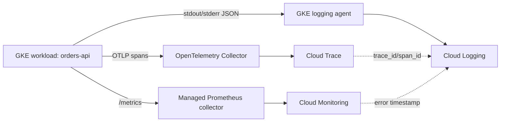
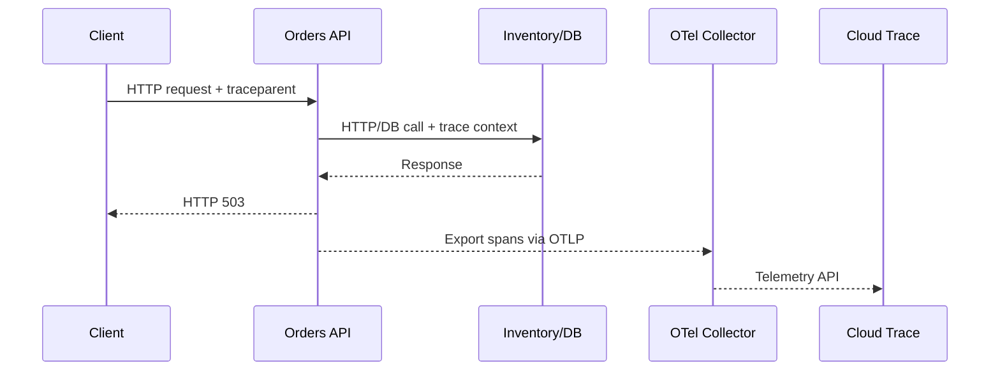
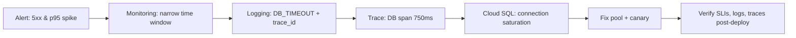

# Collecting Logs, Metrics, and Traces for GKE

Suppose the Orders application on Google Kubernetes Engine (GKE) starts responding slowly after a release. `kubectl get pods` still reports `Running`, yet some requests return HTTP 503. **Logs** show which requests failed, **metrics** show when errors began and how many users are affected, and **traces** pinpoint whether latency sits in the API, database, or a downstream service. Observing all three signals lets you find root causes instead of blindly restarting Pods.

This lesson belongs to the **Advanced GKE and Operations** chapter of the `CLOUD_PROVIDERS_GCP` module. It applies to containerized applications running on GKE Standard and Autopilot, connecting Cloud Logging, Cloud Monitoring, Managed Service for Prometheus, and Cloud Trace. The goal is designing a **verifiable telemetry pipeline serving SLOs without leaking sensitive data or letting costs spiral**.

> Examples use project `orders-lab`, cluster `orders-gke`, namespace `orders`, and Service `orders-api`. These are illustrative placeholders, not live resources. Commands that modify clusters or workloads are marked and should only run in an authorized sandbox.

## 1. Learning Outcomes

After this lesson, you will be able to:

1. Distinguish logs, metrics, and traces, and choose the right signal for a given incident.
2. Inspect GKE system, workload, and control-plane logging and metrics collection settings.
3. Emit **structured JSON logs** to `stdout/stderr`, filter them in Logs Explorer, and link them to traces.
4. Export Prometheus-style application metrics, configure `PodMonitoring`, and query them with PromQL.
5. Instrument applications with OpenTelemetry and send OTLP via a Collector to Cloud Trace.
6. Design dashboards, alerts, data security, and optimizations for cardinality, volume, and sampling.
7. Investigate a realistic incident across all three signals and validate the pipeline before production.

## 2. Three Signals, Three Questions

| Signal | Data shape | Typical question | Product |
| --- | --- | --- | --- |
| **Logs** | Events with timestamp, severity, message, and context | Which request returned 503? Which Pod logged a DB connection error? | Cloud Logging, Logs Explorer |
| **Metrics** | Numeric time series with labels | When did error rate, CPU, memory, or queue depth change? | Cloud Monitoring, Managed Service for Prometheus |
| **Traces** | Spans across services for one request | Is the 900 ms latency in the API, DB, or downstream service? | Cloud Trace / Trace Explorer |



This is a recommended integrated setup—**creating a cluster does not automatically produce application traces**. GKE automatically collects certain system/workload logs and infrastructure metrics; custom Prometheus metrics need endpoints and scrape policies; traces require explicit instrumentation and export. A Collector can also export **all three OTLP signals**, though you do not need an extra collector merely to read `stdout/stderr` logs already collected by GKE.

## 3. Inspecting Cluster Telemetry Configuration

On GKE, Logging includes these primary components:

| Log group | Configuration/source | Examples |
| --- | --- | --- |
| **SYSTEM** | System Pods, kubelet/container runtime, Kubernetes events | Node errors, DNS, scheduler system events |
| **WORKLOAD** | User workload containers; logs written to `stdout/stderr` | `orders-api` request and error logs |
| **Control plane component logs** | Optional API server, scheduler, controller manager | Admission errors, scheduler/controller logs |
| **Audit logs** | Cloud Audit Logs by service and log type | Who changed cluster/IAM, API operations |

**Autopilot** requires system logging and metrics; on **Standard**, collection components can be customized per version capabilities. Enabling logging does not collect logs written **only to files inside a container**: write to `stdout/stderr` or design a dedicated collector. Control plane logs may need to be enabled separately; changing control plane logging settings can trigger a control plane restart, so schedule it per cluster type.

### 3.1. Read-Only Commands

```bash
# Does not modify the cluster.
gcloud container clusters describe orders-gke \
  --project=orders-lab \
  --location=asia-southeast1 \
  --format="yaml(loggingConfig,monitoringConfig)"

kubectl config current-context
kubectl -n orders get pods -o wide
kubectl -n orders logs deploy/orders-api --since=15m --tail=100
```

`kubectl logs` streams container logs through Kubernetes; it is **not long-term storage**. Logs from deleted or restarted Pods can disappear from `kubectl`, whereas Cloud Logging retains centralized queryable logs per retention policy.

### 3.2. Example Configuration Update (Do Not Run by Default)

```bash
# MODIFIES CLUSTER: administrators only, after inspecting current config.
gcloud container clusters update orders-gke \
  --project=orders-lab \
  --location=asia-southeast1 \
  --logging=SYSTEM,WORKLOAD
```

Additional options (API server, scheduler, controller manager; metrics packages and Autopilot settings) follow separate rules. Before updating, check GKE version, existing settings, and org requirements so you don't accidentally drop diagnostic telemetry. **GKE system metrics** flow to Cloud Monitoring; custom application metrics do not appear merely by setting `--monitoring=SYSTEM`.

## 4. Logs: Write One JSON Event Per Line

The GKE logging agent parses **single-line JSON on `stdout/stderr`** into structured log entries. Fields like `severity`, `message`, and special `logging.googleapis.com/*` keys are recognized by Cloud Logging; custom application fields live under `jsonPayload`.

Example record emitted by an app, containing zero customer PII:

```json
{
  "severity": "ERROR",
  "message": "orders DB request timed out",
  "service": "orders-api",
  "environment": "staging",
  "operation": "create_order",
  "duration_ms": 930,
  "error_code": "DB_TIMEOUT",
  "logging.googleapis.com/trace": "projects/orders-lab/traces/0123456789abcdef0123456789abcdef",
  "logging.googleapis.com/spanId": "0123456789abcdef"
}
```

When writing to `stdout` in practice, **serialize each event as a single line of JSON**, without embedded newlines as shown in the formatted block above. With `printf` or JSON loggers, flush buffers promptly and emit UTC timestamps; Cloud Logging attaches `resource.type=k8s_container`, project, cluster, namespace, pod, and container metadata automatically.

**Never log** access tokens, `Authorization` headers, passwords, session IDs, payment card details, or full request bodies. Use stable error codes and trace IDs for debugging; store only sanitized business identifiers compliant with data policies.

### 4.1. Filtering Logs by Cluster, Namespace, and Severity

In **Logs Explorer**, use the Logging query language:

```text
resource.type="k8s_container"
resource.labels.cluster_name="orders-gke"
resource.labels.namespace_name="orders"
resource.labels.container_name="orders-api"
severity>=ERROR
```

Filter by a custom payload field:

```text
resource.type="k8s_container"
resource.labels.namespace_name="orders"
jsonPayload.error_code="DB_TIMEOUT"
```

From `gcloud`, query logs using the same filter syntax:

```bash
# READ-ONLY; limit results to avoid dumping sensitive info to the terminal.
gcloud logging read \
  'resource.type="k8s_container" AND resource.labels.namespace_name="orders" AND severity>=ERROR' \
  --project=orders-lab \
  --freshness=30m \
  --limit=30 \
  --format='table(timestamp,severity,resource.labels.pod_name,jsonPayload.message)'
```

If logs are missing, check **whether the app actually writes to `stdout/stderr`**, whether workload logging is enabled, query time range, project/cluster names, and `roles/logging.viewer` permissions. If entries were dropped by a logging sink/exclusion, tweaking the query will not recover dropped logs.

### 4.2. System Logs, Control-Plane Logs, and Audit Logs

| Source | Resource / query target | When needed |
| --- | --- | --- |
| Application containers | `k8s_container` + namespace/pod/container | 5xx errors, crashes, dependency errors |
| System workloads / kubelet | `k8s_container` / `k8s_node` depending on source | Node pressure, runtime failures |
| Control-plane components | `k8s_control_plane_component` when enabled | API server, scheduler, controller issues |
| Kubernetes events | Events in GKE logs and `kubectl get events` | Scheduling, image pulls, Evicted, probe failures |
| Cloud Audit Logs | `cloudaudit.googleapis.com` by `logName`/resource | Who modified IAM, configs, or GKE APIs |

Audit logging has distinct categories and access rules; **Data Access audit logs** are often off by default across services and require specific IAM roles to view. Never rely on application logs as a substitute for an audit trail.

## 5. Metrics: Measuring System and Application Performance

Typical GKE system metrics cover CPU, memory, disk, and network where collected. `kube-state-metrics` exposes Pod/Deployment/HPA/PVC states; cAdvisor/kubelet metrics detail container usage. **Metrics packages** carry separate enablement rules—avoid double-scraping if self-managed exporters already run.

For the Orders API, measure **RED** (Rate, Errors, Duration); for nodes and clusters, monitor CPU, memory, disk, Pending Pods, OOMKilled counts, restarts, and quotas.

| Metric | Type | Stable labels to keep |
| --- | --- | --- |
| `orders_http_requests_total` | Counter | Templated `route`, `method`, `status_class` |
| `orders_http_request_duration_seconds` | Histogram | Templated `route`, `method` |
| `orders_queue_depth` | Gauge | Bounded `queue` name |
| Container CPU/memory | GKE system metrics | Default cluster/namespace/workload labels |
| Pod desired/available replicas | `kube-state-metrics` | Namespace/deployment |

**Never use `user_id`, `order_id`, email, or raw URLs as metric labels:** every distinct value spawns new time series, exploding cardinality, ingestion, and cost. Keep `route="/orders/{id}"` instead of `route="/orders/1234"`. For histograms, pick just enough buckets to compute p95/p99 around SLO targets—excessive buckets multiply time series.

### 5.1. Managed Service for Prometheus and `PodMonitoring`

Managed collection for Google Cloud Managed Service for Prometheus is enabled by default on many newer GKE versions—verify on your cluster. It scrapes **explicitly declared targets** rather than auto-discovering every `/metrics` endpoint. A `PodMonitoring` resource in namespace `orders` selects only Pods in that same namespace by labels.

Suppose Pods labeled `app: orders-api` expose HTTP metrics on a port **named `metrics`** at `/metrics`:

```yaml
apiVersion: monitoring.googleapis.com/v1
kind: PodMonitoring
metadata:
  name: orders-api-metrics
  namespace: orders
spec:
  selector:
    matchLabels:
      app: orders-api
  endpoints:
  - port: metrics
    path: /metrics
    interval: 30s
```

The Deployment container must declare that matching named port:

```yaml
# Deployment snippet, not a standalone manifest.
containers:
- name: orders-api
  image: VERIFIED_IMAGE_DIGEST
  ports:
  - name: http
    containerPort: 8080
  - name: metrics
    containerPort: 9090
```

Apply and inspect:

```bash
# MODIFIES: apply only in a sandbox cluster with managed collection enabled.
kubectl apply -f orders-podmonitoring.yaml

# READ-ONLY:
kubectl -n orders get podmonitoring orders-api-metrics
kubectl -n orders describe podmonitoring orders-api-metrics
kubectl -n orders get pods -l app=orders-api -o wide
```

In Cloud Monitoring Metrics Explorer, query Prometheus metrics using PromQL. If data is missing, verify the selector matches Pod labels, named port `metrics` exists, the app binds to `0.0.0.0:9090` (or reachable address), collector reachability/NetworkPolicy allows scraping, target scrape status is healthy, and monitoring write IAM is intact.

### 5.2. SLI-Oriented PromQL Queries

Example **5-minute HTTP 5xx error ratio**, assuming the app exports a counter with `status_class="5xx"`:

```promql
sum(rate(orders_http_requests_total{status_class="5xx"}[5m]))
/
clamp_min(sum(rate(orders_http_requests_total[5m])), 1e-9)
```

Example **p95 latency**, assuming a standard Prometheus histogram:

```promql
histogram_quantile(
  0.95,
  sum by (le) (rate(orders_http_request_duration_seconds_bucket[5m]))
)
```

Latency results are in **seconds**. Metrics must come from the same workload/scope; if multiple clusters emit identically named series, filter by cluster/namespace/service in both numerator and denominator. Under very low request rates, error ratios swing wildly—add minimum request-rate guards to prevent noisy alerts.

### 5.3. Which Metrics to Prioritize?

| Layer | Signals to watch | Action when abnormal |
| --- | --- | --- |
| Business/API | RPS, 5xx ratio, p95/p99 latency, queue depth | Check routes, dependencies, traffic bursts |
| Pod | CPU throttling, memory, OOMKilled, restart count | Review requests/limits, profiling, recent rollouts |
| Deployment/HPA | Ready vs. desired replicas, Pending Pods, scaling lag | Inspect node capacity, HPA thresholds, quotas |
| Node | CPU/memory pressure, disk, network | Check autoscaler, noisy neighbors, storage |
| Control plane | API server/scheduler metrics if enabled | Investigate API overload or scheduling delays |

Do not cram every available metric onto one dashboard. Operational dashboards should open with **user-facing SLIs** and drill down into underlying resources; `orders-api` can lose Cloud SQL connectivity even while cluster CPU and memory look completely normal.

## 6. Traces: Following One Request Across Services

A **distributed trace** consists of one trace ID and multiple spans. Each span records `start/end time`, operation name, status, and attributes; child spans inherit context from parent spans as a request traverses APIs, job queues, and dependencies.

```text
Trace 0123456789abcdef0123456789abcdef  (request POST /orders)
  ├─ HTTP server orders-api                 940 ms
  │   ├─ Validate order                    12 ms
  │   ├─ inventory-service HTTP            80 ms
  │   └─ Cloud SQL insert                  760 ms
  └─ HTTP response                         503
```

A trace shows where time was spent; it does not explain **why** SQL slowed down on its own. Pair DB metrics, logs, and query analysis to pinpoint root causes.

### 6.1. Instrumenting with OpenTelemetry

Google Cloud recommends instrumenting GKE apps with the language-appropriate **OpenTelemetry SDK or zero-code instrumentation**, exporting OTLP to the **Google-Built OpenTelemetry Collector**, which ships telemetry to Google Cloud Observability via the Telemetry (OTLP) API. This pattern applies across Java, Go, Python, and Node.js, though SDK dependencies and integration details vary.



Sample **Deployment environment variables**, assuming a Collector named `opentelemetry-collector` runs in namespace `opentelemetry` listening on **OTLP/gRPC 4317**:

```yaml
# Place inside containers[].env of an already-instrumented Deployment.
env:
- name: OTEL_SERVICE_NAME
  value: orders-api
- name: OTEL_EXPORTER_OTLP_PROTOCOL
  value: grpc
- name: OTEL_EXPORTER_OTLP_ENDPOINT
  value: http://opentelemetry-collector.opentelemetry.svc.cluster.local:4317
- name: OTEL_TRACES_SAMPLER
  value: parentbased_traceidratio
- name: OTEL_TRACES_SAMPLER_ARG
  value: "0.10"
```

This snippet **does not instrument an app lacking the OTel SDK/agent**. You must add language instrumentation and network reachability from **Pod → Collector**. For OTLP/HTTP, port 4318 and a different protocol setting are typical—never point `grpc` at an HTTP-only endpoint. The 10% sampling value is illustrative; low-traffic services or active debugging may need different sampling policies.

### 6.2. Trace Context and Log Correlation

Trace context typically propagates via the W3C **`traceparent`** HTTP header. Applications must forward it on downstream calls; dropping the header in a proxy or async worker fragments one business flow into **disconnected traces**.

For Cloud Logging correlation, include:

- `logging.googleapis.com/trace` = `projects/PROJECT_ID/traces/TRACE_ID` (32-hex-character trace ID).
- `logging.googleapis.com/spanId` = 16-hex-character span ID.
- Depending on framework, optionally include boolean `logging.googleapis.com/trace_sampled` if sampling state is known.

Extract these values from the **active span context**—never invent fake trace IDs solely for logs. Logs Explorer links to matching traces when spans were exported, the trace ID is valid, and the viewer has permissions. If a span was sampled out or export failed, the log keeps the trace ID even though no full trace opens.

### 6.3. What Permissions Does the Collector Need?

The Google-Built OpenTelemetry Collector on GKE can use **Workload Identity Federation for GKE** to export telemetry without long-lived JSON keys. The Collector's workload identity typically needs:

| IAM role | Purpose |
| --- | --- |
| `roles/cloudtrace.agent` | Write traces to Cloud Trace |
| `roles/monitoring.metricWriter` | Export metrics |
| `roles/logging.logWriter` | Export logs via Collector |

Grant these roles only to the **Collector's Kubernetes ServiceAccount / mapped Google identity**—not to all apps or dashboard viewers. Enable Telemetry, Cloud Trace, Cloud Logging, and Cloud Monitoring APIs per your exporter architecture; verify the target Google Cloud project and network policies. Consult official Collector docs for approved production manifests instead of copying demo configs that vary across releases.

## 7. Correlating All Three Signals During Investigation

Follow a consistent investigation sequence:

1. **Metrics:** spot 5xx jumping from 0.2% to 5% around 09:30 and p95 latency climbing from 180 ms to 920 ms.
2. **Logs:** filter `resource.type="k8s_container"`, `namespace="orders"`, severity `ERROR` over the same window; find `error_code="DB_TIMEOUT"` and its trace ID.
3. **Traces:** open the trace by ID to see whether `Cloud SQL insert` duration spiked.
4. **Infrastructure:** cross-check Pod restarts, CPU throttling, Cloud SQL connections/locks, and recent rollouts.
5. **Conclusion:** confirm root cause only when corroborated across multiple signals; deploy fix/canary and re-measure the same SLIs.

If metrics show rising 5xx with zero logs, inspect the logging pipeline; if logs exist without traces, check instrumentation, export, and sampling. **Missing telemetry never proves the system is healthy.**

## 8. Dashboards, SLIs/SLOs, and Alerting

An on-call-ready Orders API dashboard should show **RPS**, **5xx ratio**, **p95/p99 latency**, **ready/desired Pods**, **CPU/memory**, **DB request latency**, **Collector health**, and direct links to Logs and Traces. Do not add dozens of charts merely because they exist.

| Metric | Example target | Appropriate alert |
| --- | --- | --- |
| Availability | 99.9% successful requests over 30 days | Error-budget burn-rate alert |
| Latency | 95% of requests under 300 ms | p95 breach gated by minimum traffic |
| Platform health | 100% critical Pods available post-rollout | Sustained missing ready replicas |
| Telemetry health | Logs/metrics/traces arriving within expected window | Scrape/export failures or ingestion lag |

**Illustrative alert rule:** 5xx ratio > 2% for 10 minutes **and** at least 100 requests in that window. In production, prefer **multi-window burn-rate alerts** tied to SLOs with deduplication to avoid paging on a single stray request.

Attach an owner, severity, runbook, dashboard link, and on-call routing to every alert. Define maintenance-window silencing, escalation, and resolution policies—never let alerts route to an unmonitored mailbox.

## 9. Telemetry Security and IAM

Telemetry is **sensitive data**. Traces can capture URLs, HTTP headers, and DB statements; logs can capture tokens, emails, or customer payloads. Minimum safeguards:

- **Minimize:** keep PII, JWTs, passwords, request bodies, and sensitive SQL parameters out of logs, spans, and metric labels.
- **Redact at source:** use field allowlists, masking, and CI checks for secret leakage.
- **Workload Identity:** grant collectors/agents least-privilege write roles; grant viewers `roles/logging.viewer`, `roles/monitoring.viewer`, and trace viewer roles.
- **Restrict query scope:** audit/Data Access logs or buckets holding sensitive fields need dedicated roles; use IAM conditions and log views instead of project-wide Editor.
- **Protect the pipeline:** enforce mTLS/NetworkPolicy on OTLP endpoints where needed, verify destination projects, and never expose collector endpoints publicly.
- **Retention and auditing:** classify log buckets, retention, and router sinks; protect audit/security logs and restrict deletion permissions.

When shipping telemetry to a centralized observability project, confirm cross-project IAM and data residency rules. Never assume telemetry is low-risk just because it is "not business data."

## 10. Cost: Controlling Volume, Cardinality, and Sampling Properly

| Cost driver | What inflates it | Mitigation |
| --- | --- | --- |
| Cloud Logging | `INFO` log per request, huge debug payloads, long retention | Log key events, sample `INFO`, redact, use controlled exclusions |
| Managed Prometheus | Too many time series/buckets, overly short scrape intervals | Limit labels/cardinality, drop unused metrics, tune intervals |
| Cloud Trace | Many spans per request, high sampling rates | Sample to match SLO/use case; avoid chatty micro-spans |
| Collector | CPU/memory, egress, overload/drops | Batching, memory limiters, autoscaling, self-observability |
| Sinks/exports | BigQuery / Cloud Storage / Pub/Sub storage and processing | Tune retention/cold tiers and restrict exported fields |

GKE **system metrics** follow different pricing rules from custom application metrics; many system metrics are ingested free of charge, whereas **Managed Service for Prometheus**, Cloud Logging, and Cloud Trace carry usage-based billing units. Check current pricing by region, project, bytes/samples ingested, and retention.

**Never cut costs by dropping all `ERROR` logs or disabling critical system telemetry.** Test cardinality limits, log levels, sampling rates, scrape intervals, and exclusions in a sandbox, comparing incident detection before and after. If using 10% trace sampling, accept that individual requests may lack spans and add targeted error-capture mechanisms when needed.

## 11. Troubleshooting: Missing or Broken Telemetry

| Symptom | Causes to check | Safe verification |
| --- | --- | --- |
| `kubectl logs` works, Logs Explorer empty | Workload logging off, wrong project/cluster, exclusions, missing viewer IAM | Check `loggingConfig`, `logName`, query time range, and `roles/logging.viewer` |
| Logs appear in Logs Explorer, JSON not parsed | App writes multi-line or malformed JSON | Inspect raw `stdout` line and logger formatter |
| Only system logs appear | `WORKLOAD` disabled or app logs to a local file instead of `stdout` | Compare cluster config against container log stream |
| `/metrics` returns 200, Metrics Explorer empty | Missing `PodMonitoring`, wrong selector/port, scrape blocked | `kubectl describe podmonitoring`; verify Pod labels and named port |
| Duplicate or exploding Prometheus metrics | Two collectors scraping or high-cardinality labels | Audit `PodMonitoring`/`ServiceMonitor`/exporters; drop duplicate series |
| `kubectl top` works, app counters missing | System metrics differ from app metrics | Check app instrumentation, endpoint, and managed collection |
| No traces | Uninstrumented, wrong OTLP port/protocol, export IAM/network, or sampling | Check OTel SDK, Collector logs/health, `roles/cloudtrace.agent`, sampling |
| Traces exist, don't link to logs | Malformed trace ID in log, wrong project, or span sampled out | Pull from active span context and format `projects/PROJECT_ID/traces/TRACE_ID` |
| Trace splits into fragments | Client/proxy/worker drops trace context | Verify `traceparent` propagation and queue message headers |
| Dashboard charts work, alerts never fire | Bad alert filter/policy/channel or overly long window | Inject synthetic error in sandbox and test notification channel |

### 11.1. Inspecting the Collector and Permissions

For a Collector deployed per official guidance in namespace `opentelemetry`:

```bash
# READ-ONLY: actual deployment name may vary.
kubectl -n opentelemetry get pods
kubectl -n opentelemetry get services
kubectl -n opentelemetry logs deploy/opentelemetry-collector \
  --since=15m --tail=100
```

If running multiple replicas, a DaemonSet, or custom names, target the exact Pod/container. Inspect Collector self-observability metrics for queue depth, export failures, and dropped spans—distinguishing **"app never sent spans"** from **"Collector received spans but failed to export."** Never expose an OTLP receiver on `0.0.0.0:4317` to the Internet without authentication and network controls.

## 12. Case Study: Finding the Cause of Post-Rollout 503s

The Orders app runs three replicas on GKE. After releasing `v2` at 09:30, request rate stays flat yet the 503 ratio jumps from 0.1% to 4% and p95 latency rises from 180 ms to 900 ms. CPU barely moves.

| Step | Source | Hypothetical finding | Meaning |
| --- | --- | --- | --- |
| 1 | Monitoring RED dashboard | 5xx rises at the exact rollout timestamp | Suspect new release; not yet conclusive |
| 2 | Logs Explorer | `DB_TIMEOUT` concentrated in `v2` Pods | Points toward the DB path |
| 3 | Trace Explorer | `database.insert_order` span takes 750/900 ms | Bottleneck is the downstream/DB call |
| 4 | Cloud SQL metrics + app config | `v2` raised pool size; DB connections hit max limit | Evidence confirms hypothesis |
| 5 | Rollback/canary | Lower pool size, ship `v2.1`, 5xx returns to 0.1% | Verified via post-change SLIs |

Investigation path:



If traces are missing due to sampling, you can still correlate logs, app metrics, and DB metrics—**never fabricate span details that were never collected**. After resolving the incident, update dashboards, alerts, and runbooks for the actual failure mode without turning one hypothesis into the universal explanation for every 503.

## 13. Practice Exercises

Perform the exercises below only in a **sandbox cluster** or on authorized sample data; never write request bodies or secrets to logs.

### Exercise A — Inspect Existing Configuration

Run the **read-only** commands from section 3 and record: logging mode, system metrics status, Managed Prometheus status, and where control-plane/audit logs live. Distinguish what GKE collects automatically from what the application must instrument.

### Exercise B — Structured Logging and Filtering

Have a test app emit one JSON line containing `severity=ERROR`, `error_code=DB_TIMEOUT`, `duration_ms=930` (with zero PII). Write a Logs Explorer query filtering by namespace, severity, and `error_code`; explain why logs should carry trace IDs but never bearer tokens.

### Exercise C — PodMonitoring

A Deployment has label `app: orders-api` and exposes `/metrics` on container port 9090 named `metrics`. Write a `PodMonitoring` scraping every 30s and check target status. If the target fails to appear, list the first three checks across labels, ports, and collector/network.

### Exercise D — PromQL and Labels

Using an HTTP request counter with `status_class` and a duration histogram, write queries for 5xx ratio and p95 latency. A developer proposes adding `order_id` as a metric label: explain the impact on cardinality and cost, and how to replace it with trace/log context.

### Exercise E — Traces and Correlation

A request flows from API → inventory → DB write. Sketch 3 spans sharing one trace ID, explain `traceparent` propagation, OTLP/gRPC 4317 config, and `logging.googleapis.com/trace` formatting. What happens if the SDK samples at 10% and a specific request isn't sampled?

### Exercise F — SLO and Cost Design

Set a 30-day 99.9% availability SLO for the Orders API. Design a dashboard of at most eight charts, one burn-rate alert, viewer/writer IAM roles, and a plan to cut `INFO` log volume and label cardinality while preserving 503 root-cause debugging.

### Exercise G — Missing-Telemetry Drill

In a sandbox, simulate a scraper with mismatched labels and a Collector lacking Cloud Trace write permissions. Write a diagnostic runbook **without granting project-wide Owner**, separating instrumentation, network, IAM, and query issues—plus post-fix verification steps.

### Self-Check Questions

1. How do logs, metrics, and traces answer different questions?
2. Why doesn't GKE `Running/Ready` guarantee low HTTP p95 latency?
3. Does GKE automatically collect logs written only to an internal file inside a container?
4. How does `PodMonitoring` select targets by namespace, labels, and port?
5. Why is `user_id` a dangerous metric label?
6. What is required for logs to link directly to Cloud Trace?
7. How does trace sampling affect single-request debugging?
8. Do a Logs Explorer reader and a trace-writing Collector need the same IAM role?
9. Why shouldn't you rely solely on CPU usage to explain HTTP 503s?
10. How can you cut observability costs without blinding incident detection?

## 14. Deployment Checklist and Official Documentation

Before declaring observability production-ready:

- [ ] Defined project, cluster, namespace, workload owners, and SLOs.
- [ ] System and app logs arrive in the right destination, parse as JSON, and leak zero secrets/PII.
- [ ] System and app metrics report cleanly, `PodMonitoring` targets are healthy, and zero duplicate scraping occurs.
- [ ] OpenTelemetry instrumentation works, OTLP endpoints are secured, and spans appear in Cloud Trace.
- [ ] Trace IDs correlate real logs and spans; tested behavior under sampling and exporter failures.
- [ ] Dashboards, alerts, and runbooks rehearsed with synthetic incidents.
- [ ] Assigned owners for telemetry write/read IAM, retention, billing, and cardinality.

Google Cloud references to consult before deployment:

- [About GKE logs](https://cloud.google.com/kubernetes-engine/docs/concepts/about-logs)
- [View GKE logs](https://cloud.google.com/kubernetes-engine/docs/how-to/view-logs)
- [Configure GKE metrics collection](https://cloud.google.com/kubernetes-engine/docs/how-to/configure-metrics)
- [Managed Service for Prometheus — managed collection](https://cloud.google.com/stackdriver/docs/managed-prometheus/setup-managed)
- [Collect kube-state metrics](https://cloud.google.com/kubernetes-engine/docs/how-to/kube-state-metrics)
- [Cloud Logging structured logging](https://cloud.google.com/logging/docs/structured-logging)
- [Choose an instrumentation approach](https://cloud.google.com/stackdriver/docs/instrumentation/choose-approach)
- [Google-Built OpenTelemetry Collector on GKE](https://cloud.google.com/stackdriver/docs/instrumentation/opentelemetry-collector-gke)
- [Cloud Trace instrumentation](https://cloud.google.com/trace/docs/setup)
- [Troubleshoot missing GKE logs](https://cloud.google.com/kubernetes-engine/docs/troubleshooting/logging)
- [Cloud Monitoring alerting](https://cloud.google.com/monitoring/alerts)
- [Google Cloud Observability pricing](https://cloud.google.com/stackdriver/pricing)

**Key takeaway:** metrics detect and quantify problems; logs provide specific event details; traces connect steps within a request. Operational quality depends on **clean instrumentation, complete collection, correlated signals, secure access, and SLO-driven action**—not simply the number of dashboards.
