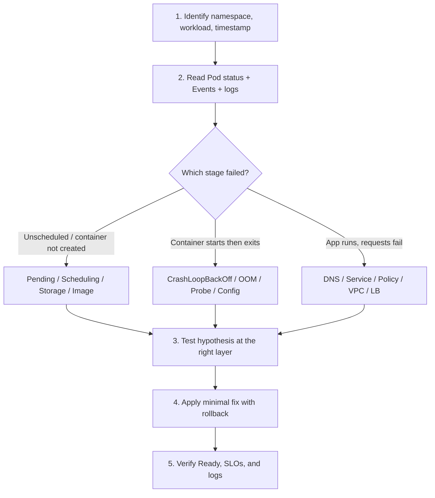
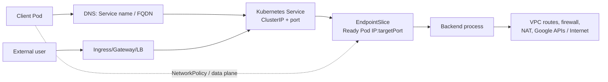

# Hands-On Troubleshooting: Pending Pods, Crash Loops, and Networking Errors

## 1. Objectives and Diagnostic Principles

In **Google Kubernetes Engine (GKE)**, three failures commonly lumped together as "the Pod isn't running" actually occur at completely different lifecycle stages:

- **`Pending`:** the Pod has not been scheduled yet, or has been assigned to a node but has not finished setting up its runtime environment.
- **`CrashLoopBackOff`:** the container started and then exited or was killed repeatedly; kubelet is backing off before the next restart attempt.
- **Networking failures:** the Pod may be `Running` and `Ready`, yet fail DNS resolution or fail to reach a Service, database, the Internet, or a load balancer.

This lesson belongs to the **Advanced GKE and Operations** chapter of **CLOUD_PROVIDERS_GCP**, connecting IAM, VPCs, Compute Engine, GKE Standard/Autopilot, Cloud Run, and data services. The goal is not memorizing dozens of commands, but **gathering evidence and fixing the exact failing layer**.

After this lesson, you will know how to read Pod status, Events, and logs; analyze resource requests and scheduling; diagnose app/probe failures; inspect DNS, Services, NetworkPolicies, and VPCs; practice three scenarios in a lab; and verify reliability and cost impacts.

> **Safety:** Commands marked *read-only* can be run wherever you hold viewer permissions. Commands with `kubectl apply`, `delete`, `rollout`, or cluster updates require approval. Never delete/restart workloads, loosen firewalls, or disable NetworkPolicies in production just to test a hunch. Keep Secrets, access tokens, and customer data out of incident reports.

## 2. Five-Step Runbook for Any Incident



### Initial Data-Collection Commands — Read-Only

Replace `NAMESPACE`, `POD_NAME`, and `DEPLOYMENT_NAME` with real values:

```bash
kubectl config current-context
kubectl get pods -A -o wide
kubectl -n NAMESPACE get pod POD_NAME -o wide
kubectl -n NAMESPACE describe pod POD_NAME
kubectl -n NAMESPACE get events --sort-by=.lastTimestamp
kubectl -n NAMESPACE get deploy DEPLOYMENT_NAME
kubectl -n NAMESPACE get pod POD_NAME -o yaml
```

**Read in order:** `status.phase`, `spec.nodeName`, `containerStatuses[].state`, `lastState`, `restartCount`, **Conditions**, and the **Events** table at the bottom of `describe`. The `STATUS` column in `kubectl get pods` can display `CrashLoopBackOff` or `ContainerCreating`, though those are **not** values of `status.phase`. Events expire after a retention window and may be gone during late post-incident reviews.

| Observation | Layer to inspect first | Key evidence |
| --- | --- | --- |
| `Pending`, `FailedScheduling` | Scheduler, CPU/RAM, selectors, taints, PVCs | Pod Events, Node `Allocatable` |
| `Pending`, `ContainerCreating` | Image, volumes, CNI, sandbox | `FailedMount`, `FailedCreatePodSandBox`, `ErrImagePull` |
| `CrashLoopBackOff` | Process, exit code, config, probes, OOM | `logs --previous`, `lastState`, `Unhealthy` |
| `Running` yet requests fail | Service, EndpointSlice, DNS, NetworkPolicy, VPC | Service selector, endpoints, DNS lookup, TCP check |
| Fails only from outside cluster | Ingress/Gateway, load balancer, health checks | Backend health, NEG, TLS, firewall |

## 3. Branch A — Pending Pods: Finding Why Scheduling or Setup Stalled

**`Pending` does not always mean the cluster is out of CPU.** Check `spec.nodeName`:

- **Empty:** the scheduler has not picked a node yet; focus on `FailedScheduling`.
- **Node assigned:** kubelet may be pulling the image, mounting a PVC, creating the network sandbox, or waiting for container startup.

### 3.1. Common Scheduling Errors

| Event or symptom | Interpretation | Next step |
| --- | --- | --- |
| `Insufficient cpu` / `memory` | Pod requests do not fit Node `Allocatable` | Rightsize requests; expand capacity or node pools |
| `untolerated taint` | Node carries a taint the Pod lacks a toleration for | Adjust placement policy deliberately |
| `didn't match Pod's node affinity/selector` | Selector/affinity matches no nodes | Fix selector/labels or add a matching pool |
| `Too many pods` / `OutOfPods` | Hit per-node Pod density cap | Check max Pods/node, Pod CIDR, autoscaler |
| `volume node affinity conflict` | PVC/PV is pinned to a different zone | Check StorageClass, PV topology, node locations |
| `unbound immediate PersistentVolumeClaims` | PVC has not bound to a PV yet | Inspect PVC Events, quotas, CSI, StorageClass |
| `FailedCreatePodSandBox` | CNI, IP allocation, or sandbox creation failed | Inspect node/kubelet/network agent logs |

Read-only checks:

```bash
kubectl -n NAMESPACE describe pod POD_NAME
kubectl get nodes -o wide
kubectl describe node NODE_NAME
kubectl -n NAMESPACE get pvc
kubectl -n NAMESPACE describe pvc PVC_NAME
```

**Requests ≠ usage.** The scheduler places Pods using CPU/RAM **requests**, not instantaneous usage. Compare each container's request, system reservations, and the node's actual `Allocatable`. A Pod requesting 6 GiB cannot fit onto a node with 4 GiB allocatable remaining, even if live RAM graphs look low.

### 3.2. Checking GKE Cluster Autoscaler

If autoscaling is enabled yet Pods stay Pending, ask in order:

1. Does the Pod match the **machine type, architecture, taints, selectors, and topology** of any scalable pool?
2. Has that pool reached `max-nodes` / `total-max-nodes`?
3. Does the project still have **CPU/GPU quota**, zonal capacity, and free **subnet/Pod IP ranges**?
4. Did the autoscaler log **no scale-up** or provisioning errors in **GKE Cluster Autoscaler visibility logs**?
5. Does the Pod have zonal PVC constraints, PDBs, or policies blocking alternative placement?

**Never raise HPA `maxReplicas` to fix a node shortage.** HPA adjusts Pod count; Cluster Autoscaler adjusts worker capacity. Autopilot likewise requires quotas, IPs, and workloads compliant with node provisioning policies.

### 3.3. Pending After Node Assignment

Inspect each container's `Waiting.reason`:

- `ErrImagePull` / `ImagePullBackOff`: wrong image/tag, missing Artifact Registry pull permissions, unreachable registry, DNS/egress.
- `ContainerCreating` with `FailedMount`: missing Secret/ConfigMap/PVC, CSI mount failure, or zone mismatch.
- `FailedCreatePodSandBox`: exhausted IPs, CNI/data plane agent issues, or node network setup error.

This differs completely from `CrashLoopBackOff`: a container that **could not pull its image** never launched an application process to crash.

## 4. Lab A — Reproducing and Fixing `FailedScheduling`

Run only in a **dedicated lab namespace**. This exercise triggers `Pending` intentionally without altering existing node configs.

### 4.1. Failing Manifest

```yaml
apiVersion: v1
kind: Pod
metadata:
  name: pending-lab
  namespace: gke-diag-lab
spec:
  restartPolicy: Never
  nodeSelector:
    training.example.com/unavailable: "true"
  containers:
    - name: app
      image: busybox:1.36
      command: ["sh", "-c", "sleep 3600"]
      resources:
        requests:
          cpu: "50m"
          memory: "32Mi"
        limits:
          memory: "64Mi"
```

Assume **no node has label `training.example.com/unavailable=true`**. Save as `pending-lab.yaml`:

```bash
# MODIFIES cluster: test environment only
kubectl create namespace gke-diag-lab
kubectl apply -f pending-lab.yaml

# READ-ONLY: confirm exact root cause
kubectl -n gke-diag-lab get pod pending-lab -o wide
kubectl -n gke-diag-lab describe pod pending-lab
kubectl get nodes --show-labels
```

**Expected result:** Pod stays `Pending` with an Event citing node selector/affinity mismatch. If a node in your cluster happens to carry that label, adjust the test label in the lab manifest so it matches nothing.

### 4.2. Scoped Fix

Remove the **invalid `nodeSelector`** from the Pod manifest and recreate the test Pod (Pod placement fields cannot be patched in place). For a lab Pod with `restartPolicy: Never`:

```bash
# MODIFIES: delete only the test Pod, never production nodes/Deployments
kubectl -n gke-diag-lab delete pod pending-lab
# Edit pending-lab.yaml to remove the nodeSelector block, then:
kubectl apply -f pending-lab.yaml
kubectl -n gke-diag-lab get pod pending-lab -w
```

The Pod could still remain Pending for **another reason** (quotas, unavailable nodes, image pulls). If so, read the new Events instead of assuming the lab is broken. Never add fake labels to production nodes just to make a test Pod schedule.

## 5. Branch B — `CrashLoopBackOff`: Container Starts Then Exits

`CrashLoopBackOff` means kubelet is **waiting before the next restart** after repeated container exits. Look for the cause in **process exit codes, OOMs, probes, or dependencies**—the BackOff status itself is only a symptom.

### 5.1. The Three Most Valuable Commands

```bash
kubectl -n NAMESPACE describe pod POD_NAME
kubectl -n NAMESPACE logs POD_NAME -c CONTAINER_NAME --tail=100
kubectl -n NAMESPACE logs POD_NAME -c CONTAINER_NAME --previous --tail=100
```

`--previous` fetches logs from the **container instance before the current restart**, which is crucial when failing containers exit within seconds. If a Pod runs sidecars, always pass `-c` for the exact container. If no prior instance ran yet, `--previous` returns nothing.

### 5.2. Reading `lastState` and Events

| Signal | Likely cause | Verification step |
| --- | --- | --- |
| `Reason: OOMKilled` | Container killed for memory | Inspect memory limit/usage, OOM events, heap/GC |
| `Exit Code: 1` or `2` | App error, bad command/args, or missing config | `logs --previous`, Env/Secret references |
| `Exit Code: 137` | Process received `SIGKILL`; **may** be OOM | Confirm via `Reason`/node logs—don't guess from 137 alone |
| `Exit Code: 143` | Process received `SIGTERM` | Check rollouts/drains/shutdown—not always a crash |
| `Unhealthy: Liveness probe failed` | Kubelet restarted due to liveness failure | Check probe port/path/timing, startup time, app logs |
| `CreateContainerConfigError` | Missing ConfigMap/Secret/env or invalid spec | Check Events; container **never started** |
| `Completed` then restarting endlessly | Command exited 0 under `restartPolicy: Always` | Should this workload be a `Job` instead of a Deployment? |

### 5.3. Distinguishing the Three Probes

- **Startup probe:** accommodates slow-starting apps; suppresses liveness/readiness checks until startup succeeds.
- **Readiness probe:** controls whether a Pod receives traffic via a Service; **never restarts** the container directly.
- **Liveness probe:** detects wedged processes and **restarts** the container after consecutive failures.

Example for a web app exposing `/startup`, `/ready`, and `/healthz`:

```yaml
startupProbe:
  httpGet:
    path: /startup
    port: 8080
  periodSeconds: 5
  failureThreshold: 24   # Allows roughly 120 seconds for startup
readinessProbe:
  httpGet:
    path: /ready
    port: 8080
  periodSeconds: 5
livenessProbe:
  httpGet:
    path: /healthz
    port: 8080
  periodSeconds: 10
  failureThreshold: 3
```

These paths are **illustrative only**; never copy them onto NGINX or apps lacking those routes. A liveness probe that queries an external database can trigger fleet-wide restarts whenever the database hiccups. Separate **readiness** (able to serve traffic) from **liveness** (process stuck and needs restart).

### 5.4. Fixing OOMs at the Root

When `lastState.terminated.reason=OOMKilled`:

1. Compare `requests.memory` and `limits.memory` against p95/peak memory usage and node limits.
2. Inspect sanitized app logs and heap dumps for memory leaks, unbounded caches, concurrency spikes, or large batch sizes.
3. If the limit is below legitimate demand, adjust **requests and limits** carefully; VPA `Off` can provide recommendations.
4. Verify after fixing: zero new `OOMKilled`, steady restart count, healthy p95 latency, and acceptable cost.

Throwing unlimited RAM or more replicas at a memory leak rarely fixes it—it usually just delays the crash.

## 6. Lab B — Intentionally Triggering `CrashLoopBackOff`

This manifest runs a command that immediately exits with a non-zero code:

```yaml
apiVersion: apps/v1
kind: Deployment
metadata:
  name: crashloop-lab
  namespace: gke-diag-lab
spec:
  replicas: 1
  selector:
    matchLabels:
      app: crashloop-lab
  template:
    metadata:
      labels:
        app: crashloop-lab
    spec:
      containers:
        - name: app
          image: busybox:1.36
          command: ["sh", "-c", "echo 'config invalid' >&2; exit 2"]
          resources:
            requests:
              cpu: "50m"
              memory: "32Mi"
            limits:
              memory: "64Mi"
```

Save `crashloop-lab.yaml` locally; once the lab namespace exists:

```bash
# MODIFIES lab
kubectl apply -f crashloop-lab.yaml

# READ-ONLY
kubectl -n gke-diag-lab get pods -l app=crashloop-lab -w
kubectl -n gke-diag-lab describe pod ACTUAL_POD_NAME
kubectl -n gke-diag-lab logs ACTUAL_POD_NAME -c app --previous
```

**Expected result:** container starts, prints `config invalid`, exits with `Exit Code: 2`; Kubernetes restarts it under the Deployment's `restartPolicy: Always` and enters `CrashLoopBackOff`. **This is neither an OOM nor a scheduler failure.**

**Fix:** update the command in the manifest to `["sh", "-c", "echo ready; sleep 3600"]`, run `kubectl apply -f crashloop-lab.yaml`, and watch the rollout. Expect the container to stay up, show `READY 1/1`, and accumulate zero new restarts on the new Pod. **Never repeatedly delete a Pod** to "fix" a bad command: the ReplicaSet just recreates it with the same bug.

## 7. Branch C — Networking: Isolating the Failing Hop

A request from a Pod typically traverses these layers:



**Check from closest to farthest:** DNS name → Service/IP/port → EndpointSlice/Pod readiness → backend listener → NetworkPolicy → VPC/firewall/NAT → load balancer. Never edit VPC firewalls when the real bug is a **Service selector matching zero Pods**.

### 7.1. Quick Error Matrix

| Symptom | Primary suspect | What to check |
| --- | --- | --- |
| `no such host` / `NXDOMAIN` | Typo in name/namespace, missing Service, DNS record | `get svc`, `nslookup`, `resolv.conf` |
| DNS `i/o timeout` | DNS Pods, NetworkPolicy blocking UDP/TCP 53, upstream | DNS Pods/Service, policies, network logs |
| `Connection refused` | No listening process, wrong `targetPort`, app unready | Service/endpoints, container port/process |
| `Connection timed out` | NetworkPolicy, firewall, route, NAT, unreachable peer | Test direct Pod IP, policies, VPC paths |
| `503` / `502` from LB | Unhealthy backend, NEG/health check/TLS/port mismatch | Ingress/Gateway, LB backend health |
| Private Pods alone can't reach Internet | Cloud NAT / Private Google Access / egress | Node external IPs, NAT config, routes, DNS |
| Only a subset of nodes fail | Data plane agent, conntrack, IP, MTU, or node fault | Compare Pod placement across nodes/zones |

**An HTTP 403 from Cloud Storage or Artifact Registry is usually IAM or API authorization**, not networking. Use HTTP status details and audit logs to separate them.

## 8. Checking DNS Inside a Pod

Same-namespace Services resolve as `backend`; cross-namespace uses:

```text
backend.gke-diag-lab.svc.cluster.local
```

Read-only checks from a Pod that includes diagnostic tools:

```bash
kubectl -n NAMESPACE exec POD_NAME -- cat /etc/resolv.conf
kubectl -n NAMESPACE exec POD_NAME -- nslookup kubernetes.default.svc.cluster.local
kubectl -n NAMESPACE exec POD_NAME -- nslookup BACKEND_SERVICE.BACKEND_NAMESPACE.svc.cluster.local
kubectl -n kube-system get svc kube-dns
kubectl -n kube-system get pods -l k8s-app=kube-dns -o wide
```

**Prerequisite:** the container must include `cat`/`nslookup`; distroless images lack shells and utilities. GKE may run **`kube-dns`, NodeLocal DNSCache, or Cloud DNS for GKE** depending on setup, so never assume every Pod queries the exact same nameserver path.

If internal Kubernetes names resolve while external domains fail, investigate **upstream DNS, egress policies, and VPC/NAT** rather than deleting Services. For `NXDOMAIN`, verify spelling and namespace first; for **timeouts**, inspect connectivity and the DNS backend. Read `/etc/resolv.conf` to check `nameserver`, `search`, and `ndots`.

With a **default-deny egress NetworkPolicy**, explicitly allow DNS traffic to the actual DNS endpoint per your cluster's DNS architecture. **Do not use `ipBlock.cidr` pointing directly at Pod/Service IPs in GKE Dataplane V2**; use selectors where appropriate due to documented Dataplane V2 constraints.

## 9. Checking Services, EndpointSlices, and Container Ports

### 9.1. Read-Only Commands

```bash
kubectl -n NAMESPACE get service BACKEND_SERVICE -o yaml
kubectl -n NAMESPACE get pods --show-labels -o wide
kubectl -n NAMESPACE get endpointslice \
  -l kubernetes.io/service-name=BACKEND_SERVICE -o wide
kubectl -n NAMESPACE describe service BACKEND_SERVICE
kubectl -n NAMESPACE describe pod BACKEND_POD
```

**`EndpointSlice`** is the primary API showing a Service's live backends. If **no Ready backend endpoints exist**, compare the Service's `spec.selector` against Pod labels, check `readinessProbe`, and verify port mappings. `kubectl get endpoints` still works in places, though the legacy Endpoints API has scaling limits and is superseded by EndpointSlice.

### 9.2. Selector Mismatch Example

Backend Pod carries label:

```yaml
metadata:
  labels:
    app: inventory
```

Yet the Service declares:

```yaml
apiVersion: v1
kind: Service
metadata:
  name: inventory
  namespace: gke-diag-lab
spec:
  selector:
    app: payment  # MISMATCH against Pod's app: inventory
  ports:
    - port: 80
      targetPort: 8080
  type: ClusterIP
```

DNS `inventory.gke-diag-lab.svc.cluster.local` **still resolves to a ClusterIP**, yet the Service **routes to zero backends**. Fix `selector.app` to `inventory` **if that is the intended workload**, then confirm `EndpointSlice` lists the **Ready** Pod IP.

### 9.3. Ports and Readiness

`port: 80` is the port clients hit on the Service; `targetPort: 8080` must match **the port the container process actually listens on**. `containerPort` in the Pod spec is purely descriptive—it **does not open a listening socket**. Furthermore, an app binding only `127.0.0.1` inside the container rejects connections arriving on the Pod IP.

Direct socket check (if the container includes shell tools):

```bash
kubectl -n NAMESPACE exec BACKEND_POD -- sh -c 'cat /proc/net/tcp'
```

That is only a Linux-socket signal, not a full application test. You can run an **approved debug Pod with vetted image/tools** in the same namespace to run `nslookup`/`curl`/`wget` against both the **Pod IP** and **Service ClusterIP**. Never run untrusted debug containers or request privileged access in production.

## 10. NetworkPolicy, Dataplane V2, and Google Cloud Paths

### 10.1. NetworkPolicy

NetworkPolicies target Pods via **Pod labels** within a **namespace**. Once isolated for ingress or egress, allow rules determine permitted flows. Policies only take effect when the cluster runs a **network policy enforcement provider**, such as **GKE Dataplane V2 (Cilium)** or Calico on Standard.

```bash
# READ-ONLY
kubectl -n NAMESPACE get networkpolicy
kubectl -n NAMESPACE describe networkpolicy POLICY_NAME
kubectl -n NAMESPACE get pods --show-labels
```

Never delete or disable all policies just to test. Inspect **both source and destination**, ingress/egress, `namespaceSelector`/`podSelector`, protocols/ports, and DNS paths. On GKE Dataplane V2, avoid **`ipBlock` targeting Pod/Service IPs**; use labels and selectors as recommended.

**Workload Identity Federation for GKE** also needs egress access to the metadata server. For GKE Dataplane V2, NetworkPolicy docs specify `169.254.169.254/32` TCP **80/8080**; other data planes may use different addresses or ports. A default-deny egress policy lacking that exception causes credential-fetch failures that look like Cloud Storage errors.

### 10.2. VPC, Firewalls, NAT, and Private Nodes

When Pods call **Cloud SQL**, Google APIs, or the Internet, check:

1. Did DNS resolve the intended private or public endpoint?
2. Does NetworkPolicy permit egress?
3. Do VPC firewall rules, hierarchical firewalls, routes, PSC/VPC peering, or VPNs permit the flow?
4. Do nodes have external IPs; if private, is **Cloud NAT** / egress configured for **all IP ranges needing NAT**?
5. For Google APIs, are **Private Google Access / Private Service Connect**, DNS, and IAM configured accurately?
6. If connections drop under heavy load, is **Cloud NAT port exhaustion** or connection saturation to the same destination occurring?

**Cloud NAT handles configured egress only**—it is neither an ingress load balancer nor an IAM grant. Never open `0.0.0.0/0` firewall rules just to test connectivity. Use **Network Intelligence Center Connectivity Tests**, VPC Flow Logs, or Cloud NAT logs/metrics where enabled and authorized.

### 10.3. GKE Dataplane V2

Autopilot runs **GKE Dataplane V2** by default; Standard clusters may use Dataplane V2 or legacy networking. When specific nodes show abnormal networking errors, check:

```bash
kubectl -n kube-system get pods -l k8s-app=cilium -o wide
kubectl -n kube-system get pods -o wide
```

The corresponding agent Pods are typically named `anetd-...`. In Cloud Logging, filter by cluster, node, namespace, and network agent logs to spot packet drops or config errors. Never SSH into nodes or restart `anetd` casually; it is core infrastructure affecting every Pod on the node.

## 11. External Access: Ingress, Gateway, and Load Balancers

When in-cluster `curl` to a Service succeeds yet external users receive `502`/`503`:

- Inspect `Ingress` or `Gateway`, routes, TLS certificates, and frontend IPs.
- Verify Service selectors, `EndpointSlices`, and **NEG / backend service** mappings.
- Check **load balancer health checks** against the exact port/path; Kubernetes readiness and LB health checks can differ.
- Check firewalls for health-check/proxy ranges, plus Cloud Armor or IAP if enabled.
- Correlate **Cloud Logging load balancer logs**, response flags, backend errors, and rollout timestamps.

```bash
# READ-ONLY
kubectl -n NAMESPACE get ingress,service
kubectl -n NAMESPACE describe ingress INGRESS_NAME
kubectl -n NAMESPACE get gateway,httproute
kubectl -n NAMESPACE describe service BACKEND_SERVICE
```

**Never diagnose "VPC network failure" from an HTTP 503 alone.** Unready backends, wrong Service selectors, or mismatched health-check paths produce identical symptoms. Query `gateway/httproute` only if your cluster has Gateway API CRDs installed.

## 12. Cloud Logging, Events, and Change Correlation

### 12.1. Viewing Container Logs in Cloud Logging

GKE forwards container `stdout/stderr` to **Cloud Logging** when workload logging is enabled:

```text
resource.type="k8s_container"
resource.labels.cluster_name="CLUSTER_NAME"
resource.labels.namespace_name="NAMESPACE"
resource.labels.pod_name="POD_NAME"
severity>=ERROR
```

This is **Logging Query Language**, not a shell command. Not every application failure logs at `severity=ERROR`; if empty, drop the severity filter, widen the time range, and verify logging and retention config.

### 12.2. Kubelet and Autoscaler Logs

GKE `CrashLoopBackOff` docs show how to trace **liveness probe restarts** inside `k8s_node` kubelet logs; GKE Cluster Autoscaler visibility logs help diagnose scale-up failures. Filter by cluster, node, Pod UID, and time window to avoid confusing pre-rollout Pods with current Pods.

### 12.3. What Changed?

Correlate the incident timestamp against:

- Deployment revisions, image digests, and ConfigMap/Secret references.
- Node pool upgrades, cluster release channels, machine types, and quota/IP changes.
- NetworkPolicies, firewalls, Ingress/Gateway, DNS, or NAT configs.
- Cloud Audit Logs / Kubernetes API audit logs and GitOps/CI/CD deployment history.

```bash
# READ-ONLY
kubectl -n NAMESPACE rollout history deployment/DEPLOYMENT_NAME
kubectl -n NAMESPACE describe deployment DEPLOYMENT_NAME
kubectl -n NAMESPACE get events --sort-by=.lastTimestamp
```

Rollbacks require **evidence the prior version worked**, database schema compatibility, and approval. Never roll back a database migration blindly just because a new app container crashed.

## 13. Three End-to-End Scenarios

### Scenario 1 — HPA Creates Pending Pods

During a sales campaign, HPA scales replicas from 4 to 12; six new Pods sit Pending with `Insufficient cpu`. Sequence:

1. Compare Pod requests against Node `Allocatable`.
2. Check node pool autoscaling limits, vCPU quotas, zonal capacity, and Pod CIDRs.
3. Inspect selectors/taints to verify an eligible pool can scale.
4. Once capacity and approvals exist, tune capacity/requests based on load tests.
5. Verify `READY`, p95 latency, 5xx, and billing post-scale.

**Never "fix" this by** setting tiny CPU requests to trick the scheduler; that increases CPU contention and throttling.

### Scenario 2 — CrashLoop Right After Deploy

New Pods show rising restarts, `Last State: Terminated`, and `Exit Code: 1`. `logs --previous` prints `missing DB_HOST`.

1. Inspect Deployment env vars, ConfigMap/Secret keys, and namespace names.
2. Identify the missing secret key without pasting secret values into tickets.
3. Restore the exact config via GitOps and roll out a verified build.
4. Monitor restarts, readiness, DB connectivity, and error rates.

Raising memory limits or restarting nodes cannot fix a missing environment variable.

### Scenario 3 — DNS Works, Service Does Not Respond

`nslookup inventory.gke-diag-lab.svc.cluster.local` succeeds, yet Service requests time out and `EndpointSlice` lists zero ready addresses.

1. Compare the Service selector with Pod labels.
2. Inspect Pod `Ready` status and `readinessProbe`.
3. Verify `port`/`targetPort` and the listening socket.
4. Only if endpoints and listeners are healthy should you investigate NetworkPolicies/data plane.
5. Retest from the client Pod and inspect logs, metrics, and timeouts.

A resolvable ClusterIP only proves **the Service's DNS record exists**—never that backends are healthy.

## 14. Standard vs. Autopilot Differences During Investigation

| Aspect | GKE Standard | GKE Autopilot |
| --- | --- | --- |
| Managing node capacity | Inspect node pools, machine types, autoscaling, MIGs/VMs | Nodes managed by GKE; focus on Pod requests, ComputeClasses, and quotas |
| Host SSH / node debugging | Possible with permissions, though risky in prod | Node access and privileged debugging are restricted |
| Network data plane | Standard data plane or Dataplane V2 depending on cluster | Managed Dataplane V2 |
| Resource-driven Pending | Requests, allocatable, nodes, quotas, IPs | Requests, Autopilot constraints, quotas/provisioning |
| First triage steps | Pod/Events/logs first, then nodes/networking | Also start with Pod/Events/logs; never rely on node SSH |

**Never copy a Compute Engine VM modification command to "fix" an underlying GKE node.** Those VMs are GKE-managed and may be recreated; always use proper GKE APIs and supported workflows.

## 15. Pre-Closure Incident Checklist

- [ ] Verified **context/cluster, namespace, Pod UID, image revision**, and failure timestamp.
- [ ] Collected evidence from **Events, `status`/`lastState`, `logs --previous`**, or targeted network checks.
- [ ] Distinguished pre-scheduling vs. post-scheduling `Pending`, image pull failures, and `CrashLoopBackOff`.
- [ ] Checked requests/limits, labels/taints, PVC topology, and Cluster Autoscaler for Pending Pods.
- [ ] Checked command/config, exit reason, OOMs, and probes for CrashLoops.
- [ ] Traced **DNS → Service → EndpointSlice → backend → NetworkPolicy → VPC/NAT/LB** for networking issues.
- [ ] Exposed zero Secrets and avoided granting `Owner` or opening wide firewalls to troubleshoot.
- [ ] Reviewed fixes with rollback plans and avoided disrupting unrelated workloads/namespaces.
- [ ] Post-fix: Pods `Ready`, rollout complete, zero abnormal restarts, and end-to-end requests succeed.
- [ ] Checked **p95/p99 latency, error rate, quota/IP usage, and cost**.
- [ ] Documented root cause, timeline, missing-log gaps, preventive actions, and follow-up owners.

### Clean Up Lab Resources

Only when certain namespace **`gke-diag-lab`** is the isolated test namespace created in this lesson:

```bash
# READ-ONLY before cleanup
kubectl -n gke-diag-lab get all
kubectl -n gke-diag-lab get pvc

# MODIFIES: delete only resources created by this lab
kubectl -n gke-diag-lab delete deployment crashloop-lab --ignore-not-found
kubectl -n gke-diag-lab delete pod pending-lab --ignore-not-found
```

Never delete the entire namespace if it holds anyone else's resources or PVCs with data to keep.

## 16. Reinforcement Exercises

1. **Selector-driven Pending:** a Pod requests 100m CPU, yet `FailedScheduling` reports no node matches `nodeSelector`. Why won't raising CPU quota help? **Answer:** the failure is a placement constraint mismatch, not CPU exhaustion.
2. **CrashLoop vs. OOM:** a Pod exits with code 137. Why can't you immediately conclude OOM? **Answer:** check `lastState.reason`, Events, and logs; `SIGKILL` has multiple causes.
3. **Readiness vs. liveness:** a container is healthy, yet the database has a brief outage; should liveness restart the Pod repeatedly? **Hint:** readiness should pull the Pod out of Service traffic; liveness should detect genuinely wedged processes needing restart.
4. **Service with zero endpoints:** DNS resolves, yet requests time out. Write three commands to inspect the selector, `EndpointSlice`, and Pod `Ready` status.
5. **DNS timeout:** a Pod has a default-deny egress NetworkPolicy. List the DNS and metadata-server paths to verify, distinguishing Dataplane V2 from other setups.
6. **Private GKE:** an app fails only on external APIs while Cloud Storage returns 403. Which looks like networking, and which looks like IAM? Test DNS/TCP, Cloud NAT, IAM, and exact HTTP errors before changing anything.
7. **Synthesis:** a new Deployment rollout has 5 Pods: 2 `Pending` (`Insufficient memory`), 2 `CrashLoopBackOff` (missing Secret key), and 1 `Running` but unready (wrong `/ready` path). Order the remediation steps to restore SLOs and stop endless restarts.

## 17. Official References

GKE features and networking evolve across versions; verify documentation before production changes:

1. [GKE – Troubleshoot deployed workloads](https://cloud.google.com/kubernetes-engine/docs/troubleshooting/deployed-workloads).
2. [GKE – Troubleshoot CrashLoopBackOff](https://cloud.google.com/kubernetes-engine/docs/troubleshooting/crashloopbackoff-events).
3. [GKE – Troubleshoot OOM](https://cloud.google.com/kubernetes-engine/docs/troubleshooting/oom-events).
4. [GKE – Troubleshoot networking](https://cloud.google.com/kubernetes-engine/docs/troubleshoot-networking).
5. [GKE – Troubleshoot kube-dns](https://cloud.google.com/kubernetes-engine/docs/troubleshooting/kube-dns).
6. [GKE – Troubleshoot connectivity in cluster](https://cloud.google.com/kubernetes-engine/docs/troubleshooting/connectivity-issues-in-cluster).
7. [GKE – NetworkPolicy](https://cloud.google.com/kubernetes-engine/docs/how-to/network-policy).
8. [GKE – Dataplane V2](https://cloud.google.com/kubernetes-engine/docs/how-to/dataplane-v2).
9. [GKE – Troubleshoot Cloud NAT packet loss](https://cloud.google.com/kubernetes-engine/docs/troubleshooting/cloud-nat-packet-loss).
10. [Kubernetes – Debug Pods](https://kubernetes.io/docs/tasks/debug/debug-application/debug-pods/).
11. [Kubernetes – Debug Services](https://kubernetes.io/docs/tasks/debug/debug-application/debug-service/).
12. [Kubernetes – DNS debugging](https://kubernetes.io/docs/tasks/administer-cluster/dns-debugging-resolution/).

**Conclusion:** Determine whether **the Pod wasn't created, the container started and died, or traffic never reached its destination** before picking tools. `Pending` starts with Events/scheduler/capacity, `CrashLoopBackOff` starts with `lastState` and `logs --previous`, and networking walks **DNS → Service/EndpointSlice → policies → VPC/LB**. Evidence-based triage with small, SLO-verified fixes is always faster and safer than blind restarts or broad permission grants.
