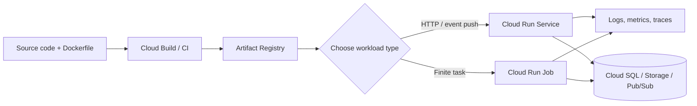

# Cloud Run Services, Jobs, and Container Execution Model

> **Chapter:** Cloud Run  
> **Module:** CLOUD_PROVIDERS_GCP  
> **Module Scope:** Explore Google Cloud from project organization, IAM, and VPC to Compute Engine, GKE, Cloud Run, storage services, and databases. Through deployment scenarios, learners know how to select services, protect resources, automate releases, and monitor reliability and cost.

An API receiving HTTP requests and an end-of-day report export task can both be packaged as containers. However, **an API needs to serve requests**, whereas **a batch task needs to finish its work and exit**. Cloud Run provides two suitable models—**services** and **jobs**—along with a container execution environment managed by Google Cloud.

In this lesson, we distinguish the two models through lifecycle, scaling, timeout, identity, and cost; then build **an authenticated HTTP service** and **a three-task job** using two separate images. These examples all use a lab project and do not expose public endpoints by default.

## Learning Objectives

After this lesson, you can:

1. Choose between a **Cloud Run service** and a **Cloud Run job** based on the type of workload, while recognizing cases that require worker pools or other solutions.
2. Explain **service → revision → instance → request** and **job → execution → task → attempt**.
3. Understand concurrency, autoscaling, cold starts, request/task timeouts, retries, and instance ephemerality.
4. Distinguish IAM for the **deployer**, **runtime service account**, and **service caller**.
5. Build images, deploy a service, create and execute a job, inspect logs/metrics, and clean up resources using `gcloud`.
6. Design **stateless, idempotent** applications that persist data outside the ephemeral filesystem.

## 1. What Problem Does Cloud Run Solve?

Cloud Run executes containers on serverless infrastructure managed by Google Cloud. The application team provides the **image/code and resource configuration**; the platform manages the execution environment, instance provisioning, request or task distribution, and integration with Cloud Logging/Monitoring. The application team remains responsible for managing code, secrets, IAM, networking, data, service quality, and cost.



**Note on the current ecosystem:** Cloud Run also provides **worker pools** for continuous background consumers that do not need an HTTP endpoint (for example, pulling from Kafka/Pub/Sub) and **Cloud Run instances** for certain single long-running workloads. These are separate resources, not an option automatically enabled inside a service or job. The scope of this lesson focuses on **services** and **jobs**.

## 2. Services and Jobs: Core Comparison

| Criterion | Cloud Run service | Cloud Run job |
|---|---|---|
| Purpose | Serve HTTP/gRPC, webhooks, requests, or push events | Complete a finite amount of work and exit |
| Entry point | Stable HTTPS endpoint of the service | Run manually, via API, scheduler, or workflow |
| Must container listen on `PORT`? | **Yes**, the ingress container must listen on `0.0.0.0:$PORT` | **No**; runs the program and exits |
| Version/execution unit | **Revision** and **instances** | **Job** definition, **executions**, **tasks** |
| Scaling | Automatic based on requests/CPU and configuration, or supported manual scaling | `tasks` and `parallelism` per execution |
| Completion | Returns HTTP response within timeout | All tasks succeed within allowed retries |
| Retry | Caller/Cloud Tasks/Pub/Sub/application decides based on integration | Has `max-retries` **per task** |
| Timeout | **Per request** | **Per task attempt** |
| Typical billing | Request-based or instance-based depending on configuration | Instance-based while tasks are running |
| Examples | Order API, website, webhook | CSV export, batch image resizing, controlled migration |

**Do not run an HTTP server as a job:** if the image's entrypoint starts a server and never exits, the job may only stop when it hits its timeout. **Do not use a service** for an unbounded batch task if the request needs to return immediately and long-running processing should be managed by a job/queue/worker.

## 3. Service Execution Model

```text
Cloud Run service: order-api (stable URL)
  ├── Revision rev-001 (image digest A, config A): 90% traffic
  │     ├── Instance 1: handles multiple concurrent requests
  │     └── Instance 2
  └── Revision rev-002 (image digest B, config B): 10% traffic
        └── Instance 3
```

A **Service** represents the endpoint and traffic distribution policy. A **Revision** is a specific configuration/image deployment; changing configuration requires a new revision. An **Instance** is a running container instance that can serve multiple requests until replaced or scaled in.

### 3.1. Concurrency and Autoscaling

`concurrency` is the **maximum number of simultaneous requests a single instance is configured to receive**. For example, assuming 100 in-flight requests, concurrency=10 would require roughly 10 instances **if other conditions allow**; this is not a formula guaranteed by the autoscaler. CPU, processing time, max instances, quota, and startup capacity all affect scaling.

- **Low concurrency:** easier to isolate memory-intensive requests or non-thread-safe code, but may create more instances and increase cost.
- **High concurrency:** saves instances for I/O-bound workloads, but may increase p95/p99 latency if CPU/memory/DB pools become overloaded.
- **Min instances:** keeps warm capacity to reduce cold starts, in exchange for idle cost.
- **Max instances:** caps scaling, but when demand exceeds serving capacity it can cause queuing/`429`/`503`; this is **not a strict spend cap**.

Default concurrency may vary by interface and vCPU count for new services. In the lab, **explicitly set `--concurrency=10`**, and do not assume the default is a fixed number across all environments.

### 3.2. HTTP Request Timeout

Services have a default **5-minute request timeout**, which can be set up to **60 minutes** according to supported configuration. Upon expiration, the client may receive **HTTP 504**, though the instance does not necessarily stop immediately; the code might still continue processing in the background. Therefore, operations with side effects require an **idempotency key**, cancellation handling, and bounded timeouts.

An API making a 2-second database call should normally set a reasonable timeout rather than raising it to 60 minutes by default. For work taking hours, consider a job or asynchronous architecture.

### 3.3. Cold Starts and Lifecycle

When no warm instance is available, the first request must wait for the container to start: pulling/loading the image, starting the runtime, connecting dependencies, and registering to serve. The platform can create or destroy instances; **there is no guarantee that a container lives forever**.

Applications should:

- Start quickly, bind properly to `PORT`, and avoid running slow migrations at startup.
- Return meaningful health/readiness responses and handle `SIGTERM` per the runtime contract.
- Manage connection pools with Cloud SQL/DBs according to the expected total number of instances.
- Persist state via Cloud SQL, Cloud Storage, or other external services; the container's writable filesystem **is ephemeral and backed by memory**.

### 3.4. Request-Based vs. Instance-Based Billing

- **Request-based (usually default):** CPU is allocated primarily while processing requests; do not rely on background threads after sending a response to finish critical work.
- **Instance-based:** CPU is allocated for the entire instance lifecycle and billed accordingly; this can be used for short background activities, though **service instances can still be shut down when idle**.

If you need a continuously running consumer with no HTTP requests, look at **worker pools**; for finite batches, a **job** is usually more suitable. Base decisions on SLOs, load patterns, and actual pricing.

## 4. Job Execution Model

```text
Job definition: report-batch
  └── Execution: report-batch-abc (triggered at 01:00)
        ├── Task index 0 ── Attempt 1 ── succeeded
        ├── Task index 1 ── Attempt 1 failed ── Attempt 2 succeeded
        └── Task index 2 ── Attempt 1 ── succeeded
The execution succeeds when all three tasks complete successfully.
```

- **Job:** declares the image, command, environment, service account, task count, parallelism, timeout, and retries.
- **Execution:** a single run of the job; running it again creates a **new execution**, rather than updating an old one.
- **Task:** a unit of work within an execution, with each task running in **a single container instance**.
- **Attempt:** one execution try of a task; retries create subsequent attempts when a task fails, within configured limits.

### 4.1. Tasks, Parallelism, and Data Partitioning

Suppose `--tasks=5 --parallelism=2`: the execution has five tasks, with at most **two tasks running simultaneously**. This does not mean Cloud Run provisions five machines running at once; the platform schedules tasks gradually depending on capacity.

The runtime provides environment variables:

| Variable | Example value | Meaning |
|---|---|---|
| `CLOUD_RUN_JOB` | `report-batch` | Job name |
| `CLOUD_RUN_EXECUTION` | `report-batch-abc` | Execution name |
| `CLOUD_RUN_TASK_INDEX` | `0`, `1`... | Task index starting from **0** |
| `CLOUD_RUN_TASK_COUNT` | `5` | Total number of tasks in the execution |
| `CLOUD_RUN_TASK_ATTEMPT` | `0`, `1`... | Attempt number, useful for observing retries |

The application must **partition data itself** using `TASK_INDEX`/`TASK_COUNT`. For example, if there are 20 files numbered `0..19`, task `i` processes files where `file_id % task_count == i`. For mutable data sources, proper checkpointing/work claiming is required; simple modulo partitioning does not solve concurrency or duplicate database writes.

### 4.2. Retries and Timeouts

Jobs default to **3 retries per task**, with a default timeout of **10 minutes per attempt**; this can be adjusted within product limits (typically up to 168 hours, while GPUs have different limits). **There is no separate overall timeout for the entire execution**; an execution finishes once all tasks complete or fail after exhausting allowed attempts.

Retries are a recovery mechanism, not an **exactly-once** guarantee. If a task writes partial results and then fails, the next attempt may repeat the action. Idempotency keys, transactions/upserts, checkpoints, and storing results outside the container are required. A program exiting with code `0` counts as a task success, but **does not by itself prove business data correctness**.

### 4.3. When Do Jobs Run?

A job can be started directly with `gcloud run jobs execute`, via API, via **Cloud Scheduler** on a schedule, or via **Workflows** in a multi-step pipeline. Creating a job resource **does not necessarily run it immediately**. If a job is triggered by a scheduler, you must secure the **caller principal invoking execute**, prevent duplicate triggers, maintain runtime permissions, and monitor failed executions.

## 5. Choosing the Right Model Across Four Scenarios

| Need | Recommended option | Reason |
|---|---|---|
| REST API returning results to clients in seconds | **Cloud Run service** | HTTPS endpoint, revisions, request autoscaling |
| Nightly report generation finishing in a few minutes | **Cloud Run job** | Finite execution, per-task retries/logs, and scheduled runs |
| Consumer continuously pulling messages from Kafka | **Cloud Run worker pool** | Background process without needing an HTTP endpoint |
| Need Kubernetes primitives/sidecars/advanced scheduling | **GKE** | Deep orchestration capabilities, at the cost of higher operational complexity |

**Common pitfalls:** Pub/Sub **push** or Eventarc can invoke a **service** over HTTP. For a continuously running Pub/Sub **pull consumer**, consider a worker pool. For a known batch of data that needs to run to completion, use a job. Do not force clients to hold an HTTP request open for tens of minutes just waiting for batch processing.

## 6. IAM, Networking, and Data: Shared Responsibilities of Both Models

### 6.1. Three Distinct Identities

| Principal | Role | Permission principle |
|---|---|---|
| **Deployer / CI** | Create/update service or job | Appropriate Cloud Run permissions + `iam.serviceAccounts.actAs` on the runtime SA |
| **Runtime service account** | Container code calling Cloud Storage, Secret Manager, Cloud SQL... | Grant only minimal roles **on the specific resources accessed** |
| **Caller** | Call HTTP service or trigger job | `roles/run.invoker` for HTTP services; appropriate job execution permission |

Permissions to **build/push images** belong to the CI identity; permissions to **pull from Artifact Registry** belong to the identity used by the platform along the deployment path, which may require Reader access on a repository in another project. Do not use a single SA with `roles/editor` for build, deploy, and runtime.

**Public vs. private service** involves two separate decisions: **ingress** determines whether requests are accepted from a network source, whereas **authentication/IAM** determines who is allowed to call it. In this lab we use `--no-allow-unauthenticated`; before making an endpoint public, evaluate risks and policies first.

### 6.2. Ingress, Egress, Secrets, and Storage

- A service has a Cloud Run-managed HTTPS URL; ingress can be `all`, `internal`, or internal + load balancer depending on supported features. A job **does not have an HTTP URL serving requests**.
- When a container needs to reach a DB over private IP, configure **Direct VPC egress** or a Serverless VPC Access connector, along with appropriate DNS/routes/firewalls. Having a VPC does not automatically grant IAM permissions.
- Use **Secret Manager** and the runtime identity instead of baking secrets into Dockerfiles, source environment variables, or image layers.
- An instance's writable filesystem can persist across multiple requests on the **same instance**, but **is not durable when the instance is lost** and can consume RAM. Uploaded files, job outputs, and sessions must be stored in appropriate external services.
- Any container can be stopped or restarted; handle `SIGTERM`, retries, and idempotency according to the runtime contract.

## 7. Lab — One Service and One Job Using Two Separate Images

**Scope:** sandbox project, region, and resources owned by the learner. The commands below are **instructions only** and were not executed while authoring this document. Enabling APIs, building, storing images, running Cloud Run, and Cloud Logging can incur charges. Do not use a production project or shared repository.

### 7.1. Preparation and Inventory

To build with Cloud Build and store images, permissions to manage APIs/repositories are required; the **actual build service account** needs permission to push to Artifact Registry (typically `roles/artifactregistry.writer` on the repo) plus required build/logging permissions. The default build identity varies by project configuration: **do not guess the SA**, and do not modify production IAM to run the lab.

```bash
PROJECT_ID="my-cloud-run-sandbox"
REGION="asia-southeast1"
REPO="cloud-run-lab"
SERVICE="hello-service-lab"
JOB="hello-job-lab"
RUNTIME_SA_NAME="cloudrun-lab-runtime"
RUNTIME_SA="$RUNTIME_SA_NAME@$PROJECT_ID.iam.gserviceaccount.com"
BASE_IMAGE="$REGION-docker.pkg.dev/$PROJECT_ID/$REPO"
SERVICE_IMAGE="$BASE_IMAGE/hello-service:v1"
JOB_IMAGE="$BASE_IMAGE/hello-job:v1"

# Read-only: verify identity, project, and conflicting resource names
gcloud auth list --filter="status:ACTIVE"
gcloud projects describe "$PROJECT_ID" --format="table(projectId,name)"
gcloud artifacts repositories list --project="$PROJECT_ID" --location="$REGION"
gcloud run services list --project="$PROJECT_ID" --region="$REGION"
gcloud run jobs list --project="$PROJECT_ID" --region="$REGION"
```

**Proceed only if** the project is correct, the lab names are not already used by others, billing/quota are appropriate, Cloud Run/APIs/Artifact Registry are permitted, and the deployer has `actAs` permission on the lab runtime SA.

### 7.2. Create Dedicated Lab Resources

```bash
# Write operations: only inside the authorized sandbox project
gcloud services enable \
  run.googleapis.com \
  cloudbuild.googleapis.com \
  artifactregistry.googleapis.com \
  iam.googleapis.com \
  --project="$PROJECT_ID"

gcloud artifacts repositories create "$REPO" \
  --repository-format=docker \
  --location="$REGION" \
  --project="$PROJECT_ID" \
  --description="Cloud Run service/job learning lab"

gcloud iam service-accounts create "$RUNTIME_SA_NAME" \
  --project="$PROJECT_ID" \
  --display-name="Runtime identity for Cloud Run lab"
```

The runtime SA does not need privileged roles when the sample programs only print text. The deployer needs the Service Account User role on this SA; an IAM administrator must grant it to the **exact principal on the exact SA**. If the repo/SA already exists, **do not run the create commands** and do not delete them during cleanup if they are shared resources.

### 7.3. Image A — HTTP Service

Create the `service/` directory on the lab machine containing two files:

**`service/app.py`**

```python
from http.server import BaseHTTPRequestHandler, ThreadingHTTPServer
import os

class Handler(BaseHTTPRequestHandler):
    def do_GET(self):
        if self.path not in ("/", "/healthz"):
            self.send_error(404)
            return
        body = b"hello from Cloud Run service\n"
        self.send_response(200)
        self.send_header("Content-Type", "text/plain")
        self.send_header("Content-Length", str(len(body)))
        self.end_headers()
        self.wfile.write(body)

if __name__ == "__main__":
    port = int(os.environ.get("PORT", "8080"))
    ThreadingHTTPServer(("0.0.0.0", port), Handler).serve_forever()
```

**`service/Dockerfile`**

```dockerfile
FROM python:3.12-slim
WORKDIR /app
COPY app.py .
USER 65532:65532
CMD ["python", "-u", "app.py"]
```

A Cloud Run service runs an HTTP server. `PORT` is provided by the platform to the ingress container; the process must listen on `0.0.0.0`. For production, pin the base image by digest, scan dependencies, and add graceful shutdown handling.

Build and deploy **after ensuring the build SA has push permission**:

```bash
# Run from the parent directory containing service/ and job/
gcloud builds submit ./service \
  --tag="$SERVICE_IMAGE" \
  --project="$PROJECT_ID"

# Private service, min 0 and bounded practice scale
gcloud run deploy "$SERVICE" \
  --image="$SERVICE_IMAGE" \
  --project="$PROJECT_ID" --region="$REGION" \
  --service-account="$RUNTIME_SA" \
  --no-allow-unauthenticated \
  --concurrency=10 \
  --timeout=30s \
  --cpu=1 --memory=512Mi \
  --min-instances=0 --max-instances=2

gcloud run services describe "$SERVICE" \
  --project="$PROJECT_ID" --region="$REGION" \
  --format="yaml(metadata.name,status.url,status.latestReadyRevisionName)"
```

**Testing the private service:** the caller must have the Invoker role and network reachability to the service. In Terminal A, run:

```bash
gcloud run services proxy "$SERVICE" \
  --project="$PROJECT_ID" --region="$REGION" --port=8080
```

In Terminal B on the same machine:

```bash
curl --fail --silent --show-error http://127.0.0.1:8080/
curl --fail --silent --show-error http://127.0.0.1:8080/healthz
```

**Expected output:** `hello from Cloud Run service`. The proxy attaches the identity token of the logged-in account; if you get `403`, check the `roles/run.invoker` permission rather than enabling unauthenticated access. The proxy cannot reach the service if ingress only allows a network path that the test machine is not part of.

### 7.4. Image B — Job Exiting After Printing Task Indexes

Create two **separate** files in `job/`:

**`job/task.py`**

```python
import os

index = int(os.environ.get("CLOUD_RUN_TASK_INDEX", "0"))
count = int(os.environ.get("CLOUD_RUN_TASK_COUNT", "1"))
execution = os.environ.get("CLOUD_RUN_EXECUTION", "local")

if count <= 0 or not 0 <= index < count:
    raise ValueError("Invalid Cloud Run task partition")

for record in range(index, 12, count):
    print(f"execution={execution} task={index}/{count} record={record}", flush=True)

print(f"task={index} completed", flush=True)
```

**`job/Dockerfile`**

```dockerfile
FROM python:3.12-slim
WORKDIR /app
COPY task.py .
USER 65532:65532
CMD ["python", "-u", "task.py"]
```

The program simply **prints logs and exits with code 0**. For example, `tasks=3` partitions 12 records: task 0 processes 0,3,6,9; task 1 processes 1,4,7,10; task 2 processes 2,5,8,11. Since it does not write to a DB, it can be re-run without corrupting data.

```bash
gcloud builds submit ./job \
  --tag="$JOB_IMAGE" \
  --project="$PROJECT_ID"

gcloud run jobs create "$JOB" \
  --image="$JOB_IMAGE" \
  --project="$PROJECT_ID" --region="$REGION" \
  --service-account="$RUNTIME_SA" \
  --tasks=3 --parallelism=2 \
  --max-retries=1 --task-timeout=120s \
  --cpu=1 --memory=512Mi

# Create a new execution and wait for completion
gcloud run jobs execute "$JOB" \
  --project="$PROJECT_ID" --region="$REGION" --wait

# Read-only: inspect executions and job configuration
gcloud run jobs executions list \
  --job="$JOB" --project="$PROJECT_ID" --region="$REGION"

gcloud run jobs describe "$JOB" \
  --project="$PROJECT_ID" --region="$REGION"
```

**Expected result:** one execution with 3 completed tasks; at any moment at most 2 tasks run concurrently according to `parallelism`. Inspect each task under **Cloud Run → Jobs → Executions → Logs**, rather than looking only at the exit code of the job creation command. `--max-retries=1` means **at most one additional attempt** per failed task, not a re-run of the entire execution.

## 8. Monitoring, Releasing, and Troubleshooting

### 8.1. Signals to Observe

| Workload type | Key metrics/logs | Questions to answer |
|---|---|---|
| **Service** | Request count, 4xx/5xx, p95/p99 latency, instance count, CPU/memory, revision | Did requests fail due to code, auth, timeout, or lack of capacity? |
| **Job** | Execution status, task attempts, failures, duration, task index/logs | Which task failed, how many times did it retry, and how far did data processing get? |
| **Both** | Startup errors, IAM audit, Artifact Registry digest, egress, billing | Are the image, runtime permissions, network, and cost right? |

For services, you can split traffic across **revisions** for canary releases or rollbacks; the **image digest and runtime configuration** should be recorded in the release record. For jobs, version the **job definition/image digest** and test a small execution before increasing the task count; do not change configuration while a production run is active without checking the impact on executions.

### 8.2. Quick Troubleshooting Table

| Symptom | Common cause | Check first |
|---|---|---|
| Service deploys but fails readiness | Not listening on `0.0.0.0:$PORT`, broken image, startup too slow | Revision logs, container command, and port |
| `403` when calling HTTP | Missing Invoker role, wrong ID token, restricted ingress | Caller IAM, token audience, ingress |
| `429`/`503` under load | Max instances/concurrency or downstream/quota limits | Request/instance metrics, scaling config |
| `504` on service | Request exceeded timeout or slow downstream | Latency, request timeout, tracing; control side effects |
| Job created but no logs | **Not executed yet** or looking at the wrong execution | `jobs executions list`, Cloud Run Console |
| Job execution failed | Non-zero task exit, timeout, memory, API permissions | Task logs, attempts, error summary |
| Duplicate job results written | Retries, execution re-runs, improper checkpointing | Idempotency key, transaction/claim |
| Cannot reach private DB | Missing VPC egress, route/DNS/firewall/IAM | Network and service identity **separately** |
| Unexpected bill spike | Min instances, low concurrency, many tasks, egress/logs | Billing Reports, metrics, and limits |

Do not "fix" every error by granting `roles/editor` or allowing anonymous requests. Read the **logs by revision/execution**, principal, and HTTP status before making changes.

## 9. Hands-On Exercises and Suggested Answers

### Exercise 1 — Choosing the Resource Type

Classify four workloads: **(A)** an API checking orders; **(B)** a nightly scheduled report generator; **(C)** a continuously running Kafka pull consumer; **(D)** an HTTPS webhook processor.

**Hint:** A and D → **service**; B → **job**; C → **worker pool**. Explain by asking *does it receive HTTP requests?* and *does it terminate after a finite amount of work?*

### Exercise 2 — Partitioning Tasks

A job has `tasks=4`, `parallelism=2`, and 20 records numbered 0–19. List the set of records belonging to task index 2 using the rule `record % task_count = task_index`. If a task fails once with `max-retries=1`, what is its maximum number of attempts?

**Answer:** task 2 processes **2, 6, 10, 14, 18**; maximum **2 attempts**. Two tasks can run simultaneously; there is no guarantee on task completion order.

### Exercise 3 — Recommending Error Handling

A service returns `504` after 30 seconds when exporting a CSV report. Users click retry, causing the database to insert two "report exported" rows. Would you raise the timeout to the maximum or switch to a different model?

**Hint:** analyze the workload and SLO; typically it is better to move to an **asynchronous job/queue**, return a status tracking ID, use an **idempotency key**, and store results in Cloud Storage/DB. Only raise the timeout when the request characteristics are appropriate, without treating the timeout as the sole root cause.

### Exercise 4 — Observation and Cost

Perform on an **approved lab**: change the service's `--concurrency` from 10 to 1 (creating a new revision), send a small batch of requests, and observe instance count and latency; for the job, change the task count from 3 to 4 in a test execution to observe task indexes. Record **actual observed results**, rather than inferring solely from configuration.

**Completion criteria:** state the revision/execution names, request errors/latency, task logs, test duration, instance/task counts, and cost impact. Do not run heavy load tests against shared services.

## 10. Cleaning Up Lab Resources

**Delete only the service, job, SA, and repository created specifically by this lab.** Deleting a Cloud Run service/job **does not automatically delete images**, and deleting a repository may affect other systems sharing those images.

```bash
# Final inventory. Double-check variable values and ownership.
printf 'Project=%s Region=%s Repo=%s Service=%s Job=%s SA=%s\n' \
  "$PROJECT_ID" "$REGION" "$REPO" "$SERVICE" "$JOB" "$RUNTIME_SA"
gcloud run services list --project="$PROJECT_ID" --region="$REGION"
gcloud run jobs list --project="$PROJECT_ID" --region="$REGION"
gcloud artifacts repositories describe "$REPO" \
  --project="$PROJECT_ID" --location="$REGION"
```

After verifying there is **no remaining dependent traffic/executions** and the owner agrees:

```bash
# ONLY on resources created specifically for the lab
gcloud run services delete "$SERVICE" \
  --project="$PROJECT_ID" --region="$REGION"

gcloud run jobs delete "$JOB" \
  --project="$PROJECT_ID" --region="$REGION"

# ONLY if this repository belongs entirely to the lab, with no images from others
gcloud artifacts repositories delete "$REPO" \
  --project="$PROJECT_ID" --location="$REGION"

# ONLY when the runtime SA is no longer used by any other workload
gcloud iam service-accounts delete "$RUNTIME_SA" \
  --project="$PROJECT_ID"
```

Re-check remaining resources, Cloud Billing, Cloud Logging, and any artifacts still incurring charges; Billing Reports data may update with a delay. **Do not delete the Cloud Build service agent, default service accounts, or the project** just to finish the lab.

## 11. Self-Check Questions

1. **How does a service differ from a job?** — A service receives requests through an endpoint; a job runs finite tasks and exits.
2. **What is a revision?** — A version of a Cloud Run service's configuration/image; a service can split traffic across revisions.
3. **How does an execution differ from a task?** — An execution is a single run of a job; a task is a unit of work within an execution and can have multiple attempts.
4. **Does `parallelism=2` make all tasks run at once?** — No; at most two tasks run concurrently, while the rest are scheduled later.
5. **What does `max-retries=0` mean?** — A task is not retried when it fails.
6. **Does a job need to listen on `PORT`?** — No; the entrypoint processes the work and exits. A service ingress container must listen on `PORT`.
7. **Should sessions or uploaded files be stored long-term inside the container?** — No; instances/filesystems are ephemeral; use external storage.
8. **Why do retries require idempotency?** — Tasks or requests can repeat and create duplicate side effects without deduplication mechanisms.
9. **Does `min-instances=0` mean cost is always zero?** — No; requests, CPU/memory, builds, storage, egress, and logs can still incur charges.
10. **Does `--no-allow-unauthenticated` change ingress?** — No; ingress and IAM authentication are two independent layers.

## Key Takeaways

**Services serve requests; jobs complete tasks.** To operate safely, design images according to the runtime contract, distinguish revisions from executions, configure concurrency/parallelism based on real load, treat retries as expected events, and persist data outside the container. Use least-privilege IAM, verify logs/metrics, enforce cost guardrails, and clean up the exact lab resources.

## Official References

- [Google Cloud — What is Cloud Run?](https://cloud.google.com/run/docs/overview/what-is-cloud-run)
- [Google Cloud — Cloud Run resource model](https://cloud.google.com/run/docs/resource-model)
- [Google Cloud — Container runtime contract](https://cloud.google.com/run/docs/container-contract)
- [Google Cloud — Deploy services](https://cloud.google.com/run/docs/deploying)
- [Google Cloud — About concurrency](https://cloud.google.com/run/docs/about-concurrency)
- [Google Cloud — Service request timeout](https://cloud.google.com/run/docs/configuring/request-timeout)
- [Google Cloud — Create Cloud Run jobs](https://cloud.google.com/run/docs/create-jobs)
- [Google Cloud — Job retries and checkpoints](https://cloud.google.com/run/docs/jobs-retries)
- [Google Cloud — Cloud Run billing settings](https://cloud.google.com/run/docs/configuring/billing-settings)
- [Google Cloud — Authenticate to Cloud Run services](https://cloud.google.com/run/docs/authenticating/overview)
