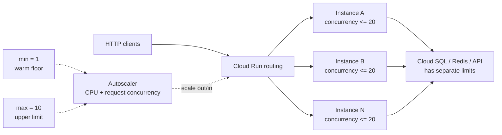

# Concurrency, Autoscaling, and Minimum Instances

A Java API deployed on **Cloud Run** might serve a few requests per minute and suddenly receive hundreds of simultaneous requests. Without managing nodes like on Compute Engine or GKE, operators still must decide **how many concurrent requests one instance handles**, **how far Cloud Run is allowed to scale out**, and **whether to keep instances warm when traffic is zero**. These three decisions directly affect latency, CPU/RAM usage, database connections, and billing.

This lesson belongs to the **Cloud Run** chapter in the **CLOUD_PROVIDERS_GCP** module, connecting knowledge of projects/IAM, VPC networking, Compute Engine, GKE, and data services with real-world container deployment on Google Cloud. The focus is on **Cloud Run services using default autoscaling**; Cloud Run jobs, worker pools, standalone Cloud Run instances, and manual scaling are separate models.

> Project names, services, container images, load figures, and unit prices in this lesson are illustrative examples. Deploy/update operations and load tests can cause disruption or incur charges; run them only in authorized environments. Metrics and behaviors were cross-checked against Google Cloud documentation at authoring time; always verify current limits and CLI versions when deploying for real.

## Learning Objectives

After this lesson, you can:

1. Distinguish **request concurrency**, **running instance count**, **min/max instances**, and **request queueing**.
2. Explain how Cloud Run autoscales on CPU, concurrency, and request demand, as well as multi-vCPU effects.
3. Choose `concurrency` for a Java HTTP API based on CPU/RAM, thread pools, processing time, and database connections.
4. Reduce cold starts with **minimum instances** without mistaking it for absolute HA or a fixed instance count.
5. Distinguish **service-level** vs. **revision-level** min/max, especially during traffic splitting or with tagged revisions.
6. Configure and verify these parameters using the Console, `gcloud`, and Terraform.
7. Measure load tests, metrics, and costs, and troubleshoot 429/5xx errors, rising latency, or database overload.

## 1. Three Parameters, Three Different Questions

| Parameter | Question | Example | Key point to remember |
| --- | --- | --- | --- |
| **Concurrency** | At most how many simultaneous in-flight requests can one instance receive? | `20` requests/instance | **Not** the instance count |
| **Min instances** | How many warm instances does Cloud Run try to keep ready to serve requests? | `1` instance | Reduces cold starts, **increases idle cost** |
| **Max instances** | Up to how many instances can the service/revision scale out to? | `10` instances | Caps cost and protects backends; can cause request waiting/errors |



Simple example: 100 requests *arriving at the same moment* **does not mean** Cloud Run immediately creates `100/20 = 5` instances. The autoscaler also factors in CPU, actual utilization, queue wait, startup time, quotas, and target thresholds. `20` is only the **per-instance request cap**, not a target utilization or a guarantee of instant instance counts.

## 2. Concurrency: True Parallelism Inside the Application

**Maximum concurrent requests per instance** sets the ceiling on how many simultaneous HTTP requests Cloud Run dispatches to a single container instance. Valid values can go up to **1,000** depending on configuration and service limits.

**Do not rely on "the default is always 80."** Current Cloud Run documentation states:

- New services created via the **Google Cloud Console** default to concurrency `80`.
- New services created via **gcloud CLI/Terraform** default to **`80 × vCPU count`**; this default is not recalculated automatically on every new revision deploy.
- Always **set an explicit value** in IaC/deploys when reproducibility matters, and use `gcloud run services describe` to inspect the live setting.

### When Should You Lower or Raise Concurrency?

| Workload profile | Direction to test | Reason |
| --- | --- | --- |
| CPU-bound: image processing, encryption, heavy compute | **Low** (e.g., 1–8) | Reduces CPU contention and memory spikes |
| Java REST API mostly waiting on database/network | **Moderate** (e.g., 10–40) | Leverages I/O wait time while bounding connection pools |
| Asynchronous I/O, benchmarked event-loop | Can be **higher** | Capable of handling many concurrent connections |
| Single request requires large amounts of RAM | **Low** | Prevents multiple concurrent requests from allocating memory into OOM |
| Workload relying on unsafe mutable global state | `1` initially; then fix code | Avoids race conditions, at the cost of more cold starts and higher bill |

These are **starting points for measurement**, not fixed framework rules. A Java Spring Boot app using servlet thread-per-request, blocking JDBC, and HikariCP has different bottlenecks from a nonblocking WebFlux app.

### Why Is Setting 1 Not Always Best?

`concurrency=1` means each instance handles at most one in-flight request; as traffic rises, the platform may need far more instances, increasing scale-out latency, total TCP/database connections, and cost. Use it only when the application cannot safely handle concurrent requests or when each request consumes nearly all CPU/RAM.

### Multi-vCPU and CPU Hotspots

Cloud Run evaluates **average CPU utilization across all vCPUs**. A single CPU-bound thread saturating 100% of one vCPU on a 4-vCPU instance may show only around **25% average CPU**. The autoscaler might not scale out on CPU as expected even while requests queue. Lower concurrency so traffic signals drive scale-out, or right-size CPU/thread pools and re-measure.

## 3. Autoscaling: What Signals Does Cloud Run Use?

Autoscaled Cloud Run services can **scale to zero** when `min=0` and there are no requests or activities keeping instances alive. As traffic rises, two behaviors come into play:

1. **Metrics-based scaling:** observes CPU utilization and request concurrency over time.
2. **On-demand scaling:** responds to sudden short-term request demand; average formulas should not be treated as exact simulations of every burst.

Current documentation describes default metrics-based scaling targets around **60% CPU** and **60% concurrency**, with support for tuning targets in applicable configurations. CPU is averaged across vCPUs; memory utilization is **not a direct autoscaling signal**.

```text
Example concurrency=20:
Target level is roughly 60% x 20 = 12 concurrent requests/instance

If average total in-flight requests is ~36:
Rough estimate from concurrency alone: 36 / 12 ≈ 3 instances
```

This is **only a conceptual calculation**, not a guarantee of exactly 3 instances. Cloud Run aggregates over observation windows, rounds up, checks CPU, applies load/CPU adjustments, cooldowns, quotas, readiness, and min/max limits.

### Autoscaling Does Not Guarantee Every Request Succeeds

- **Container not ready yet:** newly started instances must boot the runtime, open `PORT`, load classes/config, and pass probes.
- **Quota/capacity limits:** additional instances cannot always be provisioned immediately even if desired.
- **Hitting max instances:** requests may queue; documentation notes a maximum pending wait of roughly **`max(3.5 × average startup time, 10 seconds)`** where applicable, after which requests may fail.
- **Upstream bottlenecks:** Cloud SQL or downstream APIs do not automatically scale alongside Cloud Run.
- **Long-lived requests:** still occupy a concurrency slot, such as HTTP streaming or WebSockets for the connection duration.

Thus, the exact same `concurrency` change can lower instance count while worsening p95 latency; measure **both user experience and cost**.

## 4. Minimum Instances: Reduce Cold Starts, Not Fixed VMs

With `min=0`, Cloud Run can shut down all instances when idle. A new request after an idle period may wait on a **cold start**: the platform allocates a container, loads the image, and initializes the app.

With `min=1`, Cloud Run **attempts to keep** one warm instance ready to serve requests sooner. This is a **best-effort** target; instances can still be replaced or restarted due to maintenance, crashes, capacity shortages, or quotas, so `min=1` **does not guarantee** zero cold starts ever.

| Goal | Suggested min to test | Trade-off |
| --- | --- | --- |
| Dev/test, very sparse traffic | `0` | Low idle cost, noticeable cold starts |
| Small production API sensitive to initial latency | `1` | Ongoing cost to keep an instance warm |
| API needing higher headroom and HA | `2–3` after load test/SLO review | Higher baseline cost; still depends on backend HA |
| Continuous background processing | Do not just raise min | Evaluate **instance-based billing**, Cloud Tasks/Jobs, or worker pools properly |

### Service-Level vs. Revision-Level Minimum

**Service-level min** (recommended by Google for most services) maintains total minimum instances distributed across revisions **currently receiving traffic**, proportional to the traffic split. Updating it takes effect on the service without creating a new revision.

**Revision-level min** binds to a specific revision. If that revision is in the traffic split **or has a traffic tag**, it can keep warm instances alive and **still incur charges even at 0% traffic**. Tagged revisions left with revision-level min configured are a frequent source of unexpected post-canary bills.

If combining service/revision min with max at either level, **max remains the ceiling**, and multiple mins can increase the number of instances kept alive; avoid mixing them without a clear reason and verification.

### "Min=1" Does Not Mean "Only One Instance Runs"

Min is a **floor**; under load, Cloud Run can scale up to max and available quota. If you want a fixed instance count, that is **manual scaling**—do not infer it from minimum instances.

## 5. Maximum Instances: Capping Cost and Backend Pressure

**Max instances** protects budgets and finite dependencies (databases, legacy APIs, rate-limited vendors). However, setting it too low can make requests wait too long or fail during traffic peaks.

- **Service-level max:** a shared cap across serving revisions; recommended by Google as the general limit. Updating it takes effect directly on the service.
- **Revision-level max:** applies only to a specific revision and per current documentation is mainly available on services that previously configured it; new revision configs may differ depending on the case.
- **Combining service/revision max:** the effective limit is the **lower** of the two when both apply.
- **Traffic splitting:** with service-level max, instance quota may be **allocated proportionally to traffic split** across revisions. A revision receiving 10% traffic might hit its allocated share even if the overall service has not reached total max.
- **Do not treat max as a millisecond-strict hard stop:** the platform may exceed the limit very briefly under certain sudden traffic burst conditions.

For example, a service with `max=10` split 50/50 between revisions A and B: each revision may only be allocated around **5 instances** under the service cap; never assume each revision gets 10 instances.

### Protecting Cloud SQL via Instance Count

Suppose a Java service has `max=10`, with each instance running HikariCP `maximumPoolSize=5`:

```text
Maximum DB connections created by this service in a simple model:
10 instances × 5 connections/instance = 50 connections
```

Leave headroom for admin access, migrations, other services, and non-pooled connections. During rolling deployments, tagged revisions, or brief max overshoots, actual connections **can exceed 50**, so do not treat that calculation as a guarantee. HikariCP caps and downstream timeouts/backpressure remain essential.

## 6. Choosing Initial Numbers with Back-of-the-Envelope Math

For steady workloads, use **Little's Law** to estimate average in-flight requests:

\[
\text{Average Concurrency} \approx \text{RPS} \times \text{Average response time (seconds)}
\]

**Illustrative example:** 120 requests/second with an **average** response time of 250 ms:

```text
120 req/s × 0.25 s ≈ 30 concurrent requests in flight on average

Choosing concurrency=20 and an illustrative 60% target:
~12 concurrent requests/instance at target level
30 / 12 ≈ 2.5 -> roughly 3 instances based on concurrency signal alone
```

**Never substitute p95 for average response time in Little's Law.** P95/P99 measure **SLOs**, while average load estimation uses the **mean**. Setting min/max must also factor in **peak RPS**, scale-out time, tail request duration, CPU, RAM, DB capacity, and temporal spikes.

### Tuning Workflow

1. Measure current baseline: RPS, mean/p95/p99 latency, CPU, memory, instance count, DB pool saturation.
2. Pick initial concurrency based on thread pools, CPU-bound vs. I/O-bound profile, and memory per request.
3. Set min based on cold-start SLOs and acceptable idle cost.
4. Set max based on quotas and downstream connection/budget limits.
5. Load test in staging from low load up toward peak; change **one variable at a time**.
6. Compare error rates, tail latency, and billable instance time; update IaC and the rollback plan.

## 7. Deploying and Configuring Cloud Run with gcloud

### 7.1 Verify Permissions and Context

Example project `retail-dev-01`, region `asia-southeast1`, service `orders-api`. The deployer needs permission to update the Cloud Run service and `iam.serviceAccounts.actAs` on the runtime service account (the appropriate `roles/iam.serviceAccountUser` role). The image must reside in Artifact Registry with proper pull permissions.

```bash
PROJECT_ID="retail-dev-01"
REGION="asia-southeast1"
SERVICE="orders-api"
IMAGE="asia-southeast1-docker.pkg.dev/retail-dev-01/apps/orders-api:1.0.0"
SERVICE_ACCOUNT="sa-orders-api@retail-dev-01.iam.gserviceaccount.com"

gcloud auth list
gcloud config get-value project
gcloud run services list --project="$PROJECT_ID" --region="$REGION"
```

The values above are **validly formatted placeholders only**; they do not prove the image, repository, or service account already exists.

### 7.2 Fresh Deploy (Modifies Infrastructure, Incurs Charges)

```bash
gcloud run deploy "$SERVICE" \
  --project="$PROJECT_ID" \
  --region="$REGION" \
  --image="$IMAGE" \
  --service-account="$SERVICE_ACCOUNT" \
  --cpu=1 \
  --memory=512Mi \
  --concurrency=20 \
  --min=1 \
  --max=10 \
  --timeout=60s \
  --no-allow-unauthenticated
```

**Meaning:** up to 20 concurrent requests per instance; service tries to maintain 1 warm instance and scales up to max 10 per policy/quota; only principals with `run.invoker` permission can call the API. Never enable public access just to run a load test.

### 7.3 Inspect Config After Deploy (Read-Only)

```bash
gcloud run services describe "$SERVICE" \
  --project="$PROJECT_ID" --region="$REGION"

gcloud run revisions list \
  --service="$SERVICE" \
  --project="$PROJECT_ID" --region="$REGION"
```

Under **Cloud Run → Service → Scaling**, verify all three values. **Concurrency belongs to the revision template**; changing concurrency typically creates a **new revision**. **Service-level min/max** applies directly to the service and does not always require creating a revision.

### 7.4 Controlled Parameter Changes

```bash
# Changing concurrency -> creates a new revision; may affect traffic rollout.
gcloud run services update "$SERVICE" \
  --project="$PROJECT_ID" --region="$REGION" \
  --concurrency=10

# Changing service-level limits; does not need to create a new revision.
gcloud run services update "$SERVICE" \
  --project="$PROJECT_ID" --region="$REGION" \
  --min=2 --max=10

# When warm instances are no longer needed, return min to 0.
gcloud run services update "$SERVICE" \
  --project="$PROJECT_ID" --region="$REGION" \
  --min=0
```

These are **individual test options**, not a sequence of commands to run back-to-back in production. Before each `update`, read the active configuration and confirm traffic split/revisions; afterward, inspect latency, errors, and cost.

### 7.5 Service-Level vs. Revision-Level in the CLI

| Level | Min | Max | Typical effect |
| --- | --- | --- | --- |
| **Service-level** | `--min` | `--max` | Manages overall limits; recommended |
| **Revision-level (legacy/specific)** | `--min-instances` | `--max-instances` | Revision attribute and may trigger a new revision |
| **Revision request concurrency** | `--concurrency` | Not max instances | Limits simultaneous requests/instance |

Do not confuse `--max-instances=10` (revision-level) with `--max=10` (service-level) in automation. Revision-level flags have availability restrictions on newer services per current documentation; prefer service-level scaling for new projects.

## 8. Terraform: Capturing Decisions in IaC

With the Cloud Run API v2 provider, an example core configuration:

```hcl
resource "google_cloud_run_v2_service" "orders_api" {
  name                = "orders-api"
  location            = "asia-southeast1"
  project             = var.project_id
  deletion_protection = true

  scaling {
    min_instance_count = 1
    max_instance_count = 10
  }

  template {
    service_account                 = var.service_account_email
    max_instance_request_concurrency = 20

    containers {
      image = var.image_digest
      resources {
        limits = {
          cpu    = "1"
          memory = "512Mi"
        }
      }
    }
  }
}
```

This is a **minimal snippet**, assuming configured providers/variables and a real **digest-pinned** image. IAM `run.invoker`, ingress, networking, secrets, and the deployment pipeline must be declared per environment requirements. Review `terraform plan` to see which changes create a revision versus only updating scaling; avoid prolonged manual Console edits that cause configuration drift.

## 9. Java: Applications Must Handle Concurrency Safely

Allowing 20 concurrent requests in Cloud Run **does not mean** the Java app already has 20 worker threads or enough database connections. With a Spring Boot servlet stack, web server threads, queues, HikariCP, and timeouts can all form **internal bottlenecks**.

Example `application.properties` for a Java service using JDBC:

```properties
# Illustrative config only; benchmark under load to decide real values.
server.tomcat.threads.max=40
server.tomcat.accept-count=50
spring.datasource.hikari.maximum-pool-size=5
spring.datasource.hikari.connection-timeout=3000

# Do not expose sensitive actuator endpoints publicly.
management.endpoints.web.exposure.include=health,info
```

With `concurrency=20`, up to 20 requests can execute simultaneously in one instance, yet **only 5 requests can borrow a JDBC connection at once** from this pool. Other requests wait on the pool and can time out. If queries are slow, raising concurrency from 20 to 80 can worsen p95 without increasing DB throughput.

### Items to Audit

- **Thread safety:** avoid mutable singleton state shared across requests; never store user data in static fields.
- **Memory:** total heap, thread stacks, native memory, and response buffers must fit within the container memory limit. Peak memory rises with concurrency.
- **CPU:** serialization, JSON parsing, crypto, and image processing contend for CPU with garbage collection.
- **DB connection pool:** calculate the total across max instances, canaries, and other services; enforce timeouts and backpressure.
- **Async work:** request-based billing can throttle CPU outside request handling. Never rely on background threads "running forever"; use Cloud Tasks/Jobs/worker pools when appropriate.
- **Health/startup:** the app must listen on `0.0.0.0:$PORT`, report healthy only when essential dependencies are ready, and minimize unnecessary work at startup.

## 10. Minimum Instances and the Two Billing Modes

Cloud Run services have two primary billing mechanisms:

| Mechanism | When are CPU/RAM billed? | When min > 0 |
| --- | --- | --- |
| **Request-based billing** (default) | During instance startup, shutdown, and while serving requests | Idle warm instances are still billed at an **idle rate** lower than the active rate |
| **Instance-based billing** | Over the **entire instance lifecycle**, even when not processing requests | Min instances keep CPU capacity available for background tasks but charge for total uptime |

Min > 0 is **not free** under either mechanism. Conversely, `min=0` does not mean a zero bill if there are still requests, logs, egress, databases, networking, or other resources.

### CPU Outside Requests and Background Tasks

If you need Java threads executing **after a response finishes**, instance-based billing may fit better than request-based billing, though instances can still be stopped or restarted. For tasks requiring retries, deadlines, or guaranteed completion, use **Cloud Tasks**, **Cloud Run Jobs**, or an appropriate worker model. `min=1` does not turn a Cloud Run service into a durable daemon.

### Illustrative Cost Comparison Example

One warm instance maintained over a 30-day month:

```text
Expected duration ≈ 1 instance × 30 days × 24 hours = 720 instance-hours.
```

This is **maintained capacity time**, which **cannot simply be multiplied by active vCPU unit prices** to compute a request-based bill; you must separate active vs. idle time, CPU/RAM, requests, region, free tier, and billable settings. Instance-based billing calculates charges differently. Use [Cloud Run pricing](https://cloud.google.com/run/pricing) and the [Google Cloud Pricing Calculator](https://cloud.google.com/products/calculator) to estimate, then reconcile against Cloud Billing by SKU.

## 11. Observe and Load Test Before Changing Parameters

A concurrency/min/max change is only considered good when **both SLOs and cost** are evaluated together.

| Signal | Source | What to ask? |
| --- | --- | --- |
| Request count/RPS | Cloud Run Metrics | Does traffic match baseline/peak? |
| Request latency p50/p95/p99 | Cloud Monitoring, tracing | Is tail latency rising due to queueing? |
| 429/5xx and request timeouts | Request logs | Are we hitting max/capacity or app errors? |
| Container instance count | Cloud Run Metrics | How far did the autoscaler scale? |
| CPU utilization per instance | Cloud Monitoring | Is there a vCPU hotspot or CPU saturation? |
| Memory utilization / OOM | Metrics + revision logs | Is concurrency straining heap/native memory? |
| Container startup latency | Cloud Run startup metrics/logs | Did `min=1` reduce cold starts? |
| Billable instance time | Cloud Monitoring/Billing | Is warm floor cost or active load dominating? |
| DB connections/wait time | Cloud SQL/Hikari metrics | Is Cloud Run scale-out exhausting the DB pool? |

### Controlled Load Testing

In staging, with the `hey` tool installed and a principal holding `run.invoker`:

```bash
PROJECT_ID="retail-dev-01"
REGION="asia-southeast1"
SERVICE="orders-api"

URL="$(gcloud run services describe "$SERVICE" \
  --project="$PROJECT_ID" --region="$REGION" \
  --format='value(status.url)')"
TOKEN="$(gcloud auth print-identity-token)"

# Only call /health if the application actually exposes this endpoint.
# Start with light load, then ramp up in staging.
hey -z 30s -c 10 \
  -H "Authorization: Bearer $TOKEN" \
  "$URL/health"

# Never print TOKEN to logs or commit shell history containing tokens.
```

**Note:** a cheap `/health` endpoint with almost no DB I/O is **not representative** of business APIs. To evaluate concurrency, load test an endpoint with production-like work using isolated test data, scripted traffic, RPS/duration limits, and cost tracking. Testing with `hey` holds fixed client concurrency; it does not always reproduce real peak arrival rates.

### Small Experiment Matrix

| Run | Concurrency | Min | Max | What to record |
| --- | ---: | ---: | ---: | --- |
| Baseline | 20 | 0 | 10 | p95, errors, cold starts, instance count |
| Warm | 20 | 1 | 10 | p95 after idle and idle cost |
| Low concurrency | 5 | 1 | 10 | Scale-out, CPU, DB pool, startup |
| High concurrency | 40 | 1 | 10 | Memory, thread wait, p95, cost |

Change **one parameter at a time** and run long enough to capture both scale-up and scale-down. Use canary traffic splitting or staging to avoid impacting production. Never declare "40 is best" just because instance count is lowest if p95 or errors climbed.

## 12. Real-World Scenario: Java API 5xx Spike After Peak Hours

### Context

The `orders-api` on Cloud Run calls Cloud SQL. Configuration: **2 vCPU, 512 MiB, concurrency 80, min 0, max 30**, Hikari pool 10 connections/instance. During the day traffic surges from 20 to 400 RPS.

**Symptoms:** sharp p95 latency spike, DB connection borrow timeouts, and initial cold starts. Some instances show low average CPU even though one thread handling JSON/compute is saturated, while the database hits its connection limit.

### Investigation

1. **Separate metrics:** inspect Cloud Run instance count, p95, CPU/memory, and DB active connections/pool wait.
2. **Verify actual concurrency/defaults:** read the revision config rather than guessing from gcloud defaults.
3. **Inspect request profile:** CPU hotspots, requests waiting on I/O, DB query durations, and timeouts.
4. **Check backend ceiling:** 30 instances × 10 connections = up to roughly **300 connections**, before counting other services—enough to exceed the DB budget.
5. **Correlate instance growth:** if fast scale-out causes DB exhaustion, raising max further makes things worse.

### Changes Tested in Staging

- Test **concurrency 10–20** and benchmark p95/CPU/thread wait; prevent too many requests contending for the same pool.
- Tune/cap the connection pool and set service-level **max** within the DB connection budget, leaving headroom for rolling revisions.
- Test **min=1** if initial cold starts genuinely impact SLOs, weighing idle cost against benefit.
- Optimize queries/connection reuse, pooling, backoff retries, and circuit breakers; never use autoscaling as a substitute for DB optimization.
- Consider offloading CPU-heavy batches from the HTTP path to Cloud Run Jobs/Tasks.

**Conclusion:** There is no single "best" set of numbers for every Java API. Cloud Run scales well, yet remains constrained by the **application and data tier**. Final settings must be validated via load testing with realistic traffic and error budgets.

## 13. Quick Troubleshooting

| Symptom | Check first | Do not do immediately |
| --- | --- | --- |
| First request after idle is slow | Startup latency, `min=0`, JVM init, image size | Raise max without measuring cold starts |
| P95 rises with traffic | CPU, thread pool, Hikari wait, memory, concurrency | Raise concurrency just to cut instance count |
| Instance count does not rise as expected | Multi-vCPU average CPU, concurrency target, quotas, max | Assume the autoscaler is broken |
| Requests wait then 429/5xx | Max instances, pending queue, app 503s, quotas | Remove max without checking DB capacity |
| Container OOM/restarts | Memory peak, heap/native, simultaneous requests | Simply turn on `min > 0` |
| Cloud SQL "too many connections" | `max × pool size`, canary revisions, connection leaks | Increase max instances |
| Set `min=1` but still see cold starts | Instance restarts, new revisions, burst > warm capacity | Treat min as a zero-cold-start SLA |
| Bill increases during zero traffic | Warm min, billing mode, tagged revision min, logs/egress | Turn off Monitoring without checking SKUs |
| 90/10 traffic split, canary errors | Proportional service max across revisions, canary health | Assume canary gets the full max |
| Deploy succeeded but returns 403 | IAM `run.invoker`, auth token, ingress | Enable unauthenticated access to "fix" it |

### Safe Change Runbook

1. Record project, region, service, revision, traffic split, and current min/max/concurrency settings.
2. State a clear goal: reduce cold starts, keep p95 under SLO, or protect DB/budget.
3. Capture baseline, inspect IAM/quotas/billing SKUs, and estimate peak.
4. Test parameters in staging or canary, changing only one variable per test cycle.
5. Measure p95/p99, 429/5xx, instance count, CPU/memory, DB wait, and cost.
6. Roll back the revision if a concurrency change breaks things; revert service-level min/max if the new config misses targets.
7. Update IaC/runbook, documenting results and approver.

## 14. Self-Check Exercises

### Exercise 1 — Understanding the Three Parameters

A service sets `concurrency=20`, `min=1`, `max=10`. When 150 requests arrive simultaneously, will Cloud Run definitely use exactly 8 instances?

<details>
<summary>Answer</summary>

No. 20 is the per-instance concurrency ceiling, 1 is a best-effort floor, and 10 is the policy cap. Autoscaling also evaluates CPU, request concurrency targets, startup/capacity, and traffic; it does not guarantee instantaneously spawning exactly 8 instances.
</details>

### Exercise 2 — Little's Law Calculation

An API receives 80 RPS with an **average response time** of 200 ms. Roughly how many requests are in flight concurrently on average?

<details>
<summary>Answer</summary>

`80 × 0.2 = 16` concurrent requests. This is a steady-state average estimate, not p95 or a required instance count.
</details>

### Exercise 3 — Protecting the Database

Cloud Run has `max=12` and each instance opens up to 8 Hikari connections. The backend database only has a budget of 80 connections remaining for this service. What is the issue?

<details>
<summary>Suggested answer</summary>

`12 × 8 = 96` connections in the simple model, exceeding the 80-connection budget; rolling deployments can add even more pressure. Lower pool size/max, use proper pooling/proxies, reserve headroom, and measure peak usage.
</details>

### Exercise 4 — Cold Start

An API receives only a few requests per hour, and users complain the first request is slow. What should you test changing first: concurrency, min, or max?

<details>
<summary>Suggested answer</summary>

Check startup latency and then test `min=1` if SLOs and budget permit, while also optimizing JVM/image startup. Raising max does not directly fix post-idle cold starts.
</details>

### Exercise 5 — Two Billing Modes

A service has `min=2` with zero traffic overnight. Why can it still incur charges under request-based billing?

<details>
<summary>Answer</summary>

The two warm instances still reserve standby capacity and are billed at the idle rate. Under instance-based billing, charges apply across the entire instance lifecycle, including idle time.
</details>

### Exercise 6 — Tagged Revision

A canary revision receives 0% traffic, yet has a traffic tag and revision-level `min=1`. Can it incur charges?

<details>
<summary>Answer</summary>

Yes. A tagged revision with revision-level min can keep warm instances running even while receiving zero main traffic. Check old revision configs, remove tags/min when no longer needed, and prefer service-level min.
</details>

### Exercise 7 — CPU Hotspot

A single-threaded CPU-bound app on 4 vCPUs saturates 1 core; Cloud Monitoring shows ~25% average CPU while p95 keeps rising. Why, and what should you test?

<details>
<summary>Suggested answer</summary>

The autoscaler looks at average CPU across all 4 vCPUs, so 1 busy core does not push the average high. Consider right-sizing CPU, improving parallelism, or lowering concurrency so request load triggers scale-out; re-measure p95 and cost.
</details>

### Exercise 8 — Distinguishing gcloud Scopes

How does `--max 10` differ from `--max-instances 10` when configuring Cloud Run services?

<details>
<summary>Answer</summary>

`--max` sets **service-level maximum instances**. `--max-instances` is the **revision-level maximum** on services that support it. Do not swap them casually because traffic splits, cap scope, and availability differ.
</details>

## 15. Pre-Production Checklist

- [ ] Identify the actual service/revision/region, traffic split, and active concurrency value.
- [ ] Benchmark concurrency against CPU, RAM, thread pool, Hikari pool, and p95/p99.
- [ ] Do not rely on CLI/Console defaults; set explicit values for reproducibility.
- [ ] Choose min from cold-start SLOs and budget, understanding it is a best-effort warm floor.
- [ ] Set service-level max to protect budget, DB, and target APIs, leaving burst/rollout headroom.
- [ ] Do not mix up service-level `--min`/`--max` with revision-level `--min-instances`/`--max-instances`.
- [ ] Audit tagged revisions/traffic splits to avoid unexpected idle costs and caps.
- [ ] Know whether billing is request-based or instance-based; never rely on min to run durable background tasks.
- [ ] Cloud Monitoring tracks CPU, memory, instance count, request latency/errors, startup, and billable time.
- [ ] Have staging load tests, canary, rollback, budget alerts, and DB connectivity plans in place.
- [ ] Cloud Run runtime identity and `run.invoker` IAM are properly scoped; never open public access just for testing.
- [ ] All decisions are recorded in IaC and operational runbooks.

## Official References

- [Maximum concurrent requests](https://cloud.google.com/run/docs/about-concurrency): concurrency concepts, CLI/Console defaults, CPU optimization.
- [Configure concurrency](https://cloud.google.com/run/docs/configuring/concurrency): Console, `gcloud`, YAML, Terraform.
- [About Cloud Run instance autoscaling](https://cloud.google.com/run/docs/about-instance-autoscaling): CPU/concurrency targets, on-demand scaling, pending requests.
- [Configure minimum instances](https://cloud.google.com/run/docs/configuring/min-instances): service/revision-level minimum, tagged revisions, and billing.
- [Configure maximum instances](https://cloud.google.com/run/docs/configuring/max-instances): service/revision caps, traffic splitting.
- [About maximum instance limits](https://cloud.google.com/run/docs/configuring/max-instances-limits): quotas and capacity limits.
- [Billing settings](https://cloud.google.com/run/docs/configuring/billing-settings): request-based and instance-based billing.
- [Cloud Run performance tips](https://cloud.google.com/run/docs/tips/general): startup, concurrency, and application tuning.
- [Monitor Cloud Run services](https://cloud.google.com/run/docs/monitoring): metrics, logs, and troubleshooting.
- [Cloud Run pricing](https://cloud.google.com/run/pricing): CPU/RAM, requests, idle, and networking charges.
- [Google Cloud Pricing Calculator](https://cloud.google.com/products/calculator): comparing min/concurrency/CPU costs.
