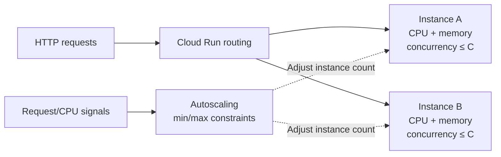
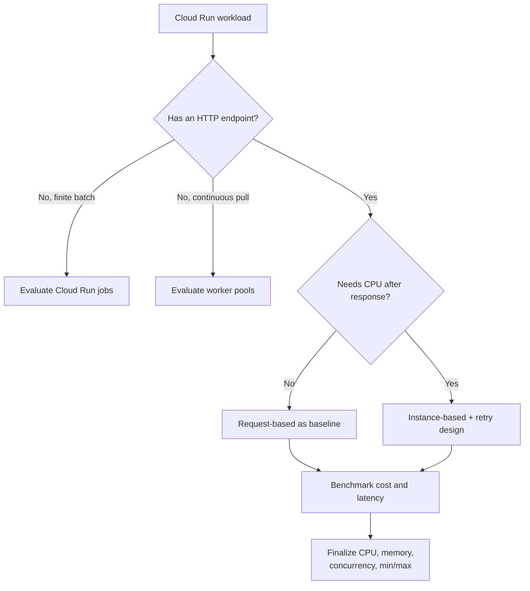

# CPU, Memory, and Choosing a Cloud Run Billing Setting

Cloud Run lets you run containerized applications without directly managing virtual machines or Kubernetes nodes. However, choosing the wrong **CPU, memory, concurrency, or billing setting** can cause out-of-memory errors, increased latency, inefficient instance scaling, or unnecessary cost.

This lesson belongs to the **Cloud Run** chapter of the `CLOUD_PROVIDERS_GCP` module, building on knowledge of projects, IAM, VPCs, Compute Engine, and GKE. The focus is on **autoscaled Cloud Run services**, which feature two primary billing settings: **request-based billing** and **instance-based billing**. The examples apply to REST APIs, Spring Boot, and asynchronous tasks, while aligning with resource protection, reliability monitoring, and cost control.

> Note: **Cloud Run services**, **jobs**, **worker pools**, and the **Cloud Run instances** resource type differ in lifecycle, billing, and certain limits. Do not apply service flags and defaults verbatim to other resource types. Pricing, quotas, and features vary by region and over time; always verify against Google Cloud documentation before production use.

## 1. Learning Objectives

After this lesson, you can:

1. Distinguish **configured vCPUs**, **allocated CPU time**, and **billable time**.
2. Choose appropriate CPU/memory for I/O-bound, CPU-bound, or JVM workloads.
3. Compare **request-based** vs. **instance-based billing**, understanding their effects on background work and scale-to-zero.
4. Explain the relationships among **concurrency, min/max instances, startup CPU boost, latency, and cost**.
5. Use `gcloud` to inspect and update a Cloud Run service's configuration, then monitor and evaluate it via load testing.
6. Estimate vCPU-seconds, GiB-seconds, and identify non-compute charges.

## 2. How Does a Request Flow Through Cloud Run?

For an autoscaled Cloud Run service, requests are routed to revisions receiving traffic. Cloud Run can route to an existing instance or spin up a new instance if additional capacity is needed.



Three concepts to separate:

| Concept | Meaning | Example |
| --- | --- | --- |
| **CPU limit** | Number of vCPUs configured per **container instance** (or per container in multi-container setups). | `1 vCPU`. |
| **Memory limit** | Maximum memory allocated to the container, covering process usage and related memory consumption. | `512Mi` or `1Gi`. |
| **Billing setting** | Determines when CPU is allocated and the duration over which instances are billed under the respective model. | Request-based or instance-based. |

An instance with `2 vCPU` does not automatically run twice as fast as a `1 vCPU` instance if the application only has a single CPU-heavy thread. Similarly, allocating large memory does not guarantee lower request latency if the bottleneck lies in Cloud SQL or an external API.

## 3. Choosing CPU and Memory

### 3.1. CPU: How Much Compute Does the Workload Need?

- **CPU-bound:** encryption, compression, heavy math, image processing, large JSON parsing. Test adding vCPUs if the app genuinely exploits parallel processing.
- **I/O-bound:** APIs primarily waiting on a database or external service. More vCPUs do not necessarily reduce latency; prioritize tuning connection pools, timeouts, and concurrency.
- **JVM/Spring Boot:** startup and garbage collection can be CPU-intensive; measure cold starts, heap, non-heap, and actual thread counts.

Cloud Run services support CPU configurations such as `1`, `2`, `4`, `6`, and `8` vCPUs, as well as certain **fractional CPU** configurations below 1 vCPU under specific conditions. Not every combination of CPU/memory or execution environment is valid.

### 3.2. CPU–Memory Relationship

Guidance table based on Cloud Run **service** limits:

| Configured vCPU | Allowed memory per published range | Notes |
| --- | --- | --- |
| `0.08` to under `1` | Constrained by CPU; max `512Mi` below `0.5 vCPU`, max `1Gi` from `0.5 vCPU` up | Subject to fractional CPU conditions below. |
| `1` | Up to `4Gi` | Often a sensible baseline to benchmark an HTTP API. |
| `2` | Up to `8Gi` | Beware of apps that only use a single core. |
| `4` | `2Gi` to `16Gi` | Evaluate multithreaded utilization and cost. |
| `6` | `4Gi` to `24Gi` | For heavier resource demands. |
| `8` | `4Gi` to `32Gi` | Not a limit to saturate by default. |

**Fractional CPU under 1 vCPU** carries important constraints for services: it requires **request-based billing**, **maximum concurrency = 1**, the **first-generation execution environment**, and CPU-tied memory limits. With second-generation, minimum memory is typically `512Mi`; first-generation may allow lower values depending on supported configurations. Check details before setting `--cpu=0.5`.

Numbers in the table are **configuration limits**, not performance benchmarks or capacity guarantees. Organization Policies, specialized hardware, and newer features may impose additional constraints.

### 3.3. Memory: More Than Just the Heap

Memory used by a container can include:

- Runtime and application code, such as JVM heap, metaspace, thread stacks, and direct buffers.
- In-process caches, native libraries, and request/response buffers.
- Temporary data written to the memory-backed filesystem, if used.
- Additional overhead from multiple concurrent requests.

Exceeding the memory limit can terminate the container instance and fail in-flight requests. **Raising the memory limit** is only right when the app genuinely needs more memory; memory leaks, unbounded payload buffering, or excessive concurrency must be fixed in code or config.

Rough planning estimate:

\[
M_{\text{peak}} \approx M_{\text{base}} + C_{\text{concurrent}} \times M_{\text{per request}}
\]

Suppose an app uses 300 MiB baseline, each request adds up to 15 MiB, and each instance handles 20 concurrent requests: the simple model gives `300 + 20 × 15 = 600 MiB`. Choosing `512Mi` risks OOM; `1Gi` is a reasonable candidate to test if CPU/memory constraints allow. **This is only a rough sizing estimate**: JVM GC, memory sharing, peak overlap, and sidecars can shift real usage.

### 3.4. vCPU Hotspot

Cloud Run autoscaling uses average CPU utilization across all allocated CPUs. For a **single-threaded** app forced to select `2 vCPU` for higher memory, one core running at 100% while the other sits near 0% may report roughly 50% average CPU. As a result, **CPU-based scaling reacts poorly** even though a thread is saturated.

Mitigation: start with the lowest vCPU count that meets memory needs; tune concurrency, parallelize work where appropriate, and measure p95 latency, throughput, and CPU utilization before scaling up resources.

## 4. The Two Billing Settings for Cloud Run Services

Google Cloud calls the two options **request-based billing** (default) and **instance-based billing**. Their legacy names were **CPU only allocated during request processing** and **CPU always allocated**.

| Criterion | **Request-based** | **Instance-based** |
| --- | --- | --- |
| CPU allocated | While processing requests, plus startup/shutdown lifecycle phases. | Throughout the entire instance lifecycle, even when no requests are active. |
| Compute billing | By **billable active time**; includes a per-request fee component. | By **entire instance lifetime**, including idle time; uses a separate rate table. |
| Idle min instances | Billed at an **applicable idle rate**; not completely free. | Continues billing for full instance CPU/memory. |
| Sparse or spiky load | Usually a good starting point. | May overpay for idle time. |
| Steady, sustained load | Compare total compute plus request fees. | Can be cost-competitive at high, steady utilization. |
| Work needing CPU after HTTP response | No guarantee CPU stays allocated outside requests. | CPU stays allocated while the instance exists. |
| Scale-to-zero | Supported when `min = 0`. | **Can still** scale to zero when `min = 0`; does not mean instances live forever. |

### 4.1. Request-Based Billing Is Not Simply "Pay Strictly Per Request"

Charges can include **vCPU-seconds, GiB-seconds, and request fees**, plus startup/shutdown and idle minimum instances per the applicable pricing schedule. Two overlapping requests on the same instance generally share **one billable instance time window**, rather than summing each request's duration separately and billing CPU/memory twice.

When `min instances = 0` and no instances are active, **there are no compute charges for non-existent instances**; charges from other services such as Artifact Registry, Cloud SQL, networking, and logging may still apply. With `min > 0`, request-based billing still charges to keep instances warm while idle, at the idle rate.

### 4.2. Instance-Based Billing Does Not Mean "24/7 Server"

CPU is allocated outside requests, yet the autoscaler can still **terminate idle instances**. If a service scales to zero, **no instance remains to execute background work** until a new request triggers one. Therefore:

- For short post-response work, instance-based may fit better than request-based, but you must still handle shutdowns, retries, and idempotency.
- If you always need CPU available when idle, consider `min instances > 0` while accepting the instance maintenance cost.
- For work that must reliably finish, use **Cloud Tasks, Cloud Run jobs, Pub/Sub, or worker pools** matching the workload pattern rather than spawning a background thread and hoping the instance lives forever.

**Cloud Run jobs** run tasks to completion under the job model and use **instance-based billing**; worker pools and other Cloud Run resource types have their own billing mechanics. Do not confuse setting `--no-cpu-throttling` on a **service** with creating a Cloud Run job.

### 4.3. Quick Selection Flow



## 5. Concurrency, Autoscaling, and Min/Max Instances

### 5.1. Concurrency Is Concurrent Requests, Not RPS

`--concurrency=20` caps **at most 20 simultaneous requests per instance**. It is **not** a limit of 20 requests/second. Per-second throughput depends on request duration and application speed.

An illustrative capacity estimate using Little's Law:

\[
\text{Average concurrent requests} \approx
\text{Requests/second} \times \text{Request duration (seconds)}
\]

For example, `100 requests/s × 0.2 s = 20` average concurrent requests. If one instance efficiently handles 10 concurrent requests, intuition suggests needing at least a few instances. However, this formula is **not the autoscaling algorithm**: Cloud Run also monitors CPU, load distribution, startup, pending requests, and other constraints.

**High concurrency** can reduce instance-hours and per-request overhead, but increases memory usage and tail latency if the app does not parallelize well. **Low concurrency** spawns more instances, which can improve isolation at the cost of higher spend and more Cloud SQL connections.

### 5.2. Min and Max Instances

- **Service-level min** keeps a warm floor of instances, reducing cold starts while incurring idle cost.
- **Service-level max** caps automatic scale-out by policy, helping protect downstreams and budgets.
- **Revision-level** limits can differ from service-level; during traffic splits, inspect both levels.
- **Max is not an absolute millisecond hard cap**: Cloud Run may briefly exceed the limit in certain cases such as traffic spikes, maintenance, or instance replacement. Nor is scaling up to max guaranteed if quotas or capacity constrain it.

For a service connecting to Cloud SQL, do not set `max=100` if each instance has a connection pool of 50 and the DB cannot sustain several thousand connections. Calculate total connections and leave proper margin.

### 5.3. Startup CPU Boost

**Startup CPU boost** temporarily allocates extra CPU while an instance starts up and for a short window after startup (currently **10 seconds** per documentation). It can reduce cold-start latency for JVM/Spring Boot apps or processes loading heavy libraries, **though the extra CPU can be billed**.

Do not enable or disable it on guesswork. Measure:

1. Cold-start p50/p95 and time until the app listens on the HTTP port.
2. First-request processing latency.
3. Billable CPU time and scale-out count under real load.
4. Impact when sidecars are present, plus supported quota/configurations.

## 6. Cost Model: Measuring Resources Over Time

Common units are **vCPU-seconds** and **GiB-seconds**; request-based billing also includes **request fees** per the pricing schedule. Rates vary by region, billing mode, free tiers/discounts, and SKUs.

Let \(v\) be vCPUs/instance, \(m\) be GiB/instance, and \(T\) be the **total billable instance time** under the model considered:

\[
\text{CPU usage} = v \times T \;\;(\text{vCPU-s})
\]
\[
\text{Memory usage} = m \times T \;\;(\text{GiB-s})
\]

### 6.1. Overlapping Requests Example

An instance has `1 vCPU` and `512Mi = 0.5 GiB`. Two HTTP requests run concurrently for 2 seconds. Considering strictly those 2 seconds of request handling (excluding startup/shutdown/min idle):

| Item | Illustrative result |
| --- | ---: |
| Instance time serving requests | 2 seconds, **not 4 seconds** |
| CPU usage | `1 × 2 = 2 vCPU-s` |
| Memory usage | `0.5 × 2 = 1 GiB-s` |
| Request count | 2, counted separately for request charges |

**Do not multiply the request count by vCPUs and treat that as billable CPU time**, because concurrent requests share the same instance's resources.

### 6.2. Comparing the Two Models with Hypothetical Time

A service has `1 vCPU, 1 GiB`. Over an observation window, summing across all instances gives:

- **400 instance-seconds actively processing requests**.
- **1,400 instance-seconds alive without handling requests**, if using instance-based billing and the instances actually stay alive.

| Model | Billable CPU in example | Billable memory in example |
| --- | ---: | ---: |
| Request-based, min=0, ignoring startup/shutdown | `400 vCPU-s` | `400 GiB-s` |
| Instance-based over 1,800 s total lifetime | `1,800 vCPU-s` | `1,800 GiB-s` |

**This is not a direct dollar comparison.** The two models use different unit prices; request-based includes request fees while instance-based may be priced advantageously for sustained load; actual instance lifetimes also vary with autoscaling. If `min > 0`, include **idle min-instance charges** for request-based. Also factor in startup CPU boost, networking, logging, Artifact Registry, and Cloud SQL where applicable.

### 6.3. Proper Cost Comparison Workflow

1. Record request count, request latency, concurrent requests, startup events, and instance count by time window.
2. Compare configured **vCPU, memory, concurrency, and min/max**.
3. Measure **billable instance time** and SKU-level costs rather than relying on average CPU%.
4. Use the **Cloud Run pricing calculator** with the right region, free tier, and discounts.
5. Load test both configurations in an authorized environment, checking latency/error rates alongside cost.

Point-in-time USD rates or free-tier numbers **should not be hardcoded as permanent conclusions**. Track actual Cloud Billing data and official pricing pages.

## 7. Hands-On with gcloud: Inspecting and Updating Configuration

Assume a **Cloud Run service** `orders-api-dev` already exists in project `orders-dev`, region `asia-southeast1`. The lab first performs **read-only** checks of the current config; update commands create new revisions or alter scaling/billing and can incur charges.

### 7.1. Inspect Existing Service

```bash
PROJECT_ID="orders-dev"
REGION="asia-southeast1"
SERVICE="orders-api-dev"

gcloud auth list
gcloud run services list \
  --project="$PROJECT_ID" \
  --region="$REGION"

gcloud run services describe "$SERVICE" \
  --project="$PROJECT_ID" \
  --region="$REGION" \
  --format=yaml
```

Look for **CPU/memory limits, container concurrency, service/revision scaling, billing and startup boost annotations**, and the image version. If the service does not exist, do not create an unauthenticated public service just to finish the exercise.

### 7.2. Test Request-Based Billing Configuration

For a lightly loaded HTTP API, a valid starting setup is `1 vCPU`, `512Mi`, concurrency `20`, and min=0:

```bash
# MODIFIES REAL RESOURCES: only on an approved lab service.
gcloud run services update "$SERVICE" \
  --project="$PROJECT_ID" \
  --region="$REGION" \
  --cpu=1 \
  --memory=512Mi \
  --concurrency=20 \
  --cpu-throttling \
  --no-cpu-boost

# Service-level min/max (distinct from legacy revision-level limits).
gcloud run services update "$SERVICE" \
  --project="$PROJECT_ID" \
  --region="$REGION" \
  --min=0 \
  --max=5
```

- `--cpu-throttling`: request-based billing; CPU is not continuously allocated for background tasks after responses.
- `--no-cpu-boost`: disables startup boost to establish a clean benchmark baseline.
- `--min=0`: enables scale-to-zero when there is no traffic.
- `--max=5`: sets a service-level cap to limit DB overload/cost risk; not an absolute hard cap at every instant.

Do not treat this setup as a universal standard for production Spring Boot: some apps need `1Gi` or more to avoid OOM; others need different concurrency due to thread pools or DB connections.

### 7.3. Evaluating Instance-Based Billing

When a workload has short post-response background tasks or very steady load, you can test:

```bash
# MODIFIES REAL RESOURCES: enable instance-based billing.
gcloud run services update "$SERVICE" \
  --project="$PROJECT_ID" \
  --region="$REGION" \
  --no-cpu-throttling

# If a warm instance is genuinely needed to run between requests:
gcloud run services update "$SERVICE" \
  --project="$PROJECT_ID" \
  --region="$REGION" \
  --min=1
```

**Important:** if you do not need continuous CPU, do not set `min=1` merely out of fear of cold starts. **`min=1` with instance-based billing charges for the entire time the instance exists**. Instances can also be replaced or terminated unexpectedly; tasks must use retries/checkpoints instead of trusting a permanent process.

To return to the Section 7.2 baseline, update back to `--cpu-throttling` and `--min=0` after recording benchmark results.

### 7.4. YAML Annotations for Reading Configuration

In the Knative Service API YAML export of a Cloud Run service:

```yaml
apiVersion: serving.knative.dev/v1
kind: Service
metadata:
  name: orders-api-dev
spec:
  template:
    metadata:
      annotations:
        run.googleapis.com/cpu-throttling: "false"
        run.googleapis.com/startup-cpu-boost: "true"
    spec:
      containerConcurrency: 20
      containers:
        - image: IMAGE_URI_REPLACE_ME
          resources:
            limits:
              cpu: "1"
              memory: "1Gi"
```

This snippet **only illustrates the fields**, not a complete manifest ready for `replace`. `cpu-throttling: "false"` means **instance-based**, while `"true"` means **request-based**. For service-level min/max, metadata and API fields may live at a different level than the revision template. Inspect **your actual exported service configuration** rather than cobbling together mixed API/YAML snippets to overwrite production.

## 8. Choosing Configuration by Scenario

| Workload | Starting configuration to test | Reason and what to verify |
| --- | --- | --- |
| API with sparse traffic and fast responses | `1 vCPU`, `512Mi–1Gi`, request-based, `min=0`. | Avoid idle compute charges; watch cold starts, p95, OOM. |
| Spring Boot API needing low latency | `1–2 vCPU`, memory from benchmarks, `min=1` if truly needed. | Reducing cold starts costs money; monitor JVM warm-up, connection pools. |
| API with steady load, instances nearly always busy | Compare request-based and instance-based via real billing. | Instance-based can win depending on rates and request fees; never guess. |
| Parallelizable CPU-bound API | Try more vCPUs if multi-threaded; tune concurrency. | Measure CPU hotspots, RPS, latency, and $/request. |
| Single-threaded API needing high memory | Be cautious raising vCPUs. | Average CPU utilization easily hides one saturated core. |
| Async work after HTTP response | Instance-based + retry mechanism, or Cloud Tasks. | CPU stays allocated outside requests, yet instances can still be terminated. |
| Batch with a clear start and end | Cloud Run **jobs**. | No need to keep an HTTP service alive just to run batch work. |
| Worker continuously reading a queue | Evaluate **worker pools**. | Request-based service autoscaling may not fit. |

## 9. Monitoring and Troubleshooting

### 9.1. Minimum Dashboard

| Signal | Question to answer |
| --- | --- |
| Request count, response latency p95/p99, 5xx/429 | Are users hitting overload or timeouts? |
| CPU utilization / allocated CPU | Is the app genuinely using CPU or mostly waiting on I/O? |
| Memory utilization, instance terminations/OOM | Is the limit enough for current peak and concurrency? |
| Instance count, concurrency, cold-start latency | Does scaling fit both traffic and budget? |
| Billable instance time and Cloud Billing by SKU | Is request-based or instance-based cheaper in practice? |
| Cloud SQL connections, external API latency | Is the bottleneck downstream? |

In each experiment, change **only one parameter group** and inspect **latency, errors, and cost** together. Never conclude `CPU=2` is better than `CPU=1` simply because one isolated request ran faster.

### 9.2. Common Issues

| Symptom | Possible cause | How to investigate |
| --- | --- | --- |
| Cannot set `--cpu=0.5` | Missing first-gen, request-based, `concurrency=1`, or memory constraints. | Check CPU/memory constraints and execution environment. |
| Container OOM | Heap/caches + concurrent requests exceed limit. | Cloud Run logs/metrics, profiler, lower concurrency or raise memory appropriately. |
| High CPU yet scaling lags | Max instances, quota, single-thread/vCPU hotspot, or insufficient signal. | Instance count, average CPU, request latency, scaling config. |
| Prolonged cold starts | Heavy JVM init, dependency/network loading, `min=0`, slow image/app startup. | Measure startup time, test startup boost/min instances, and optimize app. |
| Costs rise despite low request volume | Instance-based or min instances, background CPU, over-provisioned resources. | Check billing setting, min, instance count, and billable instance time. |
| Background task stops mid-run | Request-based throttles CPU outside requests, or idle instance shut down. | Use queue/job/worker with retries instead of trusting a lone background thread. |
| 429 during peak | Hit capacity/max instances or requests pending too long. | Check scaling, latency, quotas, and downstream bottlenecks. |
| Cloud SQL too many connections | `concurrency`/`max instances × connection pool` too high. | Set pool limits, capacity budgets, and circuit breakers. |

## 10. Exercises with Answers

**Exercise 1 — Choosing billing.** An API receives a few requests per minute, has no background tasks, and does not require always-warm instances. Which mode should you try?

*Answer:* Start with **request-based billing, min=0**. Monitor cold starts and actual cost. There is no need to pay for idle instances if SLOs are still met.

**Exercise 2 — Background thread.** An API returns HTTP 202 and then spawns a thread to send an email over 90 seconds. Why is request-based risky? Does instance-based guarantee the email finishes sending?

*Answer:* Request-based does not guarantee continued CPU allocation after the response completes. Instance-based allocates CPU while the instance stays alive, yet **does not guarantee the instance survives until completion**. Using **Cloud Tasks or a queue with retries and idempotency** is much safer.

**Exercise 3 — Memory sizing.** A JVM has a 350 MiB baseline, each request adds 12 MiB, and an instance runs 25 concurrent requests. What is the peak memory in the simple model?

*Answer:* `350 + 25 × 12 = 650 MiB`. `512Mi` risks OOM; evaluate `1Gi` and test with real GC, heap, and native memory usage.

**Exercise 4 — CPU hotspot.** A single-threaded app is assigned 2 vCPUs, yet average CPU sits at 50% while requests slow down. Why?

*Answer:* One core may be 100% saturated while the other sits nearly idle. Tune concurrency, parallelize the workload, or drop to 1 vCPU if memory permits; do not rely solely on average CPU.

**Exercise 5 — Usage with concurrent requests.** A 2 vCPU, 1 GiB instance handles 4 overlapping requests over 3 seconds. Considering only that request-serving interval, calculate usage.

*Answer:* `2 × 3 = 6 vCPU-s` and `1 × 3 = 3 GiB-s`—do **not** multiply by 4. Request fees may be billed separately.

**Exercise 6 — Min instances.** Why can a service set to request-based billing with `min=2` still incur charges during periods with zero requests?

*Answer:* Those **idle minimum instances** are still billed at the applicable idle rate (CPU and memory). Request-based billing only avoids compute charges when zero billable instances exist, not free idle warmth.

**Exercise 7 — Choosing resource type.** A task generates a report at 02:00 daily, runs for 20 minutes, and exits. Is it necessary to keep an instance-based Cloud Run service running continuously?

*Answer:* No. Evaluate a **Cloud Run job** triggered by an appropriate scheduler/workflow; pay for execution under the job model instead of keeping an HTTP service idle.

## 11. Pre-Production Checklist

- [ ] Identify whether the resource is a **Cloud Run service**, job, worker pool, or another type; never mix configs or billing assumptions.
- [ ] Have real measurements for CPU, peak memory, cold starts, request latency, and concurrency.
- [ ] CPU–memory combination is valid; fractional CPU satisfies first-gen/request-based/`concurrency=1` rules.
- [ ] Request-based vs. instance-based chosen from traffic and background-work requirements, not intuition.
- [ ] If using min instances, idle cost is accepted; if `min=0`, cold starts are accepted.
- [ ] Max instances accounts for Cloud SQL/API quotas and is not treated as an absolute hard cap.
- [ ] Startup CPU boost is benchmarked for both initialization speed and cost.
- [ ] Work requiring guaranteed completion uses a job/queue/worker with retries and checkpoints.
- [ ] Alerts configured for 5xx/429, OOM, cold starts, instance count, billable time, and budget.
- [ ] CI/CD, revision rollout/rollback, narrow IAM permissions, and load testing are in place.
- [ ] Costs for CPU, memory, requests, storage, networking, logging, and managed dependencies are modeled per region.

## 12. Summary

- **CPU and memory** define per-container-instance capacity; they cannot be chosen in complete isolation due to combination constraints and execution environment differences.
- **Request-based** works well as a baseline for many intermittent HTTP APIs; CPU is not sustained outside requests, and **min instances incur idle charges**.
- **Instance-based** allocates CPU across the instance lifecycle, useful for short background work or steady traffic, yet **does not guarantee instances stay alive forever** under autoscaling.
- **Concurrency, min/max instances, and startup boost** directly impact latency, scaling, downstream limits, and billing.
- **Decide with measurements:** compare vCPU-seconds, GiB-seconds, request fees, billable instance time, p95 latency, and error rates under identical test conditions.

### Official Google Cloud References

- [Cloud Run — Billing settings for services](https://cloud.google.com/run/docs/configuring/billing-settings)
- [Configure CPU limits for Cloud Run services](https://cloud.google.com/run/docs/configuring/services/cpu)
- [Configure memory limits for services](https://cloud.google.com/run/docs/configuring/services/memory-limits)
- [Maximum concurrent requests per instance](https://cloud.google.com/run/docs/configuring/concurrency)
- [Set minimum instances](https://cloud.google.com/run/docs/configuring/min-instances)
- [Set maximum instances](https://cloud.google.com/run/docs/configuring/max-instances)
- [About autoscaling in Cloud Run](https://cloud.google.com/run/docs/about-instance-autoscaling)
- [Cloud Run pricing](https://cloud.google.com/run/pricing)
