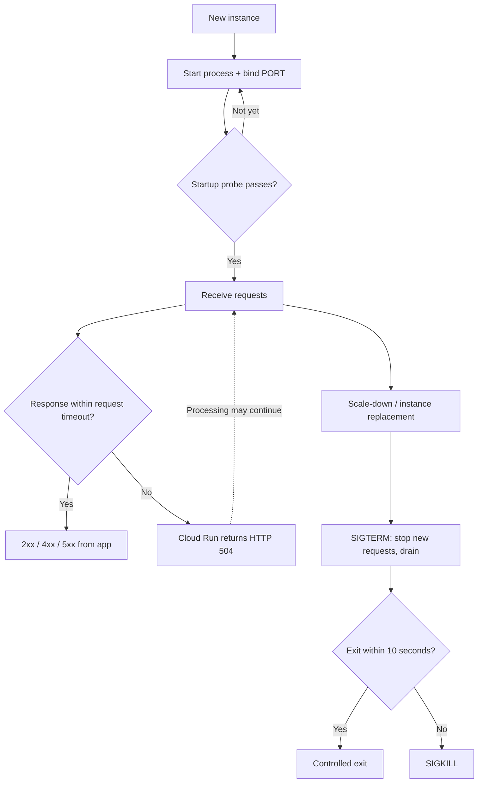
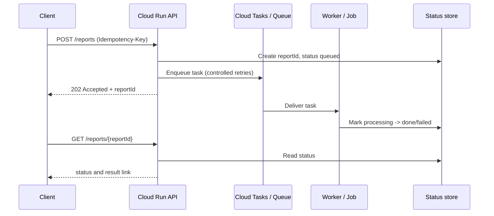

# Request Timeout, Startup Probe, and Graceful Shutdown

An API running on **Cloud Run** can encounter three very different situations: a request takes too long to process, an instance receives traffic before initialization completes, or a container is terminated while work is still in flight. All three affect reliability, yet **cannot be solved by the same timeout**.

This lesson belongs to the **Cloud Run** chapter of the `CLOUD_PROVIDERS_GCP` module, part of the Google Cloud track from projects, IAM, and VPCs to Compute Engine, GKE, Cloud Run, storage, databases, and SLO/cost-driven operations. It focuses on configuring and verifying **request timeouts**, **startup probes**, and **graceful shutdown** for **Cloud Run services** (services handling HTTP requests), without confusing them with Cloud Run Jobs task timeouts.

## 1. Objectives and Real-World Scenario

After this lesson, you can:

1. Distinguish request duration limits, startup health checking, and instance termination windows.
2. Explain why **HTTP 504 does not mean the container was terminated**.
3. Choose TCP, HTTP, or gRPC startup probes; avoid reporting Ready merely because a port opened.
4. Catch `SIGTERM`, stop accepting new requests, drain in-flight requests within a bounded deadline, and exit before `SIGKILL`.
5. Deploy a sample Go application on Cloud Run, verifying responses, logs, and all three lifecycle mechanisms.
6. Apply deadlines, retries, idempotency, observability, and approaches for long-running work.

**Running scenario:** An API responds quickly on `/`, simulates 6 seconds of data initialization, and exposes `/work` taking up to 20 seconds. We configure a **5-second** request timeout to observe HTTP 504, set up an **HTTP startup probe** to wait until the app is genuinely ready, and use a `SIGTERM` handler to shut down within **8 seconds**—shorter than Cloud Run's grace period.

## 2. Three Mechanisms Solving Three Different Problems

| Mechanism | Starting point | Key behavior | Value or limit to remember |
| --- | --- | --- | --- |
| **Request timeout** | When Cloud Run processes an HTTP request | On expiry: closes connection, returns **HTTP 504**; process may keep running | Default **300 s**, max **3600 s** |
| **Startup probe** | When a container instance starts | Until it passes, the ingress container is not marked ready; exceeding failure threshold stops it | Defaults to TCP probe; configure HTTP/gRPC when logic checks are needed |
| **Graceful shutdown** | When Cloud Run decides to stop an instance | Sends **SIGTERM**, then **SIGKILL** if still running | Roughly **10 s** to clean up |



**Note:** HTTP 504, startup failures, and SIGTERM are not three mandatory stages of a request. The diagram depicts distinct branches in an instance's lifecycle. A healthy container can serve thousands of requests without hitting these failure branches.

## 3. Request Timeout: A Connection Deadline, Not Process Lifetime

Cloud Run services default to **5 minutes (300 seconds)** per request and can be configured up to **60 minutes (3600 seconds)**. If the backend has not returned a response before the deadline, Cloud Run returns **HTTP 504 Gateway Timeout** and closes the client connection. **The instance is not automatically killed just because a request timed out**: code may keep executing even after the client gave up.

Example:

```text
Client        Cloud Run           Container
  |  GET /work                  |
  |------------>|  /work         |
  |             |--------------->|
  |     ... after 5 seconds ...  |  still processing?
  |<--- 504 -----|               |
  |             |               |  may still write data
```

Real-world consequence: the client retries an order creation request while the first attempt still commits to the database → **duplicate transactions** without idempotency.

### 3.1. Choosing Timeouts from SLOs and Upstream Limits

- **Short synchronous APIs:** set timeout slightly above reasonable processing time, aligned with client/LB timeouts and SLOs.
- **Streaming, long-polling, WebSockets:** still subject to the request timeout; implement reconnects and state management.
- **Requests longer than 15 minutes:** Google Cloud recommends **retry and reconnect-safe behavior**; do not rely on a single TCP connection staying alive the entire time.
- **Long or once-only tasks:** prefer **Cloud Tasks, Cloud Run Jobs, Workflows, or worker pools** depending on the workload; return `202 Accepted` and a tracking ID when appropriate.

Setting request timeout to **3600 s** does not give the startup probe 3600 s, nor does it extend the SIGTERM grace period from 10 s to 3600 s.

### 3.2. Application-Layer Deadlines

In addition to Cloud Run configuration, you should:

1. Set internal deadlines shorter than the request timeout, leaving buffer to return a response or roll back.
2. Enforce timeouts on database/HTTP clients and **propagate cancellation/deadlines** where supported by the framework.
3. Use an **Idempotency-Key** for order/payment operations that might be retried.
4. Avoid running critical work after already sending the response; CPU and instance lifecycle may change.
5. Log request IDs, elapsed time, and cancellation reasons; never log tokens or sensitive data.

Never assume `context canceled` or connection closed is automatically propagated into every library or background goroutine. Test cancellation across your app's HTTP framework and downstream dependencies.

## 4. Startup Probe: Checking "Ready to Serve?" Not Just "Port Open?"

Cloud Run services include a **default TCP startup probe**, typically configured as:

```yaml
startupProbe:
  timeoutSeconds: 240
  periodSeconds: 240
  failureThreshold: 1
```

A TCP probe only verifies **a TCP connection can open** to the port; it does not verify that database connections, schema migrations, config loading, or model loading have finished.

| Probe | How it passes | When to use |
| --- | --- | --- |
| **TCP** | Socket connection succeeds | App is ready as soon as its listener opens |
| **HTTP** | HTTP GET to path returns **2xx or 3xx** | Want to verify application initialization |
| **gRPC** | gRPC Health Checking protocol succeeds | gRPC apps exposing a standard health service |

When configuring an HTTP startup probe, return `503` **before initialization finishes**, and `204`/`200` **once genuinely ready**. Cloud Run can begin sending requests **immediately after the startup probe passes**, prior to any first readiness probe, so the startup probe **must reflect true readiness to serve** rather than unconditionally returning 200.

Parameters:

- `initialDelaySeconds`: delay before the first check.
- `periodSeconds`: interval between checks.
- `timeoutSeconds`: wait time for **each** check; cannot exceed period.
- `failureThreshold`: number of consecutive failures before the container is stopped.

Startup probe budget is roughly `failureThreshold × periodSeconds`, with a typical configuration limit of **600 s** (GPUs have separate limits). At the same time, **Cloud Run services require the ingress container to start listening for requests within 4 minutes**; never treat a larger probe budget as license to delay binding the port indefinitely.

### 4.1. Startup vs. Readiness and Liveness

- **Startup:** has initialization completed so the container can receive requests?
- **Readiness:** should this instance currently receive **new requests**? A failing readiness probe stops routing new requests without killing the instance.
- **Liveness:** is the process wedged/broken and in need of a restart? Cloud Run can **SIGKILL** a container after consecutive liveness failures; in-flight requests may receive **503**.

Do not wire liveness to a heavy database query, because a transient dependency outage can trigger a restart storm. On Cloud Run, a solid startup probe must ensure the instance is ready to handle traffic the moment it passes.

## 5. Graceful Shutdown: Handling SIGTERM Within 10 Seconds

When Cloud Run scales in, replaces a revision, or stops an instance, the platform generally tries to let in-flight requests finish while routing new requests to other instances. When starting shutdown, Cloud Run sends **SIGTERM** to containers, granting a **10-second window** before sending **SIGKILL** if the process has not exited. During that window CPU is allocated and billed.

In the **first-generation execution environment**, containers not handling `SIGTERM` can be stopped immediately. In **second-generation**, Google Cloud likewise recommends installing a signal handler so the app detects shutdown and cleans up. Never assume scale-in always waits for arbitrary long requests to finish: under certain conditions, `SIGTERM` can arrive while requests are still running.

**Minimum handler flow:**

1. Catch `SIGTERM` in the **main process / PID 1**.
2. Mark the app not ready and stop accepting new requests.
3. Let in-flight requests finish within an **internal deadline shorter than 10 seconds**, e.g., 8 seconds.
4. Flush bounded logs/buffers, close connections, stop background goroutines, and exit.
5. If the deadline expires, accept canceling remaining work; **do not extend cleanup indefinitely**.

**Never** call `sleep 10` inside a signal handler before starting cleanup: the entire shutdown budget is only 10 seconds. An app launched via a shell as PID 1 also needs `exec` so signals forward properly to the server process.

## 6. Go Example: One Service Demonstrating All Three Mechanisms

This example uses the **Go standard library** with no external dependencies. In a lab directory **separate from the documentation repository**, create `go.mod`, `main.go`, and `Dockerfile`.

### 6.1. `go.mod`

```go
module example.com/cloud-run-lifecycle-lab

go 1.26
```

### 6.2. `main.go`

```go
package main

import (
    "context"
    "errors"
    "fmt"
    "log"
    "net/http"
    "os"
    "os/signal"
    "strconv"
    "sync/atomic"
    "syscall"
    "time"
)

func main() {
    port := os.Getenv("PORT")
    if port == "" {
        port = "8080"
    }

    initSeconds := 6
    if raw := os.Getenv("INIT_SECONDS"); raw != "" {
        if n, err := strconv.Atoi(raw); err == nil && n >= 0 && n <= 120 {
            initSeconds = n
        }
    }

    var ready atomic.Bool
    go func() {
        time.Sleep(time.Duration(initSeconds) * time.Second)
        ready.Store(true)
        log.Println("startup complete")
    }()

    mux := http.NewServeMux()
    mux.HandleFunc("/startup", func(w http.ResponseWriter, r *http.Request) {
        if !ready.Load() {
            http.Error(w, "initializing", http.StatusServiceUnavailable)
            return
        }
        w.WriteHeader(http.StatusNoContent)
    })
    mux.HandleFunc("/", func(w http.ResponseWriter, r *http.Request) {
        fmt.Fprintln(w, "cloud-run-lifecycle-demo: ready")
    })
    mux.HandleFunc("/work", func(w http.ResponseWriter, r *http.Request) {
        seconds := 1
        if raw := r.URL.Query().Get("seconds"); raw != "" {
            n, err := strconv.Atoi(raw)
            if err != nil || n < 0 || n > 20 {
                http.Error(w, "seconds must be 0..20", 400)
                return
            }
            seconds = n
        }
        timer := time.NewTimer(time.Duration(seconds) * time.Second)
        defer timer.Stop()

        select {
        case <-timer.C:
            log.Printf("work completed, seconds=%d", seconds)
            fmt.Fprintf(w, "completed after %d seconds\n", seconds)
        case <-r.Context().Done():
            log.Println("request context canceled")
        }
    })

    server := &http.Server{
        Addr:              ":" + port,
        Handler:           mux,
        ReadHeaderTimeout: 5 * time.Second,
    }
    go func() {
        err := server.ListenAndServe()
        if err != nil && !errors.Is(err, http.ErrServerClosed) {
            log.Fatalf("server failed: %v", err)
        }
    }()

    ctx, stop := signal.NotifyContext(
        context.Background(), syscall.SIGTERM, syscall.SIGINT,
    )
    defer stop()
    <-ctx.Done()

    log.Println("SIGTERM/SIGINT: draining requests")
    ready.Store(false)
    shutdownCtx, cancel := context.WithTimeout(
        context.Background(), 8*time.Second,
    )
    defer cancel()
    if err := server.Shutdown(shutdownCtx); err != nil {
        log.Printf("graceful shutdown deadline reached: %v", err)
        _ = server.Close()
    }
    log.Println("server stopped")
}
```

Key details to note:

- `/startup` returns **503 for the first 6 seconds**, then returns **204**; the HTTP startup probe knows when the app is ready.
- `/work?seconds=8` lets you observe the effect of a **5-second** request timeout.
- Upon receiving `SIGTERM`, Go's `http.Server.Shutdown` stops accepting new connections and waits for in-flight requests; the **8-second** internal timeout leaves margin before SIGKILL.
- `r.Context().Done()` lets the app react to cancellation **if cancellation propagates**. Cloud Run returning 504 does not guarantee every internal task cancels immediately.
- This is a simulated service and does not perform real critical data transactions. Production services must add auth, tracing, structured logging, idempotency, and downstream deadlines.

### 6.3. `Dockerfile`

```dockerfile
FROM golang:1.26-alpine AS build
WORKDIR /src
COPY go.mod main.go ./
RUN CGO_ENABLED=0 GOOS=linux GOARCH=amd64 \
    go build -trimpath -o /server ./main.go

FROM gcr.io/distroless/static-debian12:nonroot
COPY --from=build /server /server
ENV PORT=8080
EXPOSE 8080
ENTRYPOINT ["/server"]
```

The final image contains only a Linux `amd64` binary and runs non-root, satisfying the Cloud Run runtime contract. For production deployments, pin base images by digest, scan for vulnerabilities, and ensure the builder/toolchain stays maintained. Never embed secrets in a Dockerfile.

## 7. Local Testing Before Deployment

If Docker is available, use two terminals. These commands **modify only local resources**:

```bash
docker build -t cloud-run-lifecycle:lab .
docker run --name cr-lifecycle-lab \
  -e INIT_SECONDS=6 \
  -p 8080:8080 \
  cloud-run-lifecycle:lab
```

In another terminal:

```bash
# During the 6-second init: 503; afterward: 204.
curl -i http://127.0.0.1:8080/startup

# Wait for initialization to complete, then run:
curl -i http://127.0.0.1:8080/work?seconds=2
```

**Simulating SIGTERM:**

```bash
# While the container is running (omit --rm so logs stay inspectable).
docker stop --time=10 cr-lifecycle-lab
docker logs cr-lifecycle-lab
docker rm cr-lifecycle-lab
```

Expect logs `SIGTERM/SIGINT: draining requests` and `server stopped`. To observe in-flight request draining, call `/work?seconds=4` and immediately stop the container; the request can finish within the grace period. For requests longer than 8 seconds, the demo server closes connections once the shutdown deadline expires. Local testing **does not prove** Cloud Run always dispatches signals and traffic identically to Docker.

## 8. Cloud Run Preflight and Deployment Permissions

Use a **dedicated lab project with billing**, adequate Cloud Run/Cloud Build/Artifact Registry permissions, and Cloud Shell or the Google Cloud CLI. Deploying with `--source` can create billable build/image/source staging artifacts. Never deploy a demo with a sleep endpoint to an unrestricted public URL.

```bash
PROJECT_ID="YOUR_LAB_PROJECT_ID"
REGION="asia-southeast1"
SERVICE="cloudrun-lifecycle-lab"

gcloud --version
gcloud auth list
gcloud projects describe "$PROJECT_ID" \
  --format="yaml(projectId,lifecycleState)"

# Read-only: check for conflicting service names before creating.
gcloud run services list \
  --project="$PROJECT_ID" --region="$REGION"

# Read-only: enabled APIs.
gcloud services list \
  --project="$PROJECT_ID" --enabled \
  --format="value(config.name)"
```

Do not proceed if `PROJECT_ID` is still a placeholder, `SERVICE` collides with another team's resource, APIs/permissions are missing, or the project is unauthorized. The deployer needs Cloud Run roles, build permissions, and permission to act as the service account per policy; **never escalate to Editor/Owner** to bypass IAM.

## 9. Sample Deploy with 5-Second Timeout and HTTP Startup Probe

After preflight checks pass, inside the directory containing `Dockerfile`, `go.mod`, and `main.go`, run the **write command creating the Cloud Run service and artifacts**:

```bash
gcloud run deploy "$SERVICE" \
  --project="$PROJECT_ID" \
  --region="$REGION" \
  --source=. \
  --port=8080 \
  --timeout=5s \
  --startup-probe="httpGet.path=/startup,httpGet.port=8080,initialDelaySeconds=0,periodSeconds=2,timeoutSeconds=1,failureThreshold=15" \
  --set-env-vars="INIT_SECONDS=6" \
  --concurrency=10 \
  --min-instances=0 \
  --max-instances=2 \
  --no-allow-unauthenticated
```

In this example:

- **Request timeout = 5 s** for testing; in production pick based on SLOs and upstream timeouts.
- Startup probe GETs `/startup` every **2 s**, with **1 s** timeout per check and up to **15 failures**, giving roughly a **30 s** budget.
- The app opens its port early, but startup only passes after 6 s when initialization finishes.
- The service is **private**; only principals with the Cloud Run Invoker role can call it.
- `concurrency=10` and `max-instances=2` bound load testing, though they do not impose a hard cap on total charges.

**A successful deploy message** does not yet prove the startup probe and responses are healthy. Inspect the revision and real requests:

```bash
gcloud run services describe "$SERVICE" \
  --project="$PROJECT_ID" \
  --region="$REGION" \
  --format="yaml(metadata.name,status.url,status.latestReadyRevisionName,spec.template)"

gcloud run revisions list \
  --project="$PROJECT_ID" \
  --region="$REGION" \
  --service="$SERVICE"
```

If your organization disallows creating private services by default, or deployment is blocked by build/repo policies, work with an administrator; never enable public ingress or disable security policies just to "get the lab working."

## 10. Verifying HTTP 200/504 and Startup

The tester must hold `roles/run.invoker` on the lab service. With `gcloud auth` properly logged in:

```bash
RUN_URL="$(gcloud run services describe "$SERVICE" \
  --project="$PROJECT_ID" --region="$REGION" \
  --format='value(status.url)')"

# Normal request: faster than timeout.
curl -i -sS \
  -H "Authorization: Bearer $(gcloud auth print-identity-token)" \
  "$RUN_URL/work?seconds=2"

# Request longer than 5 seconds: expect Cloud Run HTTP 504.
curl -i -sS \
  -H "Authorization: Bearer $(gcloud auth print-identity-token)" \
  "$RUN_URL/work?seconds=8"
```

Depending on network/client and cancellation propagation, the demo handler may continue up to 8 s or exit early when the request context cancels. The **invariant to verify** is that the client receives **504 near the 5 s mark**, and application code never relies on timeouts to automatically roll back side effects.

**You do not need to call `/startup` from the Internet during the exact first 6 seconds to prove the probe:** Cloud Run only places an instance into serving state after the probe passes; if the service scaled to zero and cold-starts, requests may queue while startup runs. Inspect logs to confirm `startup complete` and revision readiness rather than expecting a client to observe a stream of 503s.

| Check | Expected |
| --- | --- |
| `/work?seconds=2` | HTTP 200, body reports completion |
| `/work?seconds=8` | HTTP 504 near the 5-second mark |
| Revision | Ready, container passed startup probe |
| Logs | Shows startup, request handling, and possibly cancellation |
| Policy | Private service; only authorized principals can invoke |

### 10.1. Read Back Timeout/Probe Configuration

```bash
gcloud run services describe "$SERVICE" \
  --project="$PROJECT_ID" --region="$REGION" \
  --format="yaml(spec.template.spec.timeoutSeconds,spec.template.spec.containers,status.latestReadyRevisionName)"
```

Look for `timeoutSeconds: 5` and `startupProbe` with the intended HTTP path, period, and threshold. Changing timeout or probes creates a **new revision**; read back the revision and run smoke tests rather than trusting an "update succeeded" message alone.

## 11. Monitoring Requests, Startup, and Shutdown

### 11.1. Cloud Logging

Read recent entries filtered to the exact service:

```bash
gcloud logging read \
  "resource.type=\"cloud_run_revision\" AND resource.labels.service_name=\"$SERVICE\"" \
  --project="$PROJECT_ID" \
  --limit=50 \
  --format="table(timestamp,severity,httpRequest.status,textPayload)"
```

When filtering for HTTP 504:

```bash
gcloud logging read \
  "resource.type=\"cloud_run_revision\" AND resource.labels.service_name=\"$SERVICE\" AND httpRequest.status=504" \
  --project="$PROJECT_ID" \
  --limit=20
```

In Cloud Logging, request logs and container logs may appear as **separate entries** rather than one combined line; correlate by timestamp, trace/request ID, and revision. Startup probe failures or SIGTERM do not guarantee identical messages across all runtimes—clear application logging aids diagnosis.

### 11.2. Operational Signals

| Signal | What it is used for |
| --- | --- |
| Request duration, 504 rate | Detect timeouts and slow dependencies |
| p50/p95/p99 latency | Compare against SLOs instead of looking only at the timeout cap |
| Startup latency, instance count | Measure cold starts and startup probe effectiveness |
| Container start failures/restarts | Distinguish init bugs, port-binding failures, and OOMs |
| 5xx/503 and liveness failures | Detect hung/unhealthy instances and forced restarts |
| SIGTERM/drain logs | Verify the app exits within the grace window |
| CPU/memory/concurrency | Spot overload, slow processing, or OOMs |
| Cost by SKU | Track instance time, requests, builds, images, and logging |

If 504 rates rise, **do not immediately increase the timeout**: inspect database queries, thread pools, downstream deadlines, concurrency, and traffic bursts. Longer waits can cause clients to time out first, hold resources longer, and mask bottlenecks.

## 12. Controlled Configuration Changes

Cloud Run lets you update the request timeout:

```bash
# HAS IMPACT: creates a new revision; run only after approval.
gcloud run services update "$SERVICE" \
  --project="$PROJECT_ID" \
  --region="$REGION" \
  --timeout=30s
```

To update the startup probe, modify probe settings on a **new revision** via Console, `gcloud run deploy --startup-probe`, or the corresponding YAML/Terraform definition. An overly strict probe can cause every new instance to fail startup; roll out as a **canary** and test cold starts before shifting all traffic.

### 12.1. Choosing Values Based on Real Conditions

| Service profile | Configuration direction |
| --- | --- |
| Fast data-read API | Short timeout matching SLO; even shorter dependency deadlines |
| Slow-starting Java/Spring Boot | HTTP startup probe checking true readiness; evaluate min instances / startup CPU boost and optimize init |
| Heavy synchronous API | Consider offloading long tasks to async jobs, returning status/job IDs |
| System with multiple downstreams | Propagate deadlines/cancellation, bounded retries, idempotency |
| App with in-flight jobs | Short shutdown drain, job checkpoints/durable queues; do not rely on the 10-second window |
| Streaming/WebSocket | Reconnect logic, offset/resume support, appropriate timeout |

Under **request-based billing**, CPU outside active request processing can be throttled; never use a "fire-and-forget" goroutine after sending an HTTP response for critical business logic. **Instance-based billing** allocates CPU for the instance's lifetime yet does not prevent scale-down or SIGTERM; work requiring completion guarantees must use a queue/job system built for it.

## 13. Troubleshooting by Symptom

| Symptom | Common cause | Check |
| --- | --- | --- |
| HTTP **504** after 5 s | Request exceeded `--timeout`, slow downstream | Request latency, handler traces, DB timeouts |
| HTTP **503** during init | Startup probe not passing yet or instance unready | `/startup`, revision logs, probe config |
| TCP probe passes but app errors | Listener opened before init finished | Use HTTP startup probe checking real readiness |
| Revision not Ready | Not binding `0.0.0.0:$PORT`, startup crash, wrong probe path/port | Container logs, PORT, `startupProbe` |
| Repeated instance restarts | Overly sensitive liveness check, crash/OOM | Liveness logs, memory limit, health endpoint |
| SIGTERM missing from logs | Server ignores signals or shell runs as PID 1 | Docker ENTRYPOINT, signal forwarding |
| Requests cut off on scale-down | Cleanup takes longer than 10 s or long in-flight work | Shutdown logs, graceful deadline, retries |
| Duplicate transactions created | 504 followed by client retry while first call committed | Idempotency key, DB transactions/audits |
| Raised timeout yet p99 stays bad | CPU/concurrency/database bottleneck | CPU, queue wait, tracing, load tests |
| Cannot call private service | Missing Invoker/identity token, ingress policy | IAM principal, token, service URL |
| Works in local Docker, fails on Cloud Run | Build architecture, port, resource/runtime contract | Image, PORT, revision logs |
| Data lost after shutdown | Written to container filesystem or undurable background task | Cloud Storage/database/queue, flush/commit |

**Distinguishing errors:** request timeouts typically produce **504**; container OOMs can produce **500**; liveness failures often kill the instance and in-flight requests may see **503**. Error codes can also come from the app or upstreams, so always correlate with logs.

## 14. Design Example: 20-Minute Report Generation API

Suppose `POST /reports` takes 20 minutes. Setting `--timeout=1800s` is **within product limits**, yet client/LB timeouts, network drops, and retries leave users unsure whether the job succeeded.

A more reliable design:



Key point: **short synchronous request**, durably persisted job, **idempotent** execution, checkpoints/retries, and independent status tracking. Cloud Tasks/Jobs also have their own timeouts, retries, and at-least-once semantics; design so duplicate deliveries do not corrupt data.

## 15. Self-Check Exercises

### Exercise 1 — Does a Cloud Run Timeout Kill the Process?

A Cloud Run service has `--timeout=10s`; the app takes 15 s to process a request. The client receives 504 after 10 s. Can you conclude the database rolled back?

**Answer:** No. Cloud Run closes the connection while the container may continue processing. You need application-level deadlines/cancellation and proper transactions/idempotency.

### Exercise 2 — Choosing a Startup Probe

An app opens its port in 1 second but needs another 40 seconds to load a model. The TCP probe passes immediately. What should you do?

**Answer:** Use an **HTTP startup probe** returning 503 until the model is truly ready; size the probe budget appropriately while still meeting Cloud Run's port-listening contract.

### Exercise 3 — Understanding Probe Parameters

An HTTP startup probe has `periodSeconds=3` and `failureThreshold=10`, with each check timing out at 1 s. What is the approximate startup budget?

**Answer:** **30 seconds** from period × threshold (also affected by initial delay and scheduling timing). Do not confuse this with request timeout.

### Exercise 4 — SIGTERM with In-Flight Requests

A container receives SIGTERM, yet its handler waits 25 seconds before exiting. Will Cloud Run wait the full 25 seconds?

**Answer:** No. Cloud Run grants roughly **10 seconds** before SIGKILL; drain within that budget and use retries/checkpoints for long work.

### Exercise 5 — Distinguishing Startup and Liveness

A startup probe passes, but a transient database outage causes liveness to return 500. What happens?

**Answer:** Repeated liveness failures can **kill/restart** the instance, triggering a restart loop until the database recovers. Health checks must distinguish a wedged process from transient dependency failures.

### Exercise 6 — Longer Than 15 Minutes

A 25-minute streaming request can configure a 30-minute timeout—does it still need reconnect logic?

**Answer:** Yes. Cloud Run recommends reconnect/retry-safe behavior for long requests; networks, clients, or load balancers can disconnect before the service timeout.

### Exercise 7 — Request Returns 200 Before Task Finishes

An endpoint returns 200 and launches a background goroutine updating a database for 2 minutes on a request-based billing instance.

**Answer:** Unreliable: after the response, CPU can be throttled and the instance may scale down. Use a stateful queue/job with retries and idempotency.

### Exercise 8 — Private Service Returns 403

The Cloud Run revision is Ready and `/startup` passes, yet `curl "$RUN_URL/"` from the learner's machine gets 403.

**Answer:** Likely the service uses `--no-allow-unauthenticated`; verify Invoker IAM, identity token, audience, and ingress. Do not change the startup probe or open public access to work around auth errors.

## 16. Operational Checklist

- [ ] Distinguish **request timeout**, **startup probe**, and **10 s SIGTERM shutdown**.
- [ ] Request timeout aligns with SLOs/clients/LBs rather than defaulting to 60 minutes just because it is allowed.
- [ ] Downstream calls have deadlines shorter than the Cloud Run request timeout and are instrumented.
- [ ] Retriable operations use idempotency keys to limit duplicate side effects.
- [ ] HTTP startup passes **only after the app is ready**, with port bound to `0.0.0.0:$PORT`.
- [ ] Startup probe period/timeout/threshold are valid, fitting the startup budget and product limits.
- [ ] Liveness does not depend on a fragile external service; readiness reflects ability to serve traffic.
- [ ] PID 1 receives `SIGTERM`; graceful shutdown completes in **under 10 s**.
- [ ] Durable data is persisted to DB/Cloud Storage/queues, never only container memory or filesystem.
- [ ] Tested cold starts, timeout breaches, local SIGTERM, and logs.
- [ ] Metrics cover 504/503/5xx, p95/p99, startup latency, instance count, and CPU/memory.
- [ ] Service stays private unless public access is required; Invoker granted only to the right principals.
- [ ] Runbooks cover retries, alerts, canary/rollback, and lab cleanup.

## 17. Lab Cleanup and Cost Notes

If the service was created strictly for this lab and has no active clients, inspect it before deleting:

```bash
gcloud run services describe "$SERVICE" \
  --project="$PROJECT_ID" --region="$REGION"

gcloud run revisions list \
  --project="$PROJECT_ID" --region="$REGION" \
  --service="$SERVICE"
```

Once approved, delete **only the lab service**:

```bash
# DESTRUCTIVE: deletes the service and its revisions.
gcloud run services delete "$SERVICE" \
  --project="$PROJECT_ID" --region="$REGION"
```

**Do not delete the project**, shared Artifact Registry repositories, or shared Cloud Build staging buckets. Source deployments may have created images, artifacts, and logs with separate retention and costs; check project Billing, Artifact Registry, and Cloud Logging within your granted permissions. For fast rollbacks, keep verified image digests/revisions for the required window before cleanup.

**Related costs:** Cloud Run CPU/memory per billing mode and requests, instance startup/shutdown, minimum instances if configured, Artifact Registry image storage, Cloud Build, and log ingestion. Long request timeouts or high concurrency can hold resources longer; configure budget alerts, without treating alerts as hard spend caps.

## 18. Official Google Cloud Documentation

- [Configure request timeout for Cloud Run services](https://cloud.google.com/run/docs/configuring/request-timeout): 300 s default, 3600 s max, HTTP 504, and continued request execution.
- [Configure container health checks](https://cloud.google.com/run/docs/configuring/healthchecks): startup/liveness/readiness; TCP, HTTP, gRPC; probe budgets and `gcloud` examples.
- [Container runtime contract](https://cloud.google.com/run/docs/container-contract): ports, startup deadlines, SIGTERM/SIGKILL, container lifecycle.
- [Handle SIGTERM signals](https://cloud.google.com/run/docs/samples/cloudrun-sigterm-handler): shutdown signal handling samples.
- [Configure concurrency](https://cloud.google.com/run/docs/configuring/concurrency): concurrent requests per instance.
- [Configure instance billing settings](https://cloud.google.com/run/docs/configuring/billing-settings): CPU allocation and out-of-request work.
- [Optimize Cloud Run instances](https://cloud.google.com/run/docs/tips/general): startup performance and operations.
- [Cloud Run service authentication](https://cloud.google.com/run/docs/authenticating/overview): authenticating private service calls.
- [Cloud Run pricing](https://cloud.google.com/run/pricing): CPU/memory/request rates and billable components.

**Conclusion:** request timeout bounds how long clients wait for a response, startup probes block traffic to unready instances, and graceful shutdown bounds cleanup time before container termination. A reliable Cloud Run service configures **all three properly**, enforces deadlines/idempotency for side effects, offloads long tasks to durable systems, and validates behavior via logs and SLOs rather than deployment status alone.
