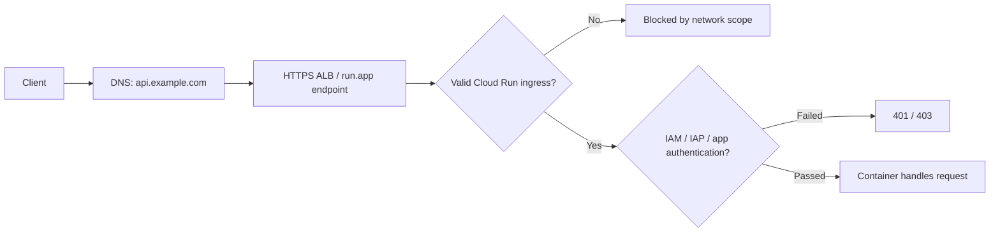
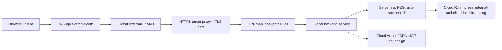

# Ingress, Custom Domains, and Load Balancer Integration

> **Chapter:** Cloud Run  
> **Module:** CLOUD_PROVIDERS_GCP  
> **Module Scope:** Explore Google Cloud from project organization, IAM, and VPC to Compute Engine, GKE, Cloud Run, storage services, and databases. Through deployment scenarios, learners know how to select services, protect resources, automate releases, and monitor reliability and cost.

Cloud Run automatically provisions an HTTPS URL of the form `*.run.app` for each service, yet enterprises commonly need `api.example.com`, TLS for their own domain, `/api/*` routing, Cloud Armor protection, or internal-only access. These requirements belong to **the incoming request path (ingress)**, **service invocation permissions**, and the **frontend layer**, rather than Dockerfile changes.

This lesson progresses from Cloud Run ingress and IAM to custom domains and **Application Load Balancer (ALB) + serverless network endpoint groups (NEGs)**. Hands-on sections cover read-only inventory, changing ingress on a sandbox service, and an **optional** lab creating an HTTPS ALB with an owned domain. Never apply network, DNS, or public-access changes in production just to test a command.

## Objectives

After this lesson, you can:

1. Distinguish `all`, `internal`, `internal-and-cloud-load-balancing`, and the `roles/run.invoker` permission.
2. Compare `run.app` URLs, **Cloud Run domain mapping**, Firebase Hosting, and **global external Application Load Balancer**.
3. Explain the flow `client → DNS → ALB → URL map → backend service → serverless NEG → Cloud Run`.
4. Design HTTPS, custom domains, Cloud Armor, Cloud CDN, and IAP without leaving bypass paths open.
5. Check DNS/TLS/HTTP status, diagnose `403`/`404`/`502`/`503` errors, and build a safe rollout procedure.
6. Use the Console/`gcloud` to test-deploy, verify, and clean up only the resources created by the lab.

## 1. Three Layers Deciding Whether a Request Reaches the App

A request to Cloud Run can be blocked at multiple layers:



- **Ingress:** determines **which network sources/paths** are permitted to reach the service. This is a network control.
- **Authentication/authorization:** verifies **who the caller is** and whether they are permitted to invoke the service. With Cloud Run, this may use IAM Invoker or IAP and application-layer authentication depending on architecture.
- **Frontend routing:** URLs, domain names, TLS certificates, ALB host/path rules, Cloud Armor/CDN. A path allowed through the network is not necessarily authorized by IAM.

**Do not equate them:** `--ingress=all` **does not automatically grant** `allUsers` permission to invoke; conversely, granting `allUsers` Invoker **does not expose** a service blocking the Internet via `--ingress=internal`.

## 2. Three Ingress Levels in Cloud Run

| `gcloud --ingress` | Permitted request sources | Common scenarios |
|---|---|---|
| `all` | All network sources, including Internet direct access to `run.app` URL if enabled; IAM still applies | Public APIs or services authenticated via IAM/app |
| `internal` | Internal sources recognized by Cloud Run: certain VPC/Shared VPC paths, internal ALB, Google Cloud products/within VPC-SC per conditions | Internal services, backends that must not receive direct Internet traffic |
| `internal-and-cloud-load-balancing` | Same sources as `internal` **plus external Application Load Balancer** | Public websites/APIs **fronted strictly by ALB** to enforce Cloud Armor/CDN/IAP |

**Important point:** "internal" is not simply "an IP in `10.0.0.0/8`." Cloud Run determines internal sources by product/VPC rules; requests from on-premises via VPN/Interconnect or from other services carry specific conditions. Never treat a private IP or private DNS as proof a request will automatically be accepted.

### 2.1. Ingress Selection Examples

- An API called directly by mobile apps via `run.app`, validating JWTs in the app: typically uses `all` with appropriate IAM/app-layer protection.
- An internal web app served strictly via an **internal Application Load Balancer**: `internal`.
- A public web app that must always traverse a **global external ALB** for Cloud Armor enforcement: `internal-and-cloud-load-balancing`.

**Ingress governs traffic entering Cloud Run**, distinct from container **egress** to Cloud SQL, private VPCs, or the Internet. Direct VPC egress and Cloud NAT do not alter `--ingress`.

### 2.2. Inventory and Modifying Ingress

Commands run in Cloud Shell/Bash; service/region names are illustrative. Read-only commands can be run on resources you have permission to inspect:

```bash
PROJECT_ID="my-cloudrun-network-lab"
REGION="asia-southeast1"
SERVICE="ingress-demo"

gcloud auth list --filter="status:ACTIVE"
gcloud run services list --project="$PROJECT_ID" --region="$REGION"
gcloud run services describe "$SERVICE" \
  --project="$PROJECT_ID" --region="$REGION" \
  --format="yaml(metadata.name,metadata.annotations,status.url,spec.template)"
gcloud run services get-iam-policy "$SERVICE" \
  --project="$PROJECT_ID" --region="$REGION"
```

**Strictly on a sandbox service you control**, after recording the initial state:

```bash
# Block direct Internet requests, while allowing external ALB:
gcloud run services update "$SERVICE" \
  --project="$PROJECT_ID" --region="$REGION" \
  --ingress=internal-and-cloud-load-balancing

# Another example for a service with internal-only callers:
# gcloud run services update "$SERVICE" \
#   --project="$PROJECT_ID" --region="$REGION" --ingress=internal
```

Changing ingress can **immediately cut off live traffic**, including triggers, webhooks, or IAM-authorized clients arriving over the Internet. Without an ALB already configured, `internal-and-cloud-load-balancing` will block direct `run.app` calls from a personal laptop outside the internal network. Never apply this in production before an alternative path and rollback plan are in place.

## 3. Default `run.app` URL and Bypass Risks

A Cloud Run service normally has a default HTTPS URL like `https://SERVICE-HASH-REGION.a.run.app` (exact format is platform-generated; **do not construct URLs manually**). Even after setting up `api.example.com`, this default URL may remain reachable.

If Cloud Run remains set to `ingress=all`, users can **call `run.app` directly**, bypassing the ALB and thus **bypassing Cloud Armor/CDN/IAP placed on the ALB**. That is a serious security design flaw when a team assumes all requests pass through the WAF.

**Mitigations:**

1. For public services that must only be accessed via an ALB, set **`--ingress=internal-and-cloud-load-balancing`**.
2. Consider **disabling the default URL** with `--no-default-url` once certain all integrations use the alternate path; this is an extra defense layer, not a replacement for ingress checks.
3. Test both `https://api.example.com` **and** the `run.app` URL from an Internet-connected machine.
4. Audit remaining allowed **internal** sources, because this mode still permits valid internal paths.

### 3.1. Caution When Disabling `run.app`

```bash
# ONLY in lab, AFTER custom domain / ALB is working:
gcloud run services update "$SERVICE" \
  --project="$PROJECT_ID" --region="$REGION" \
  --no-default-url

# Restore default URL if an integration turns out to depend on it:
gcloud run services update "$SERVICE" \
  --project="$PROJECT_ID" --region="$REGION" \
  --default-url
```

Disabling the default URL can break integrations calling `run.app`, such as **Cloud Scheduler, Cloud Tasks, Pub/Sub push, Eventarc, Workflows**, synthetic monitoring, and some Firebase/Cloud Functions integrations. Before enabling it, inventory triggers, callback URLs, and alternate domain support. `--no-default-url` does not prevent the service from being reached via other allowed ingress paths.

## 4. Custom Domains: Which Option to Choose?

| Option | Benefits | Limitations / recommendation |
|---|---|---|
| **Global external Application Load Balancer + serverless NEG** | Stable public IP; HTTPS/TLS, host/path routing, Cloud Armor, CDN, IAP, multiple backends | **Recommended for production**; more resources and LB charges |
| **Direct Cloud Run domain mapping** | Simple domain setup, automatic Google-managed certificates | **Preview/limited availability**, not recommended for production; regional, feature, and latency limits |
| **Firebase Hosting in front of Cloud Run** | Good fit for integrated static web frontend + dynamic routes | Requires proper Firebase Hosting, rewrite, and cache design |
| **Default `run.app`** | No domain ownership or extra LB needed | No vanity domain, ALB host/path policies, or ALB WAF |

Per current Cloud Run documentation, **direct domain mapping remains in Preview** and is not considered production-ready. It does not support path-based routing like `/users`, wildcard certificates, or bring-your-own certificates, and has regional and domain restrictions. For critical applications, choose **global external ALB**.

### 4.1. DNS Does Not Replace TLS or Access Control

An **A** record pointing `api.example.com` to the ALB's IP helps clients locate the frontend. However:

- **DNS:** domain name → address; does not issue certificates or authenticate callers.
- **TLS certificate:** proves domain ownership and encrypts HTTPS; must have valid trust chain and status.
- **Host/path routing:** the ALB's URL map selects the backend based on hostname/path.
- **Cloud Run IAM/app auth/IAP:** decides whether the caller may proceed to the app.

For example, if `api.example.com` points to the right IP yet the certificate is not yet **ACTIVE**, HTTPS still fails. If TLS succeeds yet the Cloud Run backend requires an IAM token that was omitted, the client still gets `403`.

## 5. ALB + Serverless NEG Architecture



**Components to distinguish:**

1. **Global external IP and forwarding rule:** public HTTPS entry point.
2. **HTTPS target proxy + certificate:** terminates TLS at the frontend.
3. **URL map:** selects backends by host/path; can send `/api/*` and `/web/*` to different backends.
4. **Backend service:** configures backend settings, logging, and policies such as Cloud Armor/CDN/IAP.
5. **Serverless NEG:** references a **Cloud Run service or URL mask**; **not** a list of VM IP:ports.
6. **Cloud Run service:** handles app requests; ingress must permit the ALB path, and IAM/app auth still apply.

### 5.1. Serverless NEG Constraints

- A serverless NEG **must be in the same region** as the referenced Cloud Run resource.
- In standard setups, the serverless NEG and Cloud Run backend reside in the **same project**; do not arbitrarily create a NEG in a central project pointing to a service in another project.
- Serverless NEGs **do not configure instance IP:port endpoints** and have distinct health-monitoring limitations compared to VM/GKE backends.
- A backend service can attach multiple serverless NEGs across **different regions** on supported LB types; cross-region distribution and failover must be checked against product conditions.
- With URL masks, a NEG can map multiple Cloud Run services via hostname/path templates, but schemas must be strictly controlled to avoid routing to unintended services.

**Do not assume "the ALB sees green health checks"** for serverless NEGs. On setups without supported **Cloud Run service health** or **outlier detection** configured, the LB may keep forwarding requests to a failing service. Use SLOs, synthetic tests, and Cloud Monitoring to track health.

### 5.2. When Do You Need an Internal Application Load Balancer?

For users strictly inside a VPC or over hybrid connectivity, you can use an **internal Application Load Balancer** and set Cloud Run to `ingress=internal`. The frontend gets a private IP; no global public IP or public DNS is needed. This model still uses serverless NEGs and host/path routing per supported LB type, and adds requirements for subnets, proxy-only subnets, firewall rules, and region/Shared VPC layout.

Do not copy the global **external** ALB commands below verbatim for an internal ALB: resource scopes and network requirements differ.

## 6. IAM, Cloud Armor, Cloud CDN, and IAP

### 6.1. The LB Does Not Log In on Behalf of the Client

If Cloud Run requires IAM Invoker, an external ALB **does not automatically mint a valid ID token** to invoke the service. For a **public website** behind an ALB, requests are typically allowed **without Cloud Run IAM auth** at the backend, **only** when:

1. The service owner has approved public access.
2. Cloud Run ingress is restricted to **`internal-and-cloud-load-balancing`** so Internet callers cannot hit `run.app` directly.
3. App auth, rate limiting, and Cloud Armor are in place as required.

Granting `allUsers` Invoker is a **real permission opening**; never use it to "fix a 403" on an internal service. For apps requiring user authentication, use **IAP** or appropriate application-layer authentication.

### 6.2. Cloud Armor / WAF

A Cloud Armor policy attached to the LB backend service (or an edge policy where supported) filters requests, applies WAF rules, enforces rate limiting, and applies security controls. An LB policy **does not shield** direct paths to `run.app` if ingress remains `all`. Measure both blocked requests and false positives.

### 6.3. Cloud CDN

Cloud CDN caches eligible responses at the edge, reducing latency and backend load. Enable it only for responses with proper caching policies; APIs carrying cookies, tokens, user-specific data, or sensitive fields require careful review of `Cache-Control`, cache keys, and behavior.

### 6.4. Identity-Aware Proxy (IAP)

There are currently **two places to enable IAP**—pick only one:

- **Enable IAP directly on Cloud Run:** per current documentation, preferred for single-service setups, protecting all ingress paths including `run.app` and LB paths without requiring an LB solely for IAP.
- **Enable IAP on the ALB backend service:** fits cases needing centralized LB management, such as certain multi-region architectures. In this mode, the **IAP service agent** needs `roles/run.invoker` on the Cloud Run backend.

**Never enable IAP on both Cloud Run and the ALB.** Additionally, **IAP and Cloud CDN cannot be enabled simultaneously on the same backend service**. Place cacheable public content and IAP-protected private endpoints on separate appropriate backends instead of forcing them onto one.

## 7. Lab A — Testing Ingress Safely

### 7.1. Prerequisites

Assume a **test Cloud Run service** owned by the learner with appropriate project permissions; if none exists yet, you may deploy an official sample image approved by your administrator. This lesson does not require creating a repo or building a new app, avoiding duplication with the basic Cloud Run deployment lesson.

**Run write commands strictly in a sandbox project.** Cloud Run, LBs, reserved IPs, DNS, certificates, and logs can incur charges. Never grant `allUsers` to a service holding sensitive data.

```bash
PROJECT_ID="my-cloudrun-network-lab"
REGION="asia-southeast1"
SERVICE="ingress-demo"

gcloud auth list --filter="status:ACTIVE"
gcloud run services list --project="$PROJECT_ID" --region="$REGION"
gcloud run services describe "$SERVICE" \
  --project="$PROJECT_ID" --region="$REGION" \
  --format="yaml(metadata.name,metadata.annotations,status.url)"
gcloud run services get-iam-policy "$SERVICE" \
  --project="$PROJECT_ID" --region="$REGION"
```

If the service does not exist yet—and only with proper permissions and sandbox budget—you can use the sample image `us-docker.pkg.dev/cloudrun/container/hello` per the quickstart; verify supported image/version at practice time:

```bash
# Skip if the service already exists; creating a new one may incur charges.
gcloud run deploy "$SERVICE" \
  --image=us-docker.pkg.dev/cloudrun/container/hello \
  --project="$PROJECT_ID" --region="$REGION" \
  --ingress=all \
  --no-allow-unauthenticated \
  --max-instances=2
```

For a service requiring authentication, test via **gcloud proxy** or an ID token for a caller holding `roles/run.invoker`. Do not treat a `403` on `run.app` as an ingress failure if the caller has not been granted permission.

### 7.2. Testing Ingress Changes in the Lab

**Before making changes**, record the initial `ingress` value and IAM policy. Then:

```bash
# Strictly on the lab service, after recording the previous state.
gcloud run services update "$SERVICE" \
  --project="$PROJECT_ID" --region="$REGION" \
  --ingress=internal-and-cloud-load-balancing

gcloud run services describe "$SERVICE" \
  --project="$PROJECT_ID" --region="$REGION" \
  --format="yaml(metadata.annotations,status.url)"
```

**Expected from an Internet machine outside the internal network:** the direct `run.app` URL is no longer reachable even with the exact URL. If no ALB is configured yet, the service **has no other permitted Internet path**; this is the expected behavior.

To revert if stopping the lab at this step:

```bash
# ONLY if the ORIGINAL config was 'all'; otherwise restore the actual original value.
gcloud run services update "$SERVICE" \
  --project="$PROJECT_ID" --region="$REGION" \
  --ingress=all
```

## 8. Lab B — HTTPS Custom Domain via External ALB (Optional)

This lab requires **a real domain/subdomain for which you control DNS**, a dedicated project, and approval for a **public HTTPS endpoint**. If you lack a domain or only want to practice concepts, complete the **design exercise in Section 11**—**do not buy a domain ad hoc or modify production DNS**.

### 8.1. Map of Resources to Create

| Lab resource | Example name | Scope |
|---|---|---|
| Cloud Run service | `ingress-demo` | Region `asia-southeast1` |
| Serverless NEG | `ingress-demo-neg` | Same region/project as Cloud Run |
| Backend service | `ingress-demo-backend` | Global |
| URL map | `ingress-demo-map` | Global |
| Managed SSL certificate | `ingress-demo-cert` | Global, for `api.example.com` |
| HTTPS target proxy | `ingress-demo-https-proxy` | Global |
| Forwarding rule | `ingress-demo-fr` | Global, port 443 |
| Reserved IP | `ingress-demo-ip` | Global external IPv4 |

**`api.example.com` is an example only and is not owned by the learner.** Replace it with your own real `DOMAIN`, and never point a real domain's DNS without the owner's approval.

### 8.2. Declare Variables and Inventory

```bash
PROJECT_ID="my-cloudrun-network-lab"
REGION="asia-southeast1"
SERVICE="ingress-demo"
DOMAIN="api.example.com"   # REPLACE with a real domain you own
NEG="ingress-demo-neg"
BACKEND="ingress-demo-backend"
URL_MAP="ingress-demo-map"
CERT="ingress-demo-cert"
PROXY="ingress-demo-https-proxy"
FR="ingress-demo-fr"
IP_NAME="ingress-demo-ip"

# Read-only: verify service and existing resource names before creating
gcloud run services describe "$SERVICE" \
  --project="$PROJECT_ID" --region="$REGION"
gcloud compute network-endpoint-groups list --project="$PROJECT_ID"
gcloud compute backend-services list --project="$PROJECT_ID"
gcloud compute forwarding-rules list --project="$PROJECT_ID"
gcloud compute addresses list --project="$PROJECT_ID"
```

Before running creation commands, ensure Compute/Network/Certificate IAM permissions, enabled `compute.googleapis.com`/`run.googleapis.com` APIs, and adequate quotas and budget. Run these commands in an **isolated sandbox project**; never pick names colliding with an LB/URL map serving real traffic.

### 8.3. Create NEG, Backend Service, and URL Map

```bash
# Write operations only after inventory and approval.
gcloud compute network-endpoint-groups create "$NEG" \
  --project="$PROJECT_ID" --region="$REGION" \
  --network-endpoint-type=serverless \
  --cloud-run-service="$SERVICE"

gcloud compute backend-services create "$BACKEND" \
  --project="$PROJECT_ID" --global \
  --load-balancing-scheme=EXTERNAL_MANAGED

gcloud compute backend-services add-backend "$BACKEND" \
  --project="$PROJECT_ID" --global \
  --network-endpoint-group="$NEG" \
  --network-endpoint-group-region="$REGION"

gcloud compute url-maps create "$URL_MAP" \
  --project="$PROJECT_ID" \
  --default-service="$BACKEND"
```

This URL map only has **one default backend**. When an architecture spans multiple Cloud Run services, add host rules/path matchers or URL masks per design; never assume `/api/*` and `/web/*` route properly without explicit rules.

### 8.4. Public IP Address and HTTPS Certificate

```bash
gcloud compute addresses create "$IP_NAME" \
  --project="$PROJECT_ID" --global \
  --ip-version=IPV4 --network-tier=PREMIUM

LB_IP="$(gcloud compute addresses describe "$IP_NAME" \
  --project="$PROJECT_ID" --global --format='value(address)')"
printf 'Global LB IP: %s\n' "$LB_IP"

# Create only for a domain you own and are authorized to use.
gcloud compute ssl-certificates create "$CERT" \
  --project="$PROJECT_ID" --global \
  --domains="$DOMAIN"

gcloud compute target-https-proxies create "$PROXY" \
  --project="$PROJECT_ID" \
  --url-map="$URL_MAP" \
  --ssl-certificates="$CERT"

gcloud compute forwarding-rules create "$FR" \
  --project="$PROJECT_ID" --global \
  --load-balancing-scheme=EXTERNAL_MANAGED \
  --network-tier=PREMIUM \
  --address="$LB_IP" \
  --target-https-proxy="$PROXY" \
  --ports=443
```

**DNS:** the domain owner creates an **A** record for `DOMAIN` pointing to `LB_IP` at the DNS provider. Never modify records serving a production website; if using Cloud DNS, select the exact managed zone with owner authorization. For IPv6, create a separate IPv6 address/forwarding rule and AAAA record—do not create an AAAA record without an IPv6 frontend configured.

Wait for DNS propagation and for the Google-managed TLS certificate to transition to **ACTIVE**; this can take some time. Check with:

```bash
gcloud compute ssl-certificates describe "$CERT" \
  --project="$PROJECT_ID" --global \
  --format="yaml(name,managed,status)"

gcloud compute forwarding-rules describe "$FR" \
  --project="$PROJECT_ID" --global \
  --format="yaml(name,IPAddress,target,ports)"

# Read-only; run on a machine with dig and Internet access
dig +short "$DOMAIN"
```

**Never use `curl -k` or ignore certificate errors to claim HTTPS works.** Perform end-to-end validation only when a valid certificate matches the exact hostname.

### 8.5. Choose Public or Private Access Policy

**Public option (only when approved):**

1. Restrict Cloud Run ingress via ALB using `--ingress=internal-and-cloud-load-balancing`.
2. If the app must be public without IAP, **intentionally** enable Cloud Run IAM anonymous access; protect with app auth/Cloud Armor as needed.
3. Verify the `run.app` URL cannot be called directly from the Internet, even though service IAM grants `allUsers`.

```bash
# 1) Allow path only via ALB (still permits valid internal sources)
gcloud run services update "$SERVICE" \
  --project="$PROJECT_ID" --region="$REGION" \
  --ingress=internal-and-cloud-load-balancing

# 2) ONLY if the resource owner approves public anonymous access via ALB:
gcloud run services add-iam-policy-binding "$SERVICE" \
  --project="$PROJECT_ID" --region="$REGION" \
  --member="allUsers" \
  --role="roles/run.invoker"
```

**Private option via IAP:** do not grant `allUsers`; enable IAP **directly on Cloud Run or on the LB backend**, never both. If enabling at the LB, grant Cloud Run Invoker to the **IAP service agent** per documentation, and grant IAP-secured Web App User to authorized callers. This option requires separate IAM/IAP setup and testing not covered by the public-grant command above.

### 8.6. End-to-End Verification

```bash
# Test only once DNS is accurate, TLS certificate is ACTIVE, and IAM is configured.
curl -I "https://$DOMAIN/"

# If DNS has not updated on the test machine yet while the certificate is ACTIVE,
# you can force hostname resolution to the frontend IP for testing:
curl --resolve "$DOMAIN:443:$LB_IP" -I "https://$DOMAIN/"
```

Interpreting results:

- **2xx/3xx:** reached the frontend and got a valid response; verify app payload and logs next.
- **403:** check Cloud Run Invoker/IAP, Cloud Armor policy, ingress, and caller identity.
- **404:** URL map host/path rule or application route mismatch.
- **502/503:** verify NEG region match, backend service, Cloud Run revision readiness, scaling limits, and LB errors.
- **TLS errors:** check A/AAAA records, certificate domains, and `ACTIVE` status.

**After configuring the ALB, test for bypass:** from a machine outside the VPC, curl the `run.app` URL; with `internal-and-cloud-load-balancing`, direct Internet requests must be rejected at the ingress layer. If it still returns a successful response, re-check resource configuration and state before sending production traffic.

## 9. Host/Path Routing, Security Policies, and Caching

Suppose a system has:

```text
https://app.example.com/      -> Cloud Run frontend
https://app.example.com/api/* -> Cloud Run API
https://app.example.com/img/* -> Backend bucket or image service
```

The ALB **URL map** uses host rules/path matchers to select backends; each Cloud Run backend normally needs a matching **serverless NEG in the same region/project**. If using dynamic URL masks, ensure service names/tags map accurately and do not accidentally expose internal endpoints.

**Cloud Armor:** attach policies to the proper backend service and inspect blocked requests in logs; Cloud Run ingress must prevent bypassing the LB. **Cloud CDN:** cache only shareable responses, avoiding caching user-specific or sensitive payloads. **IAP:** enforce directly on Cloud Run or on the LB backend—never in both places, and never combine IAP and CDN on the same backend.

If you need a single Internet entrypoint across **multiple regions**, a global ALB can attach serverless NEGs in multiple regions where supported. Never equate **multi-region** with **automatic disaster recovery**: test traffic distribution, app failures, data/database replication, DNS, and health/outlier detection explicitly.

## 10. Monitoring and Troubleshooting

| Symptom | Layer to inspect first | Resolution |
|---|---|---|
| `dig` does not return the expected IP | DNS zone, A/AAAA records, TTL | Check authoritative zone; avoid editing production records by mistake |
| HTTPS reports certificate mismatch | Certificate domain/SAN, DNS, proxy | Check managed certificate status and exact hostname |
| `run.app` works but custom domain fails | ALB forwarding rule, URL map, NEG, TLS | Check each layer sequentially per diagram |
| Domain works yet bypasses Cloud Armor | Cloud Run `ingress=all`/direct path | Set `internal-and-cloud-load-balancing`, consider disabling default URL |
| `403` through ALB | Invoker IAM/IAP/Cloud Armor; auth header | Identify which layer returned 403 via logs |
| `404` on `/api/*` | Wrong URL map host/path or app route | Inspect host rules/path matchers and actual request path |
| `502`/`503` | Wrong NEG/backend, unready revision, scale cap | Inspect LB logs, Cloud Run revisions, errors/instance count |
| Direct `run.app` blocked right after changing ingress | Set `internal-and-cloud-load-balancing` without an ALB | Expected behavior; revert if only doing Lab A |
| Callers rejected right after enabling IAP | Missing IAP user role or IAP service agent Invoker | Verify IAP location and IAM; never grant Editor |
| CDN caches wrong data | `Cache-Control`/cache key/cookies | Disable caching for sensitive responses; inspect headers |
| Unexpected cost increase | Static IP, forwarding rule, LB processing, Cloud Armor/CDN, logs | Inventory resources and check Billing Reports |

### Minimum Observability

- **Cloud Logging:** Cloud Run request logs by service/revision; load balancer logs by backend/URL; Cloud Armor deny logs.
- **Cloud Monitoring:** 4xx/5xx, p95/p99 latency, request count, instance count, LB errors, and CDN cache hit ratio if enabled.
- **Cloud Audit Logs:** changes to ingress, Invoker IAM, SSL certs, URL maps, Cloud Armor policies, and DNS.
- **External testing:** test from both the Internet **and** internal sources against granted permissions to verify there is no bypass path.

A `403` from Cloud Armor differs from a `403` from Cloud Run IAM. Read logs at the right layer instead of stripping away all access controls just to test.

## 11. Exercises and Suggested Answers

### Exercise 1 — Choosing Ingress

An employee-only service sits behind an internal ALB; a public service must pass through Cloud Armor on an external ALB; a public webhook arrives directly on `run.app` and verifies signed requests. Choose ingress for each case.

**Answer:** internal ALB → `internal`; public external ALB → `internal-and-cloud-load-balancing`; direct webhook → `all`, paired with application-layer signature verification/auth. Setting ingress does not replace IAM.

### Exercise 2 — Detecting a Bypass

A team deployed Cloud Armor on an ALB, yet accessing `https://SERVICE-...run.app` from the Internet still succeeds. What is the main cause and fix?

**Answer:** the service likely still uses `ingress=all`; clients are bypassing the ALB. Switch to `internal-and-cloud-load-balancing` and consider `--no-default-url` after inventorying triggers and callbacks.

### Exercise 3 — Sketching Domain Architecture

Trace the component chain serving `https://api.example.com/v1/orders`: DNS A → external IP → HTTPS proxy/certificate → URL map → backend service → serverless NEG → Cloud Run. If `/static/*` is added, where does routing live?

**Answer:** host/path rules live in the **URL map**; the backend can be another Cloud Run service or a matching backend bucket. DNS and TLS alone do not route `/v1/*` to the right service.

### Exercise 4 — Choosing IAP/CDN

An employee portal requires IAP login; public documentation pages require CDN; both share the same domain. Can IAP and CDN be enabled on the same backend service?

**Answer:** **No**. Split backends and URL map rules by host/path with appropriate policies; enable IAP on Cloud Run **or** the LB, not both. Review cache headers for the public section.

### Exercise 5 — Test Plan

Propose five verification checks after switching to an ALB: **DNS**, **TLS**, **requests via custom domain**, **`run.app` bypass**, and **Cloud Armor/IAP and logs**. For each test, record expected result, actual result, and rollback owner.

**Pass criteria:** custom domain works, certificate is valid, auth/policy layers behave properly, prohibited direct Internet access is blocked, internal triggers remain unaffected, and rollback is verified.

## 12. Lab Cleanup and Rollback

**Delete only lab-specific resources after verifying the owner, confirming zero live traffic, and checking remaining DNS/certificate dependencies.** LB resources depend on one another; delete **from frontend to backend** to avoid dependency errors.

### 12.1. Inventory Before Deleting

```bash
gcloud compute forwarding-rules describe "$FR" \
  --project="$PROJECT_ID" --global
gcloud compute target-https-proxies describe "$PROXY" \
  --project="$PROJECT_ID"
gcloud compute url-maps describe "$URL_MAP" \
  --project="$PROJECT_ID"
gcloud compute backend-services describe "$BACKEND" \
  --project="$PROJECT_ID" --global
gcloud compute network-endpoint-groups describe "$NEG" \
  --project="$PROJECT_ID" --region="$REGION"
```

If using a real domain, **update/remove the lab DNS record** with the domain owner's permission after confirming zero production impact. Never release an IP while DNS still points important traffic to it.

### 12.2. Delete Dedicated Lab Components

```bash
# Run only after the owner confirms removing the public frontend:
gcloud compute forwarding-rules delete "$FR" \
  --project="$PROJECT_ID" --global

gcloud compute target-https-proxies delete "$PROXY" \
  --project="$PROJECT_ID"

gcloud compute url-maps delete "$URL_MAP" \
  --project="$PROJECT_ID"

gcloud compute backend-services delete "$BACKEND" \
  --project="$PROJECT_ID" --global

gcloud compute network-endpoint-groups delete "$NEG" \
  --project="$PROJECT_ID" --region="$REGION"

gcloud compute ssl-certificates delete "$CERT" \
  --project="$PROJECT_ID" --global

gcloud compute addresses delete "$IP_NAME" \
  --project="$PROJECT_ID" --global
```

Any Cloud Armor policies, IAP settings, Cloud DNS records, or extra backends created separately **have their own lifecycles**. Do not delete shared policies, certificates, or repositories still serving other systems.

### 12.3. Revert Cloud Run IAM/Ingress

If you granted `allUsers` Invoker **strictly for the public lab**, revoke it once testing finishes:

```bash
gcloud run services remove-iam-policy-binding "$SERVICE" \
  --project="$PROJECT_ID" --region="$REGION" \
  --member="allUsers" \
  --role="roles/run.invoker"

# ONLY if the ORIGINAL lab service config was ingress=all:
gcloud run services update "$SERVICE" \
  --project="$PROJECT_ID" --region="$REGION" \
  --ingress=all
```

If the service **was created specifically in Section 7.1**, you may delete it with the resource owner's consent; if the service existed beforehand, **keep it and restore only its original configuration**, do not delete it. After cleanup, inspect Billing Reports: Cloud Run, load balancing, static IPs, Certificate Manager/SSL, Cloud Armor, Cloud CDN, DNS, and logs can incur charges even if the lab served few requests. Budget alerts do not automatically stop spend.

## 13. Production Rollout Checklist

| Area to verify | Pass criteria |
|---|---|
| **Traffic sources** | Exact ingress mode and authorized clients/triggers selected |
| **Domain and DNS** | Domain owner confirms A/AAAA records, TTL, and cutover plan |
| **TLS** | Certificate `ACTIVE`, accurate SAN/domains, renewal process verified |
| **ALB** | NEG in matching project/region; backend/URL map/frontend verified |
| **IAM & IAP** | Public/private boundaries clear; Invoker/IAP service agent least-privileged |
| **Cloud Armor/CDN** | Policies attached to right backends; no bypass; proper cache rules |
| **Default URL** | `run.app` tested; not disabled while triggers rely on it |
| **Health** | Cloud Run revision Ready, synthetic checks active, backend errors handled |
| **Observability** | LB + Cloud Run logs, 4xx/5xx, p95/p99, alerts configured |
| **Cost** | LB/IP/WAF/CDN/logging have clear budgets and owners |
| **Rollback** | Recovery paths ready for ingress, DNS, IAM, and LB config versions |
| **Cleanup** | Only lab resources removed; shared components untouched |

## Key Takeaways

**Ingress decides the entry path; IAM/IAP decides who may invoke; DNS and the ALB handle domains, TLS, and routing.** To enforce Cloud Armor/CDN/IAP on an external ALB without bypasses, configure the Cloud Run backend with `internal-and-cloud-load-balancing` and test `run.app` from the Internet. For production custom domains, **global external Application Load Balancer + serverless NEG** is the recommended option; direct Cloud Run domain mapping remains Preview. During rollout, verify DNS, TLS, routing, auth, health, and cleanup as separate, explicit steps.

## Official Documentation

- [Cloud Run — Restrict network ingress](https://cloud.google.com/run/docs/securing/ingress)
- [Cloud Run — Map custom domains](https://cloud.google.com/run/docs/mapping-custom-domains)
- [Cloud Load Balancing — Set up global external ALB with serverless NEG](https://cloud.google.com/load-balancing/docs/https/setup-global-ext-https-serverless)
- [Cloud Load Balancing — Serverless NEG concepts and limitations](https://cloud.google.com/load-balancing/docs/negs/serverless-neg-concepts)
- [Cloud Load Balancing — Regional external ALB with Cloud Run](https://cloud.google.com/load-balancing/docs/https/setting-up-reg-ext-https-serverless)
- [Cloud Run — Configure direct IAP](https://cloud.google.com/run/docs/securing/identity-aware-proxy-cloud-run)
- [IAP — Enable IAP for Cloud Run](https://cloud.google.com/iap/docs/enabling-cloud-run)
- [Cloud Armor — Integrate with serverless applications](https://cloud.google.com/armor/docs/integrating-cloud-armor)
- [Cloud Run — Authenticate requests](https://cloud.google.com/run/docs/authenticating/overview)
