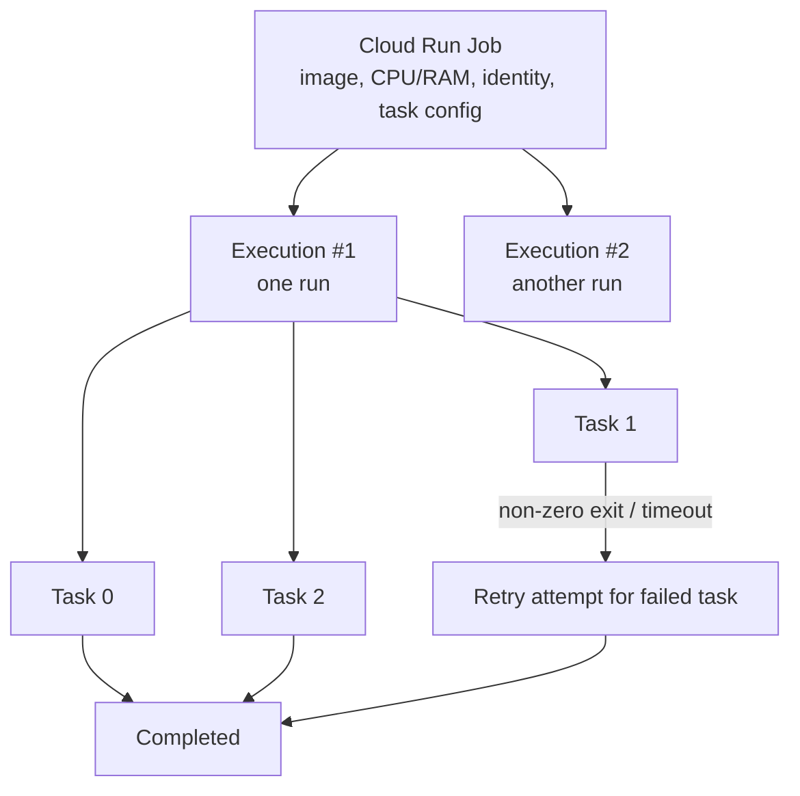
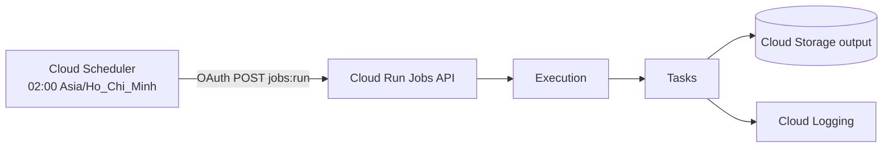

# Running Background Tasks with Cloud Run Jobs

## 1. Problem and Objectives

An e-commerce application needs to generate end-of-day reports, batch-process images, import CSV files into a database, and run a data migration. These tasks do not need an always-listening HTTP server, yet they must **run to completion**, report status, and support retries on failure.

**Cloud Run jobs** run containers under a **finite-work** (*run-to-completion*) model. You create a **Job** configuration once, then trigger one or more **Executions** whenever needed. Each execution consists of one or more **Tasks**. Each task runs a container and **exits**; it does not have to listen on an HTTP port.

This lesson belongs to the **Cloud Run** chapter in the **CLOUD_PROVIDERS_GCP** module: applying project organization, IAM, VPCs, Compute Engine/GKE, Cloud Storage, and databases to run background workloads safely while monitoring reliability and cost.

After this lesson, you will be able to:

1. Choose properly among **Cloud Run service**, **Cloud Run job**, **worker pool**, and orchestration solutions.
2. Explain Job → Execution → Task → Attempt; design `tasks`, `parallelism`, `max-retries`, and `task-timeout`.
3. Write a run-once container, partition work using `CLOUD_RUN_TASK_INDEX`, and return accurate exit codes.
4. Create, execute, observe, and update job configurations using `gcloud`.
5. Trigger jobs on a schedule via **Cloud Scheduler** or orchestrate them with **Workflows**.
6. Design IAM, Secret Manager, VPC egress, retry/idempotency, logs, alerts, and budgets.

> **Conventions:** project names, accounts, images, and buckets in examples are hypothetical. Commands that create or run jobs can incur charges and affect real data. Run them only with proper permissions in an authorized lab project. Multi-line shell syntax assumes Bash/Cloud Shell.

## 2. Choosing the Right Cloud Run Resource Type

| Need | Solution to evaluate | Reason |
| --- | --- | --- |
| API/webhook receiving HTTP and responding to users | **Cloud Run service** | Serves requests and autoscales with traffic |
| Finite batch processing, backfills, migrations, scheduled reports | **Cloud Run job** | No HTTP listener needed; runs until tasks complete |
| Continuous queue consumer, long-lived polling/streaming | **Cloud Run worker pool** or GKE | Continuous background daemon model |
| Multi-step ordering, conditional branches, coordinating multiple services/jobs | **Workflows** | Orchestrates, retries, and tracks each step |
| Very short task triggered by HTTP/events | Cloud Run service with Pub/Sub push/Eventarc as configured | On-demand processing; pair with proper queues and retries |

**Never** return HTTP 200 from a Cloud Run service and assume a background thread inside that process will reliably finish. Service request and CPU lifecycles differ from a job execution. When business logic requires **completion proof** or long execution, create a job and trigger it from an appropriate orchestrator.

**Jobs do not have a user-callable HTTP URL like services.** To start a job, an authorized client calls the **Cloud Run Jobs API** (or `gcloud run jobs execute`), Cloud Scheduler, or Workflows.

## 3. Job, Execution, Task, and Attempt Lifecycle



| Concept | Meaning | Note |
| --- | --- | --- |
| **Job** | Container configuration and execution behavior | Creating a job **does not mean it has run** |
| **Execution** | A single job invocation, tracking run outcome | Two executions of the same job are independent runs |
| **Task** | Independent unit of work within an execution; one container instance per task | Each task has its own index |
| **Attempt** | One execution try of a task | Retries can **re-process the same data slice** |

An execution is marked **succeeded when all tasks complete successfully**. A task exhausting its allowed retries causes the entire execution to fail. One task succeeding **does not automatically roll back outputs from other tasks**: data integrity must be designed at the application layer.

### Important Limits

| Attribute | Baseline value / behavior |
| --- | --- |
| `tasks` | Default **1**; maximum **10,000 tasks** per execution |
| `parallelism` | Maximum simultaneously running tasks; **cannot exceed task count** |
| `max-retries` | Default **3 retries per task**, supporting 0–10; 3 retries means up to **4 attempts** |
| `task-timeout` | Default **10 minutes per attempt**; configurable up to **168 hours (7 days)** with supported settings |
| GPU job task timeout | Maximum **12 hours** per product limits; certain long-running GPU capabilities are in Preview |
| Execution timeout | **No separate standalone timeout** for the whole execution; finishes once all tasks conclude |

A task with a 2-hour timeout and 2 retries **does not mean the execution always finishes in exactly 2 hours**. Wall-clock duration also depends on queueing, startup, parallelism, retries, and downstreams. In particular, multi-hour tasks can still hit environment disruptions or VPC connection drops requiring recovery.

## 4. Partitioning Work with Task Index and Parallelism Limits

Cloud Run automatically injects environment variables into each task:

- `CLOUD_RUN_JOB`: Job name.
- `CLOUD_RUN_EXECUTION`: current execution name.
- `CLOUD_RUN_TASK_INDEX`: task index from **0** to **`CLOUD_RUN_TASK_COUNT - 1`**.
- `CLOUD_RUN_TASK_COUNT`: total number of tasks.
- `CLOUD_RUN_TASK_ATTEMPT`: current attempt number, useful for correlating logs with retries.

Suppose there are **20 records** and the job sets `tasks=4`, `parallelism=2`. You can partition via modulo arithmetic:

| Task index | Record IDs processed | When running |
| --- | --- | --- |
| 0 | 0, 4, 8, 12, 16 | One of up to 2 concurrent tasks |
| 1 | 1, 5, 9, 13, 17 | One of up to 2 concurrent tasks |
| 2 | 2, 6, 10, 14, 18 | Waits for an open slot |
| 3 | 3, 7, 11, 15, 19 | Waits for an open slot |

**`tasks` ≠ `parallelism`.** Increasing `tasks` splits work into more pieces; increasing `parallelism` runs more pieces concurrently, which speeds things up only **if** databases, APIs, Cloud Storage, and quotas can handle the load.

**Critical assumption:** the input list must stay stable throughout the execution. Querying mutable data with `OFFSET` pagination to slice work can cause retries to skip or duplicate records. For production, use an **input manifest/snapshot**, fixed ID ranges, hash partitioning, or lease/checkpoint mechanisms.

## 5. Retries, Exit Codes, and Idempotency

**Exit code 0** signals task completion. **Nonzero exit codes**, timeouts, or certain infrastructure failures trigger retries per policy. Retry attempts can run in fresh containers: **RAM and the ephemeral filesystem are not durable checkpoint stores**.

Report export example:

1. A task reads its partition from a fixed manifest.
2. Writes output to a deterministic object key derived from **business run ID + partition ID**.
3. If a retry finds the output already exists, it **verifies checksum/metadata** before declaring success or raising a conflict.
4. Marks the overall batch complete only once every partition output is validated.

Using the Cloud Storage Python client, a create-only-if-absent write uses `if_generation_match=0`:

```python
# Illustrates write-once logic, not a complete application
from google.cloud import storage

client = storage.Client()
blob = client.bucket("acme-batch-output-lab").blob(
    "runs/2026-11-19/part-0002.json"
)
blob.upload_from_string(
    '{"count": 25}',
    content_type="application/json",
    if_generation_match=0,   # Create only when no live object exists yet
)
```

If the object already exists, the call can raise **412 Precondition Failed**; the app should **not** blindly treat every 412 as success. Re-read the object and verify it contains the exact output of the same logical run. In databases, use **transactions, unique constraints, conditional upserts**, or checkpoint tables to avoid duplicating side effects.

**Distinguish two layers of retries:** **task retries inside one execution** versus Cloud Scheduler/Workflows/clients **re-triggering the entire job**. Never rely solely on `CLOUD_RUN_EXECUTION` as the idempotency key for a daily job: each execution gets a brand-new ID, so two duplicate scheduled triggers could reprocess the whole day. Use a stable **business key** like `report_date` backed by durable state.

## 6. Lab: Write a Run-Once-and-Exit Container

This example simply prints logs so you can observe task partitioning without needing a database or bucket. Create both files **on the learner's lab machine** (the STEP 4 worker does not create these files inside the repository).

**`main.py`:**

```python
import json
import os
import time

task_index = int(os.environ.get("CLOUD_RUN_TASK_INDEX", "0"))
task_count = int(os.environ.get("CLOUD_RUN_TASK_COUNT", "1"))
attempt = int(os.environ.get("CLOUD_RUN_TASK_ATTEMPT", "0"))
execution = os.environ.get("CLOUD_RUN_EXECUTION", "local")
total_items = int(os.environ.get("TOTAL_ITEMS", "20"))

if not (0 <= task_index < task_count) or total_items < 0:
    raise ValueError("Invalid partition configuration")

for item_id in range(task_index, total_items, task_count):
    print(json.dumps({
        "event": "item_processed",
        "execution": execution,
        "task_index": task_index,
        "attempt": attempt,
        "item_id": item_id,
    }), flush=True)
    time.sleep(0.05)  # Simulate processing

print(json.dumps({
    "event": "task_completed",
    "task_index": task_index,
    "attempt": attempt,
}), flush=True)
```

**`Dockerfile`:**

```dockerfile
FROM python:3.12-slim
WORKDIR /app
COPY main.py .
CMD ["python", "main.py"]
```

Test locally across four indexes:

```bash
# Lesson assumes Docker is installed in the lab environment
docker build -t partition-job:lab .
docker run --rm \
  -e CLOUD_RUN_TASK_INDEX=2 \
  -e CLOUD_RUN_TASK_COUNT=4 \
  -e TOTAL_ITEMS=20 \
  partition-job:lab
```

**Expected:** task index 2 processes `2, 6, 10, 14, 18` and exits with **exit code 0**. You do not need an HTTP server or to open `PORT`. Before promoting to production, **pin the base image digest**, scan for vulnerabilities, run non-root where feasible, and add tests and error handling.

## 7. Build the Image, Create, and Execute the Cloud Run Job

Assumptions:

```text
Project:       acme-batch-lab
Region:        asia-southeast1
Artifact Repo: batch-images (pre-existing Docker repo)
Image:         asia-southeast1-docker.pkg.dev/acme-batch-lab/batch-images/partition-job:v1
Job:           partition-demo
Runtime SA:    batch-runner@acme-batch-lab.iam.gserviceaccount.com
```

**Preflight:** Cloud Run API/Cloud Build API/Artifact Registry API are enabled; the Docker repository and service account exist; the deployer has permissions to build/push images, create jobs, and `iam.serviceAccounts.actAs` on the runtime SA. Verify region, quotas, IAM, and billing before proceeding.

### 7.1. Build and Push the Image

From the directory containing `Dockerfile` and `main.py`:

```bash
# MODIFIES CLOUD RESOURCES: may incur build/storage charges
gcloud builds submit \
  --project=acme-batch-lab \
  --tag=asia-southeast1-docker.pkg.dev/acme-batch-lab/batch-images/partition-job:v1
```

A successful build **does not guarantee** the image is allowed to deploy if the organization enforces Binary Authorization, admission policies, or additional Artifact Registry IAM.

### 7.2. Create the Job Without Executing Yet

```bash
# CREATES JOB DEFINITION; does not launch an execution yet
gcloud run jobs create partition-demo \
  --project=acme-batch-lab \
  --region=asia-southeast1 \
  --image=asia-southeast1-docker.pkg.dev/acme-batch-lab/batch-images/partition-job:v1 \
  --tasks=4 \
  --parallelism=2 \
  --max-retries=2 \
  --task-timeout=15m \
  --cpu=1 \
  --memory=512Mi \
  --service-account=batch-runner@acme-batch-lab.iam.gserviceaccount.com \
  --set-env-vars=TOTAL_ITEMS=20
```

**Explanation:** creates **4 tasks** with at most **2** running simultaneously; each task can retry up to **2 times** after its initial attempt, with a **15-minute/attempt** timeout. CPU/RAM apply **per task container instance**, not across the whole job.

### 7.3. Describe Configuration, Then Execute

```bash
# READ-ONLY
gcloud run jobs describe partition-demo \
  --project=acme-batch-lab \
  --region=asia-southeast1

# CREATES EXECUTION: incurs charges while tasks run
gcloud run jobs execute partition-demo \
  --project=acme-batch-lab \
  --region=asia-southeast1 \
  --wait
```

`--wait` tells the CLI to **block until the execution finishes**. Without `--wait`, a successful `execute` return code **only confirms the execution started**, not that every task succeeded.

### 7.4. Override Parameters for a Single Execution

```bash
# Example re-running with a different task count without modifying the base Job
gcloud run jobs execute partition-demo \
  --project=acme-batch-lab \
  --region=asia-southeast1 \
  --tasks=2 \
  --update-env-vars=TOTAL_ITEMS=10 \
  --wait
```

These are **execution overrides**, requiring `run.jobs.runWithOverrides`; standard `roles/run.invoker` only grants `run.jobs.run`. If an automated caller only needs to run the standard configuration, **do not grant override permissions**.

## 8. Inspecting Executions, Tasks, and Logs

### 8.1. Execution Status

```bash
# READ-ONLY
gcloud run jobs executions list \
  --job=partition-demo \
  --project=acme-batch-lab \
  --region=asia-southeast1

gcloud run jobs executions describe EXECUTION_NAME \
  --project=acme-batch-lab \
  --region=asia-southeast1

gcloud run jobs executions tasks list \
  --execution=EXECUTION_NAME \
  --project=acme-batch-lab \
  --region=asia-southeast1
```

In the Console: **Cloud Run → Jobs → select job → History/Executions → select execution → Tasks/Logs/Metrics**. Check how many tasks are **Succeeded** vs. **Failed**, retry counts, and run duration; **never inspect one succeeding task and assume the entire execution succeeded**.

### 8.2. Cloud Logging

Job stdout/stderr streams to **Cloud Logging** per service configuration. Query in Logs Explorer:

```text
resource.type="cloud_run_job"
resource.labels.job_name="partition-demo"
resource.labels.location="asia-southeast1"
```

Filter further by execution or task index using **labels actually present on the log entries**. For instance, JSON logs from `main.py` include `event`, `execution`, `task_index`, and `attempt` to correlate retries. Never log request payloads, secrets, customer PII, or signed URLs.

**Logs can arrive with latency and are subject to retention.** To reconcile batch results, also maintain a status table or manifest in Cloud SQL or Cloud Storage; Cloud Logging is not a business-result database.

### 8.3. Monitoring and Alerting

Track at minimum:

| Signal | Meaning |
| --- | --- |
| Execution success/failure | Overall job completion rate |
| Task duration, retries, exit codes | Detects stuck work, timeouts, or transient failures |
| CPU/RAM and OOMs | Right-sizes per-task resources |
| Active parallelism | Assesses downstream and quota limits |
| Business completion marker | Verifies the report/partition **was actually published** |
| Cost by Cloud Billing SKU/labels | Detects duplicate runs or abnormal retry spikes |

Configure alerts when **an execution fails**, a scheduled job **misses its completion deadline**, or the output manifest is missing. Infrastructure metrics alone do not prove the report is accurate; add content validation and record-count reconciliation.

## 9. Running on a Schedule with Cloud Scheduler

A job does not know on its own when to run. For a daily report at 02:00 Vietnam time, you can configure **Cloud Scheduler** to invoke the **Cloud Run Jobs API**.



### 9.1. Permissions and Configuration

Create a dedicated Scheduler service account, such as `batch-scheduler@acme-batch-lab.iam.gserviceaccount.com`. Grant **`roles/run.invoker` on that specific Cloud Run job** so it holds `run.jobs.run`; the user creating the Scheduler job needs Cloud Scheduler permissions and `iam.serviceAccounts.actAs` on that SA.

In the Console, open **Cloud Run → Jobs → select job → Triggers → Add Scheduler Trigger**, specify cron `0 2 * * *`, timezone `Asia/Ho_Chi_Minh`, and the configured service account.

Or create the HTTP Scheduler target once permissions are granted:

```bash
# CREATES SCHEDULE: run only after proper IAM is granted
gcloud scheduler jobs create http partition-daily \
  --project=acme-batch-lab \
  --location=asia-southeast1 \
  --schedule="0 2 * * *" \
  --time-zone="Asia/Ho_Chi_Minh" \
  --uri="https://run.googleapis.com/v2/projects/acme-batch-lab/locations/asia-southeast1/jobs/partition-demo:run" \
  --http-method=POST \
  --message-body="{}" \
  --headers="Content-Type=application/json" \
  --oauth-service-account-email=batch-scheduler@acme-batch-lab.iam.gserviceaccount.com
```

**Use OAuth, not OIDC**, because the target is the Google API `run.googleapis.com`. Cloud Scheduler is a **separate** managed resource with its own quotas and billing.

### 9.2. Do Not Confuse ACK with Completion

Cloud Scheduler receives a response as soon as the `jobs:run` request is accepted—**it does not wait for all tasks to finish**. If Cloud Scheduler retries the HTTP call or someone manually triggers the same schedule, **multiple executions can process the same day**. Use business run IDs, lock/lease mechanisms, and write-once outputs to prevent destructive duplicate runs.

A **02:00** schedule does not guarantee output is ready at 02:01. Monitor completion deadlines at the execution and business levels.

## 10. Event-Driven Triggers and Multi-Step Orchestration

Jobs suit finite processing, yet **cannot act directly as an HTTP push endpoint** for Pub/Sub. A common pattern:

```text
New object in Cloud Storage / Pub/Sub event
           ↓
Eventarc / Pub/Sub → Workflows (or intermediary service)
           ↓
Cloud Run Jobs API: jobs.run
           ↓
Execution → Tasks → Output
           ↓
Workflows checks result / next step
```

**Workflows** can wait for execution completion, apply conditional retries, handle errors, and coordinate subsequent steps, though it requires its own IAM, quotas, timeouts, retries, and concurrency settings. At very high event rates, **spawning one job execution per individual message** can get expensive and hit quotas; consider micro-batching, Cloud Tasks/Pub/Sub workers, or a service depending on workload fit.

Business example: when a large file is uploaded, Workflows validates metadata → launches a data-check job execution → waits for completion → publishes a manifest. **Never launch jobs directly from unauthenticated browsers** or expose `run.jobs.runWithOverrides` to end users.

## 11. IAM, Service Accounts, and Secret Management

Separate **who can create/run the job** from **what data the job can read/write**:

| Identity | Required permissions (examples) | Principle |
| --- | --- | --- |
| User/CI creating the job | `roles/run.developer` and `roles/iam.serviceAccountUser` on the runtime SA, plus build/push rights as needed | Never use Owner for every pipeline |
| User or Scheduler invoking the job | `roles/run.invoker` or `roles/run.jobsExecutor` on the job | Needs only permission to run the standard config |
| Operator needing execution overrides | `roles/run.jobsExecutorWithOverrides` or equivalent permission | Restrict tightly since it can alter args/env/tasks |
| Runtime service account | `roles/storage.objectViewer`, `roles/storage.objectCreator`, `roles/cloudsql.client`, etc. **only as needed** | Never use broad default Editor |
| Runtime reading Secret Manager | `roles/secretmanager.secretAccessor` on the specific secret | Keep passwords out of images, args, and logs |

**Never confuse `run.jobs.run` with Cloud Storage read permissions.** Scheduler can start a job **without** holding permissions to read or write the job's data. The runtime service account is the identity calling Google APIs inside the container.

### Secret Manager

Example supplying an env var from Secret Manager (without placing secret values on the CLI):

```bash
# UPDATES config; secret must exist and runtime SA must have access
gcloud run jobs update partition-demo \
  --project=acme-batch-lab \
  --region=asia-southeast1 \
  --set-secrets=DB_PASSWORD=report-db-password:3
```

For env-injected secrets, consider **pinning numeric versions** instead of `latest` when reproducibility is required; for credentials needing dynamic refresh without restarts, evaluate **secret volume mounts** per product support. Never log secrets or bake service account JSON keys into container images.

### Artifact Registry

The job must be able to pull its image over a supported path. Verify the exact Artifact Registry repository, deployer/service agent IAM, VPC Service Controls if present, and Binary Authorization if enforced by the organization. Image pull failures differ from runtime bucket-read failures.

## 12. Connecting to VPC, Cloud SQL, and Data Services

A job **does not receive inbound HTTP traffic** like a Cloud Run service, yet tasks may still need egress to reach **Cloud SQL private IP**, Redis, internal APIs, Cloud Storage, or the Internet.

Options depending on setup:

- **Direct VPC egress** to connect into a VPC without a Serverless VPC Access connector where supported.
- **Serverless VPC Access connector** if architecture requires it.
- **Cloud SQL connectors / Cloud SQL integrations** and matching IAM/database credentials.
- **Private Google Access / Private Service Connect** or designed egress paths when reaching Google APIs.

Verify **routes, egress firewalls, NAT if needed, DNS, subnet IP capacity, and IAM**. A `403 PERMISSION_DENIED` from Cloud Storage is typically an IAM/API issue, whereas `connection timed out` to a private database warrants investigating networking/paths/firewalls.

**Never assign external IPs or open `0.0.0.0/0` because a job "cannot connect."** Use Connectivity Tests and VPC Flow Logs/Cloud NAT logs within your permissions and existing setup; make only minimal rule changes backed by evidence.

## 13. Capacity, Performance, and Cost

Each task is a container instance allocated **vCPU, memory**, and supporting resources; as multiple tasks run concurrently, total resource usage scales with active concurrency.

Hypothetical example:

```text
tasks         = 20
parallelism   = 4
cpu           = 1 vCPU / task
memory        = 512 MiB / task
max-retries   = 2
task duration = 60 seconds per attempt
```

With zero retries and each task taking 60 seconds, the execution needs **about 5 waves**, or roughly **5 minutes of elapsed time** once capacity is available. At peak concurrency, the run uses around **4 vCPU and 2 GiB RAM** across four parallel tasks. This is an illustrative capacity model, **not a latency guarantee or exact billing formula**.

For Cloud Run jobs, Cloud Run bills under the **instance-based** model for container instance lifetime with a **1-minute minimum charge**; CPU/memory are billed per vCPU-second and GiB-second, plus GPU, networking, logging, and Cloud Storage/SQL/Scheduler/Workflows if used. Retries and duplicate executions increase billable usage. Rates vary by region/SKU/discounts—consult [Cloud Run pricing](https://cloud.google.com/run/pricing).

**Choosing parallelism:** start conservatively, measure throughput and **downstream database/API capacity**, then scale up. A job with 100 tasks and `parallelism=100` is not necessarily faster than `parallelism=10` if Cloud SQL can only handle 20 connections.

**Cloud Run is not a durable state store.** A container's temporary writable filesystem vanishes when a task exits or retries. Write outputs and checkpoints to Cloud Storage or a database, and manage storage quotas and costs separately.

## 14. Troubleshooting: Symptoms and Remediation

| Symptom | Common cause | Evidence / fix |
| --- | --- | --- |
| `Permission denied` on execute | Caller missing `run.jobs.run` | Inspect job IAM and actual CI/Scheduler identity |
| Execution override rejected | Missing `run.jobs.runWithOverrides` | Run standard job config or grant controlled override role |
| Task fails to start | Missing image/tag, Artifact Registry IAM, region/quota | Check Job Events, execution status, image digest, APIs/quotas |
| Task fails immediately | Wrong command/args, missing env/secret, nonzero exit | Inspect logs by execution/task/attempt and exit code |
| Continuous retries | Permanent bug, timeout too short, dependency down | Classify transient vs. permanent errors, backoff, idempotency |
| `Task timeout` | Exceeded per-attempt time limit | Check duration metrics, checkpoint/partition size, raise timeout judiciously |
| OOMKilled | Memory limit too low or memory leak | Inspect memory usage and logs; adjust memory or app footprint |
| Tasks process duplicate data | Retries or multiple executions of same business run | Enforce idempotency keys/manifests/write-once/transactions |
| Job succeeds yet output is missing | Code exited 0 before committing data | Add output validation, manifests, and stop swallowing errors |
| Scheduler reports success, job failed | Scheduler only confirms API start, not completion | Monitor execution status and business deadline alerts |
| Cloud SQL / private endpoint errors | VPC egress, DNS, firewall/NAT, IAM/DB auth | Distinguish TCP timeouts from 403/permission errors |
| Unexpected cost spike | High parallelism, heavy retries, duplicate runs, GPU/egress | Inspect executions, Billing SKUs/labels, logs, and downstream usage |

### 5-Step Runbook

1. Confirm **Project/region/job/execution/task index**, timestamp, and logical run inputs.
2. Read **task status, attempt count, exit code, timeout, and logs**, not only summary errors.
3. Separate **container failures**, **IAM**, **networking**, **data conflicts**, and **quota/capacity** issues.
4. Apply the smallest targeted fix: image/env, specific role, timeout/parallelism, or code, with a rollback plan.
5. Re-run on **safely repeatable data**, verify outputs/manifests and SLOs, and document root cause.

For production incidents requiring forensic evidence, **do not delete executions or logs before investigating**.

## 15. Two Real-World Design Scenarios

### 15.1. Daily Order Report

**Flow:** Cloud Scheduler → Cloud Run job → read finalized data → process across multiple tasks → write Parquet/CSV files → publish manifest.

**Design:** partition by `report_date` and shard ID; bound `parallelism` to Cloud SQL capacity; job SA holds read-only source access and write access only to the target bucket; outputs use **write-once preconditions**; alert if the job misses its deadline. A duplicate scheduled run checks the manifest/lock record and **avoids creating duplicate reports**.

### 15.2. Data Backfill After Schema Migration

**Flow:** Approval-gated Workflow → multi-task Cloud Run job → each task processes a fixed ID range → write checkpoints → Workflows verifies all partitions and data quality.

**Design:** run a small canary first, ensure rollback readiness, cap write concurrency, protect the database, and verify row counts/checksums; never use `max-retries` as a substitute for transactions. For massive partitions or multi-day continuous processing, consider **GKE/Batch/worker pools** depending on infrastructure and tooling needs.

## 16. Reinforcement Exercises

1. **Product selection:** Build a REST API responding in 100 ms, a 30-minute report generator at 02:00, and a continuously running queue consumer. What should you choose? **Hint:** service, job, and worker pool/GKE respectively.
2. **Task partitioning:** Given 18 items, `tasks=3`, `parallelism=2`. List the IDs processed by each task using modulo partitioning. **Answer:** task 0: 0,3,6,9,12,15; task 1: 1,4,7,10,13,16; task 2: 2,5,8,11,14,17.
3. **Attempt count:** With `max-retries=2`, one task fails twice and succeeds on the third try. Can the execution succeed? **Answer:** Yes, if all other tasks also succeed; 3 total attempts for that task.
4. **Choosing parallelism:** A job has 200 tasks, while Cloud SQL handles only 10 concurrent connections; what `parallelism` should you start testing with? **Hint:** lower than the ceiling of 10 while leaving headroom for other apps, then benchmark.
5. **Idempotent retries:** Scheduler triggers two executions for the same `report_date`. Why is using `CLOUD_RUN_EXECUTION` as the output prefix insufficient against duplicate processing? Propose a business key, unique constraint, or write-once manifest.
6. **Permissions:** Scheduler needs to trigger the job, runtime needs to write to Cloud Storage, and an operator needs to override `tasks`. Who needs `run.jobs.run`, who needs `storage.objects.create`, and who needs `run.jobs.runWithOverrides`?
7. **Diagnosis:** `gcloud run jobs execute` without `--wait` exits 0, yet 20 minutes later outputs are missing. List the commands/pages to inspect execution/tasks/logs and hypotheses to check.

## 17. Production Deployment Checklist

- [ ] Confirmed finite workload fits **Cloud Run job**, not an HTTP service or continuous worker.
- [ ] Partitioned inputs stably; tasks execute independently and **idempotently**.
- [ ] `tasks`, `parallelism`, `task-timeout`, and `max-retries` match quotas, SLOs, and downstreams.
- [ ] Tasks return **exit code 0 only after work is committed and verified**.
- [ ] Outputs/checkpoints reside in Cloud Storage/databases, never solely in temporary filesystems.
- [ ] Image is pinned/versioned, security-scanned, and deployed via CI/CD with rollback.
- [ ] Runtime SA, deployer, invoker, and override permissions are separated.
- [ ] Secrets come from Secret Manager; never log secrets or signed URLs.
- [ ] VPC/Cloud SQL/Cloud Storage connectivity and IAM tested in a lab first.
- [ ] If triggered by Scheduler/Workflows, deduplication is enforced and **completion**—not just API ACK—is monitored.
- [ ] Dashboards/alerts track **execution failures, retries, duration, business deadlines, and outputs**.
- [ ] Estimated vCPU/GiB-seconds, retries, concurrency, networking, storage, database, and orchestration costs.
- [ ] Error-handling runbooks, backfill procedures, and evidence-preserving cleanup processes exist.

## 18. Official Documentation

1. [Create Cloud Run jobs](https://cloud.google.com/run/docs/create-jobs).
2. [Execute jobs](https://cloud.google.com/run/docs/execute/jobs).
3. [Manage job executions](https://cloud.google.com/run/docs/managing/job-executions).
4. [Set parallelism](https://cloud.google.com/run/docs/configuring/parallelism).
5. [Set task timeouts](https://cloud.google.com/run/docs/configuring/task-timeout).
6. [Jobs: retries and checkpoints](https://cloud.google.com/run/docs/jobs-retries).
7. [Cloud Run container runtime contract](https://cloud.google.com/run/docs/container-contract).
8. [Execute jobs on a schedule](https://cloud.google.com/run/docs/execute/jobs-on-schedule).
9. [Configure secrets for jobs](https://cloud.google.com/run/docs/configuring/jobs/secrets).
10. [Cloud Run IAM permissions](https://cloud.google.com/run/docs/reference/iam/permissions).
11. [Cloud Run logging](https://cloud.google.com/run/docs/logging).
12. [Cloud Run pricing](https://cloud.google.com/run/pricing).
13. [gcloud run jobs create](https://cloud.google.com/sdk/gcloud/reference/run/jobs/create) and [gcloud run jobs execute](https://cloud.google.com/sdk/gcloud/reference/run/jobs/execute).

**Key takeaway:** **Cloud Run jobs** fit background workloads **with a defined end** that can be partitioned and retried. Success means more than a container running—it means **accurate outputs, zero duplicate processing, least-privilege permissions, observable executions, and bounded costs**. Size `tasks` and `parallelism` to real downstream capacity, design idempotency before enabling retries, and verify completion rather than assuming a successful trigger command equals done.
