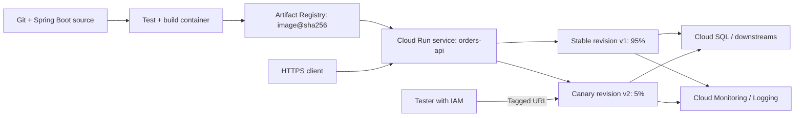
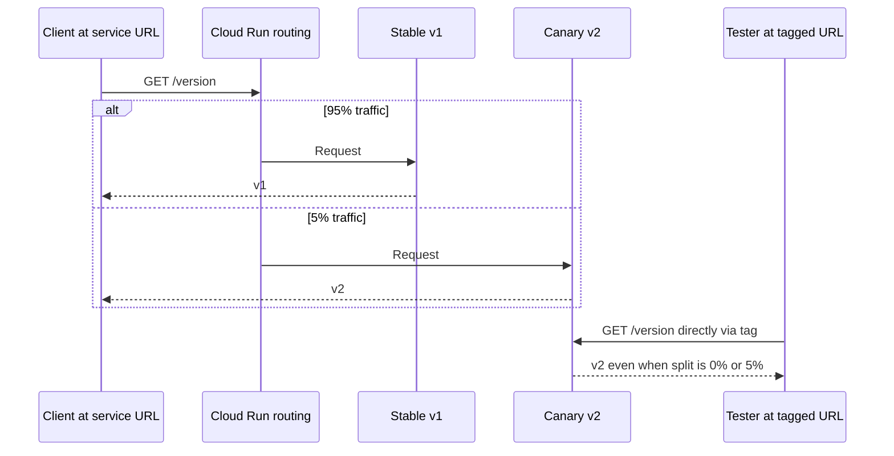
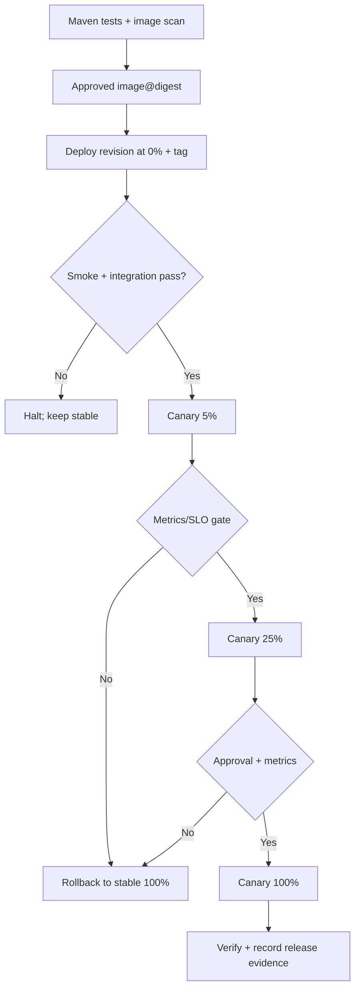

# Hands-On Canary Releases for Spring Boot on Cloud Run

A new version of the Orders API changes how promotions are calculated. Staging tests passed, yet routing 100% of users straight to the new version risks letting a database compatibility bug or timeout impact the entire system. **Canary deployment** lets you send a small fraction of real traffic to the new revision first, observe quality, ramp up gradually, and **revert to the stable revision without rebuilding the image** if needed.

This hands-on lesson belongs to the **Cloud Run** chapter of the `CLOUD_PROVIDERS_GCP` module. The workflow uses Spring Boot, Artifact Registry, Cloud Run revisions/traffic splitting, Cloud Logging, and Cloud Monitoring, while connecting to IAM, VPC/Cloud SQL, CI/CD, reliability, and cost. The goal is a **verifiable, rollback-ready release**, rather than merely getting `gcloud run deploy` to succeed.

> All projects, revisions, domains, and metrics in this lesson are **hypothetical**. Commands like `gcloud services enable`, build/push, deploy, and traffic updates **modify infrastructure or incur charges**. Run them only in an authorized sandbox. Examples use Linux/Bash syntax; on Windows PowerShell, adapt environment variable syntax accordingly.

## 1. Objectives and Outcomes

After this lesson, you can:

1. Package Java 21 Spring Boot into a container listening on Cloud Run's `PORT` variable.
2. Push images to Artifact Registry and pin image **digests** for each release.
3. Deploy a new revision with `--no-traffic --tag=canary` and test the **tagged URL** before shifting live traffic.
4. Split traffic between two revisions in steps **95/5 → 75/25 → 0/100** using `gcloud`.
5. Measure HTTP 5xx, latency, startup latency, CPU/memory, and logs **per revision** with clear go/no-go thresholds.
6. Roll back immediately to the stable revision and verify data and session impacts.
7. Recognize the limitations of traffic splitting, session affinity, Cloud SQL connection pools, IAM, and min instances.

## 2. Architecture and Prerequisites



**Orchestration model:** one Cloud Run **service** has a main URL and multiple **immutable revisions**. Each revision captures the image and configuration at creation time; a **traffic split** distributes request percentages across selected revisions. A **traffic tag** assigns a dedicated URL to a revision for direct testing, even while the revision receives **0%** traffic from the main URL. Adding a tag does not create a separate independent service.

| Component | Lesson example | Rule |
| --- | --- | --- |
| Google Cloud project | `orders-lab` | Billing enabled, adequate quotas, APIs, and IAM |
| Region | `asia-southeast1` | Keep Cloud Run and registry in the same region for convenience |
| Service | `orders-api` | Single main URL, multiple revisions |
| Artifact Registry | `orders-images` | Private Docker repository |
| Stable release | `v1`, revision generated by Cloud Run | Receiving 100% prior to rollout |
| Canary release | `v2`, tag `canary` | Initially 0%; test directly then ramp gradually |
| Metrics | Request count, 5xx rate, request latency | Broken down by revision name |

Prerequisites: `gcloud`, Docker or Cloud Build, Maven Wrapper/Java 21 installed, plus permissions to build/push/deploy and a dedicated runtime service account. The operator running commands needs `roles/run.developer` (or equivalent) and `iam.serviceAccounts.actAs` on the runtime identity; the build identity needs permission to push images to Artifact Registry. **Never use an Owner account for the entire pipeline.**

**Important:** this lab starts from a **service already running revision v1 at 100%**. If a new service has never had a revision, deploy v1 first—do not treat deploying v2 with `--no-traffic` as creating a pre-existing stable baseline.

## 3. Build a Version-Observable Spring Boot App

A minimal demo should expose `/healthz` and `/version`. The `/version` response helps verify which revision handled a test request; in production, still rely on Cloud Run revision labels and Cloud Monitoring for authoritative conclusions.

Example layout:

```text
orders-api/
  pom.xml
  src/main/java/com/example/orders/OrdersApplication.java
  src/main/resources/application.properties
  Dockerfile
  mvnw, .mvn/     # Maven Wrapper if generated from Spring Initializr
```

### 3.1. Maven Project

Example `pom.xml` using **Spring Boot 3.5.7 for illustration**, Java 21; in real practice upgrade to a currently supported, security-reviewed Spring Boot version:

```xml
<?xml version="1.0" encoding="UTF-8"?>
<project xmlns="http://maven.apache.org/POM/4.0.0"
         xmlns:xsi="http://www.w3.org/2001/XMLSchema-instance"
         xsi:schemaLocation="http://maven.apache.org/POM/4.0.0
                             https://maven.apache.org/xsd/maven-4.0.0.xsd">
  <modelVersion>4.0.0</modelVersion>
  <groupId>com.example</groupId>
  <artifactId>orders-api</artifactId>
  <version>1.0.0</version>
  <parent>
    <groupId>org.springframework.boot</groupId>
    <artifactId>spring-boot-starter-parent</artifactId>
    <version>3.5.7</version>
    <relativePath/>
  </parent>
  <properties>
    <java.version>21</java.version>
  </properties>
  <dependencies>
    <dependency>
      <groupId>org.springframework.boot</groupId>
      <artifactId>spring-boot-starter-web</artifactId>
    </dependency>
    <dependency>
      <groupId>org.springframework.boot</groupId>
      <artifactId>spring-boot-starter-test</artifactId>
      <scope>test</scope>
    </dependency>
  </dependencies>
  <build>
    <plugins>
      <plugin>
        <groupId>org.springframework.boot</groupId>
        <artifactId>spring-boot-maven-plugin</artifactId>
      </plugin>
    </plugins>
  </build>
</project>
```

### 3.2. Controller and Configuration

```java
package com.example.orders;

import java.util.Map;
import org.springframework.beans.factory.annotation.Value;
import org.springframework.boot.SpringApplication;
import org.springframework.boot.autoconfigure.SpringBootApplication;
import org.springframework.web.bind.annotation.GetMapping;
import org.springframework.web.bind.annotation.RestController;

@SpringBootApplication
@RestController
public class OrdersApplication {
    @Value("${APP_VERSION:local}")
    private String appVersion;

    @GetMapping("/healthz")
    public Map<String, String> health() {
        return Map.of("status", "ok");
    }

    @GetMapping("/version")
    public Map<String, String> version() {
        return Map.of("version", appVersion);
    }

    public static void main(String[] args) {
        SpringApplication.run(OrdersApplication.class, args);
    }
}
```

In `application.properties`:

```properties
server.address=0.0.0.0
server.port=${PORT:8080}
server.shutdown=graceful
spring.lifecycle.timeout-per-shutdown-phase=9s
```

Cloud Run requires the ingress container to listen on **`0.0.0.0`** at the port supplied via `PORT` (default 8080), not solely `127.0.0.1`. Cloud Run sends `SIGTERM` and grants roughly **10 seconds** before `SIGKILL` when stopping an instance; `9s` is merely an illustrative graceful-shutdown budget and does not guarantee arbitrary long requests finish.

**V2** should contain a real tested code/business change; `APP_VERSION` is only a demo indicator and **does not prove** the image itself changed. `/healthz` must contain no sensitive data and should not run expensive queries; test business logic and databases separately before ramping traffic.

### 3.3. Build and Test on the Developer Machine

```bash
# RUN ONLY inside the demo source directory containing Maven Wrapper, or use "mvn".
./mvnw -B clean verify
./mvnw -B package -DskipTests
```

The second command packages only **after** tests have passed. Never omit tests from a production pipeline; beyond unit tests, include integration tests, dependency scans, and verification that the DB schema supports both versions running concurrently.

## 4. Containerize and Publish Images to Artifact Registry

Simple Dockerfile example:

```dockerfile
# Lab: uses an organization-approved Java 21 runtime image.
# Production should pin scanned images by digest, never floating tags.
FROM eclipse-temurin:21-jre
WORKDIR /app
COPY target/*.jar /app/orders-api.jar
USER 10001
EXPOSE 8080
ENTRYPOINT ["java", "-jar", "/app/orders-api.jar"]
```

Conditions: **only one** executable Spring Boot JAR matches `target/*.jar`, the file is readable by UID 10001, and the app does not write to `/app`. Production should use multi-stage builds/SBOMs, CVE scanning in Artifact Registry, and pinned base image digests. Never bake passwords, API keys, or service account JSON into images or committed env files.

### 4.1. Prepare the Project and Docker Repository

```bash
# MODIFIES INFRASTRUCTURE / INCURS CHARGES.
PROJECT_ID="orders-lab"
REGION="asia-southeast1"
REPO="orders-images"
SERVICE="orders-api"
IMAGE="$REGION-docker.pkg.dev/$PROJECT_ID/$REPO/$SERVICE"

gcloud services enable run.googleapis.com \
  artifactregistry.googleapis.com \
  cloudbuild.googleapis.com \
  --project="$PROJECT_ID"

gcloud artifacts repositories create "$REPO" \
  --repository-format=docker \
  --location="$REGION" \
  --project="$PROJECT_ID" \
  --description="Orders API release images"

# Dedicated runtime identity; avoid default account if an approved SA exists.
gcloud iam service-accounts create orders-runtime \
  --display-name="Orders Cloud Run runtime" \
  --project="$PROJECT_ID"
```

If the APIs, repository, or service account **already exist**, skip creation and inspect existing metadata and permissions. The user triggering Cloud Build and the Cloud Build service account may need specific Artifact Registry/storage permissions; follow Cloud Build IAM guidance rather than granting project-wide Editor. Private repos still require read permissions for the Cloud Run service agent in cross-project setups.

### 4.2. Build Two Different Image Versions

At commit **v1**:

```bash
# MODIFIES / BILLABLE: builds and pushes image from Dockerfile.
gcloud builds submit . \
  --tag="$IMAGE:v1" \
  --project="$PROJECT_ID"
```

After merging and testing the **v2** change, build again:

```bash
gcloud builds submit . \
  --tag="$IMAGE:v2" \
  --project="$PROJECT_ID"

# READ-ONLY: retrieve image digests from the registry.
gcloud artifacts docker images list "$IMAGE" \
  --include-tags \
  --project="$PROJECT_ID"
```

Record **both actual digests** in the form `$IMAGE@sha256:...`; never fabricate a digest to deploy. Tags `v1`/`v2` can be reassigned; the **digest is the immutable artifact** tied to build, scan, and approval records. If using Cloud Build in projects with newer service account policies, confirm the runner holds push rights before starting.

## 5. Baseline v1: Stable Revision Receiving 100% Traffic

Assume the `orders-api` service does not exist yet. Once you have the **v1 image digest** and runtime service account:

```bash
# Replace with the real digest retrieved from Artifact Registry.
IMAGE_V1="$IMAGE@sha256:V1_REAL_DIGEST"
RUNTIME_SA="orders-runtime@$PROJECT_ID.iam.gserviceaccount.com"

# CREATES SERVICE / INCURS CHARGES. Demo keeps the service private via IAM.
gcloud run deploy "$SERVICE" \
  --image="$IMAGE_V1" \
  --project="$PROJECT_ID" \
  --region="$REGION" \
  --platform=managed \
  --service-account="$RUNTIME_SA" \
  --no-allow-unauthenticated \
  --port=8080 \
  --cpu=1 \
  --memory=512Mi \
  --concurrency=20 \
  --set-env-vars=APP_VERSION=v1
```

A brand-new service routes 100% traffic to its first revision by default. If the service already exists, **do not re-run the baseline deploy command** without a change request because it may create a new revision and alter live settings. Read-only check:

```bash
gcloud run services describe "$SERVICE" \
  --project="$PROJECT_ID" --region="$REGION" \
  --format="yaml(status.url,status.traffic,status.latestReadyRevisionName)"

gcloud run revisions list \
  --service="$SERVICE" --project="$PROJECT_ID" --region="$REGION"
```

Save the 100%-serving revision name into `STABLE_REV`, such as `orders-api-00001-abc` (an **illustrative name only**; replace with real output). Confirm the revision is `Ready` and smoke test endpoints using an account with `roles/run.invoker`; never open public access just to simplify testing.

## 6. Deploy v2 at 0% Traffic and Attach a Canary Tag

Once `v2` passes tests and its image digest is approved, deploy it to the **same Cloud Run service** without routing main URL traffic yet:

```bash
IMAGE_V2="$IMAGE@sha256:V2_REAL_DIGEST"

# MODIFIES / INCURS CHARGES: creates a new revision without shifting live traffic.
gcloud run deploy "$SERVICE" \
  --image="$IMAGE_V2" \
  --project="$PROJECT_ID" \
  --region="$REGION" \
  --no-traffic \
  --tag=canary \
  --update-env-vars=APP_VERSION=v2

# READ-ONLY: inspect revisions, split, and traffic tag URL.
gcloud run revisions list \
  --service="$SERVICE" --project="$PROJECT_ID" --region="$REGION"

gcloud run services describe "$SERVICE" \
  --project="$PROJECT_ID" --region="$REGION" \
  --format="yaml(status.url,status.traffic,status.latestReadyRevisionName)"
```

`--no-traffic` keeps the new revision at **0% on the main service URL**; `--tag=canary` allows direct access via the tagged URL returned in `status.traffic`. **0% does not mean unreachable**: if the service is public, anyone knowing the tag URL can send requests subject to the service's ingress/IAM policies.

`--update-env-vars` **only updates** `APP_VERSION` while keeping other variables; by contrast, `--set-env-vars` can **drop existing variables not re-listed**. Before deploying v2 in production, compare image, CPU/memory, concurrency, runtime identity, Cloud SQL/VPC, secrets, and service settings. If unexpected configuration drift appears, **halt the release** even while v2 sits at 0% traffic.

Save both exact revision names from the output:

```bash
# Placeholders only: REPLACE with actual Cloud Run revision names.
STABLE_REV="orders-api-00001-abc"
CANARY_REV="orders-api-00002-def"
TAG_URL="https://CANARY_URL_FROM_STATUS_TRAFFIC"
```

### 6.1. Testing the Tagged URL of a Private Service

A tagged revision remains subject to the service's **Invoker IAM and ingress**. If the service requires authentication, the caller needs `roles/run.invoker`; the token **audience** must normally be the **main service URL**, **not the tagged URL**.

```bash
# READ-ONLY: fetch the main service URL.
SERVICE_URL="$(gcloud run services describe "$SERVICE" \
  --project="$PROJECT_ID" --region="$REGION" \
  --format='value(status.url)')"

# Requires impersonation permission granted to tester and Invoker on the service.
TESTER_SA="canary-tester@$PROJECT_ID.iam.gserviceaccount.com"
ID_TOKEN="$(gcloud auth print-identity-token \
  --impersonate-service-account="$TESTER_SA" \
  --audiences="$SERVICE_URL")"

# CALLS ENDPOINT ONLY: sends request directly to the 0% revision.
curl --fail --show-error \
  -H "Authorization: Bearer $ID_TOKEN" \
  "$TAG_URL/version"
```

This example assumes account `canary-tester` **already exists**, the operator has permission to mint an ID token via impersonation, and the tester holds `roles/run.invoker` on the service. If a permission is missing, **never strip IAM** to bypass errors: grant permissions to the exact principal and resource. If a service is intentionally public, you can curl the tagged URL without an ID token; that is not the default configuration in this lesson.

Pre-live-traffic test checklist: `/healthz` HTTP 200, `/version` returns v2, business requests traverse all dependencies, service account permissions, DB schema, Cloud SQL connections, startup latency, logs leak no secrets, and **the main URL still returns v1**.

## 7. Split Traffic 95/5 → 75/25 → 0/100

Once v2 passes tag verification, perform **traffic migration on the Cloud Run service**. Each command below shifts live customer traffic: ensure an approver, SLO gates, and a ready rollback command are in place.

### 7.1. Stage 1: 5% Canary

```bash
# MODIFIES TRAFFIC: exact 2 revision names summing to 100%.
gcloud run services update-traffic "$SERVICE" \
  --project="$PROJECT_ID" --region="$REGION" \
  --to-revisions="$STABLE_REV=95,$CANARY_REV=5"

# READ-ONLY: verify actual result, not just exit code.
gcloud run services describe "$SERVICE" \
  --project="$PROJECT_ID" --region="$REGION" \
  --format="yaml(status.traffic)"
```

This is **per-request traffic distribution** at the service; it does not mean 5% of containers, 5% of CPU, or exactly 5 out of 100 users. At low load, random sampling varies. **Session affinity can keep returning users pinned to the same revision**, skewing observed request proportions noticeably away from the configured split.

### 7.2. Stage 2: 25% Canary

Advance only after collecting **adequate live request volume** and passing gate criteria:

```bash
# MODIFIES TRAFFIC: controlled ramp-up.
gcloud run services update-traffic "$SERVICE" \
  --project="$PROJECT_ID" --region="$REGION" \
  --to-revisions="$STABLE_REV=75,$CANARY_REV=25"
```

Example rollout cadence: 5% for 15–30 minutes → 25% for 30 minutes → 100%. **These durations are not rigid rules**: if a service receives only 10 requests/minute, 15 minutes lacks statistical evidence. Size observation windows to request volume, peak traffic patterns, downstream behavior, confidence, and business needs.

### 7.3. Stage 3: Complete 100% to v2

```bash
# MODIFIES TRAFFIC: routes all main URL traffic to the approved revision.
gcloud run services update-traffic "$SERVICE" \
  --project="$PROJECT_ID" --region="$REGION" \
  --to-revisions="$CANARY_REV=100"

# READ-ONLY:
gcloud run services describe "$SERVICE" \
  --project="$PROJECT_ID" --region="$REGION" \
  --format="yaml(status.traffic,status.latestReadyRevisionName)"
```

Pin **explicit revision names** in production so another newly deployed `LATEST` revision cannot accidentally absorb all traffic. `--to-latest` is meant for **intentionally** routing 100% to the latest revision including future deployments; it is not the safe default in a gated canary rollout.

| Stage | Stable v1 | Canary v2 | Gate to advance |
| --- | ---: | ---: | --- |
| Pre-canary | 100% | 0% (tagged test) | v2 ready, smoke/integration tests pass |
| Small canary | 95% | 5% | Compare errors, latency, and resources per revision |
| Expanded canary | 75% | 25% | Sufficient sample, no regressions, DB/queue headroom intact |
| Complete | 0% | 100% | Business metrics/SLOs met; on-call and rollback ready |
| Rollback on failure | 100% | 0% | Stable v1 remains compatible and healthy |

**Traffic migration is not instantaneous.** In-flight requests can finish on the old revision; during split updates, requests briefly hit both revisions. Never deploy a schema or feature requiring "only one version exists at a time" during traffic migration.

### 7.4. Observing the Service URL vs. Tag URL



The diagram depicts expected proportions; never run a single `curl` against the service URL to claim a 95/5 split is verified. Inspect both `status.traffic` and per-revision metrics across many requests.

## 8. Go/No-Go Decisions via Cloud Monitoring and Cloud Logging

Cloud Run integrates out of the box with Cloud Monitoring. Two key built-in metrics are `run.googleapis.com/request_count` (with `response_code_class`) and `run.googleapis.com/request_latencies`. Select monitored resource **`cloud_run_revision`** and filter by **service name + revision name** to compare v1 and v2. Metrics have ingestion/display lag; never automate traffic ramps every few seconds simply because no errors showed up yet.

### 8.1. Illustrative Canary Gate Matrix

| Signal in observation window | Example criterion | Action |
| --- | --- | --- |
| v2 request count | At least **500** requests post-warmup | Insufficient sample → hold split or run approved load test |
| HTTP 5xx rate | No more than **1%**, and not anomalously higher than v1 | Breach → halt ramp; roll back if risk is clear |
| p95 request latency | No more than **500 ms** or 20% higher than v1 at same traffic mix | Investigate cold starts/DB; hold or roll back |
| Cloud Run startup latency | No spike causing timeouts or queueing | Check init/JVM/memory/min instances |
| Memory, CPU, concurrency | Zero OOM/throttling, healthy headroom | Fix sizing before expanding |
| Business metrics | Zero broken orders, payments, or duplicate events | **Roll back immediately**, investigate data |
| Error logs | No new exceptions or secret leakage | Halt rollout on critical errors |

These thresholds are **exercise assumptions**, not official Google SLOs. In production, derive them from your system's SLOs/error budgets and request profiles, comparing v1 and v2 over the **same time window and traffic mix**. When a canary receives very few requests, "0 errors" may simply mean the sample is too small.

### 8.2. Filtering Logs for a Specific Revision

In Cloud Logging Logs Explorer:

```text
resource.type="cloud_run_revision"
resource.labels.service_name="orders-api"
resource.labels.revision_name="orders-api-00002-def"
severity>=ERROR
```

To focus on HTTP 5xx request logs:

```text
resource.type="cloud_run_revision"
resource.labels.service_name="orders-api"
resource.labels.revision_name="orders-api-00002-def"
httpRequest.status>=500
```

Filter with `gcloud`:

```bash
# READ-ONLY: substitute the exact canary revision name.
gcloud logging read \
  "resource.type=\"cloud_run_revision\" AND resource.labels.revision_name=\"$CANARY_REV\" AND severity>=ERROR" \
  --project="$PROJECT_ID" \
  --freshness=30m \
  --limit=50
```

In Cloud Monitoring, also inspect **Container instance count, startup latency, CPU/memory**, and downstream service metrics. `request_count` counts only requests **that reached a container instance**, excluding errors rejected before the container (such as IAM denials or certain capacity rejections), so combine load balancer/request logs and synthetic checks for end-to-end availability.

**You can include trace IDs:** Spring Boot/Micrometer Tracing or OpenTelemetry can attach correlation fields and export spans to Cloud Trace. Traces pinpoint whether v2 slowed down in the JVM, Cloud SQL, or a downstream API, without replacing per-revision metrics evaluation.

## 9. Rollback and Data Handling

If canary v2 triggers 5xx errors or business bugs, roll back by **shifting traffic**—no need to rebuild v1:

```bash
# MODIFIES TRAFFIC: immediately revert to the v1 revision saved before rollout.
gcloud run services update-traffic "$SERVICE" \
  --project="$PROJECT_ID" --region="$REGION" \
  --to-revisions="$STABLE_REV=100"

# READ-ONLY: confirm v1 receives 100%.
gcloud run services describe "$SERVICE" \
  --project="$PROJECT_ID" --region="$REGION" \
  --format="yaml(status.traffic)"
```

After rolling back, still verify:

1. New requests reach v1 and SLOs recover; **in-flight requests** on v2 may continue until completion.
2. Inspect data written by v2 (DB schemas, messages, external payments, caches) and side effects; traffic rollback **does not automatically undo data migrations**.
3. Verify idempotency when clients retry so duplicate orders or payments are not created.
4. Preserve v2 logs/traces, image digest, change ID, and incident evidence; block re-promotion until fixed.
5. Remove the `canary` tag only when direct access to v2 is no longer needed; tags remain active at 0% until explicitly removed.

Example removing the tag after investigation:

```bash
# MODIFIES TRAFFIC: removes direct test URL without changing traffic percentages.
gcloud run services update-traffic "$SERVICE" \
  --project="$PROJECT_ID" --region="$REGION" \
  --remove-tags=canary
```

**Never delete the stable revision or v1 artifact before the rollback window closes.** Revisions at 0% normally incur no request-based compute charges if uncalled, though tagged URLs, **revision-level minimum instances**, and certain billing settings can still incur costs. Check tags and min instances during cleanup.

## 10. Factors That Can Skew a Canary

### 10.1. Database Schemas and Concurrent Versions

A canary creates a window where **v1 and v2 concurrently read and write data**. Therefore use *expand–migrate–contract* rather than making breaking schema changes immediately:

1. **Expand:** add new columns/tables/endpoints while preserving v1 compatibility; deploy schema changes first.
2. **Migrate:** transition code and data gradually with idempotent operations while observing both versions.
3. **Contract:** drop old columns/formats only once certain no active revision or consumer still depends on them.

Avoid irreversible migrations in the same rollout as a 5% traffic shift. When Cloud Run rolls back, the database schema **does not revert automatically**; if v2 wrote rows in a new format, v1 must still read them or have a dedicated handling plan.

### 10.2. Session Affinity and State

Cloud Run offers **session affinity** to increase the likelihood that subsequent requests from the same client hit the same revision/instance. With affinity enabled, traffic splitting **is no longer independent per-request sampling**: heavy clients can skew observed ratios sharply. Unless truly required, keep the app **stateless** and store critical sessions/caches in governed shared storage.

WebSocket or streaming requests hold long-lived connections; 5% of new requests does not necessarily equal 5% of active concurrent sessions over a short window. Set timeouts, test graceful shutdown, and measure metrics suited to the request type.

### 10.3. Cloud SQL Connections and Concurrency

While v1 and v2 serve simultaneously, each revision can open **its own connection pool per instance**. Estimate the worst case before rollout:

```text
Potential connections
  ≈ v1 instances × v1 pool_max
  + v2 instances × v2 pool_max
  + background/migration/monitoring connections

Example: (8 × 10) + (4 × 10) + 10 ≈ 130 connections
```

This is an **upper-bound estimate**, not guaranteed immediate open connections. Balance Cloud SQL connection limits, HikariCP pool sizes, Cloud Run concurrency/max instances, query latency, and CPU. A `Too many connections` error during a canary can stem from the combined total of both revisions even when each runs fine alone.

If the workload uses VPC/Cloud SQL private IP, verify Direct VPC egress or Serverless VPC Access connectors, firewalls, service identities, and secrets. A canary revision can deploy cleanly yet fail once live requests hit the DB.

### 10.4. Cold Starts, Min Instances, and Resources

- Slow JVM/Spring Boot startup can worsen p95 right as the canary begins taking traffic; warm via the **tagged URL** and watch startup latency without hiding true cold-start behavior.
- Service-level or revision-level **min instances** can reduce cold starts yet bill even at zero requests; tagged revisions carrying revision-level minimum instances must be cleaned up properly.
- Revision-level **max instances** can raise total instance count while two revisions run concurrently, impacting budgets and downstream database load.
- Cloud Run request-based billing and instance-based billing carry different cost structures; monitor CPU/memory, concurrency, vCPUs, and request duration.

## 11. IAM, Security, and Release Governance

| Identity | Responsibility | Permissions to review |
| --- | --- | --- |
| CI/build identity | Build and push images | Cloud Build execution permissions, Artifact Registry Writer on repo |
| Deployment operator/CI | Create revisions, update traffic | Cloud Run Developer and `iam.serviceAccounts.actAs` on runtime SA |
| Cloud Run service agent | Pull images and manage service runtime | Required permissions, especially cross-project Artifact Registry Reader |
| Runtime service account | Call Cloud SQL, Secret Manager, or GCP APIs | Business-only permissions; never grant Owner |
| Canary tester | Send requests to private Cloud Run | `roles/run.invoker` and ID token with matching audience |
| Security/release approver | Approve image digests and traffic gates | Review/traffic-only permissions per separation of duties |

**Separate build, deploy, runtime, and test identities.** Images must be scanned; restrict who can reassign tags or swap digests; keep secrets in Secret Manager and never log passwords. A private service does not become public just by adding a canary tag, yet the **new tag URL enforces the same ingress and IAM** as the main URL. Intentionally public systems still need business-layer authentication/authorization and appropriate rate limiting/WAF.

Add auditability to the release pipeline: commit SHA, image digest, scan evidence, tests, approver, stable revision, canary revision, traffic shifts, timestamps, and rollback reasons. Never record only a mutable tag like `v2`.

## 12. Automating with Cloud Deploy (Optional Extension)

Manual `gcloud run services update-traffic` suits labs and emergency incidents. Across multiple services and regions, **Cloud Deploy** supports canary strategies on **Cloud Run services** with automated phases and approvals; Cloud Run **jobs** do not support service-style traffic splitting. Never have Cloud Deploy manage splits while an independent script mutates traffic without pipeline coordination.



This diagram illustrates an **organizational workflow**, not a drop-in Cloud Deploy configuration file. Production pipelines must **fail closed** when metrics lack samples, approvals are denied, or scanners fail; keep Cloud Deploy target/Skaffold config cleanly separated from authorized manual emergency rollbacks. With IaC, designate a single owner for `traffic` so the next `terraform apply` does not overwrite an active canary split.

## 13. Scenario: v2 Triggers Timeouts at 5% Canary

Suppose `orders-api` has run v1 smoothly for weeks; build v2 changes a promotion lookup query. After shifting 5% to canary, Cloud Monitoring shows:

| Signal | Revision v1 | Revision v2 | Assessment |
| --- | ---: | ---: | --- |
| Request count over 20 min | 9,500 | 500 | Canary has an initial sample |
| HTTP 5xx | 0.2% | 3.0% | v2 breaches the 1% gate |
| p95 latency | 210 ms | 920 ms | Clear regression |
| Memory | 260 MiB | 290 MiB | No sign of OOM |
| Trace to DB | 80 ms | 700 ms | Suspected SQL/connection pool issue |

Response workflow:

1. Halt traffic ramping immediately at 5% and page on-call.
2. Filter Cloud Logging by `CANARY_REV` to confirm `DB_TIMEOUT`; inspect Cloud Trace and DB metrics.
3. Run `--to-revisions="$STABLE_REV=100"` (rollback) and verify traffic state and SLO recovery.
4. Analyze query/index/pool configuration, fix v2 in Git, and build image digest **v3**—never mutate v2 in place.
5. Run tests, deploy v3 at 0%, smoke test via tag, and restart canary with the same gates.
6. Write the incident postmortem: root cause, impact, customer-facing metrics, DB side effects, change ID, and preventions.

These are **hypothetical scenario figures**, not real benchmark data. A p95 spike alone is not enough to blame "Cloud Run cold starts" when traces and DB metrics point to a query bottleneck.

## 14. Common Troubleshooting Table

| Error | Possible cause | Check / fix |
| --- | --- | --- |
| Revision v2 not Ready | Spring Boot not binding `0.0.0.0:$PORT`, slow startup, insufficient memory | Startup logs, container contract, build artifact, and timeout |
| `gcloud run deploy` permission denied | CI missing Run Developer, `actAs` on runtime SA, or image pull permission | Verify principal step by step; never grant Owner broadly |
| Tag URL returns `401/403` | Private service; caller missing Invoker or ID token wrong `aud` | Grant Invoker to exact principal; set token audience = **service URL** |
| `/version` on main URL still returns v1 | v2 deployed with `--no-traffic` or at 0% split | Inspect `status.traffic`; test tagged URL separately |
| Canaries do not get exact 5% at low traffic | Random sampling, session affinity, long-lived connections | Gather larger volume; compare metrics per revision |
| `update-traffic` shows no immediate effect | Asynchronous propagation and in-flight requests | Wait, verify status and SLIs; avoid frantic conflicting commands |
| 5xx rises despite normal CPU/memory | DB pool, downstream API, or logic regression | Logs/traces per revision, Cloud SQL metrics |
| Errors persist after rolling back to v1 | Schema/data mutated by v2 or external side effects | Data runbook, expand–contract, and idempotency |
| v2 missing from Cloud Monitoring | Revision received zero requests, metric lag, or wrong filters | Run tag test, filter exact revision, wait for ingestion |
| Deploying v2 wiped environment vars | Used `--set-env-vars` instead of update or full config file | Compare revision configs; restore variables/secrets |
| Costs rise while v2 is at 0% | Revision-level min instances, tagged test traffic, Cloud Build/registry | Inspect min instances/billing; remove unused tags |
| `update-traffic` fails "Revision does not exist" | Revision deleted or tag still points to deleted revision | List revisions, check tags, remove orphaned tags if appropriate |

## 15. Hands-On Exercises

### Exercise A — Create a Baseline and Explain Revisions

Using the Spring Boot source in Section 3, run tests, build image v1, push to Artifact Registry, and deploy a private service. Record the **image digest**, service URL, revision name, and `status.traffic`. Why should `latest` never serve as a release identity?

### Exercise B — Deploy a Canary Without Impacting Production

Make a small change in v2, build a new digest, and deploy with `--no-traffic --tag=canary`. Verify the tag URL returns `APP_VERSION=v2` while the main URL still returns v1. List the IAM conditions required to call the private tagged URL with an ID token.

### Exercise C — Rehearse 95/5 → 75/25

In an authorized sandbox with test load, split traffic by revision names. Track `run.googleapis.com/request_count` and logs per revision. Why are 10 requests insufficient to confirm a 5% ratio, and how can session affinity skew observed metrics?

### Exercise D — Define SLO Gates

Suppose v1 shows 0.2% 5xx and 200 ms p95; v2 shows 0.9% errors and 480 ms p95 over 700 requests. Decide whether to advance to 25% per Section 8's gates; list additional business, DB, and regression signals needed rather than relying on just two numbers.

### Exercise E — Rollback with Incompatible Database Changes

v2 writes a new field that v1 cannot parse. If traffic rolls back immediately to v1, what happens? Design an expand–migrate–contract plan and idempotency safeguards while v1 and v2 coexist.

### Exercise F — Canary Cost Analysis

A stable revision runs 8 instances and a canary runs 4 instances, each holding up to 10 DB connections. Estimate potential connections; explain the impact of min instances, cold starts, concurrency, tagged test traffic, and Cloud SQL quotas. Propose how to measure before scaling.

### Exercise G — Pipeline Design

Diagram a pipeline: Git → Maven tests → image scan → deploy 0% → tag smoke → 5% → gate → 25% → gate → 100%. Identify human approval points, required audit evidence, and rollback commands. If Cloud Deploy manages the canary, how do you prevent a second traffic-split script from overwriting it?

### Self-Check Questions

1. How does a Cloud Run service differ from a revision and a traffic tag?
2. Does `--no-traffic --tag=canary` make the new revision unreachable?
3. Why do ID tokens for a tagged URL normally set `aud` to the main service URL?
4. Why does 5% traffic not equal 5% of users or Pods?
5. Why use `--to-revisions=REVISION=100` instead of `--to-latest` when pinning a release?
6. Why is `--update-env-vars` safer than `--set-env-vars` in many update workflows?
7. Is a 0% canary always free?
8. Which metrics help distinguish a code regression, a cold start, and a Cloud SQL bottleneck?
9. When rolling back traffic, do database data and schemas automatically roll back?
10. What must be recorded to reproduce the exact deployed image after an incident?

## 16. Release Checklist and Official Documentation

- [ ] Source commit, tests, image scan, v1/v2 image digests, and runtime identity are recorded.
- [ ] Stable revision is verified at 100% traffic before deploying v2.
- [ ] Canary revision is deployed at **0% + tagged URL** with passing smoke/integration tests and verified access controls.
- [ ] Logs, metrics, business SLIs, and rollback commands are ready before ramping traffic.
- [ ] Traffic ramps step by step using **pinned revision names**, sufficient samples, and approvals.
- [ ] Both versions coexist safely across schemas/queues/secrets without exhausting Cloud SQL connections.
- [ ] Shift to 100% once v2 passes gates; re-verify metrics, business flows, and traffic state.
- [ ] Remove unneeded tags/min instances, retain the stable artifact during the rollback window, and monitor costs.

Google Cloud and Spring Boot references to check before deployment:

- [Build and deploy Spring Boot to Cloud Run](https://cloud.google.com/run/docs/quickstarts/build-and-deploy/deploy-java-service)
- [Cloud Run container runtime contract](https://cloud.google.com/run/docs/container-contract)
- [Rollbacks, gradual rollouts and traffic migration](https://cloud.google.com/run/docs/rollouts-rollbacks-traffic-migration)
- [Manage Cloud Run revisions](https://cloud.google.com/run/docs/managing/revisions)
- [gcloud run services update-traffic](https://cloud.google.com/sdk/gcloud/reference/run/services/update-traffic)
- [Deploy Cloud Run services](https://cloud.google.com/run/docs/deploying)
- [Cloud Run service-to-service authentication](https://cloud.google.com/run/docs/authenticating/service-to-service)
- [Cloud Run Monitoring](https://cloud.google.com/run/docs/monitoring)
- [Cloud Run session affinity](https://cloud.google.com/run/docs/configuring/session-affinity)
- [Cloud Run minimum instances](https://cloud.google.com/run/docs/configuring/min-instances)
- [Cloud Deploy canary deployments for Cloud Run](https://cloud.google.com/deploy/docs/deployment-strategies/canary/cloud-run)
- [Spring Boot graceful shutdown](https://docs.spring.io/spring-boot/reference/web/graceful-shutdown.html)
- [Cloud Run pricing](https://cloud.google.com/run/pricing)

**Takeaway:** A canary is a **risk-control process**, not just a traffic percentage. Build an immutable artifact → deploy 0% + tag → test and measure → ramp traffic behind SLO gates → roll back if needed → verify data and release evidence. A successful `gcloud` command alone does not make a release successful.
