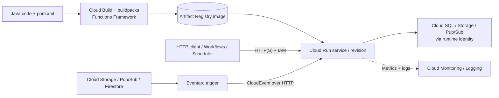
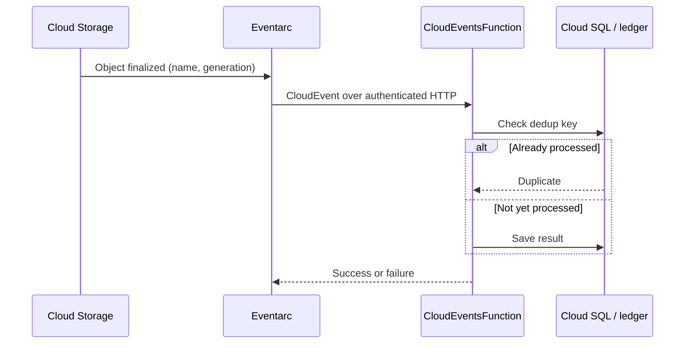
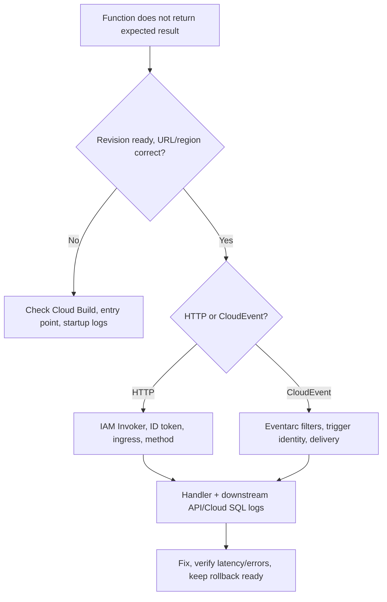

# Cloud Run functions and the managed function model

## 1. Why do we need managed functions?

An e-commerce system uses **Spring Boot** for its main REST API, yet still has many small tasks: receiving payment webhooks, checking newly uploaded files in **Cloud Storage**, reacting to **Pub/Sub** events, or performing an automated scheduled action. If each task had to run on a dedicated VM or GKE Deployment, the Java team would spend time managing servers, patching, scaling, and monitoring.

**Cloud Run functions** let you write an **HTTP handler** or **CloudEvents handler**, deploy directly from source code, and use managed Cloud Run infrastructure. Google Cloud builds it into a container, deploys a revision, provisions instances on incoming requests, and automatically adjusts the instance count based on configuration. Developers focus on the function's **inputs, logic, errors, and outputs**.

In the **Cloud Run functions and Eventarc** chapter of the **CLOUD_PROVIDERS_GCP** module, this lesson introduces the function model, Functions Framework for Java, deployment, permissions, triggers, reliability, costs, and safe practices. The content connects knowledge of project/IAM, Cloud Build, Artifact Registry, Cloud Storage, VPC, and reliability monitoring.

**Learning objectives:** distinguish between function/service/job; understand source-to-container; write and deploy a Java HTTP function; recognize CloudEvents and Eventarc; apply IAM, idempotency, timeout, and concurrency; read logs, perform rollbacks, and clean up.

> **Scope:** commands are intended only for approved lab projects. Deployments may incur Cloud Build, Artifact Registry, Cloud Run, and Cloud Logging charges. Do not enable public HTTP endpoints or create triggers on production just for testing.

## 2. Cloud Run functions and generation naming

Cloud Run functions is the current name for **Cloud Functions (2nd gen)**. A new function deployed from source runs as a **Cloud Run service**, with a `run.app` URL, revisions, IAM, autoscaling, and Cloud Run configuration options.

| Option | Management method | When to use |
| --- | --- | --- |
| **Cloud Run functions via Cloud Run Admin API** | `gcloud run deploy --source . --function ...`, Cloud Run Console/Terraform | **Recommended** when creating new functions |
| **Cloud Run functions via Cloud Functions v2 API** | `gcloud functions deploy --gen2` or v2 API | Systems requiring compatibility with legacy workflows |
| **Cloud Run functions (1st gen)** | Cloud Functions v1, `--no-gen2` | Legacy; different constraints on runtimes, concurrency, and triggers |

Functions created via the Cloud Run Admin API **cannot be managed by the Cloud Functions API**. v2 functions created via the Cloud Functions API can be managed through both the Cloud Run Admin API and the Cloud Functions v2 API depending on support conditions. Some v2 functions also have a `cloudfunctions.net` URL, which differs from the default `run.app` URL when deploying directly with Cloud Run. Before modifying an existing function, identify the **API that created and manages the resource**.

### Choosing a runtime model

| Need | Suggested service | Reason |
| --- | --- | --- |
| Webhook, event handler, very small API | **Cloud Run function** | Lightweight entry point, deployed from source |
| Spring Boot REST API with many endpoints, filters, controllers | **Cloud Run service** | Preserves the full framework and application structure |
| Batch processing that runs to completion and exits | **Cloud Run job** | Run-to-completion model |
| Consumer always connected to a message broker | **Cloud Run worker pool** or equivalent platform | Suitable for long-running background processing |
| Requires Kubernetes scheduling, sidecar/daemon, cluster control | **GKE** | Full control over Kubernetes resources |

Cloud Run functions **do not guarantee one request per instance**: concurrency can be greater than 1, so Java code must be thread-safe.

## 3. Deployment flow and identities



The process when using the **Cloud Run Admin API**:

1. Submit the source code to the build step.
2. **Cloud Build/buildpacks** combine it with Functions Framework to package it into a container.
3. The image is stored in **Artifact Registry**, typically in an auto-created repository named `cloud-run-source-deploy` if needed.
4. Cloud Run deploys a **revision**, runs instances, and provides an HTTPS URL.
5. An HTTP caller sends a request or **Eventarc** delivers a CloudEvent through a matching trigger.

Three important identities are **distinct**: the **deployer/build identity** compiles and pushes the image; the **runtime service account** allows Java code to access Google Cloud APIs; and the **trigger service account** has permission to invoke the destination when using Eventarc. Do not use the same Project Owner account for all of them.

## 4. HTTP functions and CloudEvents functions

| Type | Java entry point | Input and use cases |
| --- | --- | --- |
| **HTTP function** | `HttpFunction.service(HttpRequest, HttpResponse)` | Webhooks, internal endpoints, synchronous request/response |
| **CloudEvents function** | `CloudEventsFunction.accept(CloudEvent)` | Cloud Storage, Pub/Sub, Firestore events via Eventarc |

An **HTTP function** reads the method, headers, and body directly and writes the status/response. Its URL is not public by default: when authentication is required, the caller needs `roles/run.invoker` and a valid **OIDC ID token**.

A **CloudEvents function** receives events following the **CloudEvents** specification with `id`, `source`, `type`, `time`, and `data`. For example, `google.cloud.storage.object.v1.finalized` is emitted when Cloud Storage creates a new generation for an object. **Eventarc** filters events and delivers them to the function; it is not a new server type.

**Warning:** events may be delivered more than once or out of the order expected by business logic. Functions must implement **idempotency** and a clear retry design.

## 5. Java 21 Lab: A simple HTTP function

This example returns JSON confirming the service is ready, allowing `GET` and rejecting `POST`. This is Java Functions Framework, **not a Spring Boot controller**.

### 5.1. Maven project structure

```text
orders-health/
├── pom.xml
└── src/main/java/dev/example/functions/OrdersHealth.java
```

### 5.2. Complete `pom.xml` file

```xml
<?xml version="1.0" encoding="UTF-8"?>
<project xmlns="http://maven.apache.org/POM/4.0.0"
         xmlns:xsi="http://www.w3.org/2001/XMLSchema-instance"
         xsi:schemaLocation="http://maven.apache.org/POM/4.0.0 https://maven.apache.org/xsd/maven-4.0.0.xsd">
  <modelVersion>4.0.0</modelVersion>
  <groupId>dev.example</groupId>
  <artifactId>orders-health</artifactId>
  <version>1.0.0</version>
  <properties>
    <maven.compiler.release>21</maven.compiler.release>
    <project.build.sourceEncoding>UTF-8</project.build.sourceEncoding>
  </properties>
  <dependencies>
    <dependency>
      <groupId>com.google.cloud.functions</groupId>
      <artifactId>functions-framework-api</artifactId>
      <version>1.1.0</version>
      <scope>provided</scope>
    </dependency>
  </dependencies>
  <build>
    <plugins>
      <plugin>
        <groupId>org.apache.maven.plugins</groupId>
        <artifactId>maven-compiler-plugin</artifactId>
        <version>3.13.0</version>
      </plugin>
      <plugin>
        <groupId>com.google.cloud.functions</groupId>
        <artifactId>function-maven-plugin</artifactId>
        <version>0.11.0</version>
        <configuration>
          <functionTarget>dev.example.functions.OrdersHealth</functionTarget>
        </configuration>
      </plugin>
    </plugins>
  </build>
</project>
```

### 5.3. `OrdersHealth.java` file

```java
package dev.example.functions;

import com.google.cloud.functions.HttpFunction;
import com.google.cloud.functions.HttpRequest;
import com.google.cloud.functions.HttpResponse;
import java.io.IOException;
import java.time.Instant;

public final class OrdersHealth implements HttpFunction {
    @Override
    public void service(HttpRequest request, HttpResponse response)
            throws IOException {
        response.appendHeader("Content-Type", "application/json; charset=utf-8");

        if (!"GET".equals(request.getMethod())) {
            response.setStatusCode(405);
            response.appendHeader("Allow", "GET");
            response.getWriter().write("{\"error\":\"method_not_allowed\"}");
            return;
        }

        response.setStatusCode(200);
        response.getWriter().write(
            "{\"service\":\"orders\",\"status\":\"ok\",\"at\":\""
            + Instant.now() + "\"}");
    }
}
```

The handler contains no credentials, does not rely on local memory, and creates no DB connections. In a real application, define appropriate authentication, validation, and health semantics; do not use a static `200` response as proof that all dependencies are healthy.

### 5.4. Running locally

On a lab machine with JDK 21 and Maven, inside the directory containing `pom.xml`:

```bash
mvn -q package
mvn function:run -Drun.functionTarget=dev.example.functions.OrdersHealth
```

In another terminal:

```bash
curl -i http://localhost:8080/
curl -i -X POST http://localhost:8080/
```

Expected output: `GET=200` with JSON, `POST=405`. This is a hands-on guide for learners and **does not require running Maven inside the documentation repository**.

## 6. Deploying a private Cloud Run function with gcloud

### 6.1. Preparing the project and runtime identity

You need a project with Billing enabled, an up-to-date Cloud SDK, sufficient quota, and IAM permissions to deploy from source. Enable the foundational APIs; the first deployment may require granting permissions to the **build service account** and Google service agents. Deployer permissions typically include **Cloud Run Source Developer**, **Service Usage Consumer**, and **Service Account User** on the identity being used.

```bash
gcloud config set project PROJECT_ID
gcloud services enable run.googleapis.com \
  cloudbuild.googleapis.com artifactregistry.googleapis.com

# Lab: create a runtime service account with no business data permissions.
gcloud iam service-accounts create orders-health-runtime \
  --display-name="Orders health function runtime"
```

### 6.2. Deploying from the source directory

```bash
gcloud run deploy orders-health-fn \
  --source . \
  --function dev.example.functions.OrdersHealth \
  --base-image java21 \
  --region asia-southeast1 \
  --service-account orders-health-runtime@PROJECT_ID.iam.gserviceaccount.com \
  --no-allow-unauthenticated \
  --memory 512Mi \
  --cpu 1 \
  --concurrency 10 \
  --timeout 60s \
  --max-instances 3
```

- `--function` is the **fully qualified class name** of the HTTP handler.
- `--base-image java21` selects Java 21; the list of supported runtimes/versions is subject to change.
- `--no-allow-unauthenticated` keeps the endpoint **private**; callers need IAM Invoker.
- `--concurrency 10` allows multiple concurrent requests, so shared/static state in code must be thread-safe.
- `--max-instances 3` helps limit scale/cost, though it can **be temporarily exceeded in certain load scenarios**; it is not an exact database quota.
- `--timeout 60s` sets the request deadline; downstream calls also need their own timeouts.

Cloud Run builds the source and creates a revision; **deleting the service does not automatically delete all container images/build artifacts** stored in Artifact Registry.

### 6.3. Verifying the private endpoint

```bash
gcloud run services describe orders-health-fn \
  --region asia-southeast1 \
  --format="value(status.url)"

# Requires roles/run.invoker for the current gcloud identity.
gcloud run services proxy orders-health-fn \
  --region asia-southeast1 \
  --port 8080
```

In another terminal:

```bash
curl -i http://localhost:8080/
```

**Cloud Run proxy** automatically attaches credentials for a valid test environment. If calling directly with `curl`, you need an **OIDC ID token** whose audience matches the service URL; a Google Cloud API access token does not substitute for an ID token by default when calling an IAM-authenticated service. **Do not make the endpoint public just to fix HTTP 403**.

## 7. Eventarc and the CloudEventsFunction pattern



A Java CloudEvents handler receives **event metadata**, rather than automatically receiving file bytes:

```java
package dev.example.functions;

import com.google.cloud.functions.CloudEventsFunction;
import io.cloudevents.CloudEvent;
import java.util.logging.Logger;

public final class StorageEventHandler implements CloudEventsFunction {
    private static final Logger LOG =
        Logger.getLogger(StorageEventHandler.class.getName());

    @Override
    public void accept(CloudEvent event) {
        LOG.info(() -> "eventId=" + event.getId()
            + " source=" + event.getSource()
            + " type=" + event.getType());
        // Production: validate payload, check idempotency, then process.
        // Do not log file contents, tokens, or personal data.
    }
}
```

Deploy the handler as a **separate service** with entry point `dev.example.functions.StorageEventHandler`, rather than pointing to `OrdersHealth`. To subscribe to Cloud Storage object finalized events, an Eventarc trigger follows this pattern:

```bash
gcloud eventarc triggers create storage-finalized-lab \
  --location asia-southeast1 \
  --destination-run-service storage-event-fn \
  --destination-run-region asia-southeast1 \
  --event-filters="type=google.cloud.storage.object.v1.finalized" \
  --event-filters="bucket=BUCKET_NAME" \
  --service-account=eventarc-invoker@PROJECT_ID.iam.gserviceaccount.com
```

**This is an illustrative command**, not an end-to-end lab: you must create/deploy `storage-event-fn` and the bucket, enable the Eventarc API, satisfy location/source restrictions, and grant **Eventarc Event Receiver**, **Cloud Run Invoker** to the trigger identity, and the relevant service agent permissions (including Pub/Sub permissions when required by the source). For Cloud Storage direct events, the bucket and destination must belong to the **same project** under the supported model. A trigger may take a few minutes before it starts receiving events.

Each function has a **specific handler type**; do not assume a single Java entry point can simultaneously decode every HTTP request and every CloudEvent. The source, event type, and delivery semantics are defined by the trigger/Eventarc, not by the Java class name.

## 8. Idempotency, retries, and consistency

Eventarc/Pub/Sub delivery can be **at-least-once**: an event may be delivered to the handler more than once. The retry policy depends on how the trigger and transport are configured; **do not assume everything retries indefinitely**. Delayed or out-of-order events must also be accounted for.

Invoice processing event example:

```text
Dedup key: CloudEvent (source, id)
or: Cloud Storage (bucket, objectName, generation).

Cloud SQL ledger:
  UNIQUE(event_source, event_id)
  status: RECEIVED -> PROCESSED or FAILED

On redelivery:
  If PROCESSED -> return success, do not create a duplicate invoice.
  If incomplete -> retry with limits based on state and error.
```

For side effects across multiple systems (DB, email, Pub/Sub), use **appropriate transactions, the outbox pattern**, checkpoints, or compensation. Design **dead-letter/poison event** handling if supported by the transport. Do not return success before durable work is finished just to stop retries. Background threads/futures must be awaited/handled before the function returns; the runtime does not guarantee executing that work after the request ends.

## 9. Autoscaling, cold starts, and Java performance

Cloud Run provisions additional instances under load and can **scale to zero**, depending on configuration. A **cold start** includes environment provisioning, JVM startup, class loading/JIT, and initializing SDKs/connection pools. Instances are **reused but do not persist forever**.

| Setting | Benefit | Risk |
| --- | --- | --- |
| **Min instances** | Reduces cold starts during low traffic | Idle resource charges |
| **Max instances** | Caps scale/cost at the configured level | Does not guarantee an absolute hard cap |
| **Concurrency** | Utilizes one instance for multiple requests | Thread-safety, heap usage, contention |
| **CPU/RAM** | Increases JVM capacity | Higher cost and quota usage |
| **Timeout** | Prevents handlers from hanging too long | Requests may fail if downstream is slow |
| **Billing mode** | Request-based or instance-based | Affects cost and CPU allocation outside requests |

For Java, prioritize **minimizing unnecessary initialization**, reusing **thread-safe** Google Cloud clients, setting timeouts on all downstream calls, and avoiding storing business state in static fields or the local filesystem. Do not increase concurrency if the code uses unsynchronized mutable state.

For example, if each instance has a pool of up to 10 Cloud SQL connections and `max instances=30`, that function alone could open **300 connections**. Size max instances, pools, and queues according to database capacity; autoscaling does not automatically protect the DB from overload.

## 10. IAM, VPC, and security

| Identity | Required permissions | Should not be granted |
| --- | --- | --- |
| Deployer | Cloud Run source deployment and properly scoped `iam.serviceAccounts.actAs` | Default Project Owner |
| Build service account | Build and store images in Artifact Registry | Read access to business data |
| Runtime service account | Specific Cloud Storage/Pub/Sub/Secret Manager permissions | Project-wide Admin |
| HTTP caller | `roles/run.invoker` + OIDC ID token if private | Public `allUsers` just to bypass 403 errors |
| Eventarc trigger identity | Event receive + permission to invoke Cloud Run destination | Broad runtime account permissions |

For functions calling Cloud SQL or internal APIs, choose **VPC egress/Direct VPC egress** or a connector as needed, with proper routes/firewall/IAM. Use **Secret Manager** for secrets; never embed JSON keys in source code, committed environment variables, or logs. Public webhooks require **signature/HMAC verification, replay protection, rate limiting**, and CORS/ingress handling aligned with the security model; HTTPS and a hard-to-guess URL are not enough.

## 11. Observability and troubleshooting

Monitor **request count, HTTP 4xx/5xx, p95/p99 latency, instance count, memory/CPU, cold starts**, revision state, Cloud Build logs, and Eventarc delivery. Java should log structured correlation IDs/event IDs and errors, without logging tokens or sensitive file contents.

```bash
gcloud run services describe orders-health-fn \
  --region asia-southeast1

gcloud run services logs read orders-health-fn \
  --region asia-southeast1 \
  --limit 50

gcloud run revisions list \
  --service orders-health-fn \
  --region asia-southeast1
```

| Symptom | Primary possibilities | What to check |
| --- | --- | --- |
| Build failure | Maven/runtime, Artifact Registry, or build permissions | Cloud Build logs, `pom.xml` |
| Revision not ready | Wrong function class, init error, or resource limits | `--function`, startup/revision logs |
| HTTP 401/403 | Missing ID token/Invoker, wrong ingress | IAM, URL/audience, service proxy |
| HTTP 404/405 | Wrong URL/method or handler logic | URL and HTTP code |
| HTTP 429/503 | Concurrency/max instances/quotas, backend overload | Metrics, Cloud SQL/other dependencies |
| Events not arriving | Trigger filter/location, IAM/service agent, propagation | Eventarc triggers, type, bucket, logs |
| Event processed twice | Retries/at-least-once delivery | Dedup key and processing state |
| Unexpected bill increase | Min instances, traffic spike, builds/logs/storage | Billing Reports, settings, logs |



Do not conclude "the function did not run" just because logs haven't appeared yet: verify **project/region, Logs Explorer filters, IAM, and trigger propagation time**.

## 12. Releases, rollbacks, and cost

Functions deploy as **Cloud Run revisions**, so you can apply CI/CD, smoke tests, error rate monitoring, and traffic shifting/rollback using Cloud Run capabilities. **Rolling back code does not undo** orders or emails already sent; idempotency and data integrity must still be protected.

A concise workflow: **code review → unit tests → deploy private staging → test IAM/events → inspect logs/cost → phased production rollout → retain revision/digest for rollback**. When changing the Java runtime, check [runtime support](https://cloud.google.com/run/docs/runtimes/java), base image security update availability, and Java libraries.

Costs may include **Cloud Run CPU/memory/requests or instance time**, Cloud Build, Artifact Registry storage, Eventarc/Pub/Sub, Logging, network egress, and Cloud SQL/Storage. Scale-to-zero does not make those other resources free. Billing budget alerts **do not automatically cap spending**.

**Illustrative load example, not a pricing table:**

```text
12,000 requests/day x 0.25 seconds/request = 3,000 request-seconds.
Do not blindly divide this number by concurrency to calculate billable vCPU-seconds:
you must account for actual instance lifetime, CPU allocation, and billing mode.
```

### Cleanup on lab resources only

```bash
# After confirming the service is in the right project and has no consumers:
gcloud run services delete orders-health-fn \
  --region asia-southeast1

# If you explicitly created a separate lab trigger:
gcloud eventarc triggers delete storage-finalized-lab \
  --location asia-southeast1
```

Check Artifact Registry images, build artifacts/logs, service accounts, buckets, and Billing **separately**. Do not delete service accounts/buckets if other workloads are using them; deleting a service does not automatically clean up all supporting resources.

## 13. Exercises and applied questions

### Exercise A — Choosing a model

For a **payment webhook**, a **30-endpoint Spring Boot REST API**, a **3-hour batch job**, and a **continuously running Kafka consumer**, choose between function/service/job/worker pool or GKE. Explain your choices based on entry point, execution duration, scaling, and how work is received.

### Exercise B — Hands-on Java HTTP

Create `OrdersHealth` using Maven/Functions Framework, and test `GET=200` and `POST=405` locally. Deploy privately with `gcloud run deploy --source . --function ... --base-image java21`; invoke via Cloud Run proxy, collect logs/revisions, and clean up the lab resources. Do not enable public access to bypass IAM.

### Exercise C — Deduplicating event processing

Design `StorageEventHandler` to receive `google.cloud.storage.object.v1.finalized`, using `(bucket,name,generation)` or `(source,id)` as a dedup key stored in Cloud SQL. Describe what happens when an event is delivered twice and when the DB loses connection; propose an appropriate retry/dead-letter policy.

### Exercise D — Cloud SQL and autoscaling

A function uses 10 DB connections/instance with max 30 instances: calculate the **300 potential connections**. Propose concurrency, connection pool, max instances, queuing, and monitoring settings to protect the DB.

### Exercise E — Diagnosing both entry paths

An HTTP function returns 403, and a CloudEvents function receives no events from Cloud Storage. Write two runbooks: **IAM Invoker/ID token/ingress** and **Eventarc trigger/filter/location/service account/API**. Explain how to verify both without exposing a public endpoint.

### Self-assessment checklist

- [ ] I understand that a Cloud Run function is built from source into a Cloud Run service and differs from 1st gen.
- [ ] I can distinguish the Cloud Run Admin API from the Cloud Functions v2 API.
- [ ] I know Java HTTP and CloudEvents functions have different entry points and triggers.
- [ ] I can run locally and deploy a private Java 21 function, and check its URL/revisions/logs.
- [ ] I understand Eventarc delivery, idempotency, and retries/timeouts.
- [ ] I can distinguish deployer, build, runtime, and trigger service accounts.
- [ ] I know how to manage concurrency, cold starts, instance limits, and Cloud SQL connections.
- [ ] I can estimate costs and follow a controlled rollback and lab-scoped cleanup process.

**Conclusion:** Cloud Run functions reduce operational overhead for small **HTTP handlers and event handlers**, but reliability does not come automatically just from being "serverless." With Java on GCP, you need **the right entry point, IAM on the right identities, safe handling of duplicate events, scaling aligned with downstream systems, and controlled observability/rollback**.

## 14. Google Cloud reference documentation

- [Cloud Run functions overview](https://cloud.google.com/run/docs/functions/overview)
- [Compare Cloud Run functions and Cloud Functions generations](https://cloud.google.com/run/docs/functions/comparison)
- [Write functions: Java HTTP and CloudEvents](https://cloud.google.com/run/docs/write-functions)
- [Java runtimes](https://cloud.google.com/run/docs/runtimes/java)
- [Deploy Cloud Run functions](https://cloud.google.com/run/docs/deploy-functions)
- [Quickstart: Deploy using gcloud](https://cloud.google.com/run/docs/quickstarts/functions/deploy-functions-gcloud)
- [Java Functions Framework local development](https://cloud.google.com/run/docs/local-dev-functions)
- [Function triggers (HTTP/Eventarc)](https://cloud.google.com/run/docs/function-triggers)
- [Trigger functions from Cloud Storage](https://cloud.google.com/run/docs/tutorials/trigger-functions-storage)
- [Eventarc event delivery and retries](https://cloud.google.com/eventarc/docs/retry-events)
- [Authenticate Cloud Run requests](https://cloud.google.com/run/docs/authenticating/developers)
- [Cloud Run pricing](https://cloud.google.com/run/pricing)
