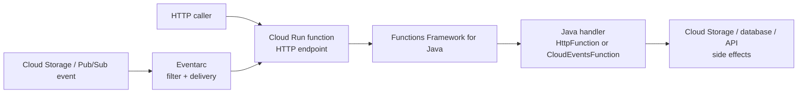
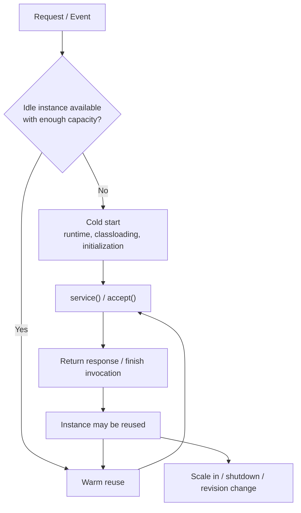

# Functions Framework and the Java function lifecycle

A small API that needs to return an HTTP response or process an "object just uploaded to Cloud Storage" event does not necessarily require deploying an entire Spring Boot application. With **Cloud Run functions**, you can write a **Java class as an entry point**, letting **Functions Framework** receive the request or CloudEvent and invoke the handler method. However, understanding **initialization, instance reuse, concurrency, retries, and invocation completion** is what makes a function reliable in production.

This lesson belongs to the **Cloud Run functions and Eventarc** chapter of the `CLOUD_PROVIDERS_GCP` module. Its content connects with IAM, VPC, Cloud Storage, Cloud Run, monitoring, and cost: writing a small function, testing on a development machine, deploying from source, and designing safe event processing without mistaking JVM memory for durable state storage.

> Examples use **Java 21**, Maven, and the Cloud Run functions interface deployed via `gcloud run deploy --source --function --base-image java21`. The `gcloud functions deploy --gen2` command may still appear in projects using the Cloud Functions v2 API; the two management flows have different deployment/trigger options and endpoints. Follow your project's flow and do not mix flags arbitrarily.

## 1. Objectives

After this lesson, you will be able to:

1. Distinguish **Functions Framework**, **Cloud Run functions**, **HTTP triggers**, and **Eventarc triggers**.
2. Write and run two Java entry points locally: `HttpFunction` and `CloudEventsFunction`.
3. Explain the **cold start → initialize → invoke → reuse → shutdown** lifecycle, and the limits of ephemeral state and background tasks.
4. Identify risks around **concurrency, duplicate events, out-of-order delivery, retry loops, and partial side effects**.
5. Deploy a function from source, configure private invocation permissions, and attach an Eventarc trigger when needed.
6. Apply logging, error handling, IAM, and basic testing/monitoring strategies.

## 2. What does Functions Framework do?

**Functions Framework for Java** is an open-source library/framework that defines the function interfaces and local runner. Cloud Run functions uses this framework to turn an **HTTP request** or **CloudEvent** into a Java method call. **Cloud Run** runs the container infrastructure, creates revisions, handles routing, scaling, and manages instance lifecycles; **Eventarc** selects and delivers events from supported sources to the destination.



| Component | Responsibility | Do not confuse with |
| --- | --- | --- |
| **`HttpFunction`** | Receives `HttpRequest`, writes `HttpResponse`. | A full web framework with automatic routing/DI. |
| **`CloudEventsFunction`** | Receives `io.cloudevents.CloudEvent`, reads metadata and payload. | Eventarc automatically guaranteeing exactly-once processing. |
| **Functions Framework local invoker** | Runs the handler on an HTTP server for local testing. | Production Cloud Run IAM/network/scaling environment. |
| **Cloud Run functions** | Builds/deploys source and runs the function as a Cloud Run service. | A JVM storing durable state or an always-on task runner. |
| **Eventarc** | Filters and delivers events per configured trigger/service account. | A transaction manager for databases or object storage. |

**The Java entry point is the fully qualified class name including package**, e.g., `example.HelloHttp`, not the method name `service` or `accept`. The class must implement the interface matching the trigger type.

## 3. Two Java handler types

### 3.1. HTTP function

Definition:

```java
package example;

import com.google.cloud.functions.HttpFunction;
import com.google.cloud.functions.HttpRequest;
import com.google.cloud.functions.HttpResponse;

public class HelloHttp implements HttpFunction {
    @Override
    public void service(HttpRequest request, HttpResponse response)
            throws Exception {
        String name = request.getFirstQueryParameter("name")
                .orElse("world");
        response.getWriter().write(greeting(name));
    }

    static String greeting(String name) {
        return "Hello, " + name + "!";
    }
}
```

A `GET /?name=An` request is expected to return `Hello, An!`. The example intentionally returns **plain text** and does not access a database. In a real API, validate inputs, set encoding/response headers, enforce authentication, configure timeouts, and bound input sizes. Never pass unvalidated query parameters into SQL, HTML, or shell commands.

An HTTP invocation ends when the handler returns its response/completes processing, not when an arbitrary asynchronous thread spawned by the handler finishes.

### 3.2. CloudEvent function

An example event is **Cloud Storage object finalized** (`google.cloud.storage.object.v1.finalized`), emitted when a new object is created or overwritten as a new generation. The handler receives **CloudEvent metadata** including `id`, `type`, `source`, `subject`, and `data` (depending on the event).

```java
package example;

import com.google.cloud.functions.CloudEventsFunction;
import io.cloudevents.CloudEvent;
import java.nio.charset.StandardCharsets;

public class StorageAudit implements CloudEventsFunction {
    @Override
    public void accept(CloudEvent event) {
        String id = event.getId();
        String type = event.getType();
        String source = event.getSource().toString();
        int size = event.getData() == null
                ? 0
                : event.getData().toBytes().length;

        System.out.printf(
                "event_id=%s event_type=%s source=%s data_bytes=%d%n",
                id, type, source, size);
    }
}
```

This snippet logs only **metadata and payload size** to avoid logging potentially sensitive object contents. In real business logic, parse `event.getData()` with an appropriate JSON/schema library, and validate `type` as well as `bucket`, `name`, and `generation` fields before processing. `CloudEvent` is not a Java object that automatically turns every payload into an application POJO.

An example CloudEvent delivered to the handler might look like:

```json
{
  "specversion": "1.0",
  "id": "event-123",
  "source": "//storage.googleapis.com/projects/_/buckets/orders-input-dev",
  "type": "google.cloud.storage.object.v1.finalized",
  "subject": "objects/report.csv",
  "data": {
    "bucket": "orders-input-dev",
    "name": "report.csv",
    "generation": "1730000000000000"
  }
}
```

This is an **illustrative** payload, not a live event. The metadata envelope conforms to **CloudEvents**, while `data` follows each event provider's schema. Eventarc may deliver CloudEvents over HTTP using **binary content mode**; not every request is JSON containing the full envelope as shown above.

### 3.3. Legacy background functions

In older projects you may see `BackgroundFunction<T>` or `RawBackgroundFunction` with legacy payload/context signatures. When writing Cloud Run functions in the modern Eventarc model, prefer **`CloudEventsFunction`** for events. Do not copy legacy two-parameter `(data, context)` examples directly into a single-parameter CloudEvent handler.

## 4. Minimal Maven project structure

A single source directory can contain **multiple entry point classes**; during deployment, you select the desired class using the `--function` flag:

```text
java-functions-lab/
├── pom.xml
└── src/
    ├── main/java/example/
    │   ├── HelloHttp.java
    │   └── StorageAudit.java
    └── test/java/example/
        └── HelloHttpTest.java
```

Self-contained `pom.xml` example:

```xml
<project xmlns="http://maven.apache.org/POM/4.0.0"
         xmlns:xsi="http://www.w3.org/2001/XMLSchema-instance"
         xsi:schemaLocation="http://maven.apache.org/POM/4.0.0 https://maven.apache.org/xsd/maven-4.0.0.xsd">
  <modelVersion>4.0.0</modelVersion>
  <groupId>example</groupId>
  <artifactId>java-functions-lab</artifactId>
  <version>1.0.0</version>
  <properties>
    <maven.compiler.release>21</maven.compiler.release>
    <project.build.sourceEncoding>UTF-8</project.build.sourceEncoding>
  </properties>
  <dependencies>
    <dependency>
      <groupId>com.google.cloud.functions</groupId>
      <artifactId>functions-framework-api</artifactId>
      <version>1.1.2</version>
      <scope>provided</scope>
    </dependency>
    <dependency>
      <groupId>org.junit.jupiter</groupId>
      <artifactId>junit-jupiter</artifactId>
      <version>5.11.4</version>
      <scope>test</scope>
    </dependency>
  </dependencies>
  <build>
    <plugins>
      <plugin>
        <groupId>org.apache.maven.plugins</groupId>
        <artifactId>maven-compiler-plugin</artifactId>
        <version>3.13.0</version>
      </plugin>
      <plugin>
        <groupId>org.apache.maven.plugins</groupId>
        <artifactId>maven-surefire-plugin</artifactId>
        <version>3.5.2</version>
      </plugin>
      <plugin>
        <groupId>com.google.cloud.functions</groupId>
        <artifactId>function-maven-plugin</artifactId>
        <version>0.11.0</version>
      </plugin>
    </plugins>
  </build>
</project>
```

The `functions-framework-api` dependency provides the interfaces and CloudEvents types used at compile time; `scope=provided` reflects that the framework is present in the Cloud Run functions runtime environment. **Do not add a Spring Boot Web server or a `main()` method just to run an HTTP handler**. The Maven dependency/plugin versions in this example should be verified against your project's dependency policy before release; there is no guarantee every build platform uses the exact same versions.

## 5. Running and testing on a development machine

Requirements: JDK 21, Maven, network access to dependency repositories. The following commands **run inside the source project created by the learner**, not inside the learning materials repository.

### 5.1. HTTP handler

```bash
# In the directory containing pom.xml
mvn test

# Terminal A: start local Functions Framework
mvn function:run -Drun.functionTarget=example.HelloHttp -Drun.port=8080
```

Open Terminal B:

```bash
curl -i "http://127.0.0.1:8080/?name=An"
curl -i "http://127.0.0.1:8080/"
```

Expected output is `Hello, An!` and `Hello, world!`, respectively. Local testing helps catch Java classpath, entry point, and input-handling bugs; **it does not replace** testing IAM/identity, Eventarc triggers, and scaling in the cloud environment.

### 5.2. Event handler

Stop the HTTP invoker, then run:

```bash
mvn function:run \
  -Drun.functionTarget=example.StorageAudit \
  -Drun.port=8080
```

In another terminal, send a **CloudEvent in binary mode**:

```bash
curl -i -X POST "http://127.0.0.1:8080/" \
  -H "ce-specversion: 1.0" \
  -H "ce-id: lab-001" \
  -H "ce-type: google.cloud.storage.object.v1.finalized" \
  -H "ce-source: //storage.googleapis.com/projects/_/buckets/orders-input-dev" \
  -H "content-type: application/json" \
  --data '{"bucket":"orders-input-dev","name":"report.csv","generation":"1"}'
```

Observe the invoker terminal; the handler is expected to log event metadata and `data_bytes`. This is a **simulated event** and does not prove that a real Eventarc trigger is configured or authorized to invoke Cloud Run.

### 5.3. Intentional testing

| Case | Expected outcome |
| --- | --- |
| HTTP missing `name` | Falls back to `world`. |
| HTTP sending long strings/special characters | Application validates/bounds input before echoing into HTML/JSON. |
| CloudEvent missing `data` | Handler does not throw `NullPointerException`; logs size 0. |
| CloudEvent wrong `type` | Real logic rejects or intentionally ignores; performs no side effects. |
| Same event sent twice | Business logic does not record/charge/move data twice. |
| Downstream API fails transiently | System-configured retry/backoff applies; no infinite retry inside one invocation. |

Example `src/test/java/example/HelloHttpTest.java` testing pure logic separated from the HTTP layer:

```java
package example;

import static org.junit.jupiter.api.Assertions.assertEquals;
import org.junit.jupiter.api.Test;

class HelloHttpTest {
    @Test
    void greetingUsesName() {
        assertEquals("Hello, An!", HelloHttp.greeting("An"));
    }
}
```

Run `mvn test` to verify unit tests. If you need to test `HttpRequest`/`HttpResponse` directly, you can add Mockito and test `getWriter()`; for event handlers, construct a CloudEvent using the CloudEvents SDK to test metadata/schema handling. **Never call production APIs directly from unit tests**; use integration tests in a dedicated environment.

## 6. Lifecycle of a Java function instance



### 6.1. Cold start and initialization

Cloud Run may spin up an instance when load rises or when no instance is ready. The Java runtime must boot the JVM, load classes, instantiate the handler, and initialize required dependencies. Cold starts can be affected by:

- Code/dependency size and classloading overhead.
- CPU/memory, SDK client initialization, and network connections.
- Synchronous startup logic, secret/config lookups, or DNS resolution.
- Min instances, concurrency, and startup CPU boost settings where supported.

**Principle:** initialize only what is necessary, measure startup time, and prune the dependency tree. If an SDK client is expensive to create yet thread-safe, you can keep it as a static/shared object **within the same instance**; if rarely used, consider safe lazy initialization.

### 6.2. Warm reuse: memory is not a database

An instance can serve multiple invocations, so an object cached in the JVM **may** be reused:

```java
package example;

import java.time.Instant;
import com.google.cloud.functions.HttpFunction;
import com.google.cloud.functions.HttpRequest;
import com.google.cloud.functions.HttpResponse;

public class InstanceInfo implements HttpFunction {
    // Initialized once per JVM/classloader if the instance is reused.
    private static final Instant INSTANCE_STARTED = Instant.now();

    @Override
    public void service(HttpRequest req, HttpResponse res)
            throws Exception {
        res.getWriter().write("instance_started=" + INSTANCE_STARTED);
    }
}
```

Two requests may see the **same timestamp** if routed to the same instance, or different timestamps across multiple instances. There is no guarantee that the next invocation will land on the same instance holding the cache.

| State | Can persist across invocations? | Where should durable state live? |
| --- | --- | --- |
| Static cache, SDK client, connection pool | Possible, **only within one instance** and must be thread-safe. | Rebuilt on cold start; source of truth remains in the data service. |
| Local variables in `service()`/`accept()` | Only that single invocation. | Never use for cross-request state. |
| Files in `/tmp` | May remain visible within one instance, lost when replaced. | Cloud Storage or appropriate storage. |
| Order status, idempotency keys | Never keep solely in RAM or `/tmp`. | Firestore, Cloud SQL, or an appropriate transactional store. |
| Background jobs after handler returns | No completion guarantee. | Cloud Tasks, Pub/Sub, Cloud Run jobs, or managed workers. |

### 6.3. Concurrency and thread safety

Cloud Run can send multiple concurrent requests to a single instance depending on the **concurrency** setting. Therefore, shared mutable state, unsynchronized lazy singletons, or caches can suffer race conditions:

```java
// DO NOT use as an exact business counter:
private static int processed = 0;

// Two threads can read the same value and overwrite each other:
// processed++;
```

Even replacing it with `AtomicInteger` is only accurate **within a single JVM**—it does not aggregate across multiple instances and does not survive scale-to-zero. For tasks requiring accurate counting or duplicate prevention, use a data store with transactions/conditional writes and define a clear business key.

### 6.4. Invocation completion and shutdown

- **HTTP:** return the response after processing succeeds or return a meaningful error. Do not send HTTP 200 before critical side effects have completed if doing so sacrifices retryability.
- **CloudEvent:** completing the handler without throwing typically acknowledges that delivery attempt. If an exception is thrown, retry behavior depends on the **Eventarc trigger/transport policy**, not just Java code.
- **Background work:** avoid `new Thread(...).start()` followed by returning and hoping the thread finishes. Instance CPU/lifecycle does not guarantee that work will complete.
- **Scale in/redeploy:** instances may be stopped, restarted, or replaced; design timeouts, retries, idempotency, and graceful shutdown for open resources.

## 7. Deploying a Cloud Run function with gcloud

Examples use the lab project `orders-dev` and region `asia-southeast1`. The deployer needs IAM permissions to create/redeploy Cloud Run services, build source, use the runtime service account, access Artifact Registry, and use related APIs per organization policy.

### 7.1. Checking the project and APIs

```bash
PROJECT_ID="orders-dev"
REGION="asia-southeast1"
HTTP_SERVICE="hello-java-dev"
EVENT_SERVICE="storage-audit-dev"

gcloud auth list
gcloud config get-value project
gcloud run services list \
  --project="$PROJECT_ID" --region="$REGION"
gcloud services list --enabled --project="$PROJECT_ID"
```

Typically required components include the **Cloud Run Admin API**, **Cloud Build**, and **Artifact Registry**; if using triggers, also **Eventarc**, event sources like **Cloud Storage/Pub/Sub**, and their service agents. Enabling APIs or granting IAM makes real changes; operate only in an authorized lab project.

### 7.2. Deploying the HTTP handler separately

From the directory containing `pom.xml` and the two Java classes:

```bash
# CREATES/MODIFIES a Cloud Run service, builds an image, and incurs charges.
gcloud run deploy "$HTTP_SERVICE" \
  --project="$PROJECT_ID" \
  --region="$REGION" \
  --source . \
  --function example.HelloHttp \
  --base-image java21
```

The command **omits `--allow-unauthenticated`** to avoid accidentally exposing public invoker access. Verify the service's IAM/ingress after deployment; existing configuration may be preserved across updates. If a public webhook is genuinely required, review authentication, rate limiting, and abuse protection before allowing unauthenticated access.

Verification:

```bash
gcloud run services describe "$HTTP_SERVICE" \
  --project="$PROJECT_ID" --region="$REGION" \
  --format="yaml(status.url,metadata.name)"

# List created revisions
gcloud run revisions list \
  --project="$PROJECT_ID" --region="$REGION" \
  --service="$HTTP_SERVICE"
```

If you hold `roles/run.invoker`, you can use `gcloud run services proxy` or call the URL with an **OIDC identity token** issued for an authorized user/application. Do not arbitrarily use an OAuth access token in place of an identity token on endpoints requiring Cloud Run IAM authentication.

### 7.3. Deploying the CloudEvent handler separately

```bash
# CREATES/MODIFIES another service that receives CloudEvents over HTTP when triggered.
gcloud run deploy "$EVENT_SERVICE" \
  --project="$PROJECT_ID" \
  --region="$REGION" \
  --source . \
  --function example.StorageAudit \
  --base-image java21
```

At this point you only have the **destination Cloud Run function**, without an Eventarc trigger yet. One source project contains multiple entry points, but each deployment selects **one target class** for that service; the remaining classes are not automatically exposed as separate endpoints.

## 8. Connecting Cloud Storage events with Eventarc

A practical example: log only when an object in bucket `orders-input-dev` finishes uploading. Path:

```text
Cloud Storage object finalized
    → Eventarc trigger (type + bucket filters)
    → authenticated Cloud Run function URL
    → Functions Framework
    → StorageAudit.accept(CloudEvent)
```

### 8.1. Prerequisites before creating the trigger

1. The bucket exists and its **location** is compatible with the Eventarc trigger under event source restrictions.
2. APIs and service agents are active; the account creating the trigger has the necessary permissions.
3. A **user-managed service account** exists for the trigger (e.g., `eventarc-delivery@orders-dev.iam.gserviceaccount.com`) authorized to **invoke the exact Cloud Run service** (`roles/run.invoker`). Depending on the event source, **Eventarc Event Receiver** and service agent/transport permissions are also required per documentation.
4. The function's runtime service account is **separate** from the trigger identity; it only needs permissions for Google APIs actually called in the handler.
5. Do not create a trigger without a plan for **duplicates/retries, poison events, cost, and event loops**.

### 8.2. Creating the trigger (once IAM is ready)

```bash
BUCKET="orders-input-dev"
TRIGGER="orders-storage-finalized-dev"
TRIGGER_SA="eventarc-delivery@$PROJECT_ID.iam.gserviceaccount.com"

# READ-ONLY: inspect existing bucket and triggers.
gcloud storage buckets describe "gs://$BUCKET" \
  --project="$PROJECT_ID"
gcloud eventarc triggers list \
  --project="$PROJECT_ID" --location="$REGION"

# INFRASTRUCTURE CHANGE: run only after IAM and region are prepared.
gcloud eventarc triggers create "$TRIGGER" \
  --project="$PROJECT_ID" \
  --location="$REGION" \
  --destination-run-service="$EVENT_SERVICE" \
  --destination-run-region="$REGION" \
  --event-filters="type=google.cloud.storage.object.v1.finalized" \
  --event-filters="bucket=$BUCKET" \
  --service-account="$TRIGGER_SA"
```

This is a **direct Eventarc Standard/Cloud Storage pattern**, and does not apply with identical syntax to every event type or region. The Cloud Storage bucket must meet the trigger's location/project requirements; creating a trigger for the first time may take time for service agent setup and event propagation.

### 8.3. Verification and cleanup

```bash
gcloud eventarc triggers describe "$TRIGGER" \
  --project="$PROJECT_ID" --location="$REGION"

# Only create a test file in an authorized LAB bucket, never with production data.
printf 'functions-lab\n' > sample-event.txt
gcloud storage cp sample-event.txt "gs://$BUCKET/sample-event.txt"

# Read function logs after the event is delivered.
gcloud run services logs read "$EVENT_SERVICE" \
  --project="$PROJECT_ID" --region="$REGION" --limit=50
```

If no event appears, do not spam hundreds of uploads: check **trigger ACTIVE state, bucket/region/event filters, trigger identity IAM, delivery logs, propagation delay, and 403/5xx errors** first.

When finishing the lab:

```bash
# DESTRUCTIVE DELETE: delete only triggers and test objects you own.
gcloud eventarc triggers delete "$TRIGGER" \
  --project="$PROJECT_ID" --location="$REGION"
gcloud storage rm "gs://$BUCKET/sample-event.txt"

# Delete the two Cloud Run services only if created exclusively for the lab:
# gcloud run services delete "$HTTP_SERVICE" --project="$PROJECT_ID" --region="$REGION"
# gcloud run services delete "$EVENT_SERVICE" --project="$PROJECT_ID" --region="$REGION"
```

Also check Artifact Registry images, Cloud Build artifacts, Logging, and lab-specific IAM bindings; deleting a service does not guarantee all auxiliary charges stop immediately.

## 9. Retries, idempotency, and event ordering

**Event-driven functions must not assume exactly-once delivery.** Events can be redelivered when the transport or handler encounters an error, and event order does not necessarily match business time. The **retry** policy belongs to the **trigger/transport**; do not assume every Eventarc configuration retries indefinitely. Some triggers created from the Cloud Run console default to **single-attempt delivery** unless retries are enabled. See the [official retries guide](https://cloud.google.com/run/docs/tips/function-retries).

Example of an "object finalized" event triggering an email or accounting entry:

| Scenario | Unsafe design | Safer design |
| --- | --- | --- |
| Event delivered twice | Sends two emails, creates two orders. | Check **idempotency key** in a persistent store. |
| Function wrote DB but ACK failed | Retry writes a second time. | Conditional insert/transaction; treat duplicates as valid success. |
| Newer event arrives before older event | Older event overwrites newer state. | Compare **generation/version** or business ordering data before updating. |
| Permanently invalid payload | Retries forever, inflating cost. | Classify permanent/transient, dead-letter/alert, and cap retries. |
| Handler writes output to same source bucket | Continuously generates new events. | Use a separate target bucket/prefix and filter in business logic. |

### 9.1. Idempotency keys

One option for deduplicating transport events is the CloudEvent `source + id` key; for tasks tied to an object generation, you may need **bucket + object name + generation** to accurately represent the business event.

```text
handle(event):
    validate type and data schema
    key = bucket + "/" + name + "#" + generation
    if atomic_create_processed_record(key) says "already exists":
        return success
    perform_or_schedule_side_effect_idempotently(key)
    mark_completed_consistently()
```

The above is **pseudocode**, not a complete transaction. Marking processed before the side effect occurs can drop work if the process crashes. Marking after the side effect without a protective protocol allows retries to repeat the side effect. Use a **transactional outbox, conditional writes, a state machine, or a queue with ack/retry** matching your data architecture.

### 9.2. When to report an error?

- **Transient failure** (database timeout, temporary rate limit): throw/fail the invocation if the trigger is configured with appropriate retries; use bounded retries/backoff.
- **Permanent invalid event**: log a minimal warning, route to dead-letter/quarantine if needed, and avoid infinite loops.
- **Duplicate already processed successfully**: return success without repeating side effects.
- **Uncertain whether side effect succeeded**: look up the idempotency key before retrying.

Merely calling `System.out.println` and returning in a handler like `StorageAudit` is an **event observation** example, not a durable data-processing workflow.

## 10. Security, performance, and observability

| Layer | Recommended practice |
| --- | --- |
| **Invoker** | HTTP functions require authenticated invocation when internal; trigger service accounts hold `roles/run.invoker` on the exact target. |
| **Runtime IAM** | Separate runtime SA from build/deployer/trigger SAs; grant only required bucket/DB/secret read/write roles. |
| **Secrets** | Use Secret Manager/IAM; never store credentials in source, public env config, or logs. |
| **Ingress/network** | Choose appropriate ingress policies and VPC egress; avoid public URLs when unnecessary. |
| **Java lifecycle** | Reuse thread-safe clients; never hold exclusive business state in static/cache/`/tmp`. |
| **Cold starts** | Review Java runtime, dependency count, min instances/startup boost against SLO/cost. |
| **Concurrency** | Protect shared mutable state, cap connection pools, load-test concurrent invocations. |
| **Observability** | Log correlation ID/`event.id`, avoid PII or full payloads; set up Cloud Logging + Monitoring alerts. |
| **Cost** | Account for invocations, vCPU/memory time, Eventarc/Pub/Sub transport, Cloud Build/Artifact Registry, network/DB. |

**A Cloud Run function is a Cloud Run service created from source**, so choices around **CPU, memory, concurrency, min/max instances, request-based/instance-based billing, and revision rollouts** affect behavior just like any Cloud Run service. Do not keep min instances thinking "a JVM will always stay alive to run background jobs"; instances can still be replaced and idle costs increase.

### 10.1. Signals to monitor

- **HTTP:** request count, p95/p99 latency, 4xx/5xx, cold starts, instance count.
- **Eventarc:** trigger active state, delivery errors, retry attempts/lag, and dead-letter queue if configured.
- **Java:** heap/GC, OOM errors, classloading/startup time, and connection pools.
- **Downstream:** Cloud Storage/Cloud SQL/HTTP errors, idempotency conflicts, and completed business jobs.
- **Billing:** Cloud Run instance time, Eventarc transport, Logging, network, and target services.

When a function returns HTTP 200 yet the business task did not finish, ask **whether ACK happened before the side effect, whether work ran after return, or whether state was lost on scale-in** — do not just look at a "handler invoked" log.

## 11. Quick troubleshooting

| Symptom | Common causes | How to resolve |
| --- | --- | --- |
| Deploy fails with `ClassNotFoundException` / entry point | Wrong package, class, or `--function`; Maven build failure. | Verify fully qualified class name, `src/main/java`, and dependency scopes. |
| HTTP `403` | Missing Cloud Run Invoker permission or bad authentication. | Verify identity token, service IAM, and ingress policy. |
| Local handler works but CloudEvents never arrive | Trigger not created, wrong event filter, incompatible location, or missing delivery IAM. | Check `eventarc triggers describe`, trigger/service logs, bucket metadata. |
| Event processed twice | Retry/duplicate delivery or non-idempotent side effect. | Persist key by event/object generation, use conditional writes. |
| Slow cold starts | Heavy dependencies, JVM initialization, external connections on class load. | Profile startup, use sensible lazy/synchronous init, evaluate min instances/startup boost. |
| Memory steadily grows | Unbounded caches, retained references, or resource leaks. | Heap profiling/GC metrics, bounded caches, close resources. |
| 429/5xx under high load | Max instances/quota, high concurrency, or saturated downstream. | Load test, inspect Cloud Run/DB metrics and quotas. |
| Work lost after response | Background thread lacks CPU/lifecycle guarantees. | Offload to queues/jobs; ack only after durable processing. |

## 12. Exercises with answers

**Exercise 1 — Choosing an interface.** A webhook receives HTTP POSTs and must reply with JSON; another function runs when an object is created in a bucket. Which interfaces should you use?

*Answer:* The webhook uses **`HttpFunction.service(HttpRequest, HttpResponse)`**; the Cloud Storage Eventarc handler uses **`CloudEventsFunction.accept(CloudEvent)`**.

**Exercise 2 — Entry point.** A class in package `example` is named `HelloHttp`. What value should `--function` take?

*Answer:* `example.HelloHttp`, which is the **fully qualified class name**, not `HelloHttp.service`.

**Exercise 3 — State.** A static variable counts 10 invocations, then resets to 0 after deploying a new revision. Is this a Cloud Run bug?

*Answer:* No. Static state lives only in the current JVM/instance. Use a **persistent store** whenever you need accurate counts or durable data.

**Exercise 4 — Concurrency.** Two requests increment a `static int` concurrently. Why can the final count be wrong? Does `AtomicInteger` solve this system-wide?

*Answer:* `++` has a race condition across threads. `AtomicInteger` is only accurate within one instance; it does not synchronize across multiple JVMs and does not persist when an instance stops.

**Exercise 5 — Duplicate events.** Eventarc delivers the same `google.cloud.storage.object.v1.finalized` event twice. The handler creates two invoices. How do you redesign it?

*Answer:* Use an idempotency key based on object generation/business ID and **conditional writes/transactions** to guarantee a single business effect; valid duplicates return success.

**Exercise 6 — Retries.** A handler throws an exception because an upstream service is temporarily unreachable. Is Eventarc guaranteed to retry automatically?

*Answer:* No. You must check the **trigger's retry/transport policy**, backoff, and attempt limits. Classify transient vs. permanent errors and design dead-letter handling when appropriate.

**Exercise 7 — Background threads.** An HTTP function returns 200 and starts a thread taking two minutes to process a file. What can happen?

*Answer:* The invocation has already ended, so CPU/lifecycle are not guaranteed; the thread may be killed when the instance goes idle or scales in. Move the work to **Cloud Tasks/Pub/Sub/Cloud Run jobs** and process with retries.

**Exercise 8 — Trigger permissions.** An Eventarc trigger is created, yet Cloud Run logs show 403. Should you grant Project Owner to the service account?

*Answer:* No. Verify the trigger identity, **`roles/run.invoker` on the specific service**, Eventarc event receiver/service agent permissions, and ingress; apply least privilege.

## 13. Production adoption checklist

- [ ] Distinguished HTTP and CloudEvent signatures; Java entry point uses the correct package/class.
- [ ] Built/tested via Maven; JDK/runtime and Functions Framework dependency are compatible.
- [ ] Local HTTP/CloudEvent tests cover invalid input, timeouts, and duplicate events.
- [ ] Runtime service account, trigger identity, and deployer permissions are separated and scoped.
- [ ] No secrets/full payloads logged; audit logs, metrics, and correlation IDs are in place.
- [ ] No exclusive business state stored in static fields/`/tmp`; client caches are thread-safe.
- [ ] Side effects use idempotency keys, transactions/conditional writes, retries, and dead-letter queues where appropriate.
- [ ] No background threads spawned after invocation if work must reliably finish.
- [ ] Eventarc filters, location, IAM, delivery status, and retry policy are verified.
- [ ] CPU/memory/concurrency/min/max and cold starts are load-tested and cost-estimated.
- [ ] Revision rollback, trigger cleanup, and Artifact Registry/transport cost checks are established.

## 14. Summary

**Functions Framework for Java** simplifies writing functions: use `HttpFunction` for HTTP and `CloudEventsFunction` for events, select the Java class as the entry point, run locally with Maven, and deploy to Cloud Run functions. However, **short handler code does not mean a simple event-processing system**: you must proactively manage lifecycle, thread safety, state, duplicate events, retries, and permissions.

The most important operational principle: **an invocation is only complete once the required side effects are safely persisted**. Treat instances as replaceable at any moment; all critical state must live in durable storage, and all side effects must handle redelivery safely.

### Official documentation

- [Write Cloud Run functions](https://cloud.google.com/run/docs/write-functions)
- [Deploy a Cloud Run function](https://cloud.google.com/run/docs/deploy-functions)
- [Java runtime](https://cloud.google.com/run/docs/runtimes/java)
- [Local functions development](https://cloud.google.com/run/docs/local-dev-functions)
- [Functions best practices](https://cloud.google.com/run/docs/tips/functions-best-practices)
- [Cloud Run function triggers](https://cloud.google.com/run/docs/function-triggers)
- [Create triggers with Eventarc](https://cloud.google.com/run/docs/triggering/trigger-with-events)
- [Configure event-driven function retries](https://cloud.google.com/run/docs/tips/function-retries)
- [Functions Framework for Java](https://github.com/GoogleCloudPlatform/functions-framework-java)
