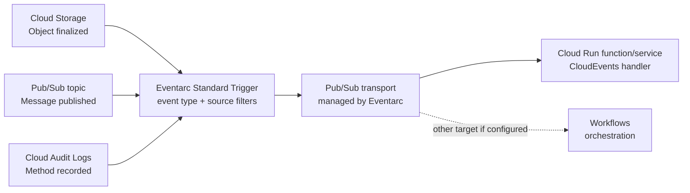
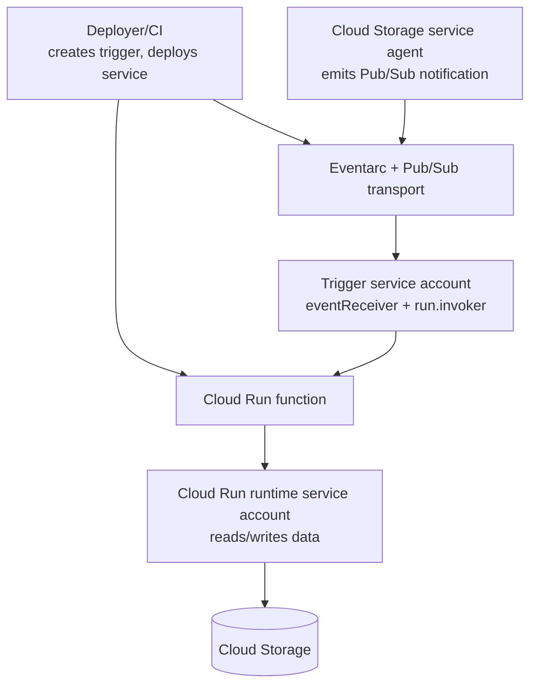
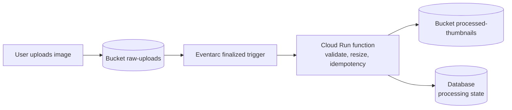

# Eventarc triggers, event providers, and CloudEvents

## 1. Why do we need Eventarc?

An e-commerce application needs to generate thumbnails when product images are uploaded to **Cloud Storage**, update orders when **Pub/Sub** messages arrive, or react when a Google Cloud resource changes. If services had to continuously check whether data had changed (*polling*), the system would waste resources and struggle to control latency.

**Eventarc** is Google Cloud's event routing service. In **Eventarc Standard**, operators create a **trigger** to select an event type from an **event provider** and forward it to an **event destination**, such as **Cloud Run functions**, Cloud Run services, or Workflows. Eventarc delivers events using the **CloudEvents** specification so consumers can read standardized metadata regardless of the emitting source.

This topic belongs to the **Cloud Run functions and Eventarc** chapter of the **CLOUD_PROVIDERS_GCP** module, connecting Project/IAM, VPC, Cloud Storage, GKE, Cloud Run, data services, release automation, and reliability/cost monitoring.

### Objectives

After this lesson, you will be able to:

1. Distinguish **source/provider, event type, trigger, filter, transport, and destination**.
2. Choose between **direct events**, **Pub/Sub events**, **Cloud Audit Logs events**, and supported third-party sources.
3. Read CloudEvents in **HTTP binary content mode**: `ce-*` headers and provider-specific payloads.
4. Deploy a **Cloud Run function** receiving Cloud Storage events using Python and `gcloud`.
5. Grant appropriate IAM permissions for the trigger identity, runtime identity, and service agent.
6. Design **idempotent** handlers because Eventarc Standard delivers events **at least once** with no ordering guarantees.
7. Monitor triggers/logs, handle errors, and control costs.

> **Note:** Project names, buckets, service accounts, and URLs below are illustrative. Commands creating triggers/buckets/Cloud Run services may incur charges; run them only in an approved lab project. This guide focuses on Eventarc **Standard**; Eventarc **Advanced** uses buses/pipelines and has different configuration.

## 2. Event architecture and terminology



| Component | Role | Example |
| --- | --- | --- |
| **Provider/source** | Service emitting the event | Cloud Storage, Pub/Sub, BigQuery via audit |
| **Event type** | Event category per source schema | `google.cloud.storage.object.v1.finalized` |
| **Trigger** | Resource that filters and routes events | Capture only finalized events from bucket A |
| **Filter attributes** | Fields published by the provider for filtering | `type`, `bucket`, `serviceName` |
| **Destination** | Consumer receiving CloudEvents or workflows | Cloud Run function `object-receiver` |
| **CloudEvent** | Common metadata alongside event-type payload | `id`, `source`, `type`, `data` |

A Standard trigger typically routes to **one destination**. To fan out, create additional triggers as appropriate or use Pub/Sub/another controlled architecture. **The provider does not know in advance which consumer will receive the event.** Eventarc does not replace a database storing business outcomes or a multi-step workflow.

## 3. Event providers and event paths

### 3.1. Direct events from Google Cloud

**Direct events** are emitted directly by integrated providers without going through a Cloud Audit Logs entry. Examples:

| Provider | Event type | Meaning |
| --- | --- | --- |
| Cloud Storage | `google.cloud.storage.object.v1.finalized` | A new object version finished creation |
| Cloud Storage | `google.cloud.storage.object.v1.deleted` | Object deletion event per provider semantics |
| Cloud Storage | `google.cloud.storage.object.v1.archived` | Live version became noncurrent when versioning is enabled |
| Cloud Storage | `google.cloud.storage.object.v1.metadataUpdated` | Object metadata changed |
| Pub/Sub | `google.cloud.pubsub.topic.v1.messagePublished` | Message published to a topic |

The `finalized` event only states that **object generation creation finished**, **not** that the image passed content inspection, malware scanning, or business approval. When both direct and audit-log events support the same scenario, Eventarc documentation recommends using **direct events** when suitable.

### 3.2. Cloud Audit Logs events

For many Google Cloud APIs, Eventarc can route events when an **audit log entry** is written:

```text
type=google.cloud.audit.log.v1.written
serviceName=bigquery.googleapis.com
methodName=google.cloud.bigquery.v2.JobService.InsertJob
```

The payload contains **audit log** information, such as `protoPayload` with `serviceName`, `methodName`, and `resourceName`; it is **not** the body of a Storage finalized event. Verify the supported operation for the provider and the actual audit logs; some **Data Access audit logs** are disabled by default and carry separate logging costs.

### 3.3. Pub/Sub as a bridge for business events

An application emitting `order.created` can publish JSON to a Pub/Sub topic; the Eventarc trigger uses:

```text
type=google.cloud.pubsub.topic.v1.messagePublished
transport-topic=projects/PROJECT_ID/topics/orders-events
```

**Key difference:** `ce-type` received at Cloud Run is still `google.cloud.pubsub.topic.v1.messagePublished`; `order.created` is a **business event type inside message data/attributes**, not an automatic replacement for the CloudEvents type. The consumer must decode and validate the payload.

### 3.4. Third-party providers and Eventarc Advanced

Eventarc Standard supports various third-party providers, many of which are in **Preview**. Do not assume every SaaS product has a connector. When you need custom sources, message buses, pipelines, enrichment, or complex format transformations, evaluate **Eventarc Advanced** separately; do not treat Advanced configuration as a drop-in replacement for Standard triggers.

## 4. Discovering event types instead of guessing

```bash
# READ-ONLY: providers in the target location
gcloud eventarc providers list \
  --project=acme-events-lab \
  --location=asia-southeast1

# READ-ONLY: required types and filteringAttributes
gcloud eventarc providers describe storage.googleapis.com \
  --project=acme-events-lab \
  --location=asia-southeast1

gcloud eventarc locations list --project=acme-events-lab
```

Read `eventTypes[].type` and `filteringAttributes` before designing. A provider may not support events in the selected location. If you encounter `Resource was not found`, check the provider/location; if `PERMISSION_DENIED`, inspect IAM permissions and the Eventarc API.

**Do not infer from a product name that every object update, HTTP call, or database change has a direct event.** Only use types published by the provider.

## 5. CloudEvents: context headers and event data

CloudEvents is an open **CNCF** specification for describing event context. **Eventarc Standard** sends HTTP POST requests to a Cloud Run destination using **CloudEvents HTTP binary content mode**:

- Headers prefixed with `ce-` describe the context.
- The body contains **event data** following the provider's schema.
- The `Content-Type` header describes the body format.

| Context attribute | HTTP header | Purpose |
| --- | --- | --- |
| `specversion` | `ce-specversion` | Specification version, typically `1.0` |
| `id` | `ce-id` | Event ID; combine with `source` when deduplicating |
| `source` | `ce-source` | Source that generated the event |
| `type` | `ce-type` | Event schema/type |
| `time` (optional) | `ce-time` | Event timestamp in RFC 3339 format |
| `subject` (optional) | `ce-subject` | Specific subject within the source, if emitted by provider |
| `datacontenttype` | `Content-Type` | Media type of the body |

### Example Cloud Storage CloudEvent over HTTP

```http
POST / HTTP/1.1
Host: example-cloud-run-service.run.app
ce-specversion: 1.0
ce-id: 9876543210
ce-source: //storage.googleapis.com/projects/_/buckets/acme-input-lab-unique-2026
ce-type: google.cloud.storage.object.v1.finalized
ce-subject: objects/uploads/photo.jpg
ce-time: 2026-11-19T02:30:00Z
Content-Type: application/json

{
  "bucket": "acme-input-lab-unique-2026",
  "name": "uploads/photo.jpg",
  "generation": "1760000000000001",
  "metageneration": "1",
  "size": "204800",
  "contentType": "image/jpeg"
}
```

This is an **illustrative sample**, not a live endpoint. **Binary mode does not place all of `id`, `source`, and `type` inside the JSON body**. With Python **Functions Framework**, the framework parses headers/body into a `CloudEvent` object for the handler to read.

### Pub/Sub CloudEvent body is different

```json
{
  "message": {
    "data": "eyJvcmRlcklkIjoiMTIzIn0=",
    "messageId": "123456789",
    "publishTime": "2026-11-19T02:30:00Z",
    "attributes": {
      "schema": "orders.v1"
    }
  },
  "subscription": "projects/acme-events-lab/subscriptions/example"
}
```

In Pub/Sub, `message.data` is **base64-encoded bytes** that must be decoded before parsing JSON/Protobuf and validating schema and business permissions. `ce-id` and `message.messageId` may relate for Pub/Sub sources, though you should not assume uniformity across all providers.

**Do not treat event contents as proof of resource access.** The trigger's permission to invoke Cloud Run is one IAM layer; the runtime service account still needs permission to read objects or databases per business requirements.

## 6. Trigger configuration and filters

An Eventarc Standard trigger declares a **location**, an **event type**, **filter attributes**, a **destination**, and a **trigger service account**.

```text
type=google.cloud.storage.object.v1.finalized
AND bucket=acme-input-lab-unique-2026
```

All filters must match (**AND**); `--event-filters` uses exact matching and **does not support general regex/wildcards**. Some providers/attributes support **`--event-filters-path-pattern`**, notably `resourceName` on the Cloud Audit Logs path, but **do not assume `name=uploads/*.jpg` is supported** for Storage direct events.

To process only objects with the `uploads/` prefix:

1. Create a trigger filtering by `bucket` as supported by the provider.
2. In the handler, check `data.name.startswith("uploads/")`.
3. Skip out-of-scope objects and ACK safely.
4. If event volume is very high, consider splitting buckets or using an appropriate filtering architecture to reduce overhead.

**You cannot change `event-filters type` on an existing trigger.** When switching event types, create a new trigger, test/cut over in a controlled way, and then delete the old trigger. Two overlapping triggers can cause duplicate side effects if the handler is not idempotent.

## 7. Choosing the right location

| Source | Eventarc Standard trigger location | Important constraint |
| --- | --- | --- |
| **Cloud Storage direct** | Location **matching the bucket**: region, dual-region, or multi-region | Do not use `global`; bucket and trigger in the same project |
| **Pub/Sub direct** | Supported single region | Do not use `global` |
| **Cloud Audit Logs** | Single region or `global` | Do not use dual-/multi-region for this type |
| **Cloud Run destination** | Region where service/function is deployed | Can differ from trigger location under conditions; check residency/latency/egress |

For example, a bucket in `asia-southeast1` cannot attach a Storage finalized trigger with `--location=global` or `--location=us-central1`. If the destination is in a different region, evaluate **latency, data residency requirements, and network cost**.

Eventarc Standard uses **Pub/Sub transport**. A **Pub/Sub message storage policy** with `enforceInTransit` can block events if the transit region is outside the allowed list; pay special attention to dual-/multi-region buckets. Cloud Storage also has a limit on **Pub/Sub notification configurations per bucket**, so you cannot add triggers indefinitely.

## 8. IAM identities in the event flow



| Identity | Typically required permissions | What to avoid |
| --- | --- | --- |
| **Deployer** | Deploy Cloud Run, create Eventarc triggers, appropriate `iam.serviceAccounts.actAs` | Granting broad Owner/Editor to CI |
| **Trigger service account** | `roles/eventarc.eventReceiver` on project per source; `roles/run.invoker` on destination | Granting full data read access if unnecessary |
| **Cloud Storage service agent** | `roles/pubsub.publisher` for direct Storage events | Confusing it with the runtime SA |
| **Runtime service account** | IAM to read/write buckets/databases per handler logic | Sharing an administrative service account |

If the trigger sends to Cloud Run and receives **HTTP 401/403**, check the **trigger SA and `roles/run.invoker`** on the exact service; if the handler is invoked but reading the bucket returns **403**, check the **runtime SA and Cloud Storage IAM**. Never make Cloud Run public just to bypass authentication errors.

## 9. Lab: Cloud Storage → Eventarc → Cloud Run function

The lab only **logs metadata** when a new object is finalized, without modifying file contents.

### 9.1. Context and APIs

```text
Project:       acme-events-lab
Region:        asia-southeast1
Bucket:        acme-input-lab-unique-2026
Function:      object-receiver
Trigger:       storage-finalized-trigger
Trigger SA:    eventarc-trigger@acme-events-lab.iam.gserviceaccount.com
Runtime SA:    function-runtime@acme-events-lab.iam.gserviceaccount.com
```

Replace the bucket name with an unused **globally unique** name. The project must have Billing, the required APIs, and deploy/Storage/Eventarc/IAM permissions. Prepare in the lab project:

```bash
# MUTATING: enable required APIs
gcloud services enable \
  run.googleapis.com eventarc.googleapis.com \
  eventarcpublishing.googleapis.com pubsub.googleapis.com \
  storage.googleapis.com cloudbuild.googleapis.com \
  artifactregistry.googleapis.com logging.googleapis.com \
  --project=acme-events-lab

# READ-ONLY before creation
gcloud auth list
gcloud eventarc providers describe storage.googleapis.com \
  --project=acme-events-lab --location=asia-southeast1
```

### 9.2. Python handler

Learners create two files **in a local lab directory**.

**`main.py`**

```python
import json
import functions_framework
from cloudevents.http import CloudEvent

@functions_framework.cloud_event
def on_storage_finalized(event: CloudEvent) -> None:
    event_type = event["type"]
    event_id = event["id"]
    source = event["source"]
    data = event.data or {}

    if event_type != "google.cloud.storage.object.v1.finalized":
        print(json.dumps({"result": "ignored", "type": event_type}))
        return

    bucket = data.get("bucket")
    object_name = data.get("name")
    generation = data.get("generation")
    if not bucket or not object_name or not generation:
        raise ValueError("Missing StorageObjectData fields")

    print(json.dumps({
        "event": "storage_finalized",
        "event_id": event_id,
        "source": source,
        "bucket": bucket,
        "name": object_name,
        "generation": generation
    }, ensure_ascii=False), flush=True)
```

**`requirements.txt`**

```text
functions-framework>=3,<4
cloudevents>=1,<2
```

The handler only logs. In production, add a **bucket allowlist**, validate file size/schema, handle idempotency/transactions, and avoid logging PII from object names. Functions Framework parses CloudEvents context/payload; no custom HTTP server is needed.

### 9.3. Creating the bucket and two service accounts

```bash
# MUTATING resources, may incur charges
gcloud storage buckets create gs://acme-input-lab-unique-2026 \
  --project=acme-events-lab \
  --location=asia-southeast1 \
  --uniform-bucket-level-access \
  --public-access-prevention

gcloud iam service-accounts create eventarc-trigger \
  --project=acme-events-lab \
  --display-name="Eventarc trigger identity"

gcloud iam service-accounts create function-runtime \
  --project=acme-events-lab \
  --display-name="Cloud Run function runtime"
```

Do not delete resources if they already exist with another owner. This lab does not need to grant object read access to the runtime SA because the handler **only processes metadata inside the event**.

### 9.4. Deploying the Cloud Run function from source

Inside the directory containing `main.py`/`requirements.txt`:

```bash
# MUTATING: build + deploy Cloud Run function
gcloud run deploy object-receiver \
  --project=acme-events-lab \
  --region=asia-southeast1 \
  --source=. \
  --function=on_storage_finalized \
  --base-image=python312 \
  --service-account=function-runtime@acme-events-lab.iam.gserviceaccount.com \
  --no-allow-unauthenticated
```

Cloud Run functions currently supports deployment via `gcloud run deploy --source . --function ... --base-image ...`. Functions previously deployed via `gcloud functions deploy --gen2` have a separate management surface/lifecycle; check the original resource when modifying older workloads. The deploy command above creates an **authenticated** Cloud Run service, **without creating the Eventarc trigger yet**.

## 10. Granting IAM, creating the trigger, and verifying

### 10.1. Permissions to receive events and invoke destination

```bash
# MUTATING IAM
gcloud projects add-iam-policy-binding acme-events-lab \
  --member="serviceAccount:eventarc-trigger@acme-events-lab.iam.gserviceaccount.com" \
  --role="roles/eventarc.eventReceiver"

gcloud run services add-iam-policy-binding object-receiver \
  --project=acme-events-lab \
  --region=asia-southeast1 \
  --member="serviceAccount:eventarc-trigger@acme-events-lab.iam.gserviceaccount.com" \
  --role="roles/run.invoker"
```

Cloud Storage direct events require the **Cloud Storage service agent** to hold Pub/Sub Publisher permission:

```bash
# Bash/Cloud Shell; first command only retrieves the service-agent email
STORAGE_SA="$(gcloud storage service-agent --project=acme-events-lab)"

# MUTATING IAM - use the retrieved service-agent email
gcloud projects add-iam-policy-binding acme-events-lab \
  --member="serviceAccount:$STORAGE_SA" \
  --role="roles/pubsub.publisher"
```

Do not substitute the runtime service account or trigger account for `STORAGE_SA`. In real environments, evaluate the smallest scope supported by the publisher role and source.

### 10.2. Creating the trigger for object finalized

```bash
# MUTATING: create Eventarc Standard trigger
gcloud eventarc triggers create storage-finalized-trigger \
  --project=acme-events-lab \
  --location=asia-southeast1 \
  --destination-run-service=object-receiver \
  --destination-run-region=asia-southeast1 \
  --event-filters="type=google.cloud.storage.object.v1.finalized" \
  --event-filters="bucket=acme-input-lab-unique-2026" \
  --service-account="eventarc-trigger@acme-events-lab.iam.gserviceaccount.com"
```

The `bucket` filter takes the **bucket name**, not a `gs://...` URI. The trigger location must match the bucket location. Creating the first trigger may take time to provision the Eventarc service agent; after creation, the trigger may take roughly **two minutes** before it begins receiving events.

### 10.3. End-to-end verification

```bash
# READ-ONLY
gcloud eventarc triggers describe storage-finalized-trigger \
  --project=acme-events-lab --location=asia-southeast1

gcloud eventarc triggers list \
  --project=acme-events-lab --location=asia-southeast1

# MUTATING: upload an object to the lab bucket
echo "Hello Eventarc" > demo.txt
gcloud storage cp demo.txt \
  gs://acme-input-lab-unique-2026/uploads/demo.txt \
  --project=acme-events-lab

# READ-ONLY: inspect Cloud Run function logs
gcloud logging read \
  'resource.type="cloud_run_revision" AND resource.labels.service_name="object-receiver"' \
  --project=acme-events-lab \
  --freshness=1h --limit=50 --format=json
```

Compare the `event="storage_finalized"` log against the actual bucket, object name, and generation. An `ACTIVE` trigger alone does not prove **the function succeeded**: inspect request logs, stdout/stderr, status, and output data. If logs do not appear immediately, account for propagation and logging delay before modifying IAM.

## 11. Pub/Sub and Cloud Audit Logs triggers

All three trigger types use different syntax. Do not wire a **Pub/Sub CloudEvent** to a handler expecting only `StorageObjectData` and conclude Eventarc is broken.

### 11.1. Existing Pub/Sub topic

Assume topic `orders-events` and Cloud Run service `orders-consumer` (with an appropriate Pub/Sub handler) already exist:

```bash
# EXAMPLE MUTATING COMMAND: run only when destination has a Pub/Sub handler
gcloud eventarc triggers create orders-message-trigger \
  --project=acme-events-lab \
  --location=asia-southeast1 \
  --destination-run-service=orders-consumer \
  --destination-run-region=asia-southeast1 \
  --event-filters="type=google.cloud.pubsub.topic.v1.messagePublished" \
  --transport-topic="projects/acme-events-lab/topics/orders-events" \
  --service-account="eventarc-trigger@acme-events-lab.iam.gserviceaccount.com"
```

Then publish an authorized test message:

```bash
gcloud pubsub topics publish orders-events \
  --project=acme-events-lab \
  --message='{"orderId":"order-123","eventType":"order.created"}'
```

The consumer must read `cloud_event.data["message"]["data"]`, **base64-decode** it, and then parse JSON and validate `eventType`/schema. **Do not reuse the `on_storage_finalized` handler directly** from the earlier lab as a Pub/Sub consumer without updating the code.

### 11.2. Audit Logs events

Example filtering a BigQuery audit operation (assuming `audit-consumer` handles the AuditLog schema):

```bash
# EXAMPLE MUTATING COMMAND; verify method and supported audited events in the region
gcloud eventarc triggers create bq-audit-trigger \
  --project=acme-events-lab \
  --location=asia-southeast1 \
  --destination-run-service=audit-consumer \
  --destination-run-region=asia-southeast1 \
  --event-filters="type=google.cloud.audit.log.v1.written" \
  --event-filters="serviceName=bigquery.googleapis.com" \
  --event-filters="methodName=google.cloud.bigquery.v2.JobService.InsertJob" \
  --service-account="eventarc-trigger@acme-events-lab.iam.gserviceaccount.com"
```

Before creating it, check **`gcloud eventarc providers describe ...`**, the catalog of audited operations, and whether the required audit log type is emitted. `resourceName` can further filter by resource if supported by the provider. An audit event has a `protoPayload` structure, distinct from a direct Storage event payload.

### 11.3. Path selection matrix

| Scenario | Type | Filters/transport |
| --- | --- | --- |
| New object created | `google.cloud.storage.object.v1.finalized` | `bucket`, location matching source |
| Pub/Sub message published | `google.cloud.pubsub.topic.v1.messagePublished` | Existing topic or Eventarc-created topic |
| Google API audit entry | `google.cloud.audit.log.v1.written` | `serviceName`, `methodName`, optionally `resourceName` |
| Supported third-party source | Provider-specific type | Per docs/schema and Preview status |

## 12. At-least-once delivery, retries, and ordering

Eventarc Standard uses **at-least-once delivery**. Consumers can receive **an event multiple times**, especially after errors or timeouts. **Event ordering is not guaranteed**: two generations of the same object may be processed out of creation order; two events must not be treated as one transaction.

Via the Pub/Sub transport mechanism, Eventarc defaults to **exponential backoff** retries, from roughly 10 seconds up to 600 seconds; default message retention is around **24 hours**. If delivery fails before retention expires, the message can be routed to a **dead-letter topic** when properly configured. Verify these values against current documentation in operations.

### A notable configuration difference

Triggers created via **Eventarc Console/CLI/Terraform** typically enable retries by default; in the **Cloud Run Console** trigger-creation flow, some default options may attempt delivery **only once**. For Cloud Run destinations, `--max-retry-attempts=1` indicates a single delivery attempt, **not "one extra retry"**.

**Do not disable retries to hide errors** if the business requires reliable processing. If you choose no retries, you must accept or explicitly handle potential event loss.

### When to ACK?

- For HTTP Cloud Run destinations, the handler must return **2xx** after critical work/side effects are committed; delivery is then considered successful.
- For **transient** errors (database unavailable, API 429), return an error per policy to allow retries.
- For **permanently invalid** payloads, route to quarantine/DLQ and define explicit ACK rules rather than retrying forever.
- Never return success upon receiving an event while actual data writes run in a background thread with no completion guarantee.

**Retries can duplicate side effects.** Inspect **Cloud Run request logs** and business state, rather than seeing one `ce-id` appear multiple times and assuming the provider generated distinct events.

## 13. Idempotent design and generation handling

### 13.1. Choosing an identifier key

| Workload type | Recommended idempotency key | Reason |
| --- | --- | --- |
| Retry of the same CloudEvent | `ce-source + ce-id` | Identifies a single event across multiple delivery attempts |
| Object generation processing | `bucket + name + generation` | Two uploads with the same name but different generations are distinct versions |
| Pub/Sub handler | Topic + messageId, or business event ID | Prevents redelivery/duplicates at the message level |
| Payments or order issuance | Business transaction ID | Prevents duplicate side effects even if upstream emits two separate events |

**Do not use an in-memory set/dictionary** as the list of processed events: Cloud Run can scale across multiple instances or restart. Use Cloud SQL/Firestore/Spanner with **transactions/unique constraints**, or an output object/manifest with a Cloud Storage **generation precondition** where appropriate.

### 13.2. Safe processing lifecycle

```text
Event finalized(bucket=A, name=uploads/a.jpg, generation=101)
  → Validate provider/type/bucket/schema
  → Claim idempotency key in durable storage
  → If already DONE: ACK, do not repeat side effects
  → Otherwise: execute business logic and write results
  → Commit DONE status using a safe protocol
  → ACK success
```

**Pitfall:** if an email is sent or DB written yet the container dies before saving `DONE` status, retries may resend the email or write again. Use API idempotency keys, transactions/outbox, or unique constraints. A simple processed-events table **does not provide end-to-end exactly-once semantics** across multiple external systems.

### 13.3. Checking Cloud Storage generation

The event provides `bucket`, `name`, and `generation`. If a handler reads the object by name without specifying generation, two rapid uploads to the same name can cause the older generation's handler to read **the newer version's contents**. For consistent workflows:

1. Use the generation from the event to read the exact version if it still exists and access is permitted.
2. Or inspect the current live generation and skip stale events per business policy.
3. Account for Object Versioning/soft delete and IAM permissions; **do not assume old generations remain readable** after being overwritten.

Because event order is not guaranteed, **last event received** does not equal **newest object generation**.

## 14. Scenario: avoiding loops when generating thumbnails

A Cloud Storage finalized event triggers a thumbnail-generation function. If the function saves thumbnails back into the **same bucket** that has the trigger, the new output triggers the function again and can create an infinite loop.



**Design options:**

1. Use **two buckets**: an input bucket with the trigger, and an output bucket without a reprocessing trigger.
2. If sharing a bucket, separate `uploads/` and `processed/` and **filter inside the handler**, noting that unrelated events still hit the function and incur cost.
3. Write markers/manifests keyed by generation with an **idempotency key**.
4. Cap Cloud Run max instances/concurrency and configure alerts for sudden spikes in event rate.
5. Verify actual file type and size, decode safely, and guard against malicious content; **a `.jpg` extension does not prove a file is a safe image**.

If bulk uploads create large backlogs, evaluate Pub/Sub/Cloud Run Jobs/Workflows to control concurrency and processing SLAs.

## 15. Monitoring and troubleshooting

Cross-check **three layers**: event source, Eventarc routing/transport, and Cloud Run destination.

| Symptom | Common causes | Evidence / resolution |
| --- | --- | --- |
| Trigger creation fails | Wrong Eventarc API, provider/location, or IAM | `providers describe`, error response, IAM |
| Trigger ACTIVE but no events arrive | Bucket/type/location mismatch; propagation delay | `triggers describe`, source object, trigger readiness time |
| Storage direct fails to publish | Storage service agent lacks `pubsub.publisher` | Service-agent identity, Pub/Sub permissions |
| Destination returns 401/403 | Trigger SA lacks `run.invoker` on the exact service | Cloud Run request logs, IAM, trigger identity |
| Handler runs but bucket read returns 403 | Runtime SA lacks `storage.objects.get` | Revision service account, Cloud Storage IAM |
| Audit events do not arrive | Wrong `serviceName`/`methodName`; audit operation not emitted | Eventarc supported events, Audit Logs |
| Pub/Sub parse errors | `message.data` still base64-encoded or wrong schema | Decode, validation, content-type |
| Event processed multiple times | At-least-once/retries or two overlapping triggers | `ce-id`, `source`, business key, idempotency logs |
| Old event processes wrong data | Overwrite on same name, handler ignores `generation` | Read exact generation or skip stale events |
| Failing event loops until retention expires | Persistent handler failure, missing DLQ/runbook | Cloud Run errors, retry policy, and transport |
| Sudden spike in invocations | Function writes output to same bucket, loop | Separate outputs, metrics, max instances |
| High latency / high cost | Cold starts, heavy processing, too many triggers | Cloud Run metrics, Pub/Sub/Logging/Billing |

### Short runbook

1. Record **project, trigger, region, source bucket/topic, UTC timestamp, and object generation/message ID**.
2. Verify the event source emitted the event, the trigger has the right **type/filter/location**, and it is ACTIVE.
3. Check the Eventarc service agent/trigger SA, Cloud Storage service agent, and invoke permissions.
4. Read Cloud Run request logs, application logs, status codes, event IDs, and retry attempts.
5. Distinguish **not routed**, **unable to invoke destination**, **handler error**, and **business state not committed**.
6. Make the minimal fix, generate a **new lab event**, and verify output/idempotency and SLOs.

Do not make Cloud Run public, grant Owner, or arbitrarily delete subscriptions/triggers just to bypass authentication errors. For deep debugging, inspect Eventarc/Cloud Monitoring metrics, Cloud Audit Logs, and the Pub/Sub transport per authorized permissions.

## 16. IAM, cost, and production governance

**Eventarc Standard includes Pub/Sub transport**, so end-to-end billing has multiple components:

- **Eventarc** charges based on edition, source, and event size per current pricing.
- **Pub/Sub transport** carries charges for throughput and data delivery/retention.
- **Cloud Run** bills compute/requests and destination resources.
- **Cloud Storage**, Cloud Logging, Cloud Build/Artifact Registry, network egress, and downstream databases.
- **Cloud Audit Logs** may incur Logging charges, especially when Data Access logs are enabled.

**Do not assume that because Google-sourced Eventarc events are inexpensive or partially free, the whole pipeline is free.** Every event triggers code execution, logging, image processing, DB reads/writes, and retries; duplicate events or loops can drive costs up sharply.

### Guardrails

- Keep the Cloud Run destination **authenticated** and grant `run.invoker` to the specific trigger SA.
- Separate runtime SA and trigger SA; grant only required IAM data permissions.
- Validate event `type`, `source`, provider payload, and business authorization.
- Never log Secret Manager values, signed URLs, PII, or full sensitive payloads.
- Manage triggers via reviewed IaC/CI/CD; during cutovers, prevent two triggers from performing the same side effect.
- Configure Cloud Run max instances/concurrency, retries/DLQ/deadlines, budget alerts, and business reconciliation.
- Do not treat Eventarc as an indefinite event storage queue; design independent replay/recovery for critical data.

## 17. Practice exercises and checks

1. **Path selection:** What `type` values are needed for finished file uploads, published Pub/Sub messages, and BigQuery audit logs? **Hint:** `google.cloud.storage.object.v1.finalized`, `google.cloud.pubsub.topic.v1.messagePublished`, `google.cloud.audit.log.v1.written`.
2. **CloudEvents:** Why is `ce-id` in an HTTP header while Storage `data.name` is in the body? **Answer:** Eventarc Standard uses **CloudEvents binary content mode**.
3. **Location:** With a bucket in `asia-southeast1`, is a Storage direct trigger set to `global` valid? **No**; trigger location must match bucket location.
4. **Filtering:** Can you add `--event-filters="name=uploads/*.jpg"` without checking the provider? **No**; only exact matches on published attributes are supported; filter prefixes in the handler when needed.
5. **IAM:** Eventarc has `eventReceiver`, yet Cloud Run returns 403. Which account and role should you inspect? **Trigger SA + `roles/run.invoker`** on the exact Cloud Run destination.
6. **Pub/Sub:** The handler receives `message.data` in base64. Outline the decode, parse, and schema validation steps, and distinguish business `order.created` from CloudEvents `messagePublished`.
7. **Idempotency:** Uploading `images/a.jpg` twice creates two generations; the first generation's event is redelivered. Design a key so retries do not duplicate processing while the new generation is still processed.
8. **Loops:** A function saves thumbnails to the same bucket triggering `finalized`. Propose two ways to prevent loops and one alert to detect abnormal invocation rate spikes.
9. **Investigation:** The trigger is ACTIVE and an object was uploaded, yet there is no output. List at least five log/IAM/config checks before changing permissions or deleting resources.

### Read-only observation exercise

In an authorized project:

```bash
gcloud eventarc providers describe storage.googleapis.com \
  --project=PROJECT_ID --location=REGION

gcloud eventarc triggers list \
  --project=PROJECT_ID --location=-

gcloud eventarc triggers describe TRIGGER_NAME \
  --project=PROJECT_ID --location=TRIGGER_LOCATION
```

Record the provider, `type`, filters, location, trigger SA, destination, and status. Pick an event you can safely emit in the lab to test end-to-end, then correlate `ce-id`/`ce-source` with Cloud Run logs.

## 18. Pre-operations checklist

- [ ] Verified provider/event types/filters via `providers describe` and current documentation.
- [ ] Distinguished direct events, Pub/Sub events, and audit-log events; handler matches the schema.
- [ ] Trigger location is valid; Storage bucket and trigger share compatible location/project.
- [ ] Triggers use only supported filters; exact matching is not confused with wildcards/prefixes.
- [ ] Trigger SA has `eventReceiver` and `run.invoker`; Storage service agent has `pubsub.publisher` when needed.
- [ ] Runtime SA has least-privilege data permissions; Cloud Run destination is not exposed publicly without reason.
- [ ] Handler reads `ce-id`, `ce-source`, `ce-type` and validates payload per provider.
- [ ] **Durable idempotency** and transaction/precondition safety are in place for side effects.
- [ ] No assumptions of exactly-once or ordering; retries, DLQ/quarantine, and replay strategy are defined.
- [ ] For Cloud Storage, `generation` is inspected to avoid misprocessing overwritten live objects.
- [ ] Output writes cannot trigger infinite processing loops.
- [ ] Dashboards/alerts track HTTP errors, retries, invocation count, duration, and business completion.
- [ ] Quotas/max instances, budgets, downstream capacity planning, and cost controls are in place.
- [ ] Tested duplicates, invalid payloads, missing IAM, timeouts, wrong locations, and trigger cutovers.
- [ ] Owner, runbook, audit trail, retention, and PII/secret protection policies are defined.

## 19. Official documentation

1. [Eventarc Standard overview](https://cloud.google.com/eventarc/standard/docs/overview).
2. [Eventarc providers and destinations](https://cloud.google.com/eventarc/standard/docs/event-providers-targets).
3. [List event providers](https://cloud.google.com/eventarc/docs/list-providers).
4. [Google Eventarc event types](https://cloud.google.com/eventarc/standard/docs/event-types).
5. [CloudEvents HTTP format](https://cloud.google.com/eventarc/docs/cloudevents).
6. [Eventarc Standard event format](https://cloud.google.com/eventarc/standard/docs/event-format).
7. [Retry Eventarc Standard events](https://cloud.google.com/eventarc/docs/retry-events).
8. [Eventarc locations](https://cloud.google.com/eventarc/docs/locations).
9. [Route Cloud Storage direct events to Cloud Run](https://cloud.google.com/eventarc/standard/docs/run/route-trigger-cloud-storage).
10. [Route Pub/Sub events to Cloud Run](https://cloud.google.com/eventarc/standard/docs/run/route-trigger-cloud-pubsub).
11. [Route Audit Log events to Cloud Run](https://cloud.google.com/eventarc/standard/docs/run/route-trigger-cloud-audit-logs).
12. [Trigger Cloud Run functions from Cloud Storage](https://cloud.google.com/run/docs/tutorials/trigger-functions-storage).
13. [Cloud Run function triggers](https://cloud.google.com/run/docs/function-triggers).
14. [Eventarc pricing](https://cloud.google.com/eventarc/pricing).
15. [CloudEvents specification](https://cloudevents.io/).

**Takeaway:** The **Provider** generates events, the **Eventarc trigger** filters and routes them, **CloudEvents** standardizes metadata, and the **Cloud Run function/service** runs business logic. A reliable event-driven system must get **type, filter, location, and IAM** right, tolerate **at-least-once delivery**, protect side effects with **idempotency**, verify actual outcomes, and monitor **both cost and reliability**.
